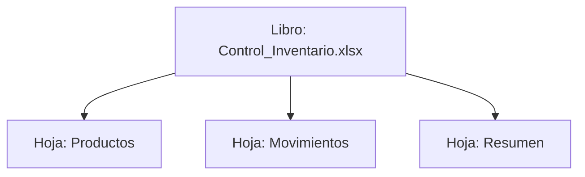
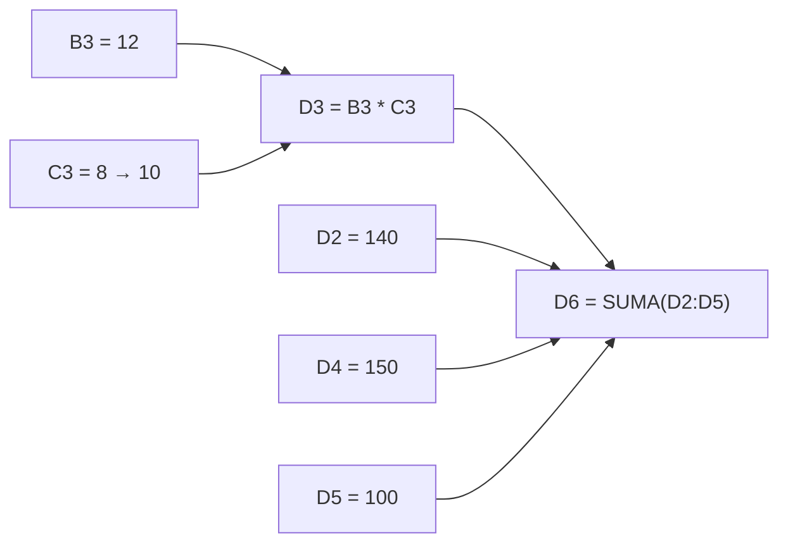
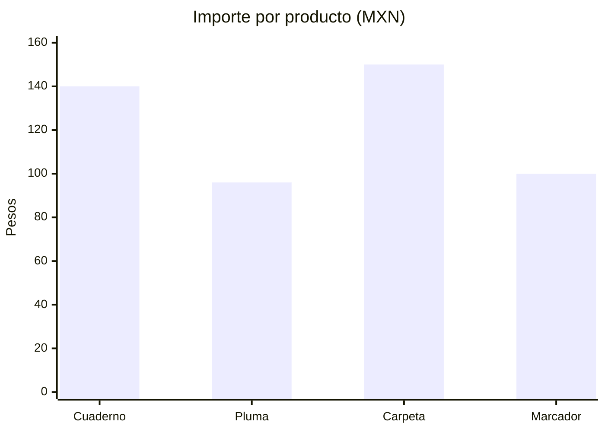
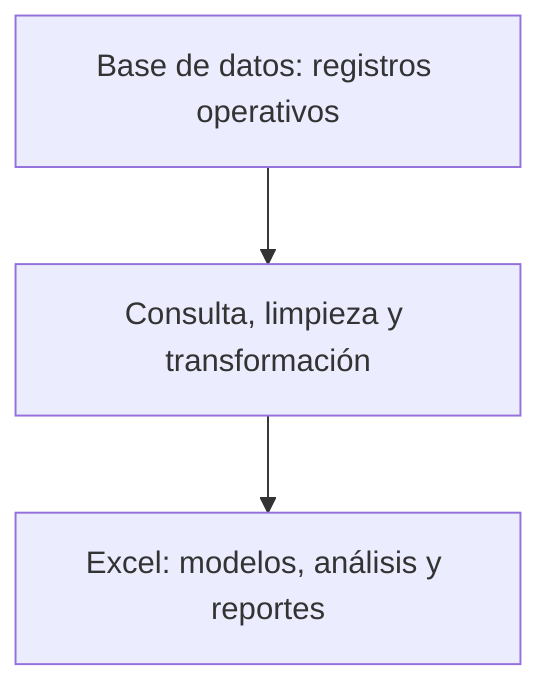
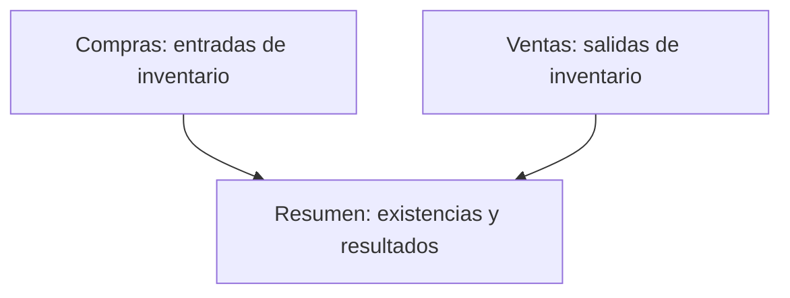
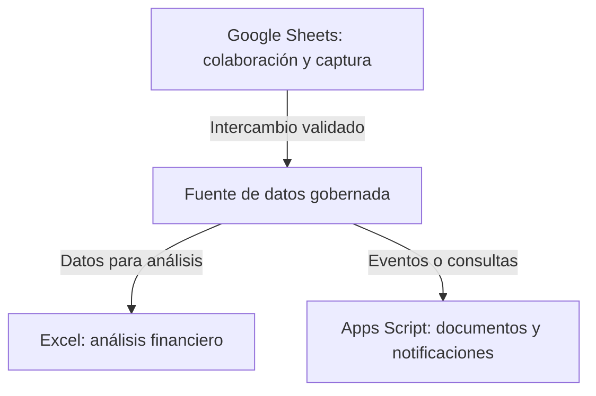

# H01 — Fundamentos de Excel y las hojas de cálculo

> **Curso integral de Microsoft Excel, Google Sheets, VBA y Google Apps Script**
> **Ruta:** H — Microsoft Excel · **Módulo:** H01 de 24 · **Roadmap:** v2.0
> **Nivel:** principiante · **Tiempo estimado:** 8 horas
> **Estado:** desarrollado, pendiente de validación académica

## Presentación del módulo

Una hoja de cálculo no es únicamente una cuadrícula para introducir números. Es un entorno de procesamiento de información que permite estructurar datos, establecer relaciones, ejecutar cálculos, analizar resultados y construir herramientas para la toma de decisiones.

Antes de utilizar Excel profesionalmente, debemos comprender **cómo se organiza la información**, qué representa cada elemento y cómo los datos se convierten en resultados.

| Sección | Contenido | Tiempo orientativo |
|---|---|---:|
| H01.01 | Conceptos fundamentales | 3 horas |
| H01.02 | Aplicaciones y alcance | 3 horas |
| H01.03 | Ecosistema de hojas de cálculo | 2 horas |

### Objetivos de aprendizaje

Al terminar H01, deberás poder:

1. Diferenciar entre un libro, una hoja, una celda y un rango.
2. Interpretar coordenadas de filas y columnas.
3. Distinguir valores de entrada, fórmulas y resultados derivados.
4. Construir una hoja de cálculo sencilla y verificar su resultado.
5. Reconocer aplicaciones empresariales y riesgos de las hojas de cálculo.
6. Identificar cuándo Excel resulta suficiente y cuándo conviene utilizar bases de datos u otros sistemas.
7. Comparar Excel y Google Sheets a nivel introductorio.
8. Reconocer los formatos XLSX, XLSM, XLSB, XLS, CSV y ODS.

**Entorno principal de referencia:** Excel para Microsoft 365 de escritorio; donde corresponda se mencionan Excel 2024 y Google Sheets. La interfaz exacta depende de la edición, licencia, sistema operativo y actualizaciones.

---

# H01.01 — Conceptos fundamentales

## H01.01.01 — Estructura de una hoja de cálculo

### H01.01.01.01 — ¿Qué es un libro?

Un **libro de Excel** (*workbook*) es el documento que contiene una o varias hojas y recursos asociados, como fórmulas, gráficos, tablas, estilos y conexiones.

Por ejemplo, `Control_Inventario.xlsx` es el nombre de un archivo de libro. Podemos imaginarlo como un contenedor organizado:



**Figura 1.** Diagrama conceptual de la estructura de un libro (no es una captura de Excel).

Una empresa podría estructurar un libro financiero así:

| Hoja | Información que almacena |
|---|---|
| Ingresos | Ventas, cobros y otras entradas de dinero |
| Gastos | Egresos y su clasificación |
| Presupuesto | Comparación entre importes planeados y reales |
| Resumen | Indicadores y resultados consolidados |

Esta distribución permite separar datos relacionados sin reunir todo en una misma cuadrícula.

#### Diferencia entre archivo, libro y hoja

- **Archivo:** representación almacenada en un sistema de archivos o un servicio compatible.
- **Libro:** documento lógico que Excel interpreta al abrir el archivo.
- **Hoja:** una unidad de organización dentro del libro.

Un libro no equivale a una hoja aunque en el lenguaje cotidiano a veces se usen ambos términos indistintamente.

Un libro también puede guardar nombres definidos, formatos, gráficos y otras características. Determinados formatos de Excel permiten conservar macros y código **VBA (Visual Basic for Applications)**; otros no.

### H01.01.01.02 — ¿Qué es una hoja?

Una **hoja de cálculo** (*worksheet*) es una superficie organizada en **filas** y **columnas**. Cada intersección forma una **celda**.


**Figura 2. Captura pública de Excel.** Fuente: [Tutor Joes — Excel 365](https://www.tutorjoes.in/microsoft_excel_in_365_tutorial/index). Observa la cinta superior, los encabezados de fila y columna y la cuadrícula. La interfaz puede variar con la versión. La imagen requiere conexión a Internet al visualizar este Markdown.

| Elemento | Identificación | Dirección visual |
|---|---|---|
| Columna | Letras: A, B, C, … | Vertical |
| Fila | Números: 1, 2, 3, … | Horizontal |
| Celda | Letra de columna + número de fila | Intersección |

Una hoja moderna de Excel contiene hasta **1,048,576 filas** y **16,384 columnas**, identificadas desde A hasta XFD. El límite de la cuadrícula no significa que utilizarla completa sea una buena práctica para todo proceso.

#### Ejemplo de cuadrícula

| Fila / Columna | A | B | C | D |
|---|---|---|---:|---:|
| 1 | Código | Producto | Precio | Stock |
| 2 | P001 | Cuaderno | 35 | 12 |
| 3 | P002 | **Pluma** | 12 | 28 |
| 4 | P003 | Carpeta | 50 | 8 |

**Figura 3. Representación tabular conceptual.** La celda **B3** contiene `Pluma`.

Interpreta la tabla de la siguiente manera:

- La fila 1 contiene los encabezados.
- La columna A almacena códigos.
- La columna B almacena nombres de productos.
- La columna C contiene precios.
- La columna D contiene existencias.
- Cada fila de datos representa un producto.

Esta organización se denomina **estructura tabular**: normalmente cada fila es un registro y cada columna representa un atributo del registro.

### H01.01.01.03 — Celdas y rangos

#### ¿Qué es una celda?

Una **celda** (*cell*) es la unidad básica de almacenamiento y cálculo de una hoja.

La dirección `B3` significa **columna B, fila 3**; las letras se escriben primero. Una celda puede estar vacía o contener texto, números, fechas, fórmulas u otros tipos admitidos por la aplicación.

Es importante separar **dirección, contenido y formato**:

| Propiedad | Ejemplo |
|---|---|
| Dirección | `C2` |
| Contenido | `35` |
| Tipo interpretado | Número |
| Formato visual | Moneda |
| Presentación posible | `$35.00` |

Modificar el formato visual no implica necesariamente cambiar el valor numérico subyacente.

#### ¿Qué es un rango?

Un **rango** (*range*) es una referencia a una o varias celdas. La expresión `A1:C4` identifica un rectángulo comprendido entre A1 y C4, inclusive.

```text
      A       B       C
  ┌───────┬───────┬───────┐
1 │  A1   │  B1   │  C1   │
  ├───────┼───────┼───────┤
2 │  A2   │  B2   │  C2   │
  ├───────┼───────┼───────┤
3 │  A3   │  B3   │  C3   │
  ├───────┼───────┼───────┤
4 │  A4   │  B4   │  C4   │
  └───────┴───────┴───────┘
```

**Figura 4.** Esquema del rango `A1:C4`: tres columnas × cuatro filas = **12 celdas**.

| Referencia | Interpretación |
|---|---|
| `A1` | Una celda |
| `A1:A10` | Diez celdas de una columna |
| `A1:D1` | Cuatro celdas de una fila |
| `B2:D5` | Rectángulo de tres columnas y cuatro filas |
| `A:A` | Toda la columna A |
| `2:2` | Toda la fila 2 |
| `Hoja2!A1` | A1 de una hoja llamada Hoja2 |

Los rangos permiten aplicar operaciones a conjuntos de datos, por ejemplo sumar, comparar, dar formato, filtrar o crear gráficos.

Una fórmula introductoria es:

```excel
=SUMA(C2:C5)
```

Esta función suma los valores numéricos del rango indicado. El estudio sistemático de las funciones matemáticas corresponde a **H08**; el de referencias relativas, absolutas, mixtas y estructuradas corresponde a **H05**.

#### Errores frecuentes de H01.01.01

| Error | Causa | Prevención |
|---|---|---|
| Confundir libro con hoja | Terminología imprecisa | Distinguir archivo y pestañas |
| Interpretar B3 como fila B | Orden incorrecto de coordenadas | Columna primero, fila después |
| Interpretar `A1:C4` como solo dos celdas | Desconocimiento de `:` | Contar el rectángulo inclusivo |
| Mezclar encabezados con datos | Organización deficiente | Mantener una fila clara de encabezados |
| Confundir el contenido con el formato | Considerar solo lo visual | Distinguir valor subyacente y presentación |

---

## H01.01.02 — Modelo de trabajo de una hoja de cálculo

Una vez identificados los componentes de una hoja, necesitamos comprender cómo se transforman los datos en resultados.


**Figura 5.** Modelo conceptual del trabajo con datos. Una decisión útil requiere interpretar el resultado, no solo calcularlo.

### H01.01.02.01 — Datos

Un **dato** es una representación registrada de un hecho, característica, medida o evento.

Ejemplos:

- Precio de un producto: 35 pesos mexicanos (MXN).
- Cantidad vendida: 4 unidades.
- Nombre de cliente: Ana.
- Fecha de compra: 15/10/2026.

Hay que distinguir entre **datos de entrada** (valores capturados o importados) y **datos derivados** (valores calculados a partir de otros).

| Elemento | Valor | Clasificación |
|---|---:|---|
| Precio unitario | $35 | Entrada |
| Cantidad vendida | 4 | Entrada |
| Importe | $140 | Derivado |

La calidad del resultado depende tanto de la calidad de los datos como de la corrección de las reglas.

**Ejemplo de error:** si el precio correcto era 35 pero se introduce 350, una fórmula matemáticamente correcta producirá un resultado empresarialmente incorrecto. Este problema se resume con *Garbage In, Garbage Out* (GIGO): una entrada defectuosa puede originar resultados defectuosos.

### H01.01.02.02 — Cálculos

Un **cálculo** aplica operaciones o reglas a valores de entrada para producir otros valores. En Excel, los cálculos se representan principalmente con **fórmulas**, que suelen comenzar con `=`.

```excel
=35*4
```

```excel
=B2*C2
```

Las dos expresiones pueden producir 140; la segunda es más reutilizable, porque su resultado depende de lo que contengan las celdas B2 y C2.

#### Demostración paso a paso: registro de ventas

Crea una hoja con los siguientes datos:

| Fila | Columna A: Producto | Columna B: Precio | Columna C: Cantidad | Columna D: Importe |
|---|---|---:|---:|---:|
| 1 | Producto | Precio | Cantidad | Importe |
| 2 | Cuaderno | 35 | 4 | 140 |
| 3 | Pluma | 12 | 8 | 96 |
| 4 | Carpeta | 50 | 3 | 150 |
| 5 | Marcador | 20 | 5 | 100 |
| 6 | Total | | | **486** |

Los valores de la columna D deben introducirse **mediante fórmulas**; aquí se muestran sus resultados para facilitar la verificación.

| Celda | Fórmula que se introduce | Resultado esperado |
|---|---|---:|
| D2 | `=B2*C2` | 140 |
| D3 | `=B3*C3` | 96 |
| D4 | `=B4*C4` | 150 |
| D5 | `=B5*C5` | 100 |
| D6 | `=SUMA(D2:D5)` | 486 |

**Procedimiento:**

1. Abre Excel y crea un libro nuevo.
2. Introduce los encabezados en `A1:D1`.
3. Captura los productos, precios y cantidades en `A2:C5`.
4. Selecciona D2 y escribe `=B2*C2`.
5. Presiona Enter: el resultado esperado es 140.
6. Introduce las demás fórmulas de las filas 3, 4 y 5.
7. En D6 escribe `=SUMA(D2:D5)`.
8. Verifica que el total sea **486**.

La fórmula `=B2*C2` tiene los siguientes componentes:

- `=` inicia la expresión.
- `B2` recupera el valor de B2.
- `*` indica multiplicación.
- `C2` recupera el valor de C2.
- El resultado aparece en la celda que contiene la fórmula.

#### Relaciones y recálculo

Si cambias la cantidad de plumas de 8 a 10:

\[
12\times 10=120
\]

El nuevo total será:

\[
140+120+150+100=510
\]

¿Por qué? Porque Excel rastrea las dependencias de las fórmulas. Cuando el cálculo está configurado como **automático**, actualiza los resultados que dependen de celdas modificadas.



**Figura 6.** Dependencias de un cálculo. La modificación de C3 afecta a D3 y después al total D6.

**Verificación práctica adicional:** cambia C3 a 15. D3 debería mostrar 180 y D6 debería mostrar **570**.

### H01.01.02.03 — Resultados

Un **resultado** es un valor producido al aplicar una operación. No equivale automáticamente a una **conclusión**.

Por ejemplo, `Ventas totales: $486` es un resultado. Si la meta era $400, entonces se superó la meta en $86:

\[
\frac{486-400}{400}\times 100=21.5\%
\]

Para interpretar correctamente un resultado se necesita conocer el objetivo, las unidades y los supuestos.

| Nivel | Ejemplo | Interpretación |
|---|---|---|
| Dato | 35 | Valor aislado |
| Información | Precio de un cuaderno: $35 | Dato contextualizado |
| Indicador | Ventas totales: $486 | Medida obtenida a partir de datos |
| Decisión | Considerar reposición de productos | Acción que requiere información y criterios adicionales |

Una buena hoja de cálculo no debe limitarse a producir números. También debe facilitar su revisión, interpretación y uso responsable.

### Buenas prácticas de H01.01

1. Diferencia visual y conceptualmente datos de entrada y resultados calculados.
2. Utiliza fórmulas para valores derivados en lugar de escribirlos manualmente.
3. Define encabezados claros para cada columna.
4. Mantén unidades coherentes (moneda, unidades, porcentajes, fechas).
5. Comprueba los resultados con cálculos sencillos independientes.
6. Evita mezclar información de distinta naturaleza sin una estructura definida.

---
# H01.02 — Aplicaciones y alcance de las hojas de cálculo

Una vez comprendida la organización de los datos, necesitamos examinar **qué problemas conviene resolver mediante Excel y cuáles requieren otras tecnologías**.

## H01.02.01 — Usos profesionales

Excel permite diseñar modelos y procesos de análisis sin tener que programar una aplicación completa. Sus aplicaciones abarcan administración, finanzas, ventas, inventarios, recursos humanos, logística y analítica. Su conveniencia depende del tamaño del problema, la frecuencia de actualización, el número de usuarios, los controles necesarios y el impacto de los errores.

### H01.02.01.01 — Administración y finanzas

En administración y finanzas, las hojas de cálculo se utilizan para registrar transacciones, preparar presupuestos, estimar flujos de efectivo y evaluar escenarios.

| Aplicación | Datos habituales | Resultado obtenido |
|---|---|---|
| Presupuesto | Ingresos y egresos estimados | Disponibilidad o saldo proyectado |
| Flujo de efectivo | Cobros y pagos por fecha | Posición de efectivo por periodo |
| Control de gastos | Fecha, categoría, importe | Gastos por concepto |
| Cotizaciones | Productos, cantidades, precios | Importe estimado |
| Cuentas por pagar | Vencimiento, proveedor, importe | Pagos por atender |

#### Ejemplo 1: presupuesto mensual

Una empresa tiene:

| Concepto | Importe (MXN) |
|---|---:|
| Ingresos | $25,000 |
| Gastos fijos | $9,500 |
| Gastos variables | $7,600 |

Disponibilidad estimada antes de otros conceptos no incluidos:

\[
25\,000-9\,500-7\,600=7\,900
\]

En Excel puedes registrar:

| Celda | Concepto / entrada |
|---|---|
| A1 | Concepto |
| B1 | Importe |
| A2 | Ingresos |
| B2 | 25000 |
| A3 | Gastos fijos |
| B3 | 9500 |
| A4 | Gastos variables |
| B4 | 7600 |
| A5 | Saldo estimado |
| B5 | `=B2-B3-B4` |

Si los gastos variables aumentan a 9,000, el saldo se reduce a **6,500**. El mismo modelo puede utilizarse sin alterar la fórmula: solo cambian sus datos de entrada.

#### Ejemplo 2: presupuesto frente a gasto real

Una empresa planeaba gastar $15,000 y terminó gastando $16,500.

Diferencia absoluta:

\[
16\,500-15\,000=1\,500
\]

Desviación respecto a lo presupuestado:

\[
\frac{1\,500}{15\,000}\times 100=10\%
\]

**Interpretación:** el gasto real superó al presupuestado un 10 %. Este resultado no explica por sí mismo las causas del sobrecosto, para las cuales necesitaríamos examinar los movimientos originales.

### H01.02.01.02 — Inventarios y analítica de datos

#### Caso A: control de inventarios

Un inventario cuantifica existencias y movimientos. Su ecuación elemental es:

\[
\text{Inventario final}=\text{Inventario inicial}+\text{Entradas}-\text{Salidas}
\]

| Producto | Inicial | Entradas | Salidas | Final |
|---|---:|---:|---:|---:|
| Cuadernos | 40 | 12 | 15 | 37 |
| Plumas | 80 | 20 | 35 | 65 |
| Carpetas | 25 | 10 | 20 | 15 |
| Marcadores | 30 | 5 | 12 | 23 |

Si los encabezados ocupan A1:E1, introduce en E2:

```excel
=B2+C2-D2
```

El resultado es **37**. Las otras filas pueden usar la misma regla ajustando sus referencias.

Un control de inventario puede responder preguntas como:

- ¿Cuántas unidades quedan?
- ¿Qué productos están por debajo del mínimo?
- ¿Qué movimientos explican un cambio?
- ¿Cuánto inventario está comprometido o disponible?

**Límite importante:** registrar únicamente el saldo final no conserva el historial de movimientos. Para un proceso auditable conviene almacenar entradas y salidas individualmente y calcular las existencias a partir de ellas.

#### Caso B: analítica comercial

La **analítica de datos** convierte registros en información que permite identificar patrones, comparar periodos y evaluar el rendimiento de una actividad.

Ejemplo de ventas, con los mismos registros de H01.01:

| Producto | Importe (MXN) |
|---|---:|
| Cuaderno | 140 |
| Pluma | 96 |
| Carpeta | 150 |
| Marcador | 100 |



**Figura 7.** Gráfico didáctico: las carpetas registran el importe más alto entre los cuatro productos. No implica necesariamente que sean el artículo de mayor rentabilidad.

**Ventas no es lo mismo que utilidades.** Un producto puede generar ingresos elevados y, al mismo tiempo, tener altos costos. Para estimar rentabilidad necesitamos datos y reglas adicionales.

#### ¿Qué es un KPI?

Un **KPI (Key Performance Indicator)** o **indicador clave de desempeño** es una medida seleccionada para evaluar el avance hacia un objetivo.

| Área | KPI de ejemplo | Propósito |
|---|---|---|
| Ventas | Ingresos por periodo | Medir actividad comercial |
| Inventarios | Rotación de inventario | Analizar movimiento de existencias |
| Finanzas | Margen de utilidad | Evaluar rentabilidad |
| Logística | Porcentaje de entregas a tiempo | Medir cumplimiento |
| Recursos humanos | Rotación de personal | Analizar entradas y salidas |

Los indicadores necesitan una **definición inequívoca**, unidades, fuente de datos y periodo. «Ventas del mes» es ambiguo si no se especifica qué ocurre con impuestos, devoluciones o ventas canceladas.

---

## H01.02.02 — Limitaciones de las hojas de cálculo

Las hojas de cálculo pueden ser herramientas suficientes para casos sencillos y llegar a ser difíciles de mantener al aumentar el número de registros, reglas, fuentes de datos y personas involucradas. Debemos conocer sus limitaciones antes de diseñar una solución.

### H01.02.02.01 — Errores humanos

| Tipo de error | Ejemplo | Consecuencia posible |
|---|---|---|
| Captura | Introducir 1,000 en lugar de 100 | Total incorrecto |
| Fórmula | Multiplicar por una columna equivocada | Resultado equivocado |
| Omisión | Excluir el último registro | Total incompleto |
| Referencia | Vincular a la celda incorrecta | Dependencia defectuosa |
| Interpretación | Convertir accidentalmente texto en fecha | Pérdida de significado |
| Lógico | Definir incorrectamente la regla de negocio | Indicadores engañosos |

#### Ejemplo: una discrepancia de $2,700

| Producto | Cantidad | Precio | Importe registrado |
|---|---:|---:|---:|
| A | 5 | 100 | 500 |
| B | 3 | 200 | 600 |
| C | 2 | 150 | 3,000 |

El tercer importe debería calcularse así:

\[
2\times 150=300
\]

Por lo tanto:

- Total registrado: `500 + 600 + 3000 = 4100`.
- Total correcto: `500 + 600 + 300 = 1400`.
- Sobreestimación: `4100 - 1400 = 2700`.

Una comprobación sistemática de `Cantidad × Precio` contra el importe declarado habría detectado el error.

#### Exactitud y precisión

La **precisión de presentación** (por ejemplo, mostrar seis decimales) no garantiza la **exactitud del resultado**. Un cálculo puede tener muchos decimales y estar basado en datos falsos o supuestos incorrectos.

La calidad depende, como mínimo, de:

1. Los datos de origen.
2. La corrección de las reglas de cálculo.
3. La coherencia de unidades y periodos.
4. La actualidad de la información.
5. Una interpretación apropiada.

#### Estrategias preventivas

- Introducir datos una sola vez y referenciarlos cuando se necesiten.
- Utilizar fórmulas para valores derivados.
- Aplicar validaciones a los campos de captura.
- Comparar cálculos importantes con verificaciones independientes.
- Definir responsables y mecanismos de revisión.
- Conservar registros de cambios cuando el proceso lo requiera.

Las herramientas de validación y auditoría se desarrollarán en H06 y H23.

### H01.02.02.02 — Cuándo utilizar bases de datos u otros sistemas

Una **base de datos** administra información estructurada utilizando capacidades especializadas de almacenamiento, consulta, integridad, concurrencia y seguridad (dependientes del motor y su configuración).

Excel y una base de datos pueden trabajar juntos:



**Figura 8.** Ejemplo conceptual de uso combinado: la base de datos conserva la información de origen mientras Excel se emplea para analizarla.

| Criterio | Excel / Sheets | Base de datos |
|---|---|---|
| Inicio de uso | Accesible para usuarios de negocio | Requiere un diseño y herramientas adecuados |
| Cálculos interactivos | Especialmente conveniente | Generalmente mediante consultas o aplicaciones |
| Integridad | Requiere controles cuidadosamente diseñados | Puede aplicar restricciones centralizadas |
| Concurrencia | Depende de la plataforma y el flujo colaborativo | Diseñada para operaciones concurrentes según motor |
| Auditoría | Debe diseñarse y configurarse | Puede incluir mecanismos transaccionales y de auditoría |
| Análisis flexible | Muy conveniente | Suele complementarse con herramientas de análisis |

**Ejemplos de decisión:**

1. **Presupuesto de una persona:** Excel puede ser suficiente.
2. **Pruebas de escenarios financieros con datos corporativos:** Excel puede trabajar sobre un origen de datos externo.
3. **Miles de pedidos simultáneos, reglas de integridad y trazabilidad por usuario:** conviene evaluar una aplicación respaldada por una base de datos.

No existe un umbral universal de filas a partir del cual Excel se vuelve inadecuado. Importan la concurrencia, los requisitos de seguridad, la integridad, el rendimiento, la escalabilidad y las consecuencias de un error.

### Buenas prácticas de H01.02

- Diseña a partir de las necesidades, no únicamente de la herramienta que ya conoces.
- Documenta supuestos, unidades y definiciones de indicadores.
- Separa los datos originales de los resultados derivados.
- Define comprobaciones independientes para resultados importantes.
- Evalúa el costo de mantenimiento, la seguridad y la criticidad del proceso.

---

# H01.03 — Ecosistema de hojas de cálculo

## H01.03.01 — Plataformas y formatos

Varias aplicaciones implementan el modelo de hojas de cálculo. Comparten conceptos básicos, pero difieren en sus herramientas de análisis, colaboración, automatización, formatos y compatibilidad.

### H01.03.01.01 — Microsoft Excel

**Microsoft Excel** permite crear, procesar, modelar, analizar y visualizar información estructurada. Entre sus entornos se incluyen:

- **Excel de escritorio:** instalado en Windows o macOS, con capacidades dependientes de edición, licencia y sistema.
- **Excel para la web:** edición y colaboración mediante navegador, con características diferentes a las de escritorio.
- **Excel móvil:** interfaz y funciones adaptadas a teléfonos y tabletas.

Esta formación tomará como referencia principal Excel de escritorio para Microsoft 365, especialmente en los módulos relacionados con VBA y analítica avanzada.

**Nota de compatibilidad:** Excel para la web puede abrir libros con macros pero no permite crear, ejecutar o editar macros VBA dentro del navegador. Véase [Microsoft Support: trabajar con macros VBA en Excel para la web](https://support.microsoft.com/en-us/office/work-with-vba-macros-in-excel-for-the-web-98784ad0-898c-43aa-a1da-4f0fb5014343).

#### Elementos de interfaz que debes reconocer

| Elemento | Finalidad |
|---|---|
| Cinta de opciones | Organiza comandos en pestañas |
| Encabezados de columna | Identifican columnas por letras |
| Encabezados de fila | Identifican filas por números |
| Cuadrícula | Contiene las celdas |
| Barra de fórmulas | Permite consultar o editar el contenido |
| Pestañas de hoja | Navegan entre hojas |
| Barra de estado | Muestra información contextual |

El manejo detallado de esta interfaz corresponde al siguiente módulo, **H02**.

### H01.03.01.02 — Google Sheets

**Google Sheets** es una aplicación de hojas de cálculo integrada en Google Workspace y centrada en el trabajo desde la web. Permite crear, editar y compartir documentos en entornos colaborativos.


**Figura 9. Captura pública de Google Sheets.** Fuente: [Tech & Learning — What is Google Sheets?](https://www.techlearning.com/how-to/what-is-google-sheets-how-does-it-work-for-teachers). Observa menús superiores, barra de fórmulas, filas, columnas y pestaña inferior. Es una interfaz de referencia que puede diferir de la versión actual; requiere Internet al visualizarse.

Excel y Sheets comparten:

- Libros o documentos con varias hojas.
- Referencias mediante coordenadas.
- Fórmulas y funciones.
- Filas, columnas y rangos.
- Gráficos, filtros y análisis tabulares.

| Aspecto | Excel | Google Sheets |
|---|---|---|
| Entorno principal | Escritorio y web | Web |
| Almacenamiento | Local o nube | Principalmente Google Drive |
| Colaboración | A través de servicios compatibles | Integrada en el entorno web |
| Automatización | VBA en escritorio y Office Scripts donde aplique | Google Apps Script |
| Herramientas avanzadas | Power Query y otras según edición/plataforma | Herramientas propias e integraciones de Google |
| Compatibilidad | Formatos nativos de Excel | Formato propio de Sheets e intercambio con Excel |

**Advertencia:** abrir el mismo archivo en dos plataformas no garantiza que todas sus fórmulas, formatos o automatizaciones se comporten igual. Las diferencias funcionales se estudiarán en la ruta G.

### H01.03.01.03 — Formatos de intercambio

Un **formato de archivo** define cómo se representan y almacenan los datos y sus características. La extensión ayuda a reconocerlo, pero cambiar el nombre de la extensión no convierte el contenido real.

| Extensión | Nombre / tipo | Uso habitual |
|---|---|---|
| `.xlsx` | Libro de Excel | Trabajo general sin código VBA |
| `.xlsm` | Libro habilitado para macros | Conservar código VBA |
| `.xlsb` | Libro binario de Excel | Libro en representación binaria |
| `.xls` | Formato heredado | Compatibilidad con Excel 97–2003 |
| `.csv` | Valores separados por delimitadores | Intercambio textual tabular |
| `.tsv` | Valores separados por tabulaciones | Intercambio textual tabular |
| `.ods` | OpenDocument Spreadsheet | Interoperabilidad con otras suites |

El formato `.xlsx` no está diseñado para conservar macros VBA; para ello se utiliza, por ejemplo, `.xlsm`. Al convertir un libro a otro formato pueden perderse características no admitidas.

#### ¿Qué es CSV?

**CSV (Comma-Separated Values)** significa *valores separados por comas*. Es un formato de texto para representar datos tabulares. Dependiendo de convenciones regionales y sistemas, se utilizan también otros delimitadores.

```csv
Producto,Precio,Cantidad
Cuaderno,35,4
Pluma,12,8
Carpeta,50,3
```

- Cada línea representa un registro (excepto el encabezado).
- Cada separador delimita campos.
- La primera línea del ejemplo nombra las columnas.
- El archivo no conserva varias hojas, fórmulas de Excel, estilos o gráficos como objetos del libro.

Si un dato contiene una coma, debe representarse adecuadamente, por ejemplo entre comillas:

```csv
Producto,Precio
"Carpeta, tamaño carta",50
```

La coma interna forma parte del nombre del producto, no representa una separación de columnas.

#### CSV frente a XLSX

| Característica | XLSX | CSV |
|---|---|---|
| Varias hojas | Sí | No |
| Fórmulas de Excel | Sí | No como fórmulas ejecutables de un libro |
| Estilos de celdas | Sí | No |
| Gráficos | Sí | No |
| Datos tabulares | Sí | Sí |
| Facilidad de intercambio entre sistemas | Depende del soporte | Común para registros tabulares |

Al exportar a CSV desde Excel normalmente se guarda la **hoja activa**, no todas las hojas del libro. Antes de sustituir un archivo XLSX por CSV, conserva una copia del original.

#### Ejemplo: interoperabilidad entre Excel y Sheets

Supongamos que trasladaremos un registro de productos desde Excel a Google Sheets. Podemos abrir el `.xlsx` desde Google Drive o importar datos desde CSV.

Validaremos que:

1. Se conservaron los encabezados.
2. Los valores numéricos se interpretan correctamente.
3. Las fechas no cambiaron de significado.
4. Las fórmulas compatibles siguen calculando lo esperado.
5. Los formatos y características importantes siguen siendo utilizables.

**Principio:** la capacidad de abrir un archivo no garantiza que todas sus funcionalidades sean equivalentes.

#### Errores frecuentes de H01.03

| Error | Consecuencia | Corrección |
|---|---|---|
| Renombrar CSV a XLSX | El contenido no se convierte | Exportar o guardar en el formato requerido |
| Guardar varias hojas como CSV | Se pierden las otras hojas | Conservar copia XLSX |
| Pretender ejecutar VBA en Sheets | Incompatibilidad de automatización | Evaluar Apps Script |
| Suponer equivalencia total de funciones | Resultados distintos o errores | Comprobar sintaxis y disponibilidad |
| Compartir sin revisar permisos | Acceso indebido | Aplicar permisos apropiados |

---
# Prácticas y ejercicios — H01

Las siguientes actividades están clasificadas por sección y dificultad. **Completa los ejercicios antes de leer el solucionario**. No requieren programación ni conocimientos de Excel más allá de los introducidos en este módulo.

## Parte A — Enunciados de los ejercicios

## Ejercicios de H01.01 — Conceptos fundamentales

### H01.01-E01 — Estructura de un libro

- **Nivel:** básico.
- **Objetivo:** identificar la jerarquía de un libro Excel.
- **Contexto:** una empresa necesita organizar su información administrativa.
- **Datos iniciales:** lista de áreas: clientes, productos, ventas y resumen.

**Instrucciones:**

1. Crea un libro llamado `Administracion_Empresa.xlsx`.
2. Crea las hojas `Clientes`, `Productos`, `Ventas` y `Resumen`.
3. Explica qué información almacenarías en cada hoja.
4. Identifica el libro, las hojas y las celdas.

**Restricciones:** no necesitas introducir fórmulas.
**Resultado esperado:** un libro con cuatro hojas y una breve explicación de su propósito.
**Criterios de evaluación:** nombres correctos, estructura y terminología precisas.

### H01.01-E02 — Coordenadas y rangos

- **Nivel:** básico.
- **Objetivo:** interpretar referencias.
- **Contexto:** localización de datos en una hoja.
- **Datos iniciales:** referencias `D7`, `A1:C4`, `C3:E8`, `B:B`, `A1:A10`.

**Instrucciones:**

1. Escribe la referencia correspondiente a la columna D, fila 7.
2. Calcula cuántas celdas comprende `A1:C4`.
3. Calcula cuántas celdas comprende `C3:E8`.
4. Explica qué significa `B:B`.
5. Explica la diferencia entre `A1` y `A1:A10`.

**Restricciones:** justifica el número de celdas contando filas y columnas.
**Resultado esperado:** cinco respuestas correctas con razonamiento.
**Criterios:** orden de coordenadas, inclusividad de extremos y precisión en la explicación.

### H01.01-E03 — Registro de ventas

- **Nivel:** intermedio.
- **Objetivo:** distinguir entradas, fórmulas y resultados.
- **Contexto:** una tienda desea automatizar el cálculo de importes.
- **Datos iniciales:**

| Producto | Precio | Cantidad |
|---|---:|---:|
| Cuaderno | 35 | 4 |
| Pluma | 12 | 8 |
| Carpeta | 50 | 3 |
| Marcador | 20 | 5 |

**Instrucciones:**

1. Coloca encabezados en `A1:D1`.
2. Introduce los cuatro registros desde la fila 2.
3. Calcula el importe de cada producto en D2:D5 mediante fórmulas.
4. Calcula el total general en D6.
5. Clasifica qué celdas contienen datos de entrada y cuáles contienen resultados.

**Restricciones:** no escribas manualmente los importes calculados.
**Resultado esperado:** D2:D5 = 140, 96, 150, 100; D6 = 486.
**Criterios:** referencias correctas, resultado verificable y clasificación adecuada.

### H01.01-E04 — Dependencias

- **Nivel:** intermedio.
- **Objetivo:** comprobar el recálculo de fórmulas.
- **Contexto:** cambian las cantidades vendidas después de capturarlas.
- **Datos iniciales:** libro del ejercicio anterior.

**Instrucciones:**

1. Cambia C3 (cantidad de plumas) de 8 a 10.
2. Anota los nuevos valores de D3 y D6.
3. Cambia C3 a 15.
4. Calcula manualmente el importe y total esperados.
5. Explica por qué cambian D3 y D6 sin modificar sus fórmulas.

**Restricciones:** conserva las fórmulas existentes.
**Resultado esperado:** para 10 plumas, D3 = 120 y D6 = 510; para 15, D3 = 180 y D6 = 570.
**Criterios:** comprensión de dependencias, verificación independiente y explicación correcta.

### H01.01-E05 — Diseño de una estructura empresarial

- **Nivel:** avanzado.
- **Objetivo:** diseñar conceptualmente un libro antes de ingresar información.
- **Contexto:** una tienda necesita registrar compras, ventas y existencias.
- **Datos iniciales:** procesos de compra, venta y consulta de inventario.

**Instrucciones:**

1. Diseña las hojas `Compras`, `Ventas` y `Resumen`.
2. Define los campos de cada una.
3. Distingue datos que capturará el usuario y resultados que se calcularán.
4. Describe cómo evitarías introducir manualmente la misma información en diferentes hojas.
5. Incluye un esquema sencillo de relaciones entre hojas.

**Restricciones:** no necesitas implementar automatizaciones ni funciones avanzadas.
**Resultado esperado:** estructura coherente de entradas, cálculos y resultados.
**Criterios:** ausencia de duplicidad innecesaria, claridad de campos y relaciones consistentes.

---

## Ejercicios de H01.02 — Aplicaciones y alcance

### H01.02-E01 — Presupuesto mensual

- **Nivel:** básico.
- **Objetivo:** modelar un cálculo financiero elemental.
- **Contexto:** control mensual de un pequeño negocio.
- **Datos iniciales:** ingresos de $25,000; gastos fijos de $9,500; variables de $7,600.

**Instrucciones:**

1. Construye una tabla con los tres conceptos.
2. Calcula el saldo estimado.
3. Modifica los gastos variables a $9,000.
4. Interpreta cómo cambia la disponibilidad.

**Restricciones:** considera constantes los otros importes; no supongas impuestos ni otros conceptos.
**Resultado esperado:** saldos de $7,900 y $6,500.
**Criterios:** operación correcta e interpretación del cambio.

### H01.02-E02 — Movimiento de inventario

- **Nivel:** intermedio.
- **Objetivo:** calcular existencias disponibles.
- **Contexto:** control de almacén.
- **Datos iniciales:** inventario inicial = 40, entradas = 12, salidas = 15, umbral mínimo = 10.

**Instrucciones:**

1. Calcula el inventario final.
2. Explica el significado de los tres movimientos.
3. Decide si procede una alerta por inventario mínimo.
4. Escribe la fórmula general utilizada.

**Restricciones:** no consideres devoluciones ni reservas de inventario.
**Resultado esperado:** 37 unidades; no corresponde alerta por el umbral dado.
**Criterios:** cálculo correcto y decisión consistente con la regla.

### H01.02-E03 — Auditoría de errores

- **Nivel:** intermedio.
- **Objetivo:** localizar inconsistencias cuantitativas.
- **Contexto:** revisión de un reporte de ventas.
- **Datos iniciales:**

| Producto | Cantidad | Precio | Importe registrado |
|---|---:|---:|---:|
| A | 5 | 100 | 500 |
| B | 3 | 200 | 600 |
| C | 2 | 150 | 3000 |

**Instrucciones:**

1. Identifica el registro incorrecto.
2. Determina el importe que debería tener.
3. Calcula el total registrado y el correcto.
4. Cuantifica el error.
5. Propón una comprobación que lo prevenga.

**Restricciones:** no modifiques cantidades ni precios.
**Resultado esperado:** el registro C debe ser 300; error total de 2700.
**Criterios:** identificación, razonamiento y prevención adecuada.

### H01.02-E04 — Indicadores comerciales

- **Nivel:** avanzado.
- **Objetivo:** interpretar resultados frente a metas.
- **Contexto:** evaluación comercial de tres sucursales.
- **Datos iniciales:**

| Sucursal | Ventas (MXN) |
|---|---:|
| Norte | 1000 |
| Centro | 700 |
| Sur | 500 |

**Meta global del periodo:** $2,000.

**Instrucciones:**

1. Calcula ventas totales.
2. Calcula la diferencia contra la meta.
3. Calcula el porcentaje de cumplimiento.
4. Escribe una conclusión sustentada.
5. Escribe una conclusión que *no* pueda justificarse sin más datos.

**Restricciones:** no supongas costos, devoluciones ni información histórica.
**Resultado esperado:** ventas = $2,200; diferencia = $200; cumplimiento = 110 %.
**Criterios:** aritmética e interpretación crítica.

### H01.02-E05 — Selección de tecnología

- **Nivel:** reto profesional.
- **Objetivo:** evaluar cuándo utilizar una hoja de cálculo y cuándo otro sistema.
- **Contexto:** una organización analiza alternativas tecnológicas.
- **Datos iniciales:** cuatro necesidades:
  1. Presupuesto familiar.
  2. Análisis de escenarios financieros.
  3. Miles de pedidos simultáneos con historial de cambios.
  4. Captura y edición colaborativa por un equipo pequeño.

**Instrucciones:**

1. Para cada caso elige Excel, Sheets, una aplicación con base de datos o una combinación.
2. Justifica la decisión usando criterios de concurrencia, integridad, análisis, colaboración y mantenimiento.
3. Indica al menos un riesgo por escenario.

**Restricciones:** las herramientas pueden combinarse; no existe una única solución universal.
**Resultado esperado:** propuesta coherente con los requisitos.
**Criterios:** justificación técnica y reconocimiento de limitaciones.

---

## Ejercicios de H01.03 — Ecosistema de hojas de cálculo

### H01.03-E01 — Reconocimiento de interfaces

- **Nivel:** básico.
- **Objetivo:** reconocer componentes comunes en Excel y Sheets.
- **Contexto:** incorporación de un usuario nuevo a ambas herramientas.
- **Datos iniciales:** figuras 2 y 9 de este documento.

**Instrucciones:**

1. Localiza encabezados de columnas.
2. Localiza encabezados de filas.
3. Localiza la cuadrícula.
4. Localiza la zona de comandos o menús.
5. Localiza la pestaña de hoja cuando sea visible.

**Restricciones:** las capturas no tienen que corresponder a la versión instalada actualmente.
**Resultado esperado:** reconocimiento de los componentes y sus funciones.
**Criterios:** identificación correcta y terminología adecuada.

### H01.03-E02 — Identificación de formatos

- **Nivel:** básico.
- **Objetivo:** seleccionar extensiones apropiadas.
- **Contexto:** intercambio de archivos entre equipos.

**Instrucciones:** elige una extensión para cada necesidad:

1. Libro habitual de Excel sin macros.
2. Libro que conserva código VBA.
3. Exportar registros tabulares como texto delimitado.
4. Guardar un libro en formato binario de Excel.
5. Trabajar con un libro heredado Excel 97–2003.

**Restricciones:** explica en una frase la razón de cada elección.
**Resultado esperado:** cinco extensiones correctas.
**Criterios:** formato y justificación apropiados.

### H01.03-E03 — Interpretación de CSV

- **Nivel:** intermedio.
- **Objetivo:** interpretar datos textuales delimitados.
- **Contexto:** importación de un catálogo.
- **Datos iniciales:**

```csv
Producto,Precio,Cantidad
"Carpeta, tamaño carta",50,3
Cuaderno,35,4
```

**Instrucciones:**

1. Cuenta los registros de productos.
2. Determina el número de columnas.
3. Explica por qué el primer nombre contiene comillas.
4. Calcula el importe total de los productos.
5. Explica por qué CSV no conserva un dashboard de Excel completo.

**Restricciones:** interpreta el campo entrecomillado como uno solo.
**Resultado esperado:** 2 registros, 3 columnas, importe $290.
**Criterios:** lectura correcta del formato y comprensión de sus límites.

### H01.03-E04 — Migración entre plataformas

- **Nivel:** avanzado.
- **Objetivo:** validar la transferencia de datos de Excel a Sheets.
- **Contexto:** trabajo compartido entre equipos con herramientas diferentes.
- **Datos iniciales:** libro original de H01.01-E03 (restaurado a 8 plumas).

**Instrucciones:**

1. Guarda una copia `.xlsx`.
2. Ábrela con Google Sheets.
3. Comprueba encabezados y registros.
4. Comprueba fórmulas y total.
5. Anota diferencias observadas entre plataformas.

**Restricciones:** conserva el archivo original; no asumas compatibilidad completa.
**Resultado esperado:** importes 140, 96, 150 y 100; total 486.
**Criterios:** comparación sistemática y resultados reproducibles.

### H01.03-E05 — Diseño de un ecosistema de trabajo

- **Nivel:** reto profesional.
- **Objetivo:** asignar responsabilidades tecnológicas a un proceso de negocio.
- **Contexto:** una empresa necesita colaboración, análisis financiero, automatización documental y accesos controlados.
- **Datos iniciales:** requisitos descritos y herramientas Excel, Sheets, Apps Script y sistemas de datos.

**Instrucciones:**

1. Propón qué herramienta atenderá cada necesidad.
2. Elabora un diagrama de componentes.
3. Define dónde debería residir el origen oficial de los datos.
4. Describe cómo gestionarías accesos y sincronización.
5. Señala dos riesgos de integración que deben evaluarse.

**Restricciones:** no hace falta programar la solución.
**Resultado esperado:** arquitectura conceptual y justificación de responsabilidades.
**Criterios:** separación de funciones, seguridad e integridad.

---
# Solucionario — H01

> **Consulta esta parte después de resolver los ejercicios.** Las soluciones incluyen resultados, razonamiento y métodos de comprobación. Puede haber más de un diseño correcto para los retos abiertos.

## Soluciones H01.01

### H01.01-E01 — Estructura de un libro

El **libro** es `Administracion_Empresa.xlsx`; contiene cuatro **hojas** (pestañas). Las celdas son las intersecciones de filas y columnas dentro de cada hoja.

| Hoja | Información posible |
|---|---|
| Clientes | Identificador, nombre, contacto |
| Productos | Código de producto, descripción, precio |
| Ventas | Fecha, producto, cantidad, importe |
| Resumen | Indicadores procedentes de las otras hojas |

**Verificación:** confirma que el archivo contiene las cuatro pestañas y que no has creado cuatro libros independientes.
**Error frecuente:** confundir el nombre del archivo con el nombre de una hoja.
**Alternativa válida:** emplear nombres de hojas equivalentes si están documentados.

### H01.01-E02 — Coordenadas y rangos

| Inciso | Respuesta | Razonamiento |
|---|---|---|
| 1 | `D7` | Columna D y fila 7 |
| 2 | 12 celdas | 3 columnas × 4 filas |
| 3 | 18 celdas | C, D, E (3 columnas); filas 3 a 8 (6) |
| 4 | Toda la columna B | Referencia de columna completa |
| 5 | Una celda frente a diez | `A1` es individual; `A1:A10` es rango |

**Verificación:** cuenta siempre los extremos.
**Error frecuente:** para filas 3 a 8, calcular 8 − 3 = 5 y olvidar que ambos extremos están incluidos. La cantidad correcta es 8 − 3 + 1 = 6.

### H01.01-E03 — Registro de ventas

Introduce en las siguientes celdas:

| Celda | Fórmula | Resultado |
|---|---|---:|
| D2 | `=B2*C2` | 140 |
| D3 | `=B3*C3` | 96 |
| D4 | `=B4*C4` | 150 |
| D5 | `=B5*C5` | 100 |
| D6 | `=SUMA(D2:D5)` | **486** |

`A2:A5` contiene descripciones; `B2:C5` contiene valores de entrada; `D2:D6` contiene resultados derivados mediante fórmulas.

**Verificación independiente:** 140 + 96 + 150 + 100 = 486.
**Error frecuente:** escribir `140` directamente en D2 en lugar de una fórmula, lo que impide actualizar el importe al modificar el precio o cantidad.
**Alternativa:** calcular el total con `=D2+D3+D4+D5`; sin embargo, `SUMA` expresa mejor la agregación de un rango.

### H01.01-E04 — Dependencias

**Primer cambio:** C3 = 10.

\[
D3=12\times10=120
\]

\[
D6=140+120+150+100=510
\]

**Segundo cambio:** C3 = 15.

\[
D3=12\times15=180
\]

\[
D6=140+180+150+100=570
\]

D3 depende de C3 porque la fórmula de D3 es `=B3*C3`. D6 depende del rango D2:D5, que incluye D3.

**Verificación:** inspecciona la barra de fórmulas para confirmar que D3 sigue conteniendo `=B3*C3` y D6 `=SUMA(D2:D5)`.
**Error frecuente:** cuando los resultados no cambian, revisar primero si el libro está configurado para cálculo manual.

### H01.01-E05 — Diseño de una estructura empresarial

Un diseño de referencia:

| Hoja | Campos de entrada | Valores derivados |
|---|---|---|
| Compras | Fecha, código, cantidad, costo unitario | Importe de compra |
| Ventas | Fecha, código, cantidad, precio unitario | Importe de venta |
| Resumen | Fecha de consulta, periodo | Ventas, compras, existencias finales |



**Razonamiento:** no es recomendable escribir manualmente el inventario final de cada producto si ya se puede derivar a partir del inventario inicial y los movimientos.

**Verificación:** comprueba que cada importe o saldo pueda identificarse como entrada o resultado calculado.
**Posible mejora:** incluir una hoja `Productos` que centralice los códigos y descripciones. Se considera una ampliación justificada del esquema mínimo.

---

## Soluciones H01.02

### H01.02-E01 — Presupuesto mensual

Primer saldo:

\[
25\,000-9\,500-7\,600=7\,900
\]

Nuevo saldo:

\[
25\,000-9\,500-9\,000=6\,500
\]

Variación:

\[
6\,500-7\,900=-1\,400
\]

**Interpretación:** si el resto de las condiciones no cambia, el incremento de $1,400 en gastos variables reduce la disponibilidad en $1,400.

**Verificación:** 25,000 − (9,500 + 9,000) = 6,500.
**Error frecuente:** confundir un saldo disponible con utilidad neta sin considerar conceptos contables o impuestos no incluidos en el ejercicio.

### H01.02-E02 — Movimiento de inventario

\[
\text{Inventario final}=40+12-15=37
\]

- **Inicial:** unidades disponibles al comienzo del periodo.
- **Entradas:** unidades que se incorporan.
- **Salidas:** unidades que se retiran.
- **Final:** unidades remanentes, 37.

Como 37 > 10, **no se requiere alerta** por el mínimo indicado.

**Verificación:** 40 + 12 = 52; 52 − 15 = 37.
**Error frecuente:** sumar las salidas en lugar de restarlas.
**Alternativa:** con más datos podría añadirse un campo que indique automáticamente `Reponer` cuando la existencia caiga por debajo del umbral.

### H01.02-E03 — Auditoría de errores

El registro C presenta la discrepancia:

\[
2\times150=300
\]

El importe registrado era 3,000.

| Magnitud | Resultado |
|---|---:|
| Total registrado | 4,100 |
| Total correcto | 1,400 |
| Sobreestimación | **2,700** |

**Método de verificación:** calcula `Cantidad × Precio` por fila y compara con el campo Importe.
**Prevención:** mantener el importe como fórmula derivada, bloquear su edición cuando corresponda y aplicar una revisión antes de publicar el reporte.

### H01.02-E04 — Indicadores comerciales

Ventas totales:

\[
1\,000+700+500=2\,200
\]

Diferencia contra la meta:

\[
2\,200-2\,000=200
\]

Porcentaje de cumplimiento:

\[
\frac{2\,200}{2\,000}\times100=110\%
\]

- **Conclusión sustentada:** las ventas registradas alcanzaron el 110 % de la meta.
- **Conclusión no sustentada:** «la sucursal Norte es la más rentable»; faltan costos y gastos.

**Verificación:** el 110 % de $2,000 es $2,200.
**Error frecuente:** confundir el **110 % de cumplimiento** con el **10 % de superación de la meta**. Ambos porcentajes describen cosas diferentes.

### H01.02-E05 — Selección de tecnología

| Escenario | Solución razonable | Fundamentación |
|---|---|---|
| Presupuesto familiar | Excel o Sheets | Modelado flexible y manejo sencillo |
| Escenarios financieros | Excel | Funciones de análisis y modelos interactivos |
| Pedidos simultáneos con historial | Aplicación con base de datos | Integridad, concurrencia y trazabilidad |
| Edición colaborativa | Google Sheets o Excel con infraestructura de colaboración | Edición compartida y control de acceso |

**Riesgos a mencionar:** errores de captura, modelos difíciles de auditar, modificaciones concurrentes no controladas, permisos excesivos y versiones inconsistentes.

**Verificación:** cada selección debe justificar los requisitos del escenario. No hay que elegir tecnologías únicamente por popularidad o familiaridad.

---

## Soluciones H01.03

### H01.03-E01 — Reconocimiento de interfaces

Los encabezados de columnas (letras) están sobre la cuadrícula; los encabezados de filas (números), a la izquierda. La cuadrícula ocupa el área central. Los menús y comandos están en la parte superior; las pestañas de hojas, normalmente en la parte inferior.

**Verificación:** explica la función de cada componente sin depender de la apariencia exacta.
**Error frecuente:** confundir una pestaña de la cinta de opciones con una pestaña de hoja.

### H01.03-E02 — Identificación de formatos

| Necesidad | Formato recomendado |
|---|---|
| Libro habitual sin macros | `.xlsx` |
| Libro con código VBA | `.xlsm` |
| Registros textuales separados por delimitadores | `.csv` |
| Libro binario de Excel | `.xlsb` |
| Libro de Excel 97–2003 | `.xls` |

**Verificación:** para almacenar VBA utiliza un formato habilitado para macros.
**Error frecuente:** pensar que cambiar la extensión de nombre transforma un archivo.

### H01.03-E03 — Interpretación de CSV

1. Hay **dos registros de productos**, sin contar encabezados.
2. Hay **tres columnas**: Producto, Precio y Cantidad.
3. El nombre `Carpeta, tamaño carta` usa comillas para que la coma interna no se interprete como delimitador de campo.
4. Importe total:

\[
(50\times 3)+(35\times 4)=150+140=290
\]

5. CSV solo describe datos textuales tabulares: no conserva gráficos, varias hojas, estilos ni un dashboard Excel completo.

**Verificación:** el primer registro conserva sus tres campos, no cuatro.
**Error frecuente:** usar una separación ingenua en cada coma sin respetar campos entrecomillados.

### H01.03-E04 — Migración entre plataformas

Los datos originales deben interpretarse así:

| Comprobación | Resultado |
|---|---|
| Encabezados | Producto, Precio, Cantidad, Importe |
| Cantidad de productos | 4 |
| Importes por producto | 140, 96, 150, 100 |
| Total | 486 |

Si las fórmulas se convierten correctamente, los cálculos deben coincidir. Comprueba la interpretación de números y fechas, los nombres de funciones y las características que puedan diferir.

**Verificación:** conserva ambos archivos y compara cada celda relevante.
**Error frecuente:** suponer que una importación completada implica compatibilidad total.

### H01.03-E05 — Diseño de un ecosistema de trabajo

Una solución conceptual posible sería:



**Figura 10.** Arquitectura de referencia, no implementación prescrita.

- **Sheets:** recopila y edita datos mediante colaboración.
- **Excel:** modela presupuestos y analiza escenarios.
- **Apps Script:** automatiza acciones en Google Workspace y se integra con APIs donde sea pertinente.
- **Origen de datos controlado:** conserva la versión oficial según los requisitos de integridad y seguridad.

**Riesgos que deben evaluarse:** duplicación de datos, sincronización incompleta, credenciales, permisos excesivos, caídas de servicios y divergencias de versiones.

**Verificación:** el diseño debe indicar quién puede modificar información, dónde se guarda la fuente principal y cómo se evita la generación de resultados contradictorios.

---

# Evaluación de conocimientos — H01

Responde sin consultar el solucionario. Cada pregunta tiene una única respuesta esperada en este contexto.

**1. ¿Cuál es la relación correcta entre libro y hoja?**

A. Una hoja contiene varios libros.
B. Un libro contiene una o varias hojas.
C. Libro y hoja son lo mismo.

**2. ¿Qué identifica B7?**

A. Fila B y columna 7.
B. Columna B y fila 7.
C. Siete columnas.

**3. ¿Cuántas celdas contiene A2:C5?**

A. 8.
B. 12.
C. 15.

**4. ¿Qué diferencia hay entre un dato de entrada y un resultado derivado?**

A. Son idénticos.
B. El resultado derivado se obtiene aplicando una regla o cálculo.
C. Los resultados no pueden estar en celdas.

**5. ¿Qué representa `=B2*C2`?**

A. Concatenación de texto.
B. Multiplicación de los valores de B2 y C2.
C. Referencia a otra hoja.

**6. ¿Qué formato conserva código VBA en un libro?**

A. CSV.
B. XLSX.
C. XLSM.

**7. ¿Cuál es una limitación de CSV?**

A. No admite registros.
B. No conserva varias hojas y formatos del libro.
C. No contiene texto.

**8. ¿Qué indicador permite evaluar rentabilidad directamente?**

A. Ventas totales.
B. Un margen de utilidad correctamente definido.
C. Número de productos.

**9. ¿Cuándo es razonable usar una base de datos como sistema principal?**

A. Siempre para sumar cuatro valores.
B. Cuando se requiere integridad y alta concurrencia transaccional.
C. Nunca si existe Excel.

**10. ¿Cuál es una verificación apropiada al migrar de Excel a Sheets?**

A. Suponer que todo funciona igual.
B. Validar datos, fórmulas y características importantes.
C. Cambiar la extensión del archivo manualmente.

## Respuestas y explicaciones de la evaluación

| Pregunta | Respuesta | Justificación |
|---|---|---|
| 1 | B | El libro es el contenedor de una o varias hojas. |
| 2 | B | Primero se identifica la columna y después la fila. |
| 3 | B | Tres columnas × cuatro filas = 12 celdas. |
| 4 | B | El derivado se obtiene mediante una operación o regla. |
| 5 | B | `*` representa multiplicación. |
| 6 | C | XLSM está habilitado para macros. |
| 7 | B | CSV no guarda toda la estructura de un libro Excel. |
| 8 | B | Para evaluar rentabilidad hace falta considerar costos y utilidad. |
| 9 | B | La concurrencia y la integridad transaccional son criterios relevantes. |
| 10 | B | Abrir un archivo no garantiza compatibilidad completa. |

**Criterio orientativo de dominio:** al menos 9 respuestas correctas de 10, además de realizar con precisión las prácticas.

## Rúbrica del módulo

| Criterio | Peso |
|---|---:|
| Corrección de conceptos y resultados | 40 % |
| Razonamiento e interpretación | 25 % |
| Reproducibilidad de procedimientos | 25 % |
| Organización y presentación | 10 % |
| **Total** | **100 %** |

---

# Glosario de referencia

| Término | Definición |
|---|---|
| Libro (*workbook*) | Documento de Excel con una o varias hojas y recursos asociados |
| Hoja (*worksheet*) | Cuadrícula de filas y columnas |
| Celda (*cell*) | Unidad de almacenamiento y cálculo |
| Fila (*row*) | Conjunto horizontal de celdas |
| Columna (*column*) | Conjunto vertical de celdas |
| Referencia | Identificador de una celda o conjunto de celdas |
| Rango (*range*) | Conjunto de celdas referenciado |
| Fórmula (*formula*) | Expresión utilizada para calcular un valor |
| Función (*function*) | Operación predefinida invocada mediante una fórmula |
| Dato de entrada | Valor introducido o importado al modelo |
| Dato derivado | Valor calculado a partir de otros valores |
| KPI | Indicador clave de desempeño (*Key Performance Indicator*) |
| CSV | Formato textual de datos separados por delimitadores |
| VBA | Visual Basic for Applications |
| Concurrencia | Acceso o ejecución simultánea de operaciones |
| Integridad de datos | Conservación de la consistencia y validez de la información |

---

# Fuentes y recursos para ampliar

Se priorizan referencias de fabricantes para los procedimientos; las imágenes públicas se indican con su procedencia específica. Los enlaces y capturas de sitios externos pueden cambiar con el tiempo.

1. [Microsoft Support — Tareas básicas en Excel](https://support.microsoft.com/es-es/excel/basic-tasks-in-excel)
2. [Microsoft Support — Excel file formats](https://support.microsoft.com/en-us/office/file-formats-that-are-supported-in-excel-0943ff2c-6014-4e8d-aaea-b83d51d46247)
3. [Microsoft Support — Change formula recalculation](https://support.microsoft.com/en-us/office/change-formula-recalculation-iteration-or-precision-in-excel-73fe0fdb-43d8-4d61-b3a1-b45d23f6c0ad)
4. [Microsoft Support — Work with VBA macros in Excel for the web](https://support.microsoft.com/en-us/office/work-with-vba-macros-in-excel-for-the-web-98784ad0-898c-43aa-a1da-4f0fb5014343)
5. [Google Workspace Learning Center — Google Sheets](https://support.google.com/a/users/answer/9282959?hl=en)
6. [Google Docs Editors Help](https://support.google.com/docs/)
7. [Microsoft Learn — Modelo de objetos de Excel VBA](https://learn.microsoft.com/en-us/office/vba/api/overview/excel/object-model)
8. [Tutor Joes — Captura de Excel](https://www.tutorjoes.in/microsoft_excel_in_365_tutorial/index)
9. [Tech & Learning — Captura de Google Sheets](https://www.techlearning.com/how-to/what-is-google-sheets-how-does-it-work-for-teachers)

---

# Control de progreso académico

| Campo | Estado |
|---|---|
| Versión del roadmap | 2.0, aprobada |
| Ruta | H — Microsoft Excel |
| Módulo | H01 — Fundamentos de Excel |
| Secciones desarrolladas | H01.01, H01.02, H01.03 |
| Último subtema desarrollado | H01.03.01.03 — Formatos de intercambio |
| Ejercicios entregados | 15 enunciados con soluciones separadas |
| Evaluación | 10 preguntas con clave de respuestas |
| Estado | Desarrollado; pendiente de revisión y validación por el estudiante |
| Contenido obligatorio de H01 pendiente de desarrollo | Ninguno según el roadmap aprobado |
| Siguiente contenido previsto | H02 — Interfaz, navegación y administración de libros |

> **Continuidad:** H01 se entrega como material de estudio, práctica y consulta. No se inicia H02 hasta recibir una instrucción explícita.

