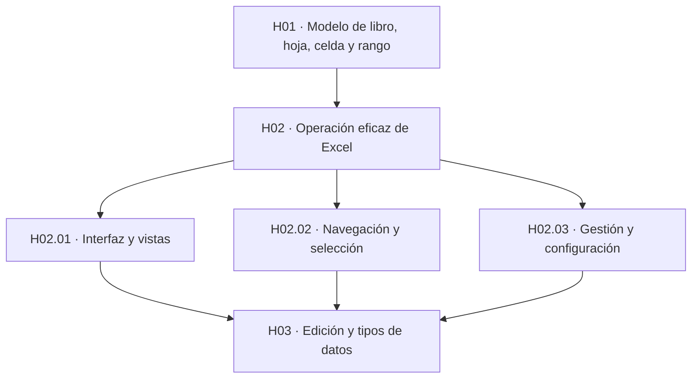
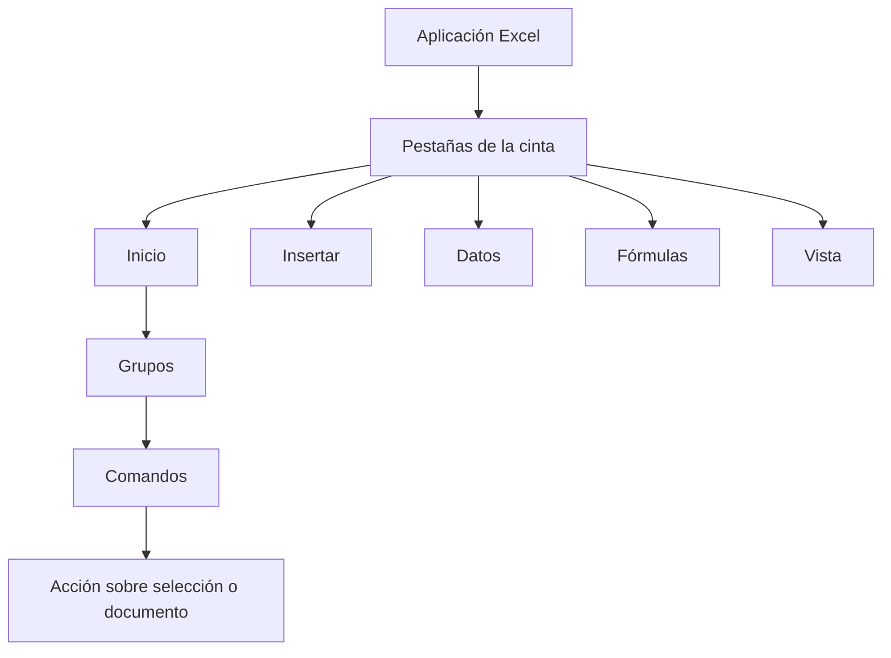
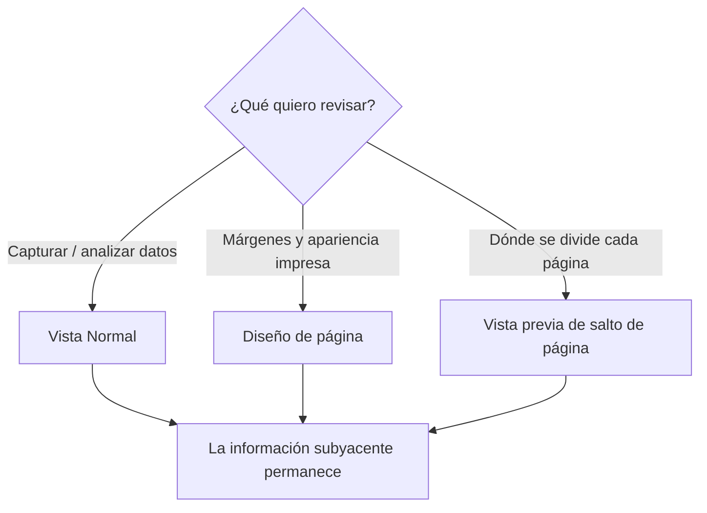
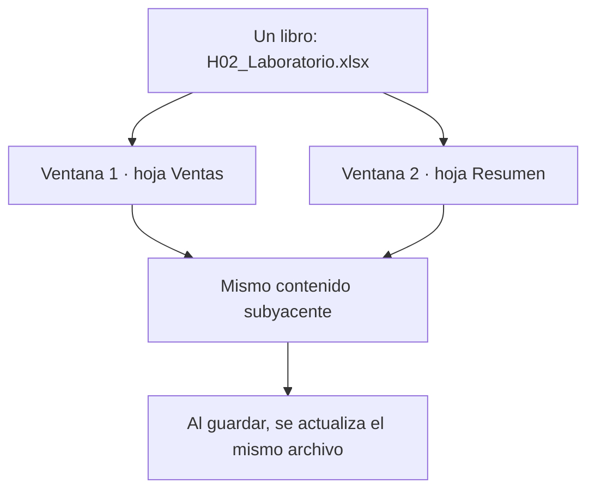
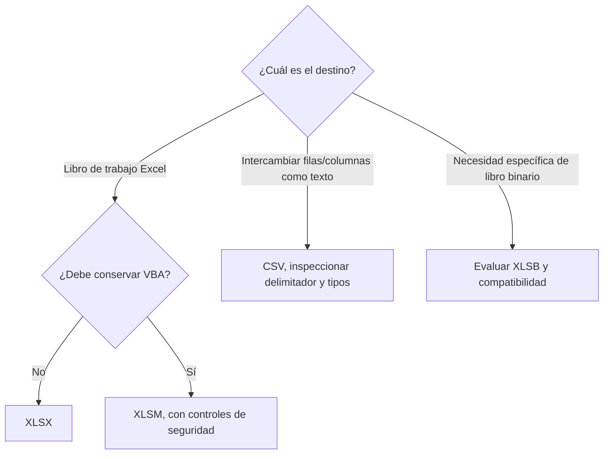
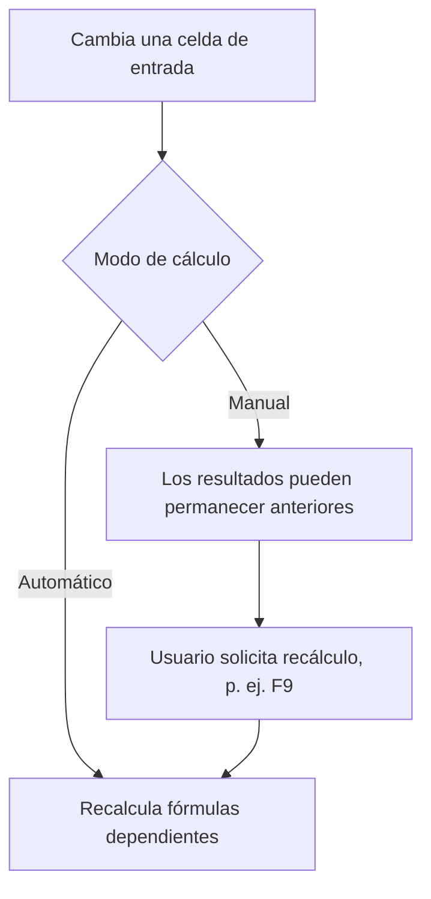
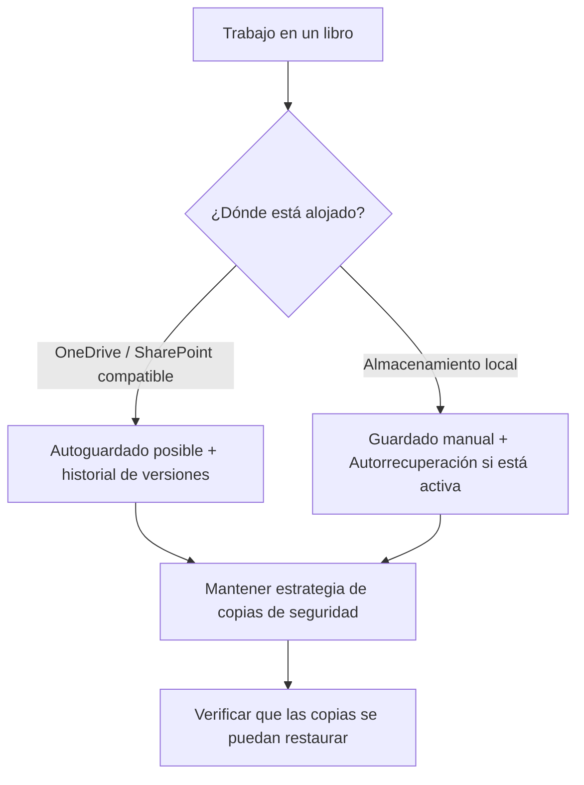
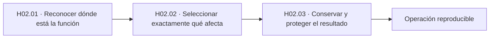
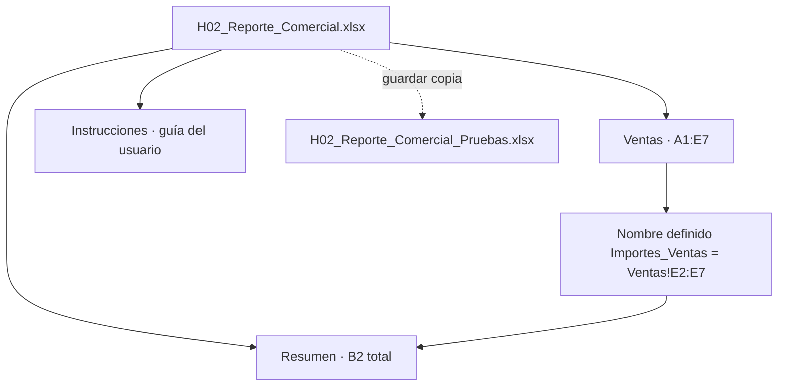

# H02 — Interfaz, navegación y administración de libros de Excel

> **Curso integral de Microsoft Excel, Google Sheets, VBA y Google Apps Script**  
> **Ruta:** H — Microsoft Excel · **Módulo:** H02 de H01–H24 · **Roadmap:** versión oficial 2.0  
> **Nivel:** principiante con orientación profesional · **Tiempo estimado:** 12 horas  
> **Estado:** desarrollado; pendiente de revisión y aprobación académica  
> **Prerrequisito:** H01 — Fundamentos de Excel y las hojas de cálculo  
> **Entorno de demostración:** Excel para Microsoft 365 de escritorio **en Windows**; diferencias con Excel para Mac y la web señaladas cuando afectan el procedimiento.

---

## Presentación del módulo

En H01 aprendiste qué son un libro, una hoja, una celda y un rango. También comprendiste por qué una hoja de cálculo puede modelar relaciones entre datos y resultados. H02 responde a una pregunta distinta: **¿cómo manejar con precisión la aplicación que contiene ese modelo?**

No basta con localizar botones. Un usuario profesional debe comprender cómo se organiza la interfaz, cómo cambia su comportamiento según el contexto, cómo seleccionar datos sin perder información, qué se guarda realmente en un archivo y cómo prevenir pérdidas o resultados obsoletos.

### Mapa curricular y dedicación

| Sección | Temas del roadmap aprobado | Horas |
|---|---|---:|
| **H02.01** — Interfaz de Excel | H02.01.01 Componentes; H02.01.02 Vistas | 4 h |
| **H02.02** — Navegación y selección | H02.02.01 Desplazamiento; H02.02.02 Selecciones | 4 h |
| **H02.03** — Gestión de archivos | H02.03.01 Operaciones; H02.03.02 Configuración | 4 h |
| **Total** | | **12 h** |

### Objetivos de aprendizaje

Al finalizar deberás poder:

1. Localizar y utilizar la cinta de opciones, la barra de fórmulas, el cuadro de nombres, la barra de estado y las pestañas de hoja.
2. Distinguir **comando**, **pestaña**, **grupo**, **herramienta contextual**, **celda activa** y **selección**.
3. Comparar las vistas Normal, Diseño de página y Vista previa de salto de página, y elegir la adecuada.
4. Navegar mediante mouse, teclado, el cuadro **Ir a**, el cuadro de nombres y atajos seleccionados.
5. Construir selecciones contiguas y discontinuas y definir/administrar rangos con nombre.
6. Crear, abrir, guardar, copiar, organizar y comparar libros y hojas sin confundir ventanas con archivos.
7. Elegir entre XLSX, XLSM, XLSB y CSV de manera consciente.
8. Interpretar el efecto del idioma, de la configuración regional y del modo de recálculo.
9. Diferenciar **Guardar**, **Autoguardado**, **Autorrecuperación**, **Historial de versiones** y **copia de seguridad**.
10. Realizar una práctica integral de navegación y administración de un libro.

### Convenciones utilizadas en el manual

- Las rutas de interfaz se muestran como `Vista > Vistas de libro > Normal`; el texto exacto puede variar según idioma, versión y tamaño de ventana.
- Los atajos se describen prioritariamente para **Excel en Windows**, porque pueden cambiar en macOS, Excel para la web, teclados compactos y equipos con teclas de función especiales.
- Las referencias de celdas se escriben como `B3`, `B3:D9`, `Hoja1!A1`.
- Los ejemplos se pueden reproducir en un libro creado por ti. **No es necesario habilitar macros**.
- Las imágenes procedentes de sitios públicos llevan fuente y propósito didáctico. Los esquemas Mermaid son ilustraciones conceptuales, no capturas reales.
- En la carpeta de trabajo se utilizarán nombres de archivo sin caracteres especiales para minimizar problemas al compartirlos entre sistemas.

### Datos de práctica comunes

Cuando una actividad se refiera a **tabla de ventas**, crea una hoja `Ventas` con estos datos en el rango `A1:E7`:

| Fila | A · ID | B · Producto | C · Cantidad | D · Precio unitario | E · Importe |
|---:|---|---|---:|---:|---|
| 1 | ID | Producto | Cantidad | Precio unitario | Importe |
| 2 | P01 | Cuaderno | 4 | 35 | `=C2*D2` |
| 3 | P02 | Pluma | 8 | 12 | `=C3*D3` |
| 4 | P03 | Carpeta | 3 | 50 | `=C4*D4` |
| 5 | P04 | Marcador | 5 | 20 | `=C5*D5` |
| 6 | P05 | Borrador | 6 | 9 | `=C6*D6` |
| 7 | P06 | Regla | 2 | 18 | `=C7*D7` |

**Resultado de control:** `E2:E7` debe mostrar **140, 96, 150, 100, 54 y 36**. La suma es **576**. Por ahora se acepta introducir las fórmulas una por una: copia relativa y autocompletado se desarrollarán formalmente en H05.



*Figura 1. Ubicación de H02 en la progresión del curso; esquema conceptual.*

---

## Índice de navegación

- [H02.01 — Interfaz de Excel](#h0201--interfaz-de-excel)
  - [H02.01.01 — Componentes](#h020101--componentes-de-la-interfaz)
  - [H02.01.02 — Vistas](#h020102--vistas-de-una-hoja-de-cálculo)
- [H02.02 — Navegación y selección](#h0202--navegación-y-selección)
  - [H02.02.01 — Desplazamiento](#h020201--desplazamiento-en-las-hojas-de-cálculo)
  - [H02.02.02 — Selecciones](#h020202--selecciones-de-celdas-y-rangos)
- [H02.03 — Gestión de archivos y configuración](#h0203--gestión-de-archivos-y-configuración)
- [Laboratorios y ejercicios](#laboratorios-y-ejercicios-prácticos--h02)
- [Solucionario independiente](#solucionario-independiente--h02)
- [Evaluación de cierre](#evaluación-de-cierre--h02)
- [Glosario](#glosario-de-h02)
- [Fuentes](#referencias-verificables-y-recursos-visuales)
- [Estado del curso](#estado-de-progreso-del-curso)

> Los enlaces del índice siguen las convenciones habituales de anclajes de GitHub; algunos lectores Markdown pueden generar anclajes diferentes.

---

# H02.01 — Interfaz de Excel

## H02.01.01 — Componentes de la interfaz

### H02.01.01.01 — Cinta de opciones y pestañas

La **cinta de opciones** (*Ribbon*) es el sistema de navegación de comandos que aparece en la zona superior de Excel. Agrupa acciones por intención y contexto: editar, insertar, calcular, revisar, representar e inspeccionar datos.


**Figura 2 — Captura real de referencia.** Fuente: [Indiana University, «Introducing Microsoft Excel»](https://ittrainingcontent.iu.edu/training/exlbs/files/pc/introducing-microsoft-excel.html). Observa especialmente: (1) pestañas de la cinta, (2) nombre del libro, (3) cuadro de nombres, (4) barra de fórmulas, (5) encabezados de columna/fila y (6) pestañas de hojas. La captura es material didáctico público y su disposición puede diferir de una instalación actual.

La organización lógica se puede representar así:



*Figura 3. Pestaña → grupo → comando. El comando puede actuar sobre la selección activa, el libro completo o la configuración de la aplicación.*

#### ¿Qué es una pestaña?

Una **pestaña** reúne comandos relacionados. Por ejemplo:

| Pestaña habitual | Objetivo central | Ejemplo de acción |
|---|---|---|
| Archivo | Abrir vista de administración de archivos y configuración | Guardar como |
| Inicio | Edición, formato y operaciones comunes | Cambiar formato numérico |
| Insertar | Incorporar objetos y estructuras | Insertar gráfico |
| Diseño de página | Preparar disposición para impresión | Cambiar orientación |
| Fórmulas | Introducir, auditar y controlar cálculos | Mostrar fórmulas |
| Datos | Obtener, depurar y organizar información | Ordenar datos |
| Revisar | Comprobar y controlar colaboración o cambios | Proteger una hoja |
| Vista | Modificar la presentación de la hoja y sus ventanas | Activar Diseño de página |

**No memorices una lista fija de pestañas.** Puede haber pestañas contextuales, complementos o pestañas adicionales (por ejemplo, Programador), y algunas funciones cambian de ubicación en distintas plataformas. La competencia importante consiste en asociar **tarea → familia de comandos → acción**.

#### ¿Qué es un grupo?

Dentro de `Inicio`, los comandos se agrupan funcionalmente. Ejemplos comunes: Portapapeles, Fuente, Alineación, Número y Edición. Si deseas cambiar el número de decimales, el grupo **Número** es un buen punto de partida; si buscas centrar un encabezado, usarás **Alineación**.

#### Comandos, menú y cuadro de diálogo

- **Comando directo:** ejecuta una operación al pulsarlo; por ejemplo, Negrita.
- **Lista desplegable:** muestra alternativas; por ejemplo, estilos de formato numérico.
- **Cuadro de diálogo:** reúne opciones adicionales, como el formato de celdas. Algunos grupos disponen de un pequeño iniciador de cuadro de diálogo en su esquina.
- **Pestaña contextual:** aparece cuando seleccionas un objeto específico, como un gráfico o una tabla.

**Ejemplo básico — encontrar un comando.** Para centrar el contenido de `A1`: selecciona `A1`, abre `Inicio`, identifica `Alineación` y utiliza **Centrar**. El cambio altera la presentación, no el contenido almacenado.

**Ejemplo intermedio — una tarea con diferentes pestañas.** Para revisar un reporte antes de compartirlo: desde `Datos`, comprueba que la información esté organizada; en `Vista`, ajusta la visualización; desde `Archivo`, elige formato y ubicación de guardado.

**Ejemplo profesional — diseñar una rutina reproducible.** En una instrucción operativa evita «haz clic en el botón verde de arriba». Es preferible escribir: «Selecciona el rango `A1:E7` y abre `Inicio > ...`» porque describe el contexto, la ubicación lógica y el elemento afectado.

#### La pestaña Archivo y la vista Backstage

`Archivo` normalmente abre la **vista Backstage**, un área orientada a acciones que afectan al documento o la aplicación: crear, abrir, guardar, imprimir, exportar, compartir, consultar información del archivo y acceder a opciones. La distribución exacta cambia entre Windows, Mac y web.

**La diferencia importante:** cambiar el color de una celda modifica la hoja; guardar como puede crear otro archivo; modificar una preferencia de Excel puede afectar a otros libros o sesiones. Identifica el **alcance** antes de ejecutar la acción.

#### Mostrar, ocultar y personalizar la cinta

En Excel para Windows puedes minimizar/expandir la cinta con `Ctrl+F1` en versiones compatibles; alternativamente, usa las opciones de presentación o la pestaña correspondiente. Personalizar comandos frecuentes puede aumentar la eficiencia, pero no conviene reorganizar el entorno del equipo de otra persona sin documentarlo.

**Referencia oficial:** [Microsoft — Show the ribbon](https://support.microsoft.com/en-us/excel/show-the-ribbon) y [Customize the ribbon in Office](https://support.microsoft.com/en-us/office/foundations-experiences/customize-the-ribbon-in-office).

**Error frecuente:** buscar un comando en una pestaña que no corresponde a la tarea. **Corrección:** clasificar la operación: datos, formato, cálculo, vista o archivo. Si cambia el entorno, consultar el buscador integrado de comandos o la documentación oficial.

### H02.01.01.02 — Barra de fórmulas y cuadro de nombres

Estos componentes parecen pequeños, pero son indispensables cuando el libro comienza a crecer.


**Figura 4 — Captura real de referencia.** Fuente: [Learning Hub — Getting started with Excel](https://www.learninghub.ac.nz/maths/excel/getting-started-with-excel/). Observa que el contenido de la barra de fórmulas puede diferir de la representación mostrada en la cuadrícula, especialmente cuando existe un formato aplicado.

#### Barra de fórmulas

La **barra de fórmulas** (*Formula Bar*) permite examinar o editar el contenido de una celda. Distingue entre:

- **Contenido almacenado o fórmula:** lo que se observa al seleccionar la celda y consultar la barra.
- **Resultado presentado en la cuadrícula:** lo que Excel muestra tras aplicar cálculo y formato.

**Demostración:**

1. En `A1`, escribe `250`.
2. En `B1`, escribe `=A1*2`.
3. Selecciona `B1`.
4. En la celda verás `500` (si el cálculo está actualizado); en la barra de fórmulas verás `=A1*2`.
5. Cambia `A1` a `300`. Con cálculo automático, `B1` mostrará `600` sin cambiar el texto de su fórmula.

| Ubicación | Qué estás observando | Ejemplo |
|---|---|---|
| B1, cuadrícula | Resultado calculado | `600` |
| Barra de fórmulas con B1 activa | Fórmula almacenada | `=A1*2` |

**Interpretación:** la barra facilita diagnosticar diferencias entre el valor visto y la expresión que lo produce. También permite editar contenido oculto en una columna estrecha o detrás de determinados objetos, siempre que haya acceso a la celda.

**Cómo mostrarla si no aparece:** `Vista > Mostrar > Barra de fórmulas` en la interfaz de escritorio compatible. [Microsoft — instrucciones relacionadas](https://support.microsoft.com/en-us/excel/what-can-i-do-if-i-can-t-see-or-edit-a-cell-because-a-control-or-object-covers-it).

#### Cuadro de nombres

El **cuadro de nombres** (*Name Box*) aparece habitualmente a la izquierda de la barra de fórmulas. Sus usos iniciales son:

1. Consultar la referencia de la celda activa.
2. Saltar a una celda escribiendo su referencia.
3. Seleccionar un rango escribiendo su dirección.
4. Asignar un nombre a una celda o rango, en los contextos admitidos.

**Demostración con coordenadas:**

1. Haz clic en el cuadro de nombres.
2. Escribe `D20` y presiona Enter.
3. Observa cómo Excel activa `D20` aunque estuviera fuera de la pantalla.
4. Escribe ahora `B2:E7` y presiona Enter.
5. Comprueba que las 24 celdas del rectángulo queden seleccionadas: 4 columnas × 6 filas.


*Figura 5. Diferencia entre especificar dónde actuar (selección) y decidir qué acción ejecutar.*

#### Celda activa frente a selección

En una selección de varias celdas existe una **celda activa**: el punto de referencia para determinadas operaciones o introducciones de datos. El borde y el sombreado de la selección dependen de la apariencia del programa. Una selección `B2:E7` no convierte todas sus celdas en «celdas activas» simultáneamente.

**Error frecuente 1:** teclear una dirección `B2:E7` dentro de una celda, en vez del cuadro de nombres. **Resultado:** ese texto queda como dato. **Prevención:** verificar que el foco esté en el cuadro correcto.

**Error frecuente 2:** confundir `=A1*2` con el resultado mostrado. **Prevención:** consultar la barra de fórmulas y la celda al mismo tiempo.

### H02.01.01.03 — Barra de estado

La **barra de estado** se encuentra generalmente en el extremo inferior de Excel. Presenta información contextual sobre el estado de edición, las selecciones y el modo de visualización. Sus elementos exactos varían por versión, configuración y situación.


**Figura 6 — Captura real de referencia.** Fuente: [Business Technology Essentials — Microsoft Excel](https://openwa.pressbooks.pub/bustechessentials/chapter/chapter-8-microsoft-excel/). Observa la parte inferior: zona de estado, accesos a vistas y control de zoom. Algunas etiquetas dependen del idioma y la versión.

#### Tres familias de información

| Familia | Información posible | Uso práctico |
|---|---|---|
| Estado de interacción | Listo, Introducir, Modificar | Saber si estás editando una celda |
| Resumen de selección | Promedio, recuento, suma, mínimo y máximo, según configuración | Validar datos rápidamente sin crear fórmulas |
| Presentación | Vistas del libro y zoom | Ajustar cómo se observa la hoja |

**Caso práctico — auditoría rápida:**

1. En una hoja, escribe `10`, `20`, `30` en `A1:A3`.
2. Selecciona `A1:A3`.
3. Observa la barra de estado: si las opciones están activas, puede mostrar `Suma: 60`, `Promedio: 20`, `Recuento: 3`.
4. Haz clic derecho en la barra (escritorio) para activar o desactivar indicadores compatibles.

**Advertencia:** este resumen es una ayuda visual, no un informe de auditoría reproducible. Si necesitas conservar el resultado, debes expresarlo explícitamente en celdas o en un reporte; esos mecanismos se profundizarán en módulos posteriores.

**Ampliación oficial:** [Microsoft — Opciones de la barra de estado de Excel](https://support.microsoft.com/es-es/excel/excel-status-bar-options).

---

## H02.01.02 — Vistas de una hoja de cálculo

Una **vista** es un modo de representación de la hoja que prioriza un propósito determinado. En Excel de escritorio, las tres vistas esenciales son **Normal**, **Diseño de página** y **Vista previa de salto de página**. Cambiar de vista no equivale a transformar automáticamente los datos.



*Figura 7. Elección de vista según el propósito del trabajo.*

### H02.01.02.01 — Vista Normal

Es el modo habitual para trabajar con la cuadrícula, introducir datos, realizar cálculos, seleccionar rangos y desplazarse libremente.

**Ruta habitual:** `Vista > Vistas de libro > Normal` o primer botón de vista en la barra inferior.

**Qué observar:** predominan las celdas, filas y columnas, sin la representación completa de márgenes de impresión.

**Ejemplo:** registra 40 transacciones y desea revisar los valores de `A1:E41`. La vista Normal permite concentrarse en las celdas y su organización. No garantiza que la tabla quepa en una página impresa.

**Buen criterio:** trabajar en Normal para captura y análisis, y cambiar a otra vista únicamente cuando el objetivo lo requiera.

### H02.01.02.02 — Diseño de página

La vista **Diseño de página** (*Page Layout*) representa el contenido en relación con páginas impresas, márgenes y áreas de encabezado y pie. Permite observar el resultado de decisiones de maquetación sin salir completamente del área de edición.

**Ruta habitual:** `Vista > Vistas de libro > Diseño de página`.

En esta vista se pueden observar límites de páginas, márgenes y espacios de encabezados/pies. No es lo mismo que la **pestaña** `Diseño de página`, que contiene comandos para configurar opciones de impresión.

**Demostración:**

1. Introduce datos desde `A1:E7`.
2. En `Vista`, selecciona `Diseño de página`.
3. Identifica el papel, los márgenes y el encabezado/pie (si están disponibles).
4. Regresa a `Normal`.
5. Confirma que los contenidos de las celdas no cambiaron por usar otra vista.

**Ejemplo profesional:** antes de generar un reporte mensual, comprueba si el título y la tabla quedarán bien ubicados en papel; el módulo H04 enseñará en detalle márgenes, encabezados, orientación y escalado.

**Referencia oficial:** [Microsoft — Insert page numbers on worksheets](https://support.microsoft.com/en-us/excel/insert-page-numbers-on-worksheets).

### H02.01.02.03 — Vista previa de salto de página

La **Vista previa de salto de página** (*Page Break Preview*) ayuda a visualizar dónde termina una página impresa y comienza la siguiente. Los saltos automáticos y manuales se representan de forma distinta; en versiones de escritorio compatibles se pueden ajustar ciertos saltos manuales.


**Figura 8 — Captura real de referencia.** Fuente: [Unica — artículo instructivo sobre Excel](https://unica.vn/blog/cach-chinh-can-le-trong-excel). La captura resalta el botón **Page Break Preview** dentro de `View`. La captura tiene una interfaz no española y funciona como referencia de ubicación.

**Ruta habitual:** `Vista > Vistas de libro > Vista previa de salto de página`.

**Observa los indicadores:** Microsoft documenta que, en esta vista, los saltos automáticos se representan mediante líneas discontinuas y los manuales mediante líneas continuas. El área fuera de impresión suele quedar atenuada. No supongas que mover una línea no altera la paginación: cualquier ajuste debe revisarse en la vista previa de impresión.

**Ejemplo intermedio:** una tabla se divide entre dos páginas y el total aparece aislado. Al abrir la vista de saltos, identificas la división. Podrías ajustar columnas, márgenes, escala u opciones de impresión en lugar de alterar las cifras. El procedimiento completo se tratará en H04.

**Limitación importante:** Excel para la web no admite agregar saltos de página manuales con las mismas herramientas que el escritorio; evita trasladar instrucciones sin comprobar el entorno.

**Referencia oficial:** [Microsoft — View page breaks](https://support.microsoft.com/en-us/excel/view-page-breaks).

### Comparación de las tres vistas

| Criterio | Normal | Diseño de página | Vista previa de salto de página |
|---|---|---|---|
| Prioridad | Trabajar con datos | Inspeccionar apariencia impresa | Controlar la división en páginas |
| Márgenes visuales | No se representan como página | Sí | Enfocado en saltos, no maquetación completa |
| Indicación de páginas | No es el foco | Sí | Sí, prominentemente |
| Edición de datos | Sí | Sí | Sí en escritorio compatible |
| Caso típico | Captura/analítica | Reporte | Tabla que ocupa varias páginas |

### Comprobación guiada de H02.01

Realiza estas acciones en un libro de prueba:

1. Identifica la cinta de opciones y localiza la pestaña `Vista`.
2. Navega con el cuadro de nombres hasta `F20`.
3. Introduce un valor en `A1` y una fórmula en `B1`; compara barra de fórmulas y resultado.
4. Selecciona tres números y comprueba la suma en la barra de estado, si está activada.
5. Cambia entre las tres vistas y verifica que los datos sigan siendo los mismos.

**Errores típicos y soluciones**

| Síntoma | Posible causa | Qué comprobar | Acción |
|---|---|---|---|
| «Desapareció la cinta» | Cinta minimizada | Opciones de visualización | Mostrar siempre la cinta o `Ctrl+F1` cuando corresponda |
| «No veo la fórmula» | Se observa solo el resultado en cuadrícula | Barra de fórmulas | Seleccionar la celda y examinar la expresión |
| «Mi tabla está partida en páginas» | Escala/tamaño/márgenes/saltos | Vista de impresión | Revisar diseño; no borrar datos para ajustarla |
| «No aparece la suma inferior» | Opción oculta o selección incorrecta | Barra de estado | Activar el indicador correspondiente |
| «Aparecen números gigantes como Página 1» | Vista de saltos activa | Pestaña Vista | Cambiar a Normal |

---

# H02.02 — Navegación y selección

## H02.02.01 — Desplazamiento en las hojas de cálculo

Una hoja moderna dispone de muchas más celdas que las visibles a la vez. Por eso, **desplazamiento**, **selección** y **edición** son acciones diferentes:

- **Desplazamiento (*scroll*):** cambia la región visible de la hoja. No implica necesariamente cambiar la celda activa.
- **Navegación:** permite activar una celda o región en función de una dirección o criterio.
- **Selección:** designa las celdas que recibirán una operación.
- **Edición:** modifica el contenido de una o varias celdas seleccionadas.

Una operación profesional debe realizarse en este orden mental:


*Figura 9. Secuencia recomendada para evitar modificar celdas o libros equivocados.*

### H02.02.01.01 — Teclado y mouse

#### Mouse y barras de desplazamiento

Operaciones comunes:

1. **Clic sobre celda:** convierte esa celda en activa.
2. **Arrastrar desde una celda:** extiende una selección rectangular.
3. **Rueda del mouse o trackpad:** desplaza el área visible según configuración.
4. **Barras horizontal y vertical:** permiten examinar otras zonas de la hoja.
5. **Zoom:** aumenta o reduce el tamaño visual sin cambiar los valores almacenados.

**Precaución:** desplazar la pantalla no garantiza que la celda activa cambie. Puedes estar mirando la fila 300 y mantener activa `B2`. Si comienzas a escribir, Excel modificará la celda que tenga el foco, no necesariamente la que estás observando cerca del centro visual.

#### Teclado y movimiento direccional

Los siguientes atajos corresponden a Excel en Windows en situaciones habituales, fuera del modo de edición; algunos dependen del estado de los datos o del equipo.

| Acción | Teclado habitual | Observación |
|---|---|---|
| Celda contigua a la derecha | `Tab` | Dentro de una tabla puede desplazarse a la siguiente celda de la fila |
| Celda contigua a la izquierda | `Shift+Tab` | Retrocede una celda |
| Celda inferior | `Enter` | El comportamiento después de introducir un dato puede configurarse |
| Celda superior | `Shift+Enter` | Habitual al confirmar una entrada |
| Una celda en una dirección | Flechas | Si no estás editando contenido |
| Comienzo de fila | `Inicio` / `Home` | En algunos equipos `Fn` puede ser necesario |
| Ir a A1 (según contexto) | `Ctrl+Inicio` | Normalmente vuelve al inicio de la hoja |
| Moverse hacia un límite del bloque | `Ctrl+Flecha` | Depende de celdas vacías y no vacías |
| Ir al extremo de región utilizada | `Ctrl+Fin` | Puede incluir formato residual, no necesariamente el último dato real |
| Avanzar una pantalla | `Av Pág` / `Page Down` | Se desplaza una región visible |
| Retroceder una pantalla | `Re Pág` / `Page Up` | Se desplaza una región visible |
| Ir a celda o rango | `Ctrl+G` o `F5` | Abre «Ir a», según contexto |
| Editar contenido de celda | `F2` | En teclado compacto quizá requiera `Fn` |

**Fuente oficial para contrastar atajos y plataformas:** [Microsoft — Keyboard shortcuts in Excel](https://support.microsoft.com/en-us/accessibility/excel/keyboard-shortcuts-in-excel).

#### Por qué `Ctrl+Flecha` no significa «último dato de la hoja»

Este comando se desplaza a un **límite en una dirección**, interpretando regiones contiguas de celdas llenas o vacías. No representa necesariamente la última transacción ni siempre la última fila de la tabla.

Ejemplo conceptual para la columna A:

| Celda | Valor |
|---|---|
| A1 | ID |
| A2 | P01 |
| A3 | P02 |
| A4 | P03 |
| A5 | *vacía* |
| A6 | P04 |
| A7 | P05 |

Si comienzas en `A2` y usas `Ctrl+↓`, el destino esperado por continuidad es el extremo del primer bloque (`A4`), no necesariamente `A7`. Si la columna tiene zonas vacías o fórmulas que devuelven `""`, el comportamiento puede variar respecto a lo que consideras «registro válido».

**Consecuencia profesional:** antes de seleccionar miles de filas con atajos, verifica la estructura real. Los encabezados repetidos, los espacios en blanco y los formatos residuales pueden afectar la selección.

#### Ejemplo — desplazarse sin perder la celda activa

1. En `A1` escribe `Inicio`.
2. Selecciona `A1` y anota el valor del cuadro de nombres.
3. Desplázate hasta que `A1` ya no esté visible usando la rueda o barra vertical.
4. Revisa el cuadro de nombres. En muchos contextos seguirá indicando `A1`.
5. Haz clic sobre una celda visible y comprueba que ahora la referencia cambia.

**Interpretación:** «lo visible» y «lo seleccionado» son conceptos distintos.

#### Ejemplo — navegación en una tabla operativa

Con la tabla `Ventas!A1:E7`:

1. Selecciona `A2`.
2. Usa `Tab` para recorrer encabezados o datos según corresponda.
3. Regresa a `A2` usando el cuadro de nombres.
4. Usa `Ctrl+Flecha abajo` y verifica a dónde llegas.
5. Introduce un espacio intencionado en un bloque de prueba y repite la observación; después revierte el cambio.

**Advertencia:** no borres registros de la tabla principal para probar atajos; utiliza una hoja `Laboratorio_Navegacion`.

### H02.02.01.02 — Cuadro «Ir a» y cuadros de diálogo

El comando **Ir a** (*Go To*) permite navegar por referencias, nombres y determinados tipos de localizaciones. No hay que confundirlo con el cuadro de nombres, aunque ambos pueden conducir a un rango específico.

**Método A — referencia directa:**

1. Presiona `Ctrl+G` o `F5` en Excel de escritorio para Windows.
2. En el cuadro **Ir a**, introduce `Ventas!D5`, si existe una hoja llamada `Ventas`.
3. Confirma.
4. Comprueba que la celda `D5` de `Ventas` está activa.

**Método B — seleccionar rango:**

1. Abre **Ir a**.
2. Escribe `Ventas!A2:E7`.
3. Confirma; observa el rango seleccionado.

**Método C — Ir a especial:** algunas versiones de Excel de escritorio permiten usar **Ir a especial** (*Go To Special*) para seleccionar celdas según propiedades (por ejemplo, vacías o con fórmulas). Esta herramienta se introduce aquí como concepto; sus aplicaciones de auditoría y limpieza se profundizarán en H06 y H23.

| Herramienta | Propósito | Ejemplo |
|---|---|---|
| Cuadro de nombres | Ir directamente a una referencia o nombre | `C10` |
| Ir a | Localizar y seleccionar referencias/nombres | `Ventas!A2:E7` |
| Ir a especial | Seleccionar celdas por características | Vacías, fórmulas |
| Buscar | Localizar coincidencias de contenido | `P03` |

**Error frecuente:** usar Buscar para seleccionar físicamente un rango rectangular. Buscar encuentra coincidencias textuales o de contenido; para seleccionar un rango por coordenadas utiliza una referencia de rango.

### H02.02.01.03 — Atajos relevantes y práctica deliberada

Los atajos mejoran el trabajo cuando sustituyen acciones frecuentes, pero deben usarse con conciencia de su contexto. La prioridad es **exactitud antes que velocidad**.

#### Catálogo inicial de atajos de Windows

| Categoría | Atajo | Acción habitual |
|---|---|---|
| Archivos | `Ctrl+N` | Libro nuevo |
| Archivos | `Ctrl+O` | Abrir archivo |
| Archivos | `Ctrl+S` | Guardar |
| Edición | `Ctrl+Z` | Deshacer, cuando la operación lo admite |
| Edición | `Ctrl+C` | Copiar selección |
| Edición | `Ctrl+V` | Pegar |
| Edición | `F2` | Editar celda activa |
| Navegación | `Ctrl+G` | Ir a |
| Navegación | `Ctrl+Inicio` | Ir a inicio de hoja |
| Navegación | `Ctrl+Fin` | Ir al extremo del área utilizada |
| Selección | `Shift+Flecha` | Extender selección |
| Selección | `Ctrl+Espacio` | Seleccionar columna actual |
| Selección | `Shift+Espacio` | Seleccionar fila actual |
| Selección | `Ctrl+Shift+Flecha` | Extender a límite de región |
| Vista | `Ctrl+F1` | Alternar visibilidad de comandos de la cinta en versiones compatibles |
| Cálculo | `F9` | Recalcular según modo y alcance; véase H02.03.02.02 |

En macOS, muchos comandos utilizan `⌘` (Command), y otros requieren combinaciones diferentes. **No debe asumirse una conversión universal `Ctrl` → `⌘`.** Para una práctica en Mac, consulta la tabla oficial de atajos específica de ese entorno.

#### Entrenamiento de 5 minutos

Practica una cadena reproducible en `Ventas`:

1. `Ctrl+Inicio` → inspecciona A1.
2. `Ctrl+G` → escribe `E7`.
3. `Shift+Flecha izquierda` repetidamente → observa la selección creciente.
4. `Esc` o clic en A1 → elimina selección sin alterar datos.
5. `Ctrl+S` → guarda.

Registra cualquier diferencia entre el resultado previsto y el observado (teclado regional, modo de edición, celda combinada, fila oculta, etc.).

**Errores a evitar:**

- Pulsar una combinación mientras editas texto y esperar comportamiento de navegación.
- Confundir `Ctrl+Fin` con la última celda realmente ocupada por un valor útil.
- Usar atajos destructivos en una hoja sin copia de seguridad.
- Omitir la confirmación visual del destino después de una navegación masiva.

---

## H02.02.02 — Selecciones de celdas y rangos

La **selección** determina el conjunto sobre el que actuarán numerosos comandos. Una mala selección puede producir errores silenciosos: cambiar el formato de una columna equivocada, eliminar celdas correctas o copiar registros incompletos.

### H02.02.02.01 — Selecciones contiguas

Una selección **contigua** contiene celdas adyacentes que forman una región continua. En hojas usuales de Excel, la selección rectangular se representa mediante dos extremos de rango, como `B2:D6`.

#### Tres formas de seleccionarla

**Método 1 — arrastre:** haz clic en `B2`, mantén presionado el botón del mouse y arrastra hasta `D6`.

**Método 2 — Shift:** selecciona `B2`, mantén `Shift` y haz clic en `D6` (en entornos de escritorio compatibles).

**Método 3 — cuadro de nombres:** escribe `B2:D6` y confirma.

```text
       A      B       C       D       E
    +------+------+-------+-------+-------+
  1 |      |      |       |       |       |
    +------+------+-------+-------+-------+
  2 |      | [B2] | [C2]  | [D2]  |       |
    +------+------+-------+-------+-------+
  3 |      | [B3] | [C3]  | [D3]  |       |
    +------+------+-------+-------+-------+
  4 |      | [B4] | [C4]  | [D4]  |       |
    +------+------+-------+-------+-------+
  5 |      | [B5] | [C5]  | [D5]  |       |
    +------+------+-------+-------+-------+
  6 |      | [B6] | [C6]  | [D6]  |       |
    +------+------+-------+-------+-------+
```

*Figura 10. Rango B2:D6: tres columnas × cinco filas = **15 celdas**. Los corchetes indican la región seleccionada; esquema conceptual.*

#### Selección con encabezados y selección sin encabezados

Supón que `A1:E7` contiene encabezados en la fila 1.

- `A1:E7` incluye encabezados y datos.
- `A2:E7` excluye encabezados.
- `C2:C7` selecciona únicamente las cantidades.
- `E2:E7` selecciona únicamente importes calculados.

**Aplicación profesional:** si intentas sumar una columna, incluir el encabezado de texto suele no alterar `SUMA` pero sí puede afectar otras operaciones, validaciones o importaciones. Debes saber si el rango incluye los campos o solo los registros.

#### Seleccionar filas y columnas completas

Para seleccionar una fila, haz clic en su encabezado numérico; para una columna, haz clic en la letra. También existen atajos `Shift+Espacio` y `Ctrl+Espacio` en Windows.

**Precaución de rendimiento:** `A:A` representa más de un millón de celdas. Operar sobre columnas enteras, especialmente con fórmulas extensivas o formatos, puede resultar innecesario. Para principiantes conviene practicar con rangos finitos.

### H02.02.02.02 — Selecciones discontinuas

Una selección **discontinua** incluye regiones separadas que no forman un único rectángulo. Se usa para aplicar ciertas operaciones a áreas separadas o inspeccionar bloques independientes.

**Ejemplo:** seleccionar `B2:B4` y `D2:D4` simultáneamente.

En Excel de escritorio para Windows:

1. Selecciona el primer bloque `B2:B4`.
2. Mantén presionada `Ctrl`.
3. Selecciona con el mouse `D2:D4`.
4. Suelta `Ctrl` cuando hayas completado la selección.

En macOS el modificador para agregar selecciones puede ser `⌘` (Command), según la operación y versión; compruébalo en la documentación de tu entorno.

```text
       A        B        C        D
    +--------+--------+--------+--------+
  1 |        |        |        |        |
  2 |        |  [B2]  |        |  [D2]  |
  3 |        |  [B3]  |        |  [D3]  |
  4 |        |  [B4]  |        |  [D4]  |
  5 |        |        |        |        |
    +--------+--------+--------+--------+
```

*Figura 11. Selección de dos áreas discontinuas, seis celdas en total. Esquema conceptual.*

**Limitación:** no todos los comandos admiten selecciones no contiguas. Por ejemplo, algunas operaciones de pegado o de análisis esperan un único rectángulo. Si Excel indica «No se puede usar ese comando con varias selecciones», la solución no es forzarlo: convierte la operación en pasos separados o trabaja sobre un rango contiguo.

**Errores frecuentes:**

- Olvidar la tecla modificadora: Excel reemplaza la selección anterior por la nueva.
- Seleccionar accidentalmente una columna completa en lugar de unos pocos registros.
- Pegar datos de una región rectangular sobre varias áreas separadas, esperando que se distribuyan automáticamente.

### H02.02.02.03 — Rangos con nombre

Un **rango con nombre** es una referencia a celdas, una fórmula o un valor bajo un identificador comprensible. Permite navegar y construir expresiones más legibles.

Por ejemplo, `Ventas_Mensuales` puede hacer referencia a `=Ventas!$E$2:$E$7`.

#### Crear un rango con nombre desde el cuadro de nombres

1. Abre la hoja `Ventas`.
2. Selecciona `E2:E7`.
3. Haz clic en el **cuadro de nombres**.
4. Introduce `Importes_Ventas` y presiona Enter.
5. Haz clic en otra celda.
6. Abre el cuadro de nombres y selecciona `Importes_Ventas` para regresar al rango.

**Importante:** el nombre no debe confundirse con un texto escrito en la cuadrícula. Es una definición utilizada por Excel para referirse a una ubicación u otra expresión.

#### Administrar un nombre

La ruta habitual en Windows es `Fórmulas > Nombres definidos > Administrador de nombres`. Desde allí se revisa, crea, edita o elimina una definición. Puede tener **ámbito** de libro o de hoja, por lo que dos nombres idénticos en ámbitos distintos pueden comportarse de forma diferente.

Referencia: [Microsoft — Define and use names in formulas](https://support.microsoft.com/en-us/excel/get-started/define-and-use-names-in-formulas) y [Use the Name Manager in Excel](https://support.microsoft.com/en-us/excel/use-the-name-manager-in-excel).

#### Normas de nomenclatura (introducción)

Se recomienda:

- Identificador corto pero descriptivo: `Importes_Ventas` mejor que `x`.
- Evitar espacios; utilizar guiones bajos (`_`) cuando ayuden a la legibilidad.
- No usar identificadores que parezcan referencias de celda, como `B2`.
- No depender de nombres ambiguos reutilizados en hojas diferentes.
- Registrar para qué se creó cada nombre.

Las reglas completas de sintaxis y el uso en fórmulas se estudiarán en H05; aquí nos concentramos en la **navegación**.

#### ¿Cómo se usa para cálculos?

Si el nombre `Importes_Ventas` refiere a `E2:E7`, puedes usarlo en una fórmula de Excel en español:

```excel
=SUMA(Importes_Ventas)
```

Resultado esperado con los datos de práctica: **576**.

**Este ejemplo conecta con H08:** la función `SUMA` ya se vio de manera introductoria en H01, pero su sintaxis, argumentos y variantes se desarrollarán posteriormente.

#### Caso de uso profesional

Un libro financiero con 25 hojas es difícil de navegar si se depende únicamente de coordenadas. Nombres como `Entradas_Anuales`, `Supuestos_Tasa` o `Inventario_Actual` pueden reducir la necesidad de recordar ubicaciones y mejorar la interpretación de ciertas fórmulas. Eso no convierte automáticamente el modelo en correcto: una referencia con nombre puede estar mal definida o apuntar a registros incompletos.

### Fallos de selección y diagnóstico

| Problema | Señal | Causa probable | Prevención |
|---|---|---|---|
| La suma rápida omite filas | Resultado menor al esperado | Selección incompleta | Comparar primeros y últimos registros |
| Se formatea una columna completa | Cambios donde no había datos | `C:C` en vez de `C2:C7` | Revisar cuadro de nombres |
| El nombre no se acepta | Mensaje de identificador inválido | Espacios o parecido a dirección | Usar `Importes_Ventas` |
| La fórmula usa el rango incorrecto | Resultado inconsistente | Nombre mal definido | Administrador de nombres |
| Se pierde una selección discontinua | Solo queda un bloque | No se usó modificador | Volver a seleccionar con `Ctrl` |

### Checklist de dominio de H02.02

- [ ] Puedo explicar la diferencia entre desplazamiento y cambio de celda activa.
- [ ] Puedo navegar a `D500` sin desplazar manualmente cientos de filas.
- [ ] Sé cuándo utilizar `Ctrl+Flecha`, `Ctrl+Fin` y `Ctrl+G`, y sus limitaciones.
- [ ] Puedo seleccionar `B2:D6` mediante dos métodos.
- [ ] Puedo seleccionar dos áreas no contiguas.
- [ ] Puedo crear, localizar y verificar el ámbito de un nombre definido.

---

# H02.03 — Gestión de archivos y configuración

## H02.03.01 — Operaciones con libros, hojas y formatos

### H02.03.01.01 — Crear, abrir y guardar

Tres operaciones cotidianas tienen implicaciones distintas:

- **Crear:** construir un libro nuevo, inicialmente sin una ruta de archivo definitiva en la mayoría de los flujos de escritorio.
- **Abrir:** cargar un archivo existente en Excel. Puede abrirse en modo edición, solo lectura o con restricciones de seguridad.
- **Guardar:** escribir los cambios del documento en el destino designado.

#### Guardar frente a Guardar como

| Acción | Propósito | Consecuencia práctica |
|---|---|---|
| Guardar | Actualizar el documento en su destino actual | Generalmente conserva nombre, ubicación y formato |
| Guardar como / Guardar una copia | Elegir nombre, ubicación o formato distintos | Puede crear un archivo independiente |
| Exportar | Obtener una representación para otro fin | El formato destino puede descartar características |

La presentación de `Guardar como` y `Guardar una copia` puede variar por plataforma, versión y ubicación (por ejemplo, OneDrive). Debe verificarse el **archivo de salida** y no confiar exclusivamente en el rótulo del botón.

#### Procedimiento 1 — crear una estructura reproducible

1. En Excel para Windows, utiliza `Archivo > Nuevo > Libro en blanco` o `Ctrl+N`.
2. Comprueba que estás en un libro vacío.
3. Renombra la hoja inicial como `Ventas`.
4. Introduce los datos de práctica `A1:E7` y sus fórmulas.
5. Usa `Archivo > Guardar como` (o la opción equivalente del entorno).
6. Elige una carpeta de práctica claramente identificada.
7. Guarda como `H02_Laboratorio.xlsx`.
8. Cierra y vuelve a abrir el archivo para confirmar que los cambios persisten.

**Comprobación de persistencia:** guardar no equivale a mirar el contenido en la pantalla. Debes cerrar, volver a abrir y contrastar los valores con la tabla original. Para archivos importantes, realiza la verificación en una copia cuando no quieras interrumpir el trabajo.

#### Procedimiento 2 — duplicar sin sobrescribir

Supón que `H02_Laboratorio.xlsx` es la versión original aprobada y deseas experimentar:

1. Abre el libro original.
2. Elige una opción para **guardar una copia** o **Guardar como** en otra ruta o nombre.
3. Usa `H02_Laboratorio_Pruebas.xlsx`.
4. Comprueba en la barra de título que trabajas sobre la copia.
5. Cambia el valor de `C2` a 10 y guarda.
6. Abre por separado el original y verifica que `C2` siga siendo 4.

**Lección de diseño:** una copia separa el experimento del documento base. Sin embargo, dos archivos independientes ya no tienen una sincronización automática garantizada.

#### Abrir archivos de procedencia desconocida

Los libros de terceros pueden contener vínculos, consultas, macros u otros mecanismos activos. Para ejercicios del curso:

- Mantén las macros deshabilitadas cuando no sean necesarias.
- No actives «habilitar contenido» por costumbre.
- Verifica que el archivo provenga de una fuente legítima.
- Trabaja con una copia cuando examines un documento desconocido.

**Fuente oficial:** [Microsoft — Save, back up, and recover a file](https://support.microsoft.com/en-us/office/collab-files/save-back-up-and-recover-a-file-in-microsoft-office).

### H02.03.01.02 — Administrar hojas y ventanas

#### Operaciones sobre hojas

Dentro del mismo libro puedes:

1. **Insertar una hoja** usando el botón `+` próximo a las pestañas u otra opción equivalente.
2. **Renombrar una hoja** (por ejemplo, doble clic sobre la pestaña y escribir `Productos`).
3. **Mover una hoja** arrastrando la pestaña a otra posición compatible.
4. **Copiar una hoja** desde el menú contextual `Mover o copiar...`, activando **Crear una copia** en Excel de escritorio.
5. **Ocultar y mostrar** hojas, según permisos y entorno.
6. **Eliminar** una hoja, con precaución porque puede contener datos o referencias utilizadas en otros lugares.

**Diferencia crítica:** mover cambia la posición o ubicación de la hoja; copiar crea otra hoja. El riesgo principal es confundir una copia con un origen actualizado.

#### Ejemplo — preparar plantilla trimestral

1. Crea hojas `Enero`, `Febrero`, `Marzo` y `Resumen`.
2. Diseña la estructura básica de `Enero`.
3. Usa `Mover o copiar... > Crear una copia` para duplicarla en el mismo libro.
4. Cambia el nombre de la nueva hoja a `Abril`.
5. Verifica los datos y referencias antes de reutilizarla.

**Advertencia:** copiar una hoja que ya contiene datos y fórmulas **no** asegura una plantilla limpia. Las referencias a otras hojas, tablas y nombres pueden requerir actualización o validación. No borres campos en una copia sin identificar primero qué contiene cada celda.

#### Ventanas del mismo libro

Una **ventana** no es necesariamente un **archivo** nuevo.

En Excel de escritorio existe `Vista > Nueva ventana`, que permite mostrar el mismo libro en dos ventanas, normalmente con etiquetas similares a `H02_Laboratorio.xlsx:1` y `H02_Laboratorio.xlsx:2`.



*Figura 12. Dos ventanas pueden representar el mismo libro, no dos copias separadas.*

#### Procedimiento — comparar dos hojas del mismo libro

1. En `H02_Laboratorio.xlsx`, crea una hoja `Resumen`.
2. Abre `Vista > Nueva ventana`.
3. Activa `Ventas` en una ventana y `Resumen` en otra.
4. Usa `Vista > Ver en paralelo` u organiza las ventanas según las opciones disponibles.
5. Cambia un valor en `Ventas` y examina la representación del mismo libro en la otra ventana.
6. Cierra **una** de las ventanas sin confundirlo con cerrar el documento completo; comprueba qué ventanas permanecen abiertas.

**Observación:** si la segunda ventana muestra otra hoja, el cambio puede no verse visualmente hasta regresar a la hoja modificada o tener un resumen que dependa de ella.

**Referencias oficiales:** [Microsoft — Move or copy worksheets](https://support.microsoft.com/en-us/excel/get-started/move-or-copy-worksheets-or-worksheet-data) y [Compare two or more worksheets at the same time](https://support.microsoft.com/en-us/excel/compare-two-or-more-worksheets-at-the-same-time).

#### Ejemplo profesional — revisión en dos monitores

Un analista puede utilizar una ventana para observar los datos fuente y otra para revisar un panel de resultados. Es más seguro que mantener dos copias de un libro sin saber cuál es la oficial. **Pero las dos ventanas comparten el mismo libro:** borrar una hoja en cualquiera de ellas afecta el documento.

### H02.03.01.03 — Formatos XLSX, XLSM, XLSB y CSV

El formato elegido determina **qué características se pueden conservar**, no solo qué extensión mostrará el sistema operativo.

| Formato | Naturaleza | Uso adecuado | Riesgo o limitación |
|---|---|---|---|
| `.xlsx` | Libro de Excel en formato Office Open XML | Trabajo general sin código VBA | No almacena macros VBA |
| `.xlsm` | Libro Excel habilitado para macros | Proyectos con código VBA | Requiere gestión de confianza y seguridad |
| `.xlsb` | Libro binario de Excel | Algunos libros grandes o flujos que requieren formato binario | Interoperabilidad y herramientas externas pueden ser diferentes |
| `.csv` | Texto tabular delimitado | Intercambio de registros con otros sistemas | No conserva fórmulas, múltiples hojas ni estilos como un libro |

**Regla:** cambiar manualmente la extensión del nombre no realiza una conversión de formato. La conversión debe realizarse mediante un proceso de guardado/exportación compatible.

#### Guardar como CSV: ejemplo correcto

Partiendo de la hoja `Ventas`, el CSV generado desde la hoja activa podría contener **valores calculados** como estos (delimitador coma, con la configuración apropiada):

```csv
ID,Producto,Cantidad,Precio unitario,Importe
P01,Cuaderno,4,35,140
P02,Pluma,8,12,96
P03,Carpeta,3,50,150
P04,Marcador,5,20,100
P05,Borrador,6,9,54
P06,Regla,2,18,36
```

Ten presente que Excel puede usar el separador de lista definido por el sistema, así como diferentes representaciones locales de números y fechas. Por eso es necesario **inspeccionar el texto exportado** en un editor de texto o importarlo nuevamente con los ajustes correctos.

##### Pérdidas al exportar a CSV

| Elemento original en XLSX | ¿Se conserva como tal en CSV? |
|---|---|
| Múltiples hojas | No; se exporta una hoja activa mediante el flujo habitual |
| Fórmula `=C2*D2` | No; normalmente se exporta el resultado mostrado |
| Color de encabezado | No |
| Bordes, anchos de columna | No |
| Gráficos | No |
| Datos de texto y números | Se representan como campos textuales delimitados |

**Ejemplo de riesgo:** un código de cliente como `00125` puede perder sus ceros iniciales al ser reinterpretado como número por una aplicación receptora. El problema no es necesariamente que el texto CSV carezca de los ceros; puede ser la inferencia de tipo al abrirlo. Este tema se abordará en H03 y H17.

#### Elegir un formato mediante un árbol de decisión



*Figura 13. Elección conceptual de formato; cada caso puede tener requisitos adicionales.*

**Comparación con Google Sheets:** Sheets puede abrir o importar determinados archivos Excel, pero abrirlos no garantiza conservar automáticamente todas sus funciones, macros o elementos visuales. En la ruta G se estudiarán las diferencias en detalle.

---

## H02.03.02 — Configuración y continuidad operativa

### H02.03.02.01 — Idioma y configuración regional

El concepto «idioma de Excel» agrupa varias configuraciones que no son equivalentes:

1. **Idioma de visualización:** idioma de menús, botones y cuadros de diálogo.
2. **Idioma de autoría/corrección:** preferencias de edición y herramientas lingüísticas disponibles.
3. **Configuración regional:** convenciones de número, moneda, fecha, hora y, en ciertos entornos, separadores utilizados por fórmulas y listas.
4. **Idioma de funciones:** nombres que pueden mostrarse en un Excel localizado, como `SUMA` frente a `SUM`.

#### Ejemplo: dos números y un mismo valor conceptual

| Convención | Interpretación visual posible |
|---|---|
| `1,234.56` | Coma de miles, punto decimal |
| `1.234,56` | Punto de miles, coma decimal |

No son cadenas intercambiables en todos los entornos. Si pegas `1,234.56` en una aplicación configurada con coma decimal, puede tratarse de manera inesperada según el mecanismo de importación.

#### Separadores de argumentos de funciones

En configuraciones locales compatibles, una función con varios argumentos puede usar `;` o `,`. **No atribuyas un separador universal a un país:** compruébalo en tu Excel y usa la sintaxis que tu entorno admita.

Ejemplo ilustrativo de dos convenciones posibles:

```excel
=SI(A1>0;"Positivo";"No positivo")
```

```excel
=IF(A1>0,"Positive","Not positive")
```

Son ejemplos de **configuraciones diferentes**; no hay que mezclarlas sin adaptar nombre de función y separador. La función condicional se desarrollará en H07.

#### Comprobar idioma de interfaz en Excel para Windows

1. Abre `Archivo > Opciones`.
2. Localiza `Idioma`.
3. Examina las preferencias de **mostrar Office** y de **autoría/corrección**.
4. Documenta los cambios antes de instalarlos o aplicarlos, especialmente en equipos compartidos.

**Referencia oficial:** [Microsoft — Cambiar el idioma de menús y herramientas de corrección](https://support.microsoft.com/es-es/office/languages/change-the-language-office-uses-in-its-menus-and-proofing-tools).

#### Separadores decimales en escritorio Windows

En versiones compatibles, `Archivo > Opciones > Avanzadas` permite elegir si usar los separadores del sistema o reemplazarlos temporalmente para Excel. Cambiar este ajuste **no debe realizarse sin comprender los archivos existentes**: puede afectar interpretación y entrada de datos.

**Referencia oficial:** [Microsoft — Change the character used to separate thousands or decimals](https://support.microsoft.com/en-us/excel/change-the-character-used-to-separate-thousands-or-decimals).

#### Excel para la web

En Excel para la web, algunas preferencias regionales pueden configurarse desde `Archivo > Opciones > Configuración regional`, según el archivo alojado y las condiciones de la cuenta. La documentación indica limitaciones cuando las cookies de terceros están deshabilitadas y aplica a archivos almacenados en hosts de Microsoft.

**Referencia oficial:** [Microsoft — Change regional format settings in Excel for the web](https://support.microsoft.com/en-us/excel/change-regional-format-settings-in-excel-for-the-web).

**Aplicación profesional:** si una integración recibe CSV de diversos países, registra el **separador de campos**, **separador decimal**, **formato de fecha** y **codificación** antes de importar, en vez de asumir que Excel los inferirá siempre correctamente.

### H02.03.02.02 — Opciones de cálculo y actualización de fórmulas

En H01 aprendiste que una fórmula depende de otras celdas. Ahora necesitamos comprender que Excel dispone de **modos de cálculo**.

El comportamiento habitual en un libro nuevo es **automático**: al cambiar una entrada, Excel recalcula los resultados que dependen de ella. Pero también es posible operar en modo **manual**.



*Figura 14. Diferencia entre cálculo automático y manual. Diagrama simplificado.*

| Modo | Comportamiento general | Riesgo |
|---|---|---|
| Automático | Actualiza cálculos dependientes tras cambios | Más consumo en libros muy complejos |
| Automático excepto tablas de datos | Excepción para tablas de datos de análisis de hipótesis | Algunos resultados de esas tablas pueden requerir actualización |
| Manual | Recalcula al solicitarlo o según reglas configuradas | Resultados obsoletos si no recalculas |

**Importante en Excel de escritorio:** Microsoft advierte que modificar las opciones de cálculo puede afectar **todos los libros abiertos**. En Excel para la web el ajuste documentado se aplica al libro actual en la sesión del navegador. Verifica el entorno y restaura el estado inicial después de una práctica.

#### Experimento controlado

Utiliza una copia de `H02_Laboratorio.xlsx` para evitar afectar otros documentos:

1. Cierra otros libros de Excel que no necesites.
2. En `Ventas`, verifica `C2=4`, `D2=35`, `E2=140`.
3. Comprueba primero que el modo actual sea **Automático** desde `Fórmulas > Opciones de cálculo`.
4. Cambia temporalmente a **Manual** (solo si el entorno permite hacerlo).
5. Modifica `C2` de 4 a 10.
6. Observa si `E2` continúa mostrando el valor previo (**podría variar si otros eventos provocaron recálculo**).
7. Ejecuta el comando de recalcular (`F9` o `Fórmulas > Calcular ahora`, cuando proceda).
8. Comprueba que `E2=350`.
9. **Restaura Automático** antes de cerrar la práctica.
10. Guarda la copia experimental, no el original.

**Qué demuestra:** la expresión `=C2*D2` puede ser correcta aunque la cuadrícula muestre temporalmente un valor antiguo. El diagnóstico requiere comprobar cálculo, entradas y fórmulas.

**Atajos avanzados documentados para Windows:**

| Atajo | Significado general |
|---|---|
| `F9` | Recalcular fórmulas que necesitan actualización en libros abiertos |
| `Shift+F9` | Recalcular hoja activa |
| `Ctrl+Alt+F9` | Forzar recálculo completo en libros abiertos |
| `Ctrl+Shift+Alt+F9` | Revisar dependencias y forzar recálculo completo |

No uses indiscriminadamente estos atajos en modelos grandes: pueden implicar tiempos de cálculo relevantes. Son parte del diagnóstico, no una solución a fórmulas incorrectas.

**Referencia oficial:** [Microsoft — Change formula recalculation, iteration, or precision](https://support.microsoft.com/en-us/excel/change-formula-recalculation-iteration-or-precision-in-excel).

#### Advertencia especial: precisión tal como se muestra

Excel distingue el valor almacenado de su formato. La opción **Establecer precisión como se muestra** puede modificar permanentemente valores almacenados para ajustarlos a la representación visual. **No la actives durante ejercicios de este curso**; podría alterar datos y resultados de manera irreversible. Esta funcionalidad se estudiará en el contexto de precisión y auditoría.

### H02.03.02.03 — Recuperación, Autoguardado e historial de versiones

Estas funciones se confunden porque todas parecen reducir el riesgo de pérdida, pero no cumplen el mismo objetivo.

| Mecanismo | Qué hace | Limitación principal |
|---|---|---|
| **Guardar** (*Save*) | Persiste explícitamente los cambios | Si no guardas, puedes perder el trabajo reciente |
| **Autoguardado** (*AutoSave*) | Guarda cambios automáticamente cuando el archivo y la plataforma son compatibles, especialmente en OneDrive/SharePoint y Microsoft 365 | No aplica universalmente a todo archivo local |
| **Autorrecuperación** (*AutoRecover*) | Mantiene información de recuperación a intervalos para fallos inesperados, si está habilitada | No sustituye a guardar ni garantiza recuperar cada cambio |
| **Historial de versiones** (*Version History*) | Permite consultar/restaurar versiones almacenadas bajo condiciones compatibles | Depende de ubicación y servicio/versionado del archivo |
| **Copia de seguridad** (*backup*) | Conserva una copia recuperable separada | Debe planificarse, verificarse y protegerse |



*Figura 15. Protección por capas del trabajo. Esquema conceptual; los servicios concretos dependen de licencia y ubicación.*

#### Autoguardado vs Autorrecuperación

**Autoguardado** trabaja sobre archivos compatibles, típicamente hospedados en OneDrive o SharePoint con Microsoft 365. Cuando funciona, va persistiendo cambios durante la sesión. Si te equivocas, el hecho de que el cambio se haya guardado automáticamente no significa que «Deshacer» o cerrar sin guardar lo revertirá: para versiones anteriores puede ser necesario **Historial de versiones**.

**Autorrecuperación** prepara información que puede permitir recuperar una versión del documento después de un fallo. No está diseñada para ser tu única estrategia de guardado. Un cierre normal sin guardar no se debe tratar como si la recuperación estuviera garantizada.

#### Procedimiento de recuperación de un libro no guardado en Excel para Windows

Según el entorno, la ruta documentada es:

1. `Archivo > Información > Administrar libro`.
2. Selecciona **Recuperar libros no guardados**, si aparece.
3. Inspecciona los elementos disponibles.
4. Abre el candidato adecuado.
5. Guarda inmediatamente una copia con nombre y ubicación identificables.
6. Compara su contenido con la última versión fiable antes de reemplazarla.

**Advertencia:** la ruta puede no mostrar nada si no existen archivos recuperables o la función estaba deshabilitada.

Fuente: [Microsoft — Recover an earlier version of an Office file](https://support.microsoft.com/en-us/office/collab-files/recover-an-earlier-version-of-an-office-file).

#### Historial de versiones: escenario y precauciones

Cuando el archivo está alojado en un servicio compatible y el historial está disponible:

1. Abre el archivo.
2. Busca **Historial de versiones** desde el nombre del archivo o la sección de información, según interfaz.
3. Revisa fecha, autor y contenido de una versión anterior.
4. Si vas a restaurar, **verifica primero si necesitas preservar el estado actual en una copia**.
5. Restaura únicamente tras confirmar que se trata de la versión deseada.

**Fuente:** [Microsoft — What is AutoSave?](https://support.microsoft.com/en-us/office/collab-files/what-is-autosave).

#### Estrategia mínima de recuperación para el curso

Se recomienda la siguiente estructura de carpetas:

```text
Curso_Excel/
├── H02/
│   ├── originales/
│   │   └── H02_Laboratorio.xlsx
│   ├── practicas/
│   │   └── H02_Laboratorio_Pruebas.xlsx
│   ├── exportaciones/
│   │   └── H02_Ventas.csv
│   └── respaldos/
│       └── H02_Laboratorio_Respaldo.xlsx
```

Esta estructura es un **ejemplo**. Crear varias copias en una misma unidad no constituye necesariamente una copia de seguridad resistente ante fallo físico, borrado accidental o cifrado malicioso. Para información importante, aplicar almacenamiento separado y política corporativa de respaldos.

### Integridad documental: controles finales

Antes de entregar un libro, comprueba:

1. Nombre, extensión y ubicación del archivo.
2. Hojas previstas y orden lógico.
3. Ausencia de información confidencial no autorizada.
4. Fórmulas y resultados actualizados.
5. Compatibilidad del formato con quien recibirá el documento.
6. Existencia de una copia recuperable cuando el riesgo lo amerite.
7. Capacidad de volver a abrir el archivo y encontrar la información esperada.

**Error frecuente:** asumir que «hay un icono de nube» equivale a que existe una copia de seguridad completa e independiente. El guardado sincronizado y el respaldo ante pérdida son controles diferentes.

---

## Síntesis de conexiones entre las tres secciones



*Figura 16. La interfaz permite acceder al comando, la navegación define el alcance y la gestión documental preserva el trabajo.*

**Caso de integración:** un analista abre el archivo correcto, activa la hoja `Ventas`, utiliza el cuadro de nombres para seleccionar `E2:E7`, comprueba en la barra de estado que las cantidades son coherentes, guarda una copia antes de cambiar el modelo y verifica el total después de reabrirla. Cada etapa reduce un tipo distinto de error.

---

# Laboratorios y ejercicios prácticos — H02

## Instrucciones generales

Los siguientes **15 ejercicios** corresponden a cinco por sección. Las soluciones de referencia aparecen en el capítulo posterior y **no deben consultarse antes de realizar la práctica**.

- **Requisitos:** Excel para Microsoft 365 de escritorio en Windows o una versión de escritorio compatible. Cuando el ejercicio exige una característica de Windows (por ejemplo, `Archivo > Opciones`), registra la alternativa o limitación si estudias en Mac/web.
- **Datos iniciales:** si no se indica algo distinto, utiliza `H02_Laboratorio.xlsx`, con la tabla `Ventas!A1:E7` descrita al principio del módulo.
- **Seguridad:** no habilites macros; trabaja exclusivamente con datos ficticios; usa copias para probar funciones que modifican configuración.
- **Evidencia:** registra el resultado final, el procedimiento y, cuando corresponda, capturas de pantalla o una breve tabla con valores observados.
- **Evaluación:** se valorarán la exactitud, la verificación independiente y la capacidad de explicar *por qué* funciona cada procedimiento.

## Parte A — Enunciados (sin soluciones)

### H02.01 — Ejercicios sobre interfaz y vistas

#### H02.01-E01 · Anatomía de la ventana — Básico

**Objetivo:** localizar elementos estructurales de Excel y explicar su función.

**Contexto:** una persona acaba de incorporarse al equipo y necesitas enseñarle la interfaz.

**Datos iniciales:** libro nuevo en blanco.

**Instrucciones:**

1. Abre un libro nuevo.
2. Localiza y anota la ubicación de: barra de título, cinta, pestañas, grupo Número, cuadro de nombres, barra de fórmulas, encabezados de fila y columna, pestañas de hoja y barra de estado.
3. Identifica qué componente utilizarías para aplicar formato a una celda, navegar a `F20` y revisar rápidamente el total de una selección.
4. Representa al menos seis componentes en un esquema etiquetado o una captura anotada.

**Restricciones:** no modificas las preferencias globales de la aplicación.

**Resultado esperado:** 10 elementos identificados y tres tareas vinculadas a componentes adecuados.

**Criterios:** terminología (40 %), ubicación (40 %), explicación (20 %).

#### H02.01-E02 · Diferenciar fórmula y resultado — Básico

**Objetivo:** identificar dónde se observa la expresión y dónde se visualiza el resultado.

**Contexto:** auditoría de un cálculo de comisión simple.

**Datos iniciales:** en `A1` introduce `250`; en `B1`, `=A1*2`.

**Instrucciones:**

1. Selecciona `B1`.
2. Anota exactamente lo que ves en la celda y en la barra de fórmulas.
3. Modifica `A1` a `300`.
4. Revisa `B1` nuevamente.
5. Explica qué permanece constante y qué cambia.

**Restricciones:** no sustituyas la fórmula de `B1` por un número manual.

**Resultado esperado:** `500` y luego `600` como resultados; la expresión `=A1*2` persiste.

**Criterios:** reproducción (50 %), explicación de dependencias (50 %).

#### H02.01-E03 · Barra de estado como verificación rápida — Intermedio

**Objetivo:** comprobar resúmenes instantáneos sin escribir fórmulas adicionales.

**Contexto:** revisión de cinco importes de factura.

**Datos iniciales:** `A1:A5 = 10, 15, 20, 25, 30`.

**Instrucciones:**

1. Selecciona `A1:A5`.
2. Activa en la barra de estado los indicadores de suma, promedio y recuento, si están disponibles.
3. Registra los tres valores.
4. Selecciona solo `A2:A4` y compara.
5. Explica por qué esto no constituye un informe persistente.

**Restricciones:** sin funciones de Excel en celdas.

**Resultado esperado:** para A1:A5, suma 100, promedio 20, recuento 5; para A2:A4, suma 60, promedio 20, recuento 3.

**Criterios:** cálculos correctos (60 %), interpretación (40 %).

#### H02.01-E04 · Selección de vista según propósito — Intermedio

**Objetivo:** aplicar correctamente las tres vistas principales.

**Contexto:** una tabla comercial debe editarse y posteriormente prepararse para impresión.

**Datos iniciales:** `Ventas!A1:E7`.

**Instrucciones:**

1. Accede a Vista Normal e identifica la cuadrícula.
2. Cambia a Diseño de página e identifica la representación de página y márgenes.
3. Cambia a Vista previa de salto de página e identifica límites y números de página si aparecen.
4. Regresa a Normal.
5. Documenta qué vista es más útil para capturar registros, revisar márgenes y detectar divisiones de página.

**Restricciones:** no elimines ni alteres datos.

**Resultado esperado:** tabla comparativa de tres vistas y regreso a Normal.

**Criterios:** selección adecuada (60 %), explicación (40 %).

#### H02.01-E05 · Manual visual de interfaz — Reto profesional

**Objetivo:** producir instrucciones operativas comprensibles y verificables.

**Contexto:** capacitar a una persona que nunca ha utilizado Excel.

**Datos iniciales:** libro creado en el ejercicio H02.01-E01.

**Instrucciones:**

1. Redacta un procedimiento de 6 a 10 pasos para localizar `D20`, introducir un dato y verificarlo en la barra de fórmulas.
2. Agrega una imagen propia anotada o un esquema Mermaid con flujo de operaciones.
3. Incluye una tabla de tres errores posibles y su solución.
4. Diferencia explícitamente navegar, seleccionar y editar.
5. Añade un criterio de éxito verificable por otra persona.

**Restricciones:** no depender de referencias vagas como «el botón de arriba».

**Resultado esperado:** procedimiento que otra persona pueda reproducir en un entorno compatible.

**Criterios:** precisión (40 %), reproducibilidad (40 %), calidad didáctica (20 %).

### H02.02 — Ejercicios de navegación y selección

#### H02.02-E01 · Saltar a referencias — Básico

**Objetivo:** desplazarse sin recorrer manualmente la hoja.

**Contexto:** consultar ubicaciones específicas en un libro con muchas filas.

**Datos iniciales:** hoja `Ventas` de práctica.

**Instrucciones:**

1. Usa el cuadro de nombres para ir a `D500`.
2. Abre **Ir a** (`Ctrl+G` o `F5`) y vuelve a `Ventas!A1`.
3. Usa el cuadro de nombres para seleccionar `B2:D6`.
4. Calcula cuántas celdas contiene la selección.
5. Describe la diferencia entre estar en `D500` y tener seleccionadas 15 celdas.

**Restricciones:** no utilices barras de desplazamiento en los pasos 1–3.

**Resultado esperado:** localizaciones correctas y selección de 15 celdas.

**Criterios:** dominio de métodos (70 %), comprensión (30 %).

#### H02.02-E02 · Elegir entre atajos — Intermedio

**Objetivo:** comprender los límites de navegación condicionada por datos.

**Contexto:** columna con una interrupción de datos.

**Datos iniciales:** hoja `Laboratorio_Navegacion` con `A1=ID`, `A2=P01`, `A3=P02`, `A4=P03`, `A5` vacía, `A6=P04`, `A7=P05`.

**Instrucciones:**

1. Selecciona `A2`.
2. Utiliza `Ctrl+↓` y anota el destino.
3. Utiliza el cuadro de nombres para ir a `A7`.
4. Compara ambos métodos.
5. Explica por qué `Ctrl+↓` no debe utilizarse ciegamente para localizar el último registro.

**Restricciones:** no cambies los datos hasta registrar el resultado.

**Resultado esperado:** en el conjunto indicado, el primer salto desde `A2` alcanza el límite del bloque contiguo `A4` en Excel de escritorio en condiciones habituales.

**Criterios:** resultado observado (50 %), razonamiento (50 %).

#### H02.02-E03 · Selección contigua y discontinua — Intermedio

**Objetivo:** construir selecciones exactas.

**Contexto:** preparar dos grupos de celdas para una revisión visual.

**Datos iniciales:** `Ventas!A1:E7`.

**Instrucciones:**

1. Selecciona `B2:D6` y calcula cuántas celdas incluye.
2. Selecciona `B2:B4`.
3. Agrega `D2:D4` sin perder la primera selección.
4. Cuenta las celdas totales seleccionadas.
5. Explica qué ocurre al repetir el paso 3 sin utilizar el modificador correspondiente.

**Restricciones:** no borrar ni pegar información.

**Resultado esperado:** 15 celdas en el paso 1 y seis celdas en dos áreas en el paso 3.

**Criterios:** selección exacta (80 %), explicación (20 %).

#### H02.02-E04 · Crear y navegar mediante un nombre — Avanzado

**Objetivo:** introducir rangos con nombre y verificar su referencia.

**Contexto:** simplificar la navegación hacia los importes de ventas.

**Datos iniciales:** hoja `Ventas`, columna E.

**Instrucciones:**

1. Selecciona `E2:E7`.
2. Define el nombre `Importes_Ventas` mediante el cuadro de nombres.
3. Selecciona otra celda.
4. Vuelve a la selección usando el nombre.
5. Abre el administrador de nombres y confirma la referencia y el ámbito.
6. En `G2`, introduce `=SUMA(Importes_Ventas)` y verifica el resultado.

**Restricciones:** evita espacios en el nombre; no cambies las fórmulas originales.

**Resultado esperado:** nombre que refiere a `Ventas!$E$2:$E$7` y fórmula con total **576**.

**Criterios:** definición (40 %), navegación (20 %), comprobación (40 %).

#### H02.02-E05 · Auditoría de una selección — Reto profesional

**Objetivo:** detectar un error causado por un rango incompleto.

**Contexto:** un analista ha reportado importes agregados con una fila omitida.

**Datos iniciales:** importes de `Ventas!E2:E7`.

**Instrucciones:**

1. Selecciona solo `E2:E6` y registra suma o total comprobable.
2. Selecciona `E2:E7` y repite.
3. Cuantifica la diferencia.
4. Identifica el registro omitido.
5. Escribe un protocolo de tres controles para evitar omisiones de filas futuras.

**Restricciones:** no cambies ni elimines registros para simular el error.

**Resultado esperado:** suma parcial **540**, suma completa **576**, omisión de **36** correspondiente a P06.

**Criterios:** cálculo (50 %), diagnóstico (30 %), prevención (20 %).

### H02.03 — Ejercicios de gestión y configuración

#### H02.03-E01 · Crear, guardar y verificar — Básico

**Objetivo:** garantizar la persistencia del trabajo.

**Contexto:** entregar un archivo que otra persona pueda abrir.

**Datos iniciales:** tabla de `Ventas` indicada al principio.

**Instrucciones:**

1. Crea el libro `H02_Laboratorio.xlsx`.
2. Incluye una hoja llamada `Ventas` y su tabla `A1:E7`.
3. Guarda en una carpeta identificable.
4. Cierra el libro y vuelve a abrirlo.
5. Verifica las seis fórmulas de importe y sus resultados.
6. Registra ruta, nombre y formato.

**Restricciones:** no habilites macros ni guardes como CSV.

**Resultado esperado:** archivo `.xlsx` recuperable, con suma de importes **576**.

**Criterios:** persistencia (50 %), estructura (30 %), verificación (20 %).

#### H02.03-E02 · Copia de hoja frente a nueva ventana — Intermedio

**Objetivo:** distinguir duplicación de datos y duplicación de vista.

**Contexto:** comparar un reporte fuente con una revisión.

**Datos iniciales:** `H02_Laboratorio.xlsx`.

**Instrucciones:**

1. Crea una **copia** de la hoja `Ventas` dentro del mismo libro; renómbrala `Ventas_Copia`.
2. Modifica `Ventas_Copia!C2` a 10.
3. Confirma que `Ventas!C2` permanece en 4.
4. Desde el mismo libro abre `Vista > Nueva ventana`.
5. Activa `Ventas` en una ventana y `Ventas_Copia` en otra.
6. Explica por qué ambas ventanas pertenecen al mismo archivo aunque muestren hojas diferentes.

**Restricciones:** no reemplaces el original.

**Resultado esperado:** dos hojas diferentes; `Ventas!E2=140` y `Ventas_Copia!E2=350`; dos vistas del mismo libro.

**Criterios:** independencia de hojas (50 %), comprensión de ventanas (50 %).

#### H02.03-E03 · Exportación y auditoría de CSV — Intermedio

**Objetivo:** comprobar qué se conserva y qué se pierde al exportar datos.

**Contexto:** intercambiar registros con un sistema externo.

**Datos iniciales:** hoja `Ventas` original sin modificaciones.

**Instrucciones:**

1. Guarda el libro original como `.xlsx`.
2. Con `Ventas` activa, exporta una **copia** como `.csv` en la carpeta `exportaciones`.
3. Ábrela en un editor de texto para identificar campos y delimitadores.
4. Comprueba los registros P01 y P06.
5. Indica qué ocurrió con las fórmulas y por qué debes conservar el `.xlsx`.

**Restricciones:** no cambies la extensión manualmente; no asumas que el CSV usa coma sin verificarlo.

**Resultado esperado:** seis registros de producto, encabezados, importes de 140 y 36, sin fórmulas ni varias hojas.

**Criterios:** exportación (40 %), inspección (40 %), razonamiento (20 %).

#### H02.03-E04 · Experimento de cálculo manual — Avanzado

**Objetivo:** diagnosticar y restaurar una preferencia que afecta el cálculo.

**Contexto:** el total de un reporte no parece actualizarse.

**Datos iniciales:** copia `H02_Laboratorio_Pruebas.xlsx`, con `Ventas!C2=4`, `D2=35`, `E2=140`.

**Instrucciones:**

1. Cierra otros libros de Excel antes de experimentar.
2. Verifica el estado de `Fórmulas > Opciones de cálculo`.
3. Cambia temporalmente a Manual, si tu entorno lo permite.
4. Cambia `C2` de 4 a 10 y observa el efecto en `E2`.
5. Ejecuta un recálculo explícito.
6. Verifica que `E2=350`.
7. Restaura **Automático** y verifica que el modo haya quedado establecido.
8. Explica por qué un resultado visible podría estar desactualizado.

**Restricciones:** no activar «precisión como se muestra»; registrar cualquier recálculo automático inesperado; no practicar con documentos empresariales activos.

**Resultado esperado:** evidencia del cambio de modo y resultado final 350 tras recálculo, con modo automático restablecido.

**Criterios:** seguridad (30 %), comprensión (40 %), recuperación del estado (30 %).

#### H02.03-E05 · Plan de continuidad y recuperación — Reto profesional

**Objetivo:** distinguir protección ante pérdida, versiones previas y respaldos.

**Contexto:** un equipo mantiene un archivo semanal con información importante.

**Datos iniciales:** archivo ficticio `Reporte_Semanal.xlsx` que puede guardarse localmente o en OneDrive compatible.

**Instrucciones:**

1. Diseña una estrategia de guardado para un archivo local.
2. Diseña otra para un archivo en OneDrive/SharePoint compatible.
3. Diferencia qué puede recuperar cada mecanismo: Guardar, Autoguardado, Autorrecuperación, Historial y backup.
4. Describe cómo actuarías si se eliminan por error varias filas y el cambio ya fue guardado.
5. Describe cómo actuarías si Excel se cierra inesperadamente antes de guardar.
6. Construye una lista de verificación de recuperación.

**Restricciones:** no provoques fallos intencionales ni borres archivos reales; no presupongas que todas las versiones están disponibles en todos los entornos.

**Resultado esperado:** plan de recuperación razonado con límites claros de cada mecanismo.

**Criterios:** cobertura de escenarios (50 %), realismo técnico (30 %), controles verificables (20 %).

---

## Proyecto integrador opcional — H02-P01 · Entorno de reporte reproducible

**Dificultad:** integración básica–intermedia. **Duración sugerida:** 60–90 minutos (incluida en la práctica del módulo).

**Problema:** un equipo requiere un libro de ventas que cualquier integrante pueda revisar y copiar sin riesgo de modificar el original.

**Requisitos funcionales:**

1. Crear `H02_Reporte_Comercial.xlsx`.
2. Incluir hojas `Ventas`, `Resumen` y `Instrucciones`.
3. Completar `Ventas!A1:E7` con los datos de práctica.
4. Definir `Importes_Ventas` para `Ventas!E2:E7`.
5. Calcular en `Resumen!B2` el total `=SUMA(Importes_Ventas)`, con resultado 576.
6. Añadir en `Instrucciones` una tabla con pasos para abrir, seleccionar el rango, cambiar vistas y crear una copia.
7. Guardar una copia del libro como `H02_Reporte_Comercial_Pruebas.xlsx`.
8. Confirmar que ambos archivos se pueden abrir y que contienen resultados consistentes.

**Requisitos no funcionales:** nomenclatura clara, ausencia de macros, protección del original mediante trabajo sobre copia, procedimientos reproducibles.

**Prueba de aceptación:** otra persona puede abrir la versión original, localizar la hoja `Resumen`, confirmar que el total es 576, navegar al nombre `Importes_Ventas` y distinguir archivo original de copia.

**Solución de referencia:** situada después del solucionario de ejercicios.

---

# Solucionario independiente — H02

> **Regla de estudio:** intenta primero la Parte A. A continuación se presenta un procedimiento de referencia, el resultado previsto, una verificación y errores comunes. Si tu interfaz difiere, adapta la ruta sin cambiar la competencia evaluada.

## Soluciones de H02.01

### H02.01-E01 — Anatomía de la ventana

**Procedimiento recomendado:** abre un libro nuevo y recorre la pantalla de arriba abajo. Encuentra (a) nombre del documento en barra de título, (b) pestañas y comandos, (c) cuadro de nombres y barra de fórmulas, (d) encabezados y cuadrícula, (e) pestañas de hoja, y (f) barra de estado.

**Tabla de referencia:**

| Elemento | Zona habitual | Para qué sirve |
|---|---|---|
| Barra de título | Superior | Identificar archivo y ventana |
| Cinta de opciones | Superior | Acceder a comandos |
| Pestaña Inicio | Superior, dentro de la cinta | Edición y formato comunes |
| Grupo Número | En Inicio | Formatos de número |
| Cuadro de nombres | Encima de la cuadrícula, a la izquierda | Ver o escribir referencia/nombre |
| Barra de fórmulas | Encima de la cuadrícula | Ver/editar contenido de celda |
| Encabezados de columna | Borde superior de cuadrícula | Identificar columnas |
| Encabezados de fila | Borde izquierdo | Identificar filas |
| Pestañas de hoja | Zona inferior | Cambiar de hoja |
| Barra de estado | Borde inferior | Estado, indicadores y zoom |

**Verificación:** el estudiante debe poder localizar `F20` sin hacer scroll manual, identificar dónde se guarda y dónde se ven sumas rápidas.

**Error frecuente:** llamar «barra de fórmulas» al cuadro de nombres. **Alternativa:** observar cuál contiene la coordenada (`F20`) y cuál muestra el contenido seleccionado.

### H02.01-E02 — Diferenciar fórmula y resultado

1. En `A1` escribe `250`; en `B1`, `=A1*2`.
2. Con `B1` activa, la cuadrícula debe mostrar **500** y la barra **`=A1*2`**.
3. Cambia `A1` a `300`.
4. Con recálculo automático, `B1` debe mostrar **600**, mientras la fórmula sigue siendo **`=A1*2`**.

**Razonamiento:** cambiar una entrada modifica el resultado de una fórmula dependiente, no el texto que expresa la relación. **Verificación:** `300 × 2 = 600`.

**Error frecuente:** escribir `600` manualmente en `B1` y perder el vínculo. **Prevención:** inspecciona la barra de fórmulas después de cada modificación.

### H02.01-E03 — Barra de estado

Valores completos: `10+15+20+25+30=100`; promedio `100/5=20`; recuento de números = 5.

Subconjunto `A2:A4`: `15+20+25=60`; promedio `60/3=20`; recuento = 3.

| Selección | Suma | Promedio | Recuento |
|---|---:|---:|---:|
| `A1:A5` | 100 | 20 | 5 |
| `A2:A4` | 60 | 20 | 3 |

**Procedimiento:** selecciona el rango, haz clic derecho en la barra de estado en Excel de escritorio y marca los resúmenes disponibles. Si algún indicador no aparece, confirma la versión y el tipo de dato.

**Limitación:** el valor no se almacena en una celda por el mero hecho de observarlo en la barra. **Método alternativo:** un cálculo explícito sería necesario para un reporte persistente, tema de H08 y H09.

### H02.01-E04 — Selección de vista

1. `Vista > Normal`: cuadrícula para editar datos.
2. `Vista > Diseño de página`: muestra márgenes y distribución en papel.
3. `Vista > Vista previa de salto de página`: muestra divisiones de impresión; puede presentar líneas de salto y numeración.
4. Regresa a Normal al finalizar.

**Justificación:** una vista reorganiza cómo inspeccionas el documento, no el valor de las celdas. El contenido del rango `A1:E7` debe mantenerse.

**Error frecuente:** suponer que **Diseño de página** como vista y como pestaña son lo mismo. **Corrección:** la pestaña contiene comandos; la vista cambia la representación.

### H02.01-E05 — Manual visual de interfaz

**Ejemplo de procedimiento válido:**

1. Abre Excel y verifica el nombre del libro.
2. Identifica el cuadro de nombres, a la izquierda de la barra de fórmulas.
3. Haz clic en el cuadro de nombres.
4. Escribe `D20` y presiona Enter.
5. Verifica que `D20` sea la celda activa.
6. Escribe `125` y confirma.
7. Vuelve a seleccionar `D20`.
8. Verifica que la cuadrícula y la barra de fórmulas muestren el dato esperado.
9. Guarda el libro con un nombre claro.

**Errores previstos:** escribir `D20` en una celda; seleccionar una celda distinta; no guardar el documento. **Controles:** comparar referencia activa, contenido y nombre de archivo.

**Criterio verificable:** una tercera persona encuentra el valor `125` en `D20` de la hoja prevista después de cerrar y reabrir el libro.

**Alternativa visual:** incluir el diagrama de la figura 9 y una captura anotada del cuadro de nombres.

## Soluciones de H02.02

### H02.02-E01 — Saltar a referencias

1. En cuadro de nombres: `D500` → Enter.
2. `Ctrl+G` o `F5` → `Ventas!A1` → aceptar.
3. Cuadro de nombres: `B2:D6` → Enter.
4. Contabiliza columnas `B`, `C`, `D` = 3; filas 2–6 = 5, por tanto `3 × 5 = 15` celdas.

**Razonamiento:** `D500` es una celda individual; `B2:D6` es una selección rectangular. Ambas operaciones pueden realizarse sin mover manualmente las barras de desplazamiento.

**Verificación:** cuadro de nombres y resaltado visual compatibles con la acción; al hacer clic en el cuadro pueden cambiar las referencias mostradas.

### H02.02-E02 — Elegir entre atajos

Partiendo de `A2` con datos en A2, A3, A4 y vacío A5, `Ctrl+↓` normalmente se detiene en el borde del bloque continuo, **A4**. En cambio, introducir `A7` en el cuadro de nombres lleva directamente a `A7`, independientemente de los datos intermedios.

**Razonamiento:** `Ctrl+Flecha` usa la estructura de regiones llenas y vacías; el cuadro de nombres usa una dirección explícita. El primero sirve para explorar límites de datos; el segundo para un destino conocido.

**Verificación:** compara el cuadro de nombres tras cada navegación.

**Error frecuente:** «Ctrl+Abajo siempre salta al último registro». **Corrección:** identificar bloques y comprobar filas vacías; para archivos extensos utilizar tablas estructuradas u otros mecanismos apropiados cuando se estudien en H06.

### H02.02-E03 — Selección contigua/discontinua

**Parte 1:** `B2:D6` incluye 3 columnas y 5 filas = **15 celdas**.

**Parte 2:** `B2:B4` contiene 3 celdas y `D2:D4` otras 3; con `Ctrl` para agregar la segunda área en Windows, quedan **6 celdas** en dos regiones.

**Sin el modificador:** el clic o arrastre posterior suele reemplazar la selección anterior, por lo que solo permanecería el nuevo bloque.

**Verificación:** inspecciona visualmente ambos bloques y comprueba que la operación prevista admite múltiples áreas.

### H02.02-E04 — Crear y navegar mediante un nombre

1. Selecciona `Ventas!E2:E7`.
2. En cuadro de nombres define `Importes_Ventas`.
3. En `F1` haz clic fuera de la región y vuelve a elegir `Importes_Ventas` desde el cuadro de nombres.
4. En el administrador de nombres, comprueba una referencia similar a `=Ventas!$E$2:$E$7` y un ámbito de libro si esa fue la opción elegida.
5. En `G2`, escribe:

```excel
=SUMA(Importes_Ventas)
```

Resultado: `140+96+150+100+54+36=576`.

**Razonamiento:** el nombre simboliza una referencia; no suma valores por sí solo. `SUMA` realiza la agregación sobre el rango al que apunta.

**Error frecuente:** nombrar `Importes Ventas` con un espacio. **Alternativa:** `Importes_Ventas`.

**Otra verificación:** cambia temporalmente un valor de entrada en una copia y confirma que el total responde si el cálculo está automático.

### H02.02-E05 — Auditoría de una selección

Total parcial `E2:E6`:

\[
140+96+150+100+54=540
\]

Total completo `E2:E7`:

\[
540+36=576
\]

**Diferencia:** **36**, correspondiente al producto P06 (Regla) de la fila 7.

**Controles recomendados:**

1. Confirmar que el rango empieza en el primer registro y termina en el último.
2. Comparar cantidad de registros esperados con cantidad efectivamente incluida.
3. Utilizar una fuente estructurada para que nuevas filas queden cubiertas por los cálculos, cuando corresponda (H06).

**Error frecuente:** usar `E2:E6` en un reporte que ahora tiene nuevos registros en E7. **Prevención:** validar los extremos después de cada actualización de datos.

## Soluciones de H02.03

### H02.03-E01 — Crear, guardar y verificar

**Procedimiento:**

1. Crea un libro nuevo y renombra hoja a `Ventas`.
2. Introduce los encabezados y seis registros.
3. Calcula `E2=140`, `E3=96`, `E4=150`, `E5=100`, `E6=54`, `E7=36`.
4. Guarda como `H02_Laboratorio.xlsx`.
5. Cierra y vuelve a abrir el libro.
6. Selecciona `E2:E7` y comprueba la suma **576** en la barra de estado (si está habilitada) o mediante una fórmula de prueba en otra celda.

**Verificación:** el archivo existe en la carpeta prevista; su extensión es `.xlsx`; no aparece un aviso de conversión de formato; el total permanece correcto.

**Error frecuente:** creer que un libro nuevo ya tiene un destino definitivo. **Prevención:** usar Guardar como y comprobar nombre y carpeta.

### H02.03-E02 — Copia de hoja frente a nueva ventana

1. Duplicar `Ventas` produce otra hoja, `Ventas_Copia`, con datos inicialmente idénticos.
2. Cambiar `Ventas_Copia!C2` a 10 genera `Ventas_Copia!E2=350`, porque `10 × 35=350`.
3. `Ventas!C2` sigue siendo 4 y `Ventas!E2=140`.
4. `Vista > Nueva ventana` crea una vista adicional del **mismo libro**, no otra copia independiente del archivo.
5. Si guardas tras editar desde cualquiera de esas ventanas, el libro compartido por ambas recibe los cambios.

**Verificación:** comprueba primero la diferencia entre hojas, después observa el nombre del archivo asociado a las dos ventanas.

**Error frecuente:** usar Nueva ventana pensando que se crea una versión segura. **Corrección:** para experimentar sin modificar el original, guarda una copia independiente del archivo.

### H02.03-E03 — Exportación y auditoría CSV

**Procedimiento de referencia:** guarda la hoja activa `Ventas` como CSV mediante el comando compatible con tu edición. Abre el texto con un editor (sin interpretarlo automáticamente como una hoja de cálculo).

Debes encontrar una estructura con **una fila de encabezados y seis registros**, aunque los delimitadores y el formato local de números puedan cambiar. Los registros esperados contienen:

```text
P01 ... 4 ... 35 ... 140
P06 ... 2 ... 18 ... 36
```

**Interpretación:** las expresiones `=C2*D2` y `=C7*D7` no se conservan como fórmulas de libro; su salida exportada se representa como valor. Tampoco viajan los formatos visuales ni otras hojas.

**Verificación:** reabre el `.xlsx` y confirma que aún puedes seleccionar E2 y ver la fórmula. Inspecciona el `.csv` como texto y confirma que contiene el resultado de esa celda.

**Error frecuente:** volver a abrir el CSV en Excel y confundir el resultado de inferencia de tipos con lo que almacenaba literalmente el archivo. **Prevención:** inspeccionar ambas representaciones.

### H02.03-E04 — Experimento de cálculo manual

**Secuencia de referencia:**

1. Copia el libro y cierra otros libros abiertos.
2. En el archivo de pruebas, comprueba `C2=4`, `D2=35`, `E2=140`.
3. Cambia cálculo a **Manual** (entorno de escritorio compatible).
4. Actualiza `C2=10`.
5. Si la fórmula no se ha recalculado, E2 podría permanecer en 140 aunque la expresión `=C2*D2` sea correcta.
6. Solicita cálculo con `F9` u opción equivalente.
7. Comprueba `E2=350`.
8. **Restaura Automático** y documenta el estado final.

**Interpretación:** el modo controla cuándo se ejecutan los cálculos; no cambia la relación matemática que expresa la fórmula. Excel puede recalcular por otros eventos, de modo que lo esencial es observar el modo y verificar el resultado final, no forzar un valor obsoleto.

**Error crítico:** terminar el ejercicio con cálculo Manual y afectar otros libros abiertos. **Prevención:** restauración y comprobación explícitas.

### H02.03-E05 — Plan de continuidad y recuperación

**Diseño A — archivo local:** guardado frecuente (`Ctrl+S`), Autorrecuperación habilitada según política, copia de seguridad separada y comprobación periódica de restauración. No confiar en la Autorrecuperación como sustituto del respaldo.

**Diseño B — archivo en OneDrive/SharePoint compatible:** Autoguardado cuando esté disponible, historial de versiones para cambios anteriores, permisos apropiados, copia de seguridad independiente si el proceso es crítico y verificación de restauración.

**Escenario 1: filas eliminadas y cambio ya guardado.** Detener la edición; revisar historial de versiones si existe; conservar antes una copia del estado actual; comparar el contenido y restaurar la versión correcta. Si no hay historial, consultar respaldos verificados.

**Escenario 2: cierre inesperado.** Reabrir Excel, inspeccionar el panel de recuperación o `Recuperar libros no guardados` si aparece; guardar una copia del archivo recuperado; validar qué transacciones faltan; contrastar con el último respaldo válido.

**Lista de verificación sugerida:**

- [ ] He identificado el archivo correcto y su última versión confiable.
- [ ] He detenido ediciones que puedan sobrescribir evidencia.
- [ ] Compruebo si existe historial de versiones o recuperación disponible.
- [ ] Conservo una copia de la situación actual antes de restaurar.
- [ ] Comparo registros y cálculos importantes.
- [ ] Documento qué se recuperó y qué se perdió.
- [ ] Verifico una copia de seguridad independiente.

**Error frecuente:** tratar Autoguardado, Autorrecuperación y respaldo como sinónimos. **Corrección:** describir el riesgo que mitiga cada mecanismo.

## Solución de referencia del proyecto H02-P01

**Arquitectura del archivo:**



*Figura 17. Solución de proyecto con hojas, rango nombrado y copia de pruebas.*

**Procedimiento:**

1. Crea `H02_Reporte_Comercial.xlsx`.
2. Renombra y crea las hojas indicadas.
3. Introduce las seis ventas y fórmulas en `Ventas`.
4. Selecciona `Ventas!E2:E7` y define `Importes_Ventas`.
5. En `Resumen!A2`, escribe `Ventas totales`.
6. En `Resumen!B2`, escribe `=SUMA(Importes_Ventas)`.
7. Verifica **576**.
8. En `Instrucciones`, documenta la navegación con el cuadro de nombres, las tres vistas y el proceso de guardar copia.
9. Guarda el original y luego genera `H02_Reporte_Comercial_Pruebas.xlsx` con un procedimiento de copia compatible.
10. Cierra y vuelve a abrir ambos archivos por separado; confirma nombres y resultados.

**Criterios de aceptación:** dos archivos diferenciables, tres hojas, seis registros, nombre funcional, resultado 576 y procedimiento de lectura reproducible.

**Prueba de regresión opcional:** modifica `Ventas!C2` solo en el archivo de pruebas, recalcula si fuese necesario y confirma que el libro original mantiene 576. Si cambias P01 de 4 a 10 unidades, el archivo de pruebas alcanzará **786**, pues añade 210 al total inicial; el original conserva **576**.

---

# Evaluación de cierre — H02

**Modalidad:** cuestionario de 12 preguntas. Responde sin consultar las soluciones y revisa después la clave. Puntuación orientativa: 1 punto por acierto, total 12.

1. ¿En qué elemento introduces `D20` para saltar directamente a esa celda sin editar la cuadrícula?
   - A. Barra de estado
   - B. Cuadro de nombres
   - C. Barra de título
2. ¿Qué representa la barra de fórmulas al seleccionar una celda con `=A1*2`?
   - A. La expresión almacenada
   - B. Solo el resultado numérico
   - C. El nombre del archivo
3. ¿Qué vista permite examinar de forma especialmente clara márgenes y encabezados para impresión?
   - A. Normal
   - B. Diseño de página
   - C. Ir a especial
4. ¿Qué vista facilita identificar las divisiones entre páginas impresas?
   - A. Vista previa de salto de página
   - B. Normal
   - C. Administrador de nombres
5. En Windows, ¿qué comando abre comúnmente el cuadro Ir a?
   - A. `Ctrl+G`
   - B. `Ctrl+S`
   - C. `Ctrl+N`
6. ¿Cuántas celdas contiene `B2:D6`?
   - A. 10
   - B. 12
   - C. 15
7. ¿Qué carácter puede separar palabras dentro de un nombre como `Importes_Ventas`?
   - A. Espacio obligatorio
   - B. Guion bajo
   - C. Dos puntos obligatorios
8. ¿Qué ocurre al usar Vista > Nueva ventana sobre el libro activo?
   - A. Crea otra ventana del mismo libro
   - B. Exporta automáticamente un CSV
   - C. Duplica físicamente el archivo
9. ¿Qué formato debes considerar si necesitas almacenar código VBA dentro del libro?
   - A. CSV
   - B. XLSX
   - C. XLSM
10. ¿Qué riesgo introduce el cálculo manual?
   - A. Obliga a borrar las fórmulas
   - B. Puede dejar resultados visibles sin actualizar
   - C. Convierte el archivo a CSV
11. ¿Cuál de estas afirmaciones es correcta?
   - A. Autoguardado y respaldo independiente son la misma cosa
   - B. Autorrecuperación garantiza conservar cada última pulsación
   - C. El historial de versiones permite recuperar estados anteriores cuando está disponible
12. ¿Qué verifica realmente un proceso de guardado profesional?
   - A. Que la ventana siga abierta
   - B. Que exista el archivo en la ruta adecuada y pueda reabrirse correctamente
   - C. Que la barra de título cambie de color

<details>
<summary>Clave de evaluación y explicaciones — abrir después de responder</summary>

| Pregunta | Respuesta | Razón |
|---:|:---:|---|
| 1 | B | El cuadro de nombres admite referencias y nombres definidos. |
| 2 | A | La barra muestra el contenido o expresión; la celda suele mostrar el resultado. |
| 3 | B | Diseño de página prioriza la representación de impresión. |
| 4 | A | Vista previa de salto permite inspeccionar la división entre páginas. |
| 5 | A | `Ctrl+G` abre Ir a en Excel de escritorio Windows compatible. |
| 6 | C | 3 columnas × 5 filas = 15 celdas. |
| 7 | B | Un guion bajo es válido en nombres como `Importes_Ventas`. |
| 8 | A | Nueva ventana ofrece otra vista del mismo libro. |
| 9 | C | XLSM admite almacenamiento de macros VBA. |
| 10 | B | Pueden quedar resultados obsoletos hasta recalcular. |
| 11 | C | El historial permite versiones previas bajo las condiciones de disponibilidad. |
| 12 | B | La comprobación requiere persistencia y capacidad de recuperación. |

**Dominio recomendado:** 11–12 correctas y prácticas funcionales verificadas. Con 9–10 conviene revisar conceptos fallidos. Con 8 o menos se recomienda repetir los ejercicios relevantes antes de H03.

</details>

## Rúbrica de módulo

| Dimensión | Peso | Evidencia |
|---|---:|---|
| Exactitud de procedimientos y selecciones | 35 % | Rangos, vistas, navegación y archivos correctos |
| Comprensión de fundamentos | 25 % | Interpretaciones y respuestas justificadas |
| Reproducibilidad y verificación | 25 % | Reapertura, cálculos y comprobaciones |
| Seguridad y orden documental | 15 % | Copias, restauración de opciones y trazabilidad |
| **Total** | **100 %** | |

Se considera **competencia adquirida** cuando el estudiante puede repetir las operaciones en un archivo nuevo, sin depender del solucionario y sin alterar accidentalmente datos ajenos.

---

# Glosario de H02

| Concepto | Significado |
|---|---|
| Cinta de opciones (*Ribbon*) | Sistema de pestañas, grupos y comandos de Excel |
| Pestaña | Conjunto de comandos relacionados dentro de la interfaz |
| Grupo | Subdivisión de comandos dentro de una pestaña |
| Pestaña contextual | Pestaña que aparece por selección de objetos específicos |
| Backstage | Vista de archivo y configuración de Office |
| Cuadro de nombres (*Name Box*) | Control para mostrar o introducir referencias y nombres definidos |
| Barra de fórmulas (*Formula Bar*) | Área donde consultar o editar contenido de la celda |
| Barra de estado (*Status Bar*) | Zona inferior con información contextual y ciertos controles |
| Celda activa | Celda con foco dentro de una selección |
| Selección contigua | Conjunto adyacente de celdas, usualmente rectangular |
| Selección discontinua | Conjunto de áreas separadas seleccionadas simultáneamente |
| Ir a (*Go To*) | Comando de navegación por referencia o nombre |
| Nombre definido | Identificador que se refiere a un rango, valor o fórmula |
| Vista Normal | Vista enfocada en interacción con la cuadrícula |
| Diseño de página | Vista orientada a apariencia en papel |
| Vista previa de salto | Vista de límites entre páginas impresas |
| Ventana del libro | Representación visual de un libro abierto |
| Guardar como | Operación para asignar otra ubicación, nombre o formato al libro |
| XLSX | Formato moderno habitual de Excel, sin almacenamiento de macros VBA |
| XLSM | Formato de Excel habilitado para macros |
| XLSB | Formato binario de libro Excel |
| CSV | Texto tabular con campos delimitados, sin modelo de libro completo |
| Localización | Preferencias de idioma y convenciones de región |
| Recálculo | Proceso de actualizar resultados de fórmulas |
| Autoguardado | Persistencia periódica/continua bajo condiciones compatibles |
| Autorrecuperación | Mecanismo de recuperación ante fallos, si está disponible |
| Historial de versiones | Registro de versiones anteriores en servicios compatibles |
| Copia de seguridad | Copia separada destinada a permitir recuperación de datos |

---

# Referencias verificables y recursos visuales

## Documentación oficial (consulta prioritaria)

1. Microsoft Support — [Show the ribbon](https://support.microsoft.com/en-us/excel/show-the-ribbon). Visibilidad de la cinta y controles asociados.
2. Microsoft Support — [Customize the ribbon in Office](https://support.microsoft.com/en-us/office/foundations-experiences/customize-the-ribbon-in-office). Personalización de pestañas y comandos.
3. Microsoft Support — [Excel status bar options](https://support.microsoft.com/en-us/excel/excel-status-bar-options). Indicadores y estados de la barra inferior.
4. Microsoft Support — [View page breaks](https://support.microsoft.com/en-us/excel/view-page-breaks). Vista previa de salto y distinción de saltos.
5. Microsoft Support — [Insert page numbers on worksheets](https://support.microsoft.com/en-us/excel/insert-page-numbers-on-worksheets). Diseño de página y encabezados.
6. Microsoft Support — [Keyboard shortcuts in Excel](https://support.microsoft.com/en-us/accessibility/excel/keyboard-shortcuts-in-excel). Atajos por plataforma y contexto.
7. Microsoft Support — [Select specific cells or ranges](https://support.microsoft.com/en-au/excel/select-specific-cells-or-ranges-in-excel). Selecciones y navegación.
8. Microsoft Support — [Define and use names in formulas](https://support.microsoft.com/en-us/excel/get-started/define-and-use-names-in-formulas). Definición de nombres.
9. Microsoft Support — [Use the Name Manager in Excel](https://support.microsoft.com/en-us/excel/use-the-name-manager-in-excel). Administración y ámbitos.
10. Microsoft Support — [Move or copy worksheets](https://support.microsoft.com/en-us/excel/get-started/move-or-copy-worksheets-or-worksheet-data). Operaciones de hojas y diferencias por entorno.
11. Microsoft Support — [Compare two or more worksheets at the same time](https://support.microsoft.com/en-us/excel/compare-two-or-more-worksheets-at-the-same-time). Nuevas ventanas y comparación.
12. Microsoft Support — [Save, back up, and recover a file](https://support.microsoft.com/en-us/office/collab-files/save-back-up-and-recover-a-file-in-microsoft-office). Operaciones de guardado.
13. Microsoft Support — [Change Office display and proofing language](https://support.microsoft.com/en-us/office/languages/change-the-language-office-uses-in-its-menus-and-proofing-tools). Preferencias lingüísticas.
14. Microsoft Support — [Change thousands or decimal separators](https://support.microsoft.com/en-us/excel/change-the-character-used-to-separate-thousands-or-decimals). Separadores regionales.
15. Microsoft Support — [Regional format settings in Excel for the web](https://support.microsoft.com/en-us/excel/change-regional-format-settings-in-excel-for-the-web). Diferencias web.
16. Microsoft Support — [Change formula recalculation, iteration, or precision](https://support.microsoft.com/en-us/excel/change-formula-recalculation-iteration-or-precision-in-excel). Modos de cálculo y advertencias.
17. Microsoft Support — [What is AutoSave?](https://support.microsoft.com/en-us/office/collab-files/what-is-autosave). Autoguardado e historial.
18. Microsoft Support — [Recover an earlier version of an Office file](https://support.microsoft.com/en-us/office/collab-files/recover-an-earlier-version-of-an-office-file). Restauración y archivos recuperables.

## Capturas de referencia utilizadas

| Figura | Fuente | Qué observar |
|---|---|---|
| 2 | [Indiana University — Introducing Microsoft Excel](https://ittrainingcontent.iu.edu/training/exlbs/files/pc/introducing-microsoft-excel.html) | Pestañas, barra de fórmulas, cuadro de nombres y pestañas de hojas |
| 4 | [Learning Hub — Getting started with Excel](https://www.learninghub.ac.nz/maths/excel/getting-started-with-excel/) | Distinción entre referencia, celda y contenido |
| 6 | [Business Technology Essentials — Excel](https://openwa.pressbooks.pub/bustechessentials/chapter/chapter-8-microsoft-excel/) | Barra de estado, vistas y zoom |
| 8 | [Unica — Tutorial de Excel](https://unica.vn/blog/cach-chinh-can-le-trong-excel) | Botón de vista previa de salto de página |

> **Nota sobre imágenes:** el documento enlaza imágenes remotas de fuentes públicas, por lo que necesita conexión a Internet para mostrarlas. Los derechos de cada imagen pertenecen a sus respectivos autores. Para una publicación redistribuible de este material, revisar permisos/licencias y sustituir las imágenes por capturas propias cuando sea necesario. Los diagramas Mermaid y ASCII incluidos son esquemas didácticos de este manual.

---

# Estado de progreso del curso

| Campo | Estado |
|---|---|
| Roadmap | v2.0 (66 módulos), aprobado |
| Ruta | H — Microsoft Excel |
| Módulo | H02 — Interfaz, navegación y administración de libros |
| Secciones desarrolladas | H02.01, H02.02, H02.03 |
| Temas desarrollados | H02.01.01, H02.01.02, H02.02.01, H02.02.02, H02.03.01, H02.03.02 |
| Último subtema | **H02.03.02.03 — Recuperación y versiones** |
| Ejercicios enunciados | **15** (5 por sección) |
| Soluciones entregadas | **15** (separadas) |
| Proyecto integrador | H02-P01, enunciado y solución |
| Evaluación | 12 preguntas y clave separada |
| Temas curriculares pendientes dentro de H02 | Ninguno de los planificados; faltan práctica real y validación del estudiante |
| Estado académico | Desarrollado; pendiente de validación |
| Siguiente contenido oficial | **H03 — Introducción, edición y tipos de datos** |

**Cierre:** H02 está listo como material de estudio y consulta. No se presupone que ha sido estudiado por el usuario únicamente porque el documento exista. No se avanzará al módulo H03 sin una instrucción posterior.
