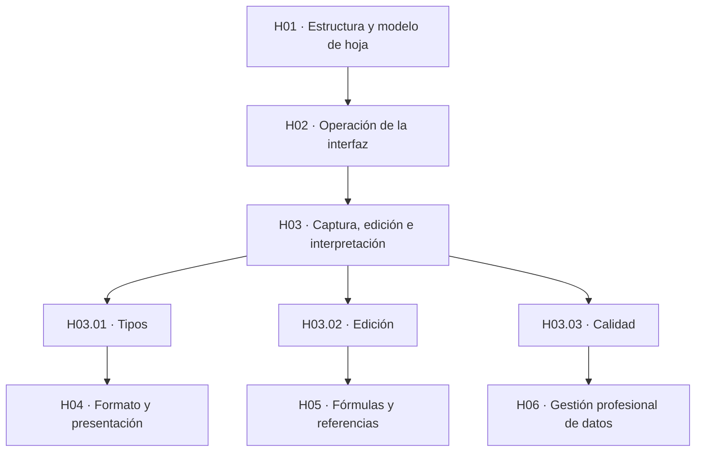
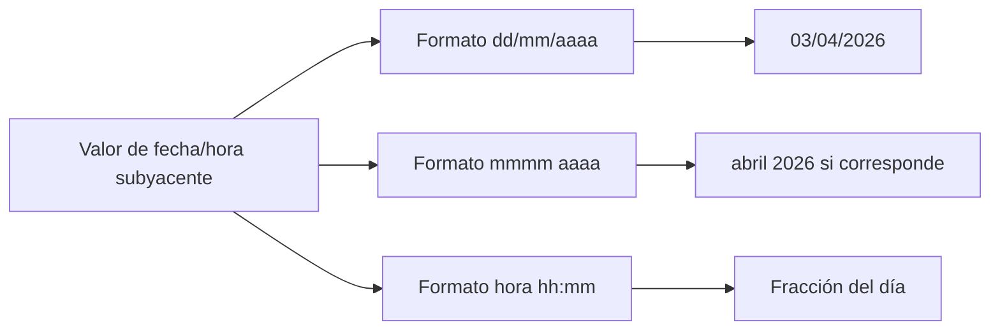
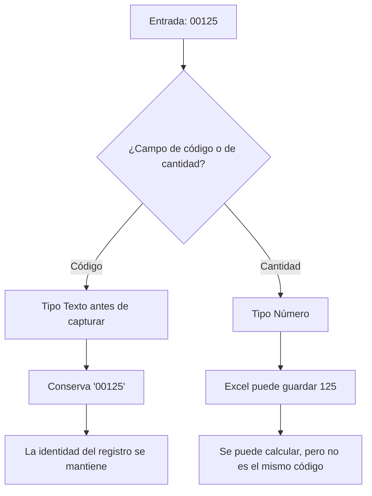
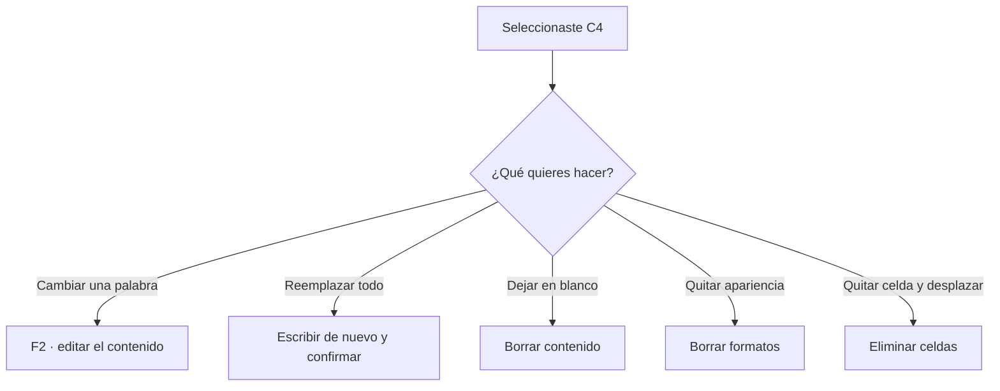
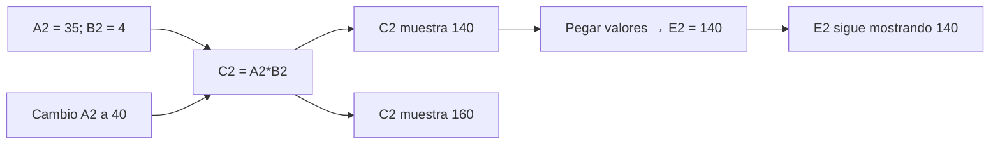
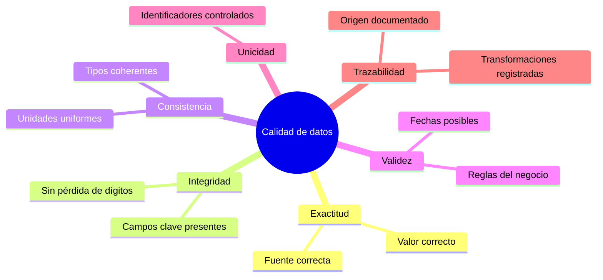
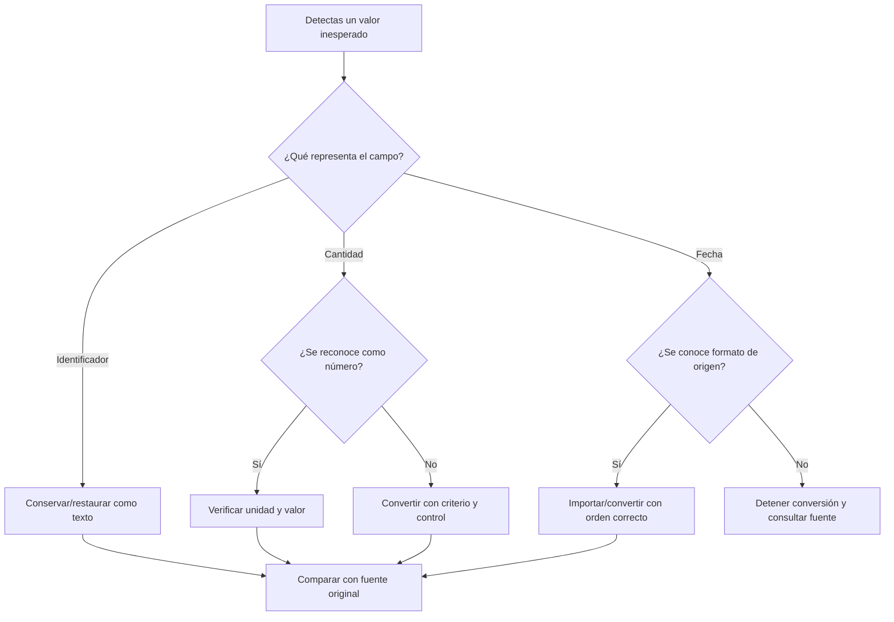
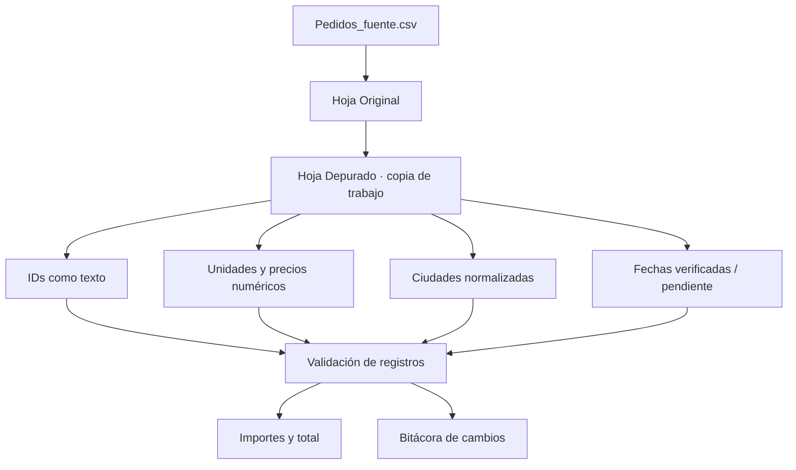

# H03 — Introducción, edición y tipos de datos en Excel

> **Curso integral de Microsoft Excel, Google Sheets, VBA y Google Apps Script**  
> **Ruta:** H — Microsoft Excel · **Módulo:** H03 de H01–H24 · **Roadmap:** versión oficial 2.0  
> **Nivel:** principiante con proyección profesional · **Tiempo orientativo:** 12 horas  
> **Estado:** desarrollado; pendiente de validación académica  
> **Prerrequisitos:** H01 — Fundamentos; H02 — Interfaz, navegación y libros  
> **Entorno de demostración:** Excel para Microsoft 365 de escritorio en Windows. Se indican diferencias relevantes respecto de Excel 2024, macOS, Excel para la web y Google Sheets.
>
> **Enfoque:** Concepto → Fundamento → Demostración → Aplicación → Errores → Práctica → Evaluación. Las lecciones de H04–H16 ampliarán el formato, las fórmulas y las funciones aquí presentadas introductoriamente.

---

## Presentación del módulo

En H01 descubriste **qué representa** una celda; en H02 aprendiste **cómo navegar y administrar** el entorno. H03 estudia **qué significa el dato que introduces, cómo lo interpreta Excel, cómo editarlo y cómo evitar que una entrada aparentemente válida comprometa tus análisis**.

Un campo con `00125` puede ser un **código**, no una cantidad. Un valor como `03/04/2026` puede representar el 3 de abril o el 4 de marzo. La cadena `"125"` puede verse igual que un número 125, pero las operaciones sobre ambos no siempre se comportan igual. Estos problemas no son de estética: afectan el significado, la calidad y la trazabilidad.

### Ubicación curricular

| Sección | Temas | Duración sugerida |
|---|---|---:|
| **H03.01 — Tipos de datos** | H03.01.01 Valores; H03.01.02 Interpretación | 4 h |
| **H03.02 — Introducción y edición** | H03.02.01 Operaciones; H03.02.02 Portapapeles | 4 h |
| **H03.03 — Calidad de captura** | H03.03.01 Problemas; H03.03.02 Corrección | 4 h |
| **Total** | | **12 h** |

### Competencias específicas

Al finalizar, serás capaz de:

1. Diferenciar valores de texto, números, fechas/horas, valores lógicos, errores y fórmulas.
2. Explicar la diferencia entre **valor subyacente**, **representación visual** y **significado empresarial**.
3. Detectar y prevenir conversiones automáticas que alteran códigos, identificadores, fechas y números extensos.
4. Capturar, editar, sobrescribir, borrar, copiar, mover, transponer y pegar datos de forma controlada.
5. Utilizar relleno automático y Relleno rápido sin confundirlos con fórmulas dinámicas.
6. Detectar números almacenados como texto y convertirlos solo cuando el campo representa una magnitud numérica.
7. Aplicar procedimientos reproducibles de búsqueda, reemplazo y limpieza básica.
8. Construir un pequeño registro limpio de clientes con comprobaciones documentadas.

### Convenciones del manual

- Los nombres de comandos se muestran en español, con el término inglés entre paréntesis cuando ayude a reconocer otra interfaz.
- Las rutas de menú como **Datos > Herramientas de datos > Texto en columnas** pueden variar según versión, tamaño de pantalla y sistema.
- Los atajos corresponden prioritariamente a **Windows**. En Mac y web comprueba los equivalentes oficiales.
- Los datos de ejemplo no son personales ni reales. No se requieren macros, complementos ni servicios externos.
- Las fórmulas usan nombres en **español** y `;` como separador cuando hay varios argumentos. En equipos con otra configuración podrían requerirse nombres en inglés y `,`.
- La configuración regional de Excel influye en la interpretación de números y fechas; las fechas de ejemplo se especifican, cuando sea posible, con año de cuatro cifras y nombre de mes.
- Una **captura enlazada** es una imagen real alojada por su fuente; un **diagrama Mermaid o tabla esquemática** es una ilustración conceptual.
- Los resultados previstos son reproducibles bajo las condiciones indicadas. No se afirma que se haya ejecutado Excel directamente para verificarlos.

### Navegación

- [H03.01 — Tipos de datos](#h0301--tipos-de-datos)
- [H03.02 — Introducción y edición](#h0302--introducción-y-edición)
- [H03.03 — Calidad de captura](#h0303--calidad-de-captura)
- [Anexo A — Enunciados de 15 ejercicios](#anexo-a--enunciados-de-ejercicios)
- [Anexo B — Solucionario independiente](#anexo-b--solucionario-independiente)
- [Proyecto integrador H03-P01](#proyecto-integrador-h03-p01--depuración-de-un-registro-comercial)
- [Evaluación de conocimientos](#evaluación-de-conocimientos)
- [Glosario](#glosario)
- [Fuentes y figuras](#fuentes-oficiales-y-recursos-visuales)
- [Control del curso](#control-de-progreso-del-curso)



*Figura 1. Progresión entre módulos; diagrama conceptual.*

---

# H03.01 — Tipos de datos

## H03.01.01 — Valores

### H03.01.01.01 — Texto

**Definición.** Un valor de tipo **texto** es una secuencia de caracteres tratada como información textual, no como una magnitud que debe utilizarse directamente en operaciones aritméticas. Puede incluir letras, dígitos, espacios y símbolos.

**Ejemplos:** `Ana López`, `P-001`, `A12-B`, `00125`, `cliente@ejemplo.com`.

**Distinción crucial:** que algo *contenga números* no implica que deba ser almacenado como número. Un código postal, un identificador de producto, un folio y un número telefónico pueden contener exclusivamente dígitos, pero normalmente **no se suman, multiplican ni promedian**.

| Campo | Ejemplo | Tipo conceptual recomendable | Por qué |
|---|---|---|---|
| Nombre | `Ana López` | Texto | Etiqueta descriptiva |
| Código SKU | `000471` | Texto | Identificador, los ceros son significativos |
| Folio | `123456789012345678` | Texto | No se calcula ni deben perderse dígitos |
| Unidades vendidas | `12` | Número | Se suma y multiplica |
| Precio | `149.50` | Número | Interviene en cálculos |

**Cómo capturar un código con ceros a la izquierda:**

1. Selecciona **una columna vacía** destinada a códigos.
2. En **Inicio > Número**, selecciona **Texto**, *antes de introducir o pegar datos*.
3. Escribe `000471` en una celda; verifica que se conserven sus seis caracteres.
4. Si es un campo importado, configura el tipo **Texto** durante la importación. En Excel para Microsoft 365/2024 existe también configuración de conversiones automáticas, cuando esté disponible.

**Alternativa de una sola celda:** escribe `'000471` (apóstrofo inicial); Excel lo interpretará como texto y normalmente no mostrará ese apóstrofo en la celda. Evita hacerlo indiscriminadamente si después necesitas calcular con el contenido.

> **Advertencia crítica:** si Excel ya convirtió `000471` en `471`, cambiar posteriormente el formato de celda a **Texto** no reconstruye los ceros perdidos. Necesitas conocer la longitud o el código original, o reimportar la fuente.

**Ejemplo básico.** Registra `SKU` en A1 y `000471` como texto en A2. El contenido debe verse como `000471`, y no como `471`.

**Ejemplo intermedio.** En `A2:A4` guarda los códigos `000471`, `000472` y `000499` como texto. En B escribe las descripciones correspondientes. No conviertas la columna A en numérica aunque solo contenga dígitos.

**Ejemplo empresarial.** Un sistema de ventas puede utilizar una clave textual para unir el registro de una transacción con su catálogo de productos. Si se eliminan ceros, el identificador puede dejar de coincidir con la fuente oficial.

**Error habitual:** convertir los códigos a números porque aparecen alineados a la izquierda. La alineación es solamente una pista visual y puede modificarse manualmente; no es una prueba definitiva del tipo.

**Referencia oficial:** [Microsoft — Keeping leading zeros and large numbers](https://support.microsoft.com/en-us/excel/keeping-leading-zeros-and-large-numbers).

### H03.01.01.02 — Números

**Definición.** En una hoja de Excel, un valor numérico representa una cantidad apta para operaciones matemáticas: suma, resta, multiplicación, comparación, promedio, etc.

Ejemplos de significado numérico:

- `25` unidades disponibles.
- `-13` ajuste de inventario.
- `1500.75` importe, si la configuración decimal admite esa escritura.
- `0.21` proporción equivalente al 21 % cuando se aplica el formato porcentual.

**Excel no identifica unidades semánticas por sí solo.** Si B2 contiene 20, ¿son pesos, kilómetros o unidades? Debes definirlo mediante encabezados, documentación y diseño.

#### Valor, número mostrado y unidad

| Nivel | Ejemplo | Explicación |
|---|---|---|
| Valor | `0.21` | Cantidad numérica subyacente |
| Presentación | `21 %` | Formato porcentual aplicado |
| Interpretación | «Tasa de devolución: 21 %» | Significado en un proceso |

**Caso reproducible:**

1. Escribe `0.21` en B2 usando el separador decimal de tu equipo.
2. Observa el valor original.
3. Aplica **Inicio > Número > Porcentaje**.
4. Comprueba que se muestra `21 %` (los espacios/decimales dependen del formato).
5. Regresa a **General**: la cantidad sigue siendo `0.21`.

**Principio:** mostrar dos decimales **no equivale** a redondear permanentemente el número almacenado. El redondeo explícito se estudia en H08.

**Notación científica:** Excel puede mostrar un número grande como `1.23E+09` sin que la notación por sí sola sea un error. No obstante, los números de **más de 15 dígitos significativos** introducidos como números pueden perder precisión: guarda los identificadores extensos como texto. [Microsoft — Format numbers as text](https://support.microsoft.com/en-us/excel/format-numbers-as-text).

#### Ejemplo con números

| A | B | C |
|---|---:|---:|
| Producto | Cantidad | Precio |
| Cuaderno | 4 | 35 |
| Pluma | 8 | 12 |

En D2 escribe `=B2*C2`, resultado `140`. En D3 escribe `=B3*C3`, resultado `96`. El campo *Cantidad* contiene magnitudes, no identificadores.

### H03.01.01.03 — Fechas y horas

**Definición.** Las fechas y horas válidas que Excel reconoce se manejan normalmente como **números de serie** con un formato de presentación temporal.

En el sistema de fechas **1900**, empleado habitualmente en libros modernos de Windows, cada día se representa mediante un número de serie y las fracciones representan horas del día. Por ejemplo, `0.5` equivale a medio día (12:00), cuando se interpreta como hora. Existe también un sistema **1904**, que representa las mismas fechas con números de serie distintos, separados por 1,462 días. Esta diferencia importa al combinar libros. [Microsoft — Date systems in Excel](https://support.microsoft.com/en-us/excel/date-systems-in-excel).

> **Nota histórica:** Excel conserva una peculiaridad de compatibilidad del sistema de fechas de 1900 alrededor de febrero de ese año. Evita usar fechas históricas anteriores a marzo de 1900 sin conocer esa limitación; H11 abordará el sistema temporal a fondo.



*Figura 2. El valor subyacente y el formato visual son conceptos distintos. El texto `03/04/2026` sería ambiguo sin convención regional explícita.*

#### Fechas ambiguas

Imagina que recibes `03/04/2026` sin información de origen:

- Bajo `dd/mm/aaaa` representa el **3 de abril de 2026**.
- Bajo `mm/dd/aaaa` representa el **4 de marzo de 2026**.

**Nunca conviertas automáticamente un conjunto de fechas ambiguas sin confirmar la convención de origen.** La regionalización del equipo que *importa* no sustituye la documentación del sistema que *generó* los datos.

**Buenas prácticas:**

1. Solicita la convención de origen; cuando sea posible, intercambia fechas como `2026-04-03` en un formato estandarizado y acompañado de una especificación.
2. Para crear una fecha dentro de Excel sin ambigüedad regional, utiliza `=FECHA(2026;4;3)` en una configuración española. No se espera memorizar todavía la función: su desarrollo corresponde a H11.
3. Confirma si el campo contiene solo fecha, solo hora o fecha y hora.
4. Al importar, especifica el tipo de columna y el orden día/mes/año.

**Fecha como texto:** si una celda contiene la cadena textual `'2026-04-03`, Excel no necesariamente la tratará como una fecha apta para cálculos. Cambiar únicamente su apariencia a formato Fecha no garantiza la conversión.

**Ejemplo profesional:** una empresa que importa registros de ventas desde Estados Unidos puede interpretar equivocadamente la fecha `05/06/2026`; el error alteraría los análisis mensuales y vencimientos.

### H03.01.01.04 — Valores lógicos y errores

#### Valores lógicos

Un **valor lógico o booleano** representa una de dos alternativas: `VERDADERO` o `FALSO` (en inglés, `TRUE` y `FALSE`). No equivale a las cadenas de texto `"VERDADERO"` y `"FALSO"` que puedan ingresarse como etiquetas.

En una celda vacía escribe:

```excel
=5>3
```

Resultado esperado: **VERDADERO**, si la interfaz está en español. Ahora escribe `=5<3`: resultado **FALSO**.

Aquí se utiliza una comparación simple como demostración; las funciones lógicas se desarrollarán en H07.

| Entrada | Interpretación |
|---|---|
| `VERDADERO` reconocido como constante lógica | Booleano |
| `"VERDADERO"` dentro de una fórmula | Cadena de texto |
| `=8=8` | Fórmula que devuelve VERDADERO |
| `=8=9` | Fórmula que devuelve FALSO |

> La apariencia de las constantes lógicas localizadas depende de idioma y configuración. Para resultados inequívocos en esta práctica, utiliza fórmulas de comparación (`=8=8`, `=8=9`).

#### Valores de error

Excel puede mostrar valores de error cuando no consigue evaluar correctamente una operación o acceder a una referencia.

| Error común (la etiqueta visible puede localizarse) | Idea general | Ejemplo de origen |
|---|---|---|
| `#¡DIV/0!` / `#DIV/0!` | División entre cero | `=10/0` |
| `#¡VALOR!` / `#VALUE!` | Tipo de argumento no apropiado | Operación con texto no convertible |
| `#¡REF!` / `#REF!` | Referencia inválida | Fórmula cuyo referente fue eliminado |
| `#N/D` / `#N/A` | Valor no disponible | Búsqueda sin coincidencia |
| `#¿NOMBRE?` / `#NAME?` | Nombre o función no reconocidos | Error tipográfico en fórmula |
| `#¡NUM!` / `#NUM!` | Problema numérico | Operación fuera del dominio admitido |

**No confundas `####` con un error de fórmula.** A menudo indica que el ancho de la columna no permite representar un valor o una fecha/hora. [Microsoft — Detect formula errors](https://support.microsoft.com/en-us/excel/detect-formula-errors-in-excel).

**Caso básico:** en A1 introduce `10`, en B1 introduce `0` y en C1 escribe `=A1/B1`. El resultado será un error de división por cero. No borres el error sin analizar la causa. Los procedimientos de tratamiento de errores serán tratados en H07.

#### Celda vacía, cero y cadena vacía

Una celda sin contenido **no es lo mismo** que una celda que almacena el número `0`. Tampoco equivale universalmente a una celda cuya fórmula devuelve una cadena vacía `""`.

| Caso | Ejemplo | Implicación |
|---|---|---|
| Vacío real | A1 sin contenido | No hay entrada |
| Cero | A1 contiene `0` | Existe una cantidad igual a cero |
| Texto vacío | A1 contiene `=""` | Hay una fórmula, aunque el resultado visible sea vacío |

Esta distinción importa para recuentos, exportaciones, validación e indicadores: **ausencia de información** no significa necesariamente **cantidad cero**.

#### Tipos de datos vinculados

Algunas ediciones de Microsoft 365 ofrecen **tipos de datos vinculados**, como entidades financieras o geográficas, sujetos a servicios y disponibilidad. No deben confundirse con los tipos básicos anteriores ni asumirse universales. Se estudiarán cuando corresponda a funciones especializadas y modelos de datos.

---

## H03.01.02 — Interpretación

### H03.01.02.01 — Conversión implícita y coerción de tipos

**Coerción de tipos** es el intento de Excel de interpretar o convertir un valor de un tipo a otro según la operación y la configuración.

Por ejemplo, al introducir `00125` en una celda con formato General, Excel puede interpretarlo como el número `125`, eliminando los ceros. Si escribes un texto que se parece a una fecha, Excel puede transformarlo en una fecha real. En algunas operaciones una cadena numérica puede convertirse implícitamente, pero **no debe confiarse en que esto ocurra igual en todas las fórmulas**.



*Figura 3. El tipo correcto depende del significado del campo, no de su apariencia.*

**Caso de coerción a evitar:** un importe recibido como texto `'1,250.50` puede resultar ambiguo: ¿la coma representa agrupación de millares o separador decimal? No introduzcas conversiones masivas sin comprobar la convención del origen.

**Prueba controlada:**

1. En A1 escribe el texto `Cantidad` y en B1 `Cantidad convertida`.
2. Da formato **Texto** a A2 y escribe `12`.
3. En B2, escribe la función `=VALOR(A2)` (en español), que intenta interpretar el texto como número en el entorno actual.
4. Comprueba que devuelve `12` y compara el comportamiento del campo con el original.

No uses `VALOR` sobre identificadores. Si el contenido contiene espacios no estándar, separadores inesperados o letras, la conversión puede fallar. Para casos más complejos existen funciones específicas y Power Query, que se estudiarán después.

### H03.01.02.02 — Valores frente a formatos

Una celda tiene **contenido**, puede tener **una fórmula** y puede tener una **regla de formato**. Debes separarlos mentalmente.

| Contenido subyacente | Formato aplicado | Visualización posible |
|---|---|---|
| `1250` | Moneda MXN con dos decimales | `$1,250.00` o equivalente regional |
| `0.25` | Porcentaje sin decimales | `25 %` |
| `0.5` | Porcentaje | `50 %` |
| `0.5` | Hora | `12:00` en un contexto horario |
| Un número de serie de fecha | Fecha | Una fecha legible |

**Caso frecuente:** escribes el número `25` y después aplicas el formato Porcentaje. Puede mostrarse `2500 %`, porque el formato multiplica la representación porcentual por 100. Si querías representar el 25 %, el valor de entrada apropiado era `0.25` o ingresar `25 %` mediante la sintaxis reconocida por Excel.

**Regla:** dar un nuevo formato **no garantiza que se corrija un dato incorrectamente interpretado o convertido**.

### H03.01.02.03 — Precisión, límites y seguridad semántica

Excel almacena números con la precisión propia de su motor de cálculo; para entradas decimales significativas considera el límite de **15 dígitos de precisión** descrito oficialmente. Esta limitación es especialmente importante para identificadores de 16 o más dígitos, que deben tratarse como texto. [Microsoft — Data import and analysis options](https://support.microsoft.com/en-us/excel/data-import-and-analysis-options-in-excel).

**No confundas:**

- **Precisión**: cantidad de cifras relevantes que se conservan/representan.
- **Formato**: cómo aparecen los valores.
- **Exactitud**: concordancia con el dato verdadero.
- **Identidad**: si el código alfanumérico sigue siendo exactamente el mismo.

Ejemplo: un número de cuenta ficticio `123456789012345678` no debe procesarse como una cantidad. Si un sistema lo captura numéricamente y cambia los últimos dígitos, **un ajuste visual de decimales no lo repara**; hay que recuperar el identificador original.

Otro detalle: el motor numérico representa muchos números decimales de forma aproximada en binario. Ver `0.3` en pantalla no implica que todas las operaciones sean internamente exactas. El fundamento de aritmética numérica se retomará al estudiar redondeos y cálculos.

### H03.01 — Errores típicos y buenas prácticas

| Situación | Causa probable | Detección | Prevención |
|---|---|---|---|
| `0007` termina como `7` | Conversión automática a número | Comparar contra el código original | Tipo Texto antes de capturar/importar |
| `25` se muestra `2500 %` | Formato porcentual sobre un 25 entero | Revisar barra de fórmulas | Introducir proporción `0.25` |
| Fecha cambia de mes | Convención regional ambigua | Comparar fuente y mes del registro | Confirmar DD/MM/AAAA o MM/DD/AAAA |
| Folio largo pierde dígitos | Se introdujo como número | Comparar longitud y valor original | Tipo Texto desde origen |
| `####` en fecha | Falta de espacio o fecha/hora no representable | Aumentar ancho; revisar valor | Ajustar ancho o corregir entrada |
| Suma omite un campo | Número almacenado como texto | Comprobación de tipo, indicadores | Convertir cantidades, no identificadores |

**Punto de control:** antes de capturar cualquier columna, responde: **¿es una magnitud, una etiqueta, un identificador o una fecha real?** Si no puedes responderlo, necesitas definir el esquema de datos.

---
# H03.02 — Introducción y edición

La edición profesional no consiste simplemente en escribir rápidamente. Consiste en cambiar datos **sin perder su significado, sin modificar rangos ajenos y manteniendo la trazabilidad de los resultados**.

## H03.02.01 — Operaciones

### H03.02.01.01 — Edición de celdas

#### Tres formas de introducir contenido

**Método A: escribir en una celda vacía.**

1. Selecciona A1.
2. Escribe `Cliente`.
3. Pulsa **Enter** para confirmar.
4. Selecciona B1 y escribe `Pedido`.
5. Pulsa **Tab** para confirmar y desplazarte, en una configuración habitual, a la siguiente columna.

**Método B: sustituir el contenido existente.**

1. Selecciona A1, que contiene `Cliente`.
2. Empieza a escribir `Nombre del cliente` sin entrar en modo edición.
3. Confirma con Enter. Excel reemplazará el contenido anterior de la celda.

**Método C: modificar una parte del contenido.**

1. Selecciona A1.
2. Pulsa **F2** (en Windows) o haz doble clic en la celda.
3. Ajusta solamente la palabra necesaria.
4. Pulsa Enter para guardar la edición o **Esc** para descartarla.

**Diferencia importante:** teclear sobre una celda seleccionada puede **sobrescribir todo el contenido**; entrar en modo edición permite modificar una parte sin reemplazarlo íntegramente.

#### Introducir varios renglones dentro de la misma celda

Puedes escribir un salto de línea manual dentro de una celda utilizando **Alt + Enter** en Excel para Windows. En macOS, Microsoft documenta **Control + Option + Return** para esta función. Esto no crea una nueva fila de la hoja: solo agrega una separación visible dentro del mismo valor de texto. [Microsoft — Start a new line of text inside a cell](https://support.microsoft.com/en-us/excel/start-a-new-line-of-text-inside-a-cell-in-excel).

**Ejemplo:** en D2 escribe `Entregar por la mañana`, pulsa Alt+Enter y después escribe `Llamar antes de llegar`. Comprueba que ambos renglones siguen perteneciendo a D2.

#### Borrado de contenido, borrado de formato y eliminación de celdas

No son equivalentes:

| Acción | Qué modifica | Qué suele conservar |
|---|---|---|
| **Supr/Delete** sobre una celda | Quita su contenido | Formato de celda |
| **Inicio > Borrar > Borrar contenido** | Quita valores/fórmulas | Estilos/formatos |
| **Borrar formatos** | Quita formatos | Valor o fórmula |
| **Borrar todo** | Quita contenido, formatos y otros elementos aplicables | La posición de la celda en la cuadrícula |
| **Eliminar celdas** | Quita las celdas seleccionadas y puede desplazar otras | No conserva la misma distribución |

**Atención:** eliminar una celda y desplazar las adyacentes puede romper relaciones entre columnas; es un riesgo distinto a limpiar su contenido. [Microsoft — Clear cells of contents or formats](https://support.microsoft.com/en-us/excel/clear-cells-of-contents-or-formats).



*Figura 4. Guía conceptual para elegir una operación de edición.*

#### Deshacer y rehacer

En Excel para Windows, **Ctrl+Z** suele deshacer cambios recientes y **Ctrl+Y** suele rehacer o repetir, según el contexto. Los historiales de deshacer no deben considerarse copias de seguridad permanentes. Para un cambio masivo de datos conserva una copia independiente antes de comenzar.

**Caso profesional.** Si quieres corregir `Ciudad de Mexico` a `Ciudad de México` en una celda, usa edición. Si pretendes cambiar el texto en cientos de registros, primero define un criterio y utiliza búsqueda/reemplazo controlado, explicado en H03.03.

### H03.02.01.02 — Autocompletar, series y Relleno rápido

Excel dispone de mecanismos diferentes que suelen confundirse:

- **Autocompletar texto:** propone entradas previamente utilizadas en la misma columna cuando corresponde; no equivale a generar un algoritmo de transformación.
- **Relleno automático (AutoFill):** copia contenido o extiende secuencias con base en celdas de ejemplo mediante el controlador de relleno.
- **Relleno rápido (Flash Fill):** identifica un patrón de transformación a partir de ejemplos y genera salidas estáticas.

#### A. Autocompletar texto

Si en una columna ya escribiste `Papelería`, Excel puede sugerir esa misma entrada al comenzar a escribir una coincidencia. Aceptar la sugerencia reutiliza un valor; no significa que se haya creado una fórmula ni que los datos estén validados.

**Buenas prácticas:** comprueba las sugerencias antes de aceptarlas cuando existan categorías parecidas, como `Contabilidad` y `Contable`.

#### B. Relleno automático de series

**Objetivo:** completar una secuencia sin escribir todos los valores manualmente.

**Ejemplo: números pares.**

1. Escribe `2` en A2 y `4` en A3.
2. Selecciona A2:A3.
3. Sitúa el cursor en la esquina inferior derecha de la selección (controlador de relleno).
4. Arrastra hasta A7.
5. Resultado esperado: `2, 4, 6, 8, 10, 12` en A2:A7.

**Ejemplo: repetición.** Si solo introduces `2` y arrastras, Excel puede copiar el valor, en lugar de producir una secuencia; usa las opciones del controlador para elegir **Copiar celdas** o **Rellenar serie** según corresponda.

**Ejemplo: fechas.** Puedes introducir dos fechas consecutivas correctamente reconocidas y extenderlas. El comportamiento exacto depende del contenido inicial y de la opción de relleno seleccionada (días, laborables, meses, años).

| Semilla | Objetivo | Resultado esperado si se elige la opción apropiada |
|---|---|---|
| `2, 4` | Números pares | 2, 4, 6, 8… |
| `10, 20` | Incrementar de 10 | 10, 20, 30, 40… |
| `Lunes` | Días de semana | Lunes, martes, miércoles… según idioma/listas |
| Dos fechas diarias sucesivas | Serie de días | Día siguiente, día siguiente… |
| `Código-001` | Copiar un identificador | Depende de patrones y opciones; **verifica siempre** |

**Referencia oficial:** [Microsoft — Fill data automatically in worksheet cells](https://support.microsoft.com/en-us/excel/get-started/fill-data-automatically-in-worksheet-cells).

#### C. Relleno rápido (Flash Fill)

El Relleno rápido **infiere patrones a partir de ejemplos**. Resulta útil para separar nombres, combinar campos o extraer porciones de texto.

**Ejemplo reproducible: separar una clave.**

| Fila | A · Nombre completo | B · Nombre previsto |
|---:|---|---|
| 1 | Nombre completo | Nombre |
| 2 | Laura Méndez | Laura |
| 3 | Diego Ríos | Diego |
| 4 | Sofía Luna | Sofía |
| 5 | Carlos Vera | Carlos |

Procedimiento:

1. Copia los nombres completos en A2:A5.
2. En B2 escribe `Laura` como ejemplo.
3. Selecciona B3 y empieza a escribir `Diego` o activa **Datos > Relleno rápido** cuando corresponda.
4. En Windows, **Ctrl+E** es el método abreviado documentado para Relleno rápido.
5. Comprueba todos los resultados, en especial los nombres compuestos o con partículas como `De la Cruz`.


*Figura 5. Imagen pública asociada a [Microsoft Support — Using Flash Fill in Excel](https://support.microsoft.com/en-us/excel/using-flash-fill-in-excel). Debe observarse que Excel identifica un patrón de transformación y propone resultados. La imagen corresponde a material de Microsoft; su aspecto no necesariamente coincide con la versión actual en español.*

**Limitación esencial:** Relleno rápido genera datos de salida; **no mantiene necesariamente una dependencia de fórmula** con el origen. Si cambias A2 después, B2 no se recalcula como lo haría una fórmula. Tampoco entiende el significado de un nombre: aprende una regularidad visual y puede equivocarse. Por eso debe auditarse la columna completa.

**Comparación breve:**

| Herramienta | Qué hace | ¿Cambios del origen recalculan automáticamente la salida? | Riesgo típico |
|---|---|---|---|
| Autocompletar texto | Sugiere entrada existente | No | Seleccionar sugerencia incorrecta |
| Relleno automático | Copia o extiende patrón/serie | Depende de si se copiaron fórmulas | Serie inesperada |
| Relleno rápido | Detecta transformación por ejemplos | **No como fórmula** | Fallos con excepciones |

**Google Sheets:** posee herramientas propias de autofill y sugerencias inteligentes, pero no debe suponerse equivalencia exacta de menús o comportamiento. Las diferencias funcionales se estudiarán en G02–G05.

---

## H03.02.02 — Portapapeles

### H03.02.02.01 — Copiar, mover y pegar datos

Cuando copias un rango, Excel puede transferir mucho más que el valor visible: **fórmulas, formato, reglas de validación y otros atributos**, según el tipo de pegado seleccionado.

**Copiar** no equivale a **mover**:

- **Copiar** (Ctrl+C): conserva el origen y genera otro contenido en el destino.
- **Cortar** (Ctrl+X): prepara el contenido para moverlo a otra ubicación.
- **Pegar** (Ctrl+V): realiza el pegado predeterminado, que puede incluir fórmulas y formato.

**Precaución:** el destino puede sobrescribirse. Antes de pegar, identifica el rango que quedará afectado.

#### Ejemplo de copia

En una hoja vacía, escribe:

| A | B |
|---|---:|
| Producto | Precio |
| Libreta | 35 |
| Marcador | 20 |

1. Selecciona A1:B3 y pulsa Ctrl+C.
2. Selecciona D1 y pega.
3. Comprueba que D1:E3 contiene una copia y A1:B3 continúa intacto.

Si copias una **fórmula relativa**, Excel puede adaptar las referencias a su nueva ubicación. Este tema se desarrollará formalmente en **H05**; por ahora basta con saber que *copiar un cálculo no siempre produce la misma expresión textual*.

**Regla de seguridad:** nunca ordenes, pegues ni muevas una sola columna de registros relacionados sin comprobar si es necesario incluir las demás columnas. Podrías separar precios de productos o identificadores de sus dueños.

### H03.02.02.02 — Pegado especial y transposición

**Pegado especial (Paste Special)** permite elegir qué atributos deseas transferir.

| Modalidad | Qué transfiere | Cuándo usarla |
|---|---|---|
| Todo | Contenido y atributos compatibles | Duplicar un bloque completo |
| Valores | Valores/resultados, sin conservar la fórmula | Crear una instantánea de resultados |
| Fórmulas | Expresiones de cálculo | Reutilizar reglas sin trasladar el aspecto |
| Formatos | Presentación | Uniformar una tabla |
| Transponer | Convierte filas en columnas y viceversa | Reorganizar la orientación |
| Operación Multiplicar | Realiza operación con valores numéricos | Conversión controlada, con copia de respaldo |
| Vínculo | Crea referencias al origen en escenarios compatibles | Datos dependientes de fuente |

**Acceso en Windows:** Inicio > Pegar > Pegado especial o, en diversos entornos de Excel de escritorio, **Ctrl+Alt+V**. Las opciones exactas dependen del contexto y de la versión. [Microsoft — Paste options](https://support.microsoft.com/en-us/excel/paste-options).


*Figura 6. Captura publicada en [Microsoft Learn Q&A](https://learn.microsoft.com/en-us/answers/questions/5520301/experiencing-error-with-sharepoint-something-went). Ilustra las opciones visuales de pegado; los iconos y las denominaciones pueden cambiar. Fuente de comunidad alojada por Microsoft, no una captura generada para este manual.*

#### Ejemplo 1: Pegar valores en lugar de fórmulas

1. En A1 escribe `Precio`, en B1 `Cantidad` y en C1 `Importe`.
2. En A2 escribe `35`, en B2 `4`, en C2 escribe `=A2*B2`; resultado esperado: `140`.
3. Copia C2.
4. En E2 utiliza **Pegar > Valores**.
5. Cambia A2 a `40`.

**Comparación esperada:** C2 recalcula a **160**, pero E2 permanece en **140** porque contiene una copia estática del resultado anterior.



*Figura 7. Diferencia entre una fórmula viva y una instantánea obtenida con Pegado de valores.*

**Uso profesional:** congelar cifras de cierre mensual puede servir para comparar con una nueva versión del modelo, pero registra fecha, criterio y fuente. No sustituyas accidentalmente las fórmulas originales por valores.

#### Ejemplo 2: Transponer

Supongamos los siguientes datos en A1:C2:

| A | B | C |
|---|---|---|
| Enero | Febrero | Marzo |
| 100 | 150 | 120 |

Después de copiar A1:C2 y transponer desde E1, el resultado será:

| E | F |
|---|---:|
| Enero | 100 |
| Febrero | 150 |
| Marzo | 120 |

Una selección de **2 filas × 3 columnas** se convierte en **3 filas × 2 columnas**.

**Procedimiento:** seleccionar rango → copiar → seleccionar celda superior izquierda del destino → Inicio > Pegar > Transponer → verificar orientación y no sobrescritura.

> No todas las combinaciones de rangos, tablas, fórmulas dinámicas y selección de origen permiten exactamente las mismas operaciones de pegado/transposición. Cuando una opción no aparezca, utiliza un rango de práctica simple y consulta la documentación de tu versión.

#### Pegado especial para conversión de texto a número: con precaución

Microsoft documenta un método histórico que utiliza **multiplicar por 1** al pegar de forma especial sobre valores numéricos guardados como texto. Funciona para ciertos casos, pero debe aplicarse **solo a campos cuya semántica sea realmente numérica**, después de crear copia de respaldo y comprobar separadores. [Microsoft — Fix text-formatted numbers](https://support.microsoft.com/en-us/excel/fix-text-formatted-numbers-by-applying-a-number-format).

**Jamás apliques esa operación masivamente sobre** SKU, códigos postales, teléfonos, folios o identificadores largos: puedes destruir información.

### H03.02 — Errores frecuentes

| Error | Por qué ocurre | Recomendación |
|---|---|---|
| Sustituir el contenido al querer corregir una palabra | Se escribió directamente en celda seleccionada | Entrar en edición con F2 |
| Usar Supr en lugar de borrar formato | Solo se quita contenido | Usar Borrar formatos cuando corresponda |
| Esperar actualización de Relleno rápido | Produce resultados estáticos | Repetir y verificar tras cambios de origen |
| Pegado arrastra colores/reglas | Se eligió pegado predeterminado | Seleccionar Valores o Formatos explícitamente |
| Copiar una fórmula cambia referencias | Las referencias relativas se adaptan | Revisar resultados; estudiar H05 |
| Transponer sobre datos existentes | Destino no está vacío | Utilizar un rango libre y comprobar dimensión |
| Desplazar celdas en una tabla | Se eliminaron celdas, no solo su contenido | Trabajar con registros completos y respaldos |

**Comprobación final de la sección:** si un procedimiento modifica múltiples registros, revisa **origen, destino, cantidad de filas, tipo de pegado y resultados**, preferentemente mediante comparación antes/después.

---

# H03.03 — Calidad de captura

Una hoja profesional necesita criterios de calidad **anteriores** a la captura y controles **posteriores** a cada transformación. Lo importante no es que la columna «parezca correcta», sino que conserve el tipo, la identidad y el significado de cada dato.

## H03.03.01 — Problemas

### H03.03.01.01 — Ceros iniciales y números largos

#### Problema: pérdida de identidad en los códigos

Si recibes un SKU `000017` y Excel lo convierte a `17`, ya no tienes la representación original. Esto es un defecto de integridad del identificador, aun cuando el valor numérico 17 sea matemáticamente correcto.

**Casos vulnerables:** códigos postales, códigos de empleados, números de guía, folios, referencias bancarias, UPC/EAN representados como texto, identificadores externos y códigos que mezclan cifras y letras.

**Estrategia recomendada:**

1. Clasifica el campo según su **significado**, no según el teclado que lo produce.
2. Si es identificador, guarda el original como texto desde el inicio.
3. Si importas CSV, elige **Datos > Desde texto/CSV**, revisa la previsualización y establece el tipo Texto para las columnas de códigos antes de confirmar la conversión/carga.
4. Desactiva conversiones automáticas específicas en Excel para Microsoft 365 o Excel 2024 si la configuración está disponible y conviene al proceso.
5. Compara las longitudes y los valores finales contra la fuente.

La opción de texto durante importación es especialmente importante porque recuperar ceros perdidos después **requiere conocer los datos originales**. [Microsoft — Keeping leading zeros and large numbers](https://support.microsoft.com/en-us/excel/keeping-leading-zeros-and-large-numbers).

#### Problema: números de más de 15 dígitos

**Fuente ficticia:** `123456789012345678`.

- Si se importa como **Texto**, conserva exactamente los 18 caracteres.
- Si se importa como **Número**, puede perder dígitos significativos y presentarse en notación científica.

**Regla:** para identificadores extensos, **nunca intentes repararlos mediante formato científico/numérico**: vuelve a importar el original como texto.

### H03.03.01.02 — Números almacenados como texto

Un número **almacenado como texto** es un valor cuyos caracteres parecen numéricos, pero que Excel trata como contenido textual. Puede aparecer por:

- Importación de archivos o portapapeles.
- Aplicación anticipada del formato Texto.
- Uso de un apóstrofo inicial.
- Espacios, saltos de línea, separadores o símbolos incompatibles.
- Convenciones de decimal y millares diferentes.

**Síntomas frecuentes:**

1. Alineación izquierda por defecto (indicio, no garantía).
2. Pequeño triángulo de advertencia en la esquina superior izquierda cuando la comprobación de errores está habilitada.
3. Recuentos o totales inesperados.
4. Ordenamientos que mezclan texto y números.
5. Fórmulas que devuelven errores o resultados incoherentes según el contexto.

**Ejemplo de comprobación:**

| Celda | Contenido | Tipo esperado |
|---|---|---|
| A2 | `'120` (apóstrofo utilizado al introducir) | Texto: `120` |
| A3 | `80` | Número: 80 |
| A4 | `50` | Número: 50 |

Si escribes `=SUMA(A2:A4)` en A5, el resultado previsto es **130**, porque `SUMA` normalmente omite en ese rango el número almacenado como texto en A2. Este ejemplo ilustra por qué una lista visualmente uniforme puede producir un total incorrecto.

Si A2 es una cantidad, conviértela cuidadosamente a número; el total esperado será entonces **250**. Si fuera un código, **no debes convertirla**.

#### Imagen de referencia: detección y conversión

La documentación de Microsoft incluye capturas del triángulo de comprobación de errores y de la acción **Convertir en número**:

[Ver captura y procedimiento oficial — Microsoft Support](https://support.microsoft.com/es-es/excel/convert-numbers-stored-as-text-to-numbers-in-excel).

*Figura 8. Captura real referenciada mediante enlace al artículo oficial, que contiene las imágenes de la interfaz. Observa el indicador en la esquina superior izquierda y el menú contextual de conversión. Se utiliza enlace en vez de duplicar sin verificar la URL interna de la imagen.*

### H03.03.01.03 — Fechas ambiguas y conversiones regionales

Los errores de fechas son especialmente delicados porque una fecha interpretada equivocadamente puede seguir pareciendo válida.

| Entrada | Posible interpretación 1 | Posible interpretación 2 | Riesgo |
|---|---|---|---|
| `04/05/2026` | 4 de mayo | 5 de abril | Cambio de mes |
| `08/09/2026` | 8 de septiembre | 9 de agosto | Reporte equivocado |
| `12/11/26` | 12 de noviembre de 2026 | 11 de diciembre de 2026, según origen | Mes y año de dos dígitos |
| `13/02/2026` | 13 de febrero con D/M/A | No es fecha válida con M/D/A habitual | Fallo de conversión |

**Diagnóstico correcto:** examinar metadatos de origen, configuración del sistema exportador, convenciones regionales y muestras no ambiguas. Una fecha como `13/02/2026` ayuda a descartar algunos órdenes, pero **no demuestra el origen de todas las filas** si los registros provienen de fuentes distintas.

**Prevención:** documentación explícita del tipo de fecha, año de cuatro dígitos, elección del tipo durante importación y pruebas de consistencia por periodo. [Microsoft — Convert dates stored as text to dates](https://support.microsoft.com/es-es/excel/convert-dates-stored-as-text-to-dates).

#### Errores de limpieza adicionales

Aunque el catálogo formal de funciones de texto se estudia en H10, conviene reconocer desde ahora:

- **Espacios invisibles:** `"Cliente"` frente a `"Cliente "`.
- **Mayúsculas y acentos:** `"México"`, `"MEXICO"`, `"Mexico"`.
- **Duplicados semánticos:** `"S. A. de C. V."` y `"SA de CV"` pueden referirse a una misma razón social, pero no hay que asumirlo automáticamente.
- **Caracteres no imprimibles:** importaciones desde sistemas que incluyen tabuladores, saltos o espacios no separables.
- **Celdas en blanco frente a cero:** una venta de `$0` podría ser válida; una celda vacía puede indicar falta de captura.

La calidad de datos tiene al menos estas dimensiones:



*Figura 9. Dimensiones conceptuales de calidad. La «unicidad» exige saber qué campo identifica de forma única un registro.*

---

## H03.03.02 — Corrección

### H03.03.02.01 — Buscar y reemplazar

**Buscar y reemplazar** permite localizar coincidencias y sustituir contenido bajo condiciones específicas.

**Procedimiento sugerido en Excel de escritorio para Windows:**

1. Crea una copia del archivo o duplica la hoja.
2. Selecciona la columna o el rango que quieras revisar.
3. Pulsa **Ctrl+F** para Buscar o **Ctrl+H** para Reemplazar.
4. Especifica el término buscado y, si procede, el texto de sustitución.
5. Abre **Opciones** y define **Dentro de: Hoja/Libro**, coincidencia exacta, mayúsculas/minúsculas y ámbito apropiado.
6. Utiliza primero **Buscar todos** o **Buscar siguiente** para inspeccionar coincidencias.
7. Prefiere **Reemplazar** una a una si no has validado que todas las coincidencias deban modificarse.
8. Verifica el recuento/resultado; vuelve a comparar contra la copia si hiciste una sustitución global.

**Caso controlado:**

| Fila | Original | Normalizado |
|---:|---|---|
| 2 | CDMX | Ciudad de México |
| 3 | Puebla | Puebla |
| 4 | CDMX | Ciudad de México |
| 5 | Toluca | Toluca |

Si reemplazas `CDMX` por `Ciudad de México` en un rango que **solo contiene ciudades**, las filas 2 y 4 cambiarán como se espera. Si lo ejecutas en todo el libro, podrías modificar nombres de archivos, títulos o notas que no querías alterar.

**Comodines básicos de búsqueda:** `?` coincide con un carácter y `*` con una secuencia de caracteres; `~` sirve para buscar literalmente ciertos comodines. Son útiles, pero potencialmente peligrosos en sustituciones globales.

**Referencia oficial:** [Microsoft — Buscar o reemplazar texto y números](https://support.microsoft.com/es-es/excel/get-started/find-or-replace-text-and-numbers-on-a-worksheet).

### H03.03.02.02 — Conversión de datos y validación posterior

#### Método 1 — Convertir un número guardado como texto desde advertencia

Úsalo cuando el campo sea una **cantidad** y Excel muestre el indicador de error.

1. Haz respaldo de la columna o libro.
2. Selecciona las celdas que de verdad deban ser numéricas.
3. Abre el menú del indicador de error.
4. Elige **Convertir en número**.
5. Comprueba los valores, sumas, negativos y decimales.

**No conviertas** IDs, teléfonos o folios.

#### Método 2 — Función VALOR

Si A2 contiene texto que representa un número sencillo en la configuración local, escribe en B2:

```excel
=VALOR(A2)
```

**Resultado esperado:** una magnitud numérica cuando la conversión es posible. Después de comprobar que todo es correcto, puedes copiar B2:B100 y pegar **Valores** en el rango definitivo, conservando la copia original.

**Advertencia:** si el campo contiene `1,234`, el significado depende de los separadores regionales. No supongas que todas las configuraciones lo interpretarán igual. Las variantes con separadores explícitos y tratamientos de texto se desarrollarán en H10.

#### Método 3 — Texto en columnas

**Datos > Texto en columnas** permite dividir una columna delimitada o realizar conversiones bajo un asistente, según edición. Es útil cuando recibes `Nombre,Apellido,Ciudad` o fechas textuales cuya estructura está documentada.

Ejemplo de entrada como **texto literal** en A2:

```text
Laura,Méndez,Puebla
```

**Resultado esperado tras delimitación por coma:**

| A | B | C |
|---|---|---|
| Laura | Méndez | Puebla |

**Precaución:** antes de iniciar, deja vacías las columnas de destino. Previsualiza los resultados para evitar sobrescribir datos.

#### Método 4 — Importación desde Texto/CSV

Para datos masivos o de procedencia externa, es preferible **importar con tipos definidos** en lugar de corregir los daños después:

1. Abre Excel y selecciona **Datos > Desde texto/CSV**.
2. Selecciona el archivo sin abrirlo previamente mediante doble clic si esto puede activar conversiones indeseadas.
3. Revisa separador de columnas, codificación y previsualización.
4. Elige **Transformar datos** cuando sea necesario controlar tipos en Power Query (disponibilidad según entorno).
5. Establece **Texto** para identificadores; establece los tipos adecuados para cantidades y fechas **solo tras confirmar el origen**.
6. Carga los datos.
7. Ejecuta comprobaciones de integridad: filas, longitudes, sumas y fechas de muestra.

[Microsoft — Import or export text files](https://support.microsoft.com/en-us/excel/get-started/import-or-export-text-txt-or-csv-files).

> **Nota de alcance:** se introduce aquí el principio de importación; las técnicas completas de transformación, consultas y lenguaje M corresponden a H17 y H21.

#### Tabla de decisión para corregir datos



*Figura 10. Protocolo básico de corrección: se determina primero el significado del dato.*

#### Validación posterior: evidencia mínima

Después de limpiar datos, verifica lo siguiente:

| Comprobación | Pregunta | Ejemplo |
|---|---|---|
| Filas | ¿Se conserva el número de registros? | 50 antes, 50 después |
| Identidad | ¿Se conservan los códigos exactamente? | `000017` sigue siendo `000017` |
| Tipo | ¿Las cantidades son números y los códigos texto? | `Unidades` suma correctamente |
| Fechas | ¿Se conserva el día y mes esperados? | 3 abril ≠ 4 marzo |
| Totales | ¿Los importes concuerdan con la fuente? | Suma y total por registro |
| Origen | ¿Queda documentado cómo se hizo la transformación? | Registro de limpieza |

**Recomendación de trazabilidad:** mantén una hoja `Original` de solo consulta y otra `Depurado`; registra en `Bitacora` los cambios principales, responsable, fecha, motivo y método. La implementación profesional de trazabilidad se ampliará en H06 y H23.

### Caso guiado H03 — Archivo de clientes con defectos

Supongamos que una empresa comparte este extracto de una exportación. **Los valores entre comillas simples en la tabla representan texto; no debes conservar las comillas de la representación didáctica salvo cuando se indique que son parte del dato.**

| Fila | ID original | Cliente | Importe | Fecha de alta | Problema |
|---:|---|---|---:|---|---|
| 2 | `00021` | Ana Pérez | 120 | 3 abril 2026 | ID con ceros |
| 3 | `00022` | Luis Ríos | `"85"` | 4 abril 2026 | Importe textual |
| 4 | `00023` | Sofía Luna | 40 | `04/05/2026` | Fecha ambigua |
| 5 | `00024` | Ana Pérez | 160 | 5 abril 2026 | Nombre repetido, ID distinto |

**Análisis:**

1. **ID:** texto en todas las filas. Nunca convertir a numérico.
2. **Importe:** debe ser número; `"85"` requiere verificación y conversión.
3. **Fecha:** la de fila 4 **no puede corregirse justificadamente** sin saber el orden día/mes/año del origen.
4. **Duplicados:** dos registros con el mismo nombre no son necesariamente duplicados; los ID son diferentes.
5. **Total numérico correcto:** 120 + 85 + 40 + 160 = **405**, después de validar y convertir el importe de 85. No omitas el importe textual ni lo reconviertas arbitrariamente.

**Protocolo de depuración:** conservar original → documentar significado de columnas → controlar tipo → resolver ambigüedades con fuente → convertir cantidades → comparar conteos e importes → aprobar resultados.

### H03.03 — Errores frecuentes y lecciones aprendidas

| Situación | Corrección inadecuada | Corrección profesional |
|---|---|---|
| Código `00021` se volvió `21` | Aplicar formato Texto a `21` y suponer que quedó bien | Recuperar código original o regla validada de longitud |
| Monto `'85` no suma | Convertir toda la tabla a números | Convertir **solo** la columna de montos validada |
| Fecha `04/05/2026` | Elegir una convención por intuición | Confirmar el sistema exportador |
| Dos clientes con igual nombre | Eliminar el segundo | Comparar identificadores y reglas de duplicidad |
| Diferencias regionales | Reemplazar todos los puntos por comas | Documentar decimales/millares y transformar con contexto |
| Reemplazo global equivocado | Confiar en Deshacer como única recuperación | Respaldar y acotar a columnas verificadas |

---
# Anexo A — Enunciados de ejercicios

**Reglas para la práctica autónoma:**

- Resuelve cada ejercicio en una hoja con el identificador del ejercicio, o en un libro nuevo si se indica.
- **No consultes el Anexo B hasta haber terminado.**
- Cada ejercicio presenta: identificador, dificultad, objetivo, contexto, datos, instrucciones, restricciones, resultado esperado y criterio de evaluación.
- Si tu configuración regional es diferente, adapta los signos decimales y los nombres de funciones sin cambiar el objetivo técnico.
- Antes de un pegado o reemplazo masivo, crea una copia de respaldo.

## Ejercicios de H03.01 — Tipos de datos (cinco)

### H03.01-E01 — Clasificador de campos

- **Dificultad:** Básico.
- **Objetivo:** distinguir magnitudes de identificadores y etiquetas.
- **Contexto:** diseñar el esquema de una tabla de pedidos.
- **Datos iniciales:** `folio=000347`, `producto=Cuaderno`, `unidades=12`, `precio=35.50`, `fecha=3 abril 2026`, `pagado=VERDADERO`.
- **Instrucciones:** crea una tabla con las columnas Campo, Valor de ejemplo, Tipo conceptual, Razón. Decide si cada campo es texto, número, fecha/hora o lógico. Explica qué campos podrían calcularse o compararse numéricamente.
- **Restricción:** clasifica por significado; no presupongas que todos los dígitos son números.
- **Resultado esperado:** seis clasificaciones justificadas.
- **Criterio de evaluación:** 1 punto por tipo correcto y 1 punto por interpretación coherente (12 puntos).

### H03.01-E02 — Identificadores con ceros

- **Dificultad:** Básico.
- **Objetivo:** preservar claves textuales exactas.
- **Contexto:** cargar códigos SKU para un catálogo.
- **Datos iniciales:** `0007`, `0032`, `0104`, `1200`, `0000`.
- **Instrucciones:** crea `Catalogo` y escribe `SKU` en A1. Aplica formato **Texto** a A2:A6 **antes** de introducir los cinco códigos. Captúralos y verifica visualmente que conserven la longitud prevista de cuatro caracteres. Explica cómo comprobarías los mismos códigos contra el sistema origen.
- **Restricción:** no utilices formato numérico personalizado como sustituto de la conservación del valor original.
- **Resultado esperado:** cinco cadenas de cuatro caracteres, incluida `0000`.
- **Criterio:** coincidencia textual exacta y explicación sobre por qué no conviene convertir a número.

### H03.01-E03 — Valor, formato y porcentaje

- **Dificultad:** Intermedio.
- **Objetivo:** separar valor subyacente de su presentación.
- **Contexto:** calcular una tasa de devolución.
- **Datos iniciales:** `0.125`, `25`, `0.25`.
- **Instrucciones:** escribe los tres valores en A2:A4 (adaptando separador decimal); aplica formato Porcentaje a las tres celdas; registra los resultados visibles. Vuelve al formato General. Explica por qué el valor `25` no representa el 25 % cuando simplemente se cambia el formato.
- **Restricción:** no alteres el contenido original de las celdas entre ambos formatos.
- **Resultado esperado:** 12.5 %, 2500 % y 25 %, sujetos al número de decimales de presentación.
- **Criterio:** tres resultados y explicación de la escala porcentual.

### H03.01-E04 — Tiempo y ambigüedad regional

- **Dificultad:** Intermedio.
- **Objetivo:** distinguir fecha como texto de fecha real y detectar ambigüedad.
- **Contexto:** un proveedor envía `04/05/2026`, sin indicar su convención regional.
- **Datos iniciales:** `04/05/2026`, `13/05/2026`, `2026-05-04`.
- **Instrucciones:** escribe los valores **como texto** en tres celdas; identifica interpretaciones plausibles. Crea además una fecha real equivalente al 4 de mayo de 2026 mediante `=FECHA(2026;5;4)` (usa la variante local). Aplica un formato de fecha legible y explica qué evidencia falta para convertir el primer texto sin riesgo.
- **Restricción:** no interpretes la fecha ambigua como una sola fecha «correcta» sin conocer el origen.
- **Resultado esperado:** documento que diferencia texto, fecha real y las dos interpretaciones del dato ambiguo.
- **Criterio:** reconocimiento de la incertidumbre y construcción de la fecha no ambigua.

### H03.01-E05 — Vacío, cero, lógico y error

- **Dificultad:** Avanzado.
- **Objetivo:** observar categorías que pueden parecer similares en pantalla.
- **Contexto:** un informe debe distinguir falta de captura y cantidad cero.
- **Datos iniciales:** celda A2 en blanco; A3 con 0; A4 con `=""`; A5 con `=7>5`; A6 con `=7/0`.
- **Instrucciones:** crea cada caso exactamente, documenta qué se ve en pantalla y qué significa. Identifica las tres entradas que no deben tratarse como equivalentes (`vacío`, `0`, `""`). Explica por qué A6 necesita diagnóstico y no un simple cambio de formato.
- **Restricción:** el valor de A4 debe proceder de una fórmula, no de borrar la celda.
- **Resultado esperado:** cinco observaciones correctas, incluida la distinción de tres tipos de «aparente vacío»/cero.
- **Criterio:** explicar resultado lógico, error y diferencia semántica.

## Ejercicios de H03.02 — Edición y portapapeles (cinco)

### H03.02-E01 — Edición controlada

- **Dificultad:** Básico.
- **Objetivo:** distinguir sobrescritura, edición parcial y borrado.
- **Contexto:** actualizar un registro de contacto.
- **Datos iniciales:** A1 `Cliente`; A2 `Alejandra Torres`; B2 `Puebla`; C2 `Pedido pendiente`.
- **Instrucciones:** modifica A2 a `Alejandra T. Torres` con **F2** sin sobrescribir todo; reemplaza B2 por `Toluca` escribiendo sobre la celda seleccionada; borra solo el contenido de C2. Registra las tres operaciones realizadas.
- **Restricción:** no elimines la celda C2 ni desplaces el resto de la hoja.
- **Resultado esperado:** A2 `Alejandra T. Torres`, B2 `Toluca`, C2 vacía.
- **Criterio:** contenido final y selección de comando apropiada.

### H03.02-E02 — Serie aritmética

- **Dificultad:** Básico.
- **Objetivo:** generar una secuencia con Relleno automático.
- **Contexto:** numerar lotes de producción.
- **Datos iniciales:** A2 = 10, A3 = 20.
- **Instrucciones:** selecciona ambas celdas y extiende hasta A9; utiliza **Rellenar serie** si Excel copia en lugar de extender. En B2:B9 registra la progresión esperada y compara.
- **Restricción:** utiliza el controlador de relleno para A4:A9, no captures todos los valores a mano.
- **Resultado esperado:** ocho valores desde 10 hasta 80 con incremento 10.
- **Criterio:** serie y reconocimiento de la diferencia entre copiar y extender.

### H03.02-E03 — Relleno rápido de nombres

- **Dificultad:** Intermedio.
- **Objetivo:** extraer información a partir de un patrón.
- **Contexto:** preparar una columna de primer nombre para un correo informal.
- **Datos iniciales:**

| A · Nombre completo |
|---|
| Laura Méndez |
| Diego Ríos |
| Sofía Luna |
| Carlos Vera |
| Elena Cruz |

- **Instrucciones:** coloca los nombres completos en A2:A6; introduce `Laura` en B2; aplica Relleno rápido en el destino y revisa cada salida. Después cambia A3 por `Diego Ramírez` y observa si B3 cambia automáticamente.
- **Restricción:** no uses fórmulas de texto en B2:B6; esta actividad compara comportamientos.
- **Resultado esperado:** nombres `Laura`, `Diego`, `Sofía`, `Carlos`, `Elena`, y constatación de que la salida no es una fórmula vinculada al origen.
- **Criterio:** calidad de extracción y explicación de la naturaleza estática de Flash Fill.

### H03.02-E04 — Fórmula frente a instantánea

- **Dificultad:** Intermedio.
- **Objetivo:** comparar copiar fórmulas y pegar resultados.
- **Contexto:** almacenar una fotografía del importe actual de un pedido.
- **Datos iniciales:** A2=35, B2=4, C2=`=A2*B2`.
- **Instrucciones:** pega C2 como **Valores** en E2; después modifica A2 a 40. Compara C2 y E2, documenta la diferencia y explica cuándo serviría cada técnica.
- **Restricción:** E2 debe contener el resultado como constante, no una referencia.
- **Resultado esperado:** C2=160; E2=140.
- **Criterio:** pasos reproducibles, identificación de fórmula/constante y explicación profesional.

### H03.02-E05 — Transposición de reporte

- **Dificultad:** Avanzado.
- **Objetivo:** cambiar la orientación de una tabla sin alterar la correspondencia entre etiquetas y cifras.
- **Contexto:** adaptar datos horizontales para una gráfica o sistema externo.
- **Datos iniciales:** A1:D2:

| A | B | C | D |
|---|---|---|---|
| Ene | Feb | Mar | Abr |
| 100 | 120 | 90 | 140 |

- **Instrucciones:** copia A1:D2 y transpón desde F1; documenta dimensiones original y destino; suma manualmente las cifras para comprobar que no cambió la información.
- **Restricción:** usa un área vacía y no sobrescribas el origen.
- **Resultado esperado:** F1:G4 con cuatro filas, dos columnas; suma de 450.
- **Criterio:** orientación correcta y preservación de correspondencias.

## Ejercicios de H03.03 — Calidad de captura (cinco)

### H03.03-E01 — Diagnóstico de códigos dañados

- **Dificultad:** Básico.
- **Objetivo:** detectar pérdida de ceros significativos.
- **Contexto:** el catálogo de un proveedor define SKU de cinco caracteres.
- **Datos iniciales:** fuente `00017`, `00852`, `12004`; archivo recibido como números `17`, `852`, `12004`.
- **Instrucciones:** compara origen y destino, indica qué registros no conservan su identidad exacta y explica cómo importarías correctamente el archivo la próxima vez.
- **Restricción:** no declares que un formato de cinco dígitos recupera los códigos sin una norma de origen confirmada.
- **Resultado esperado:** dos discrepancias detectadas; estrategia de conservación como texto.
- **Criterio:** identificación y prevención.

### H03.03-E02 — Conversión controlada de cantidades

- **Dificultad:** Intermedio.
- **Objetivo:** convertir números almacenados como texto solo en campos cuantitativos.
- **Contexto:** registrar unidades vendidas.
- **Datos iniciales:** A1 `SKU`, B1 `Unidades`; A2:A4 como texto `00017`, `00018`, `00019`; B2=texto `'12`, B3=8 numérico, B4=texto `'5`.
- **Instrucciones:** conserva los SKU; convierte **únicamente** las unidades de B2 y B4 por un método válido; calcula `=SUMA(B2:B4)` en B5. Explica cuánto habría sumado una función SUMA de rango antes de la conversión.
- **Restricción:** no conviertas A2:A4.
- **Resultado esperado:** total final 25; total del rango antes de conversión 8, suponiendo que B2/B4 son realmente texto.
- **Criterio:** exactitud y seguridad semántica.

### H03.03-E03 — Limpieza de ciudades

- **Dificultad:** Intermedio.
- **Objetivo:** aplicar Buscar/Reemplazar con alcance limitado.
- **Contexto:** corregir abreviaciones de ciudad en una base de clientes.
- **Datos iniciales:** en columna C (`Ciudad`) aparecen `CDMX`, `Puebla`, `CDMX`, `Toluca`, `CDMX` en C2:C6; en D2 aparece la nota `Oficina CDMX — no modificar`.
- **Instrucciones:** respalda la hoja; selecciona exclusivamente C2:C6; reemplaza la coincidencia completa `CDMX` por `Ciudad de México`; verifica D2 y la cantidad de sustituciones.
- **Restricción:** no ejecutar «Reemplazar todo» en todo el libro.
- **Resultado esperado:** tres modificaciones en la columna C; D2 intacta.
- **Criterio:** control del ámbito y del resultado.

### H03.03-E04 — Fechas internacionales

- **Dificultad:** Avanzado.
- **Objetivo:** documentar incertidumbre y proponer una importación segura.
- **Contexto:** un CSV sin metadatos contiene las cadenas `04/05/2026`, `11/12/2026` y `13/02/2026`.
- **Datos iniciales:** las tres cadenas tal como están escritas.
- **Instrucciones:** identifica qué fechas son ambiguas bajo interpretaciones D/M/A y M/D/A, cuál permite descartar M/D/A en condiciones ordinarias y redacta cinco pasos de validación con el proveedor antes de convertir.
- **Restricción:** no infieras que las tres filas proceden de un origen homogéneo sin evidencia.
- **Resultado esperado:** dos cadenas ambiguas, una que no admite M/D/A con un mes convencional y un protocolo de verificación.
- **Criterio:** razonamiento y control de incertidumbre.

### H03.03-E05 — Auditoría de registro mixto

- **Dificultad:** Reto profesional.
- **Objetivo:** diseñar un procedimiento reproducible de calidad.
- **Contexto:** preparar una base para calcular ventas.
- **Datos iniciales:**

| ID fuente | Producto | Unidades fuente | Precio fuente |
|---|---|---|---|
| `0001` | Cuaderno | `"4"` | `35` |
| `0002` | Pluma | `8` | `"12"` |
| `0003` | Carpeta | `3` | `50` |
| `0004` | Marcador | `"5"` | `20` |

Las comillas dobles alrededor de las cantidades representan celdas de **texto numérico**; los otros valores de unidades/precios son números. Los ID se consideran texto.

- **Instrucciones:** diseña una hoja `Original` y una hoja `Depurado`. Conserva los ID exactamente, transforma en números exclusivamente unidades y precios, calcula importe por fila y total, registra qué campos modificaste y cómo verificarías la concordancia con la fuente.
- **Restricción:** no asumir que formatear celdas corrige tipos; documentar cada conversión.
- **Resultado esperado:** importes 140, 96, 150 y 100; total 486; todos los identificadores conservados.
- **Criterio:** exactitud de totales, trazabilidad y prevención de pérdida de identidad.

---
# Anexo B — Solucionario independiente

> **Aviso para autoaprendizaje:** este anexo revela las soluciones. Resuelve primero los ejercicios y utiliza las respuestas para verificar tus propios procedimientos. Las operaciones sobre formatos y fechas pueden verse ligeramente diferentes si cambian las configuraciones regionales.

## Soluciones de H03.01

### Solución H03.01-E01 — Clasificador de campos

| Campo | Valor | Tipo correcto | Razón |
|---|---|---|---|
| Folio | `000347` | Texto | Los ceros forman parte del identificador |
| Producto | Cuaderno | Texto | Etiqueta descriptiva |
| Unidades | 12 | Número | Magnitud que se suma/multiplica |
| Precio | 35.50 | Número | Cantidad monetaria apta para cálculos |
| Fecha | 3 abril 2026 | Fecha real | Permite agrupar/comparar periodos |
| Pagado | VERDADERO | Lógico | Estado binario cuando se modela como booleano |

**Verificación:** los valores que pueden participar de una multiplicación simple son unidades y precio: `12 × 35.50 = 426.00`. El folio nunca debe participar como cantidad, aunque contenga dígitos.

**Error a evitar:** ingresar `000347` en formato General y esperar que los ceros permanezcan.

**Alternativa:** si el sistema utiliza códigos alfanuméricos, la clasificación como texto sigue siendo válida.

### Solución H03.01-E02 — Identificadores con ceros

**Pasos:** seleccionar A2:A6 → Inicio > formato **Texto** → capturar `0007`, `0032`, `0104`, `1200`, `0000`.

**Resultado:**

| Fila | Valor esperado | Número de caracteres |
|---:|---|---:|
| 2 | `0007` | 4 |
| 3 | `0032` | 4 |
| 4 | `0104` | 4 |
| 5 | `1200` | 4 |
| 6 | `0000` | 4 |

**Verificación:** comparar carácter por carácter con la exportación original; el mero formato visual de cuatro ceros no demuestra conservación de la identidad.

**Error frecuente:** crear un formato numérico `0000` tras perder los ceros y afirmar que se ha recuperado el dato exacto. Solo sería reconstrucción confiable si el esquema de origen exige precisamente cuatro caracteres y no existen otras excepciones.

### Solución H03.01-E03 — Valor, formato y porcentaje

| Valor original | Presentación con porcentaje | Interpretación |
|---:|---:|---|
| 0.125 | 12.5 % | 12.5 por cada cien |
| 25 | 2500 % | 25 unidades = 2500 por cada cien |
| 0.25 | 25 % | 25 por cada cien |

**Procedimiento:** capturar valores → aplicar Porcentaje → ajustar a 1 decimal cuando sea necesario → recuperar formato General y comparar.

**Verificación matemática:** porcentaje mostrado = valor numérico × 100. Por ello 25 × 100 = 2500 %.

**Error común:** alterar el contenido al corregir la cantidad de decimales de visualización.

### Solución H03.01-E04 — Tiempo y ambigüedad regional

- `04/05/2026`: **4 de mayo** si la convención es día/mes/año; **5 de abril** si es mes/día/año.
- `13/05/2026`: bajo día/mes/año corresponde al **13 de mayo**; no es fecha convencional válida en mes/día/año porque no existe mes 13.
- `2026-05-04`: su lectura pretendida puede describirse como **4 de mayo de 2026** si el emisor confirma que utiliza año-mes-día. Importarlo como texto conserva los caracteres hasta confirmar.

**Construcción segura dentro de Excel:**

```excel
=FECHA(2026;5;4)
```

**Verificación:** formatear la celda como fecha larga y comprobar que corresponda al **4 de mayo de 2026**. La interfaz puede mostrar el nombre del mes en otro idioma.

**Información faltante:** convención de origen documentada, sistema exportador y si todos los registros comparten el mismo formato.

### Solución H03.01-E05 — Vacío, cero, lógico y error

| Celda | Contenido | Salida visible habitual | Significado |
|---|---|---|---|
| A2 | Nada | Vacía | Sin contenido |
| A3 | `0` | 0 | Número cero |
| A4 | `=""` | Vacía | Fórmula que devuelve texto vacío |
| A5 | `=7>5` | VERDADERO | Resultado lógico |
| A6 | `=7/0` | Error #¡DIV/0! o equivalente | Operación inválida |

**Verificación:** selecciona A4 y observa la **barra de fórmulas**: aunque visualmente parezca vacía, contiene `=""`.

**Errores frecuentes:** reemplazar un faltante por cero sin regla aprobada; interpretar una cadena vacía generada por fórmula como ausencia de fórmula; ocultar un error sin diagnosticar denominador.

## Soluciones de H03.02

### Solución H03.02-E01 — Edición controlada

1. Selecciona A2 y pulsa F2; inserta `T. ` para obtener `Alejandra T. Torres` sin sustituir por accidente el resto.
2. Selecciona B2 y escribe `Toluca` para reemplazar `Puebla` completamente.
3. Selecciona C2 y pulsa Supr/Delete: la celda queda sin contenido, pero no desaparece ni desplaza a otras celdas.

**Resultado:** A2 `Alejandra T. Torres`, B2 `Toluca`, C2 vacía.

**Verificación:** selecciona C2: sigue existiendo en su dirección, aunque carezca de contenido.

### Solución H03.02-E02 — Serie aritmética

| Fila | A · Resultado esperado |
|---:|---:|
| 2 | 10 |
| 3 | 20 |
| 4 | 30 |
| 5 | 40 |
| 6 | 50 |
| 7 | 60 |
| 8 | 70 |
| 9 | 80 |

**Regla inferida:** cada término aumenta en 10 respecto del anterior. Si Excel copió `10, 20, 10, 20...`, selecciona la opción **Rellenar serie** y comprueba la secuencia.

**Verificación:** diferencia entre valores consecutivos = 10 para todas las posiciones.

### Solución H03.02-E03 — Relleno rápido de nombres

| Nombre completo | Nombre extraído esperado |
|---|---|
| Laura Méndez | Laura |
| Diego Ríos | Diego |
| Sofía Luna | Sofía |
| Carlos Vera | Carlos |
| Elena Cruz | Elena |

**Procedimiento:** introduce el ejemplo `Laura` en B2 → ejecuta Relleno rápido desde la columna B → inspecciona los cinco resultados.

**Verificación adicional:** cambiar A3 de `Diego Ríos` a `Diego Ramírez` **no modifica automáticamente B3**, porque B3 no es una fórmula vinculada al origen. En este caso particular el primer nombre continúa siendo «Diego», por lo que la salida correcta y la anterior se ven iguales: para **demostrar de forma visible que no existe actualización**, realiza una segunda prueba cambiando temporalmente `Diego Ramírez` por `Daniel Ramírez`. B3 permanecerá `Diego` hasta que vuelvas a aplicar la transformación o lo edites. Documenta ambas observaciones.

**Nota de calidad del ejercicio:** la primera modificación solicitada conserva el nombre y, por sí sola, no permite observar una diferencia visible. La prueba adicional separa claramente comportamiento estático de fórmula.

**Error frecuente:** suponer que Flash Fill está conectado dinámicamente a la columna origen.

### Solución H03.02-E04 — Fórmula frente a instantánea

1. A2 = 35, B2 = 4, C2 = `=A2*B2` → C2 muestra 140.
2. Copia C2 y en E2 elige **Pegar > Valores** → E2 muestra 140, **sin fórmula**.
3. Cambia A2 a 40.
4. C2 recalcula: 40 × 4 = **160**.
5. E2 sigue siendo **140**.

**Verificación:** selecciona C2 y comprueba que su barra de fórmulas muestra `=A2*B2`; selecciona E2 y comprueba que contiene `140`.

**Aplicación:** C2 sirve para cálculos actualizables; E2 puede servir como instantánea de cierre documentada.

### Solución H03.02-E05 — Transposición de reporte

Origen A1:D2: 2 filas y 4 columnas. Destino transpuesto F1:G4: 4 filas y 2 columnas.

| F · Mes | G · Ventas |
|---|---:|
| Ene | 100 |
| Feb | 120 |
| Mar | 90 |
| Abr | 140 |

**Verificación:** suma de ventas = 100 + 120 + 90 + 140 = **450**. Las etiquetas deben conservar su correspondencia con los valores.

**Error frecuente:** transponer solo la primera fila, dejando sin reorientar los importes, o pegar sobre un destino con datos.

## Soluciones de H03.03

### Solución H03.03-E01 — Diagnóstico de códigos dañados

| SKU origen | Valor convertido | ¿Se conservó exactamente? |
|---|---|---|
| `00017` | `17` | No |
| `00852` | `852` | No |
| `12004` | `12004` | Sí, visualmente y si el origen es el esperado |

**Prevención:** importar la columna como Texto **antes** de cargar el archivo; conservar el original y validar igualdad exacta de caracteres.

**Comprobación:** dos de tres registros perdieron ceros relevantes.

**Advertencia:** aunque un formato `00000` haría que `17` se mostrara `00017`, sería una reconstrucción inferida de longitud fija, no una recuperación automática del contenido original.

### Solución H03.03-E02 — Conversión controlada de cantidades

**Antes:** B2 es texto `12`, B3 es número `8`, B4 es texto `5`. `=SUMA(B2:B4)` devuelve normalmente **8**, porque ignora los textos del rango.

**Procedimiento:**

1. Conserva A2:A4 como texto (`00017`, `00018`, `00019`).
2. Selecciona B2 y B4 y usa **Convertir en número** si está disponible, o aplica `=VALOR(B2)` / `=VALOR(B4)` en una columna auxiliar y pega los resultados validados como Valores.
3. Mantén B3 como número 8.
4. Introduce en B5: `=SUMA(B2:B4)`.

**Resultado final:** `12 + 8 + 5 = 25`.

**Verificación:** códigos originales intactos y columna de unidades apta para suma.

### Solución H03.03-E03 — Limpieza de ciudades

**Procedimiento:** crea copia → selecciona solo C2:C6 → Ctrl+H → Buscar `CDMX` → Reemplazar por `Ciudad de México` → activar coincidencia completa si corresponde → previsualizar → reemplazar coincidencias dentro de la selección y comprobar.

**Resultado:**

| Fila | Ciudad final |
|---:|---|
| 2 | Ciudad de México |
| 3 | Puebla |
| 4 | Ciudad de México |
| 5 | Toluca |
| 6 | Ciudad de México |

D2 permanece: `Oficina CDMX — no modificar`.

**Recuento de referencia:** tres sustituciones en la columna de ciudades. Comprueba siempre qué rango realmente cubrió el comando; el comportamiento depende del alcance configurado y de la selección.

### Solución H03.03-E04 — Fechas internacionales

| Texto | Con D/M/A | Con M/D/A | Estado |
|---|---|---|---|
| `04/05/2026` | 4 de mayo de 2026 | 5 de abril de 2026 | Ambiguo |
| `11/12/2026` | 11 de diciembre de 2026 | 12 de noviembre de 2026 | Ambiguo |
| `13/02/2026` | 13 de febrero de 2026 | Mes 13, inválido | Compatible con D/M/A; revisar origen |

**Protocolo propuesto:** (1) solicitar documentación del formato; (2) confirmar sistema y región exportadores; (3) pedir muestra de fechas no ambiguas; (4) asegurar que los registros provienen del mismo esquema; (5) probar una importación pequeña y contrastar con fechas oficiales antes de convertir toda la columna.

**Error frecuente:** inferir el formato global de un archivo basándose en una sola fecha no ambigua cuando el conjunto podría agrupar orígenes distintos.

### Solución H03.03-E05 — Auditoría de registro mixto

**Diseño de libro:**

- Hoja `Original`: copia inalterada de los cuatro registros con sus representaciones originales.
- Hoja `Depurado`: identificador textual exacto, producto, unidades numéricas, precio numérico, importe calculado.
- Hoja `Bitacora`: cambios y criterios.

**Resultado previsto:**

| ID texto | Producto | Unidades numéricas | Precio numérico | Importe |
|---|---|---:|---:|---:|
| `0001` | Cuaderno | 4 | 35 | 140 |
| `0002` | Pluma | 8 | 12 | 96 |
| `0003` | Carpeta | 3 | 50 | 150 |
| `0004` | Marcador | 5 | 20 | 100 |
| **Total** | | | | **486** |

**Cálculo:** si las columnas en `Depurado` son A ID, B Producto, C Unidades, D Precio y E Importe: en E2 escribe `=C2*D2`, repite hasta E5, y en E6 introduce `=SUMA(E2:E5)`.

**Bitácora mínima:**

| Campo | Registro | Cambio | Justificación |
|---|---|---|---|
| Unidades | `0001` | texto `4` → número 4 | Es magnitud |
| Precio | `0002` | texto `12` → número 12 | Es magnitud monetaria |
| Unidades | `0004` | texto `5` → número 5 | Es magnitud |
| ID | Todos | Sin conversión | Conserva identificadores |

**Verificación:** mismo número de filas que el origen; cuatro ID con cuatro caracteres; cada importe igual a unidades × precio; total 486. No se requieren transformaciones de nombre de producto.

---
# Proyecto integrador H03-P01 — Depuración de un registro comercial

> **Nivel:** Introducción profesional. **Tiempo orientativo:** 60–90 minutos.  
> **Competencias combinadas:** tipos de datos, edición, importación controlada, formatos, búsqueda/reemplazo, revisión y trazabilidad.

## 1. Problema

Una papelería recibe registros exportados desde un sistema externo. Los datos parecen válidos, pero algunas cantidades se entregan como cadenas, los identificadores contienen ceros iniciales, una fecha es ambigua y los nombres de ciudad utilizan abreviaturas.

El objetivo es crear un pequeño **proceso manual reproducible** que convierta las cantidades necesarias en valores numéricos sin modificar los identificadores y que documente los casos no resueltos. El proyecto no requiere Power Query avanzado, VBA ni programación.

## 2. Objetivos y criterios de aceptación

- Conservar seis identificadores completos, cada uno de cinco caracteres.
- Mantener seis registros y sus nombres originales.
- Convertir cantidad y precio a tipos numéricos cuando esté justificado.
- Normalizar **solo la columna Ciudad**, sustituyendo `CDMX` por `Ciudad de México`.
- Preservar una fecha de origen ambiguo sin inventar su significado.
- Calcular el importe para cada registro y el total general.
- Registrar transformaciones, justificación y verificaciones.

## 3. Datos de entrada

Copia este texto en un archivo nuevo `Pedidos_fuente.csv` con codificación UTF-8, o utilízalo como referencia para capturar los valores manualmente. **No abras el CSV con doble clic si necesitas conservar sus tipos antes de controlar la importación.**

```csv
ID,Cliente,Ciudad,Unidades,Precio,FechaAlta
00021,Ana Pérez,CDMX,4,35,2026-04-03
00022,Luis Ríos,Puebla,8,12,2026-04-04
00023,Sofía Luna,CDMX,3,50,04/05/2026
00024,Carlos Vera,Toluca,5,20,2026-04-05
00025,Elena Cruz,CDMX,2,15,2026-04-06
00026,Mario Díaz,Querétaro,6,9,2026-04-07
```

En un CSV los campos son texto delimitado hasta que el programa receptor los interpreta. Para simular cantidades de tipo texto tras importar, puedes convertir temporalmente una de las entradas de la columna `Unidades` en texto con apóstrofo y comprobar que el método de limpieza la restituye.

**Supuestos del ejercicio:** los campos que usan `2026-MM-DD` corresponden a **año-mes-día**, según especificación del supuesto origen. La fecha `04/05/2026` es ambigua porque no sigue inequívocamente esa convención. No la conviertas a una fecha cierta sin corroboración.

## 4. Diseño de solución



*Figura 11. Arquitectura conceptual del proyecto: se conserva la fuente, se transforma en una copia y se valida.*

### Hojas propuestas

| Hoja | Propósito | ¿Se modifica? |
|---|---|---|
| `Original` | Conservación de datos tal como provienen de la fuente | No, tras importar y verificar |
| `Depurado` | Normalización de ciudad, tipos y cálculo de importes | Sí, con criterio |
| `Bitacora` | Método, autor, fecha y justificación de los cambios | Sí, como registro de auditoría |
| `Resumen` | Indicadores finales y alertas de calidad | Solo resultados |

## 5. Desarrollo paso a paso

**Paso 1 — Crear y guardar el libro.** Crea `H03_Proyecto_Depuracion.xlsx` y las cuatro hojas descritas. Guarda una copia del archivo CSV sin modificaciones.

**Paso 2 — Importar con tipos controlados.** Utiliza **Datos > Desde texto/CSV**, revisa UTF-8 y coma como separador; transforma antes de cargar cuando debas especificar tipos. Asegura que **ID** y **FechaAlta** se conserven inicialmente como texto. Las cantidades y precios pueden convertirse solo después de validar que su contenido es numérico.

**Paso 3 — Conservar la fuente.** Copia o carga los registros a `Original`; verifica exactamente seis registros y la presencia de `00021` y `00026`.

**Paso 4 — Crear copia editable.** Coloca los datos en `Depurado`. Mantén A: ID, B: Cliente, C: Ciudad, D: Unidades, E: Precio, F: FechaAlta. Agrega G: Importe y H: EstadoFecha.

**Paso 5 — Normalizar ciudad.** Selecciona C2:C7 y reemplaza coincidencias completas de `CDMX` por `Ciudad de México`. Comprueba tres modificaciones y que ninguna columna de origen fue alterada accidentalmente.

**Paso 6 — Normalizar magnitudes.** Revisa D2:E7; convierte cualquier número textual en cantidad numérica con método verificado y sin modificar la columna A.

**Paso 7 — Revisar fechas.** Las filas con fecha ISO (`2026-04-03`, etc.) pueden validarse conforme a la especificación de origen; para la fila con `04/05/2026`, coloca `Pendiente de validar` en H4. No inventes si es 4 de mayo o 5 de abril. Para las otras filas, coloca `Formato fuente confirmado`.

**Paso 8 — Calcular importes.** En G2 escribe:

```excel
=D2*E2
```

Copia o introduce las fórmulas equivalentes en G3:G7. En G8 escribe:

```excel
=SUMA(G2:G7)
```

**Paso 9 — Crear la hoja Resumen.** Registra número de pedidos = 6, importe total = 570, tres ciudades normalizadas y una fecha pendiente de confirmación. Puedes escribir un resumen sencillo, o enlazar los valores ya verificados a la hoja `Depurado`.

**Paso 10 — Documentar y auditar.** En `Bitacora` indica origen, cambio, razón y verificación. Comprueba que hay seis códigos únicos con longitud de cinco caracteres.

## 6. Solución de referencia

| ID | Cliente | Ciudad depurada | Unidades | Precio | Importe | Estado de fecha |
|---|---|---|---:|---:|---:|---|
| `00021` | Ana Pérez | Ciudad de México | 4 | 35 | 140 | Formato fuente confirmado |
| `00022` | Luis Ríos | Puebla | 8 | 12 | 96 | Formato fuente confirmado |
| `00023` | Sofía Luna | Ciudad de México | 3 | 50 | 150 | **Pendiente de validar** |
| `00024` | Carlos Vera | Toluca | 5 | 20 | 100 | Formato fuente confirmado |
| `00025` | Elena Cruz | Ciudad de México | 2 | 15 | 30 | Formato fuente confirmado |
| `00026` | Mario Díaz | Querétaro | 6 | 9 | 54 | Formato fuente confirmado |
| **Total** | | | | | **570** | **1 pendiente** |

**Comprobación independiente:**

\[
4(35)+8(12)+3(50)+5(20)+2(15)+6(9)
=140+96+150+100+30+54=\boxed{570}
\]

### Plan de pruebas

| ID | Prueba | Resultado esperado |
|---|---|---|
| T01 | Contar registros | 6 registros, sin considerar encabezado |
| T02 | Comparar identificadores | Se conservan `00021` a `00026` exactamente |
| T03 | Revisar tipo de unidades y precios | Todos valores cuantitativos numéricos |
| T04 | Recalcular importes | 140, 96, 150, 100, 30, 54 |
| T05 | Verificar total | 570 |
| T06 | Revisar ciudad | 3 reemplazos de `CDMX` |
| T07 | Revisar fecha ambigua | Una pendiente, ninguna fecha inventada |
| T08 | Comparar `Original` | Se preserva el origen íntegro |

### Posibles mejoras

- Crear una tabla de Excel con referencias estructuradas (H06).
- Crear validaciones de entrada (H06).
- Automatizar importación y limpieza con Power Query (H17 y H21).
- Construir indicadores y dashboards (H18, H19, H23).
- Automatizar la revisión y los reportes con VBA (V06–V15).

---

# Evaluación de conocimientos

**Instrucciones:** resuelve las preguntas sin consultar el solucionario. Cada respuesta correcta vale 1 punto. Se recomienda obtener **12 de 14** y realizar las prácticas críticas sin pérdidas de datos.

1. ¿Un código de producto `000017` debe clasificarse como número porque contiene solo dígitos?
2. ¿Cuál es la diferencia entre una celda vacía y una celda que contiene el número cero?
3. Si una celda tiene el valor numérico `0.35` y se aplica el formato porcentaje, ¿qué representa?
4. ¿Por qué un identificador de 18 dígitos debería almacenarse como texto?
5. ¿Qué puede significar `04/05/2026` si desconocemos el formato de origen?
6. ¿Cuál es la diferencia entre escribir sobre una celda seleccionada y usar F2?
7. ¿Qué hace Relleno rápido y en qué se distingue de una fórmula?
8. ¿Cómo se genera, con Relleno automático, la serie 3, 6, 9, 12 usando dos valores semilla?
9. ¿Qué ocurre si se pega el resultado de una fórmula mediante «Valores» y luego cambian los datos originales?
10. ¿De qué dimensiones pasa una tabla 2 × 5 al transponerse?
11. ¿Cómo se puede detectar un número almacenado como texto y cuál es el riesgo de convertirlo sin criterio?
12. Si un rango incluye `"12"` como texto y `8` como número, ¿qué suele devolver `=SUMA(rango)` antes de la conversión?
13. ¿Qué controles deben aplicarse antes de un reemplazo masivo?
14. ¿Es correcto transformar una fecha ambigua al mes que «parece más lógico»? Justifica.

## Clave de evaluación (consultar al finalizar)

1. **No.** Es un identificador: el cero es parte de la clave.
2. Vacío = falta de contenido; cero = cantidad explícita igual a cero.
3. **35 %**, porque 0.35 × 100 = 35.
4. Para evitar pérdidas de precisión y conservar exactamente la identidad de los dígitos.
5. 4 de mayo o 5 de abril, según convención D/M/A o M/D/A.
6. Escribir sustituye normalmente el contenido completo; F2 edita el contenido existente.
7. Infiere un patrón y escribe resultados estáticos; una fórmula puede recalcúlarse cuando cambian sus referencias.
8. Escribir 3 en A2 y 6 en A3, seleccionar ambas y extender la serie hasta A5.
9. El valor pegado permanece como constante; la fórmula original puede cambiar.
10. De **2 filas × 5 columnas** a **5 filas × 2 columnas**.
11. Puede aparecer advertencia o un indicio de alineación; convertir códigos e IDs destruye ceros o precisión. Verificar semántica.
12. Normalmente **8**: `SUMA` ignora el texto numérico dentro de un rango de referencia.
13. Respaldo, selección/alcance, coincidencia completa, previsualización, verificación de coincidencias y revisión posterior.
14. No. Debe consultarse el formato original y mantener la incertidumbre documentada.

### Rúbrica académica

| Dimensión | Peso | Evidencia |
|---|---:|---|
| Comprensión de tipos y significado | 30 % | E01–E05 y preguntas 1–5 |
| Edición segura y reproducción | 25 % | Ejercicios H03.02 |
| Calidad e integridad de datos | 30 % | Ejercicios H03.03 y proyecto |
| Documentación y verificación | 15 % | Bitácora y pruebas de aceptación |
| **Total** | **100 %** | |

**Criterio de dominio:** además del resultado numérico, debe demostrarse que **no se perdieron códigos**, que **no se interpretaron fechas ambiguas sin respaldo** y que el estudiante **distingue datos estáticos de fórmulas**. Estos criterios tienen prioridad sobre la mera presentación visual.

---

# Glosario

| Concepto | Definición |
|---|---|
| Tipo de dato | Categoría según la cual el programa interpreta y procesa un valor |
| Texto | Secuencia de caracteres tratada como información textual |
| Número | Magnitud representada numéricamente |
| Identificador | Clave de referencia a una entidad; no requiere interpretación aritmética |
| SKU (*Stock Keeping Unit*) | Código de referencia a un artículo/unidad de inventario |
| Valor subyacente | Contenido que se almacena o evalúa, independientemente de cómo se muestre |
| Formato | Regla de presentación aplicada al contenido de la celda |
| Coerción | Conversión o interpretación de un tipo de valor como otro |
| Número de serie | Representación numérica usada por Excel para fechas y horas |
| Booleano | Valor lógico VERDADERO o FALSO |
| Valor de error | Resultado especial que indica un problema de cálculo o referencia |
| Precisión | Capacidad de representar cifras numéricas significativas |
| Relleno automático | Función que copia o extiende datos y series |
| Relleno rápido (*Flash Fill*) | Herramienta que infiere una transformación a partir de ejemplos |
| Pegado especial | Pegado con selección de atributos, operaciones u orientación |
| Transposición | Cambio de orientación: filas por columnas |
| Regla de calidad | Criterio para decidir si un registro es válido, consistente o completo |
| Dato faltante | Información que no se capturó o no se conoce |
| Bitácora | Registro documentado de cambios, motivos y verificaciones |
| CSV (*Comma-Separated Values*) | Formato de texto tabular delimitado; no almacena tipos Excel de forma intrínseca |
| Interoperabilidad | Capacidad de intercambiar datos entre sistemas conservando su significado |
| Trazabilidad | Capacidad de reconstruir origen, transformaciones y decisiones aplicadas |

---

# Fuentes oficiales y recursos visuales

**Fecha de consulta editorial:** octubre de 2026. Los contenidos sobre menús y características deben contrastarse con la edición y plataforma concreta del estudiante.

## Referencias oficiales de Microsoft

1. [Enter data manually in worksheet cells](https://support.microsoft.com/en-US/Excel/enter-data-manually-in-worksheet-cells) — Entrada, confirmación y captura.
2. [Start a new line of text inside a cell in Excel](https://support.microsoft.com/en-us/excel/start-a-new-line-of-text-inside-a-cell-in-excel) — Saltos de línea en Windows y Mac.
3. [Format numbers as text](https://support.microsoft.com/en-us/excel/format-numbers-as-text) — Campos textuales e identificadores.
4. [Keeping leading zeros and large numbers](https://support.microsoft.com/en-us/excel/keeping-leading-zeros-and-large-numbers) — Conversiones y precisión.
5. [Data import and analysis options in Excel](https://support.microsoft.com/en-us/excel/data-import-and-analysis-options-in-excel) — Conversiones automáticas y configuración.
6. [Date systems in Excel](https://support.microsoft.com/en-us/excel/date-systems-in-excel) — Sistemas 1900 y 1904.
7. [Convert dates stored as text to dates](https://support.microsoft.com/es-es/excel/convert-dates-stored-as-text-to-dates) — Diagnóstico de fechas textuales.
8. [Detect formula errors in Excel](https://support.microsoft.com/en-us/excel/detect-formula-errors-in-excel) — Errores y avisos.
9. [Clear cells of contents or formats](https://support.microsoft.com/en-us/excel/clear-cells-of-contents-or-formats) — Borrar, limpiar y eliminar.
10. [Fill data automatically in worksheet cells](https://support.microsoft.com/en-us/excel/get-started/fill-data-automatically-in-worksheet-cells) — Series y controlador de relleno.
11. [Using Flash Fill in Excel](https://support.microsoft.com/en-us/excel/using-flash-fill-in-excel) — Patrones y atajos.
12. [Paste options](https://support.microsoft.com/en-us/excel/paste-options) — Valores, fórmulas, formatos y transposición.
13. [Convertir en números los números guardados como texto](https://support.microsoft.com/es-es/excel/convert-numbers-stored-as-text-to-numbers-in-excel) — Tipos y conversión.
14. [Fix text-formatted numbers by applying a number format](https://support.microsoft.com/en-us/excel/fix-text-formatted-numbers-by-applying-a-number-format) — Métodos de conversión y sus limitaciones.
15. [Buscar o reemplazar texto y números en una hoja](https://support.microsoft.com/es-es/excel/get-started/find-or-replace-text-and-numbers-on-a-worksheet) — Búsqueda con alcance.
16. [Import or export text (.txt or .csv) files](https://support.microsoft.com/en-us/excel/get-started/import-or-export-text-txt-or-csv-files) — Importación y tipos.
17. [Top ten ways to clean your data](https://support.microsoft.com/en-us/excel/top-ten-ways-to-clean-your-data) — Limpieza de datos.

## Recursos visuales del módulo

| Figura | Tipo | Fuente / propósito |
|---|---|---|
| 1 | Mermaid conceptual | Ruta H01–H06, secuencia curricular |
| 2 | Mermaid conceptual | Fecha/valor frente a visualización |
| 3 | Mermaid conceptual | Decidir texto frente a número |
| 4 | Mermaid conceptual | Seleccionar edición, borrado o eliminación |
| 5 | **Imagen real pública** | [Microsoft Support — Relleno rápido](https://support.microsoft.com/en-us/excel/using-flash-fill-in-excel); ejemplo de patrón |
| 6 | **Imagen real pública** | [Microsoft Learn Q&A — Menú Pegado especial](https://learn.microsoft.com/en-us/answers/questions/5520301/experiencing-error-with-sharepoint-something-went) |
| 7 | Mermaid conceptual | Fórmula recalculable frente a valor estático |
| 8 | **Captura real enlazada desde fuente** | [Microsoft — Números como texto](https://support.microsoft.com/es-es/excel/convert-numbers-stored-as-text-to-numbers-in-excel) |
| 9 | Mermaid conceptual | Dimensiones de calidad de datos |
| 10 | Mermaid conceptual | Decidir tratamiento según tipo |
| 11 | Mermaid conceptual | Arquitectura del proyecto integrador |

**Notas de uso de imágenes:** las capturas de terceros se enlazan a sus páginas u hospedajes públicos y conservan sus atribuciones. Para hacer una edición redistribuible con imágenes incorporadas en un repositorio o publicación, verifica las licencias aplicables y, si procede, utiliza capturas propias. El archivo `.md` no incluye archivos de fuentes ni necesita dependencias para leer sus textos; las imágenes externas sí requieren Internet y los diagramas requieren un renderizador Mermaid compatible.

## Compatibilidad y alcance

- **Excel para Microsoft 365 / Excel 2024 de escritorio en Windows:** entorno de las demostraciones; puede haber variaciones por canal de actualización.
- **Excel en macOS:** equivalentes de menús y atajos pueden cambiar; consulta documentos oficiales por plataforma.
- **Excel para la web:** algunas opciones avanzadas de importación, portapapeles y características de escritorio pueden no estar disponibles o presentarse de otra manera.
- **Google Sheets:** conceptos compartidos pero herramientas, menús, conversiones y comportamiento de sugerencias pueden diferir; se estudiarán en la ruta G.
- **Separadores regionales:** si una fórmula en español usa `;`, otro sistema podría requerir `,`; si un número usa `.` para decimales, otra región puede requerir `,`. Adapta sintaxis y no fuerces sustituciones masivas sin comprobar.

---

# Control de progreso del curso

| Campo | Estado |
|---|---|
| Roadmap | 2.0 aprobado · 66 módulos |
| Ruta | H — Microsoft Excel |
| Módulo | **H03 — Introducción, edición y tipos de datos** |
| Secciones desarrolladas | **H03.01**, **H03.02**, **H03.03** |
| Temas desarrollados | H03.01.01, H03.01.02, H03.02.01, H03.02.02, H03.03.01, H03.03.02 |
| Último subtema desarrollado | **H03.03.02.02 — Conversión de datos** |
| Ejercicios | **15** enunciados; **15** soluciones separadas |
| Proyecto | **H03-P01** — Depuración de un registro comercial; solución de referencia y plan de pruebas |
| Evaluación | **14 preguntas** con clave separada |
| Recursos visuales | **8 diagramas Mermaid** y **3 recursos de captura/imagen pública** (dos embebidos y uno enlazado) |
| Pendientes curriculares de H03 | Ninguno de los planificados; pendiente ejecución de prácticas y validación del estudiante |
| Estado académico | Desarrollado; pendiente de revisión y aprobación académica |
| Siguiente módulo | **H04 — Formato, presentación e impresión** |

**Continuidad:** el módulo H03 se entrega como manual en Markdown. No presupone aprendizaje ni aprobación por el hecho de haberse generado. Se continuará con H04 únicamente bajo instrucción del usuario.
