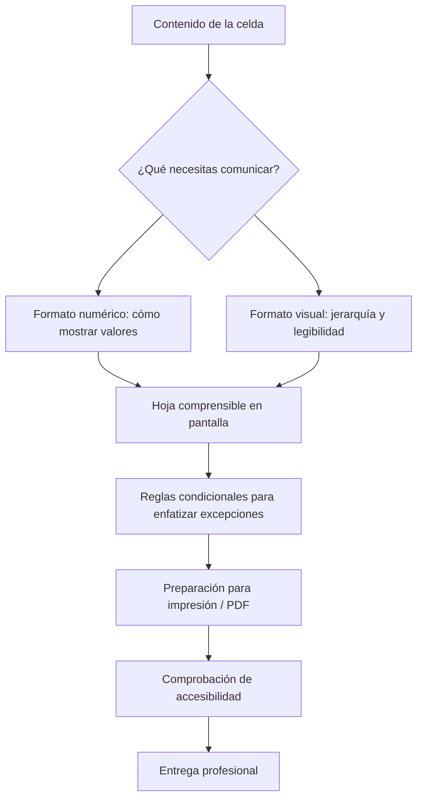
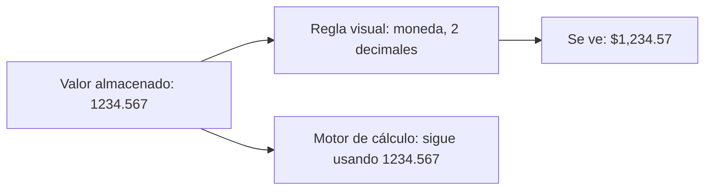
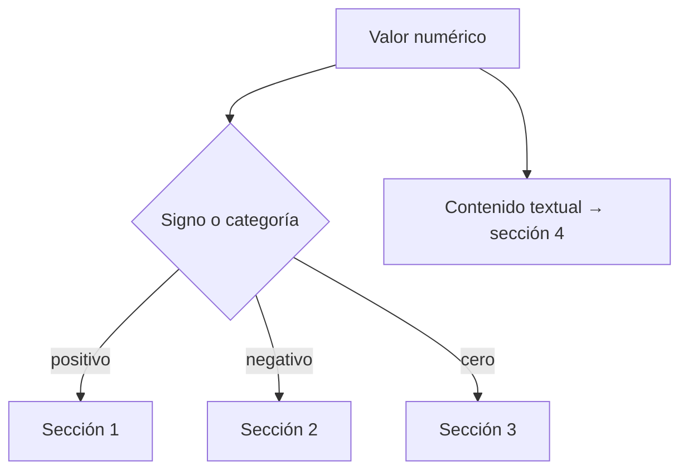
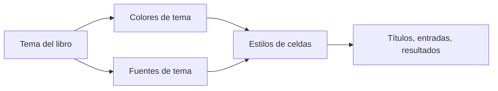
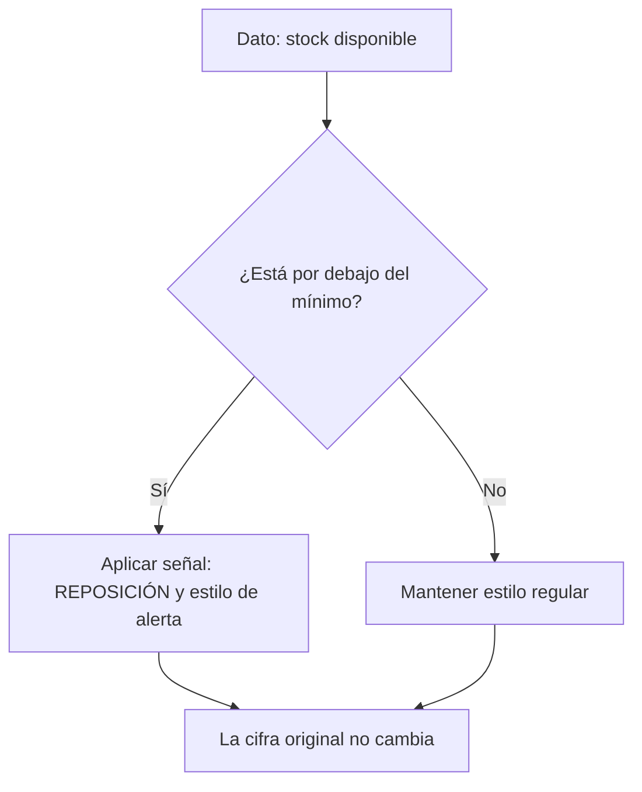
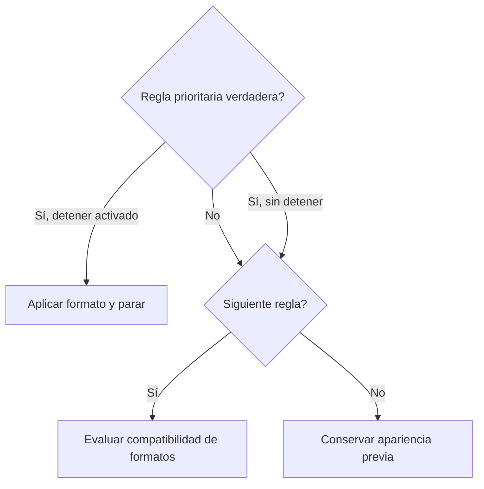
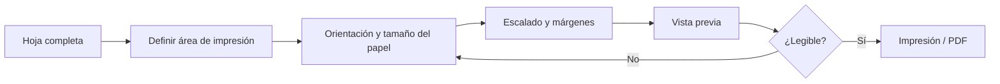
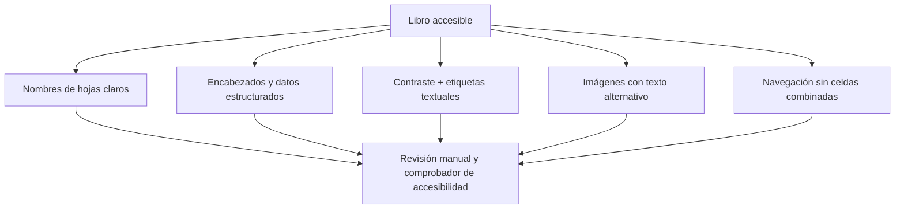
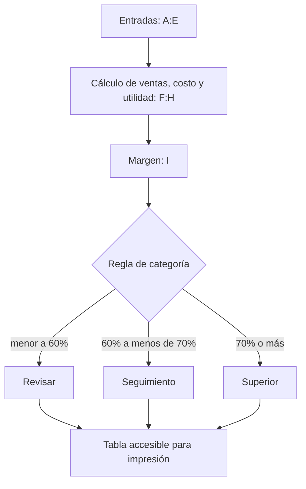

# H04 — Formato, presentación e impresión en Microsoft Excel

> **Programa:** Curso integral de Excel, Google Sheets, VBA y Google Apps Script  
> **Ruta:** I — Microsoft Excel · **Roadmap:** 2.0 (aprobado) · **Módulo:** H04/24  
> **Nivel:** Principiante → intermedio · **Duración orientativa:** 12 horas  
> **Dependencias:** H01 (fundamentos), H02 (interfaz y archivos), H03 (datos y tipos)  
> **Versión editorial:** 1.0 · **Fecha de revisión documental:** 24 de octubre de 2026  
> **Estado:** desarrollado; pendiente de validación académica del estudiante

---

## Cómo utilizar este manual

Este documento constituye el capítulo completo H04, no un resumen de diapositivas. Incluye fundamentos, procedimientos, ejemplos reproducibles, representaciones visuales, diagnóstico de errores, ejercicios, solucionario independiente, proyecto integrador y evaluación. Puedes abrirlo en VS Code, GitHub o cualquier visor Markdown. Los esquemas `mermaid` necesitan un visor que los soporte. Las capturas de pantalla enlazadas requieren conexión a internet.

**Entorno principal:** Excel para Microsoft 365, aplicación de escritorio en **Windows**. Se indican las diferencias pertinentes de Excel para Mac y para la web. Los nombres de menú corresponden a la interfaz de Excel en español; pueden diferir con otras configuraciones.

**Convención regional:** las tablas reproducibles utilizan el estilo conceptual mexicano: pesos MXN; punto decimal `.`; coma para miles. La apariencia real y la sintaxis de códigos de formato dependen de idioma/región y separadores configurados en Excel. Las fórmulas se expresan con nombres en español y `;` como separador de argumentos *cuando hay más de uno*; si tu Excel utiliza coma `,`, adapta el separador. No copies una cadena de apariencia monetaria como dato: escribe números y aplica formato.

**Material recomendado:** crea `H04_Practicas.xlsx` con hojas `Formatos`, `Diseno`, `Impresion`, `Proyecto` y `Pruebas`. Guarda el archivo antes de modificar opciones; practica en una copia cuando se indiquen controles de alto impacto.

### Resultados de aprendizaje

Al finalizar H04 deberás demostrar que puedes:

1. Separar rigurosamente **valor almacenado, tipo de dato, fórmula y presentación**.
2. Aplicar formatos numéricos y construir formatos personalizados con criterios explícitos.
3. Diseñar jerarquía visual con tipografía, alineación, bordes, temas, estilos y dimensiones adecuadas.
4. Agrupar información sin destruir los datos ni obstaculizar la navegación.
5. Crear reglas de formato condicional reproducibles, interpretar su prioridad y diagnosticar superposiciones.
6. Preparar una hoja para distribución impresa o PDF usando áreas, escalado, márgenes, títulos, encabezados y saltos.
7. Evaluar contraste, orden lógico, navegación por teclado y accesibilidad.

### Índice de cobertura aprobado

| Sección | Tema | Subtemas permanentes |
|---|---|---|
| `H04.01` Formatos de celda | `H04.01.01` Formatos numéricos | `.01` número y moneda; `.02` porcentaje; `.03` fechas/horas; `.04` personalizados |
| | `H04.01.02` Formatos visuales | `.01` fuentes; `.02` bordes/rellenos; `.03` alineación |
| `H04.02` Diseño de hojas | `H04.02.01` Organización | `.01` estilos/temas; `.02` dimensiones; `.03` agrupaciones |
| | `H04.02.02` Formato condicional | `.01` reglas; `.02` escalas/iconos; `.03` precedencia |
| `H04.03` Presentación final | `H04.03.01` Impresión | `.01` área/escala; `.02` encabezados; `.03` saltos |
| | `H04.03.02` Accesibilidad | `.01` contraste; `.02` estructura/navegación |

### Mapa general



**Figura 1 (diagrama conceptual):** recorrido desde el contenido hasta un documento listo para distribuir. El formato no sustituye a la calidad de los datos.

---

# H04.01 — Formatos de celda

**Objetivo de sección:** presentar datos de manera coherente sin alterar inadvertidamente su significado matemático. **Tiempo sugerido:** 4 horas.

## H04.01.01 — Formatos numéricos

### Fundamento: contenido, valor y apariencia no son lo mismo

Una celda puede contener `1234.567` y mostrar `$1,234.57`, pero el valor numérico subyacente se mantiene `1234.567` cuando solo se aplica un formato de dos decimales. Las operaciones posteriores utilizan normalmente el valor real, no su representación visible.



**Figura 2:** el formato cambia la representación y, por regla general, no el valor almacenado. Importante: la opción avanzada **Establecer precisión como se muestra** sí modifica permanentemente los valores guardados y puede reducir su exactitud: no la actives en modelos financieros sin comprenderla y guardar una copia.

**Ruta de acceso (Windows):** selecciona una celda o rango → `Inicio > Número` → desplegable de formatos; para opciones detalladas `Ctrl+1 > Número`. En Mac, el cuadro y los atajos pueden diferir; desde `Inicio > Número` se encuentra la alternativa. [Microsoft: formatos disponibles](https://support.microsoft.com/es-es/excel/get-started/available-number-formats-in-excel).


*Figura 3 — Captura real (fuente: [Excel Off The Grid, guía de formatos contables](https://exceloffthegrid.com/number-formats-for-accounting-and-finance/)). Identifica la lista **Categoría** a la izquierda, **Muestra** y el campo **Tipo**. La captura está en inglés y puede no coincidir exactamente con tu edición.*

### H04.01.01.01 — Número y moneda

**Conceptos.** `General` interpreta los valores sin un formato numérico especial. `Número` controla separador de miles y posiciones decimales. `Moneda` añade un símbolo monetario y permite configurar negativos. `Contabilidad` suele alinear símbolos y decimales para reportes financieros. Aplicar `$` **no cambia** el código monetario económico de un dato: hay que etiquetar explícitamente MXN, USD, EUR si existe riesgo de confusión.

| Valor numérico almacenado | Presentación deseada | Tipo o regla |
|---:|---|---|
| `1234.5` | `1,234.50` | Número, dos decimales y separador de miles |
| `1234.5` | `$1,234.50` | Moneda, símbolo `$`, dos decimales |
| `-234.5` | `($234.50)` | Negativos entre paréntesis, cuando el formato elegido lo admita |
| `0` | `—` | Formato personalizado que distingue ceros |

**Procedimiento guiado.**

1. En `Formatos`, escribe `1234.5`, `-234.5` y `0` en `A2:A4`.
2. Selecciona `A2:A4` y presiona `Ctrl+1`.
3. Abre **Número** y configura dos posiciones decimales y separador de miles. Examina la vista previa.
4. Cambia a **Moneda** y prueba distintas presentaciones de negativos. Comprueba visualmente el resultado sin reescribir las celdas.
5. En `B2`, introduce `=A2*2` y verifica que sigue devolviendo el cálculo a partir del valor real.

**Ejemplo profesional.** Un reporte mezcla costos, cantidades y porcentajes. Aplica moneda únicamente a columnas cuyo significado sea monetario; las cantidades se muestran como número sin símbolo y los porcentajes se formatean separadamente. Evita dar la misma apariencia a magnitudes distintas.

**Errores típicos.** Escribir `"$1,234.50"` como texto hace que el valor no sea necesariamente numérico; usar el símbolo de dólar para MXN y USD sin etiqueta induce a confusión; el formato contable no reemplaza un libro mayor ni valida asientos.

### H04.01.01.02 — Porcentaje

El porcentaje expresa una parte relativa a 100. Un valor almacenado de `0.125` se muestra como `12.5%` cuando se aplica formato porcentual; el formato multiplica visualmente por 100 y añade `%`.

| Contenido de celda | Como General | Como % con 1 decimal |
|---|---:|---:|
| `0.125` | 0.125 | 12.5% |
| `1` | 1 | 100.0% |
| `1.25` | 1.25 | 125.0% |
| `-0.08` | -0.08 | -8.0% |

**Trampa frecuente:** si introduces `15` y *luego* aplicas formato porcentaje, puede visualizarse `1500%`; no representa una tasa de 15%. Para representar un 15%, guarda `0.15` (o introduce `15%` en una celda con interpretación correcta).

**Caso: variación presupuestal.** Presupuesto `B2=80000`, gasto real `C2=92000`. En `D2`:

```excel
=(C2-B2)/B2
```

El resultado interno es `0.15`; con formato porcentaje a un decimal se muestra `15.0%`. No copies `15` como valor a D2. Si el presupuesto puede ser cero, **no uses esa fórmula sin manejar la división por cero**: se estudiará formalmente en H07.

**Verificación:** `C2-B2=12000`; `12000/80000=0.15`, por tanto variación +15.0%. Recuerda que la interpretación favorable o desfavorable depende del indicador: una subida de gastos puede ser desfavorable, aunque el porcentaje sea positivo.

### H04.01.01.03 — Fecha y hora

En Excel, las fechas válidas suelen almacenarse como números de serie, y las horas como fracciones de día. El **formato** determina cómo se muestran. No todas las cadenas que parecen fechas son reconocidas como fechas numéricas; esta conversión depende de configuración regional e importación (se estudió en H03).

Ejemplos de apariencia, suponiendo que el contenido sea un valor fecha válido:

| Formato | Muestra ilustrativa | Uso |
|---|---|---|
| `dd/mm/aaaa` (patrón localizado) | `24/10/2026` | Fecha corta regional |
| Fecha larga integrada | `sábado, 24 de octubre de 2026` | Reportes legibles |
| `hh:mm` | `14:30` | Hora del día |
| `[h]:mm` | `27:15` | Duraciones superiores a 24 horas |

**Atención:** los códigos internos para formatos de fecha pueden variar según el idioma. En la documentación inglesa se usa `yyyy`; el español suele usar `aaaa`. La opción más robusta para principiantes es elegir una **categoría de fecha integrada** desde el cuadro de formato y verificar la muestra, no asumir que un código copiado entre instalaciones funcionará sin ajustes.

**Ejemplo de duración.** Con `B2=13:45` y `C2=17:15` como horas válidas, `=C2-B2` produce una fracción de día equivalente a `3:30`. El formato horario explica cómo se visualiza, no convierte mágicamente texto en horas.

**Riesgos.** Si ves `#####`, puede deberse al ancho insuficiente o a una fecha/hora no representable bajo el formato actual (por ejemplo, ciertos valores temporales negativos). Aumenta el ancho y comprueba el dato. Evita interpretar `03/04/2026` sin conocer si el origen es `día/mes` o `mes/día`.

### H04.01.01.04 — Formatos numéricos personalizados

Un formato personalizado es una regla de presentación aplicada **a datos ya almacenados**. Puede definir hasta cuatro secciones delimitadas por punto y coma:

```text
positivos;negativos;ceros;textos
```

La sintaxis concreta y los separadores decimales/millares pueden variar por configuración regional. Los ejemplos de abajo representan el **patrón canónico de la documentación inglesa**: si tu Excel usa separadores distintos, revisa el cuadro `Personalizada > Tipo`.

| Símbolo | Función | Ejemplo |
|---|---|---|
| `0` | Posición obligatoria; rellena ceros | `0000` presenta 42 como `0042` |
| `#` | Posición opcional | `#,##0` agrega agrupación de miles |
| `?` | Reserva espacio para alinear decimales | `0.0?` |
| `.` | Separador decimal (según región) | `0.00` |
| `,` | Agrupación o escala según posición/región | `#,##0` |
| `%` | Muestra valor por 100 más símbolo | `0.0%` |
| `"texto"` | Inserta etiqueta literal | `0" unidades"` |
| `@` | Inserta el contenido textual | `"SKU: "@` |
| `;` | Separa secciones | `0;(0);-;@` |

**Ejemplos progresivos:**

- Básico: `00000` aplicado al número 42 muestra `00042`. **Advertencia:** no recupera ceros iniciales de un identificador que se haya truncado o cambiado de tipo durante una importación; para códigos, generalmente conviene conservar texto desde el origen.
- Intermedio: `0" unidades"` muestra `15 unidades` sin convertir el 15 en texto.
- Profesional: `#,##0.00;[Red](#,##0.00);"—";@` permite diferenciar signos y mostrar ceros como raya. Los nombres de colores también pueden localizarse (`[Rojo]` en UI española). Verifica cómo interpreta tu instalación el código antes de adoptarlo.



**Figura 4:** las secciones de un formato personalizado gobiernan apariencias distintas; **no** son reglas de validación ni cambian la lógica de un cálculo.

**Procedimiento:** selección → `Ctrl+1 > Número > Personalizada` → escribe el formato → observa *Muestra* → confirma → calcula con los valores originales para comprobar que siguen siendo numéricos. En **Excel para la web no se pueden crear formatos personalizados** desde su interfaz; utiliza Excel de escritorio cuando sea necesario. [Fuente oficial](https://support.microsoft.com/es-es/excel/get-started/create-a-custom-number-format).

**Errores comunes y diagnóstico.**

| Síntoma | Posible causa | Acción correcta |
|---|---|---|
| `#####` | Ancho insuficiente / fecha-hora no visualizable | Autoajusta y examina el valor |
| Se ve `1500%` en vez de `15%` | Se guardó `15` y no `0.15` | Corrige el dato original, no solo el estilo |
| Aparecen ceros extra en IDs | Se aplicó `00000` solo como máscara | Define IDs como texto cuando corresponda |
| Diferencias de separador en formatos copiados | Configuración regional | Adapta según la muestra de Excel |
| El total parece no coincidir con cifras redondeadas | El cálculo utiliza valores internos | Distingue redondeo visual de redondeo calculado |

Referencia: [Microsoft, directrices de formatos personalizados](https://support.microsoft.com/es-es/excel/review-guidelines-for-customizing-a-number-format).

## H04.01.02 — Formatos visuales

### H04.01.02.01 — Fuentes y legibilidad

La tipografía codifica jerarquía, no decoración. Debe facilitar que una persona identifique rápidamente un título, un encabezado, un dato de entrada y un resultado.

| Componente | Sugerencia | Por qué |
|---|---|---|
| Título de informe | Negrita y tamaño superior al cuerpo | Establece contexto |
| Encabezado de tabla | Negrita o peso seminegrita; contraste | Separa etiquetas de registros |
| Datos | Tipografía legible; tamaño consistente | Reduce esfuerzo de lectura |
| Notas | Tamaño ligeramente menor, sin sacrificar legibilidad | Distingue instrucciones auxiliares |
| Advertencias | Etiqueta + color + texto | No depende únicamente del color |

**Paso a paso:** selecciona `A1:D1`, aplica negrita, aumenta moderadamente tamaño de fuente, comprueba contraste y evita más de dos familias tipográficas. En `Inicio > Fuente` controla tipografía, tamaño, color y efectos. No uses color de letra muy claro sobre fondo blanco.

**Ejemplo:** en un informe de gastos, establece `A1:D1` como encabezado oscuro con texto blanco y `A2:D20` como cuerpo regular. Mantén cifras alineadas de forma coherente por columna.

### H04.01.02.02 — Bordes y rellenos

Los **bordes** delimitan regiones; los **rellenos** distinguen categorías o jerarquías. Un exceso de bordes gruesos hace más difícil localizar la información importante.

**Principios recomendados:** borde inferior bajo encabezados, líneas discretas entre grupos si es necesario, rellenos suaves para datos y una superficie destacada para resultados. Evita usar solo color para codificar «error», «éxito» o «pendiente».

```text
┌───────────────────────────────────────────────┐
│ REPORTE DE GASTOS       [título + relleno]     │
├─────────────┬──────────────┬──────────────────┤
│ Concepto    │ Categoría    │ Importe          │ ← encabezado
├─────────────┼──────────────┼──────────────────┤
│ Renta       │ Fijo         │ $5,000.00        │
│ Transporte  │ Variable     │   $950.00        │
├─────────────┴──────────────┼──────────────────┤
│ TOTAL                       │ $5,950.00        │ ← mayor énfasis
└─────────────────────────────┴──────────────────┘
```

*Figura 5 (esquema textual, no captura real): jerarquía visual basada en espacios, bordes selectivos y énfasis del total.*

**Paso a paso:** `Inicio > Fuente > Bordes / Color de relleno`; aplica bordes solo donde separen contenido. Comprueba el contraste con texto negro o blanco según fondo. Las líneas de cuadrícula que se ven en pantalla no son equivalentes a bordes creados por el usuario.

### H04.01.02.03 — Alineación, ajuste y orientación

Excel permite alinear horizontal y verticalmente, sangrar, girar texto, ajustar el contenido en varias líneas y combinar celdas. Hay diferencias importantes:

- **Ajustar texto** (*Wrap Text*) modifica la presentación del texto dentro de una celda; puede requerir aumentar o autoajustar la altura de fila.
- **Combinar y centrar** altera la estructura de celdas: si varias celdas contienen valores, combinarlas puede provocar pérdida de contenidos no ubicados en la celda superior izquierda. También dificulta filtrar, seleccionar rangos y utilizar lectores de pantalla. Evítalo dentro de tablas de datos.
- **Centrar en la selección** (cuando esté disponible en escritorio) ofrece una solución visual para títulos sin combinar físicamente todas las celdas del rango.
- **Orientación** rotada puede ahorrar espacio, pero perjudica legibilidad si se exagera.

**Demostración:** introduce `Detalle de gastos operativos correspondientes a octubre de 2026` en A2, fija un ancho estrecho en la columna A, aplica `Inicio > Alineación > Ajustar texto` y autoajusta la altura de la fila. Si el contenido queda oculto, revisa si estableciste una altura fija o combinaste celdas.

**Criterio profesional:** alinear cifras a la derecha y etiquetas a la izquierda suele facilitar comparación; no es una regla obligatoria. En una misma columna mantén decisiones consistentes.

### Síntesis y verificación de H04.01

Antes de continuar, comprueba estas tres preguntas: ¿puedes distinguir un valor de su representación?, ¿puedes conseguir una apariencia homogénea sin escribir símbolos monetarios dentro de los datos?, ¿puedes explicar por qué conviene evitar la combinación de celdas en una tabla?

**Referencias principales:** [formatos](https://support.microsoft.com/es-es/excel/get-started/available-number-formats-in-excel), [personalizados](https://support.microsoft.com/es-es/excel/review-guidelines-for-customizing-a-number-format), [ajustar texto](https://support.microsoft.com/es-es/excel/wrap-text-in-a-cell-in-excel).

---
# H04.02 — Diseño y organización de hojas

**Objetivo de sección:** crear interfaces de hoja comprensibles y mantenibles, y distinguir el diseño estático de las señales visuales basadas en reglas. **Tiempo sugerido:** 4 horas.

## H04.02.01 — Organización visual

### H04.02.01.01 — Estilos y temas

Un **estilo de celda** es una configuración reutilizable que puede contener tipografía, relleno, bordes, alineación y formatos numéricos; un **tema** es una combinación de colores, fuentes y efectos aplicables al documento que influye sobre estilos vinculados al tema. No son exactamente lo mismo.



*Figura 6 (diagrama conceptual): los estilos derivados del tema facilitan la coherencia y pueden actualizarse conjuntamente al cambiar de tema.*

**¿Por qué estilos y no formato manual?** Si 25 hojas usan un mismo estilo para un indicador, es más sencillo cambiarlo centralizadamente que buscar todas las celdas. También se reduce la posibilidad de generar variaciones arbitrarias de tamaño, color o símbolo.

**Procedimiento (escritorio):**

1. Crea una hoja llamada `Diseno`, con título en A1, encabezados en A3:D3, registros en A4:D8 y total en D9.
2. Selecciona A1 y ve a `Inicio > Estilos de celda`; aplica un estilo de encabezado.
3. Aplica un estilo adecuado a A3:D3 y uno de resultados a D9. Compara con aplicar formato manual a cada celda.
4. Investiga `Diseño de página > Temas` para elegir colores y fuentes coordinados.
5. Cambia el tema y revisa qué estilos vinculados al tema se actualizan.
6. Si el entorno lo permite, crea un estilo personalizado `Entrada` con relleno discreto; úsalo en varias celdas.

**Regla de diseño:** define roles semánticos visuales, por ejemplo `Título`, `Encabezado`, `Dato`, `Entrada`, `Resultado`, `Advertencia`. Un mismo rol debe verse igual en todas las hojas. Evita crear 15 estilos diferentes para 15 categorías equivalentes.

**Precaución técnica:** los estilos de celda se guardan dentro del libro. Copiar hojas de muchas fuentes puede introducir variantes de estilos y aumentar la complejidad; no asumas que copiar una hoja mantiene una guía visual consistente entre libros.

Fuente: [Microsoft: aplicar o crear estilos de celda](https://support.microsoft.com/en-us/excel/apply-create-or-remove-a-cell-style).

### H04.02.01.02 — Dimensiones de filas y columnas

El ancho de columna de Excel en vista normal suele medirse en unidades relacionadas con caracteres de la fuente estándar; la altura de fila se mide en puntos. Por eso **ancho 20 no significa 20 píxeles ni 20 centímetros**. En la vista Diseño de página se pueden visualizar medidas físicas bajo la configuración adecuada.

| Acción | Ruta práctica (Windows) | Situación |
|---|---|---|
| Ancho manual | Selecciona columna → `Inicio > Formato > Ancho de columna` | Columnas de medidas homogéneas |
| Autoajustar ancho | Doble clic en borde derecho del encabezado de columna | Texto que debe ser visible |
| Alto manual | Selecciona fila → `Inicio > Formato > Alto de fila` | Distribución consistente |
| Autoajustar alto | Doble clic en borde inferior del número de fila | Texto ajustado o multilineal |
| Ocultar/mostrar | `Inicio > Formato > Ocultar y mostrar` | Información auxiliar o temporal |

**Ejemplo:** con una columna `Descripción` que contiene `Suscripción anual de mantenimiento preventivo`, primero aplica `Ajustar texto`; después establece un ancho razonable y autoajusta el alto. No agrandes todas las columnas hasta que el informe se vuelva inmanejable o ilegible al imprimir.

**Problema frecuente:** un valor `1200000` aparece como `#######`. No significa necesariamente error en la fórmula; verifica primero si cabe visualmente en la columna. También puede aparecer en casos de fechas/horas negativas no representables.

**Distinción:** ocultar una columna no protege su contenido. Un usuario que puede editar el libro podría mostrarla. La seguridad y los permisos se tratarán en H23.

Fuente: [Microsoft: cambiar ancho y alto](https://support.microsoft.com/es-es/excel/change-the-column-width-and-row-height).

### H04.02.01.03 — Agrupaciones y esquemas

La **agrupación** permite contraer y expandir filas o columnas relacionadas sin eliminarlas. Es útil para separar información resumida de su detalle.

```text
Nivel   -/+  Categoría                     Importe
 1       -   GASTOS OPERATIVOS            $9,200
 2       +   [detalle de gastos oculto]

Al expandir:
 1       -   GASTOS OPERATIVOS            $9,200
 2       -      Renta                     $5,000
 2              Electricidad              $1,200
 2              Internet                    $600
 2              Transporte                $2,400
```

*Figura 7 (esquema conceptual, no captura): los detalles siguen existiendo aunque estén contraídos. Los importes son ficticios.*

**Procedimiento:**

1. Registra en `Diseno` un bloque de detalle consecutivo y una fila de resumen fuera del bloque que agruparás.
2. Selecciona las **filas completas** del detalle.
3. Ve a `Datos > Esquema > Agrupar` (la ubicación puede variar ligeramente).
4. Comprueba la presencia de controles `+`/`−` en el margen.
5. Contrae y expande; revisa que el resumen permanezca visible.
6. Usa `Datos > Desagrupar` cuando necesites retirar el esquema.

Microsoft documenta esquemas de hasta ocho niveles para determinadas configuraciones de Excel. No significa que convenga utilizar ocho: una estructura demasiado profunda dificulta comprenderla. [Referencia oficial](https://support.microsoft.com/es-es/excel/outline-group-data-in-a-worksheet).

**No confundas** agrupar con ocultar filas manualmente: una agrupación comunica que hay detalle expandible, mientras que ocultar solo retira temporalmente su visualización.

## H04.02.02 — Formato condicional

Un **formato condicional** aplica una apariencia cuando se cumple una regla basada en el valor, una comparación, una fórmula u otra condición admitida. A diferencia de un formato fijo, la apariencia puede cambiar cuando cambian los datos.



*Figura 8: el formato condicional comunica una situación; no es un sistema de alerta externo ni modifica el inventario.*

### H04.02.02.01 — Reglas de resaltado

Las reglas más accesibles están en `Inicio > Formato condicional`. Pueden resaltar valores mayores o menores que una referencia, duplicados, textos concretos y fechas, entre otros criterios.

**Ejemplo reproducible: inventario.** Escribe en `Diseno`:

| Fila | A: Producto | B: Stock | C: Mínimo | D: Estado |
|---:|---|---:|---:|---|
| 1 | Producto | Stock | Mínimo | Estado |
| 2 | Cuaderno | 14 | 10 | Normal |
| 3 | Pluma | 5 | 12 | Reposición |
| 4 | Carpeta | 2 | 5 | Reposición |
| 5 | Marcador | 20 | 8 | Normal |
| 6 | Libreta | 8 | 8 | Normal |

**Caso simple:** para resaltar `B2:B6` cuando un stock sea inferior a `10`, selecciona `B2:B6` → `Formato condicional > Reglas para resaltar celdas > Es menor que…` → `10` → elige formato. Se resaltarán B3 y B4 (y eventualmente otros valores bajo diez). Esta regla **no evalúa los mínimos particulares por producto**.

**Caso con mínimo por fila:** para resaltar cada registro que tenga stock menor que su mínimo propio, selecciona `A2:D6` → `Formato condicional > Nueva regla > Utilice una fórmula que determine las celdas para aplicar formato` → escribe:

```excel
=$B2<$C2
```

`$B` y `$C` fijan las **columnas** de stock y mínimo; el `2` es relativo para que la regla se adapte a cada fila del rango. La fórmula deberá ingresarse respecto de la celda superior izquierda A2. Este es un **adelanto contextual** de referencias mixtas, cuyo fundamento formal corresponde a H05. El resultado esperado es resaltar las filas de **Pluma** y **Carpeta**. La fila Libreta no se resalta porque `8 < 8` es falso.

**Verificación manual:** 14≥10, 5<12, 2<5, 20≥8, 8=8. Hay dos registros bajo mínimo, no tres.

**Errores típicos:** incluir encabezados en la selección, usar referencias absolutas de fila (`$B$2`) para un bloque que necesita reglas por fila, aplicar la regla a una columna incorrecta o confundir `<=` con `<`.

### H04.02.02.02 — Barras de datos, escalas de color e iconos

Estas herramientas destacan patrones sin tener que leer todos los números:

| Herramienta | Representación | Cuándo utilizarla | Riesgo |
|---|---|---|---|
| Barras de datos | Longitud dentro de la celda | Comparar magnitudes | Escalas engañosas si mezclas unidades |
| Escalas de color | Gradiente con valores mínimos/intermedios/máximos | Distinguir extremos y distribución | El color no es preciso por sí solo |
| Conjuntos de iconos | Flechas, semáforos u otros símbolos | Clasificar por umbrales | Umbrales automáticos mal interpretados |

**Ejemplo:** para una columna `Cumplimiento` con valores `0.65`, `0.90`, `1.05`, aplica formato **Porcentaje** y posteriormente un conjunto de iconos que hayas configurado con umbrales explícitos. Para evaluar `>=100%`, el umbral numérico correspondiente es `1.00`; **no uses 100 como umbral numérico**.

```text
Cumplimiento (valor real → presentación)
0.65 →  65%   [■■■■■■□□□□]  Por debajo de meta
0.90 →  90%   [■■■■■■■■■□]  Cerca de meta
1.05 → 105%   [■■■■■■■■■■]  Meta superada
```

*Figura 9: barras conceptuales, no salida exacta de la escala automática de Excel. Las barras reales dependen del mínimo/máximo y ajustes de la regla.*

**Procedimiento:** selecciona una columna numérica → `Inicio > Formato condicional > Barras de datos / Escalas de color / Conjuntos de iconos`. Después revisa `Administrar reglas > Editar regla` y confirma el **tipo de umbral** (Número, Porcentaje, Percentil, Fórmula, según aplique), así como el valor de corte.

**Advertencia:** un umbral de tipo **Porcentaje** dentro del administrador puede representar porcentaje del rango entre mínimo y máximo de los datos; no equivale necesariamente al porcentaje numérico que guarda cada celda. Para metas del 80%, 100% o 120% normalmente conviene utilizar **Número** con umbrales `0.8`, `1.0`, `1.2` y validar sobre ejemplos.

### H04.02.02.03 — Precedencia, conflictos y administración de reglas

Si varias reglas afectan la misma celda y compiten por el mismo formato, Excel necesita determinar cuál prevalece. El **Administrador de reglas de formato condicional** muestra orden, tipo, estilo y rango `Se aplica a`.


*Figura 10 — Captura real (fuente: [ICAEW, artículo sobre prioridad de reglas en Excel, 2025](https://www.icaew.com/technical/technology/excel-community/excel-community-articles/2025/excel-whats-occurrin-07)). Observa la columna de formato de cada regla, el orden vertical y la selección del rango. La captura ilustra un comportamiento concreto; su presentación puede cambiar entre versiones.*

**Ejemplo de conflicto:** supongamos que el valor de A2 es `7` y existen estas reglas sobre A2:

1. `A2 > 0`: relleno verde.
2. `A2 > 5`: relleno rojo.

Las dos condiciones son verdaderas. Si ambas compiten por el **mismo atributo** (relleno), se aplica la de **mayor prioridad** (posición superior), salvo ajustes que modifiquen el comportamiento. Si una regla colorea el relleno y otra establece el tipo de letra, pueden coexistir porque no necesariamente entran en conflicto sobre el mismo atributo.

**Detener si es verdad (*Stop If True*)** indica que, si se cumple una regla, no se aplicarán las posteriores sobre las celdas afectadas. No siempre puede configurarse para barras de datos, escalas de color y conjuntos de iconos. No presupongas que aparece para cualquier tipo de regla.

**Procedimiento de auditoría:**

1. Selecciona el rango a revisar.
2. Abre `Inicio > Formato condicional > Administrar reglas`.
3. Cambia el desplegable de reglas a **Esta hoja** si deseas inspeccionar todas, no solo la selección.
4. Inspecciona **Se aplica a**: ¿contiene el rango previsto?
5. Ordena las reglas de excepción más importantes por encima de reglas más generales.
6. Evalúa si debes activar **Detener si es verdad** (cuando corresponda).
7. Edita, elimina o combina reglas innecesarias y prueba valores límite.



*Figura 11 (modelo conceptual simplificado): la prioridad, el atributo afectado y «Detener si es verdad» intervienen en el resultado.*

**Caso práctico adicional:** establece reglas excluyentes para una columna de cumplimiento: `menor que 0.8` = Crítico; `desde 0.8 hasta menos de 1` = Seguimiento; `al menos 1` = Meta. Define los umbrales evitando solapamientos. La etiqueta de texto junto al color asegura accesibilidad.

**Problemas frecuentes**

| Problema | Diagnóstico | Corrección |
|---|---|---|
| Todo el bloque tiene un solo color | Referencia de fila absoluta | Revisar fórmulas relativas y `Se aplica a` |
| Cambio de color inesperado | Varias reglas en conflicto | Revisar prioridad/atributos |
| Barras cambian al filtrar o ampliar el rango | Mínimos/máximos relativos | Fijar umbrales cuando el caso lo exija |
| Iconos no reflejan meta porcentual | Tipo de umbral incorrecto | Usar Número 0.8/1.0, validar |
| Lentitud en libro grande | Reglas duplicadas/fragmentadas | Simplificar y consolidar reglas |

Fuente: [Microsoft: formato condicional, reglas y precedencia](https://support.microsoft.com/es-es/excel/use-conditional-formatting-to-highlight-information-in-excel).

### Laboratorio de diseño: miniinforme

Reproduce esta tabla en `Diseno` desde F1:

| Categoría | Presupuesto | Real | Cumplimiento |
|---|---:|---:|---:|
| Marketing | 12000 | 11500 | `=H2/G2` |
| Operación | 18000 | 20700 | `=H3/G3` |
| Tecnología | 25000 | 23000 | `=H4/G4` |
| Formación | 5000 | 4500 | `=H5/G5` |

> **Interpretación importante:** `Real / Presupuesto` no siempre es «cumplimiento» deseable; en **gastos**, un valor de 115% implica sobre-ejecución presupuestal. Usa el encabezado `Ejecución presupuestal` si esa es la definición correcta y no reutilices los mismos umbrales semánticos que para ventas.

**Resultados exactos:** `11500/12000 = 95.8333...%`, `20700/18000 = 115%`, `23000/25000 = 92%`, `4500/5000 = 90%`. Al presentar con un decimal: 95.8%, 115.0%, 92.0%, 90.0%.

### Síntesis H04.02

Una hoja profesional debe permitir distinguir, en pocos segundos, **qué se captura, qué se calcula, qué representa un indicador y qué requiere atención**. Las herramientas visuales deben tener una relación explícita con un significado; no conviertas el color en sustituto de una definición.

---

# H04.03 — Presentación final, impresión y accesibilidad

**Objetivo de sección:** asegurar que una hoja siga siendo comprensible al distribuirse, imprimirse, exportarse o leerse con tecnologías de apoyo. **Tiempo sugerido:** 4 horas.

## H04.03.01 — Impresión

### H04.03.01.01 — Área de impresión, orientación, márgenes y escalado

La impresión transforma una cuadrícula potencialmente extensa en páginas físicas limitadas. Debemos controlar **qué se imprime**, **cómo se divide** y **si el contenido sigue siendo legible**.



*Figura 12: la vista previa es una comprobación, no un trámite opcional.*

**Área de impresión (*Print Area*).** Es el rango o conjuntos de rangos que Excel incluye por defecto al imprimir una hoja. En `Impresion`, selecciona `A1:F25` → `Diseño de página > Área de impresión > Establecer área de impresión`. Para eliminarla: `Borrar área de impresión`. Excel conserva ese ajuste con el libro. Si defines varias áreas no contiguas, normalmente se imprimen como áreas separadas; compruébalo en la vista previa.

**Orientación.** Vertical conviene a reportes altos y angostos; horizontal a tablas con muchas columnas. No es suficiente cambiar a horizontal si hay demasiadas columnas: quizá debas reducir columnas auxiliares, reorganizar el informe o repartirlo entre páginas.

**Márgenes.** Definen espacio reservado alrededor del contenido y pueden dejar lugar a encabezados y pies de página. Un margen demasiado pequeño puede recortar información al imprimir, según la impresora. Visualízalo en `Archivo > Imprimir`.

**Escalado.** Las opciones más habituales son:

| Opción | Efecto | Riesgo |
|---|---|---|
| Sin escala | Mantiene tamaño habitual | Generar muchas páginas horizontales |
| Ajustar todas las columnas a una página | Reduce ancho hasta caber | Texto demasiado pequeño si hay muchas columnas |
| Ajustar hoja a una página | Comprime ancho y alto | Ilegibilidad en hojas largas |
| 1 página de ancho y alto automático | Mantiene todas las columnas juntas, permite varias páginas verticales | Suele ser buena alternativa para tablas largas |

**Recomendación profesional:** para un informe de 200 registros, utiliza **1 página de ancho y varias de alto**, en lugar de comprimir todo en una sola página. La opción `Ajustar a 1 página de ancho por 1 de alto` es apropiada solo si el contenido sigue siendo legible.

**Procedimiento paso a paso:**

1. Elige el rango final que quieres distribuir.
2. Define área de impresión.
3. Ve a `Diseño de página > Orientación` y elige según anchura real.
4. Define el tamaño de papel (por ejemplo, A4 o carta, según destinatarios).
5. Configura márgenes y escalado mediante `Diseño de página > Configurar página`.
6. Abre `Archivo > Imprimir`, revisa **todas** las páginas de la vista previa.
7. Corrige columnas recortadas, filas sin encabezado, páginas casi vacías o fuente demasiado pequeña.
8. Guarda el libro y, si se requiere, exporta o imprime a PDF desde un mecanismo compatible.

**Compatibilidad:** Microsoft señala que determinadas opciones avanzadas de **Ajustar a una página** de escritorio no están disponibles de la misma forma en Excel para la web. Si el procedimiento no aparece, abre el archivo con Excel de escritorio. [Referencia oficial](https://support.microsoft.com/es-es/excel/fit-to-one-page-in-excel).

**Ejemplo conceptual de paginación**

```text
PÁGINA 1                                      PÁGINA 2
┌───────────────────────────┐                 ┌───────────────────────────┐
│ Informe octubre           │                 │ Informe octubre           │
│ Producto | Cant. | Total  │                 │ Producto | Cant. | Total  │ ← encabezados repetidos
│ ... filas 1 a 30 ...      │                 │ ... filas 31 a 60 ...     │
│ Página 1 / 2              │                 │ Página 2 / 2              │
└───────────────────────────┘                 └───────────────────────────┘
```

*Figura 13: concepto de títulos repetidos. El reparto exacto depende del tamaño de papel, alturas, escalado, márgenes y controlador de impresión.*

Fuente: [Microsoft: área de impresión](https://support.microsoft.com/es-es/excel/set-or-clear-a-print-area-on-a-worksheet) y [configuración de página](https://support.microsoft.com/es-es/excel/page-setup).

### H04.03.01.02 — Encabezados, pies y títulos repetidos

Estas expresiones se refieren a cosas diferentes:

- **Encabezado/pie de página**: texto o elementos insertados arriba/abajo de una página impresa, como nombre de documento, fecha o número de página.
- **Títulos de impresión**: filas o columnas existentes en la hoja que se repiten en cada página para que la tabla siga siendo interpretable.
- **Encabezados de fila/columna de Excel**: letras A, B, C y números 1, 2, 3 de la interfaz; no son lo mismo que los nombres de columnas de tus datos.

**Encabezado/pie.** Desde Excel de escritorio, utiliza `Insertar > Encabezado y pie de página` o el cuadro `Configurar página`; añade nombre del documento y numeración cuando corresponda. No inventes datos en un pie (por ejemplo, «auditoría validada») si no ha ocurrido tal validación.


*Figura 14 — Captura real de una edición anterior de Excel, fuente: [Ablebits, repetir encabezados](https://www.ablebits.com/office-addins-blog/repeat-header-rows-excel/). Observa la pestaña **Sheet/Hoja** y el campo **Rows to repeat at top/Filas para repetir en la parte superior**. Es una referencia de ubicación visual, no un diseño garantizado para Excel 365.*

**Repetir títulos.** Si la fila 1 contiene `Producto | Cantidad | Importe` y habrá varias páginas verticales:

1. Abre `Diseño de página > Imprimir títulos`.
2. En el apartado de hoja, ubica **Filas para repetir en extremo superior**.
3. Escribe `$1:$1` para repetir la primera fila. Para repetir encabezado de dos filas: `$1:$2`.
4. Observa el resultado en vista previa de varias páginas.

Si el comando está deshabilitado, comprueba que no estás editando una celda, no has seleccionado varias hojas o un objeto incompatible y que la configuración de impresión del sistema es adecuada. En Excel para la web no están disponibles las mismas opciones de repetir títulos al imprimir; utiliza la aplicación de escritorio. [Microsoft: títulos repetidos](https://support.microsoft.com/es-es/excel/repeat-specific-rows-or-columns-on-every-printed-page).

**Precaución:** «Inmovilizar paneles» mantiene encabezados visibles al desplazarte en pantalla, pero **no sustituye** a repetir títulos impresos.

### H04.03.01.03 — Saltos de página

Un **salto de página** indica dónde termina una página y comienza otra al imprimir. Excel puede insertarlos automáticamente; en escritorio también puedes añadir y administrar saltos manuales.

**Procedimiento:** abre `Vista > Vista previa de salto de página`, observa líneas de separación y, cuando sea compatible, ajusta o inserta saltos mediante `Diseño de página > Saltos`. Revisa en vista previa de impresión, ya que cambios en escala, márgenes o papel pueden alterar la distribución.

**Caso de uso:** un reporte contiene cinco departamentos. Puedes intentar separar las secciones para evitar que el título de un departamento quede al final de una página mientras el detalle aparece en la siguiente. Si forzar un salto produce páginas casi vacías, reconsidera el orden o el escalado.

**Problemas y correcciones**

| Síntoma | Causa probable | Corrección |
|---|---|---|
| 9 columnas se reparten en dos páginas anchas | Escalado sin controlar | Ajustar 1 página de ancho o usar horizontal |
| Los encabezados faltan en página 2 | No hay títulos repetidos | Configurar `$1:$1` |
| Muchas páginas en blanco | Área de impresión o formato residual fuera del rango útil | Revisar área, saltos y extensión de impresión |
| Fuente diminuta | Forzar toda la hoja en una página | Permitir varias páginas de alto |
| En PDF aparece información auxiliar | Área de impresión amplia | Ajustar a rango de entrega |

## H04.03.02 — Accesibilidad

La **accesibilidad** consiste en que las personas puedan leer, comprender y navegar la hoja usando diversas capacidades y tecnologías, incluidos lectores de pantalla. Una hoja puede ser estéticamente agradable y, aun así, resultar difícil de utilizar.

### H04.03.02.01 — Contraste y señales redundantes

No dependas solo de «rojo = malo» y «verde = bueno». Personas con alteraciones de percepción del color, usuarios de impresión monocromática o lectores de pantalla pueden no captar ese significado.

**Diseño robusto:** utiliza **color + texto + valor**.

| Indicador | Diseño ambiguo | Diseño accesible |
|---|---|---|
| Pedido retrasado | Celda roja sin explicación | `Retrasado · 4 días` + señal visual |
| Meta lograda | Celda verde únicamente | `Cumplido · 103%` + icono/estilo |
| Stock bajo | Fondo naranja sin texto | `REPOSICIÓN · 3 unidades` |

**Buenas prácticas:** texto claramente legible sobre su fondo, evitar tipografías diminutas, usar tamaños coherentes, no saturar la hoja de colores y comprobar cómo se ve en blanco y negro. Un contraste satisfactorio de un elemento no garantiza accesibilidad del libro completo.

**Comprobación:** `Revisar > Comprobar accesibilidad` (nombre y ubicación pueden variar). Revisa las advertencias y decide cómo corregirlas; el comprobador no garantiza por sí solo que el documento sea accesible. [Microsoft: buenas prácticas de accesibilidad en Excel](https://support.microsoft.com/en-us/accessibility/excel/accessibility-best-practices-with-excel-spreadsheets).

### H04.03.02.02 — Estructura, encabezados y navegación

La accesibilidad también depende de la **estructura lógica**:

1. Escribe un título descriptivo y contenido orientador en una ubicación predecible (a menudo A1).
2. Utiliza nombres únicos y descriptivos para las hojas (`Ventas_Oct`, `Inventario`, `Resumen`).
3. Mantén encabezados de columna reconocibles y relaciones claras entre campos.
4. Evita filas y columnas completamente vacías en mitad de la tabla de datos; pueden interrumpir la lectura y confundir la extensión del conjunto.
5. Evita **combinar celdas** dentro de tablas estructuradas: puede perjudicar la navegación con lectores de pantalla.
6. Añade texto alternativo significativo a gráficos e imágenes informativos; describe el mensaje, no solo «imagen de gráfico».
7. Escribe vínculos con texto descriptivo (`Manual de captura de inventario`) y no solo `haz clic aquí`.
8. Identifica unidades, moneda, periodo, fuente y fecha de actualización.
9. Usa tablas de Excel con encabezados cuando corresponda, como se desarrollará en H06.
10. Verifica navegación por teclado y lectura del documento antes de distribuirlo.



*Figura 15: la accesibilidad es una propiedad del conjunto de decisiones de diseño, no solo del contraste.*

**Ejemplo de reestructuración.** Antes: una tabla con encabezados combinados, tres filas vacías entre bloques y colores sin leyenda. Después: una fila única de encabezados, registros consecutivos, columna `Estado` con etiquetas y leyenda de métricas. Esta reorganización mejora también la compatibilidad con filtros, análisis y automatización.

**¿Qué cambia en Google Sheets?** Se transfieren los principios generales (encabezados, contraste, nombres de hojas y evitar depender del color), pero la ubicación de menús, opciones de estilos y comprobadores no es idéntica. La ruta G estudiará sus equivalencias sin asumir que los controles de Excel existen igual en Sheets.

### Lista de verificación para entregar un informe

- [ ] El título indica propósito, periodo y unidad monetaria cuando corresponde.
- [ ] No hay valores derivados escritos manualmente cuando deberían calcularse.
- [ ] Los formatos corresponden al tipo y significado de los datos.
- [ ] Los negativos y ceros son distinguibles y no se esconden resultados relevantes.
- [ ] Las reglas condicionales tienen umbrales explícitos y auditables.
- [ ] No hay números mostrados como `#####`.
- [ ] Los encabezados de la tabla siguen visibles o repetidos según el medio.
- [ ] La vista previa de **todas** las páginas es legible.
- [ ] Los colores no son la única señal de estados o excepciones.
- [ ] Las hojas tienen nombres descriptivos; no hay celdas combinadas dentro de tablas de datos.
- [ ] Los enlaces y gráficos tienen descripciones interpretables.
- [ ] Se ejecutó revisión de accesibilidad y se resolvieron los problemas relevantes.

**Referencias:** [Microsoft: accesibilidad en Excel](https://support.microsoft.com/en-us/accessibility/excel/accessibility-best-practices-with-excel-spreadsheets) y [herramientas de accesibilidad](https://support.microsoft.com/en-us/accessibility/excel/accessibility-tools-for-excel).

---
# Parte práctica — Ejercicios SIN soluciones

> **Instrucciones comunes:** trabaja en `H04_Practicas.xlsx`; usa Excel de escritorio para opciones avanzadas que no estén disponibles en la web. No modifiques los valores originales salvo que un enunciado lo pida. Cada ejercicio debe incluir una captura o anotación del estado final y una explicación breve de la decisión visual. Guarda versiones intermedias si vas a experimentar con prioridades o configuraciones de impresión. **No consultes el solucionario hasta terminar la práctica.**

## Prácticas H04.01 (cinco ejercicios)

### H04.01-E01 — Valor frente a presentación · Básico

**Objetivo:** reconocer que el formato visual suele conservar el valor numérico.

**Datos iniciales (hoja `Formatos`):** introduce los siguientes números en `A2:A6`, sin símbolos monetarios escritos como texto.

| Celda | Valor |
|---|---:|
| A2 | 42.758 |
| A3 | 1500 |
| A4 | -120.6 |
| A5 | 0 |
| A6 | 0.125 |

**Instrucciones:** 1) aplica `Número` con 2 decimales a A2; 2) aplica `Moneda` MXN con 2 decimales a A3 y A4; 3) aplica número con 2 decimales a A5; 4) aplica porcentaje con 1 decimal a A6; 5) escribe `=A2*2` en B2 y registra lo que ves comparado con la multiplicación del valor real.

**Restricciones:** no uses copiar/pegar como texto para simular formatos; no actives precisión como se muestra.

**Resultado esperado:** cinco presentaciones coherentes y cálculo B2 basado en `42.758`.

**Criterio (10 pts):** 6 aplicación de formatos, 2 preservación de valores, 2 interpretación.

### H04.01-E02 — Formato de un registro financiero · Intermedio

**Objetivo:** seleccionar formato según unidad y papel semántico.

Crea una tabla desde `D1:G5`:

| Concepto | Unidades | Precio unitario (MXN) | Total (MXN) |
|---|---:|---:|---|
| Cuadernos | 5 | 35.5 | `=E2*F2` |
| Plumas | 12 | 12 | `=E3*F3` |
| Carpetas | 3 | 49.9 | `=E4*F4` |
| Marcadores | 8 | 20.25 | `=E5*F5` |

**Instrucciones:** 1) aplica entero sin decimales a las unidades; 2) aplica moneda con dos decimales a precios e importes; 3) alinea de manera consistente los importes; 4) añade un total en G6 con `=SUMA(G2:G5)`; 5) explica por qué no se usa formato moneda para unidades.

**Resultado esperado:** tabla legible con total general correcto.

**Criterio (10 pts):** 4 semántica del formato, 4 total/cálculos, 2 legibilidad.

### H04.01-E03 — Porcentajes y valores límite · Intermedio

**Objetivo:** interpretar porcentajes desde valores decimales almacenados.

En A1:D4:

| Indicador | Meta | Real | Cumplimiento |
|---|---:|---:|---|
| Atención de pedidos | 800 | 760 | `=C2/B2` |
| Ventas (MXN) | 80000 | 82000 | `=C3/B3` |
| Devoluciones máximas | 100 | 8 | `=C4/B4` |

**Instrucciones:** 1) calcula D2:D4; 2) muestra dos decimales como porcentaje; 3) escribe qué significa cada porcentaje y si un valor más alto es necesariamente mejor; 4) demuestra qué ocurriría al escribir el número `15` en una celda y darle formato porcentaje.

**Restricciones:** no conviertas los resultados a texto.

**Resultado esperado:** porcentajes correctos e interpretación no simplista.

**Criterio (10 pts):** 5 cálculos, 5 razonamiento.

### H04.01-E04 — Fechas, horas y duraciones · Intermedio

**Objetivo:** distinguir formatos de fecha/hora de duraciones.

En A1:C3:

| Evento | Inicio | Fin |
|---|---|---|
| Turno matutino | 08:15 | 17:45 |
| Turno vespertino | 13:30 | 21:00 |

**Instrucciones:** 1) captura horas reconocidas por Excel; 2) calcula en D2:D3 `=C2-B2` y `=C3-B3`; 3) usa formato hora `hh:mm` para mostrar la duración; 4) en E2 introduce `=27.5/24` y aplica `[h]:mm`; 5) explica por qué 27:30 no equivale a 03:30 como duración, aunque el formato de hora del reloj pueda mostrar horas módulo 24.

**Resultado esperado:** horas de duración calculadas y una duración mayor a un día mostrada correctamente.

**Criterio (10 pts):** 4 fórmulas, 4 formato, 2 distinción conceptual.

### H04.01-E05 — Formatos personalizados y auditoría · Avanzado

**Objetivo:** construir y validar máscaras sin confundirlas con almacenamiento textual.

En `Formatos` introduce: `D10=42`, `D11=15`, `D12=-235.5`, `D13=0`, `D14=1234.5`.

**Instrucciones:** 1) aplica a D10 el formato personalizado `00000`; 2) aplica a D11 `0" unidades"`; 3) diseña un formato adecuado a D12:D14 para distinguir negativos entre paréntesis, ceros como raya y positivos con dos decimales; 4) inspecciona barra de fórmulas para comprobar que D10 sigue siendo 42; 5) explica cuándo sería incorrecto confiar en la máscara `00000` para preservar un código de producto.

**Resultado esperado:** presentación coherente y justificación del tratamiento de identificadores.

**Restricciones:** la puntuación en códigos deberá adaptarse a la configuración de tu Excel. No cambies el dato para alcanzar un efecto estético.

**Criterio (10 pts):** 5 formatos, 3 validación, 2 seguridad de datos.

## Prácticas H04.02 (cinco ejercicios)

### H04.02-E01 — Guía de estilos de un informe · Básico

**Objetivo:** establecer jerarquía visual.

**Datos:** crea una hoja `Diseno` con un título en A1 (`Reporte de desempeño`), encabezados en A3:D3 (`Área`, `Responsable`, `Resultado`, `Estado`) y tres registros ficticios en A4:D6.

**Instrucciones:** 1) define estilos para título, encabezado, registro y resultado; 2) usa máximo dos familias tipográficas; 3) aplica color de forma consistente; 4) escribe una pequeña leyenda de estilos; 5) prueba un cambio de tema si tu edición lo permite.

**Resultado esperado:** informe con roles visuales distinguibles, sin pérdida de información.

**Criterio (10 pts):** 4 jerarquía, 3 consistencia, 3 explicación.

### H04.02-E02 — Dimensiones, bordes y alineación · Básico

**Objetivo:** mejorar legibilidad con tamaños y alineaciones adecuados.

**Datos:** crea una tabla A1:C4 con columnas `Código`, `Descripción`, `Importe` y registros `P01 / Servicio de mantenimiento preventivo mensual / 5200`, `P02 / Material de reposición / 850`, `P03 / Soporte técnico de emergencia / 1750`.

**Instrucciones:** 1) usa `Ajustar texto` en B2:B4; 2) establece ancho razonable en la columna B; 3) autoajusta alturas; 4) aplica bordes discretos, encabezado destacado y moneda en C2:C4; 5) comprueba que no haya `#####` ni texto cortado.

**Resultado esperado:** tabla legible sin combinar celdas ni alterar textos.

**Criterio (10 pts):** 4 tamaños, 3 presentación, 3 integridad.

### H04.02-E03 — Agrupación de filas · Intermedio

**Objetivo:** mostrar resumen y detalle de un mismo proceso.

En una hoja `Desglose`, crea:

| Fila | Concepto | Importe |
|---:|---|---:|
| 1 | Concepto | Importe |
| 2 | Renta | 5000 |
| 3 | Electricidad | 1200 |
| 4 | Internet | 600 |
| 5 | Transporte | 2400 |
| 6 | TOTAL OPERACIÓN | `=SUMA(B2:B5)` |

**Instrucciones:** 1) agrupa filas 2:5 sin incluir la fila 6; 2) colapsa y expande el detalle; 3) verifica que el total continúe visible; 4) desagrupa y vuelve a agrupar; 5) explica por qué agrupar no borra datos.

**Resultado esperado:** controles de esquema y total accesible con detalle contraído.

**Criterio (10 pts):** 6 funcionamiento, 2 total, 2 razonamiento.

### H04.02-E04 — Formato condicional por fila · Intermedio

**Objetivo:** crear una regla que utilice un umbral distinto en cada registro.

Introduce en `Diseno` el conjunto de inventario de H04.02.02.01 (`A1:D6` con Cuaderno, Pluma, Carpeta, Marcador y Libreta).

**Instrucciones:** 1) selecciona A2:D6; 2) crea una regla por fórmula `=$B2<$C2`; 3) aplica un resaltado de alerta a filas que requieren reposición; 4) comprueba qué ocurre en la fila Libreta cuyo stock = mínimo; 5) documenta el rango **Se aplica a**.

**Resultado esperado:** solo Pluma y Carpeta resaltadas.

**Criterio (10 pts):** 6 condición y referencia, 2 intervalo, 2 interpretación.

### H04.02-E05 — Prioridad de reglas e iconos · Avanzado

**Objetivo:** diagnosticar interacciones entre reglas de formato.

En `Diseno`, captura los valores `0.74`, `0.89`, `1.05`, `0.80` y `1.00` en `J2:J6`; muéstralos como porcentaje de una posición decimal.

**Instrucciones:** 1) crea una regla roja para valores `<0.80`; 2) otra amarilla para `<1.00`; 3) otra verde para `>=1.00`; 4) ordena primero la roja, luego la amarilla y finalmente la verde; activa `Detener si es verdad` cuando la regla y tu edición lo permitan; 5) predice y documenta el estado de cada fila; 6) prueba adicionalmente un conjunto de iconos en una **copia** del rango, con umbrales de tipo **Número**, y compara los resultados.

**Resultado esperado:** clasificación coherente sin error en los valores límite 0.80 y 1.00.

**Criterio (10 pts):** 4 condiciones, 3 prioridad, 3 umbrales de iconos.

## Prácticas H04.03 (cinco ejercicios)

### H04.03-E01 — Área de impresión · Básico

**Objetivo:** imprimir solo el rango relevante.

**Contexto:** la hoja `Impresion` contiene un informe en `A1:F20` y notas internas en `H1:J12` que no deben aparecer en el documento distribuido.

**Instrucciones:** 1) crea datos ficticios en ambas áreas; 2) establece `A1:F20` como área de impresión; 3) revisa vista previa; 4) guarda y vuelve a abrir el libro para confirmar persistencia; 5) elimina el área de impresión y comprueba cómo cambia la vista previa.

**Resultado esperado:** notas internas excluidas mientras el área esté definida.

**Criterio (10 pts):** 5 rango, 3 verificación, 2 explicación.

### H04.03-E02 — Escalado legible · Intermedio

**Objetivo:** elegir una escala que mantenga legibilidad.

**Contexto:** un reporte A1:I100 contiene nueve columnas y cien filas.

**Instrucciones:** 1) orienta la página horizontal; 2) configura papel carta o A4 según disponibilidad; 3) compara `1 página de ancho por 1 de alto` con `1 página de ancho por alto automático`; 4) describe el efecto sobre legibilidad y número de páginas; 5) selecciona la configuración más adecuada y justifica por qué.

**Resultado esperado:** decisión fundamentada en vista previa; no se exige un número de páginas fijo porque depende de impresora, tamaño de fuente y márgenes.

**Criterio (10 pts):** 4 comparación, 4 legibilidad, 2 justificación.

### H04.03-E03 — Encabezados repetidos · Intermedio

**Objetivo:** imprimir tablas extensas con contexto en cada página.

**Datos:** hoja `Impresion` con fila 1 como `Fecha | Producto | Cantidad | Precio | Importe` y al menos 80 registros de práctica.

**Instrucciones:** 1) establece `$1:$1` como fila de título repetido; 2) prepara una impresión de varias páginas verticales; 3) comprueba que la página 2 incluye encabezados de datos; 4) añade número de página en pie; 5) explica por qué inmovilizar fila 1 no sustituye a imprimir títulos.

**Resultado esperado:** todas las páginas legibles e identificables.

**Criterio (10 pts):** 5 título, 3 pie, 2 comprensión.

### H04.03-E04 — Saltos de página · Avanzado

**Objetivo:** distribuir un informe con secciones visibles.

**Contexto:** un documento incluye sección `Ventas`, `Operación` y `Servicio`, cada una con encabezados y filas de detalle.

**Instrucciones:** 1) incorpora divisiones claras por sección; 2) revisa saltos automáticos; 3) inserta uno manual cuando mejore la legibilidad; 4) evalúa el resultado con escalado y márgenes; 5) elimina cualquier salto que genere una página casi vacía.

**Resultado esperado:** distribución comprensible y sin títulos huérfanos. Adjunta comentario sobre decisiones; la paginación exacta depende del entorno.

**Criterio (10 pts):** 4 organización, 4 revisión, 2 justificación.

### H04.03-E05 — Auditoría de accesibilidad · Reto profesional

**Objetivo:** mejorar una hoja sin cambiar el significado de los datos.

**Situación inicial:** existe un informe con títulos combinados dentro de una tabla, texto gris claro sobre fondo blanco, hojas `Hoja1`, `Hoja2` y estados comunicados exclusivamente por relleno rojo/verde.

**Instrucciones:** 1) identifica al menos cinco problemas; 2) renombra hojas; 3) reemplaza celdas combinadas en la tabla por estructura tabular sencilla; 4) agrega etiquetas textuales de estado; 5) mejora contraste; 6) ejecuta el comprobador de accesibilidad y documenta advertencias restantes.

**Resultado esperado:** versión corregida con informe breve «problema → cambio → verificación».

**Criterio (10 pts):** 5 detección, 3 corrección, 2 verificación.

---
# Solucionario de las prácticas (separado de los enunciados)

> **Uso didáctico:** intenta resolver cada ejercicio antes de leer esta sección. Los colores, tamaños de columna y número de páginas pueden variar sin invalidar la solución si conservan claridad, semántica y criterios de aceptación. Los **valores y relaciones numéricas**, en cambio, sí deben concordar.

## Soluciones H04.01

### Solución H04.01-E01 — Valor frente a presentación

1. `A2=42.758` con dos decimales **se ve** como `42.76`; el valor sigue siendo 42.758.
2. `A3=1500` como moneda MXN con dos decimales **se ve** como `$1,500.00` (o representación regional equivalente).
3. `A4=-120.6` muestra cantidad monetaria negativa, normalmente `-$120.60` o una opción con paréntesis si se eligió.
4. `A5=0` se ve como `0.00`.
5. `A6=0.125` se ve como `12.5%`.
6. En `B2`, `=A2*2` devuelve **85.516** internamente. Puede verse como `85.516`, `85.52` u otra representación según el formato de B2. Si alguien multiplica el **valor mostrado** 42.76 por 2 obtendrá 85.52, que no es exactamente 85.516: este contraste demuestra por qué el redondeo visual no modifica el contenido.

**Comprobación:** cambia A2 a `42.7589` y observa cómo puede permanecer la misma presentación con dos decimales mientras B2 sí cambia.

### Solución H04.01-E02 — Formato de un registro financiero

| Producto | Unidades | Precio | Importe |
|---|---:|---:|---:|
| Cuadernos | 5 | $35.50 | $177.50 |
| Plumas | 12 | $12.00 | $144.00 |
| Carpetas | 3 | $49.90 | $149.70 |
| Marcadores | 8 | $20.25 | $162.00 |
| **TOTAL** | | | **$633.20** |

**Procedimiento:** establece `E2:E5` como Número 0 decimales; `F2:G6` como Moneda 2 decimales; introduce `=E2*F2` en G2 y repite con la fila correspondiente hasta G5; total `=SUMA(G2:G5)` en G6.

**Verificación independiente:** 177.50 + 144.00 + 149.70 + 162.00 = **633.20**. Las unidades no expresan moneda, por tanto **no** deben incluir `$`.

### Solución H04.01-E03 — Porcentajes y valores límite

| Indicador | Cálculo | Valor interno | Presentación (2 decimales) |
|---|---|---:|---:|
| Pedidos atendidos / previstos | `760/800` | 0.95 | 95.00% |
| Ventas reales / meta | `82000/80000` | 1.025 | 102.50% |
| Devoluciones / máximo previsto | `8/100` | 0.08 | 8.00% |

**Interpretación:** un 102.5% en ventas puede indicar superación de meta, pero un porcentaje mayor de devoluciones, respecto a un límite de devoluciones, no suele ser deseable. **Nunca** interpretes porcentajes sin etiqueta de denominador y criterio de negocio.

**Control del error:** `15` formateado como porcentaje se ve `1500%`; para representar 15% el valor interno debe ser `0.15`.

### Solución H04.01-E04 — Fechas, horas y duraciones

- D2: `17:45 − 08:15 = 09:30`.
- D3: `21:00 − 13:30 = 07:30`.
- E2: `27.5/24 = 1.1458333…` días. Con formato `[h]:mm` se muestra `27:30`.

**Razonamiento:** en una duración los días completos cuentan como horas acumuladas. Un formato de hora del reloj puede mostrar las horas restantes tras los días completos; no es adecuado para representar acumulados superiores a 24 h.

**Prueba:** aplica a E2 un formato de hora del día y compáralo con `[h]:mm`. Si Excel no interpreta las entradas como horas, verifica las celdas de origen y la configuración regional; no escribas `09:30` como texto para ocultar el problema.

### Solución H04.01-E05 — Formatos personalizados y auditoría

| Celda | Contenido real | Máscara ilustrativa | Presentación esperada |
|---|---:|---|---|
| D10 | 42 | `00000` | `00042` |
| D11 | 15 | `0" unidades"` | `15 unidades` |
| D12 | -235.5 | `#,##0.00;(#,##0.00);"—"` | `(235.50)` |
| D13 | 0 | misma regla | `—` |
| D14 | 1234.5 | misma regla | `1,234.50` |

**Nota regional:** el patrón mostrado utiliza símbolos de la documentación inglesa; ajusta separadores si Excel interpreta la máscara de otra forma. Un color explícito para negativos es opcional, pero nunca debe ser la única señal.

**Procedimiento:** usa `Ctrl+1 > Personalizada`, introduce la máscara en `Tipo` y confirma los ejemplos desde **Muestra** antes de aceptar. En la barra de fórmulas D10 seguirá indicando `42`; la máscara no transforma automáticamente un código largo o importado en texto fiable.

**Mejora posible:** almacenar identificadores como texto desde su origen y utilizar formatos numéricos solo para medidas cuantitativas.

## Soluciones H04.02

### Solución H04.02-E01 — Guía de estilos

Una guía aceptable incluye: `Título` con 15–18 pt, negrita y contraste alto; `Encabezado` con relleno sobrio y negrita; `Datos` con tipografía regular de tamaño legible; `Resultado` con énfasis selectivo en totales. No es obligatorio adoptar medidas tipográficas exactas: debes justificar la lectura sobre pantalla e impresión.

**Verificación:** si cambias de tema, los estilos vinculados deberían seguir una combinación coherente de colores y fuentes; comprueba que no se pierda contraste. Documenta, por ejemplo: «Azul oscuro = encabezados; gris claro = campos calculados; ningún dato crítico se transmite solo mediante color».

### Solución H04.02-E02 — Dimensiones, bordes y alineación

**Procedimiento reproducible:**

1. Selecciona columna B y establece un ancho razonable (p. ej., 28–35 unidades de ancho de Excel como punto de partida, no como obligación).
2. Aplica `Inicio > Alineación > Ajustar texto` a B2:B4.
3. Selecciona filas 2:4 y utiliza **Autoajustar alto de fila**.
4. Aplica dos decimales de moneda a C2:C4, encabezado destacado a A1:C1 y un borde inferior ligero bajo la fila 1.
5. Verifica que las descripciones sean legibles completas y que C2:C4 muestren `$5,200.00`, `$850.00`, `$1,750.00` (o equivalente regional).

**Diagnóstico:** si el texto sigue cortado, comprueba si hay alturas fijas incompatibles o celdas combinadas. Evitar combinar es parte del criterio de aceptación.

### Solución H04.02-E03 — Agrupación de filas

La fila de resumen calcula `=SUMA(B2:B5)` y arroja **9,200**. Agrupa **filas completas 2:5**, dejando fuera la fila 6. Al contraer, el resumen debe seguir visible y el detalle ocultarse en pantalla sin perderse. Al expandir, vuelven a verse Renta, Electricidad, Internet y Transporte con sus cantidades originales.

**Verificación alternativa:** desagrupa y revisa que las filas sigan intactas; vuelve a agrupar. No uses `Eliminar filas`, porque borraría datos y modificaría cálculos.

### Solución H04.02-E04 — Formato condicional por fila

Regla aplicada a `=$A$2:$D$6` (o forma equivalente para el rango):

```excel
=$B2<$C2
```

Evaluación por fila:

| Producto | Comparación | ¿Resaltar? |
|---|---|---|
| Cuaderno | 14 < 10 | No |
| Pluma | 5 < 12 | **Sí** |
| Carpeta | 2 < 5 | **Sí** |
| Marcador | 20 < 8 | No |
| Libreta | 8 < 8 | No |

**Razonamiento:** la regla de comparación es estricta (`<`); si el mínimo significa «reponer al alcanzar exactamente el mínimo», la condición de negocio sería `<=`, pero eso exige **cambiar el requisito** y documentarlo.

### Solución H04.02-E05 — Prioridad de reglas e iconos

| Valor interno | Se ve | Regla principal | Clasificación |
|---:|---:|---|---|
| 0.74 | 74.0% | `<0.80` | Roja |
| 0.89 | 89.0% | `<1.00` | Amarilla |
| 1.05 | 105.0% | `>=1.00` | Verde |
| 0.80 | 80.0% | `<1.00` | Amarilla |
| 1.00 | 100.0% | `>=1.00` | Verde |

**Orden importante:** primero roja (`<0.80`) y activar detener si es verdad; después amarilla (`<1.00`) con detener si es verdad; finalmente verde (`>=1.00`). Sin detener, la primera fila cumple tanto la regla roja como la amarilla; podrían competir por el mismo atributo y el resultado dependerá de la prioridad. Con el orden propuesto, rojo prevalece. Para los iconos usa tipo **Número** con umbrales almacenados como 0.8 y 1.0, no porcentajes relativos al rango.

**Verificación de límites:** 0.80 no satisface «menor que 0.80»; 1.00 satisface «mayor o igual que 1.00».

## Soluciones H04.03

### Solución H04.03-E01 — Área de impresión

1. Selecciona A1:F20 y define `Diseño de página > Área de impresión > Establecer`.
2. La vista previa debe incluir el informe sin H1:J12.
3. Guarda, cierra y abre el archivo; verifica que el ajuste continúa.
4. En `Área de impresión > Borrar`, quítalo y observa que la vista previa puede volver a incluir las notas internas si forman parte del área usada de la hoja.

**Verificación:** la exclusión no equivale a protección: no compartas un archivo con notas confidenciales solo porque estén fuera del área de impresión.

### Solución H04.03-E02 — Escalado legible

**Decisión esperada:** orientación horizontal, ancho ajustado a una página y altura automática suele ser mejor para 100 registros. Intentar 1 página de ancho y 1 de alto puede volver el texto minúsculo.

**Procedimiento:** configura en `Diseño de página > Configurar página`, compara las dos opciones y consulta todas las páginas. No hay un total universal de páginas: los resultados dependen de tamaño del papel, impresora, escala, filas y márgenes.

**Criterio clave:** un informe con más páginas pero que se puede leer y mantiene sus encabezados es preferible a un único folio ilegible.

### Solución H04.03-E03 — Encabezados repetidos

1. Usa la fila 1 para nombres de campos.
2. En `Diseño de página > Imprimir títulos`, introduce `$1:$1`.
3. Comprueba que la página 2 repite los nombres de campos.
4. Añade número de página mediante `Insertar > Encabezado y pie de página` o `Configurar página`.
5. La opción de **Inmovilizar paneles** solo afecta a navegación de pantalla y no satisface el requisito de impresión.

**Verificación:** una imagen de la vista previa de la segunda página con encabezados y numeración.

### Solución H04.03-E04 — Saltos de página

No existe una única paginación correcta sin especificar equipo e impresora. La solución debe mostrar que identificaste el inicio de cada bloque de departamento, evitaste títulos aislados al final de páginas y revisaste que la escala no redujera la fuente excesivamente.

**Secuencia sugerida:** vista de salto de página → inspección de límites automáticos → inserción de salto manual solo cuando mejore la continuidad del contenido → vista previa de todas las páginas → eliminación de saltos contraproducentes.

**Verificación:** entrega anotaciones concretas, como «el encabezado de Operación queda al principio de página» o «se eliminó un salto porque creaba una página casi vacía».

### Solución H04.03-E05 — Auditoría de accesibilidad

| Problema detectado | Cambio recomendado | Verificación |
|---|---|---|
| Títulos combinados dentro de tabla | Encabezados independientes, sin combinaciones | Navegación por celdas correcta |
| Texto gris pálido sobre blanco | Color de texto de contraste suficiente | Lectura directa y comprobador |
| Nombres `Hoja1`, `Hoja2` | `Registro`, `Resumen` | Identificación por pestañas |
| Solo relleno rojo/verde para estados | Columna `Estado`: `A tiempo` / `Retrasado` | El significado existe sin color |
| Ausencia de encabezados claros | Encabezados textuales por columna | Fácil interpretar registros |
| Filas vacías entre datos | Registros contiguos | Navegación consistente |
| Gráfico sin descripción | Texto alternativo contextual | Contenido interpretable sin imagen |

**Procedimiento:** corrige la hoja y revisa `Revisar > Comprobar accesibilidad`. La ausencia de alertas automáticas no sustituye una evaluación de lectura humana y navegación por teclado.

---
# Proyecto integrador H04-P01 — Informe comercial listo para distribución

**Nivel:** profesional inicial · **Dedicación sugerida:** 90–120 minutos dentro del módulo.  
**Propósito:** convertir registros numéricos sin formato en un documento correcto, legible, coherente y accesible, tanto en pantalla como impreso.

## 1. Problema

Una papelería tiene un registro de ocho productos. La dirección necesita comparar ingresos, costos y márgenes para un periodo, destacar resultados visualmente y distribuir un reporte en PDF o impresión. El archivo actual contiene datos válidos, pero no tiene convenciones visuales ni un diseño de página.

## 2. Requisitos funcionales

1. Mantener los valores de entrada separados de las columnas calculadas.
2. Formatear precios, ventas, costos y utilidad en MXN; cantidades como enteros y margen como porcentaje.
3. Distinguir encabezados, entradas, cálculos y total general con estilos consistentes.
4. Configurar reglas condicionales sobre margen: `menor a 0.60` indica **Revisar**, `0.60 hasta menos de 0.70` indica **Seguimiento**, `0.70 o más` indica **Superior**.
5. Incluir una etiqueta textual de categoría para que la clasificación no dependa solo del color.
6. Preparar el informe para impresión horizontal, con área definida, encabezados y pie adecuados.
7. Realizar comprobaciones de cálculo y accesibilidad.

## 3. Datos iniciales

Crea una hoja `Proyecto` y coloca estos campos en la fila 1. Captura los registros desde la fila 2.

| Código | Producto | Precio unitario MXN | Unidades | Costo unitario MXN |
|---|---|---:|---:|---:|
| P001 | Cuaderno | 35 | 12 | 10 |
| P002 | Pluma | 12 | 25 | 4 |
| P003 | Carpeta | 50 | 7 | 18 |
| P004 | Marcador | 20 | 15 | 7 |
| P005 | Libreta | 65 | 4 | 24 |
| P006 | Regla | 18 | 20 | 5 |
| P007 | Tijeras | 49 | 6 | 19 |
| P008 | Cinta | 22 | 9 | 9 |

## 4. Estructura y modelo de cálculo

Utiliza estas columnas:

| Columna | Campo | Regla |
|---|---|---|
| A | Código | Identificador: texto |
| B | Producto | Etiqueta |
| C | Precio unitario | Moneda |
| D | Unidades | Entero |
| E | Costo unitario | Moneda |
| F | Ventas | `=C2*D2` |
| G | Costo total | `=E2*D2` |
| H | Utilidad bruta por producto | `=F2-G2` |
| I | Margen bruto sobre ventas | `=H2/F2` |
| J | Categoría | Etiqueta textual calculada o asignada siguiendo rangos |

**Definición de margen:** utilidad bruta / ventas. No es retorno sobre costo, ni necesariamente utilidad neta: se omiten gastos operativos, impuestos y otros componentes de rentabilidad.

**Nota de progresión:** si todavía no has aprendido la función `SI`, no necesitas programarla en J. Puedes **clasificar manualmente** los ocho valores calculados, comprobándolos uno por uno. Las funciones lógicas serán estudiadas formalmente en H07.

## 5. Desarrollo por fases

1. **Captura:** introduce datos fuente sin símbolos monetarios dentro de las celdas numéricas.
2. **Cálculos:** introduce las fórmulas F2:I2 y repítelas con referencias de fila adecuadas hasta la fila 9. Esta actividad utiliza referencias simples ya introducidas en H01.
3. **Resumen:** en fila 10 crea totales con `=SUMA(F2:F9)`, `=SUMA(G2:G9)` y `=SUMA(H2:H9)`. El margen global se calcula como `=H10/F10`, **no** como promedio simple de los porcentajes individuales.
4. **Formatos:** monedas con 2 decimales, cantidades sin decimales y porcentajes con un decimal.
5. **Estilos:** título del informe en una región *fuera* de la tabla o incorpora espacio superior si lo consideras necesario; mantén la tabla de registros con encabezados independientes y sin celdas combinadas.
6. **Formato condicional:** configura umbrales numéricos 0.60 y 0.70 sobre `I2:I9`; verifica casos frontera.
7. **Etiquetas:** añade en J la categoría definida por los umbrales.
8. **Impresión:** define área de impresión que incluya título, encabezados, registros y totales. Si mueves la tabla a otras filas, actualiza también las fórmulas y referencias. Usa orientación horizontal y vista previa.
9. **Accesibilidad:** comprueba contraste, hoja descriptiva, encabezados, ausencia de celdas combinadas en datos y estados legibles sin color.
10. **Entrega:** conserva `H04_Practicas.xlsx` y produce el PDF si tu entorno dispone de una opción de exportación compatible.

## 6. Resultados de referencia verificados

| Producto | Ventas | Costo | Utilidad | Margen sobre ventas | Categoría |
|---|---:|---:|---:|---:|---|
| Cuaderno | $420 | $120 | $300 | 71.4% | Superior |
| Pluma | $300 | $100 | $200 | 66.7% | Seguimiento |
| Carpeta | $350 | $126 | $224 | 64.0% | Seguimiento |
| Marcador | $300 | $105 | $195 | 65.0% | Seguimiento |
| Libreta | $260 | $96 | $164 | 63.1% | Seguimiento |
| Regla | $360 | $100 | $260 | 72.2% | Superior |
| Tijeras | $294 | $114 | $180 | 61.2% | Seguimiento |
| Cinta | $198 | $81 | $117 | 59.1% | Revisar |
| **TOTAL** | **$2,482** | **$842** | **$1,640** | **66.1%** | Seguimiento global |

**Verificaciones:**

- `$2,482 - $842 = $1,640`.
- `1640/2482 ≈ 0.66075745`, es decir **66.1%** con un decimal.
- El margen total **no** debe calcularse como media aritmética simple de los ocho márgenes, pues cada producto tiene distinta base de ventas.
- El producto de margen más bajo de este conjunto es **Cinta** (≈59.1%); no implica automáticamente que sea una mala decisión comercial: faltan contexto, demanda y otros gastos.

**Riesgo de integridad:** si insertas una fila para el título dentro del espacio ocupado por la tabla, Excel puede reajustar referencias. Comprueba la estructura real tras cada operación; no presupongas que el rango sigue siendo A1:J10.

## 7. Arquitectura visual del proyecto



*Figura 16: flujo conceptual del proyecto. El módulo H04 se centra en cómo presentar y validar estos resultados, no en construir un software de ventas.*

## 8. Pruebas de aceptación

| Prueba | Esperado | Método |
|---|---|---|
| Integridad de ingresos | F10 = 2482 | Suma manual independiente |
| Integridad de costos | G10 = 842 | Suma manual independiente |
| Utilidad | H10 = 1640 | F10 - G10 |
| Margen global | I10 ≈ 66.1% | H10/F10 |
| Categorías de margen | 2 Superior, 5 Seguimiento, 1 Revisar | Cuenta de etiquetas |
| Corrección de unidades | Cantidades enteras, precios monetarios | Inspección por columna |
| Impresión | Sin columnas cortadas | Vista previa de todas las páginas |
| Accesibilidad | Categorías legibles sin colores | Inspección manual + comprobador |

**Criterios no funcionales:** el libro debe ser mantenible, tener nombres claros, conservar valores numéricos utilizables en cálculos, limitar estilos a una convención simple y no depender exclusivamente del color.

**Opciones de mejora posterior (no obligatorias en H04):** crear una tabla estructurada (H06), validación (H06), funciones lógicas (H07), análisis dinámico (H19) y automatización programable (ruta V).

---

# Evaluación final H04 — Preguntas de comprensión y aplicación

**Tiempo recomendado:** 25–35 minutos. Responde sin consultar el solucionario. Puntaje: 1 punto por pregunta (15 en total).

1. ¿Un valor `42.758` mostrado como `42.76` se convierte automáticamente en `42.76` para los cálculos?
2. Si una celda almacena `0.15`, ¿qué se espera al formatearla como porcentaje con un decimal?
3. ¿Qué sucederá normalmente si el número `15` se formatea como porcentaje?
4. ¿Por qué escribir `$1,500` como texto no equivale a formatear el número `1500` como moneda?
5. ¿Qué significa el formato personalizado `00000` aplicado a `42` y qué riesgo presenta para los identificadores?
6. ¿Cuántas secciones puede tener un formato numérico personalizado y qué distingue cada una?
7. ¿Cuál es la diferencia entre un tema y un estilo de celda?
8. ¿Por qué deberías evitar combinar celdas dentro de una tabla de datos?
9. En un inventario, ¿cuál es la diferencia entre `=$B2<$C2` y `=$B$2<$C$2` al aplicarla a muchas filas?
10. ¿Qué regla prevalecería en una celda con valor 7 si se aplican simultáneamente dos reglas de relleno, una `>0` y otra `>5`, y la regla `>0` tiene mayor prioridad?
11. ¿En qué se diferencian umbrales de tipo Número y Porcentaje del rango en un conjunto de iconos?
12. ¿Por qué «ajustar todo a una página» puede ser una mala configuración para una tabla de cien filas?
13. ¿Qué hace `$1:$1` cuando se establece como fila de títulos de impresión? ¿Es lo mismo que inmovilizar paneles?
14. Menciona tres medidas de accesibilidad que no dependan solo del color.
15. Si las ventas totales son 2,482 y la utilidad bruta 1,640, ¿cómo calculas el margen global y por qué no debes usar el promedio simple de los márgenes de los productos?

## Respuestas de referencia — Evaluación final

1. **No.** El formato comúnmente cambia apariencia, no valor de cálculo; salvo opciones especiales que modifican precisión almacenada.
2. **15.0%.** Porque se visualiza `0.15 × 100%`.
3. **1500%.** El valor numérico almacenado es 15, no 0.15.
4. El texto no garantiza comportamiento numérico consistente; la celda con número más formato permite cálculos y mantiene las unidades visuales separadas del valor.
5. Muestra `00042`. No debe utilizarse como solución única para preservar datos que debieron importarse como texto.
6. Hasta cuatro: positivos, negativos, ceros y textos, separados por punto y coma en ese orden.
7. Tema: conjunto coordinado global de colores/fuentes; estilo: conjunto de propiedades de formato reutilizables para una celda.
8. Complica navegación, accesibilidad, selección y operaciones tabulares; puede provocar pérdida de contenidos si se combinan varias celdas no vacías.
9. La primera compara las columnas B/C de **cada fila**; la segunda compara siempre B2/C2.
10. En conflicto por el relleno, la de prioridad más alta (`>0`) prevalece; podría cambiar según prioridades o mecanismos de detener evaluación.
11. Número compara valores internos explícitos, como 0.8 y 1.0. Porcentaje del rango puede ubicar umbrales relativos entre mínimo/máximo, no a la magnitud de una meta expresada como tasa.
12. Puede comprimir texto y volverlo ilegible; conviene en muchos casos permitir varias páginas de alto.
13. Repite la fila 1 en cada página impresa. **No**, inmovilizar paneles es una función de visualización en pantalla.
14. Encabezados descriptivos, etiquetas textuales de estados, texto alternativo, nombres de hoja, contraste suficiente, navegación sin celdas combinadas o vínculos significativos (tres cualesquiera correctamente justificados).
15. `1640/2482≈66.0757%`, que se presenta **66.1%** con un decimal. La base económica de cada margen es distinta y el promedio simple daría el mismo peso a productos con distintos ingresos.

### Rúbrica de aprobación del módulo

| Categoría | Peso | Evidencia |
|---|---:|---|
| Correctitud de resultados y conceptos | 35% | Prácticas H04.01, evaluación |
| Formato y jerarquía visual | 25% | Prácticas H04.02, proyecto |
| Impresión y accesibilidad | 25% | Prácticas H04.03, proyecto |
| Documentación y justificaciones | 15% | Razonamientos, comprobaciones y referencias |

**Criterio orientativo:** al menos 85/100 en prácticas y proyecto, y 13/15 en evaluación teórica. Si una sección se evalúa insuficientemente, repasa las unidades asociadas antes de avanzar. No se marcará el dominio como «validado» hasta una evaluación efectiva.

---

# Glosario de H04

| Término | Definición |
|---|---|
| Formato de número | Regla de presentación visual aplicada a un valor numérico |
| Formato personalizado | Cadena de códigos que define la visualización de positivos, negativos, ceros y texto |
| Marcador `0` | Posición obligatoria que muestra ceros adicionales cuando hacen falta |
| Marcador `#` | Posición opcional que omite ceros no significativos |
| Porcentaje | Expresión relativa a una base de cien; `0.15` como porcentaje es 15% |
| Estilo de celda | Conjunto reutilizable de propiedades visuales de una celda |
| Tema | Sistema de colores, fuentes y efectos vinculados al documento |
| Relleno | Color o patrón aplicado al fondo de una celda |
| Borde | Línea configurada alrededor de uno o varios lados de una celda |
| Ajustar texto | Mostrar contenido en varias líneas dentro de una celda |
| Agrupación / esquema | Sistema de niveles para expandir y contraer filas o columnas |
| Formato condicional | Estilo aplicado automáticamente según una regla evaluada |
| Precedencia | Prioridad de reglas cuando se superponen |
| Detener si es verdad | Opción de reglas que impide evaluar reglas posteriores cuando se satisface una condición, según sus restricciones |
| Barra de datos | Representación visual proporcional de un valor dentro de la celda |
| Escala de color | Asignación gradual de colores según valores del rango |
| Iconos condicionales | Símbolos clasificados por umbrales configurables |
| Área de impresión | Rango designado para impresión habitual de la hoja |
| Escalado | Redimensionamiento del contenido para ajustarlo al papel |
| Títulos de impresión | Filas o columnas que se repiten en páginas impresas |
| Encabezado y pie | Zona superior/inferior del papel para texto, fecha, numeración u otros elementos |
| Salto de página | Límite de división entre páginas impresas |
| Contraste | Diferencia visual suficiente entre texto, símbolos y fondos |
| Texto alternativo | Descripción textual del propósito o significado de un recurso visual |
| Accesibilidad | Diseño que permite uso y comprensión mediante diversas capacidades y tecnologías |

# Referencias técnicas y recursos visuales

Documentación oficial consultada para las capacidades descritas. En caso de divergencia, verifica la página de Microsoft correspondiente a tu **edición** y **plataforma**; las interfaces cambian.

1. [Microsoft — Formatos de número disponibles](https://support.microsoft.com/es-es/excel/get-started/available-number-formats-in-excel).
2. [Microsoft — Crear formato personalizado](https://support.microsoft.com/es-es/excel/get-started/create-a-custom-number-format).
3. [Microsoft — Directrices de formatos personalizados](https://support.microsoft.com/es-es/excel/review-guidelines-for-customizing-a-number-format).
4. [Microsoft — Formato de porcentajes](https://support.microsoft.com/es-es/excel/format-numbers-as-percentages-in-excel).
5. [Microsoft — Ajustar texto](https://support.microsoft.com/es-es/excel/wrap-text-in-a-cell-in-excel).
6. [Microsoft — Estilos de celda](https://support.microsoft.com/en-us/excel/apply-create-or-remove-a-cell-style).
7. [Microsoft — Ancho de columnas y alto de filas](https://support.microsoft.com/es-es/excel/change-the-column-width-and-row-height).
8. [Microsoft — Agrupar filas y columnas](https://support.microsoft.com/es-es/excel/outline-group-data-in-a-worksheet).
9. [Microsoft — Formato condicional y precedencia](https://support.microsoft.com/es-es/excel/use-conditional-formatting-to-highlight-information-in-excel).
10. [Microsoft — Definir/eliminar área de impresión](https://support.microsoft.com/es-es/excel/set-or-clear-a-print-area-on-a-worksheet).
11. [Microsoft — Ajustar a página y limitaciones](https://support.microsoft.com/es-es/excel/fit-to-one-page-in-excel).
12. [Microsoft — Configuración de página](https://support.microsoft.com/es-es/excel/page-setup).
13. [Microsoft — Repetir títulos en impresión](https://support.microsoft.com/es-es/excel/repeat-specific-rows-or-columns-on-every-printed-page).
14. [Microsoft — Buenas prácticas de accesibilidad en Excel](https://support.microsoft.com/en-us/accessibility/excel/accessibility-best-practices-with-excel-spreadsheets).
15. [Microsoft — Herramientas de accesibilidad](https://support.microsoft.com/en-us/accessibility/excel/accessibility-tools-for-excel).

**Fuentes de imágenes externas (capturas reales, distintas de diagramas conceptuales):**

- [Excel Off The Grid — Cuadro Formato de celdas](https://exceloffthegrid.com/number-formats-for-accounting-and-finance/).
- [ICAEW — Administrador de reglas de formato condicional (2025)](https://www.icaew.com/technical/technology/excel-community/excel-community-articles/2025/excel-whats-occurrin-07).
- [Ablebits — Cuadro Configurar página, repetir filas](https://www.ablebits.com/office-addins-blog/repeat-header-rows-excel/).

Las imágenes enlazadas son capturas de interfaz de sus respectivas fuentes y pueden corresponder a otras versiones, idiomas o configuraciones. Los diagramas Mermaid y los cuadros de texto son **esquemas originales de finalidad didáctica**, no capturas reales.

---

# Control de progreso y continuación

| Campo | Estado |
|---|---|
| Roadmap | v2.0 aprobado; 66 módulos |
| Ruta | H — Microsoft Excel |
| Módulo | H04 — Formato, presentación e impresión |
| Sección H04.01 | Desarrollada; pendiente de validación |
| Sección H04.02 | Desarrollada; pendiente de validación |
| Sección H04.03 | Desarrollada; pendiente de validación |
| Último tema desarrollado | H04.03.02.02 — Estructura y navegación |
| Subtemas obligatorios pendientes dentro de H04 | Ninguno en el índice aprobado |
| Prácticas entregadas | 15 ejercicios con enunciados y solucionario separados |
| Proyecto | H04-P01, con requisitos, criterios y resultados de referencia |
| Evaluación | 15 preguntas con respuestas separadas |
| Estado de calidad | Revisión editorial y aritmética del material; no se afirma ejecución de Excel real |
| Estado académico | Desarrollado, pendiente de estudio y aprobación |
| Próximo módulo propuesto | H05 — Fórmulas, operadores y referencias |

**No se inicia H05 sin instrucción expresa del estudiante.**
