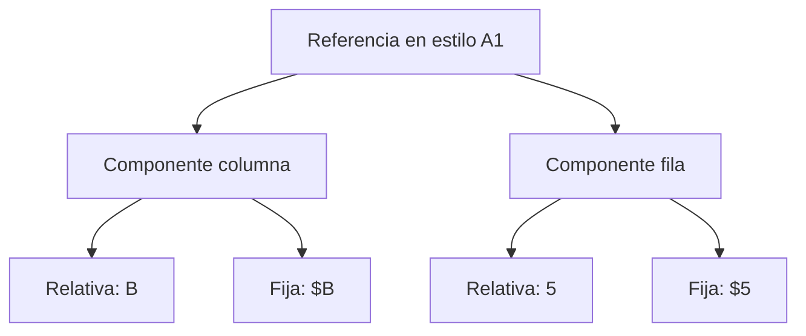
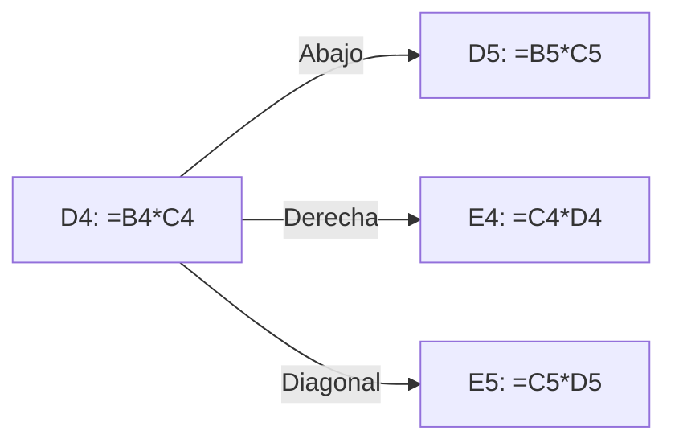
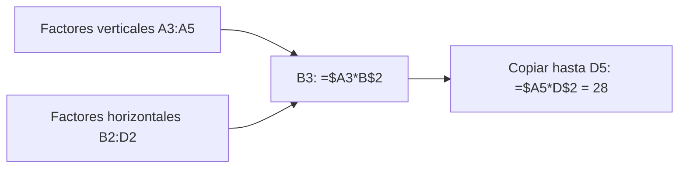
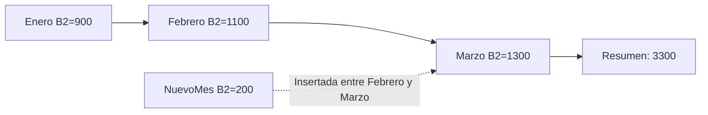
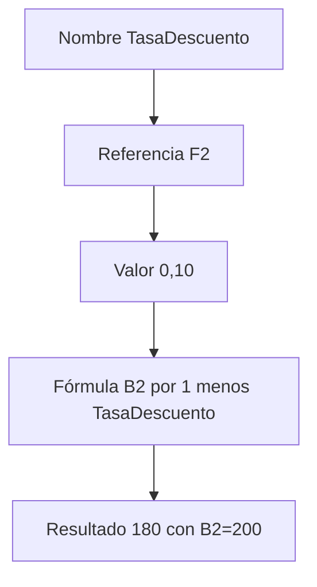
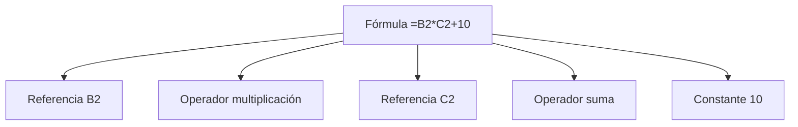
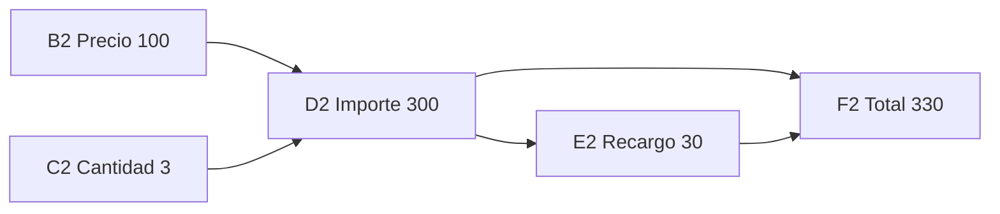
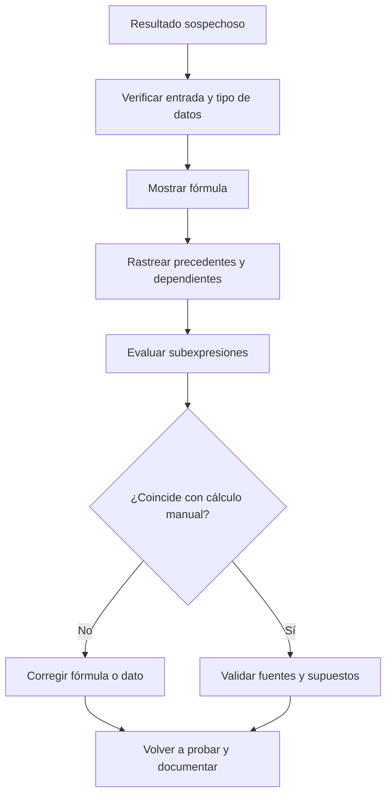
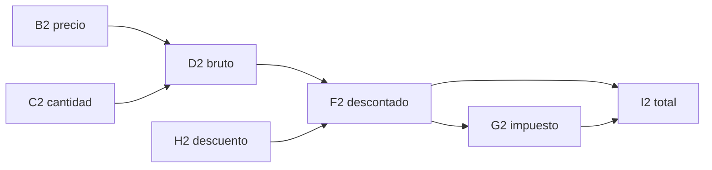
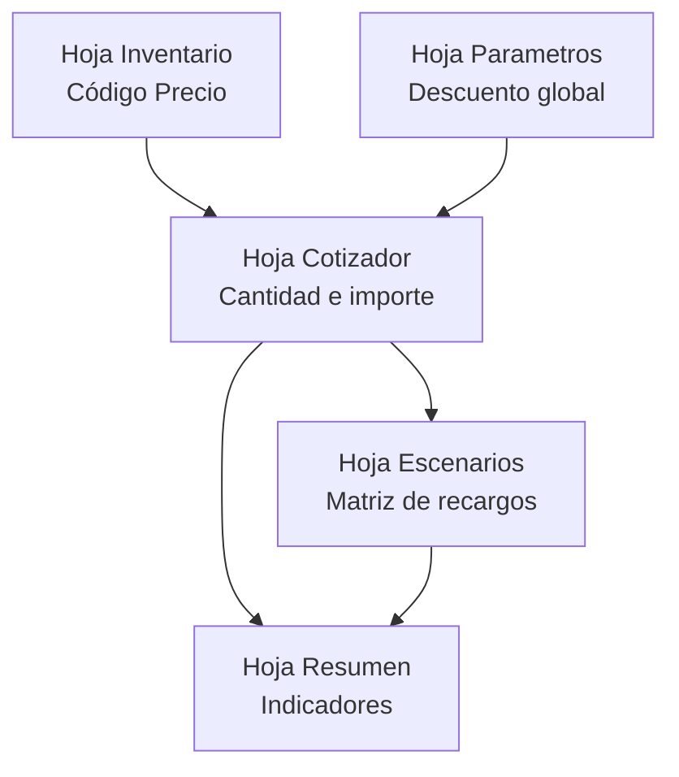

# H05 — Fórmulas, operadores y referencias

> **Curso integral de Excel, Google Sheets, VBA y Google Apps Script**  
> **Ruta:** H — Excel · **Módulo:** H05/24 · **Roadmap:** v2.0 aprobado  
> **Duración orientativa:** 16 h · **Entorno principal:** Excel Microsoft 365 de escritorio (Windows); notas para Mac, web y Sheets.  
> **Estado:** desarrollado, pendiente de revisión académica · **Actualización de fuentes:** 24/10/2026.

## Objetivos y guía de lectura

Al terminar podrás construir referencias relativas, absolutas, mixtas, entre hojas y libros, usar nombres definidos, razonar sobre los operadores y su prioridad, y diagnosticar problemas de dependencias, recálculo, precisión y errores. Prerrequisitos: H01–H04. Las referencias estructuradas se tratarán en H06 y las funciones por familias en H07–H16.

**Convenciones.** Mostraremos fórmulas con nombres españoles (`SUMA`, `SI`) y, salvo advertencia, separador de argumentos `;` y decimal `,`. Tu instalación puede usar nombres y separadores distintos; no cambies comas/puntos indiscriminadamente. Las cifras monetarias son ficticias. Las capturas externas son ilustrativas, no muestran necesariamente la última versión. Los diagramas Mermaid son esquemas didácticos (no capturas reales).

### Mapa curricular

| Sección | Tema | Subtemas aprobados |
|---|---|---|
| H05.01 | H05.01.01 Referencias de celda | `.01` relativas · `.02` absolutas · `.03` mixtas |
| H05.01 | H05.01.02 Referencias ampliadas | `.01` entre hojas · `.02` tridimensionales · `.03` externas y nombres |
| H05.02 | H05.02.01 Operadores | `.01` aritméticos · `.02` comparación · `.03` texto y referencias |
| H05.02 | H05.02.02 Evaluación | `.01` precedencia · `.02` paréntesis · `.03` separadores regionales |
| H05.03 | H05.03.01 Dependencias | `.01` recálculo · `.02` circularidad · `.03` precisión y errores |
| H05.03 | H05.03.02 Auditoría básica | `.01` rastreo de precedentes · `.02` evaluación de fórmulas |

---

# H05.01 — Referencias

## H05.01.01 — Referencias de celda

Una **referencia** indica dónde obtener el valor que requiere una fórmula. En el sistema A1, `C7` indica columna C, fila 7. La fórmula `=C7*D7` obtiene dos valores y los multiplica. Las referencias poseen una dimensión de **columna** y otra de **fila**; cada una puede modificarse al copiar o permanecer fija.



### H05.01.01.01 — Referencias relativas

La referencia relativa **no contiene `$`**, por ejemplo `B4`. Cuando se copia la fórmula, Excel adapta las coordenadas según cuánto se movió el destino desde el origen.

| Fórmula en D4 | Destino de la copia | Desplazamiento | Fórmula resultante |
|---|---|---|---|
| `=B4*C4` | D5 | 1 fila abajo | `=B5*C5` |
| `=B4*C4` | E4 | 1 columna a la derecha | `=C4*D4` |
| `=B4*C4` | E5 | 1 columna y 1 fila | `=C5*D5` |



**Laboratorio A — Ventas.** En una hoja nueva, crea encabezados `A1=Producto`, `B1=Precio`, `C1=Cantidad`, `D1=Importe`. Captura: fila 2 `Agenda,80,3`; fila 3 `Lápiz,12,5`; fila 4 `Libreta,45,4`. Escribe `=B2*C2` en D2 y copia hasta D4. Obtendrás **240, 60 y 180**. Selecciona D3 y verifica en la **barra de fórmulas** `=B3*C3`. Si cambias C3 de 5 a 7, el resultado debe ser 84 con recálculo automático.

**Concepto crucial:** copiar una fórmula no equivale a copiar su resultado. Lo que se reproduce es la expresión, ajustando sus referencias.

### H05.01.01.02 — Referencias absolutas

Una referencia **absoluta** usa `$` delante de la columna y de la fila: `$F$2`. En `=B2*$F$2` la referencia a B2 es relativa, pero la de F2 se conserva al copiar la fórmula.

**Laboratorio B — Recargo fijo (tasa hipotética de 16 %).**

| Celda | Contenido |
|---|---|
| A1:D1 | Producto · Precio · Recargo · Total |
| A2:B2 | Agenda · 80 |
| A3:B3 | Libreta · 45 |
| A4:B4 | Marcador · 30 |
| F1 | Tasa |
| F2 | 16 % (valor 0,16) |

1. En C2 escribe `=B2*$F$2`, y en D2 `=B2+C2`.
2. Copia ambas fórmulas a las filas 3 y 4.
3. Comprueba:

| Fila | Precio | Recargo | Total |
|---:|---:|---:|---:|
| 2 | 80 | 12,80 | 92,80 |
| 3 | 45 | 7,20 | 52,20 |
| 4 | 30 | 4,80 | 34,80 |

Sin fijar F2, al copiar aparecerían referencias a F3 y F4. El signo `$` **no protege el valor** contra edición ni impide que Excel actualice referencias tras insertar o borrar celdas: solamente controla el desplazamiento al copiar.

**Atajo Windows:** dentro de una fórmula, al editar la referencia seleccionada, F4 suele alternar `B2` → `$B$2` → `B$2` → `$B2` → `B2`. Puede requerirse `Fn+F4`. En Mac/otras plataformas utiliza la interfaz correspondiente o escribe `$` manualmente.

### H05.01.01.03 — Referencias mixtas

Una referencia **mixta** fija una sola coordenada:

| Referencia inicial | Fijación | Al copiar 2 columnas a la derecha y 3 filas abajo |
|---|---|---|
| `B5` | Ninguna | `D8` |
| `$B$5` | Ambas | `$B$5` |
| `$B5` | Columna | `$B8` |
| `B$5` | Fila | `D$5` |

**Laboratorio C — Matriz de productos.** Introduce B2:D2 = `2, 3, 4` y A3:A5 = `5, 6, 7`. En B3 escribe **`=$A3*B$2`** y copia por el rectángulo B3:D5. Deberá producir:

| Factor | ×2 | ×3 | ×4 |
|---:|---:|---:|---:|
| 5 | 10 | 15 | 20 |
| 6 | 12 | 18 | 24 |
| 7 | 14 | 21 | 28 |



¿Por qué funciona? `$A3` retiene A pero varía el número de fila. `B$2` conserva la fila 2 pero cambia de columna. **Error frecuente:** fijar ambas coordenadas hace que toda la tabla repita el mismo valor.

### Copiar, cortar y modificar la estructura no son equivalentes

Copiar adapta referencias relativas; cortar/mover una celda con fórmula normalmente busca preservar sus referencias originales; insertar o eliminar filas/columnas puede hacer que Excel **reescriba incluso referencias absolutas**. Eliminar una celda referenciada puede generar `#¡REF!`. Compruébalo sobre una copia y observa la barra de fórmulas, no solo el resultado visible.

### Captura guiada 1 — Barra de fórmulas y pestaña Fórmulas


*Fuente visual pública: [Open Oregon, Introduction to Excel for Business Data, 2.1](https://openoregon.pressbooks.pub/introductiontoexcel/chapter/2-1-formulas/). Qué observar: barra que muestra la expresión de la celda y comandos de Fórmulas. Imagen de una versión anterior; las posiciones exactas pueden variar.*

Fuente oficial sobre los cuatro tipos de referencia: [Microsoft — Cambiar entre referencias relativas, absolutas y mixtas](https://support.microsoft.com/es-es/excel/switch-between-relative-absolute-and-mixed-references).

## H05.01.02 — Referencias ampliadas

### H05.01.02.01 — Referencias entre hojas

Una fórmula recupera información de **otra hoja del mismo libro** con el patrón `Hoja!Celda`. El signo `!` separa la hoja y la referencia:

```excel
=Enero!B2
='Ventas Norte'!B2
```

Los nombres de hoja con espacios se colocan entre comillas simples. En el siguiente caso, no hay necesidad de copiar manualmente las ventas de cada hoja en el resumen.

**Laboratorio D:** crea `Enero`, `Febrero` y `Resumen`. Coloca 1 200 en `Enero!B2` y 1 450 en `Febrero!B2`. Escribe en `Resumen!B2`:

```excel
=Enero!B2+Febrero!B2
```

Resultado **2 650**. Renombra `Enero` como `Enero 2026`: comprueba que Excel actualice la referencia a `'Enero 2026'!B2`. Renombrar una hoja normalmente actualiza las fórmulas del libro, pero confirma los resultados tras modificaciones estructurales.

### H05.01.02.02 — Referencias tridimensionales (3D)

Una **referencia 3D** apunta a la **misma celda o rango** de todas las hojas comprendidas entre dos pestañas **según su orden físico en el libro**. Requiere una función compatible, por ejemplo:

```excel
=SUMA(Enero:Marzo!B2)
```

Con tres hojas contiguas `Enero`, `Febrero`, `Marzo` y `B2` = 900, 1 100 y 1 300 respectivamente, la fórmula devuelve **3 300**. Crea `Resumen` **fuera** del bloque delimitado por Enero y Marzo.



**Laboratorio E:** inserta una hoja `NuevoMes` con B2=200 **entre** Febrero y Marzo. Al quedar dentro del intervalo, el total esperado pasa a **3 500**. Muévela fuera de los extremos y el total volverá a **3 300**. **Implicación:** agregar, eliminar o mover hojas puede modificar cálculos sin tocar la fórmula textual. No todas las funciones aceptan referencias 3D y las hojas deberían compartir estructura.

En documentación oficial: [Referencia 3D y consecuencias de reorganizar hojas](https://support.microsoft.com/es-es/excel/create-a-reference-to-the-same-cell-range-on-multiple-worksheets).

### H05.01.02.03 — Referencias externas y nombres

#### Vínculos a otros libros

Una **referencia externa** obtiene datos de otro archivo. **Libro de origen**: contiene el valor. **Libro de destino**: utiliza la fórmula. Cuando ambos están abiertos, una expresión típica es:

```excel
='[Tarifas.xlsx]Precios'!$B$2
```

**Laboratorio F:** en `Tarifas.xlsx` crea `Precios!B2=150`. Abre `Cotizador.xlsx`, escribe `=` en su B2, cambia a Tarifas y selecciona Precios!B2; confirma la fórmula. Debería mostrar **150**. Guarda ambos; cierra y vuelve a abrir el libro destino. Puede solicitar autorización para actualizar vínculos; comprueba antes que el origen sea fiable.

**Puntos críticos:**

- Con el origen **cerrado**, Excel puede mostrar una ruta completa al archivo origen.
- Rutas renombradas, permisos, cambios de ubicación o archivos ausentes pueden provocar vínculos rotos o cifras almacenadas que ya no son actuales.
- **Romper vínculos** puede sustituir fórmulas por valores fijos y Microsoft advierte que esa operación puede no deshacerse; guarda una copia previa.
- No actives la actualización automática de vínculos de archivos no confiables.

Fuentes: [Crear vínculos de libros](https://support.microsoft.com/es-es/excel/create-workbook-links) · [Administrar vínculos](https://support.microsoft.com/es-es/excel/manage-workbook-links).

#### Nombres definidos

Los **nombres definidos** son identificadores que representan una celda, rango, constante o fórmula. En vez de `=B2*(1-$F$2)` puedes escribir:

```excel
=B2*(1-TasaDescuento)
```

**Laboratorio G:** escribe 10 % en F2 y selecciona F2. En el **cuadro de nombres** introduce `TasaDescuento` y confirma con Enter (alternativa: Fórmulas → Administrador de nombres → Nuevo). Introduce 200 en B2 y la fórmula anterior en C2: resultado **180**. Si cambias F2 a 15 %, el resultado será **170**.



**Reglas y riesgos:** los nombres no pueden contener espacios ni coincidir con una referencia válida; pueden tener alcance de **libro** o **hoja**; Excel no los distingue por mayúsculas/minúsculas. Un nombre con alcance de hoja usado desde otra hoja puede necesitar un prefijo. Nombres ambiguos o demasiado genéricos dificultan mantenimiento. También se usarán referencias estructuradas de tablas en H06.

Fuente: [Microsoft — Nombres en fórmulas](https://support.microsoft.com/es-es/excel/names-in-formulas).

### Tabla de diagnóstico de H05.01

| Problema | Causa | Verificación y solución |
|---|---|---|
| La tasa se desplaza a la fila siguiente | Referencia relativa | Usar `$F$2` o nombre definido |
| Todos los resultados de una matriz se repiten | Fijación excesiva | Dejar variar una dimensión con referencia mixta |
| Cambia el total 3D al insertar pestaña | Se incorpora al intervalo | Verificar orden físico de pestañas |
| `#¡REF!` tras eliminar datos | Referencia ya no válida | Restaurar estructura o corregir fórmula |
| El dato externo no se actualiza | Libro o permiso no disponible | Revisar vínculos y origen |
| No puedes crear un nombre | Espacio, colisión o alcance | Probar nombre único sin espacios |

**Buenas prácticas:** diferencia entre parámetros y entradas, documenta el origen de las referencias 3D, evita cadenas extensas de libros externos, utiliza nombres con semántica clara y revisa siempre la fórmula después de copiar.

---

# H05.02 — Lenguaje de fórmulas

## H05.02.01 — Operadores

Una **fórmula** comienza generalmente con `=` y contiene operandos (literales, referencias, funciones) y operadores. Por ejemplo, en `=B2*C2+10`, B2 y C2 son referencias, `*` y `+` son operadores y 10 es una constante.



### H05.02.01.01 — Operadores aritméticos

| Operador | Acción | Fórmula | Resultado |
|---|---|---|---:|
| `+` | Suma | `=5+3` | 8 |
| `-` | Resta | `=5-3` | 2 |
| `-` unario | Negación | `=-5` | -5 |
| `*` | Multiplicar | `=5*3` | 15 |
| `/` | Dividir | `=15/3` | 5 |
| `^` | Potencia | `=2^3` | 8 |
| `%` | Porcentaje | `=200*15%` | 30 |

**El porcentaje tiene significado numérico:** `15%` equivale a `0,15`. Una celda que visualmente muestra 15 % puede almacenar 0,15. Confundir 15 con 0,15 multiplica un resultado por 100.

**Ejemplo empresarial:** si B2=1000 (precio base) y C2=10 % (descuento), la fórmula `=B2*(1-C2)` devuelve **900**. `1-C2` es la fracción del precio que se paga. Para redondeos, exponentes y matemáticas detalladas, véase H08.

### H05.02.01.02 — Comparación

Devuelven valores lógicos **VERDADERO** o **FALSO**, no cadenas de texto.

| Operador | Significado | Ejemplo | Resultado |
|---|---|---|---|
| `=` | Igual | `=5=5` | VERDADERO |
| `<>` | Diferente | `=5<>4` | VERDADERO |
| `>` | Mayor | `=7>9` | FALSO |
| `<` | Menor | `=7<9` | VERDADERO |
| `>=` | Mayor o igual | `=8>=8` | VERDADERO |
| `<=` | Menor o igual | `=8<=7` | FALSO |

Ejemplo: con ventas en `C2=2200` y meta `D2=2000`, `=C2>=D2` devuelve VERDADERO. Esta comparación puede incorporarse a `SI` o a reglas más complejas, que aprenderás en H07. No compares montos almacenados como texto sin verificar el tipo de dato (H03).

### H05.02.01.03 — Texto y referencias

El operador `&` **concatena** textos:

```excel
="Cliente: "&A2
=A2&"-"&B2
```

Con A2=`P001` y B2=`Norte`, la segunda devuelve **P001-Norte**. Las comillas delimitan texto literal. El espacio en `"Cliente: "` forma parte del resultado.

**Referencias y rangos:**

| Notación | Uso |
|---|---|
| `A2:A10` | Dos puntos: rango contiguo incluyente |
| `B2:D2 C1:C3` | Espacio: intersección, celda C2 |
| `Enero!B2` | Referencia a una hoja |
| `A2#` | Rango desbordado en Excel moderno; desarrollo en H16 |
| `@A2:A10` | Intersección implícita; desarrollo en H16 |

**Sobre la unión de referencias:** existe un operador específico, pero su representación en algunas páginas localizadas y configuraciones de Excel puede variar. Para **sumar dos rangos separados** de forma reproducible usa dos argumentos:

```excel
=SUMA(B2:B4;D2:D4)
```

El `;` de este ejemplo es **separador de argumentos**, no debe confundirse automáticamente con el operador de unión. Con configuración que usa coma entre argumentos, adapta la sintaxis. Para ilustrar la **intersección**, escribe `C2=18` y `=SUMA(B2:D2 C1:C3)`: el único punto en común es C2, resultado 18. Una intersección vacía puede devolver `#¡NULO!`.

Fuente: [Microsoft — Operadores de cálculo y prioridad](https://support.microsoft.com/es-es/excel/calculation-operators-and-precedence-in-excel).

## H05.02.02 — Evaluación de fórmulas

### H05.02.02.01 — Precedencia

Cuando una fórmula combina operadores, **no necesariamente se evalúan de izquierda a derecha**. Primero Excel aplica sus reglas de prioridad. Si dos operadores están al mismo nivel (por ejemplo multiplicación y división), los evalúa de izquierda a derecha.

| Prioridad de mayor a menor | Operadores |
|---:|---|
| 1 | Referencias (rango, intersección, unión) |
| 2 | Negación unaria `-` |
| 3 | Porcentaje `%` |
| 4 | Potencia `^` |
| 5 | Multiplicación y división `*` `/` |
| 6 | Suma y resta `+` `-` |
| 7 | Concatenación `&` |
| 8 | Comparaciones `=` `<` `>` `<=` `>=` `<>` |

**Ejemplos para calcular a mano antes de abrir Excel:**

| Fórmula | Operaciones principales | Resultado |
|---|---|---:|
| `=5+2*3` | `2*3=6`, `5+6` | 11 |
| `=(5+2)*3` | `(5+2)=7`, `7*3` | 21 |
| `=20/5*2` | `20/5=4`, `4*2` | 8 |
| `=2^3+1` | `2^3=8`, `8+1` | 9 |
| `=100*15%` | `15%=0,15`, `100*0,15` | 15 |
| `=-2^2` | Negación unaria antes que potencia en Excel | 4 |
| `=-(2^2)` | Potencia agrupada y luego negación | -4 |

La expresión `=-2^2` es una diferencia importante frente a algunas convenciones matemáticas y lenguajes. Para evitar ambigüedad, escribe `=(-2)^2` (4) o `=-(2^2)` (-4) explícitamente.

```mermaid
flowchart TD
  A[=5+2*3] --> B[2*3 = 6]
  B --> C[5+6 = 11]
  D[=(5+2)*3] --> E[5+2 = 7]
  E --> F[7*3 = 21]
```

### H05.02.02.02 — Paréntesis y anidamiento

Los **paréntesis** indican qué subexpresión debe agruparse y ayudan a transmitir la intención del modelo. No son solamente una forma de corregir la prioridad: mejoran la legibilidad para el auditor.

**Ejemplo 1, margen sobre ventas:** con `B2=1200` (ventas) y `C2=780` (costo), la fórmula correcta es:

```excel
=(B2-C2)/B2
```

Resultado: **0,35 = 35 %**. En cambio, `=B2-C2/B2` devuelve **1199,35**, porque Excel divide antes de restar. Es un número calculado, pero no representa el margen.

**Ejemplo 2, descuento y recargo/impuesto hipotético:** si B2=1000, C2=10 % de descuento y D2=16 % de impuesto aplicado **sobre el importe descontado**:

```excel
=B2*(1-C2)*(1+D2)
```

Desarrollo: `1000*(0,9)*(1,16) = 1044`. No se está indicando una regla fiscal real: es la hipótesis de este ejercicio.

**Ejemplo 3, función anidada (vista previa de H07/H09):**

```excel
=SI(PROMEDIO(B2:B4)>=70;"Aprobado";"Revisar")
```

La función interior PROMEDIO produce un número; se compara con 70, y SI elige qué texto devolver. Comprueba que cada paréntesis abierto tenga su cierre correspondiente.

### H05.02.02.03 — Separadores regionales

Las fórmulas se ven distintas según **idioma de funciones**, **separador de argumentos**, **separador decimal** y configuración regional. No todos tienen que coincidir con el idioma de la interfaz.

| Concepto | Ejemplo localizado | Otro entorno posible |
|---|---|---|
| Función de suma | `SUMA` | `SUM` |
| Función condicional | `SI` | `IF` |
| Argumentos | `=SI(A2>0;"Sí";"No")` | `=IF(A2>0,"Yes","No")` |
| Número decimal | `0,16` | `0.16` |

**Procedimiento de diagnóstico:**

1. En una hoja nueva prueba `=SUMA(2;3)` (resultado 5 si corresponde a tu localización).
2. Si Excel marca error de sintaxis, revisa el separador de argumentos y prueba `=SUMA(2,3)` solamente cuando sea el correcto.
3. Si Excel no reconoce SUMA, inspecciona el idioma de las funciones y sus equivalentes.
4. Prueba una celda con `0,16` y verifica que Excel lo trate como número, no texto.
5. Al importar fórmulas o datos de otra región, valida con casos controlados **antes** de automatizar conversiones.

**Error de migración:** no reemplaces todas las comas por puntos a ciegas: podrías alterar decimales, separadores de argumentos, textos o archivos CSV. Las fórmulas documentadas aquí están destinadas a ser reproducidas ajustando explícitamente la configuración.

### Errores frecuentes en H05.02

| Síntoma | Causa probable | Acción recomendada |
|---|---|---|
| `=5+2*3` da 11 y esperabas 21 | Prioridad | Usa paréntesis para agrupar suma |
| Margen mayor que 100 % | Fórmula de margen sin agrupar | Usa `=(Ventas-Costos)/Ventas` |
| La función no se reconoce | Idioma local | Comprueba nombre localizado |
| Excel muestra error al poner comas | Separador regional | Usa el separador configurado |
| 16 % se calcula como 16 veces el importe | Valor 16 en lugar de 0,16 | Almacena `16%` o `0,16` numérico |
| Una cadena `"123"` provoca un resultado extraño | Tipo no numérico | Comprueba coerción y calidad de datos |

**Buenas prácticas:** usa paréntesis que expresen el significado de negocio; centraliza tasas; evita fórmulas muy largas si pueden dividirse en cálculos intermedios verificables; revisa tipos y números almacenados como texto (H03).

---

# H05.03 — Motor de cálculo

## H05.03.01 — Dependencias

### H05.03.01.01 — Recálculo

El **recálculo** determina cuándo Excel vuelve a evaluar las fórmulas. Un **precedente** es una celda cuyo valor utiliza una fórmula; un **dependiente** es la celda que contiene dicha fórmula. En términos conceptuales puede modelarse como un **grafo dirigido**.

**Ejemplo reproducible:**

| Celda | Contenido | Resultado inicial |
|---|---|---:|
| B2 | 100 | 100 |
| C2 | 3 | 3 |
| D2 | `=B2*C2` | 300 |
| E2 | `=D2*10%` | 30 |
| F2 | `=D2+E2` | 330 |



Al actualizar C2 de 3 a 4, D2 pasa a 400, E2 a 40 y F2 a **440** si el modo de cálculo es automático. Excel utiliza las relaciones entre fórmulas para identificar qué resultados deben revisarse; esto no garantiza por sí solo que el modelo empresarial esté correctamente planteado.

#### Modos de cálculo

- **Automático:** Excel actualiza las fórmulas necesarias cuando cambian sus datos; es el comportamiento habitual.
- **Manual:** las fórmulas pueden conservar resultados anteriores hasta que se recalcule expresamente; es un riesgo en informes.
- **Automático excepto tablas de datos:** opción asociada a herramientas de análisis de hipótesis cuando está disponible. No se refiere a las tablas estructuradas que estudiarás en H06.

En Excel para Windows de escritorio: **Fórmulas → Opciones para el cálculo** o **Archivo → Opciones → Fórmulas**. Comprueba el modo activo: según cómo se abran los libros, la configuración puede influir en otros documentos abiertos.

| Atajo usual de Windows | Acción |
|---|---|
| `F9` | Recalcular fórmulas cambiadas en libros abiertos |
| `Mayús+F9` | Recalcular hoja activa |
| `Ctrl+Alt+F9` | Forzar recálculo de todas las fórmulas |
| `Ctrl+Alt+Mayús+F9` | Comprobar dependencias y recálculo completo |

En Mac, web y teléfonos las opciones y atajos pueden diferir. Fuente: [Microsoft — Recálculo, iteración y precisión](https://support.microsoft.com/es-es/excel/change-formula-recalculation-iteration-or-precision-in-excel).

#### Funciones volátiles (introducción)

Algunas funciones como `AHORA` o `ALEATORIO` pueden recalcularse al producirse un recálculo aunque no cambie un argumento explícito. El uso excesivo de funciones volátiles puede perjudicar el rendimiento. Su estudio detallado corresponde a los módulos de funciones y optimización.

### H05.03.01.02 — Circularidad

Una **referencia circular** se produce si una fórmula depende, directamente o a través de una cadena, de su propia celda.

- **Directa:** en A1 se escribe `=A1+1`.
- **Indirecta:** A1 contiene `=B1+1` y B1 contiene `=A1+1`.


El ciclo impide resolver de forma ordinaria un orden acíclico. Excel suele advertirlo y en la aplicación de escritorio permite localizar referencias circulares desde **Fórmulas → Comprobación de errores → Referencias circulares**.

**Laboratorio H:** en un libro de ensayo escribe en A1 `=A1+1`. Observa la advertencia; después reemplaza la fórmula por 5. En B1 escribe `=A1+2` y comprueba B1=7. Ahora tienes una dependencia válida, sin ciclo.

**Cálculo iterativo:** Excel puede permitir modelos circulares mediante repetidas evaluaciones, configurando **iteraciones máximas** y **cambio máximo** (criterio de parada). No es una solución automática para fórmulas defectuosas: algunos procesos no convergen o dependen de los valores iniciales. Solo actívalo si tu modelo tiene justificación matemática, criterios de convergencia y pruebas.

Fuente: [Microsoft — Quitar o permitir una referencia circular](https://support.microsoft.com/es-es/excel/remove-or-allow-a-circular-reference-in-excel).

### H05.03.01.03 — Precisión, redondeo y errores

Excel documenta aproximadamente **15 dígitos significativos** de precisión numérica. Por eso un código de cuenta o producto de 18 dígitos **no debe guardarse como número** si es imprescindible conservar cada dígito: configúralo como texto antes de capturar/importar, tal como estudiaste en H03.

Excel usa una representación numérica de punto flotante, por lo que algunos cálculos decimales pueden producir diferencias mínimas frente a la aritmética decimal exacta. **No presupongas que un resultado mostrado con dos decimales tiene esos dos únicos decimales en memoria.**

**Prueba de tolerancia (introducción):** escribe A1=0,1, B1=0,2 y C1=0,3. Comprueba:

```excel
=ABS((A1+B1)-C1)<0,0000001
```

Si los datos son correctos, el resultado esperado es VERDADERO. `ABS` calcula valor absoluto; es una función presentada aquí únicamente para ilustrar tolerancia, cuya ficha completa se estudiará en H08. En inglés, el decimal en esa fórmula se escribiría usualmente `0.0000001`.

**Redondeo de pantalla ≠ precisión almacenada.** Formatear 1,23456 con dos decimales produce visualmente 1,23, pero no necesariamente altera el valor utilizado en un cálculo. La opción **Precisión como se muestra** sí puede modificar los valores almacenados y perder exactitud; no la actives como solución cosmética.

#### Errores habituales

| Código (según localización) | Interpretación | Causa típica | Revisión |
|---|---|---|---|
| `#¡DIV/0!` | División por cero | `=10/0` | Validar denominador |
| `#¡VALOR!` | Tipo incompatible | Número tratado como texto | Inspeccionar tipo de entrada |
| `#¡REF!` | Referencia inválida | Borrado de celda u hoja de origen | Restaurar referencia |
| `#¿NOMBRE?` | Excel no reconoce un nombre | Función mal escrita | Revisar función/nombre definido |
| `#N/A` | Valor no disponible | Búsqueda sin coincidencia | Revisar criterios |
| `#¡NUM!` | Cálculo fuera de dominio real | `=RAIZ(-1)` | Revisar dominio |
| `#¡NULO!` | Intersección inexistente | Rangos sin zona común | Revisar operador y rangos |
| Error de derrame (p. ej., `#¡DESBORDAMIENTO!`) | La matriz no puede expandirse | Celdas destino ocupadas | Liberar espacio; H16 |
| `#####` | No cabe representación o hay fecha/hora incompatible | Columna estrecha | Ajustar ancho y revisar formato |

**Laboratorio I — Errores controlados:** en un libro de pruebas escribe A1 `=10/0`, A2 `=RAIZ(-1)`, A3 `=1/2`, A4 `=SUMA(1;2)` (ajusta nombres/separadores a tu configuración). Esperas división por cero, error numérico, 0,5 y 3, respectivamente. Registra causas antes de reparar.

**Riesgo profesional:** funciones como `SI.ERROR` (H07) pueden sustituir un error por un valor alternativo. No las emplees para ocultar silenciosamente errores en un informe importante.

---

## H05.03.02 — Auditoría básica

### H05.03.02.01 — Rastreo de precedentes

**Precedentes:** celdas cuyo valor es leído por la fórmula. **Dependientes:** celdas cuyas fórmulas utilizan ese valor. En el ejemplo de B2, C2, D2, E2 y F2:

- Precedentes directos de **D2**: B2 y C2.
- Dependientes directos de **D2**: E2 y F2.
- F2 depende indirectamente de B2 y C2 a través de las fórmulas intermedias.

**Procedimiento (Excel de escritorio):**

1. Selecciona D2 y ve a **Fórmulas → Auditoría de fórmulas → Rastrear precedentes**.
2. Observa las flechas desde B2 y C2.
3. Selecciona D2 y usa **Rastrear dependientes**; observa E2 y F2.
4. Presiona **Quitar flechas** para limpiar.
5. Repite desde F2 para investigar de qué depende el resultado final.


*Fuente visual externa: [Anaplan Community — discusión de celdas precedentes](https://community.anaplan.com/discussion/65080/show-precedent-line-items). Observa las flechas que relacionan el cálculo con sus entradas; la herramienta **no certifica** que la regla de negocio sea correcta. La captura puede ser de otra edición.*

**Limitaciones:** puede no ser posible rastrear completamente los precedentes en otros libros cerrados y determinados tipos de objetos. Las flechas pueden desaparecer tras editar celdas o la estructura. Fuente: [Microsoft — Mostrar relaciones entre fórmulas y celdas](https://support.microsoft.com/es-es/excel/display-the-relationships-between-formulas-and-cells).

### H05.03.02.02 — Evaluar fórmulas

La función de **Evaluar fórmula** permite descomponer una operación en resultados intermedios y localizar fallos de prioridad, tipo de dato o argumentos. Disponibilidad y recorrido de menú pueden variar por edición/plataforma.

**Laboratorio J — Margen:** con B2=1 200, C2=780 y D2=`=(B2-C2)/B2`:

1. Selecciona D2 (valor esperado 0,35).
2. En escritorio, ve a **Fórmulas → Evaluar fórmula**.
3. Pulsa **Evaluar** sucesivamente.
4. Interpreta `=(1200-780)/1200` → `=420/1200` → `=0,35`.
5. Compara con `=B2-C2/B2`, cuyo resultado es 1199,35 y **no** representa un margen porcentual.

```mermaid
flowchart TD
    A[=(B2-C2)/B2] --> B[=(1200-780)/1200]
    B --> C[=420/1200]
    C --> D[0,35 = 35 por ciento]
```

Algunas funciones condicionales, referencias externas, funciones volátiles o cálculos circulares tienen particularidades en la evaluación, por lo que conviene contrastar con una prueba numérica independiente. Fuente: [Microsoft — Evaluar una fórmula paso a paso](https://support.microsoft.com/es-es/excel/evaluate-a-nested-formula-one-step-at-a-time).

### Herramientas de auditoría relacionadas

| Herramienta | Objetivo | Ejemplo de uso |
|---|---|---|
| Mostrar fórmulas | Mostrar expresión en lugar del resultado | Verificar que D2:D100 contienen fórmulas |
| Comprobación de errores | Detectar problemas típicos | Buscar `#¡REF!` y `#¡DIV/0!` |
| Rastrear precedentes | Identificar entradas | Determinar dónde se define una tasa |
| Rastrear dependientes | Evaluar impacto | Saber qué KPI cambia si cambia el precio |
| Evaluar fórmula | Inspeccionar etapas | Comprobar paréntesis y operaciones |
| Ventana Inspección | Observar celdas importantes | Vigilar margen al modificar supuestos |

### Figura — Flujo de auditoría



**Buenas prácticas:** separa inputs y outputs, guarda una hoja de supuestos, documenta orígenes externos, usa cifras de control y casos extremos, nunca sustituyas fórmulas por números sin dejar trazabilidad y valida los resultados contra un cálculo independiente.

---
# Parte A — Ejercicios prácticos (enunciados)

> **Regla de aprendizaje autónomo:** no consultes la Parte B hasta completar los ejercicios. Guarda versiones de ensayo de los libros. El estándar de corrección requiere: resultados numéricos, fórmula utilizada, procedimiento y una comprobación independiente. Son **15 ejercicios**: cinco en cada sección; los niveles incluyen básico, intermedio, avanzado y reto profesional.

## Ejercicios de H05.01 — Referencias

### H05.01-E01 — Predicción al copiar (básico)

**Objetivo:** razonar el desplazamiento de referencias. **Datos:** una fórmula original se ubica en D4 y será copiada a F7. **Enunciado:** predice qué ocurrirá con cada referencia incluida en la fórmula: `B4`, `$B$4`, `$B4`, `B$4`.

**Instrucciones:** (1) determina movimiento horizontal y vertical; (2) actualiza solamente las dimensiones relativas; (3) verifica en Excel con cuatro fórmulas de prueba. **Restricción:** resolver primero en papel. **Resultado esperado:** cuatro referencias nuevas. **Criterio:** cada una debe reflejar +2 columnas y +3 filas cuando corresponda.

### H05.01-E02 — Recargo único por producto (básico)

**Objetivo:** introducir un parámetro central mediante referencia absoluta. **Datos:** filas A2:B4 = `Agenda/100`, `Carpeta/60`, `Pluma/25`; F2 = **8 %** de recargo ficticio. **Enunciado:** calcula en C2:C4 el recargo y en D2:D4 el total.

**Instrucciones:** escribe una fórmula con `$F$2` en C2; copia abajo; calcula precio final en D2 y copia; cambia F2 a 10 %. **Restricción:** no introduzcas la tasa en cada fila. **Resultado esperado:** recargos y totales actualizables. **Criterio:** al cambiar F2 solo se cambian los valores de entrada, no fórmulas.

### H05.01-E03 — Matriz de comisiones (intermedio)

**Objetivo:** aplicar fijaciones de fila y columna. **Datos:** `B2:D2` = 5 %, 8 %, 10 % y `A3:A5` = 1 000, 2 000, 3 000. **Enunciado:** crea una matriz de comisiones en `B3:D5` con **una única fórmula inicial**.

**Instrucciones:** usa una referencia mixta a la venta y otra a la tasa; copia B3 a toda la matriz; comprueba D5 y C4. **Restricción:** no escribas nueve fórmulas manualmente. **Resultado esperado:** matriz de 3×3. **Criterio:** referencias mixtas y resultados correctos.

### H05.01-E04 — Consolidación por hojas (avanzado)

**Objetivo:** probar las consecuencias de modificar el orden de hojas en referencias 3D. **Datos:** hojas contiguas `Abril`, `Mayo`, `Junio`, B2 = 500, 700, 900; `Resumen` fuera de ese bloque.

**Instrucciones:** calcula el total 3D; inserta entre Mayo y Junio una hoja `Ajuste` con B2=100; vuelve a calcular; mueve Ajuste fuera del bloque y verifica. **Restricción:** conserva nombres y orden claros. **Resultado esperado:** tres totales y explicación. **Criterio:** detectar que el orden de pestañas es una parte del significado de la referencia.

### H05.01-E05 — Cotizador con vínculo externo (reto profesional)

**Objetivo:** crear un modelo mantenible con un precio de origen externo y un nombre definido. **Datos:** `Tarifas.xlsx` → hoja `Precios`, celda B2 = 250; `Cotizador.xlsx` → B2 enlaza al precio externo; F2 = 12 % de descuento ficticio.

**Instrucciones:** define `DescuentoComercial` para F2; calcula en C2 el precio neto; prueba cambio de F2 a 15 %; documenta qué sucede si no se puede acceder al origen. **Restricción:** no rompas enlaces sin respaldo. **Resultado esperado:** valores calculados y guía de mantenimiento. **Criterio:** resultado correcto, seguridad y evidencia de la fuente.

## Ejercicios de H05.02 — Operadores

### H05.02-E01 — Precedencia (básico)

**Objetivo:** identificar el orden de operaciones. **Enunciado:** predice y prueba `=4+6*2`, `=(4+6)*2`, `=30/5*3`, `=2^3+2`, `=-(3^2)`.

**Instrucciones:** escribe el orden de resolución de cada una y contrástalo con Excel. **Restricción:** no calcular primero por ensayo y error. **Resultado esperado:** cinco valores. **Criterio:** justificar prioridad y paréntesis.

### H05.02-E02 — Descuento más impuesto (intermedio)

**Objetivo:** combinar operadores y paréntesis. **Datos:** B2 = 800 (precio), C2 = 15 % (descuento), D2 = 16 % (impuesto ficticio aplicado al importe descontado).

**Instrucciones:** E2 = importe tras descuento; F2 = impuesto sobre E2; G2 = total; H2 = una sola fórmula equivalente para el total. **Restricción:** no apliques el impuesto a la base antes de descontar. **Resultado esperado:** G2 y H2 idénticos. **Criterio:** explicar bases de cada operación.

### H05.02-E03 — Identificador y pruebas lógicas (intermedio)

**Objetivo:** concatenar y comparar. **Datos:** A2=`P-001`; B2=`Norte`; C2=2 200; D2=2 000.

**Instrucciones:** E2 produce `P-001-Norte` con `&`; F2 indica si ventas ≥ meta; G2 indica si ventas ≠ meta. **Restricción:** F2/G2 deben devolver valores lógicos, no textos. **Resultado esperado:** cadena y dos VERDADERO. **Criterio:** tipos y sintaxis correctos.

### H05.02-E04 — Auditoría de margen (avanzado)

**Objetivo:** detectar un error de prioridad en un indicador. **Datos:** B2=2 500 (ventas), C2=1 625 (costos).

**Instrucciones:** compara `=B2-C2/B2` con `=(B2-C2)/B2`; expresa el segundo en porcentaje y redacta por qué el primero no mide el margen. **Resultado esperado:** dos resultados y conclusión. **Criterio:** cálculo y significado empresarial.

### H05.02-E05 — Adaptación regional (reto profesional)

**Objetivo:** preparar una fórmula portable de forma razonada. **Datos:** A2=120, A3=80, B2=200 (umbral).

**Instrucciones:** crea una condición que devuelva `Alcanzado` si la suma de A2:A3 ≥ B2 y `Pendiente` si no; escribe variante española y variante inglesa; explica el separador. **Restricción:** no manipules datos numéricos como cadenas de texto. **Resultado esperado:** `Alcanzado`. **Criterio:** selección de función y localización documentadas.

## Ejercicios de H05.03 — Motor de cálculo y auditoría

### H05.03-E01 — Grafo de dependencias (básico)

**Objetivo:** identificar precedentes/dependientes. **Datos:** B2=50, C2=4, D2=`=B2*C2`, E2=`=D2*5%`, F2=`=D2+E2`.

**Instrucciones:** dibuja grafo de dependencias, identifica precedentes directos de D2 y dependientes directos, cambia C2 de 4 a 6 y registra nuevos resultados. **Resultado esperado:** grafo y tres importes. **Criterio:** relaciones y operaciones correctas.

### H05.03-E02 — Referencia circular (intermedio)

**Objetivo:** reconocer un ciclo y corregirlo sin activar iteración. **Enunciado:** en un archivo de prueba coloca A1=`=B1+1`, B1=`=A1+1`.

**Instrucciones:** localiza la circularidad; luego cambia A1 al valor 10 y mantiene B1=`=A1+1`. **Restricción:** no habilitar cálculo iterativo. **Resultado esperado:** advertencia desaparece y B1=11. **Criterio:** distinguir ciclo de dependencia ordinaria.

### H05.03-E03 — Rastreo de margen incorrecto (intermedio)

**Objetivo:** usar precedentes y evaluación. **Datos:** B2=1 500, C2=900, D2=`=B2-C2/B2`.

**Instrucciones:** calcula resultado actual; encuentra margen correcto; corrige D2; determina precedentes directos y pasos de Evaluar fórmula. **Resultado esperado:** margen corregido y procedimiento de auditoría. **Criterio:** contraste entre cálculos.

### H05.03-E04 — Precisión y tipos (avanzado)

**Objetivo:** preservar identificadores y comprobar decimales con tolerancia. **Datos:** identificador `00012345678901234567`; A2=0,1, B2=0,2, C2=0,3.

**Instrucciones:** conserva identificador como texto sin perder ceros; utiliza `ABS` para verificar que la diferencia absoluta entre A2+B2 y C2 es menor a 0,0000001; explica por qué formatear con dos decimales no arregla precisión. **Restricción:** no activar “Precisión como se muestra”. **Resultado esperado:** identificador íntegro y comparación lógica.

### H05.03-E05 — Auditoría integral (reto profesional)

**Objetivo:** consolidar fórmulas, referencias y control de resultados. **Datos:** B2=750 precio unitario; C2=6 unidades; H2=10 % descuento; D2=`=B2*C2`; F2=`=D2*(1-$H$2)`; G2=`=F2*16%` impuesto ficticio; I2=`=F2+G2`.

**Instrucciones:** calcula todo, traza precedentes de I2, cambia C2 a 8, prueba H2=0 % y H2=100 % con C2 restaurado a 6, y registra valores. **Restricción:** no sobrescribir fórmulas; cada escenario debe comenzar con los valores de entrada especificados. **Resultado esperado:** cuadro de controles y grafo. **Criterio:** resultados, consistencia y justificación.

---
# Parte B — Solucionario razonado (consultar después de practicar)

## Soluciones H05.01 — Referencias

### Solución H05.01-E01

Copiar de D4 a F7 desplaza **2 columnas** a la derecha y **3 filas** hacia abajo.

| Referencia original | Referencia final | Razonamiento |
|---|---|---|
| `B4` | `D7` | Ambas coordenadas son relativas |
| `$B$4` | `$B$4` | Ninguna cambia |
| `$B4` | `$B7` | Solo aumenta la fila |
| `B$4` | `D$4` | Solo aumenta la columna |

**Verificación:** escribe en D4 `=B4`, copia a F7 y comprueba `=D7`; repite con las otras variantes. Como F7 puede apuntar a una celda vacía, para la corrección importa la fórmula **mostrada en la barra**, no necesariamente su resultado numérico. **Error típico:** asumir que `$B4` inmoviliza también la fila.

### Solución H05.01-E02

En **C2** escribe `=B2*$F$2`; en **D2** escribe `=B2+C2`. Copia C2:D2 hasta la fila 4.

| Producto | Precio | Recargo con 8 % | Total con 8 % |
|---|---:|---:|---:|
| Agenda | 100 | 8,00 | 108,00 |
| Carpeta | 60 | 4,80 | 64,80 |
| Pluma | 25 | 2,00 | 27,00 |

Al cambiar F2 a **10 %** los recargos son 10,00, 6,00 y 2,50; los totales son **110,00**, **66,00** y **27,50**. La fórmula de C3 será `=B3*$F$2`, no `=B3*F3`. **Prevención:** conserva los parámetros en un sitio visible y rastreable.

### Solución H05.01-E03

En **B3** introduce `=$A3*B$2` y copia hasta **D5**.

| Venta | 5 % | 8 % | 10 % |
|---:|---:|---:|---:|
| 1 000 | 50 | 80 | 100 |
| 2 000 | 100 | 160 | 200 |
| 3 000 | 150 | 240 | 300 |

**D5 = 300**, porque `$A5=3000` y `D$2=10%`; **C4 = 160**, porque `$A4=2000` y `C$2=8%`. Verifica con calculadora y comprueba la fórmula de D5: `=$A5*D$2`.

### Solución H05.01-E04

En `Resumen!B2`:

```excel
=SUMA(Abril:Junio!B2)
```

- Original: 500 + 700 + 900 = **2 100**.
- Después de insertar Ajuste con B2=100 **dentro** del intervalo: **2 200**.
- Al mover Ajuste fuera de los extremos del grupo: **2 100**.

Las referencias 3D incluyen todas las pestañas comprendidas entre sus extremos según el orden de hojas. **Verificación:** selecciona cada pestaña del bloque y cuenta sus B2. **Alternativa más controlable:** `=Abril!B2+Mayo!B2+Junio!B2`, útil si las hojas de ajustes no deben agregarse automáticamente. Esta alternativa requiere actualizar la fórmula si aparecen meses nuevos.

### Solución H05.01-E05

En `Cotizador.xlsx`, B2 se enlaza a `Tarifas.xlsx` → `Precios!B2`. Con el origen abierto podría aparecer una fórmula como:

```excel
='[Tarifas.xlsx]Precios'!$B$2
```

Crea el nombre **DescuentoComercial** para `Cotizador.xlsx!F2`. En C2:

```excel
=B2*(1-DescuentoComercial)
```

Con 12 %: `250*0,88 = 220`. Con 15 %: `250*0,85 = 212,50`.

**Verificación:** confirma en Administrador de nombres que `DescuentoComercial` se refiera a F2 y que la fórmula de B2 conserve el origen correcto. Si falta Tarifas.xlsx, podría mantenerse un valor almacenado o notificarse un vínculo problemático; no asumas actualización correcta sin comprobar. **Prevención:** rutas controladas, copias de seguridad, registro de fuentes y autorización consciente antes de actualizar contenido externo.

## Soluciones H05.02 — Operadores

### Solución H05.02-E01

| Fórmula | Razonamiento | Resultado |
|---|---|---:|
| `=4+6*2` | 6×2=12; 4+12 | **16** |
| `=(4+6)*2` | 4+6=10; 10×2 | **20** |
| `=30/5*3` | 30/5=6; 6×3 | **18** |
| `=2^3+2` | 2³=8; 8+2 | **10** |
| `=-(3^2)` | 3²=9; cambio de signo | **-9** |

**Verificación:** introduce cada fórmula en una celda independiente y compara. **Advertencia:** en Excel `=-3^2` produce 9 por prioridad de negación unaria, mientras que `=-(3^2)` produce -9; la distinción importa para análisis matemático.

### Solución H05.02-E02

| Celda | Fórmula | Cálculo | Resultado |
|---|---|---|---:|
| E2 | `=B2*(1-C2)` | 800×0,85 | **680,00** |
| F2 | `=E2*D2` | 680×0,16 | **108,80** |
| G2 | `=E2+F2` | 680+108,8 | **788,80** |
| H2 | `=B2*(1-C2)*(1+D2)` | 800×0,85×1,16 | **788,80** |

**Verificación:** G2 debe coincidir con H2. La base del impuesto es 680, no 800. Esto representa un supuesto explícito y ficticio.

### Solución H05.02-E03

- E2: `=A2&"-"&B2` → **P-001-Norte**.
- F2: `=C2>=D2` → **VERDADERO**.
- G2: `=C2<>D2` → **VERDADERO**.

No escribas comillas alrededor de las referencias; las comillas se usan para el separador literal `"-"`. Comprueba que F2 y G2 sean lógicos, no cadenas copiadas.

### Solución H05.02-E04

- Fórmula incorrecta: `=B2-C2/B2` = `2500-(1625/2500)` = **2499,35**.
- Fórmula correcta: `=(B2-C2)/B2` = `875/2500` = **0,35 = 35 %**.

El margen es la utilidad bruta (`ventas - costo`, en esta simplificación) **dividida entre ventas**. Cambiar el formato de 2499,35 a porcentaje no arreglaría el cálculo; los paréntesis cambian la operación.

### Solución H05.02-E05

**Español, separador `;`:**

```excel
=SI(SUMA(A2:A3)>=B2;"Alcanzado";"Pendiente")
```

**Inglés, separador `,` en el entorno correspondiente:**

```excel
=IF(SUM(A2:A3)>=B2,"Alcanzado","Pendiente")
```

`A2+A3 = 120+80 = 200` y el umbral B2 también es 200, por lo que la comparación `>=` devuelve VERDADERO y el resultado es **Alcanzado**. **Verificación adicional:** modifica A3 a 79; debe devolver **Pendiente**.

## Soluciones H05.03 — Motor y auditoría

### Solución H05.03-E01

Grafo: **B2 y C2 → D2 → E2** y **D2, E2 → F2**. Precedentes directos de D2: B2 y C2. Dependientes directos: E2 y F2.

| Estado | D2 | E2 | F2 |
|---|---:|---:|---:|
| C2=4 | 200 | 10 | 210 |
| C2=6 | **300** | **15** | **315** |

**Verificación:** multiplicar B2×C2; calcular 5 % de D2; sumar. Asegúrate de que Excel no esté en cálculo manual con resultados antiguos.

### Solución H05.03-E02

En el estado inicial existe un ciclo: A1 necesita B1 y B1 necesita A1. **No hay una cadena de evaluación sin circularidad**. En una copia de prueba, sustituye la fórmula A1 por el valor **10** y conserva B1=`=A1+1`. Entonces B1 devuelve **11** y deja de depender circularmente de sí misma. **Prevención:** distingue entradas (constantes/datos) y salidas calculadas, y revisa las flechas de dependencia.

### Solución H05.03-E03

Fórmula incorrecta: `1500-(900/1500)` = **1499,4**.

Fórmula correcta en D2:

```excel
=(B2-C2)/B2
```

Utilidad = 600; margen = 600/1500 = **0,40**, o **40 %**. Precedentes directos: B2 y C2. En Evaluar fórmula deberían observarse las operaciones dentro de paréntesis antes de la división. **Verificación:** comparar contra cálculo manual, no solo contra el valor de pantalla.

### Solución H05.03-E04

1. Antes de capturar, establece como **Texto** la celda o columna de identificadores, o escribe un apóstrofo inicial de entrada (`'00012345678901234567`), que Excel utiliza para conservarlo como texto. El texto resultante es **00012345678901234567**, incluidos los ceros iniciales.
2. Una entrada de 20 caracteres numéricos no debe almacenarse como número de Excel si todos los dígitos importan; su precisión numérica de 15 dígitos significativos podría degradarla.
3. Comprueba en otra celda:

```excel
=ABS((A2+B2)-C2)<0,0000001
```

4. Para números A2=0,1, B2=0,2 y C2=0,3, el resultado esperado es **VERDADERO**.
5. El formato de celda con 2 decimales afecta a la **presentación**, no necesariamente a la representación interna. Evita cambiar la precisión almacenada para ocultar un problema.

**Verificación:** compara el identificador carácter por carácter con el original; para la tolerancia, experimenta con un C2 claramente diferente, como 0,31, y comprueba que el resultado pase a FALSO.

### Solución H05.03-E05

**Fórmulas:** D2=`=B2*C2`; F2=`=D2*(1-$H$2)`; G2=`=F2*16%`; I2=`=F2+G2`.

| Escenario | Precio B2 | Cantidad C2 | Descuento H2 | D2 bruto | F2 descontado | G2 impuesto | I2 total |
|---|---:|---:|---:|---:|---:|---:|---:|
| Inicial | 750 | 6 | 10 % | 4 500 | 4 050 | 648 | **4 698** |
| Cantidad 8 | 750 | 8 | 10 % | 6 000 | 5 400 | 864 | **6 264** |
| Sin descuento | 750 | 6 | 0 % | 4 500 | 4 500 | 720 | **5 220** |
| Descuento total | 750 | 6 | 100 % | 4 500 | 0 | 0 | **0** |

**Rastreo conceptual:** B2 y C2 alimentan D2; D2 y H2 alimentan F2; F2 alimenta G2; F2 y G2 alimentan I2.



**Verificación:** modifica un solo parámetro por escenario, restaura entradas para el siguiente, y compara contra los valores de la tabla. El ejemplo supone impuesto sobre precio después de descuento, no especifica tratamiento fiscal real. Si H2=100 %, el modelo arroja cero; en producción podrías querer validar qué descuentos están permitidos.

---
# Proyecto integrador H05-P01 — Cotizador de varias regiones

**Dificultad:** integrador. **Contexto:** una distribuidora necesita un cotizador sencillo que combine precios, cantidades, tasas variables por categoría y una tasa fija global, con cálculos que puedan copiarse de forma segura. Se desarrollará sin VBA, Power Query ni otras herramientas todavía no estudiadas.

## 1. Problema y objetivos

Un operador escribe cantidades para tres artículos. El precio base se almacena en una tabla; existe un descuento único para todas las ventas y, de forma opcional, un recargo distinto para cada región. Necesitamos preservar las referencias al copiar fórmulas, reconocer errores y verificar los resultados numéricos.

### Requisitos funcionales

1. Cargar artículos y precios.
2. Aplicar cantidad por artículo.
3. Aplicar un descuento porcentual fijo desde una celda de parámetros.
4. Calcular el subtotal, el importe descontado y un total.
5. Construir una matriz de **recargos alternativos** por escenario/región con referencias mixtas.
6. Generar al menos dos pruebas que evidencien que las fórmulas no contienen referencias equivocadas.

### Requisitos no funcionales

- Entradas separadas visualmente de resultados.
- Ninguna tasa debe copiarse como constante dentro de decenas de fórmulas.
- Nombres y encabezados claros.
- Resultados reproducibles y documentados.
- No utilizar rutas externas desconocidas ni fórmulas que dependan de archivos faltantes.

## 2. Arquitectura del libro



Este diagrama muestra un diseño lógico; en el ejercicio implementaremos primero la operación principal en `Cotizador` y la matriz en `Escenarios`.

## 3. Datos reproducibles

En la hoja `Cotizador` captura:

| Celda | Dato |
|---|---|
| A1:F1 | Código · Descripción · Precio · Cantidad · Subtotal · Neto descontado |
| A2:D2 | P001 · Agenda · 100 · 3 |
| A3:D3 | P002 · Carpeta · 60 · 5 |
| A4:D4 | P003 · Pluma · 25 · 8 |
| H1 | Descuento global |
| H2 | 10 % |
| A6 | Total neto |

**Procedimiento:**

1. En E2 escribe `=C2*D2`; copia hasta E4.
2. En F2 escribe `=E2*(1-$H$2)`; copia hasta F4.
3. En F6 escribe `=SUMA(F2:F4)`.
4. En `Escenarios`, coloca B2:D2 = 0 %, 5 %, 8 % (tres escenarios de recargo hipotético).
5. En A3:A5 coloca los importes netos obtenidos en F2:F4 mediante `=Cotizador!F2`, `=Cotizador!F3` y `=Cotizador!F4`.
6. En B3 escribe `=$A3*(1+B$2)` y copia hasta D5.
7. Verifica que los resultados de la matriz aumenten por columna sin alterar su tasa cuando copias verticalmente.
8. Cambia `Cotizador!H2` a 0 % y documenta el impacto.

## 4. Pruebas de aceptación

| Prueba | Entrada | Evidencia esperada |
|---|---|---|
| T01 | Descuento 10 % | F6 = 720 |
| T02 | Descuento 0 % | F6 = 800 |
| T03 | Escenario 5 % y artículo P001 con 10 % descuento | C3 = 283,50 |
| T04 | Escenario 8 % y artículo P003 con 10 % descuento | D5 = 194,40 |
| T05 | Cualquier celda de matriz | Conserva columna A fija y fila 2 fija según el componente |

## 5. Solución de referencia y verificación

**Subtotal por artículo:** P001 = 100×3 = 300; P002 = 60×5 = 300; P003 = 25×8 = 200; suma bruta **800**.

Con 10 % de descuento:

| Artículo | Subtotal E | Neto F |
|---|---:|---:|
| P001 | 300 | 270 |
| P002 | 300 | 270 |
| P003 | 200 | 180 |
| **Total** | **800** | **720** |

Matriz de Escenarios tras mantener el descuento 10 %:

| Neto original | +0 % | +5 % | +8 % |
|---:|---:|---:|---:|
| 270 | 270 | 283,50 | 291,60 |
| 270 | 270 | 283,50 | 291,60 |
| 180 | 180 | 189 | 194,40 |

**Comprobaciones:** la fórmula en C3 debe ser `=$A3*(1+C$2)` y la de D5 `=$A5*(1+D$2)`. Con descuento global 0 %, el total neto será 800; restaura 10 % para replicar la matriz mostrada.

**Nota pedagógica:** este proyecto no usa una Tabla de Excel formal; en H06 lo mejoraremos con referencias estructuradas, validación y actualización de datos. Un recargo por región sobre el neto se considera un supuesto comercial del ejercicio, no un impuesto ni una regla legal universal.

---

# Evaluación conceptual H05 (15 preguntas)

**Instrucción:** elige una respuesta por pregunta. No mires la clave hasta terminar. Puntuación: 1 punto por acierto (15 posibles). Se recomienda **13/15 o más**, junto con la ejecución correcta de las prácticas, antes de avanzar.

1. ¿Qué referencia fija fila y columna? A) `B2` B) `$B$2` C) `$B2` D) `B$2`.
2. Si `D2` contiene `=B2*C2` y se copia a D3, ¿qué queda? A) `=B2*C2` B) `=C3*D3` C) `=B3*C3` D) `=B$2*C$2`.
3. ¿Qué referencia fija solamente la columna B? A) `$B2` B) `B$2` C) `$B$2` D) `B2`.
4. ¿Para qué sirve F4 al editar referencias en Excel para Windows? A) Eliminar hoja B) Alternar tipos de referencia C) Copiar valor D) Abrir macros.
5. ¿Qué significa `='Ventas Norte'!B2`? A) Otro libro B) Una celda de la hoja llamada Ventas Norte C) Un rango 3D D) Texto plano.
6. ¿Qué puede incluir `=SUMA(Enero:Marzo!B2)`? A) Solo Enero y Marzo B) Todas las hojas entre ambos extremos C) Todos los libros abiertos D) Solo la hoja activa.
7. ¿Qué riesgo tiene romper un vínculo a otro libro? A) Convertir fórmulas vinculadas en valores B) Proteger el libro C) Borrar Windows D) Habilitar una macro.
8. ¿Cuál de estas expresiones devuelve 11? A) `=(5+2)*3` B) `=5+2*3` C) `=2^3+4` D) `=30/5*3`.
9. ¿Qué devuelve `=8<>8`? A) VERDADERO B) 8 C) FALSO D) Error de referencia.
10. ¿Qué operador concatena texto? A) `*` B) `&` C) `^` D) `%`.
11. ¿Cuál expresa correctamente margen sobre ventas? A) `=Ventas-Costo/Ventas` B) `=(Ventas-Costo)/Ventas` C) `=Ventas+Costo` D) `=Costo*Ventas`.
12. ¿Qué puede explicar que una fórmula no actualice el resultado después de cambiar un dato? A) Modo de cálculo manual B) Columna estrecha siempre C) Texto en negritas D) Cambiar el color de fondo.
13. ¿Qué es una referencia circular? A) Una hoja llamada Circular B) Una fórmula que directa o indirectamente depende de sí misma C) Una suma de tres rangos D) Una fila protegida.
14. Si el resultado muestra 1,23 con dos decimales, ¿qué puedes afirmar? A) El valor real es exactamente 1,23 B) No puede contener más decimales C) Es un valor redondeado visualmente y puede conservar mayor precisión D) Es necesariamente texto.
15. ¿Qué comando ayuda a saber qué celdas alimentan una fórmula? A) Rastrear precedentes B) Insertar imagen C) Cambiar tema D) Ordenar Z–A.

## Clave razonada — Leer al finalizar

| Nº | Correcta | Razón |
|---:|---|---|
| 1 | B | `$` antes de ambas coordenadas |
| 2 | C | La fórmula desciende una fila |
| 3 | A | Columna fija, fila relativa |
| 4 | B | Alterna tipos de fijación de la referencia |
| 5 | B | `!` separa nombre de hoja y celda |
| 6 | B | La referencia 3D depende del bloque de pestañas |
| 7 | A | Se pueden conservar valores y perderse fórmulas de vínculo |
| 8 | B | Multiplicación antes de suma: 5+6=11 |
| 9 | C | Ocho no es distinto de ocho |
| 10 | B | `&` une textos |
| 11 | B | Agrupa la diferencia antes de dividir |
| 12 | A | El cálculo manual puede mantener un resultado anterior |
| 13 | B | Existe un ciclo en el grafo de dependencias |
| 14 | C | La visualización no implica precisión almacenada idéntica |
| 15 | A | Permite identificar las fuentes de la fórmula |

**Rúbrica sugerida:** exactitud de fórmulas 40 %, razonamiento y claridad 25 %, capacidad para reproducir/verificar 25 %, documentación y presentación 10 %. En proyectos, un resultado coincidente sin una fórmula verificable se considera insuficiente.

---

# Glosario de consulta

| Término | Definición |
|---|---|
| Fórmula | Expresión que Excel interpreta para obtener un valor |
| Operando | Valor o referencia sobre el que actúa un operador |
| Referencia relativa | Dirección que se adapta al copiar la fórmula |
| Referencia absoluta | Dirección cuya fila y columna quedan fijas al copiar |
| Referencia mixta | Dirección que fija una sola dimensión |
| Referencia 3D | Referencia a la misma posición a través de un bloque de hojas |
| Referencia externa | Vínculo a una celda/rango en otro libro |
| Nombre definido | Identificador semántico para celda, rango, constante o fórmula |
| Precedente | Celda cuya información utiliza otra fórmula |
| Dependiente | Celda que contiene una fórmula que utiliza otra celda |
| Grafo de dependencias | Representación conceptual de relaciones entre celdas |
| Recálculo | Nueva evaluación de fórmulas conforme al modo configurado |
| Circularidad | Ciclo de dependencias directas o indirectas |
| Iteración | Evaluaciones repetidas según un criterio de parada |
| Precedencia | Prioridad entre operadores de una expresión |
| Concatenación | Unión de valores en una cadena de texto |
| Precisión numérica | Capacidad de representar y operar con cifras significativas |
| Tolerancia | Límite permitido para evaluar una diferencia numérica |
| Auditoría de fórmulas | Comprobación del origen, la lógica y resultados de fórmulas |

## Referencias técnicas oficiales

Documentación oficial consultada para el alcance del módulo (enlaces públicos; la disponibilidad de características depende de edición, región y sistema operativo):

1. [Microsoft — Información general sobre fórmulas de Excel](https://support.microsoft.com/es-es/excel/get-started/overview-of-formulas-in-excel).
2. [Microsoft — Referencias relativas, absolutas y mixtas](https://support.microsoft.com/es-es/excel/switch-between-relative-absolute-and-mixed-references).
3. [Microsoft — Referencias 3D entre hojas](https://support.microsoft.com/es-es/excel/create-a-reference-to-the-same-cell-range-on-multiple-worksheets).
4. [Microsoft — Crear vínculos de libros](https://support.microsoft.com/es-es/excel/create-workbook-links).
5. [Microsoft — Administrar vínculos de libros](https://support.microsoft.com/es-es/excel/manage-workbook-links).
6. [Microsoft — Nombres en fórmulas](https://support.microsoft.com/es-es/excel/names-in-formulas).
7. [Microsoft — Operadores de cálculo y precedencia](https://support.microsoft.com/es-es/excel/calculation-operators-and-precedence-in-excel).
8. [Microsoft — Recálculo, iteración y precisión](https://support.microsoft.com/es-es/excel/change-formula-recalculation-iteration-or-precision-in-excel).
9. [Microsoft — Referencias circulares](https://support.microsoft.com/es-es/excel/remove-or-allow-a-circular-reference-in-excel).
10. [Microsoft — Mostrar relaciones entre fórmulas y celdas](https://support.microsoft.com/es-es/excel/display-the-relationships-between-formulas-and-cells).
11. [Microsoft — Evaluar fórmulas paso a paso](https://support.microsoft.com/es-es/excel/evaluate-a-nested-formula-one-step-at-a-time).
12. [Microsoft — Detectar errores en fórmulas](https://support.microsoft.com/es-es/excel/detect-formula-errors-in-excel).
13. [Microsoft — Seguridad y contenido externo](https://support.microsoft.com/es-es/office/security-privacy/block-or-unblock-external-content-in-office-documents).
14. [Google — Lista de funciones de Google Sheets](https://support.google.com/docs/table/25273?hl=es), para contrastar equivalencias en la ruta G.

## Checklist de calidad del módulo

- [x] H05.01.01.01–.03: relativas, absolutas, mixtas y copia.
- [x] H05.01.02.01–.03: hojas, 3D, vínculos externos y nombres.
- [x] H05.02.01.01–.03: aritmética, comparación, texto y referencias.
- [x] H05.02.02.01–.03: precedencia, paréntesis y localización.
- [x] H05.03.01.01–.03: dependencias, circularidad, precisión y errores.
- [x] H05.03.02.01–.02: precedentes/dependientes y evaluación de fórmulas.
- [x] 15 ejercicios prácticos y 15 soluciones separadas.
- [x] Un proyecto integrador con casos de prueba y solución numérica.
- [x] Evaluación de 15 preguntas con clave separada.
- [x] Diagramas Mermaid, capturas públicas enlazadas y documentación técnica.
- [ ] Validación directa de todas las operaciones en Microsoft Excel: **no realizada aquí**; los cálculos numéricos y consistencia del documento sí pueden revisarse independientemente.
- [ ] Revisión/aprobación académica por el estudiante.

## Registro de continuidad

| Campo | Estado |
|---|---|
| Roadmap | v2.0, 66 módulos aprobados |
| Ruta | H — Excel |
| Módulo | H05 — Fórmulas, operadores y referencias |
| Secciones desarrolladas | H05.01, H05.02 y H05.03 |
| Última unidad | H05.03.02.02 — Evaluar fórmula |
| Ejercicios | 15 enunciados + 15 soluciones |
| Proyecto | H05-P01 Cotizador de varias regiones |
| Evaluación | 15 preguntas con clave |
| Contenidos obligatorios pendientes | Ninguno en el plan H05; falta validación práctica externa y revisión académica |
| Siguiente contenido | H06 — Tablas, rangos y gestión profesional de datos |
| Estado de validación | Desarrollo documental completo; pendiente de aprobación |

**Fin de H05.** No se inicia H06 hasta nueva instrucción.
