# H06 — Tablas, rangos y gestión profesional de datos

> **Curso integral de Microsoft Excel, Google Sheets, VBA y Google Apps Script**  
> **Ruta I — Microsoft Excel · Módulo 06 de 24 · Roadmap aprobado v2.0**  
> **Nivel:** principiante a intermedio · **Duración orientativa:** 14 horas  
> **Entorno principal:** Excel para Microsoft 365 de escritorio en Windows. Donde procede, se comentan Excel 2024, Excel para la web y Google Sheets.  
> **Estado:** material académico desarrollado; pendiente de revisión y aprobación del estudiante.  
> **Última revisión del material:** 24 de octubre de 2026.

---

## Cómo utilizar este manual

1. Estudia los temas **en el orden de sus identificadores**.
2. Abre Excel y **reproduce** cada ejemplo antes de pasar al siguiente.
3. Utiliza el conjunto de datos del apartado «Laboratorio base»; los cálculos esperados están contrastados contra ese conjunto.
4. Resuelve primero la **Parte A — Ejercicios** sin consultar la **Parte B — Solucionario**.
5. Realiza el proyecto integrador y pasa la evaluación final. No necesitas conocimientos de Power Query, VBA ni funciones de matrices dinámicas.

**Convención:** las fórmulas se muestran con nombres de funciones en español y con el separador de argumentos `;`, habitual en instalaciones con determinada configuración regional. En otras instalaciones puede ser `,`. No confundas ese separador de argumentos con el delimitador del CSV. Los nombres de menús pueden variar ligeramente por actualización o plataforma.

**Términos:** la primera vez que aparecen, los acrónimos se explican: *CSV* (Comma-Separated Values, valores separados por comas); *ID* (identificador); *KPI* (Key Performance Indicator, indicador clave de desempeño). Los nombres de categorías técnicas conservan sus denominaciones habituales.

### Objetivos del módulo

Al finalizar, deberás poder:

- Modelar una lista de registros con campos, claves, encabezados y tipos coherentes.
- Distinguir un **rango normal** de una **tabla de Excel**, crear y nombrar tablas, usar referencias estructuradas y configurar una fila de totales.
- Ordenar datos por texto, valores numéricos, fechas, varios niveles, listas personalizadas, colores e iconos **sin romper la integridad de los registros**.
- Aplicar filtros automáticos, personalizados y avanzados; interpretar la lógica **Y/O** y usar segmentaciones cuando estén disponibles.
- Diseñar validaciones por lista, entero, decimal, fecha y regla personalizada.
- Identificar y corregir duplicados, datos incompletos e inconsistencias; conservar evidencia antes de eliminar información.
- Construir un catálogo profesional de inventarios con controles, vistas y resultados verificables.

### Mapa de contenido aprobado

| ID | Sección / tema / subtema |
|---|---|
| **H06.01** | **Organización tabular** |
| H06.01.01 | Tablas de Excel: **.01** creación; **.02** referencias estructuradas; **.03** filas de totales |
| H06.01.02 | Diseño de conjuntos de datos: **.01** encabezados; **.02** registros; **.03** claves y duplicados |
| **H06.02** | **Ordenamiento y filtrado** |
| H06.02.01 | Ordenar: **.01** texto y números; **.02** fechas; **.03** multinivel; **.04** colores e iconos |
| H06.02.02 | Filtrar: **.01** criterios simples; **.02** personalizados; **.03** avanzados y segmentadores según compatibilidad |
| **H06.03** | **Validación y calidad** |
| H06.03.01 | Validación: **.01** listas; **.02** números y fechas; **.03** reglas personalizadas |
| H06.03.02 | Corrección: **.01** duplicados; **.02** inconsistencias; **.03** control de entradas |

### Mapa de dependencias

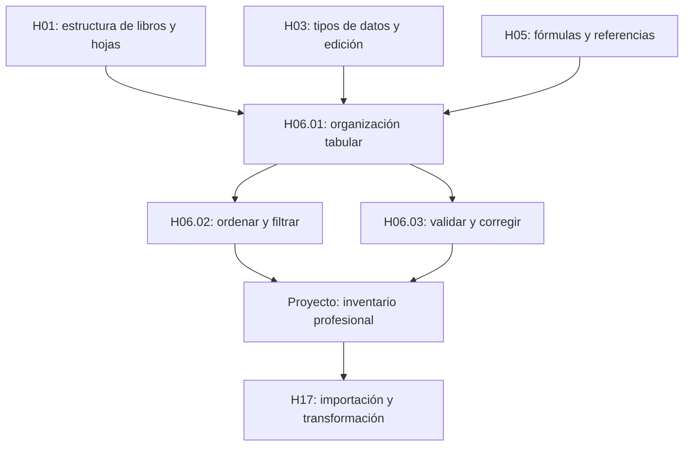

**Figura 1 —** Dependencias conceptuales del módulo. *Diagrama original (Mermaid), no captura de interfaz.*

---

## Laboratorio base — Catálogo de inventario

Usaremos un conjunto de 12 productos con códigos únicos. Todos los resultados numéricos del manual parten de estos valores iniciales, salvo que un ejercicio indique explícitamente una modificación.

**Procedimiento de preparación:** crea el libro `H06_Inventario.xlsx`; renombra la primera hoja como `Catalogo`; sitúa los encabezados en **A1:G1**; pega los valores desde A1. Si tu Excel no divide correctamente los campos, usa **Datos → Texto en columnas** o el método de importación disponible y especifica coma como delimitador. Verifica que `Precio` y `Stock` sean numéricos.

```csv
ID,Producto,Categoria,Proveedor,Precio,Stock,Estado
P001,Cuaderno Escolar,Papelería,Norte,35,12,Activo
P002,Pluma Azul,Papelería,Sur,12,28,Activo
P003,Carpeta Carta,Papelería,Norte,50,8,Activo
P004,Marcador Permanente,Papelería,Centro,20,5,Activo
P005,Libreta Profesional,Papelería,Sur,70,14,Activo
P006,Tijeras Oficina,Oficina,Centro,45,9,Activo
P007,Engrapadora Oficina,Oficina,Norte,120,4,Inactivo
P008,Regla 30 cm,Papelería,Sur,18,35,Activo
P009,Clips Caja,Oficina,Centro,25,16,Activo
P010,Memoria USB 32 GB,Tecnología,Norte,160,6,Activo
P011,Mouse USB,Tecnología,Sur,220,11,Activo
P012,Cable HDMI,Tecnología,Centro,95,7,Inactivo
```

**Diccionario de datos del laboratorio**

| Campo | Significado | Tipo esperado | Restricción de diseño |
|---|---|---|---|
| `ID` | Clave del producto | Texto | Única y no vacía; patrón previsto P + tres dígitos |
| `Producto` | Nombre comercial | Texto | Obligatorio |
| `Categoria` | Familia del artículo | Texto categórico | Papelería, Oficina o Tecnología |
| `Proveedor` | Región del proveedor | Texto categórico | Norte, Sur o Centro |
| `Precio` | Precio unitario en MXN | Número decimal | Mayor que cero |
| `Stock` | Unidades disponibles | Número entero | Igual o mayor que cero |
| `Estado` | Situación comercial | Texto categórico | Activo o Inactivo |

**Valores de control (datos originales, antes de editar):**

| Métrica | Resultado |
|---|---:|
| Registros | **12** |
| Productos activos | **10** |
| Productos inactivos | **2** |
| Stock total | **155 unidades** |
| Valor del inventario (`Precio × Stock`) | **$8,196 MXN** |
| Productos con `Estado = Activo` y `Stock <= 10` | **4** (`P003`, `P004`, `P006`, `P010`) |

> **Por qué un único conjunto de datos:** permite estudiar el efecto de transformar un rango en tabla, filtrar, ordenar y validar sin volver a introducir ejemplos incompatibles. Guarda siempre una copia de los datos originales; las transformaciones pueden cambiar el orden y algunos ejercicios añaden registros de manera deliberada.

---

# H06.01 — Organización tabular

## H06.01.01 — Tablas de Excel

### H06.01.01.01 — Creación de una tabla

#### A. Concepto y fundamento

Un **rango** es un conjunto de celdas referenciadas, como `A1:G13`. Una **tabla de Excel** es un objeto definido sobre un rango, con encabezados y capacidades integradas de filtrado, estilo, expansión y referencias estructuradas. Aplicar un borde o un color a un rango **no lo convierte** en una tabla.

**Comparación detallada:**

| Propiedad | Rango normal | Tabla de Excel |
|---|---|---|
| Encabezados | Se escriben libremente | Encabezados administrados por la tabla |
| Botones de filtro | Se pueden activar | Se integran con la tabla |
| Nombre lógico de tabla | No aplica | Ej. `tblProductos` |
| Expansión de datos | Requiere comprobar referencias | En muchos casos expande al añadir filas contiguas |
| Fórmulas de columnas | Copia manual o relleno | Puede crear columna calculada automáticamente |
| Referencia a una columna | `E2:E13` | `tblProductos[Precio]` |
| Fila de totales integrada | No | Sí |
| Conveniencia | Operaciones simples o temporales | Listas estructuradas y mantenibles |

**Diagrama conceptual:**

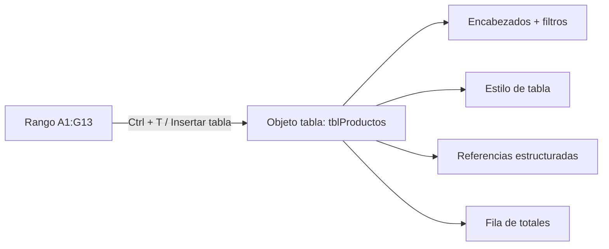

**Figura 2 —** Transformación de una selección de celdas en un objeto tabla. *Esquema conceptual.*

#### B. Procedimiento reproducible (Excel de escritorio)

1. Abre la hoja `Catalogo` con los datos de A1:G13.
2. Selecciona cualquier celda dentro del conjunto; para evitar ambigüedades, selecciona **A1:G13** completo.
3. Ve a **Insertar → Tabla** o usa **Ctrl + T** en Windows.
4. Confirma que el intervalo sea `$A$1:$G$13` y activa **La tabla tiene encabezados**.
5. Selecciona una celda del nuevo objeto. Abre la pestaña contextual **Diseño de tabla** (el nombre puede variar).
6. Establece el **Nombre de la tabla** como `tblProductos`.
7. Prueba un estilo con filas con bandas; revisa que `ID`, `Precio` y `Stock` sigan correctamente alineados y tipados.
8. Guarda el libro. A partir de este momento, las referencias estructuradas al catálogo usarán `tblProductos`.

**Comprobación:** filtra `Estado` por `Activo`, borra el filtro y observa que los encabezados mantienen botones de filtro. Después incorpora un producto al final y comprueba si queda dentro de los límites de la tabla. Si no, usa **Cambiar tamaño de la tabla**. No confíes en la expansión automática cuando existan filas en blanco, objetos adyacentes o condiciones especiales.

#### C. Ejemplo básico

Un rango de cinco columnas puede tener exactamente el mismo aspecto visual que una tabla. La diferencia se descubre al añadir una fila nueva: en una tabla bien construida, los estilos, las fórmulas de columnas y varias referencias pueden propagarse a los datos agregados.

#### D. Ejemplo intermedio

Una tienda incorpora `P013`. Si la lista es una tabla y la fórmula usa `tblProductos[Stock]`, al agregar correctamente `P013` al objeto tabla, la referencia se amplía. Si se hubiera construido con el rango fijo `F2:F13`, quizá habría que revisar el límite manualmente.

#### E. Aplicación profesional

En los reportes comerciales se reciben actualizaciones periódicas. Diseñar la captura como tabla ayuda a evitar fórmulas que dejan fuera los nuevos registros. No elimina, sin embargo, la necesidad de validar que las filas importadas realmente entraron al objeto.

#### F. Errores frecuentes y prevención

- **Encabezado dentro de una celda combinada:** descombina; una tabla necesita encabezados utilizables.
- **Seleccionar únicamente parte de los campos:** confirma la selección antes de crear el objeto.
- **Dejar líneas de subtotales manuales dentro de los registros:** separa los cálculos agregados de los datos transaccionales.
- **Renombrar la pestaña y asumir que cambió el nombre de la tabla:** son objetos distintos.
- **Agregar un registro bajo una fila vacía:** verifica si la nueva fila pertenece a la tabla.

**Recurso visual — captura pública:**


*Figura 3 — Captura histórica de Excel publicada por Ohio State University ([fuente](https://u.osu.edu/weedingthenumbers/2014/07/11/insert-a-table-in-excel/)). Observa las flechas de filtros en los encabezados y la cinta contextual de herramientas de tabla. **Captura real histórica**, no corresponde necesariamente al diseño de Microsoft 365 actual.*

**Referencia oficial:** [Microsoft — Descripción general de las tablas](https://support.microsoft.com/es-es/excel/overview-of-excel-tables).

---

### H06.01.01.02 — Referencias estructuradas

#### A. Qué son y por qué importan

Las **referencias estructuradas** permiten identificar datos de una tabla mediante el nombre de la tabla, sus columnas y determinados selectores especiales, en lugar de depender únicamente de direcciones como `E2:E13`.

Ejemplo:

```excel
=SUMA(tblProductos[Stock])
```

Esto comunica: *suma los números de la columna Stock de la tabla llamada tblProductos*.

En el laboratorio, el resultado inicial es **155**.

**Comparación de estilos:**

| Fórmula | Tipo de referencia | Observación |
|---|---|---|
| `=SUMA(F2:F13)` | Coordenadas | Intervalo fijo, si se mantiene tal cual |
| `=SUMA(tblProductos[Stock])` | Estructurada | Sigue el conjunto de filas de datos de esa columna |
| `=[@Precio]*[@Stock]` | Fila actual dentro de la tabla | Se utiliza para una columna calculada |

#### B. Anatomía de la referencia

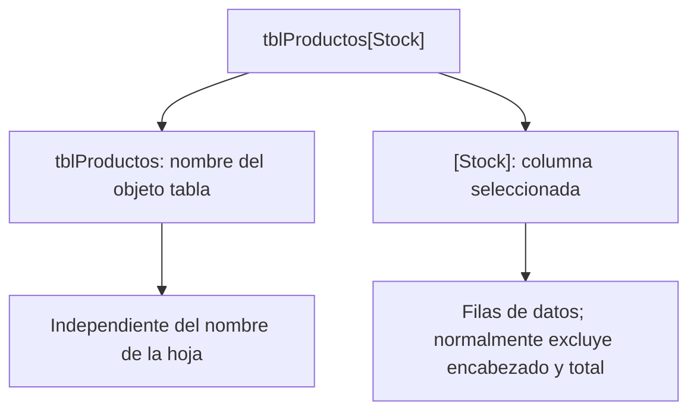

**Figura 4 —** Componentes de una referencia estructurada. *Esquema conceptual.*

Selectores habituales documentados por Microsoft en español:

| Referencia | Contenido |
|---|---|
| `tblProductos[#Datos]` | Área de registros |
| `tblProductos[#Encabezados]` | Encabezados |
| `tblProductos[#Todas]` | Datos, encabezados y totales cuando existan |
| `tblProductos[#Totales]` | Fila de totales, si existe |
| `tblProductos[Precio]` | Columna de precios (filas de datos) |
| `[@Precio]` | Precio de la fila actual, dentro de la tabla |

**Nota de idioma:** los selectores especiales como `#Datos` pueden mostrarse en inglés (`#Data`) según la localización de la instalación. Usa la fórmula sugerida por Excel en tu versión. Evita traducir literalmente los encabezados de columnas: `tblProductos[Precio]` debe coincidir con el nombre real del campo.

#### C. Columna calculada: valor del inventario

1. Dentro de `tblProductos`, agrega un encabezado **`Valor`** en la siguiente columna de la tabla (H1 si no hay otros campos).
2. En la primera celda de datos de esa columna, introduce:

```excel
=[@Precio]*[@Stock]
```

3. Confirma. Excel puede reconocer una **columna calculada** y completar la fórmula para los demás registros.
4. Verifica que cada `Valor` sea `Precio × Stock`.
5. En una celda **fuera de la tabla**, escribe:

```excel
=SUMA(tblProductos[Valor])
```

6. El resultado esperado es **8196** (aplica formato monetario posteriormente si lo deseas).

**Cálculos de comprobación:** P001 = `35 × 12 = 420`; P007 = `120 × 4 = 480`; P011 = `220 × 11 = 2420`.

No confundas las dos expresiones siguientes:

- `tblProductos[Precio]`: representa **toda la columna de datos**.
- `[@Precio]`: representa el **precio de la fila actual** cuando la fórmula está en la tabla.

**Errores comunes:**

- Escribir `[@Precio]` fuera de un contexto de tabla y esperar que identifique automáticamente una fila.
- Omitir el nombre de la tabla cuando la fórmula está en otra hoja y requiere una referencia completa.
- Suponer que dos encabezados repetidos pueden distinguirse claramente. Excel debe manejar nombres de columnas únicos.
- Alterar manualmente parte de una columna calculada, produciendo fórmulas inconsistentes.
- Cambiar el nombre del objeto sin revisar herramientas externas que pudieran depender de ese nombre.

**Referencia oficial:** [Microsoft — Usar referencias estructuradas](https://support.microsoft.com/es-es/excel/using-structured-references-with-excel-tables).

---

### H06.01.01.03 — Filas de totales

#### A. Fundamento

La **fila de totales** es un elemento opcional de la tabla que aparece al final y proporciona cálculos agregados. No es un registro de producto y debe quedar fuera de los datos operativos.

Excel suele utilizar `SUBTOTALES` en sus resúmenes. Esta función tiene la ventaja de **ignorar las filas filtradas**, por lo que sirve para mostrar resúmenes del conjunto visible.

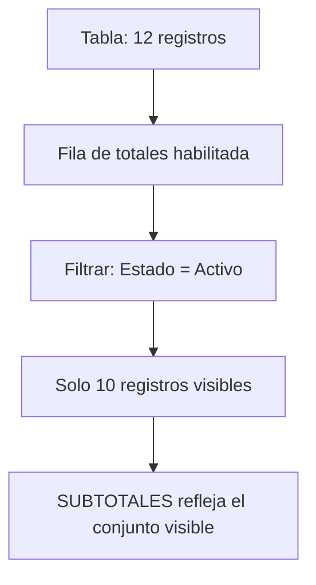

**Figura 5 —** Diferencia entre agregado general y agregado sensible al filtro. *Diagrama conceptual.*

#### B. Procedimiento

1. Selecciona una celda de `tblProductos`.
2. En **Diseño de tabla**, activa **Fila de totales**.
3. En la columna `Stock`, elige **Suma** en el desplegable de la fila de totales.
4. Comprueba que, sin filtros, aparezca **155**.
5. En la columna `Valor`, elige **Suma**: debe mostrar **8196**.
6. Filtra el campo `Estado` para dejar visibles solo productos `Activo`.
7. Verifica el resumen visible: **144 unidades** y **7051 MXN** de valor de inventario.
8. Borra los filtros y restaura el total completo.

**Fórmula explícita equivalente en Excel en español:**

```excel
=SUBTOTALES(109;tblProductos[Stock])
```

El código `109` solicita una suma que excluye tanto las filas filtradas como las ocultas manualmente. Con `9`, las filtradas se excluyen, pero las ocultas manualmente se tratan de forma diferente. Este matiz se estudia en profundidad en H08 y se documenta en la [referencia oficial de SUBTOTALES](https://support.microsoft.com/es-es/excel/functions/subtotal-function).

| Contexto | `SUMA(tblProductos[Stock])` | `SUBTOTALES(109;tblProductos[Stock])` |
|---|---:|---:|
| Sin filtro | 155 | 155 |
| Solo Activo | 155 | 144 |
| Solo Inactivo | 155 | 11 |

**Importante:** `SUBTOTALES` no se limita a «sumar visibles» en todos los contextos posibles; su comportamiento depende del número de función y de si las filas están filtradas u ocultas manualmente.

#### C. Aplicaciones y límites

La fila de totales es útil para informes exploratorios, controles de cantidad, importes acumulados y tablas operativas. Si necesitas reportes formales por varias categorías, pueden ser mejores las funciones condicionales (H07), las tablas dinámicas (H19) o Power Query (H21).

**Referencia oficial:** [Microsoft — Total de datos en una tabla](https://support.microsoft.com/es-es/excel/get-started/total-the-data-in-an-excel-table).

---

## H06.01.02 — Diseño de conjuntos de datos

### H06.01.02.01 — Encabezados

#### A. Definición

El **encabezado** nombra el atributo representado por una columna. Los encabezados constituyen la primera capa de documentación de un conjunto de datos.

**Mal diseño:** `Dato 1`, `Dato 2`, `Valor`, `Notas` sin definiciones claras.  
**Mejor diseño:** `ID`, `Producto`, `Categoria`, `Precio`, `Stock`, `Estado`.

Reglas prácticas:

1. Un atributo distinto por columna.
2. Un nombre semántico, preferiblemente breve y estable.
3. Encabezados no vacíos y no repetidos dentro de una tabla.
4. Unidades documentadas para medidas (`Precio` en MXN, `Stock` en unidades).
5. Convención estable de nombres: por ejemplo, `Categoria` sin acento para simplificar referencias externas, o `Categoría` con acento en toda la documentación. **No mezcles ambas arbitrariamente**.
6. Evita encabezados fusionados, títulos largos o subtotales insertados entre registros.

**Ejemplo comparativo:**

| Problema | Diseño frágil | Diseño mejorado |
|---|---|---|
| Unidades no identificadas | `Monto` | `Importe_MXN` |
| Dos medidas en un campo | `Precio/Stock` | `Precio`, `Stock` |
| Columna sin significado | `Dato3` | `Fecha_Registro` |
| Nombre cambiante | `Categoría 2025` | `Categoria` más columna `Periodo` cuando proceda |

#### B. Ejemplo profesional

Un dashboard basado en una columna llamada `Ventas` puede romperse conceptualmente si el equipo empieza a usar ese campo para «ventas antes de devoluciones» en un mes y «ventas netas» en otro. Los encabezados forman parte del contrato de datos, pero necesitan un diccionario que precise su significado.

### H06.01.02.02 — Registros

Un **registro** representa una observación, entidad o evento con el mismo conjunto de atributos que las demás filas.

La regla central es definir la **granularidad**: ¿qué representa exactamente una fila?

- En `tblProductos`, **una fila representa un producto**.
- En una tabla de `Movimientos`, una fila representaría **un movimiento de inventario**.
- En una tabla de `VentasDetalle`, una fila podría representar **una línea de una venta**.

Mezclar granularidades crea errores: si algunas filas son productos y otras son totales del mes, no puedes contar registros correctamente sin separar tipos de fila.

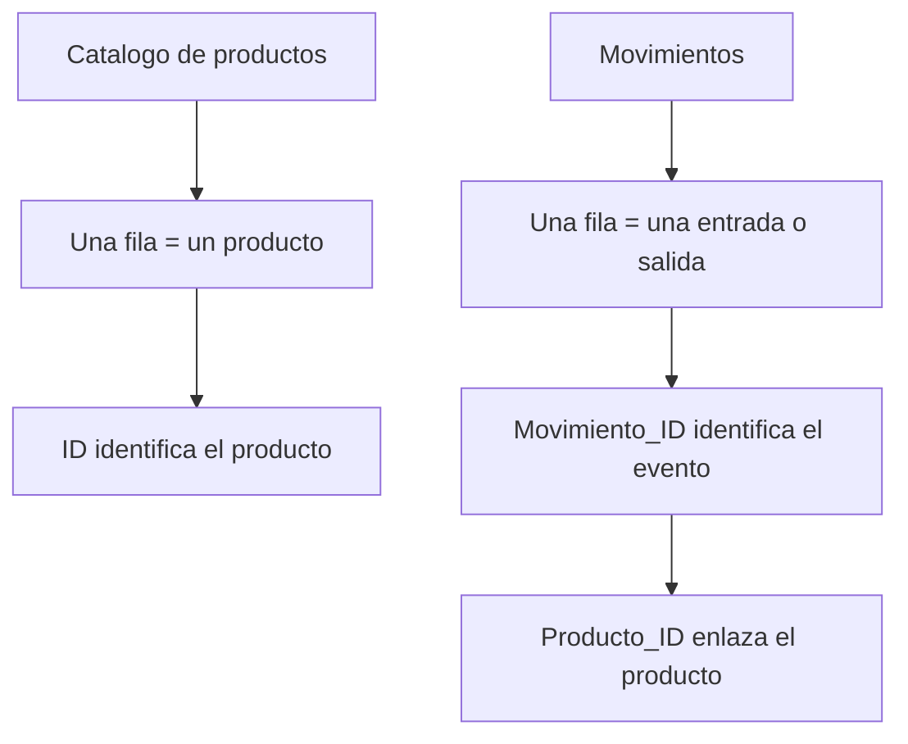

**Figura 6 —** Granularidad de entidades y eventos. *Modelo conceptual; las relaciones detalladas se desarrollan en bases de datos y modelado posterior.*

**Observación profesional:** si en el catálogo hay una fila por producto, `Stock` puede reflejar la situación actual. Un sistema con auditoría completa requiere también el historial de movimientos y políticas de reconciliación.

### H06.01.02.03 — Claves y duplicados

#### A. Qué es una clave

Una **clave** es un atributo o combinación de atributos que permite identificar un registro de forma única dentro del ámbito definido.

En nuestro laboratorio, `ID` cumple esa función:

```text
P001 → Cuaderno Escolar
P002 → Pluma Azul
P003 → Carpeta Carta
```

Dos productos distintos pueden tener el mismo nombre descriptivo y seguir siendo entidades distintas (por ejemplo, variaciones de tamaño). Por eso la identidad no debería depender ciegamente de un campo visual como `Producto`.

#### B. Clave natural y clave asignada

- **Natural:** identificador existente en el negocio, como un código normalizado de producto, si es verdaderamente estable y único.
- **Asignada:** código definido por el propio sistema, como `P001`.
- **Compuesta:** identificación que requiere varios atributos, por ejemplo `(Pedido_ID, Numero_Linea)`.

En una hoja de cálculo estas claves son una **convención de diseño** que puede protegerse mediante validación y revisión, pero la hoja no impone automáticamente todas las garantías de integridad de una base de datos transaccional.

#### C. Duplicado exacto vs duplicado de clave vs duplicado semántico

| Tipo | Ejemplo | Acción apropiada |
|---|---|---|
| Exacto | Dos filas iguales en todos los campos | Investigar importación repetida |
| Por clave | `P001` aparece dos veces con distinto precio | Resolver conflicto según la fuente autorizada |
| Semántico | `Pluma azul` / `Pluma Azul ` | Normalizar y revisar si son la misma entidad |

**No todos los valores repetidos constituyen errores.** Es normal que varios productos tengan `Categoria = Oficina` o `Proveedor = Norte`. Lo importante es definir **qué campos deben ser únicos**.

### Guía visual de calidad tabular

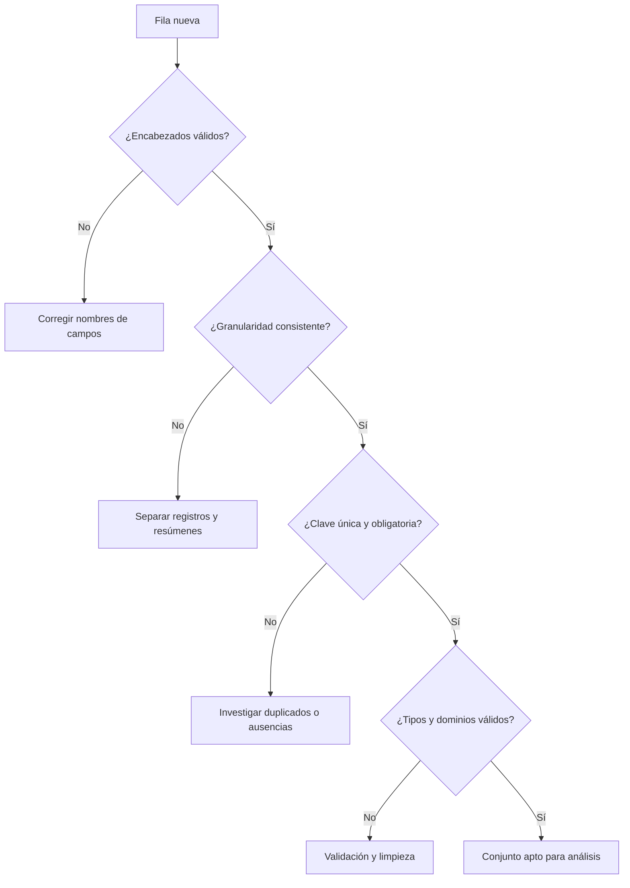

**Figura 7 —** Control conceptual de calidad de la estructura. *No reemplaza un proceso de auditoría.*

### Recapitulación H06.01

Una tabla profesional necesita más que un estilo visual. Requiere definir qué representa cada fila, nombrar claramente sus columnas, mantener claves consistentes y utilizar referencias que evolucionen junto a los datos. La estructura prepara el análisis posterior, pero por sí sola no corrige errores de origen.

---
# H06.02 — Ordenamiento y filtrado

## H06.02.01 — Ordenar datos

### Introducción: ordenar no es filtrar

**Ordenar** reorganiza la secuencia de las filas según uno o más criterios. **Filtrar** mantiene el orden relativo del subconjunto visible, pero oculta temporalmente filas que no cumplen los criterios. Ninguna de las dos operaciones debería cambiar el significado de cada registro si se aplica correctamente al conjunto completo.

| Operación | Qué cambia | Qué permanece |
|---|---|---|
| Ordenar por `Stock` ascendente | Posición de los registros | Valores y asociación de columnas por registro |
| Filtrar `Estado = Activo` | Visibilidad de filas | Registros conservados en el conjunto fuente |
| Quitar duplicados | El número de registros existentes | Únicamente los registros retenidos, según las columnas seleccionadas |

**Error de alto impacto:** seleccionar solo `Stock` y ordenar esa columna aislada, separando cantidades de sus productos. Para mantener la integridad, trabaja dentro de la **tabla completa** o confirma que Excel expanda adecuadamente la selección antes de ordenar.

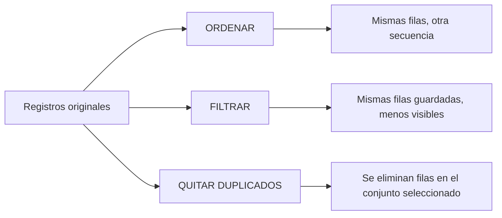

**Figura 8 —** Efectos distintos sobre un conjunto de registros. *Esquema conceptual.*

---

### H06.02.01.01 — Ordenar texto y números

#### A. Ordenamiento de texto

En una columna de texto, las opciones habituales son **A a Z** y **Z a A**. Excel utiliza reglas de comparación que pueden depender de la configuración regional y las opciones de ordenación; evita asumir que el orden será idéntico entre todos los idiomas para cadenas con acentos, signos o mayúsculas.

**Ejemplo básico:** en la tabla, selecciona el filtro de `Categoria` y elige A a Z. Los grupos, en el orden esperado con estos datos, son `Oficina`, `Papelería` y `Tecnología`.

**Ejemplo intermedio:** dentro de cada categoría, conviene ordenar productos por `Stock` de menor a mayor para inspeccionar existencias críticas. Esto requiere **varios niveles** (H06.02.01.03).

#### B. Ordenamiento numérico

Con `Stock`, de menor a mayor, los códigos comenzarán así:

| Posición | ID | Stock |
|---:|---|---:|
| 1 | P007 | 4 |
| 2 | P004 | 5 |
| 3 | P010 | 6 |
| 4 | P012 | 7 |
| 5 | P003 | 8 |
| 6 | P006 | 9 |

Puedes comprobar los seis primeros manualmente. Si en la columna hay números guardados como texto, no se garantiza el resultado numérico esperado. Antes de ordenar, **verifica tipos**, especialmente si el origen fue CSV o una exportación externa.

#### C. Procedimiento paso a paso

1. Selecciona una celda **dentro de `tblProductos`**, preferiblemente en la columna que deseas ordenar.
2. Abre **Datos → Ordenar y filtrar**, o el desplegable del encabezado.
3. Elige **De menor a mayor**, **De mayor a menor**, **A a Z** o **Z a A**, según el tipo de dato.
4. Comprueba que el ID y el nombre de producto permanecen juntos en cada fila.
5. Restaura la secuencia de negocio si es necesario: crea una columna `OrdenOriginal` **antes de ordenar**, con los valores 1 a 12. El orden original no siempre puede recuperarse solo ordenando por otro campo.

**Aplicación real:** priorización de productos de bajo stock, listado alfabético de clientes o clasificación de facturas por monto.

**Errores y soluciones:**

- Si `100` aparece antes que `20` al ordenar como texto, comprueba el tipo real de dato.
- Si aparecen filas en blanco intercaladas, revisa los límites de la tabla.
- Si los códigos ya no corresponden a los nombres, recupera una copia previa y repite la operación sobre el conjunto completo.

---

### H06.02.01.02 — Ordenar fechas

#### A. Fechas verdaderas frente a texto con aspecto de fecha

Excel representa las fechas ordinarias mediante valores numéricos con formato de fecha (H03). Por ello, ordenar una columna que contiene **fechas reales** permite ordenar cronológicamente. Si importas cadenas de texto similares a fechas, quizá se ordenen como texto.

**Laboratorio adicional (hoja `Entregas`):** crea una columna `FechaEntrega` con fechas de Excel interpretadas como día/mes/año (o ingrésalas mediante un método acorde con tu configuración regional):

| ID | FechaEntrega | Prioridad |
|---|---|---|
| E01 | 03/10/2026 | Alta |
| E02 | 15/09/2026 | Media |
| E03 | 10/10/2026 | Baja |
| E04 | 28/09/2026 | Alta |

**Orden cronológico esperado (más antigua → más reciente):** `E02`, `E04`, `E01`, `E03`.

#### B. Procedimiento

1. Selecciona una celda de `FechaEntrega`.
2. Comprueba el tipo: aplica temporalmente formato **Número** a una celda de prueba o inspecciona el valor con una operación simple; si no corresponde a una fecha Excel, corrige el origen.
3. Ordena de **más antiguo a más reciente**.
4. Comprueba que `15/09/2026` está antes de `03/10/2026`.
5. Repite de más reciente a más antiguo y observa el orden inverso.

**Precaución:** `03/10/2026` puede interpretarse como 3 de octubre o 10 de marzo dependiendo de la configuración. En intercambios internacionales, conviene utilizar fechas ISO normalizadas en la fuente y conversión explícita al importar.

#### C. Caso profesional

Un supervisor programa entregas. Si un sistema exporta las fechas como texto `2026-9-5`, `2026-10-1` y `2026-9-15` sin longitud normalizada, ordenarlas lexicográficamente puede producir resultados inesperados. El paso correcto es **normalizar y reconocer el tipo de dato** antes de ordenar.

---

### H06.02.01.03 — Ordenamiento multinivel

#### A. Definición

El **ordenamiento multinivel** aplica criterios jerárquicos: primero compara el campo principal y, **solo cuando hay empate dentro de ese campo**, pasa al segundo y a los siguientes.

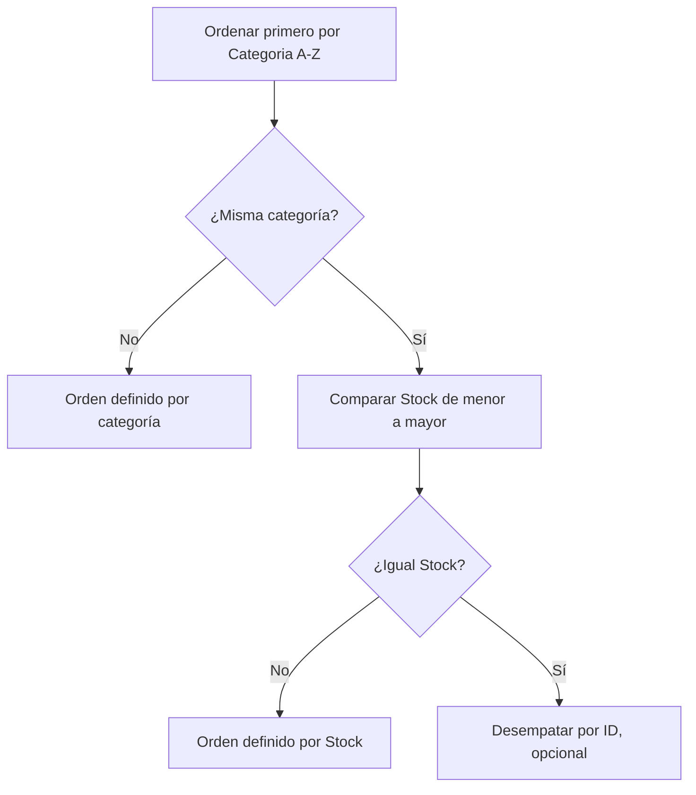

**Figura 9 —** Ordenación jerárquica. *Diagrama conceptual.*

#### B. Procedimiento

1. En `tblProductos`, selecciona **Datos → Ordenar**.
2. Asegúrate de que Excel reconoce la fila de encabezados.
3. Primer nivel: columna `Categoria`, ordenar por **Valores de celda**, orden **A a Z**.
4. Pulsa **Agregar nivel**.
5. Segundo nivel: columna `Stock`, ordenar **De menor a mayor**.
6. Opcionalmente agrega un tercer nivel por `ID` ascendente para un criterio de desempate estable.
7. Pulsa **Aceptar** y contrasta con el orden esperado.

**Orden completo para el laboratorio original:**

| Grupo | ID según orden de Stock ascendente | Stock |
|---|---|---|
| Oficina | P007, P006, P009 | 4, 9, 16 |
| Papelería | P004, P003, P001, P005, P002, P008 | 5, 8, 12, 14, 28, 35 |
| Tecnología | P010, P012, P011 | 6, 7, 11 |

#### C. Listas personalizadas

No siempre interesa orden alfabético. Para estados como `Crítica`, `Alta`, `Media`, `Baja`, el orden de prioridad no es alfabético. Excel admite **listas personalizadas** para imponer un orden significativo en vez de A a Z. Un ejemplo empresarial es `Urgente > Alto > Normal > Bajo`.

En Excel de escritorio, puedes crear una lista desde **Archivo → Opciones → Avanzadas → General → Modificar listas personalizadas**, cuando el entorno ofrece esta opción; luego selecciónala en **Datos → Ordenar → Orden → Lista personalizada**. No presupongas que el diálogo o sus capacidades sean idénticos en la web.

**Referencia oficial:** [Microsoft — Ordenar datos usando una lista personalizada](https://support.microsoft.com/es-es/excel/sort-data-using-a-custom-list).

---

### H06.02.01.04 — Ordenar por colores e iconos

#### A. Cuándo tiene sentido

La ordenación por **color de celda**, **color de fuente** o **icono de formato condicional** sirve cuando esos elementos tienen un significado operativo conocido (por ejemplo, rojo = pendiente de inspección). No debe ser el único mecanismo que codifique un estado: colores e iconos pueden cambiar y no son universalmente accesibles.

#### B. Ejemplo

En la hoja `Catalogo`, marca de manera visual:

- Rojo: stock menor o igual a 5.
- Amarillo: stock entre 6 y 10.
- Verde: stock mayor que 10.

**Resultado esperado:** rojo para `P004` y `P007`; amarillo para `P003`, `P006`, `P010`, `P012`; verde para los demás. Estas categorías se pueden expresar primero con una columna textual `Prioridad` antes de definir colores.

#### C. Procedimiento

1. Aplica el color de celda manual o por formato condicional (el formato condicional se profundiza en H04).
2. Abre **Datos → Ordenar**.
3. En **Ordenar según**, selecciona `Color de celda`, `Color de fuente` o `Icono de celda` según corresponda.
4. Elige un color/icono concreto y posición `En la parte superior`.
5. Agrega niveles para los colores restantes. **No existe un orden natural universal para los colores**.
6. Comprueba que la ordenación respeta las demás columnas de cada producto.

**Mejor práctica:** si necesitas un orden de negocio persistente, usa una columna `Prioridad` con valores explícitos y una lista personalizada; mantén colores como apoyo visual, no como fuente única de verdad.

**Recurso visual oficial:** [Microsoft — Ordenar datos, incluidos color e icono](https://support.microsoft.com/es-es/excel/sort-data-in-a-range-or-table-in-excel). Las imágenes de la ventana **Ordenar** aparecen en esa página y muestran los campos *Columna*, *Ordenar según* y *Orden*. La ubicación exacta puede cambiar por versión.

---

## H06.02.02 — Filtrar datos

### Conceptos comunes

Un **filtro** permite presentar temporalmente solo los registros que cumplen uno o varios criterios. Las filas no coincidentes permanecen almacenadas, salvo que después se ejecute otra operación destructiva.

**Diferencia con eliminar:** filtrar `Estado = Activo` no elimina `P007` ni `P012`; únicamente los oculta mientras el filtro está activo.

**Esquema:**

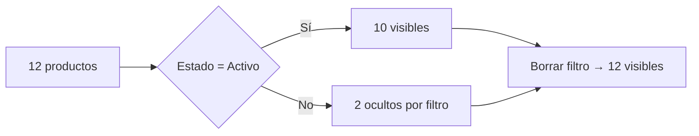

**Figura 10 —** Filtro no destructivo. *Esquema conceptual.*

### H06.02.02.01 — Filtros simples

#### A. Filtrar una tabla

1. Selecciona la flecha del encabezado `Estado`.
2. Desmarca `Inactivo` y deja solo `Activo`.
3. Confirma: aparecen **10 registros**.
4. Observa que los números de fila pueden quedar salteados y el botón del encabezado indica que existe un filtro.
5. Borra el filtro desde la misma columna o desde las opciones de Datos.

**Ejemplos de filtros simples:**

| Tipo de datos | Criterio | Resultado esperado |
|---|---|---|
| Texto | `Categoria = Tecnología` | 3 productos: P010, P011, P012 |
| Texto | `Estado = Inactivo` | P007, P012 |
| Número | `Stock <= 10` | 6 productos: P003, P004, P006, P007, P010, P012 |
| Proveedor | `Proveedor = Norte` | P001, P003, P007, P010 |

**Búsqueda en el filtro:** el cuadro de búsqueda de un desplegable puede ayudar a identificar valores, pero no representa necesariamente un lenguaje completo de consultas ni sustituye el filtrado por criterios avanzado.

#### B. Filtro vs ocultación manual

Un filtro oculta filas según valores. La ocultación manual permite ocultar filas por decisión del usuario sin un criterio explícito. Esta distinción importa para funciones agregadas como `SUBTOTALES` y para explicar por qué ciertos registros no aparecen.

### H06.02.02.02 — Filtros personalizados

#### A. Comparaciones

Excel permite construir filtros numéricos como `Mayor que`, `Menor que`, `Entre`, `Es igual a` y, para texto, condiciones del tipo `Contiene`, `Comienza por`, etc.

**Ejemplo 1 (números):** `Stock >= 5` **Y** `Stock <= 10` → `P003` (8), `P004` (5), `P006` (9), `P010` (6), `P012` (7); total **5** registros.

**Ejemplo 2 (múltiples columnas):** `Categoria = Tecnología` **Y** `Estado = Activo` → `P010` y `P011`.

**Ejemplo 3 (OR en una categoría):** categoría `Oficina` **O** `Tecnología` → seis registros (`P006`, `P007`, `P009`, `P010`, `P011`, `P012`).

#### B. Comodines

Para filtros de texto, los caracteres comodín permiten patrones aproximados:

| Símbolo | Uso habitual | Ejemplo |
|---|---|---|
| `*` | Cero o más caracteres | `*USB*` contiene USB |
| `?` | Un solo carácter | `P00?` coincide con P001–P009 si los valores cumplen esa forma |
| `~` | Tratar ciertos comodines como literales | `~*` busca un asterisco literal en entornos compatibles |

**Precaución:** comparar cadenas es distinto de comprobar identidades. Para identificar registros únicos, utiliza una clave explícita. Un filtro `Contiene USB` encuentra por coincidencia textual; no sabe cuáles productos son equivalentes o pertenecen a la misma familia comercial.

#### C. Caso profesional

Una persona responsable de compras quiere ver los productos **activos** con **stock no superior a 10**. Aplica filtro `Estado = Activo` y `Stock <= 10`. Espera cuatro códigos: **P003, P004, P006 y P010**. La suma de existencias de estos cuatro es **28 unidades**.

**Validación:** si el resultado es cinco, probablemente incluiste un artículo inactivo o confundiste `<=10` con `<10`.

---

### H06.02.02.03 — Filtro avanzado y segmentaciones

#### A. Filtro avanzado: definición

El **Filtro avanzado** permite utilizar un rango de criterios separado del conjunto de datos para expresar condiciones más complejas.

La regla básica del rango de criterios es:

- Condiciones en la **misma fila de criterios** se combinan con **Y**.
- Condiciones en **filas diferentes** se combinan con **O**.
- El encabezado del criterio debe coincidir con el encabezado del campo del origen (salvo casos de criterios calculados con reglas particulares).

**Esquema lógico:**

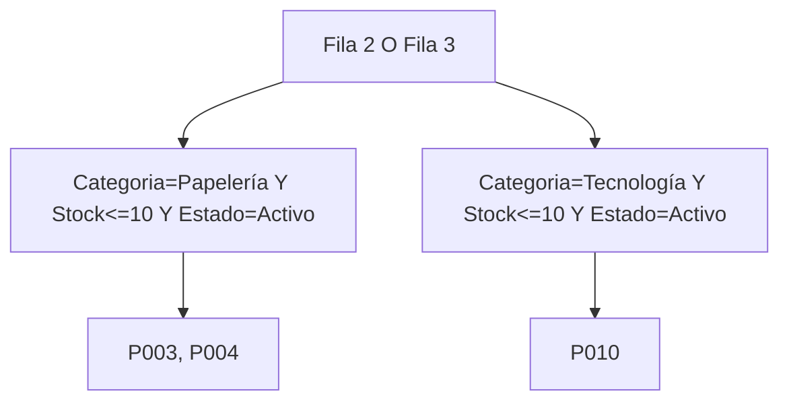

**Figura 11 —** Composición Y/O de criterios avanzados. *Esquema conceptual.*

#### B. Laboratorio de filtro avanzado

En un lugar **separado del origen** (por ejemplo `K1:M3`), escribe:

| Categoria | Stock | Estado |
|---|---|---|
| Papelería | `<=10` | Activo |
| Tecnología | `<=10` | Activo |

Las celdas de criterio de tipo `<=10` deben ser interpretadas por Excel como operadores de filtrado; si el programa reinterpreta el valor, entra directamente en el campo de criterio adecuado.

Después:

1. Borra cualquier filtro activo en el catálogo.
2. Selecciona una celda del origen.
3. Ve a **Datos → Avanzadas** (Excel de escritorio, cuando esté disponible).
4. Selecciona **Filtrar la lista, de forma local** o **Copiar a otra ubicación**.
5. Configura `Rango de la lista = $A$1:$H$13` si ya agregaste `Valor`; de lo contrario, `$A$1:$G$13`.
6. Configura `Rango de criterios = $K$1:$M$3`.
7. Confirma y comprueba los códigos **P003, P004 y P010**.
8. Si realizaste una copia a otra ubicación, verifica que la zona de destino esté separada de la tabla original.

**Limitación importante:** los resultados del filtro avanzado **no se actualizan automáticamente** al cambiar el rango de criterios; hay que volver a aplicar el filtro. La disponibilidad exacta de los controles puede variar por plataforma.

**Recurso oficial:** [Microsoft — Filtrar por criterios avanzados](https://support.microsoft.com/es-es/excel/filter-by-using-advanced-criteria).

#### C. Filtros con varios límites sobre una misma columna

Una necesidad frecuente es `(Stock > 5 Y Stock < 12) O Stock > 25`. En un filtro avanzado puede requerirse duplicar el encabezado `Stock` en el rango de criterios para expresar condiciones simultáneas sobre el mismo campo, de acuerdo con el patrón publicado por Microsoft. Por eso **dos condiciones en una misma fila no se escriben siempre una debajo de otra**: su ubicación cambia la lógica.

#### D. Segmentaciones de datos (*slicers*)

Las **segmentaciones de datos** presentan botones visuales para aplicar filtros de forma interactiva a tablas y tablas dinámicas compatibles.

**Procedimiento orientativo:**

1. Selecciona una celda de `tblProductos`.
2. Abre **Insertar → Segmentación de datos** (nombres y disponibilidad según entorno).
3. Elige el campo `Categoria`.
4. Selecciona el botón `Tecnología`; deberían quedar visibles **P010, P011 y P012**.
5. Si además filtras `Estado = Activo`, quedarán **P010 y P011**.
6. Borra los filtros al terminar.

Una segmentación **no es un reemplazo de la validación de datos**. Filtra registros visibles, pero no restringe lo que se introduce en las celdas.

**Captura de referencia:** consulta las imágenes oficiales de [Microsoft — Usar segmentaciones para filtrar datos](https://support.microsoft.com/es-es/excel/get-started/use-slicers-to-filter-data). Observa los botones de cada categoría, su estado seleccionado y el control de borrar filtro.

### Errores frecuentes H06.02

| Síntoma | Causa probable | Corrección |
|---|---|---|
| Se desalinearon los productos y precios | Se ordenó una sola columna | Recuperar copia y ordenar la tabla entera |
| `100` aparece antes que `20` | Números guardados como texto | Convertir correctamente antes de ordenar |
| Un filtro devuelve más filas de las esperadas | Confusión entre Y y O | Escribir los criterios en forma lógica antes de aplicarlos |
| El subtotal no coincide con el total general | Filas ocultas por filtros | Comparar `SUMA` y `SUBTOTALES` según el objetivo |
| El filtro avanzado conserva un resultado antiguo | No se volvió a ejecutar | Reaplicar Filtro avanzado |
| Un color deja de tener el significado esperado | Codificación visual sin campo subyacente | Guardar `Prioridad` como dato explícito |

---
# H06.03 — Validación y calidad de datos

## H06.03.01 — Validación

### Introducción: prevención frente a detección

La **validación de datos** define reglas para restringir la introducción de valores en determinadas celdas. Una validación puede comprobar que una cantidad sea entera, que un precio esté dentro de un intervalo o que el campo `Estado` adopte uno de los valores autorizados.

**No es un mecanismo infalible de integridad:** el pegado, el relleno, los resultados de fórmulas o las macros pueden generar valores no válidos sin que aparezcan los mismos mensajes que al escribir manualmente; además, crear reglas sobre datos existentes no corrige esos datos automáticamente. Microsoft recomienda auditar celdas existentes mediante las herramientas correspondientes. [Fuente oficial](https://support.microsoft.com/es-es/excel/display-or-hide-circles-around-invalid-data).

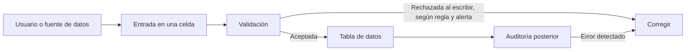

**Figura 12 —** Prevención y auditoría son controles complementarios. *Esquema conceptual.*

El diálogo de Excel suele permitir:

- **Configuración:** tipo de dato admitido y condiciones.
- **Mensaje de entrada:** aviso mostrado al seleccionar la celda.
- **Mensaje de error:** respuesta a una entrada no válida; el estilo **Detener** busca bloquearla, mientras otras opciones pueden advertir o permitir continuar.

### H06.03.01.01 — Validación por listas

#### A. Cuándo utilizarla

Una lista desplegable ayuda a mantener consistencia cuando el conjunto de opciones es reducido y controlado: `Activo`/`Inactivo`, categorías de productos o departamentos.

**Valor empresarial:** evita variaciones como `activo`, `ACT`, `Activoo` o una categoría no autorizada que posteriormente no coincida con los filtros.

#### B. Laboratorio: lista Estado

1. Guarda una copia de trabajo, preferiblemente antes de modificar datos.
2. En una hoja `Parametros` escribe en A1:A2:

```text
Activo
Inactivo
```

3. Selecciona las celdas de datos de `Estado` en `tblProductos` (G2:G13 en el conjunto original).
4. Abre **Datos → Validación de datos**.
5. En **Permitir**, selecciona **Lista**.
6. Si la fuente está en otra hoja, usa un rango con nombre, por ejemplo `ListaEstados`, para mejorar la compatibilidad, o escribe `Activo;Inactivo` / `Activo,Inactivo` según el separador de listas aceptado por tu instalación. La referencia directa entre hojas puede depender de la versión y la interfaz.
7. Configura un mensaje de entrada: «Selecciona un estado autorizado».
8. Configura una alerta de tipo **Detener**, cuando esté disponible: «Solo se admiten Activo o Inactivo».
9. Prueba con `Activo` (válido) y `Pendiente` (debe rechazarse mediante introducción manual bajo la regla seleccionada).

**Precaución:** una lista dependiente de un rango fijo debe mantenerse cuando cambien las opciones; para listas grandes es mejor una tabla o una fuente nombrada cuidadosamente diseñada.

#### C. Lista para Categoria

Aplica el mismo procedimiento con `Papelería`, `Oficina` y `Tecnología`. Antes de imponer las reglas, revisa si existen valores históricos que no coinciden con la nueva taxonomía; no transformes categorías antiguas automáticamente sin permiso de negocio.

**Recurso visual oficial:** [Microsoft — Aplicar validación de datos a celdas](https://support.microsoft.com/es-es/excel/get-started/apply-data-validation-to-cells). Observa en las capturas las opciones *Permitir*, *Origen* y los cuadros de mensajes.

---

### H06.03.01.02 — Validación de números y fechas

#### A. Enteros frente a decimales

`Stock` representa unidades físicas enteras. Un valor `3.5` podría tener sentido en un inventario de peso, pero no en este catálogo de artículos contados por unidad. Por eso el campo debe respetar el dominio **entero y no negativo**.

`Precio` es una cantidad monetaria que admite decimales, pero no importes negativos para este catálogo de precios unitarios. Esa es una **regla de negocio del ejemplo**, no una propiedad universal del dinero.

#### B. Reglas propuestas

| Campo | Permitir | Condición | Ejemplos válidos | Ejemplos inválidos |
|---|---|---|---|---|
| `Stock` | Número entero | Mayor o igual a 0 | `0`, `12`, `28` | `-1`, `3.5` |
| `Precio` | Decimal | Mayor que 0 | `0.01`, `35`, `220.5` | `0`, `-5` |
| `FechaRecepcion` | Fecha | Entre dos límites definidos | Fecha real dentro del intervalo | Texto que no sea fecha, fuera de periodo |

**Procedimiento para Stock:**

1. Selecciona la columna de datos `Stock`, sin incluir encabezado ni fila de totales.
2. Abre **Datos → Validación de datos**.
3. **Permitir: Número entero**.
4. **Datos: Mayor o igual que**; **Mínimo: 0**.
5. Configura un mensaje de error comprensible.
6. Prueba con `0`, `10`, `-3` y `2.5`.
7. Añade temporalmente una celda con valor inválido por copia solo en una hoja de ensayo y comprueba si el comportamiento difiere de introducirlo manualmente.

**Fechas:** si utilizas un rango permitido entre el 01/01/2026 y el 31/12/2026, asegúrate de introducir **fechas reales**. Los límites y la interpretación de la fecha deben corresponder a la configuración regional. Los casos extremos deben probarse explícitamente.

#### C. Valores faltantes

La validación puede permitir o no celdas vacías en determinados escenarios. Una regla de tipo «entero no negativo» no sustituye necesariamente una comprobación independiente de obligatoriedad. Si `Stock` está vacío, ¿representa cero unidades o un dato desconocido? Son situaciones distintas: no debe asumirse `0` sin criterio documentado.

---

### H06.03.01.03 — Reglas personalizadas

#### A. Fundamento

Una regla personalizada utiliza una **fórmula** que se evalúa como VERDADERO o FALSO para decidir si una entrada se ajusta al criterio. Es útil cuando la condición no cabe en las reglas predefinidas.

Se recomienda construir y probar la fórmula **en celdas normales** antes de configurarla como validación; así se puede comprobar cada caso sin depender de un cuadro de diálogo.

#### B. Claves únicas por `ID`

Supón que el catálogo ocupa `A2:A13`. Para impedir introducir manualmente un ID ya usado, selecciona la primera celda de datos y utiliza una regla personalizada, ajustando las referencias según el rango real:

```excel
=CONTAR.SI($A$2:$A$1000;A2)=1
```

**Interpretación:**

- `CONTAR.SI` cuenta cuántas veces aparece el valor de `A2` dentro de un intervalo definido.
- El resultado debe ser **exactamente 1**, es decir, el ID de esa fila no se repite.
- `$A$2:$A$1000` fija el área inspeccionada, pero impone un límite que hay que revisar cuando crezca el conjunto.
- `A2` conserva una referencia relativa a la fila validada si Excel la aplica correctamente al rango seleccionado.

Para un **ID obligatorio**, además de único, podrías emplear:

```excel
=Y(A2<>"";CONTAR.SI($A$2:$A$1000;A2)=1)
```

**Importante:** esta fórmula es introductoria y utiliza funciones lógicas cuyo estudio formal corresponde a H07. El ejemplo requiere configurar el rango de aplicación correctamente; una validación sobre A2:A13 no necesariamente se extenderá automáticamente a todas las filas futuras en cualquier entorno o modalidad de pegado.

#### C. Control de prefijo

Los códigos siguen el patrón `P001`. Una validación introductoria para un prefijo sería:

```excel
=IZQUIERDA(A2;1)="P"
```

Pero eso **no garantiza** que los tres caracteres restantes sean dígitos. Comprobar el formato exacto requiere controles adicionales, que más adelante se desarrollarán mediante funciones de texto y lógica. Evita describir una regla parcial como si fuera una validación completa.

#### D. Regla relacionada entre campos

Si los artículos inactivos necesitan una revisión antes de ser vendidos, puede establecerse una regla de control de calidad según `Estado` y `Stock`, pero la regla debe acordarse con el negocio: **no hay ninguna contradicción universal en que un artículo inactivo conserve stock**. En nuestro conjunto original, `P007` y `P012` tienen existencias pese a estar inactivos, y eso no representa por sí solo un error.

#### E. Limitaciones y buenas prácticas

- Las reglas se pueden eludir mediante ciertos métodos de pegado o automatización.
- Las fórmulas personalizadas deben probarse en varias filas y casos límite.
- La validación no garantiza unicidad transaccional cuando varios usuarios trabajan simultáneamente.
- Mantén un diccionario de reglas y mensajes comprensibles para los usuarios.
- Complementa reglas con **auditorías posteriores** y copias de seguridad.

**Referencias oficiales:** [Microsoft — Aplicar validación](https://support.microsoft.com/es-es/excel/get-started/apply-data-validation-to-cells) y [Microsoft — Más información sobre validación](https://support.microsoft.com/es-es/excel/more-on-data-validation).

---

## H06.03.02 — Corrección de registros

### H06.03.02.01 — Duplicados

#### A. Detectar antes de eliminar

Excel permite **resaltar duplicados** mediante formato condicional y **quitar duplicados** mediante una herramienta de datos. La primera sirve para inspeccionar; la segunda elimina registros de la selección según las columnas elegidas.

**Nunca ejecutes una eliminación irreversible sobre una única copia de datos importantes.** Antes, acuerda qué define un duplicado y qué registro debe conservarse.

#### B. Laboratorio controlado

Haz una **copia** de `Catalogo` llamada `Duplicados_Prueba` y agrega estas dos filas:

| ID | Producto | Categoria | Proveedor | Precio | Stock | Estado |
|---|---|---|---|---:|---:|---|
| P003 | Carpeta Carta | Papelería | Norte | 50 | 8 | Activo |
| P002 | Pluma Azul | Papelería | Sur | 13 | 28 | Activo |

Ahora tienes 14 registros en la copia, pero hay **12 IDs distintos** porque P003 y P002 están repetidos.

**Importante:** la segunda fila añadida no es un duplicado exacto de la fila original P002 porque su `Precio` cambió de 12 a 13. Sin embargo, es un **duplicado de clave** y necesita resolución.

**Flujo recomendado:**

1. Guarda la copia antes de corregir.
2. Resalta valores duplicados en la columna `ID`: **Inicio → Formato condicional → Resaltar reglas de celdas → Valores duplicados**.
3. Confirma los códigos repetidos.
4. Determina la fuente de verdad y la política de resolución.
5. Prueba la herramienta **Datos → Quitar duplicados** en otra copia de ensayo, seleccionando solo **ID** como criterio.
6. Comprueba que queden 12 IDs y revisa cuál de las versiones de `P002` se conservó.
7. **No presupongas** que la primera o la última fila es la correcta; el orden de la selección afecta qué instancia se conserva.

**Advertencia sobre selección de columnas:** si marcas **todas** las columnas, la fila duplicada exacta de P003 será candidata a eliminación, pero las dos versiones de P002 (precios distintos) **no son duplicados exactos** y podrían mantenerse ambas. Si solo marcas `ID`, se considera repetición por clave.

**Fuente oficial:** [Microsoft — Buscar y eliminar duplicados](https://support.microsoft.com/es-es/excel/find-and-remove-duplicates).

#### C. Diferencias entre tres operaciones

| Operación | Destructiva | Finalidad |
|---|---|---|
| Formato condicional de duplicados | No | Identificar posibles casos |
| Filtro avanzado de únicos | No elimina el origen | Presentar o copiar valores únicos |
| Quitar duplicados | Sí, sobre selección | Eliminar filas consideradas repetidas |

**Diagrama de decisión:**

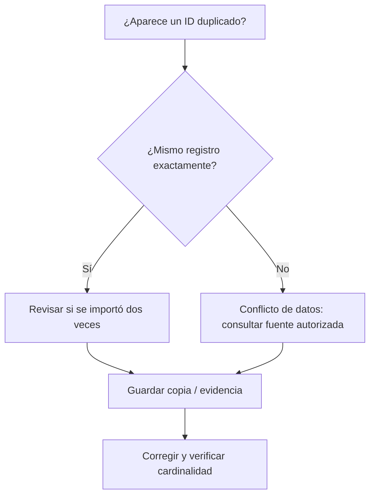

**Figura 13 —** Tratamiento prudente de duplicados. *Diagrama conceptual.*

---

### H06.03.02.02 — Inconsistencias

#### A. Definición

Una **inconsistencia** es una violación de las expectativas definidas para el conjunto de datos: puede ser sintáctica, de tipo, de dominio, de formato, de relación o de significado.

**Ejemplos:**

| Problema | Valor recibido | Expectativa | Acción propuesta |
|---|---|---|---|
| Espacios | `" Norte "` | `Norte` | Normalizar y documentar |
| Estado no permitido | `Pausado` | Activo/Inactivo | Revisar taxonomía |
| Precio como texto | `"$35"` importado como texto | Número 35 en MXN | Convertir después de verificar origen |
| Stock fraccionario | `3.5` | Entero | Corregir o revisar unidad de medida |
| Clave vacía | `""` | ID obligatorio | Recuperar identificación |
| Código repetido | `P002` aparece dos veces | Único | Resolver la fuente autorizada |
| Fecha ambigua | `04/05/2026` | Formato interpretado | Definir convención e importar explícitamente |

No todo dato sorprendente es erróneo. Un `Precio = 0` podría ser legítimo en un registro promocional, aunque no lo permitamos en el **catálogo de precios unitarios** de este laboratorio. La política depende del contexto.

#### B. Metodología de limpieza

1. **Conservar fuente**: trabajar sobre una copia o flujo trazable.
2. **Perfilar**: contar filas, examinar nulos, tipos, rangos, únicos.
3. **Definir reglas**: documentar qué es correcto.
4. **Detectar**: listas de valores, filtros, formato condicional y funciones.
5. **Corregir**: transformación explícita y justificada.
6. **Reconciliar**: comprobar conteos y agregados después.
7. **Registrar cambios**: quién, cuándo y por qué se modificó.

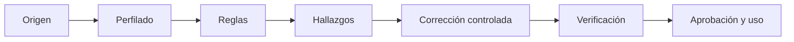

**Figura 14 —** Flujo de saneamiento de datos. *Esquema conceptual.*

#### C. Método de verificación

Antes de corregir, toma una foto de las siguientes métricas: cantidad de registros, IDs distintos, total de `Stock`, valor de inventario y número de valores no permitidos por campo. Después de corregir, vuelve a calcularlos. Un cambio en esos totales debe tener una **explicación trazable**, no ser ignorado.

**Caso:** si eliminas una fila duplicada de P003, ¿debería bajar el stock agregado? En la copia de prueba, sí, porque previamente la duplicación hacía contar el producto dos veces. Pero el objetivo no es «reducir stock»; es restaurar **una fila por ID**.

---

### H06.03.02.03 — Control de entradas

#### A. Modelo de tres capas

El control de datos profesional combina:

1. **Diseño:** campos, granularidad, claves y dominios.
2. **Prevención:** validación de datos, ayudas de captura y permisos apropiados.
3. **Detección/corrección:** pruebas de calidad, conciliaciones y registro de excepciones.

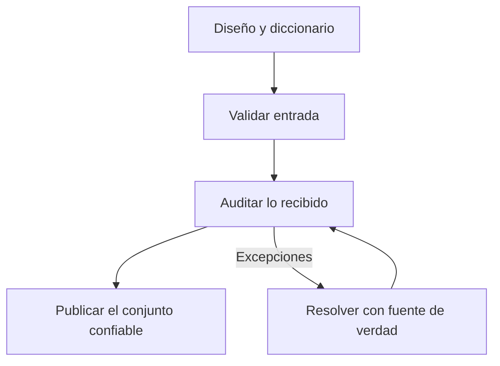

**Figura 15 —** Capas de control. *Diagrama conceptual.*

#### B. Controles aplicados al catálogo

| Campo | Control preventivo | Auditoría posterior |
|---|---|---|
| ID | Mensaje y regla de unicidad | Duplicados, nulos y patrón |
| Producto | Longitud/obligatoriedad según política | Vacíos y normalización |
| Categoria | Lista predefinida | Valores fuera de catálogo |
| Proveedor | Lista predefinida | Valores desconocidos |
| Precio | Decimal mayor que cero | Texto, negativos y extremos |
| Stock | Entero no negativo | Fraccionarios, vacíos y negativos |
| Estado | Lista Activo/Inactivo | Valores no permitidos |

#### C. Buenas prácticas empresariales

- Mantén una hoja `Parametros` para opciones autorizadas y otra `ControlCalidad` para hallazgos.
- Protege las fórmulas y celdas de resumen cuando corresponda, recordando que proteger una hoja **no es equivalente a cifrar la información**.
- Usa identificadores estables en lugar de nombres descriptivos para relaciones.
- Evita corregir registros de manera automática cuando existan varias interpretaciones posibles.
- No ocultes errores con formatos visuales; documéntalos y resuélvelos.
- Revisa los permisos de edición y la trazabilidad cuando el libro se comparte.
- Para sistemas críticos, evalúa una solución con controles en la capa de datos, además de Excel.

#### D. Limitaciones de compatibilidad

Las tablas, el ordenamiento y la validación están disponibles en múltiples ediciones actuales, pero **no todos los cuadros, menús u opciones avanzadas funcionan igual** en escritorio, web y móviles. La herramienta **Círculo con datos no válidos** está documentada para escritorio y puede no visualizarse en Excel para la web. El filtro avanzado y ciertas opciones de listas personalizadas deben verificarse en el entorno concreto. No presentes una operación como universal cuando la interfaz no ofrezca ese control.

**Fuente:** [Microsoft — Mostrar u ocultar círculos alrededor de datos no válidos](https://support.microsoft.com/es-es/excel/display-or-hide-circles-around-invalid-data).

### Recapitulación H06.03

La validación previene parte de los errores de captura, pero no garantiza la integridad de los datos. Las técnicas de limpieza deben aplicarse **con criterio de negocio**, conservar evidencia y comprobar nuevamente las métricas después de cualquier cambio destructivo.

---
# Parte A — Ejercicios prácticos (sin soluciones)

> **Instrucción:** resuelve estos enunciados antes de avanzar a la Parte B. Se incluyen cinco ejercicios por sección, desde nivel básico hasta un reto profesional. Trabaja en hojas o copias separadas; no modifiques el catálogo original permanentemente salvo cuando se indique.

## Ejercicios H06.01 — Organización tabular

### H06.01-E01 — De rango a tabla

- **Dificultad:** básico.
- **Objetivo:** reconocer un objeto tabla y diferenciarlo de un rango con formato.
- **Contexto:** preparar el catálogo para actualizaciones recurrentes.
- **Datos iniciales:** laboratorio base, A1:G13.
- **Instrucciones:** (1) selecciona el rango completo; (2) conviértelo en tabla con encabezados; (3) cambia el nombre de la tabla a `tblProductos`; (4) aplica filas con bandas; (5) identifica en un párrafo tres diferencias entre la tabla creada y el rango inicial.
- **Restricciones:** conservar exactamente los 12 registros y los siete encabezados; no copiar el catálogo a una tabla nueva escribiendo los datos otra vez.
- **Resultado esperado:** objeto `tblProductos`, encabezados correctos y filtros visibles.
- **Criterios:** nombre correcto (25 %), delimitación completa (25 %), integridad de datos (30 %) y explicación (20 %).

### H06.01-E02 — Columna calculada y referencias estructuradas

- **Dificultad:** intermedio.
- **Objetivo:** calcular un valor derivado mediante una referencia a la fila actual.
- **Contexto:** cuantificar el valor monetario del inventario.
- **Datos iniciales:** `tblProductos` original (12 filas).
- **Instrucciones:** (1) añade `Valor`; (2) calcula `Precio × Stock` usando `[@Precio]` y `[@Stock]`; (3) comprueba tres productos; (4) calcula el total de toda la columna con `=SUMA(tblProductos[Valor])` en una celda fuera de la tabla; (5) explica la diferencia entre la referencia a la fila y la referencia a una columna completa.
- **Restricciones:** no ingresar valores de `Valor` manualmente; no introducir filas de totales como productos.
- **Resultado esperado:** 12 importes y un valor agregado.
- **Criterios:** sintaxis funcional (30 %), resultados de comprobación (30 %), total (20 %) y explicación (20 %).

### H06.01-E03 — Subtotales y filtros

- **Dificultad:** intermedio.
- **Objetivo:** distinguir totales generales de subtotales sensibles al filtro.
- **Contexto:** comparar existencias totales y existencias de artículos activos.
- **Datos iniciales:** tabla con `Valor` del ejercicio anterior.
- **Instrucciones:** (1) habilita fila de totales; (2) suma `Stock` y `Valor`; (3) filtra `Estado = Activo`; (4) registra los nuevos totales; (5) compara con una `SUMA` sobre todas las filas y explica el comportamiento.
- **Restricciones:** no borrar las filas inactivas; restablecer filtros después.
- **Resultado esperado:** dos pares de cifras (sin filtro y con filtro).
- **Criterios:** cuatro valores (60 %), interpretación (30 %) y restauración del catálogo (10 %).

### H06.01-E04 — Diccionario de datos y granularidad

- **Dificultad:** avanzado.
- **Objetivo:** formalizar la estructura de datos antes de ampliarla.
- **Contexto:** integrar un sistema de movimientos de almacén sin confundir productos con operaciones.
- **Datos iniciales:** catálogo base y estos movimientos propuestos: `M001, P001, Entrada, 5`; `M002, P001, Salida, 2`; `M003, P003, Entrada, 4`.
- **Instrucciones:** (1) explica la granularidad de `Catalogo` y `Movimientos`; (2) diseña los encabezados de `Movimientos`; (3) señala su clave y el vínculo con `Catalogo`; (4) explica por qué no debe añadirse cada movimiento como una fila de producto; (5) define qué representa `Stock` antes y después de procesarlos.
- **Restricciones:** no utilizar VBA ni Power Query.
- **Resultado esperado:** dos esquemas de tablas compatibles, con claves y significado de filas.
- **Criterios:** granularidad (30 %), claves (25 %), diseño (25 %) y razonamiento (20 %).

### H06.01-E05 — Auditoría de claves repetidas

- **Dificultad:** reto profesional.
- **Objetivo:** diferenciar duplicados exactos de conflictos de identidad.
- **Contexto:** recibiste registros adicionales de un proveedor.
- **Datos iniciales:** copia del catálogo base más dos filas extra: una repetición exacta de `P003`; y `P002,Pluma Azul,Papelería,Sur,13,28,Activo`.
- **Instrucciones:** (1) cuenta registros; (2) calcula IDs diferentes; (3) identifica el duplicado exacto; (4) identifica el conflicto de precio; (5) redacta una propuesta para resolver los dos casos manteniendo trazabilidad.
- **Restricciones:** no eliminar automáticamente la versión de `P002` con precio 13 por desconocer su vigencia.
- **Resultado esperado:** diagnóstico y plan de limpieza justificado.
- **Criterios:** clasificación (40 %), conteos (20 %), política de resolución (30 %) y trazabilidad (10 %).

---

## Ejercicios H06.02 — Ordenamiento y filtrado

### H06.02-E01 — Ordenar textos y números

- **Dificultad:** básico.
- **Objetivo:** ordenar sin desalinear campos de un mismo registro.
- **Contexto:** priorizar productos con inventario bajo.
- **Datos iniciales:** tabla original sin filtros; si ya contiene una columna `Valor`, consérvala.
- **Instrucciones:** (1) ordena `Stock` de menor a mayor; (2) anota los primeros seis IDs y stocks; (3) ordena `Producto` de A a Z; (4) compara cambios; (5) explica por qué jamás debes ordenar solo la columna `Stock` aislada.
- **Restricciones:** preservar la correspondencia entre `ID` y `Producto`.
- **Resultado esperado:** secuencia numérica correcta y explicación de integridad.
- **Criterios:** seis IDs y valores (60 %), orden textual (20 %) y seguridad (20 %).

### H06.02-E02 — Fechas y tipos de datos

- **Dificultad:** intermedio.
- **Objetivo:** ordenar cronológicamente datos correctamente interpretados.
- **Contexto:** planificación de entregas.
- **Datos iniciales:** cuatro registros `E01 03/10/2026`, `E02 15/09/2026`, `E03 10/10/2026`, `E04 28/09/2026`, con fecha en formato día/mes/año.
- **Instrucciones:** (1) crea `Entregas`; (2) verifica que `FechaEntrega` sea fecha real y no texto; (3) ordena de más antigua a más reciente; (4) documenta la secuencia; (5) explica el riesgo de configuraciones regionales.
- **Restricciones:** no obtener el orden correcto solo mediante edición manual de filas.
- **Resultado esperado:** orden cronológico validado.
- **Criterios:** datos (30 %), orden (40 %) y diagnóstico de fechas (30 %).

### H06.02-E03 — Ordenamiento multinivel

- **Dificultad:** intermedio.
- **Objetivo:** aplicar una jerarquía de ordenamiento.
- **Contexto:** agrupar artículos por categoría y, dentro de ella, listar primero los más escasos.
- **Datos iniciales:** laboratorio original.
- **Instrucciones:** (1) primer nivel `Categoria A-Z`; (2) segundo nivel `Stock ascendente`; (3) tercero `ID ascendente` para desempatar; (4) documenta los IDs en orden por grupo; (5) explica qué sucede si intercambias los dos primeros niveles.
- **Restricciones:** no utilizar filtros para simular ordenación.
- **Resultado esperado:** tres grupos con un orden interno correcto.
- **Criterios:** niveles (35 %), orden (45 %) y razonamiento (20 %).

### H06.02-E04 — Orden por prioridad visual

- **Dificultad:** avanzado.
- **Objetivo:** relacionar colores e iconos con un criterio de negocio.
- **Contexto:** visualizar urgencia de reabastecimiento.
- **Datos iniciales:** inventario base.
- **Instrucciones:** (1) clasifica `Stock <= 5` como Roja, `6–10` como Amarilla y `>10` como Verde; (2) aplica un formato de color o icono; (3) utiliza la opción de ordenar por color/icono; (4) describe por qué no existe un orden universal de colores; (5) explica cómo reemplazar la codificación meramente visual por un campo textual o numérico.
- **Restricciones:** no modificar `Stock` para forzar el orden.
- **Resultado esperado:** dos IDs rojos, cuatro amarillos y seis verdes; propuesta de clasificación explícita.
- **Criterios:** bandas (50 %), procedimiento (30 %) y accesibilidad (20 %).

### H06.02-E05 — Filtro combinado y avanzado

- **Dificultad:** reto profesional.
- **Objetivo:** traducir una condición lógica a filtros de Excel.
- **Contexto:** un departamento de compras prepara el listado de productos activos con bajo stock.
- **Datos iniciales:** laboratorio base con 12 registros.
- **Instrucciones:** (1) aplica filtro `Estado = Activo` Y `Stock <= 10`; (2) anota IDs y suma el stock visible; (3) crea el rango de criterios avanzado `(Categoria = Papelería Y Stock <= 10 Y Activo) O (Categoria = Tecnología Y Stock <= 10 Y Activo)`; (4) identifica IDs del segundo filtro; (5) compara Y/O y restaura la tabla.
- **Restricciones:** no borrar ni sustituir registros.
- **Resultado esperado:** dos conjuntos de IDs reproducibles y explicación de operadores.
- **Criterios:** filtro simple combinado (40 %), avanzado (40 %) e interpretación (20 %).

---

## Ejercicios H06.03 — Validación y calidad

### H06.03-E01 — Lista de estados

- **Dificultad:** básico.
- **Objetivo:** restringir un campo categórico.
- **Contexto:** evitar estados escritos con variantes incorrectas.
- **Datos iniciales:** hoja `Catalogo`, campo `Estado`.
- **Instrucciones:** (1) crea una lista autorizada `Activo`, `Inactivo` en `Parametros`; (2) configura validación sobre `Estado`; (3) crea mensaje de ayuda; (4) configura alerta **Detener** si está disponible; (5) prueba la entrada manual `Pendiente`.
- **Restricciones:** no alterar los estados originales permanentemente.
- **Resultado esperado:** lista accesible y reacción prevista ante un valor no permitido.
- **Criterios:** fuente de valores (25 %), configuración (40 %), pruebas (25 %) y restauración (10 %).

### H06.03-E02 — Precio, stock y fechas

- **Dificultad:** intermedio.
- **Objetivo:** distinguir dominios numéricos y temporales.
- **Contexto:** una captura administrativa no debe aceptar stock negativo ni fraccionario.
- **Datos iniciales:** columna `Precio`, columna `Stock` y una hoja de ensayo `Recepciones` con `FechaRecepcion`.
- **Instrucciones:** (1) configura `Stock` como entero >=0; (2) `Precio` decimal >0; (3) `FechaRecepcion` entre 01/01/2026 y 31/12/2026; (4) prueba límites y valores fuera de rango; (5) anota diferencias entre escribir y pegar un valor.
- **Restricciones:** no reemplazar entradas legítimas de la tabla base.
- **Resultado esperado:** tabla de casos probados con válido/no válido según la regla.
- **Criterios:** reglas (50 %), pruebas (30 %) y límites (20 %).

### H06.03-E03 — Regla de unicidad de ID

- **Dificultad:** avanzado.
- **Objetivo:** usar una fórmula personalizada para detectar repetición de claves.
- **Contexto:** garantizar que un nuevo producto no reutilice accidentalmente un ID.
- **Datos iniciales:** IDs P001 a P012; rango de prueba A2:A1000.
- **Instrucciones:** (1) implementa una regla basada en `CONTAR.SI`; (2) explica las referencias absolutas y relativas; (3) prueba un ID nuevo `P013`; (4) prueba uno existente `P002`; (5) explica dos limitaciones del método ante pegado y concurrencia.
- **Restricciones:** aplicar la validación inicialmente en una **copia**, no sobre el único archivo fuente.
- **Resultado esperado:** aceptación del ID nuevo y rechazo o identificación del duplicado, según método de entrada.
- **Criterios:** fórmula (35 %), explicación (25 %), pruebas (25 %) y límites (15 %).

### H06.03-E04 — Laboratorio de limpieza

- **Dificultad:** avanzado.
- **Objetivo:** clasificar errores de calidad y definir correcciones seguras.
- **Contexto:** se reciben cinco registros con anomalías.
- **Datos iniciales:** crea una tabla independiente con estas filas (cada una deliberadamente problemática):

| ID | Producto | Categoria | Precio | Stock | Estado |
|---|---|---|---|---|---|
| P020 | Bloc de notas | `Papelería ` (espacio final) | 25 | 8 | Activo |
| P021 | Bolígrafo | Papelería | `"$15"` como texto | 10 | Activo |
| P022 | Grapas | Oficina | 30 | -2 | Activo |
| P023 | Mouse | Tecnología | 240 | 3.5 | Activo |
| P024 | Cable USB | Tecnología | 60 | 12 | Pendiente |

- **Instrucciones:** (1) identifica la anomalía de cada fila; (2) clasifícala como formato, tipo, dominio o catálogo; (3) sugiere una corrección; (4) distingue cuáles correcciones pueden automatizarse con seguridad y cuáles deben consultarse; (5) documenta un control preventivo para cada una.
- **Restricciones:** no inventar el stock correcto de P022/P023 ni decidir unilateralmente el estado de P024.
- **Resultado esperado:** cinco diagnósticos y cinco planes de validación.
- **Criterios:** detección (40 %), prudencia de corrección (40 %) y controles preventivos (20 %).

### H06.03-E05 — Plan de calidad empresarial

- **Dificultad:** reto profesional.
- **Objetivo:** diseñar un sistema de controles reproducibles y auditables.
- **Contexto:** un analista debe publicar un catálogo con datos confiables cada semana.
- **Datos iniciales:** laboratorio base; se prevén nuevas importaciones y cambios de proveedores.
- **Instrucciones:** (1) crea un diccionario para los siete campos; (2) define al menos **ocho controles** preventivos/detectivos; (3) diseña una hoja `ControlCalidad` para registrar hallazgos; (4) propone cinco métricas de verificación; (5) establece un procedimiento de respaldo y aprobación antes de eliminar duplicados.
- **Restricciones:** no depender exclusivamente de colores; no asumir que la validación evita toda entrada incorrecta.
- **Resultado esperado:** plan de gobierno de datos utilizable y verificable.
- **Criterios:** cobertura (30 %), trazabilidad (30 %), métricas (25 %) y prevención (15 %).

---
# Parte B — Solucionario razonado

> Consulta después de completar los enunciados. Los valores se refieren al conjunto original de 12 productos, excepto cuando el ejercicio indique una copia modificada.

## Soluciones H06.01

### Solución H06.01-E01 — De rango a tabla

**Procedimiento:** selecciona A1:G13 → **Ctrl + T** → confirma `Mi tabla tiene encabezados` → nombre `tblProductos` desde Diseño de tabla → estilo con bandas.

**Verificación objetiva:** siete columnas, 12 registros de datos y una fila de encabezados. El nombre del objeto es `tblProductos`, no `Catalogo` (que es el nombre de la hoja). La tabla dispone de controles de filtrado propios, referencias estructuradas y la opción de fila de totales. El archivo sigue guardándose como libro de Excel.

**Razonamiento:** una tabla aporta estructura semántica al rango, no solo estilo. Si al añadir una fila al final no queda incluida, amplía el tamaño de la tabla de modo explícito y revisa que no haya separaciones.

**Error a evitar:** convertir únicamente A2:G13 sin encabezados, lo que lleva a que Excel genere nombres de encabezados por defecto o interprete incorrectamente la primera fila.

### Solución H06.01-E02 — Columna calculada

En la columna `Valor`, introduce:

```excel
=[@Precio]*[@Stock]
```

En una celda exterior a la tabla:

```excel
=SUMA(tblProductos[Valor])
```

**Resultado detallado:**

| ID | Precio | Stock | Valor (MXN) |
|---|---:|---:|---:|
| P001 | 35 | 12 | 420 |
| P002 | 12 | 28 | 336 |
| P003 | 50 | 8 | 400 |
| P004 | 20 | 5 | 100 |
| P005 | 70 | 14 | 980 |
| P006 | 45 | 9 | 405 |
| P007 | 120 | 4 | 480 |
| P008 | 18 | 35 | 630 |
| P009 | 25 | 16 | 400 |
| P010 | 160 | 6 | 960 |
| P011 | 220 | 11 | 2420 |
| P012 | 95 | 7 | 665 |
| **Total** | | **155** | **8196** |

**Explicación:** `[@Precio]` y `[@Stock]` toman valores de una fila de datos. `tblProductos[Valor]` representa la columna de todas las filas y es apropiada para agregación.

**Comprobación alternativa:** 420 + 336 + 400 + 100 + 980 + 405 + 480 + 630 + 400 + 960 + 2420 + 665 = 8196.

### Solución H06.01-E03 — Subtotales y filtros

Sin filtro: `Stock = 155`, `Valor = 8196`.

Con `Estado = Activo`: quedan diez registros, `Stock = 144` y `Valor = 7051`.

**Interpretación:** los productos inactivos son P007 y P012:

- Stock inactivo = `4 + 7 = 11`.
- Valor inactivo = `480 + 665 = 1145`.
- Stock activo = `155 - 11 = 144`.
- Valor activo = `8196 - 1145 = 7051`.

La fila de totales con `SUBTOTALES(109;...)` refleja las filas visibles. Una suma convencional de toda la columna de datos continúa incluyendo los registros inactivos ocultos por el filtro.

**Verificación:** al borrar el filtro, la fila de totales debe volver a 155 y 8196. Si no ocurre, revisa si había filas ocultas manualmente o si se eliminó algún producto.

### Solución H06.01-E04 — Diccionario y granularidad

Una propuesta correcta:

**Catalogo:** una fila por producto; `Producto_ID` (o `ID`) como clave. Campos: `ID`, `Producto`, `Categoria`, `Proveedor`, `Precio`, `Stock`, `Estado`.

**Movimientos:** una fila por movimiento; `Movimiento_ID` como clave propia, `Producto_ID` como referencia al catálogo; campos `Movimiento_ID`, `Producto_ID`, `Tipo`, `Cantidad`, `FechaMovimiento` y, si corresponde, `Responsable`.

| Movimiento_ID | Producto_ID | Tipo | Cantidad |
|---|---|---|---:|
| M001 | P001 | Entrada | 5 |
| M002 | P001 | Salida | 2 |
| M003 | P003 | Entrada | 4 |

**Razonamiento:** si se repitiese P001 en el catálogo por cada movimiento, habría varias filas del mismo producto y el stock actual sería ambiguo. En cambio, una tabla de eventos permite registrar operaciones sin perder la identidad del producto.

**Si los movimientos se aplican sobre el stock inicial:** P001 pasaría de 12 a `12 + 5 - 2 = 15`; P003 pasaría de 8 a `8 + 4 = 12`. Estos son resultados ilustrativos, no modificaciones obligatorias del laboratorio base.

**Limitación:** definir que los movimientos son los únicos cambios autorizados y evitar doble actualización requiere una política operativa y controles que todavía no implementamos.

### Solución H06.01-E05 — Auditoría de claves repetidas

**Resultados:** 14 registros físicos; 12 IDs distintos; claves repetidas `P003` y `P002`.

**Clasificación:**

- Copia de P003: duplicado exacto (todos los campos iguales a la fila original del catálogo).
- Copia de P002 con `Precio = 13`: **duplicado por clave** con información conflictiva, no duplicado exacto.

**Tratamiento propuesto:** guardar copia de importación, marcar ambas anomalías, verificar el origen de la versión conflictiva de P002 y decidir si corresponde a una actualización del precio, un error de captura o un producto distinto que necesita un ID nuevo. Solo después de resolverlo, restaurar una fila por ID.

**Verificación:** el número de IDs únicos debe ser igual al número de filas del catálogo limpio. No basta con observar un total de stock aparentemente razonable.

---

## Soluciones H06.02

### Solución H06.02-E01 — Orden simple

Ordena toda la tabla por `Stock` ascendente. Los seis primeros resultados son:

| Posición | ID | Producto | Stock |
|---:|---|---|---:|
| 1 | P007 | Engrapadora Oficina | 4 |
| 2 | P004 | Marcador Permanente | 5 |
| 3 | P010 | Memoria USB 32 GB | 6 |
| 4 | P012 | Cable HDMI | 7 |
| 5 | P003 | Carpeta Carta | 8 |
| 6 | P006 | Tijeras Oficina | 9 |

**Prueba de integridad:** después de la ordenación, `P010` debe continuar asociado a `Memoria USB 32 GB` y `Precio = 160`, no a la fila en que estaba antes de ordenar.

Por `Producto` A a Z, los primeros nombres serán `Cable HDMI`, `Carpeta Carta`, `Clips Caja`, `Cuaderno Escolar` (según comparación lingüística habitual para este conjunto).

**Conclusión:** ordenar únicamente una columna puede destruir relaciones entre campos. Si eso sucede, recupera una copia en lugar de intentar reparar manualmente decenas de filas.

### Solución H06.02-E02 — Fechas

Orden cronológico:

| Posición | ID | FechaEntrega |
|---:|---|---|
| 1 | E02 | 15/09/2026 |
| 2 | E04 | 28/09/2026 |
| 3 | E01 | 03/10/2026 |
| 4 | E03 | 10/10/2026 |

**Razonamiento:** septiembre precede a octubre. Si el sistema interpreta `03/10/2026` como 10 de marzo, el resultado cambia: antes de concluir que ordenar funciona mal, comprueba que los valores sean fechas reales con la convención correcta.

**Método de verificación:** inspecciona el valor almacenado tras aplicar un formato numérico en una copia, o realiza una comparación/función de fecha en celdas auxiliares. No confundas mostrar una cadena con formato de fecha con almacenar una fecha Excel.

### Solución H06.02-E03 — Orden multinivel

El orden correcto, después de aplicar `Categoria A–Z → Stock ascendente → ID ascendente`, es:

```text
Oficina:     P007 → P006 → P009
Papelería:  P004 → P003 → P001 → P005 → P002 → P008
Tecnología: P010 → P012 → P011
```

**Explicación:** todos los productos de `Oficina` aparecen juntos, y dentro de ese grupo sus stocks son 4, 9, 16. Si inviertes los dos primeros niveles, el resultado principal será el stock global ascendente y las categorías solo se utilizarán para desempatar, produciendo una secuencia distinta.

**Verificación:** 3 + 6 + 3 = 12 registros; ningún ID debe desaparecer.

### Solución H06.02-E04 — Prioridad visual

**Resultados esperados:**

| Banda | Condición | IDs | Cantidad |
|---|---|---|---:|
| Roja | `Stock <= 5` | P004, P007 | 2 |
| Amarilla | `6 <= Stock <= 10` | P003, P006, P010, P012 | 4 |
| Verde | `Stock > 10` | P001, P002, P005, P008, P009, P011 | 6 |

**Nota conceptual:** el color no tiene un orden predeterminado. Para ordenar rojo antes que amarillo y verde debes elegir explícitamente niveles por color, o preferiblemente construir un campo de prioridad numérica `1, 2, 3` y usar el color como indicación adicional.

**Método alternativo:** agrega columna `PrioridadStock` y define los valores mediante una regla revisada; el tratamiento formal de `SI` y condiciones anidadas se hará en H07.

### Solución H06.02-E05 — Filtros combinados

**Primer filtro:** `Estado = Activo` **Y** `Stock <= 10`.

| ID | Categoria | Stock |
|---|---|---:|
| P003 | Papelería | 8 |
| P004 | Papelería | 5 |
| P006 | Oficina | 9 |
| P010 | Tecnología | 6 |
| **Total visible** | | **28** |

**Segundo filtro avanzado:** `(Papelería y Activo y Stock <= 10) O (Tecnología y Activo y Stock <= 10)`.

| ID | Categoria | Stock |
|---|---|---:|
| P003 | Papelería | 8 |
| P004 | Papelería | 5 |
| P010 | Tecnología | 6 |
| **Total visible** | | **19** |

**Razonamiento:** `P006` desaparece del segundo conjunto porque pertenece a `Oficina`, aunque cumple `Activo` y `Stock <= 10`.

**Criterio avanzado reproducible:**

| Categoria | Stock | Estado |
|---|---|---|
| Papelería | `<=10` | Activo |
| Tecnología | `<=10` | Activo |

En la misma fila de criterios se aplica `Y`; entre filas se aplica `O`. No confundas escribir ambas categorías en la misma celda con un operador lógico válido.

---

## Soluciones H06.03

### Solución H06.03-E01 — Lista de estados

**Configuración:** `Datos → Validación de datos → Lista` con origen `Activo,Inactivo` o rango nombrado `ListaEstados` (ajusta el delimitador o fuente a tu entorno). Activa el desplegable en la celda y, cuando exista, alerta de estilo **Detener**.

**Prueba:** introducir manualmente `Activo` debe aceptarse; `Pendiente` debe producir la alerta definida y requerir corrección bajo el comportamiento de «Detener». Un valor pegado puede requerir auditoría posterior.

**Verificación:** los diez valores activos y dos inactivos originales se conservan. Configurar validación no debe modificar los datos existentes por sí mismo.

### Solución H06.03-E02 — Dominios numéricos y fechas

| Campo | Entrada | Esperado | Por qué |
|---|---|---|---|
| Stock, entero >= 0 | `0` | Válida | Cumple límite inferior |
| Stock, entero >= 0 | `12` | Válida | Entero no negativo |
| Stock, entero >= 0 | `-1` | Inválida | Negativo |
| Stock, entero >= 0 | `2.5` | Inválida | No entero |
| Precio, decimal > 0 | `0.01` | Válida | Positivo |
| Precio, decimal > 0 | `0` | Inválida | No mayor que cero |
| Fecha, dentro de 2026 | 01/01/2026 | Válida | Límite incluido |
| Fecha, dentro de 2026 | 31/12/2026 | Válida | Límite incluido |
| Fecha, dentro de 2026 | 01/01/2027 | Inválida | Fuera del periodo |

**Interpretación:** la clasificación presupone que Excel reconoce los tipos correctos de datos y que se utiliza una alerta capaz de bloquear la escritura manual inválida. Registrar por separado cualquier comportamiento distinto al pegar datos.

### Solución H06.03-E03 — Regla de unicidad

Una fórmula apropiada para el laboratorio de prueba es:

```excel
=Y(A2<>"";CONTAR.SI($A$2:$A$1000;A2)=1)
```

- `$A$2:$A$1000` fija el espacio de búsqueda.
- `A2` representa la celda que se está evaluando y se desplaza por fila al aplicar correctamente la validación.
- `A2<>""` exige que el código no esté vacío.
- `=1` exige que el valor aparezca una sola vez.

**Prueba de entrada:** `P013` será único si no se encuentra ya en la copia; `P002` repetirá una clave y debe disparar el control cuando el flujo de entrada active la validación.

**Limitaciones:** (1) algunas operaciones de pegado pueden saltar los mensajes de validación y (2) Excel no implementa mediante esta regla las garantías transaccionales de unicidad de un motor de base de datos en entornos concurrentes. Además, los IDs fuera de A2:A1000 requieren ampliar la comprobación.

**Alternativa:** usar revisiones periódicas sobre la clave y una fuente de datos centralizada con restricciones de unicidad cuando la criticidad lo requiera.

### Solución H06.03-E04 — Laboratorio de limpieza

| ID | Hallazgo | Tipo | Acción sugerida | Control preventivo |
|---|---|---|---|---|
| P020 | `Papelería ` con espacio final | Normalización de texto | Quitar espacios sobrantes tras confirmar la categoría | Lista de categorías y limpieza de entrada |
| P021 | `"$15"` como texto | Tipo de dato | Convertir a número 15 MXN después de verificar símbolo y separador | Precio decimal >0 |
| P022 | Stock `-2` | Violación de dominio | Investigar registro; **no inventar cantidad** | Stock entero >=0 |
| P023 | Stock `3.5` | Violación de dominio/granularidad | Comprobar unidad; corregir solo con respaldo | Stock entero según unidad |
| P024 | Estado `Pendiente` | Valor fuera de catálogo | Revisar si es nuevo estado autorizado o error | Lista de valores y gobierno del catálogo |

**Qué se puede automatizar:** detectar espacios y tipos incorrectos, y potencialmente normalizar formatos después de definir reglas. **Qué requiere decisión:** cantidades negativas o fraccionarias, y la interpretación de un nuevo estado, porque varias correcciones podrían ser posibles.

**Verificación:** el diagnóstico contiene cinco hallazgos distintos. El objetivo no es reemplazar todo por valores arbitrarios que «pasen la regla», sino restablecer el significado correcto de la información.

### Solución H06.03-E05 — Plan de calidad empresarial

**Ejemplo de plan, sujeto a adaptación empresarial:**

| Regla | Tipo | Comprobación |
|---|---|---|
| 1. ID obligatorio | Preventiva/detectiva | Sin claves vacías |
| 2. ID único | Detectiva | Conteo de ID repetido = 0 |
| 3. Categoria válida | Preventiva | Lista de opciones permitidas |
| 4. Proveedor válido | Preventiva | Norte/Sur/Centro según catálogo |
| 5. Precio numérico | Preventiva/detectiva | No textos de moneda |
| 6. Precio > 0 | Preventiva/detectiva | Límite de negocio |
| 7. Stock entero >= 0 | Preventiva/detectiva | Cantidad válida |
| 8. Estado válido | Preventiva | Activo/Inactivo |
| 9. Producto obligatorio | Detectiva | Sin descripciones vacías |
| 10. Valor consistente | Detectiva | Precio × Stock = Valor |

**Hoja `ControlCalidad`:** `FechaRevision`, `Lote`, `Campo`, `Registro_ID`, `Regla`, `ValorObservado`, `Severidad`, `Responsable`, `Accion`, `EstadoHallazgo`, `FechaCierre`.

**Cinco métricas mínimas:** (1) filas totales, (2) IDs distintos, (3) claves duplicadas, (4) registros inválidos por regla, (5) valor total del inventario. Pueden incorporarse stock total y cantidad de nulos como controles adicionales.

**Proceso:** recibir datos → guardar original → aplicar reglas → generar reporte de hallazgos → resolver con responsable → aprobar cambios → publicar versión limpia → conciliar resultados → archivar evidencia.

**Comprobación:** el proceso debe identificar **quién decide** qué hacer con un duplicado conflictivo; de otro modo, la limpieza no es auditable.

---
# Proyecto integrador — H06-P01: Catálogo de inventarios profesional

## 1. Planteamiento del problema

Una pequeña empresa comercializa productos de papelería, oficina y tecnología. Su inventario se recibe en una hoja de cálculo, pero el catálogo carece de criterios explícitos de calidad, resulta difícil encontrar artículos para reposición y los reportes dependen de operaciones manuales poco documentadas.

**Objetivo del proyecto:** construir un libro de Excel con una tabla de productos, controles de captura, filtros útiles para compras, procedimientos de revisión de duplicados y un resumen verificable de inventario.

**Duración orientativa:** 90–150 minutos después de estudiar las tres secciones, adicional al tiempo de práctica distribuido en el módulo.

## 2. Requisitos funcionales

| ID | Requisito | Criterio de aceptación |
|---|---|---|
| RF-01 | Catálogo estructurado | `tblProductos` conserva los 12 registros y campos originales |
| RF-02 | Valor por producto | Columna `Valor = Precio × Stock` sin capturas manuales de importes |
| RF-03 | Fila de totales | Stock y Valor responden a los filtros |
| RF-04 | Orden de reposición | Ordenación por stock y, opcionalmente, categoría |
| RF-05 | Búsqueda de activos críticos | Filtro `Activo` Y `Stock <= 10` |
| RF-06 | Valores restringidos | Listas para `Estado`, `Categoria`, `Proveedor` |
| RF-07 | Control numérico | Precio positivo, Stock entero no negativo |
| RF-08 | Revisión de duplicados | Copia de ensayo para resaltar y clasificar conflictos |
| RF-09 | Resumen de calidad | Métricas y descripción de hallazgos |
| RF-10 | Entrega | Libro documentado y verificable con una hoja de instrucciones |

## 3. Requisitos no funcionales

- **Mantenibilidad:** nombres de columnas comprensibles, `tblProductos` nombrada y reglas documentadas.
- **Reproducibilidad:** se conservan los datos iniciales y una copia donde se puedan repetir los resultados.
- **Seguridad operativa:** no se eliminan filas conflictivas sin respaldo.
- **Compatibilidad:** el libro debe abrirse en Excel para Microsoft 365 de escritorio; cualquier comportamiento específico de la web debe documentarse.
- **Usabilidad:** filtros, mensajes de validación y campos con unidades claras.
- **Escalabilidad razonable:** contemplar nuevas filas de productos dentro de la tabla y la revisión de las fórmulas/rangos de validación cuando crezca.

## 4. Arquitectura del libro

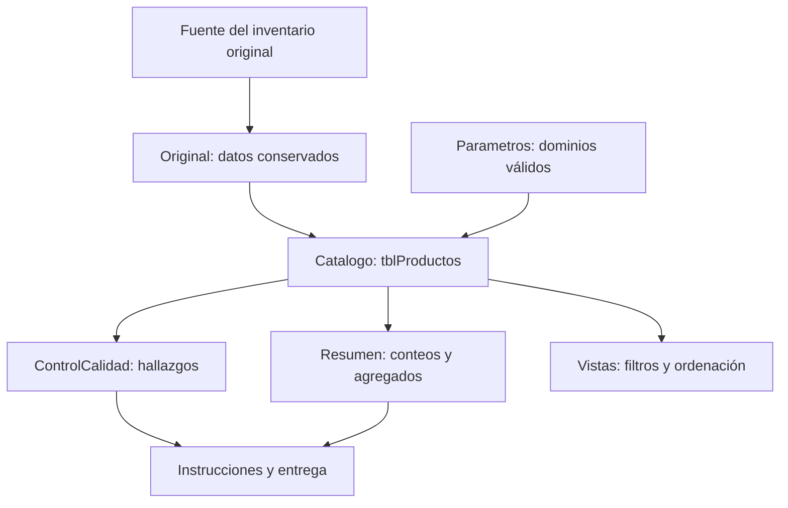

**Figura 16 —** Diseño lógico del proyecto. *Esquema conceptual; no hay conexión externa en esta versión.*

**Hojas recomendadas:**

1. `Original` — copia íntegra de los datos de entrada.
2. `Catalogo` — tabla oficial del laboratorio, con columna `Valor`.
3. `Parametros` — valores permitidos para `Categoria`, `Proveedor` y `Estado`.
4. `ControlCalidad` — hallazgos y responsables.
5. `Resumen` — indicadores simples, instrucciones de filtrado y verificaciones.
6. `Pruebas` — registros problemáticos creados expresamente sin contaminar la fuente.

## 5. Desarrollo paso a paso

### Fase A — Preparar la base

1. Copia el CSV del laboratorio en `Original` y verifica los tipos de datos.
2. Copia los datos a `Catalogo`.
3. Convierte A1:G13 en tabla con encabezados y nómbrala `tblProductos`.
4. Registra el número inicial de filas y los totales de stock y valor que deberías obtener.
5. Guarda una primera versión del archivo.

### Fase B — Calcular y validar

1. Agrega la columna `Valor` con `=[@Precio]*[@Stock]`.
2. Comprueba P001 = 420, P010 = 960 y P011 = 2420.
3. En `Resumen`, agrega los indicadores del apartado 6.
4. Habilita la fila de totales para `Stock` y `Valor`.
5. Crea listas de validación para los tres campos categóricos, preferiblemente desde rangos nombrados de `Parametros`.
6. Configura `Stock` y `Precio` según sus dominios. Prueba entradas incorrectas en una copia.
7. Documenta el procedimiento de revisión de IDs repetidos.

### Fase C — Ordenar, filtrar y mostrar excepciones

1. Ordena por `Categoria A–Z`, luego `Stock ascendente`.
2. Comprueba el orden esperado indicado en H06.02-E03.
3. Filtra `Estado = Activo` y `Stock <= 10`: deben aparecer los IDs P003, P004, P006 y P010.
4. Revisa sus existencias. El subtotal visible será 28 unidades si empleas la agregación adecuada.
5. Aplica una segmentación por categoría, si tu entorno la soporta y el ejercicio no complica el formato.
6. Restaura el filtro antes de guardar el estado final general del catálogo, o deja indicado expresamente qué vista quedó activa.

### Fase D — Calidad, pruebas y documentación

1. En `Pruebas`, introduce la repetición exacta de P003 y el conflicto de precio de P002.
2. Aplica resaltado de duplicados sobre `ID` y explica los hallazgos.
3. Prueba reglas con valores `-1` en Stock, `0` en Precio, `Pendiente` en Estado y un ID repetido mediante entrada manual.
4. Registra en `ControlCalidad` cada hallazgo, su causa y la acción propuesta.
5. Conserva los resultados de las pruebas y limpia la hoja oficial del catálogo si alguna modificación de ensayo llegó a ella.
6. Documenta el proceso para añadir un producto nuevo sin excluirlo accidentalmente de las validaciones o de la tabla.

## 6. Indicadores esperados y verificación

**Resumen global:**

| Indicador | Resultado |
|---|---:|
| Total de productos | 12 |
| Activos | 10 |
| Inactivos | 2 |
| Stock total | 155 |
| Valor total | $8,196 MXN |
| Activos con stock <= 10 | 4 |
| Stock de activos con stock <= 10 | 28 |

**Resumen por categoría (sin filtrar):**

| Categoria | Productos | Stock | Valor de inventario |
|---|---:|---:|---:|
| Oficina | 3 | 29 | 1285 |
| Papelería | 6 | 102 | 2866 |
| Tecnología | 3 | 24 | 4045 |
| **Total** | **12** | **155** | **8196** |

**Resumen por proveedor (sin filtrar):**

| Proveedor | Productos | Stock | Valor |
|---|---:|---:|---:|
| Norte | 4 | 30 | 2260 |
| Sur | 4 | 88 | 4366 |
| Centro | 4 | 37 | 1570 |

**Cómo construir estos resúmenes:** puedes obtenerlos mediante filtrado de categorías y lectura de la fila de totales, documentando cada extracción. En módulos posteriores, H07/H09 permitirán automatizar agregaciones con criterios y H19 enseñará tablas dinámicas. **No se exige todavía utilizar esas técnicas avanzadas.**

## 7. Pruebas de aceptación

| Caso | Acción | Resultado esperado |
|---|---|---|
| T01 | Abrir el catálogo original | 12 registros |
| T02 | Sumar `Stock` | 155 |
| T03 | Sumar `Valor` | 8196 |
| T04 | Filtrar `Activo` | 10 registros, stock 144 y valor 7051 |
| T05 | Filtrar `Activo` y `Stock <= 10` | P003, P004, P006, P010 |
| T06 | Ordenar por `Stock` ascendente | Primer ID P007 |
| T07 | Ordenar por `Categoria`, luego `Stock` | Oficina P007/P006/P009 primero |
| T08 | Introducir `Pendiente` manualmente bajo lista con alerta Detener | Regla debe alertar/rechazar |
| T09 | Introducir `Stock=-1` manualmente bajo regla | Regla debe alertar/rechazar |
| T10 | Crear dos registros conflictivos en `Pruebas` | Diagnóstico: P003 exacto, P002 por clave |
| T11 | Borrar todos los filtros | Recuperar totales generales |
| T12 | Agregar temporalmente un artículo a la tabla | Revisar expansión de fórmulas y reglas de validación |

**Limitaciones de pruebas:** los casos de interacción de la interfaz deben ejecutarse en Excel por el estudiante. Los resultados numéricos anteriores fueron comprobados a partir del conjunto proporcionado; no se afirma que un libro real haya sido ejecutado automáticamente en una instalación de Excel.

## 8. Errores previsibles y mejoras futuras

- **Dato nuevo fuera de la tabla:** ampliar el objeto y revisar las fuentes de validación.
- **Datos de precios capturados como texto:** normalizar con una conversión explícita (H03).
- **Registros repetidos sin fuente autorizada:** mantenerlos en `ControlCalidad` hasta su resolución.
- **Necesidad de historial de inventario:** crear una tabla de movimientos separada.
- **Necesidad de actualizar automáticamente cientos de archivos:** considerar Power Query en H21.
- **Necesidad de automatizar formularios:** considerar VBA en la ruta V o Apps Script en la ruta A, según plataforma.

## 9. Criterios de evaluación del proyecto

| Dimensión | Peso |
|---|---:|
| Integridad y estructura del catálogo | 25 % |
| Cálculos y subtotales | 20 % |
| Ordenamiento y filtros | 20 % |
| Validaciones y controles de calidad | 25 % |
| Documentación y verificabilidad | 10 % |
| **Total** | **100 %** |

---

# Evaluación final de conocimientos — 15 preguntas

> Contesta sin abrir el solucionario. Primero marca una respuesta para cada pregunta. Cada acierto vale un punto. La clave y la explicación aparecen después de todas las preguntas.

1. ¿Qué diferencia principal existe entre un rango con estilo y una tabla?  
   **A)** Una tabla admite solo números. **B)** Una tabla es un objeto estructurado con filtros y referencias propias. **C)** Son idénticos.
2. ¿Qué representa `tblProductos[Stock]`?  
   **A)** Una sola celda. **B)** Toda la columna Stock de datos de la tabla. **C)** La fila de encabezados exclusivamente.
3. Dentro de una columna calculada, `[@Precio]` señala:  
   **A)** El precio de la fila actual. **B)** El primer precio del libro. **C)** El precio de todos los productos en una matriz.
4. En el catálogo original, ¿cuál es la suma de Stock?  
   **A)** 144. **B)** 155. **C)** 8196.
5. Al filtrar `Estado = Activo`, el total de stock calculado con `SUBTOTALES(109;...)` será:  
   **A)** 155. **B)** 144. **C)** 11.
6. ¿Qué significa granularidad?  
   **A)** El color de las filas. **B)** Qué entidad/evento representa una fila. **C)** La ubicación de un archivo.
7. Ordenar solamente la columna Precio fuera del conjunto completo puede:  
   **A)** Desalinear atributos de registros. **B)** Crear relaciones válidas. **C)** Reparar IDs duplicados.
8. En un orden multinivel, el segundo criterio se evalúa principalmente:  
   **A)** Antes del primero. **B)** Cuando las filas empatan en el primero. **C)** Nunca.
9. Al filtrar `Categoria = Tecnología`, ¿cuántos productos quedan visibles?  
   **A)** 2. **B)** 3. **C)** 4.
10. En Filtro avanzado, varias condiciones en una misma fila de criterios se combinan normalmente como:  
    **A)** Y. **B)** O. **C)** Exclusión.
11. ¿Qué hace el filtro respecto a los registros no visibles?  
    **A)** Los borra. **B)** Los oculta temporalmente. **C)** Les modifica el ID.
12. ¿Cuál es una regla razonable para `Stock` en este laboratorio?  
    **A)** Decimal de cualquier signo. **B)** Texto libre. **C)** Entero >=0.
13. Si dos filas comparten ID pero tienen precios distintos:  
    **A)** No puede haber conflicto. **B)** Son duplicados de clave a investigar. **C)** La correcta es siempre la última.
14. ¿Qué limitación tiene la validación de datos?  
    **A)** Siempre impide pegados erróneos. **B)** No sustituye auditorías de valores ya existentes. **C)** Elimina todos los duplicados automáticamente.
15. ¿Cuál es el valor total del inventario inicial?  
    **A)** 8196. **B)** 7051. **C)** 2866.

## Clave y retroalimentación

| Pregunta | Respuesta | Explicación |
|---:|:---:|---|
| 1 | B | Una tabla es un objeto que añade estructura y funcionalidades propias. |
| 2 | B | Una referencia estructurada por columna identifica sus registros de datos. |
| 3 | A | `@` señala el campo de la misma fila en contexto de tabla. |
| 4 | B | La suma original de stock es 155 unidades. |
| 5 | B | Los 10 productos activos suman 144 unidades. |
| 6 | B | La granularidad define qué representa cada fila. |
| 7 | A | Si se separan campos se destruye la integridad de cada registro. |
| 8 | B | El segundo nivel desempata dentro del primer criterio. |
| 9 | B | P010, P011 y P012 pertenecen a Tecnología. |
| 10 | A | En la misma fila se aplica la lógica Y. |
| 11 | B | Filtrar oculta y permite restaurar la vista completa. |
| 12 | C | Las existencias se cuentan en unidades enteras no negativas. |
| 13 | B | Son registros conflictivos por identidad; debe determinarse la fuente correcta. |
| 14 | B | La validación no garantiza prevenir toda inconsistencia. |
| 15 | A | Precio × Stock por producto suma 8196 MXN. |

**Criterio recomendado de dominio:** al menos **13/15** en la evaluación conceptual, resolver las 15 prácticas y superar el 85 % de la rúbrica del proyecto. Si fallas en una pregunta, vuelve al subtema asociado y reproduce su ejemplo, no memorices únicamente la letra correcta.

---

# Glosario de referencia — H06

| Término | Definición breve |
|---|---|
| Rango | Conjunto de celdas referenciables. |
| Tabla de Excel | Objeto estructurado sobre un rango con encabezados y características de gestión de datos. |
| Encabezado | Nombre de un campo/atributo dentro de una tabla. |
| Registro | Fila que representa una observación, entidad o evento. |
| Campo | Atributo almacenado en una columna. |
| Granularidad | Unidad de significado que representa cada fila. |
| Clave | Campo o conjunto de campos destinado a identificar un registro. |
| Clave compuesta | Identificador definido por varios campos. |
| Referencia estructurada | Referencia a tablas/columnas por nombres y selectores. |
| Columna calculada | Columna de una tabla con fórmulas coherentes por fila. |
| Fila de totales | Fila de resumen de un objeto tabla. |
| Ordenamiento | Reorganización de filas según criterios. |
| Orden multinivel | Ordenación secuencial por varias columnas. |
| Filtro | Selección temporal de registros visibles por criterios. |
| Filtro avanzado | Mecanismo que interpreta un rango de criterios para consultas complejas. |
| Segmentación | Control visual con botones para filtrar conjuntos compatibles. |
| Validación de datos | Restricción o regla de entrada sobre celdas. |
| Dominio | Conjunto de valores permitidos para un campo. |
| Duplicado exacto | Filas coincidentes en todos los campos comparados. |
| Duplicado por clave | Registros con la misma identidad, aunque otros campos difieran. |
| Integridad | Propiedad de los datos de satisfacer reglas y relaciones esperadas. |
| Perfilado | Exploración sistemática de la estructura y calidad de un conjunto. |
| Trazabilidad | Capacidad de explicar el origen y los cambios de un dato. |
| Reconciliación | Comparación entre resultados para detectar diferencias injustificadas. |
| Subtotal | Agregado relativo a un subconjunto o criterio de visibilidad. |
| CSV | Comma-Separated Values, formato textual de intercambio de registros y campos. |

# Recursos visuales adicionales

Los siguientes recursos muestran **capturas reales de Excel o imágenes de interfaces** en versiones concretas; pueden no coincidir visualmente con tu instalación. Las figuras Mermaid del documento son **esquemas originales** para explicar conceptos, no capturas de software.

**Figura 17 — Cuadro de ordenación con varios niveles.** Observa los campos de primer criterio, segundo criterio y el botón `Add Level` (Agregar nivel). Captura en inglés publicada en un artículo de Simple Sheets: [artículo fuente](https://www.simplesheets.co/blog/how-to-sort-alphabetically-in-excel-and-keep-rows-together).


**Figura 18 — Menú de filtro de una columna de tabla.** Observa `Sort A to Z`, `Sort by Color` y `Text Filters`. Captura alojada en Microsoft Learn, de un ejemplo de Microsoft Cost Management. [Fuente](https://learn.microsoft.com/en-us/azure/cost-management-billing/savings-plan/calculate-ea-savings-plan-savings).


**Figura 19 — Diálogo de validación de datos.** Observa `Allow = List`, el campo de valores permitidos y las pestañas de mensaje de entrada y alerta. Captura en inglés de un recurso educativo público, no de documentación oficial. [Fuente](https://www.careerprinciples.com/resources/excel-data-validation).


**Consejo de visualización:** GitHub y muchos editores Markdown muestran las imágenes remotas cuando hay conectividad. Mermaid necesita un visualizador compatible, por ejemplo GitHub o una extensión de previsualización en Visual Studio Code.

# Referencias oficiales y documentación complementaria

Estas páginas se utilizaron como fuentes técnicas para contrastar comportamientos y diferencias; ninguna imagen se atribuye a Microsoft si su origen es externo.

1. [Microsoft Support — Descripción general de las tablas de Excel](https://support.microsoft.com/es-es/excel/overview-of-excel-tables).
2. [Microsoft Support — Crear y dar formato a tablas](https://support.microsoft.com/es-es/excel/get-started/create-and-format-tables).
3. [Microsoft Support — Referencias estructuradas](https://support.microsoft.com/es-es/excel/using-structured-references-with-excel-tables).
4. [Microsoft Support — Fila de totales de tablas](https://support.microsoft.com/es-es/excel/get-started/total-the-data-in-an-excel-table).
5. [Microsoft Support — Función SUBTOTALES](https://support.microsoft.com/es-es/excel/functions/subtotal-function).
6. [Microsoft Support — Ordenar datos de una tabla o rango](https://support.microsoft.com/es-es/excel/sort-data-in-a-range-or-table-in-excel).
7. [Microsoft Support — Ordenar mediante listas personalizadas](https://support.microsoft.com/es-es/excel/sort-data-using-a-custom-list).
8. [Microsoft Support — Filtrar con criterios avanzados](https://support.microsoft.com/es-es/excel/filter-by-using-advanced-criteria).
9. [Microsoft Support — Segmentaciones](https://support.microsoft.com/es-es/excel/get-started/use-slicers-to-filter-data).
10. [Microsoft Support — Aplicar validación de datos](https://support.microsoft.com/es-es/excel/get-started/apply-data-validation-to-cells).
11. [Microsoft Support — Más sobre validación](https://support.microsoft.com/es-es/excel/more-on-data-validation).
12. [Microsoft Support — Círculos alrededor de datos no válidos](https://support.microsoft.com/es-es/excel/display-or-hide-circles-around-invalid-data).
13. [Microsoft Support — Buscar y eliminar duplicados](https://support.microsoft.com/es-es/excel/find-and-remove-duplicates).
14. [Microsoft Support — Filtrar valores únicos o eliminar duplicados](https://support.microsoft.com/es-es/excel/get-started/filter-for-unique-values-or-remove-duplicate-values).
15. [Ohio State University — Insertar tablas en Excel (captura histórica)](https://u.osu.edu/weedingthenumbers/2014/07/11/insert-a-table-in-excel/).

---

# Control final del módulo

| Campo de seguimiento | Estado |
|---|---|
| Roadmap oficial | **2.0, 66 módulos** |
| Ruta | **H — Microsoft Excel** |
| Módulo | **H06 — Tablas, rangos y gestión profesional de datos** |
| Secciones desarrolladas | **H06.01, H06.02, H06.03** |
| Último subtema desarrollado | **H06.03.02.03 — Control de entradas** |
| Subtemas obligatorios pendientes en H06 | **Ninguno en la planificación aprobada** |
| Ejercicios entregados | **15 (5 por sección)** |
| Soluciones | **15 desarrolladas y separadas** |
| Proyecto integrador | **H06-P01: Catálogo de inventarios profesional** |
| Evaluación | **15 preguntas con clave y explicación** |
| Figuras | **19 (15 diagramas Mermaid y 4 capturas reales enlazadas)** |
| Estado académico | **Desarrollado; pendiente de revisión y aprobación del estudiante** |
| Siguiente módulo | **H07 — Funciones lógicas, condicionales y control de errores** |

**Conocimientos que debes dominar para continuar:** crear y nombrar tablas; construir referencias estructuradas; distinguir agregados globales y visibles; interpretar granularidad y claves; ordenar por varios campos; aplicar filtros simples y avanzados; establecer validaciones; auditar y tratar duplicados sin perder información ni trazabilidad.

**Alcance de verificación:** se han contrastado las reglas y límites relevantes con documentación pública oficial. Los resultados numéricos del conjunto base fueron verificados independientemente. Los procedimientos de interacción con Excel constituyen instrucciones para reproducir en la aplicación; no se presentan como ejecutados en una instancia real de Excel desde este documento.

> **Fin de H06.** No se inicia H07 hasta recibir una nueva instrucción del estudiante.
