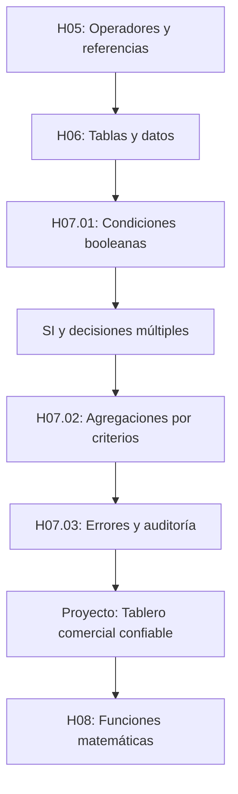
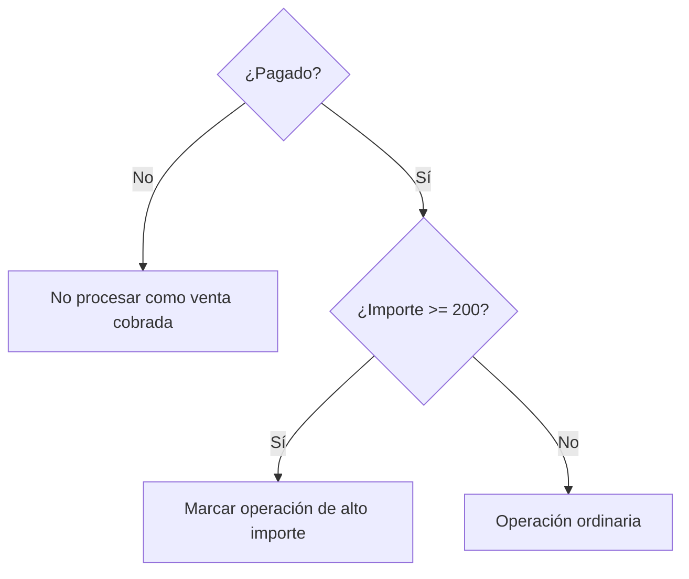
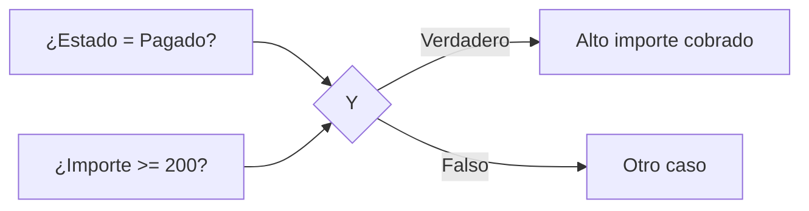
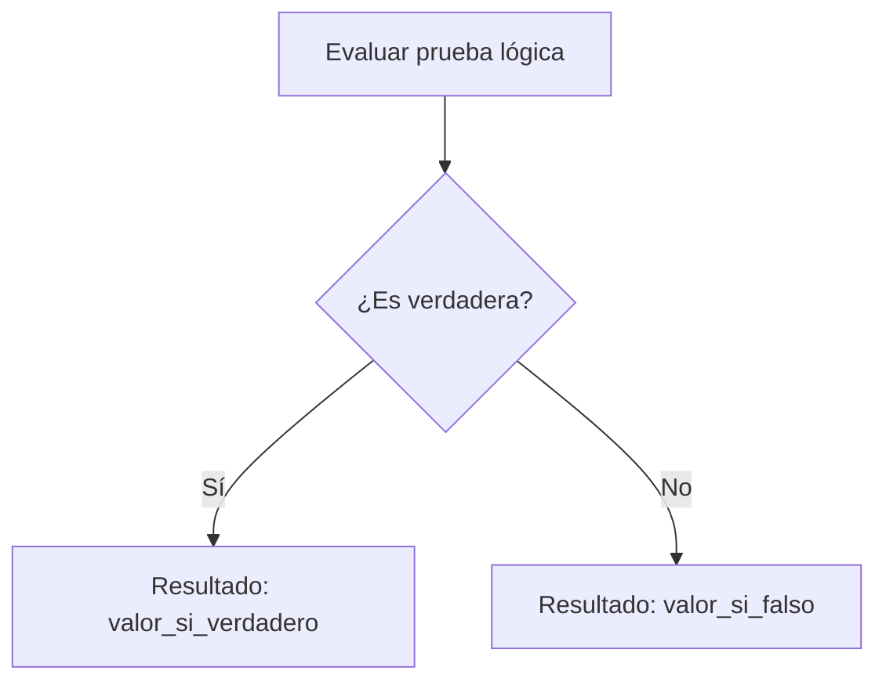
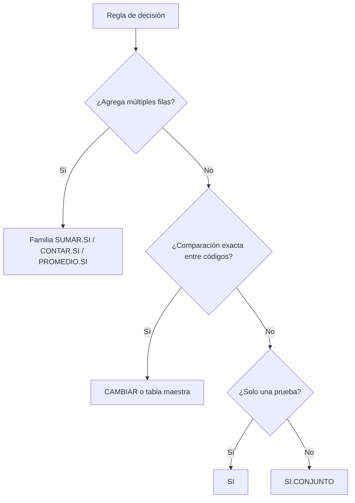
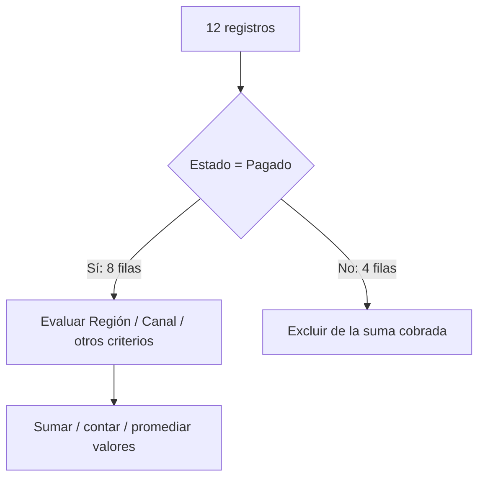
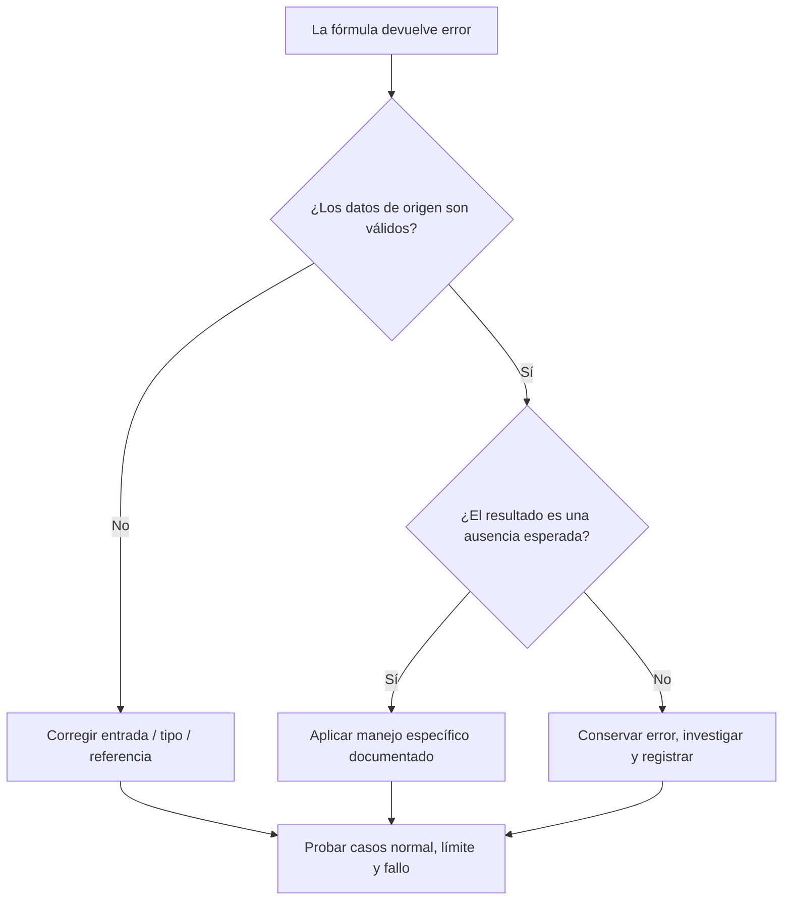
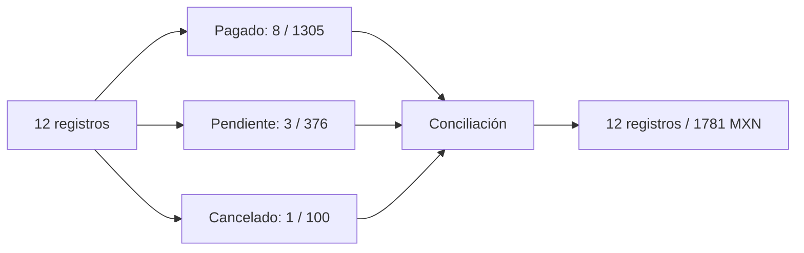
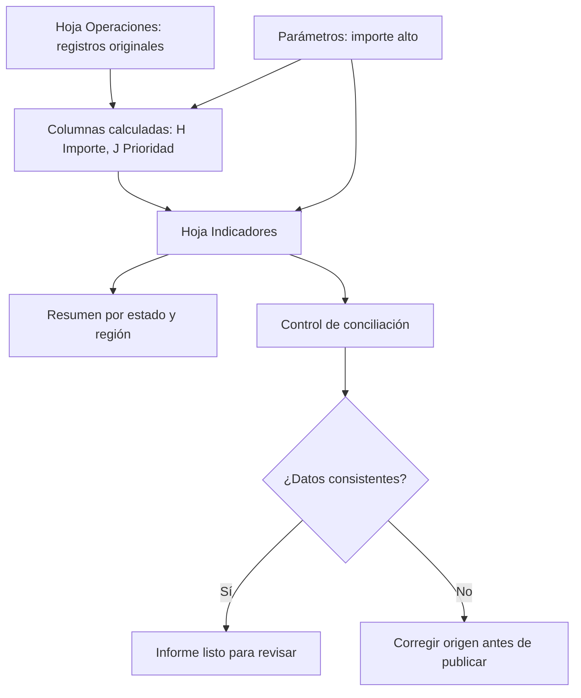

# H07 — Funciones lógicas, condicionales y control de errores

> **Curso integral de Excel, Google Sheets, VBA y Google Apps Script**  
> **Ruta:** H — Microsoft Excel · **Módulo:** H07/24 · **Roadmap:** 2.0 aprobado  
> **Nivel:** básico–intermedio con transición al diseño profesional · **Estudio recomendado:** 18 h como base curricular (la profundización puede requerir más tiempo)  
> **Estado:** desarrollado para estudio, pendiente de revisión y aprobación académica · **Fecha de consulta de referencias:** 24-10-2026

[Índice](#índice) · [Datos para reproducir los ejemplos](#4-conjunto-de-datos-del-laboratorio) · [Ejercicios](#h07---ejercicios-sin-soluciones) · [Solucionario](#h07---solucionario-separado) · [Evaluación](#evaluación-final-del-módulo)

---

## 1. Propósito y competencias

En H05 aprendiste a interpretar fórmulas, operadores y referencias; en H06 organizaste los datos mediante tablas, filtros y validaciones. **H07 agrega capacidad de decisión:** convertir reglas del negocio en condiciones verificables, agregar únicamente registros que cumplen ciertos criterios y distinguir fallos reales de resultados legítimamente vacíos.

Al finalizar podrás:

1. Expresar requisitos con valores lógicos y tablas de verdad.
2. Elegir entre `Y`, `O`, `NO` y `XO`, sin confundir exclusividad con «al menos uno».
3. Construir decisiones con `SI`, `SI.CONJUNTO` y `CAMBIAR`, respetando el orden y los casos predeterminados.
4. Agregar ventas y registros con uno o varios criterios mediante `SUMAR.SI`, `SUMAR.SI.CONJUNTO`, `CONTAR.SI`, `CONTAR.SI.CONJUNTO`, `PROMEDIO.SI` y `PROMEDIO.SI.CONJUNTO`.
5. Gestionar `#N/D`, `#¡DIV/0!` y otros errores con criterio: corregir el origen antes de ocultar el síntoma.
6. Construir y auditar un tablero de control sin macros.
7. Diferenciar las funciones documentadas de Excel de sus equivalentes en Google Sheets.

**Prerrequisitos:** H05 y H06. No necesitas conocimientos previos de programación.

### 1.1 Estructura oficial y cobertura

| Sección | Tema | Subtemas de la versión 2.0 |
|---|---|---|
| H07.01 | Lógica formal | H07.01.01.01 Y; .02 O; .03 NO; .04 XO |
| H07.01 | Evaluación condicional | H07.01.02.01 SI; .02 SI.CONJUNTO; .03 CAMBIAR |
| H07.02 | Funciones con criterios | H07.02.01.01 SUMAR.SI/SUMAR.SI.CONJUNTO; .02 CONTAR.SI/CONTAR.SI.CONJUNTO; .03 PROMEDIO.SI/PROMEDIO.SI.CONJUNTO |
| H07.03 | Gestión de errores | H07.03.01.01 SI.ERROR; .02 SI.ND; .03 errores de cálculo |
| H07.03 | Diseño de fórmulas | H07.03.02.01 anidamiento; .02 legibilidad y pruebas |

**Alcance del catálogo:** las 17 funciones con ficha principal en este capítulo son `VERDADERO`, `FALSO`, `Y`, `O`, `NO`, `XO`, `SI`, `SI.CONJUNTO`, `CAMBIAR`, `SUMAR.SI`, `SUMAR.SI.CONJUNTO`, `CONTAR.SI`, `CONTAR.SI.CONJUNTO`, `PROMEDIO.SI`, `PROMEDIO.SI.CONJUNTO`, `SI.ERROR` y `SI.ND`. Las funciones `ESERROR`/`ESNOD` se mencionan aquí como herramientas diagnósticas con estudio principal en **H13**, y `LET`, `LAMBDA`, `MAP`, `BYROW`, `REDUCE`, etc., se desarrollarán en **H16**: el catálogo de Excel clasifica varias de esas funciones en «Lógicas», pero no se omiten ni se duplican por ello. La clasificación del catálogo es distinta de la secuencia pedagógica.

### 1.2 Convención de fórmulas y compatibilidad

- Ejemplos principales: **Excel Microsoft 365 de escritorio, nombres en español, separador de argumentos `;`**. Si tu Excel usa `,` como separador de argumentos, sustituye solo el separador correspondiente; no reemplaces otros signos indiscriminadamente.
- Los nombres en **inglés** aparecen junto a cada función. Algunos usuarios utilizan funciones en inglés; no se debe asumir que basta con cambiar la configuración regional para traducir fórmulas ya existentes.
- Se utilizarán datos enteros y porcentajes escritos con referencias o fracciones para evitar ambigüedades entre `,` decimal y delimitadores.
- Google Sheets admite funciones equivalentes en múltiples casos, pero **el nombre localizado y el separador varían con el idioma/configuración del archivo**. Debes comprobarlos en su ayuda, no mezclarlos en una misma fórmula.
- Las fichas se basan en la documentación de [funciones lógicas de Microsoft](https://support.microsoft.com/es-es/excel/logical-functions-reference), [funciones de Excel por categoría](https://support.microsoft.com/es-es/excel/excel-functions-by-category) y el [catálogo oficial de Sheets](https://support.google.com/docs/table/25273?hl=es).

### 1.3 Itinerario de aprendizaje



**Figura 1.** Ruta conceptual. Cada paso utiliza conceptos anteriores y añade una responsabilidad nueva.

## 2. Recursos visuales de interfaz


*Figura 2 — Captura pública de Excel, fuente: [ExcelMojo, IF AND in Excel](https://www.excelmojo.com/if-and-in-excel/). Busca la pestaña «Formulas/Fórmulas», el menú «Logical/Lógicas» y la función «IF/SI». La captura corresponde a una interfaz en inglés y puede diferir de Microsoft 365 actual; no es una recreación.*


*Figura 3 — Captura pública de Microsoft Q&A: [pregunta sobre SUMIF y autorrelleno](https://learn.microsoft.com/en-us/answers/questions/5091002/2-questions-sumif-and-autofilling-cells). Observa el orden de argumentos `SUMIFS(sum_range, criteria_range, criteria)` y las referencias con `$`. El ejemplo está en inglés y es ajeno al conjunto de datos didáctico.*

> **Nota sobre imágenes:** los enlaces son públicos y externos. Para ver las imágenes necesitas conexión a Internet. Los diagramas Mermaid incluidos en este `.md` son esquemas conceptuales originales, no capturas de una interfaz real. GitHub y algunos editores Markdown los representan visualmente; en otros se verá su código fuente.

---

## 3. Conceptos previos: razonamiento booleano

Una **proposición** es una afirmación que puede evaluarse como verdadera o falsa dentro de un contexto concreto, por ejemplo «el pedido está pagado». En Excel, una comparación como `E2>=5` devuelve un valor lógico `VERDADERO` o `FALSO`, no las cadenas de texto `"VERDADERO"` o `"FALSO"`.

**No confundas:** `=A2="Pagado"` produce un valor lógico; `="Pagado"` produce texto; `=VERDADERO()` produce el valor lógico verdadero. Estas distinciones afectan comparaciones y cálculos.

### 3.1 Tabla de verdad elemental

| P | Q | P Y Q | P O Q | P XO Q | NO P |
|---|---|---|---|---|---|
| F | F | F | F | F | V |
| F | V | F | V | V | V |
| V | F | F | V | V | F |
| V | V | V | V | F | F |

- **Y (AND):** todas las condiciones deben cumplirse.
- **O (OR):** al menos una debe cumplirse; también acepta ambas verdaderas.
- **XO (XOR):** con dos condiciones, exactamente una debe ser verdadera. Con más de dos argumentos, Excel devuelve verdadero si la **cantidad de condiciones verdaderas es impar**, no necesariamente si solo una es verdadera.
- **NO (NOT):** invierte el valor de la condición.



**Figura 4.** Regla de negocio compuesta: `=Y(G2="Pagado";H2>=200)`.

### 3.2 Operadores de comparación y precedencia

| Operador | Lectura | Ejemplo con A2 = 8 |
|---|---|---|
| `=` | Igual a | `=A2=8` → VERDADERO |
| `<>` | Diferente de | `=A2<>8` → FALSO |
| `>` / `<` | Mayor / menor | `=A2>5` → VERDADERO |
| `>=` / `<=` | Mayor o igual / menor o igual | `=A2<=8` → VERDADERO |

La igualdad es una **comparación**, no una instrucción de asignación como la de muchos lenguajes de programación. Las condiciones se evalúan de acuerdo con la sintaxis y precedencia de operadores de Excel, incluida la prioridad de los paréntesis. [Referencia oficial](https://support.microsoft.com/es-es/excel/the-order-in-which-excel-performs-operations-in-formulas).

---

## 4. Conjunto de datos del laboratorio

Usaremos **un mismo libro** durante las tres secciones. Crea una hoja llamada `Operaciones` y pega la tabla siguiente desde `A1`. Introduce los importes de `H2:H13` mediante `=E2*F2` y copia hacia abajo (la tabla muestra el resultado esperado). Estos datos son **ficticios** y todos los importes están expresados en **MXN**.

| Fila | A: ID | B: Región | C: Canal | D: Producto | E: Unidades | F: Precio | G: Estado | H: Importe | I: Responsable |
|---:|---|---|---|---|---:|---:|---|---:|---|
| 2 | P001 | Norte | Web | Cuaderno | 4 | 35 | Pagado | 140 | Ana |
| 3 | P002 | Sur | Tienda | Pluma | 8 | 12 | Pendiente | 96 | Luis |
| 4 | P003 | Norte | Tienda | Carpeta | 3 | 50 | Pagado | 150 | Ana |
| 5 | P004 | Centro | Web | Pluma | 10 | 12 | Pagado | 120 | Marta |
| 6 | P005 | Sur | Web | Marcador | 5 | 20 | Pendiente | 100 | Luis |
| 7 | P006 | Norte | Web | Cuaderno | 6 | 35 | Pagado | 210 | Ana |
| 8 | P007 | Centro | Tienda | Carpeta | 2 | 50 | Cancelado | 100 | Marta |
| 9 | P008 | Sur | Tienda | Cuaderno | 7 | 35 | Pagado | 245 | Luis |
| 10 | P009 | Centro | Web | Marcador | 9 | 20 | Pagado | 180 | Marta |
| 11 | P010 | Norte | Tienda | Pluma | 15 | 12 | Pendiente | 180 | Ana |
| 12 | P011 | Sur | Web | Carpeta | 4 | 50 | Pagado | 200 | Luis |
| 13 | P012 | Centro | Tienda | Marcador | 3 | 20 | Pagado | 60 | Marta |

**Validación inicial** (no son todos «ingresos cobrados»):

| Métrica | Valor esperado | Interpretación |
|---|---:|---|
| Total de 12 importes | 1 781 | Incluye operaciones pendientes y canceladas |
| Operaciones pagadas | 8 | Registros cuyo `Estado = Pagado` |
| Importe pagado | 1 305 | Suma de los importes de 8 operaciones pagadas |
| Importe pendiente | 376 | Tres operaciones todavía pendientes |
| Importe cancelado | 100 | Una operación cancelada |

El total general cumple la identidad `1305 + 376 + 100 = 1781`. Esta es una **prueba de conciliación** que repetirás al finalizar el módulo.

> **Disciplina de modelado:** para este laboratorio se define «importe pagado» como la suma de H cuando G es `Pagado`. En un entorno real, esta convención requiere validar que el estado representa un cobro confirmado y no solo la autorización del pedido.

---

# H07.01 — Lógica formal y evaluación condicional

## H07.01.01 — Operadores booleanos

### H07.01.01.01 — `Y` / `AND`: conjunción lógica

**Definición.** `Y` devuelve `VERDADERO` cuando todas las condiciones se cumplen y `FALSO` cuando al menos una falla.

**Ficha funcional:**

- Nombre Excel ES/EN: `Y` / `AND` · categoría oficial: Lógicas.
- **Sintaxis:** `=Y(valor_lógico1;[valor_lógico2];...)`.
- **Argumentos:** `valor_lógico1` obligatorio; adicionales opcionales, hasta 255 condiciones según la documentación vigente de Microsoft.
- **Resultado:** booleano (`VERDADERO`/`FALSO`).
- **Disponibilidad:** función clásica de Excel, presente en Microsoft 365, 2024, 2021 y versiones anteriores compatibles; equivalente en Sheets: `Y` / `AND`.

**Ejemplo básico:** `=Y(5>3;10<12)` → `VERDADERO`.

**Ejemplo intermedio:** en `Operaciones!J2`, `=Y(G2="Pagado";H2>=200)` → `FALSO` para P001; al copiar hasta J13, P006 y P008 cumplen simultáneamente ambas condiciones, y P011 también cumple con 200 exactamente (`>=`).

**Caso empresarial:** aprobar la liberación de un pedido solo si está pagado **y** dispone de inventario suficiente: `=Y(G2="Pagado";K2>=E2)` donde K2 sería la disponibilidad registrada.

**Errores y límites:** utilizar `Y` para condiciones alternativas excluye registros que cumplen solo una; `Y` no sustituye al control de los tipos de datos; si existe un error de cálculo en un argumento la función puede propagarlo. No presupongas que la evaluación de todos los argumentos evita divisiones inválidas (ver H07.03).

**Alternativas y relaciones:** `O`, `SI(Y(...))`, `CONTAR.SI.CONJUNTO` para contar filas sin columna auxiliar. **Ejercicio:** H07.01-E02.

### H07.01.01.02 — `O` / `OR`: disyunción inclusiva

**Definición.** `O` es verdadero si **una o más** condiciones resultan verdaderas.

- **Sintaxis:** `=O(valor_lógico1;[valor_lógico2];...)`.
- **Argumentos:** primera condición obligatoria, otras opcionales; valores o referencias evaluables como condiciones.
- **Resultado:** booleano · **Sheets:** `O` / `OR`.
- **Básico:** `=O(2>5;7>=7)` → `VERDADERO`.
- **Intermedio:** `=O(B2="Norte";B2="Sur")` → `VERDADERO` para P001.
- **Profesional:** marcar un pedido que requiere revisión si está `Pendiente` **o** `Cancelado`: `=O(G2="Pendiente";G2="Cancelado")`.
- **Error frecuente:** confundir «o» con «solo una de las dos». `O(VERDADERO;VERDADERO)` es verdadero. Para exclusividad, considera `XO` con dos condiciones.
- **Relaciones:** `NO(Y(...))` y `Y(NO(...);NO(...))`, leyes de De Morgan; `CONTAR.SI` + `SUMA` para alternativas sobre un mismo campo.
- **Ejercicio:** H07.01-E02.

### H07.01.01.03 — `NO` / `NOT`: negación

- **Sintaxis:** `=NO(lógica)`.
- **Argumento:** un valor o expresión lógica obligatoria.
- **Resultado:** inversión de VERDADERO/FALSO · **Sheets:** `NO` / `NOT`.
- **Básico:** `=NO(3=4)` → `VERDADERO`.
- **Intermedio:** `=NO(G2="Pagado")` → `FALSO` para P001.
- **Profesional:** `=Y(NO(G2="Cancelado");E2>0)` para detectar movimientos no cancelados con unidades positivas.
- **Limitaciones:** la negación de un estado no equivale a otro estado específico: «no pagado» puede significar `Pendiente`, `Cancelado`, `Rechazado`, etc. Evita reemplazar reglas de negocio explícitas por negaciones demasiado amplias.
- **Alternativas:** `G2<>"Pagado"`; la forma `NO(...)` puede mejorar la lectura cuando se niega una condición compuesta.
- **Ejercicio:** H07.01-E03.

### H07.01.01.04 — `XO` / `XOR`: disyunción exclusiva y paridad

- **Sintaxis Excel:** `=XO(valor_lógico1;[valor_lógico2];...)`.
- **Nombre en inglés:** `XOR` · **Sheets:** el catálogo oficial registra `XOR`, no presupongas que el nombre localizado sea `XO` en Sheets.
- **Resultado:** `VERDADERO` si una cantidad **impar** de argumentos es verdadera; con dos condiciones equivale a «exactamente una».
- **Básico:** `=XO(VERDADERO;FALSO)` → `VERDADERO`.
- **Intermedio:** `=XO(VERDADERO;VERDADERO)` → `FALSO`.
- **Profesional:** entre dos canales mutuamente excluyentes, `=XO(C2="Web";C2="Tienda")` comprueba que el canal coincide exactamente con una de esas dos alternativas. Para cadenas distintas que nunca pueden ser simultáneamente iguales, también podría utilizarse `O`, pero `XO` comunica la intención de exclusividad.
- **Advertencia avanzada:** `=XO(VERDADERO;VERDADERO;VERDADERO)` → `VERDADERO` (3 verdaderos, cantidad impar); NO significa que «solo una» sea verdadera. Para exactamente una entre varias, usa `=CONTAR.SI(K2:M2;VERDADERO)=1` si K:M contienen valores lógicos, y verifica el comportamiento de los tipos de celda.
- **Disponibilidad histórica:** introducida en Excel 2013. [Referencia oficial XO](https://support.microsoft.com/es-es/excel/functions/xor-function).
- **Ejercicio:** H07.01-E03.

### Constantes booleanas — `VERDADERO` / `TRUE` y `FALSO` / `FALSE`

| Función ES | Inglés | Sintaxis | Valor | Ejemplo |
|---|---|---|---|---|
| `VERDADERO()` | `TRUE()` | Sin argumentos | Lógico verdadero | `=SI(VERDADERO();"A";"B")` → A |
| `FALSO()` | `FALSE()` | Sin argumentos | Lógico falso | `=SI(FALSO();"A";"B")` → B |

La documentación española de Microsoft incluye títulos de página inconsistentes («Función VERDAD») pero describe y ejemplifica **`VERDADERO()`** como sintaxis de la función. Por ello este capítulo usa `VERDADERO()` y la constante sin paréntesis `VERDADERO`. [Microsoft: función TRUE](https://support.microsoft.com/es-es/excel/functions/true-function). En hojas modernas suele bastar escribir `VERDADERO` o `FALSO` sin llamar a una función. También existen en Sheets.

**Ejemplo básico:** `=VERDADERO()` → VERDADERO. **Intermedio:** `=Y(VERDADERO();H2>0)` → VERDADERO. **Profesional:** caso de cierre de `SI.CONJUNTO(...;VERDADERO;"Sin categoría")`. **Errores:** usar `"VERDADERO"` con comillas produce texto, no la constante lógica. **Alternativas:** comparaciones explícitas. **Ejercicio:** H07.01-E01.

### Comprobación: de proposiciones a decisiones



**Figura 5.** Los operadores lógicos combinan condiciones; por sí mismos no agregan cantidades ni calculan promedios.

---
## H07.01.02 — Evaluación condicional

### H07.01.02.01 — `SI` / `IF`: bifurcaciones

**Qué resuelve:** convierte una prueba lógica en uno de dos resultados alternativos. Es la expresión central para automatizar decisiones en Excel.

**Ficha funcional completa:**

| Campo | Contenido |
|---|---|
| Nombre ES / EN | `SI` / `IF` |
| Categoría | Lógicas |
| Sintaxis | `=SI(prueba_lógica;valor_si_verdadero;[valor_si_falso])` |
| `prueba_lógica` | **Obligatorio:** expresión que se evalúa a verdadero o falso |
| `valor_si_verdadero` | **Obligatorio:** valor, referencia o fórmula devuelta al cumplirse la prueba |
| `valor_si_falso` | **Opcional:** valor, referencia o fórmula devuelta si no se cumple; se recomienda escribirlo explícitamente |
| Tipo devuelto | Depende de la rama: texto, número, booleano, resultado matricial o error |
| Compatibilidad | Función histórica, presente en ediciones modernas de Excel; Sheets ofrece `SI` / `IF` |
| Referencia | [Microsoft SI](https://support.microsoft.com/es-es/excel/functions/if-function); [Google Sheets SI](https://support.google.com/docs/answer/3093364?hl=es) |

**Ejemplo introductorio — mayoría de edad:**

```excel
=SI(A2>=18;"Mayor de edad";"Menor de edad")
```

Para A2 = 20 devuelve `Mayor de edad`; para A2 = 17 devuelve `Menor de edad`. Las palabras entre comillas son texto y no nombres de celdas.

**Ejemplo intermedio — clasificación de cobro:**

```excel
=SI(G2="Pagado";"Cobrado";"No cobrado")
```

Para P001 (G2 = Pagado), devuelve `Cobrado`. Para P002 (G3 = Pendiente), devuelve `No cobrado`. **Advertencia:** «No cobrado» agrupa pendientes y cancelados; no equivale exclusivamente a pendiente.

**Ejemplo profesional — cálculo condicional:**

```excel
=SI(G2="Pagado";H2;0)
```

La fórmula devuelve el importe si la operación está pagada y cero en otros casos. Es útil como columna auxiliar `Importe cobrado`. Pero para obtener el total de todas las filas, suele ser más simple una sola fórmula `SUMAR.SI(G2:G13;"Pagado";H2:H13)` (se estudia en H07.02).

**Modelo mental:**



**Figura 6.** `SI` selecciona una ruta de salida según una condición.

**Errores frecuentes:**

- Escribir `SI(G2=Pagado;...)` sin comillas: `Pagado` podría interpretarse como nombre definido; si no existe, aparece `#¿NOMBRE?`.
- Invertir las ramas: un «Cumple» asignado al caso falso modifica la lógica del negocio.
- Omitir el caso falso y asumir que será vacío; documenta siempre el comportamiento esperado.
- Transformar cantidades en cadenas al devolver `"0"` en una rama y `0` en otra.
- Suponer que una celda vacía y el número cero significan lo mismo.

**Alternativas y relaciones:** `SI.CONJUNTO`, `CAMBIAR`, tablas de reglas, `SUMAR.SI`, `SI.ERROR` para errores del cálculo. **Ejercicio:** H07.01-E01.

### H07.01.02.02 — `SI.CONJUNTO` / `IFS`: varias condiciones en orden

**Qué resuelve:** devuelve el resultado asociado a la **primera condición verdadera** entre pares de condiciones/resultados. Es más legible que una cadena extensa de `SI` anidados cuando las condiciones se expresan por umbrales.

| Campo | Contenido |
|---|---|
| Sintaxis | `=SI.CONJUNTO(prueba_lógica1;valor_si_verdadero1;[prueba_lógica2;valor_si_verdadero2];...)` |
| Argumentos | Primer par obligatorio; pares siguientes opcionales; cada condición se asocia a su resultado |
| Resultado | Primer resultado cuya condición sea VERDADERO; si no hay coincidencias y no se incluye respaldo, `#N/D` |
| Disponibilidad | Función moderna; consultar la edición exacta. Microsoft la documenta para Excel Microsoft 365 y ediciones modernas como Excel 2019/2021/2024. Sheets: `SI.CONJUNTO` / `IFS` |
| Fuente | [Microsoft SI.CONJUNTO](https://support.microsoft.com/es-es/excel/functions/ifs-function) |

**Básico — clasificación por puntos:**

```excel
=SI.CONJUNTO(A2>=90;"Excelente";A2>=70;"Suficiente";VERDADERO;"Por mejorar")
```

Para A2 = 90, devuelve `Excelente`; 75 → `Suficiente`; 45 → `Por mejorar`. La cláusula `VERDADERO;"Por mejorar"` funciona como un **caso predeterminado**.

**Intermedio — clasificación de importes cobrados:**

```excel
=SI.CONJUNTO(G2<>"Pagado";"No cobrado";H2>=200;"Cobrado alto";VERDADERO;"Cobrado normal")
```

Para P001, `Cobrado normal`; P006 (210), `Cobrado alto`; P002 (Pendiente), `No cobrado`. **El orden importa:** primero excluimos operaciones no cobradas y luego clasificamos por importe.

**Profesional — niveles de atención:**

```excel
=SI.CONJUNTO(Y(G2="Pagado";H2>=200);"Prioritario";G2="Pagado";"Estándar";VERDADERO;"No aplicar")
```

Un registro pagado de alto importe es `Prioritario`; otros pagados son `Estándar`. El sistema podría usar estas categorías para asignar revisiones.

**Error crítico de orden:**

```excel
=SI.CONJUNTO(A2>=70;"Aprobado";A2>=90;"Excelente";VERDADERO;"Reprobado")
```

Si A2 = 95, devuelve `Aprobado`, porque la primera condición ya es verdadera; la condición más estricta queda bloqueada. **Solución:** ordenar de mayor a menor los umbrales aplicables o explicitar intervalos mutuamente excluyentes.

**Límites:** no es apropiado para buscar coincidencias exactas sobre una lista larga y mutable de códigos: en tales casos conviene una tabla de correspondencias y una búsqueda (H12). **Ejercicio:** H07.01-E04.

### H07.01.02.03 — `CAMBIAR` / `SWITCH`: correspondencia exacta de valores

`CAMBIAR` evalúa una expresión **una vez** y compara su valor con una lista de candidatos. Devuelve el resultado del primer candidato coincidente o un valor predeterminado opcional. A diferencia de `SI.CONJUNTO`, normalmente no se emplea para expresar una serie de desigualdades como `>=90`.

| Campo | Contenido |
|---|---|
| Sintaxis | `=CAMBIAR(expresión;valor1;resultado1;[valor2;resultado2];...;[valor_predeterminado])` |
| `expresión` | **Obligatorio:** valor o fórmula que se comparará |
| Pares valor/resultado | Al menos un par obligatorio; adicionales opcionales |
| Valor predeterminado | **Opcional:** se utiliza si no hay coincidencias; sin él se devuelve `#N/D` |
| Tipo devuelto | El del resultado seleccionado |
| Compatibilidad | Excel Microsoft 365, Excel 2019/2021/2024 y variantes que lo admitan; Sheets ofrece `SWITCH` / `CAMBIAR` según localización y catálogo |
| Referencia | [Microsoft CAMBIAR](https://support.microsoft.com/es-es/excel/functions/switch-function) |

**Básico:** `=CAMBIAR(A2;1;"Nuevo";2;"En proceso";3;"Terminado";"Desconocido")`. Para A2 = 2 → `En proceso`.

**Intermedio:**

```excel
=CAMBIAR(G2;"Pagado";"Cobrado";"Pendiente";"Por cobrar";"Cancelado";"Sin efecto";"Revisar estado")
```

Para P001 → Cobrado, P002 → Por cobrar, P007 → Sin efecto.

**Profesional:** convertir códigos de prioridad `A`, `B`, `C` a plazos de atención `1`, `2`, `3` días mediante:

```excel
=CAMBIAR(K2;"A";1;"B";2;"C";3;"Código inválido")
```

**Errores frecuentes:** confundir el último argumento sin pareja con un nuevo caso; omitir respaldo; usar `CAMBIAR` para intervalos numéricos; forzar correspondencias con diferencias de tipos o espacios ocultos. **Alternativas:** `SI.CONJUNTO`, tablas maestras y búsqueda H12. **Ejercicio:** H07.01-E05.

#### ¿Qué función conviene elegir?

| Situación | Recomendación | Motivo |
|---|---|---|
| Dos resultados según una condición | `SI` | Sencillez |
| Varias pruebas con prioridades | `SI.CONJUNTO` | Primera condición verdadera |
| Códigos exactos con significado | `CAMBIAR` | Mapea valores discretos |
| Tabla de cientos de códigos | Funciones de búsqueda (H12) | Mantenimiento y separación de datos |
| Conteo o suma de muchas filas | Familia `*.SI` | Agregación directa |



**Figura 7.** Árbol orientativo de selección de funciones, no una regla universal.

### 1.3 Buenas prácticas de H07.01

1. Especifica primero la regla empresarial con palabras y casos frontera; después tradúcela a fórmula.
2. Define los valores posibles de cada campo (`Pagado`, `Pendiente`, `Cancelado`) y valida la captura (H06).
3. Evita condiciones solapadas si el orden de prioridad no está documentado.
4. Prefiere una salida explícita para estados no reconocidos (`"Revisar estado"`) en lugar de asumir que no existirán.
5. Trabaja con booleanos reales y no representaciones de texto de verdadero/falso.
6. Construye un pequeño conjunto de pruebas: caso verdadero, falso, límite, vacío y error.

---

# H07.02 — Funciones con criterios: sumar, contar y promediar

## H07.02.01 — Agregaciones condicionadas

Las funciones de agregación con criterios responden preguntas del tipo «¿cuánto?», «¿cuántos?» y «¿cuál es el promedio?» **solo para las filas que cumplen una o varias condiciones**.

| Pregunta | Una condición | Varias condiciones |
|---|---|---|
| Sumar importes | `SUMAR.SI` (`SUMIF`) | `SUMAR.SI.CONJUNTO` (`SUMIFS`) |
| Contar registros | `CONTAR.SI` (`COUNTIF`) | `CONTAR.SI.CONJUNTO` (`COUNTIFS`) |
| Promediar valores | `PROMEDIO.SI` (`AVERAGEIF`) | `PROMEDIO.SI.CONJUNTO` (`AVERAGEIFS`) |

**Regla de alineación:** la fila n-ésima de todos los rangos de criterios y resultados debe corresponder al **mismo registro**. No mezcles rangos desplazados o tablas con diferente orden: una fórmula puede devolver un número creíble pero incorrecto.

### 2.1 ¿Cómo se escriben los criterios?

| Necesidad | Criterio válido | Interpretación |
|---|---|---|
| Igualdad exacta de texto | `"Pagado"` | Comparar con el texto Pagado |
| Diferente | `"<>Cancelado"` | Excluir Cancelado |
| Mayor o igual a 200 | `">=200"` | Comparación numérica |
| Umbral en K2 | `">="&K2` | Construir criterio usando un valor de celda |
| Empieza por «Cua» | `"Cua*"` | `*` corresponde a cero o más caracteres |
| Un carácter variable | `"P00?"` | `?` corresponde a un carácter |
| Asterisco literal | `"*~**"` | `~*` significa carácter `*` literal dentro de un patrón |
| Celdas vacías | `""` | Según semántica y origen del dato |
| No vacías | `"<>"` | Revisar presencia de fórmulas que devuelven `""` |

Los criterios de texto generalmente no distinguen mayúsculas/minúsculas en estas funciones. Para requisitos de coincidencia sensible a mayúsculas, se necesitan alternativas especializadas y pruebas de compatibilidad.

**Combinación entre rangos:** los pares de criterios de las funciones `...SI.CONJUNTO` se interpretan como condiciones **Y** aplicadas por fila. Una condición O («Norte o Sur») sobre la misma columna requiere otra estrategia, por ejemplo sumar dos resultados mutuamente excluyentes, una columna auxiliar o una función matricial apropiada.



**Figura 8.** Agregación por criterios: primero identificar registros válidos, después calcular una medida.

### H07.02.01.01 — `SUMAR.SI` / `SUMIF`

| Campo | Contenido |
|---|---|
| Sintaxis | `=SUMAR.SI(rango;criterio;[rango_suma])` |
| `rango` | **Obligatorio:** celdas donde se prueba la condición |
| `criterio` | **Obligatorio:** número, referencia o expresión de comparación |
| `rango_suma` | **Opcional:** valores que se sumarán; si se omite, se intenta sumar el propio `rango` |
| Resultado | Número, normalmente 0 si no hay coincidencias |
| Plataforma | Excel moderno y anterior compatible; Google Sheets `SUMAR.SI` / `SUMIF` |
| Fuente | [Microsoft SUMAR.SI](https://support.microsoft.com/es-es/excel/functions/sumif-function) |

**Básico:** `=SUMAR.SI(E2:E13;">5")` → **55** unidades (sumando únicamente unidades superiores a 5: 8+10+6+7+9+15 = 55).

**Intermedio:** `=SUMAR.SI(G2:G13;"Pagado";H2:H13)` → **1 305** MXN.

**Profesional:** `=SUMAR.SI(B2:B13;"Norte";H2:H13)` → **680** MXN de operaciones de la región Norte, **incluidas las pendientes**. Para analizar cobros de Norte es necesario añadir el criterio de estado, por lo que usaremos `SUMAR.SI.CONJUNTO`.

**Errores:** invertir el rango de criterios y suma; rangos desalineados; interpretar el importe de pedidos como efectivo cobrado; no usar comillas cuando el operador forma parte de un criterio textual. **Límites:** los comodines siguen las reglas de Excel; ciertos criterios de texto muy largos tienen limitaciones documentadas. **Ejercicio:** H07.02-E01.

### `SUMAR.SI.CONJUNTO` / `SUMIFS`

| Campo | Contenido |
|---|---|
| Sintaxis | `=SUMAR.SI.CONJUNTO(rango_suma;rango_criterios1;criterio1;[rango_criterios2;criterio2];...)` |
| `rango_suma` | **Obligatorio y PRIMER argumento:** importes a sumar |
| `rango_criterios1` y `criterio1` | **Obligatorios:** primer rango y condición |
| Otros pares | **Opcionales:** hasta 127 pares de rango/criterio según la documentación |
| Resultado | Número |
| Plataforma | Excel Microsoft 365 y otras ediciones compatibles; Sheets dispone de función equivalente |
| Fuente | [Microsoft SUMAR.SI.CONJUNTO](https://support.microsoft.com/es-es/excel/functions/sumifs-function) |

**Básico:** `=SUMAR.SI.CONJUNTO(H2:H13;G2:G13;"Pagado")` → **1 305**.

**Intermedio:**

```excel
=SUMAR.SI.CONJUNTO(H2:H13;B2:B13;"Norte";G2:G13;"Pagado")
```

→ **500** MXN (P001 140 + P003 150 + P006 210).

**Profesional:**

```excel
=SUMAR.SI.CONJUNTO(H2:H13;B2:B13;"Norte";C2:C13;"Web";G2:G13;"Pagado")
```

→ **350** MXN (P001 y P006).

**Error más frecuente de todo el tema:** `SUMAR.SI` recibe el `rango_suma` como tercer argumento **opcional**, mientras que `SUMAR.SI.CONJUNTO` lo recibe como **primer argumento obligatorio**. No son intercambiables sin reordenar.

**Caso con parámetro variable:** si K2 contiene `200`, `=SUMAR.SI.CONJUNTO(H2:H13;G2:G13;"Pagado";H2:H13;">="&K2)` devuelve **655** MXN (210+245+200); al variar K2 cambia el resultado. La cadena `">="&K2` ensambla el operador y el umbral.

**Limitaciones:** los rangos deben compartir dimensiones; múltiples criterios se aplican simultáneamente a cada fila; si necesitas alternativas O, debes modelarlas explícitamente. **Ejercicio:** H07.02-E02.

### H07.02.01.02 — `CONTAR.SI` / `COUNTIF`

| Campo | Contenido |
|---|---|
| Sintaxis | `=CONTAR.SI(rango;criterio)` |
| `rango` | **Obligatorio:** conjunto de celdas evaluadas |
| `criterio` | **Obligatorio:** condición de selección |
| Resultado | Entero no negativo: número de celdas que cumplen el criterio |
| Plataforma | Excel y Google Sheets equivalentes |
| Fuente | [Google: CONTAR.SI](https://support.google.com/docs/answer/3093480?hl=es); [Microsoft funciones](https://support.microsoft.com/es-es/excel/ways-to-count-values-in-a-worksheet) |

**Básico:** `=CONTAR.SI(G2:G13;"Pagado")` → **8**.

**Intermedio:** `=CONTAR.SI(D2:D13;"Pluma")` → **3** registros de plumas.

**Profesional:** `=CONTAR.SI(H2:H13;">=200")` → **3** operaciones (210, 245, 200), **independientemente de su estado**. Si quieres solo las pagadas, necesitas otro criterio.

**Error frecuente:** creer que `CONTAR.SI(G2:G13;"Pagado")` cuenta todas las celdas con valores numéricos; cuenta coincidencias, a diferencia de `CONTAR`. **Limitación:** una única condición por función. **Ejercicio:** H07.02-E03.

### `CONTAR.SI.CONJUNTO` / `COUNTIFS`

| Campo | Contenido |
|---|---|
| Sintaxis | `=CONTAR.SI.CONJUNTO(rango_criterios1;criterio1;[rango_criterios2;criterio2];...)` |
| Primer par | **Obligatorio:** rango y condición |
| Pares posteriores | **Opcionales:** hasta 127 pares según documentación |
| Resultado | Entero no negativo |
| Plataforma | Excel y Google Sheets; diferencias regionales de sintaxis según entorno |
| Fuente | [Microsoft CONTAR.SI.CONJUNTO](https://support.microsoft.com/es-es/excel/functions/countifs-function) |

**Básico:** `=CONTAR.SI.CONJUNTO(B2:B13;"Norte";G2:G13;"Pagado")` → **3**.

**Intermedio:** `=CONTAR.SI.CONJUNTO(C2:C13;"Web";G2:G13;"Pendiente")` → **1** (P005).

**Profesional:** `=CONTAR.SI.CONJUNTO(G2:G13;"Pagado";H2:H13;">=200")` → **3**. Si cambia el límite de alto importe, construye el criterio con una referencia.

**Error:** rangos de tamaños diferentes o un criterio en la columna equivocada. **Alternativa:** columna auxiliar con `SI`, `FILTRAR` (H16) o tabla dinámica (H19). **Ejercicio:** H07.02-E03.

### H07.02.01.03 — `PROMEDIO.SI` / `AVERAGEIF`

| Campo | Contenido |
|---|---|
| Sintaxis | `=PROMEDIO.SI(rango;criterio;[rango_promedio])` |
| `rango` | **Obligatorio:** celdas donde se prueba el criterio |
| `criterio` | **Obligatorio:** condición |
| `rango_promedio` | **Opcional:** valores que se promedian; si falta, se considera el propio rango |
| Resultado | Número o `#¡DIV/0!` si no hay valores numéricos elegibles |
| Plataforma | Excel y Sheets equivalentes bajo localización apropiada |
| Fuente | [Microsoft PROMEDIO.SI](https://support.microsoft.com/es-es/excel/functions/averageif-function) |

**Básico:** `=PROMEDIO.SI(G2:G13;"Pagado";H2:H13)` → **163.125** MXN (1305 ÷ 8).

**Intermedio:** `=PROMEDIO.SI(B2:B13;"Norte";H2:H13)` → **170** MXN (680 ÷ 4, incluye pendiente).

**Profesional:** promedio de ventas **pagadas**, no todas las operaciones, en la región Norte: `PROMEDIO.SI.CONJUNTO(H2:H13;B2:B13;"Norte";G2:G13;"Pagado")` → **166.666...** MXN.

**Errores:** promediar valores de una categoría que carece de coincidencias numéricas produce división por cero; representar un error como cero puede alterar el significado del promedio. **Ejercicio:** H07.02-E04.

### `PROMEDIO.SI.CONJUNTO` / `AVERAGEIFS`

| Campo | Contenido |
|---|---|
| Sintaxis | `=PROMEDIO.SI.CONJUNTO(rango_promedio;rango_criterios1;criterio1;[rango_criterios2;criterio2];...)` |
| `rango_promedio` | **Obligatorio y PRIMER argumento:** valores cuyo promedio se calcula |
| Pares de criterios | **Primer par obligatorio, siguientes opcionales** |
| Resultado | Número o `#¡DIV/0!` si no existen registros numéricos válidos |
| Plataforma | Excel y Sheets equivalentes |
| Fuente | [Microsoft PROMEDIO.SI.CONJUNTO](https://support.microsoft.com/es-es/excel/functions/averageifs-function) |

**Básico:** `=PROMEDIO.SI.CONJUNTO(H2:H13;G2:G13;"Pagado")` → **163.125**.

**Intermedio:** `=PROMEDIO.SI.CONJUNTO(H2:H13;B2:B13;"Norte";G2:G13;"Pagado")` → **166.666...** (500 ÷ 3).

**Profesional:** promedio de cobros del canal Web: `=PROMEDIO.SI.CONJUNTO(H2:H13;C2:C13;"Web";G2:G13;"Pagado")` → **170** (850 ÷ 5).

**Precisión:** el número mostrado puede redondearse en pantalla sin alterar necesariamente el valor de cálculo. Si se necesita reportar pesos con dos decimales, configura el formato; si una regla financiera exige redondear, documenta cuándo y dónde redondear (H08).

**Error frecuente:** utilizar `PROMEDIO.SI.CONJUNTO` como suma; la media debe interpretarse siempre con su denominador. **Ejercicio:** H07.02-E04.

### 2.2 Laboratorio comparativo y verificaciones

Introduce estas fórmulas en una hoja `Indicadores` o en celdas libres de la hoja `Operaciones`:

| Indicador | Fórmula con referencias a `Operaciones` | Resultado esperado |
|---|---|---:|
| Cantidad pagada | `=CONTAR.SI(Operaciones!G2:G13;"Pagado")` | 8 |
| Total cobrado | `=SUMAR.SI(Operaciones!G2:G13;"Pagado";Operaciones!H2:H13)` | 1305 |
| Total pendiente | `=SUMAR.SI(Operaciones!G2:G13;"Pendiente";Operaciones!H2:H13)` | 376 |
| Norte pagado | `=SUMAR.SI.CONJUNTO(Operaciones!H2:H13;Operaciones!B2:B13;"Norte";Operaciones!G2:G13;"Pagado")` | 500 |
| Web pagado | `=SUMAR.SI.CONJUNTO(Operaciones!H2:H13;Operaciones!C2:C13;"Web";Operaciones!G2:G13;"Pagado")` | 850 |
| Promedio pagado | `=PROMEDIO.SI(Operaciones!G2:G13;"Pagado";Operaciones!H2:H13)` | 163.125 |

**Comprobación independiente:** `Total pagado / número de pagadas = 1305/8 = 163.125`. Esta identidad debe coincidir con `PROMEDIO.SI` en el ejemplo sin vacíos ni otros filtros.

### 2.3 Riesgos reales de las funciones de criterios

1. **Rangos desalineados:** se suma el importe de un registro con el estado de otro.
2. **Criterios textuales invisibles:** `"Pagado "` puede no comportarse como `"Pagado"`; normaliza los datos primero (H06/H10).
3. **Comodines involuntarios:** si un código contiene `*` o `?`, escápalos con `~` cuando deban interpretarse literalmente.
4. **Agregaciones sobre datos filtrados:** las funciones de criterios estándar evalúan sus rangos, no solo las filas visibles por un filtro ordinario; la visibilidad no implica automáticamente exclusión de una suma.
5. **Interpretación errónea:** un promedio de «importe por operación» no equivale a «precio unitario medio».
6. **Sin coincidencias:** `SUMAR.SI` normalmente devuelve 0; `PROMEDIO.SI` devuelve error por ausencia de divisor válido. No son comportamientos equivalentes.
7. **OR vs AND:** `SUMAR.SI.CONJUNTO(...;Región;"Norte";Región;"Sur")` exigiría que la **misma celda** fuese Norte y Sur; si buscas cualquiera de ambos, suma dos consultas separadas si son mutuamente excluyentes.

**Relación con Google Sheets:** estas seis funciones figuran también en el catálogo de Sheets; se consideran equivalentes para los ejemplos aquí desarrollados si se respetan nombres, delimitadores y tipos. La integración avanzada con `QUERY` se tratará en G04, no sustituye a la explicación de las funciones básicas.

### 2.4 Matriz de equivalencias con Google Sheets

La siguiente tabla resume nombres documentados en español en Excel y Sheets. Si se configura el idioma inglés en Sheets, se utilizan nombres ingleses. La configuración regional afecta además a los separadores y a la representación numérica.

| Excel (español) | Inglés | Google Sheets (español, catálogo) | Observación |
|---|---|---|---|
| `VERDADERO` | `TRUE` | `VERDADERO` | No confundir booleano con texto |
| `FALSO` | `FALSE` | `FALSO` | No confundir booleano con texto |
| `Y` | `AND` | `Y` | Conjunción |
| `O` | `OR` | `O` | Disyunción inclusiva |
| `NO` | `NOT` | `NO` | Negación |
| `XO` | `XOR` | `XOR` en la lista oficial consultada | **Nombre diferente** en la documentación localizada |
| `SI` | `IF` | `SI` | Orden verdadero/falso |
| `SI.CONJUNTO` | `IFS` | `SI.CONJUNTO` | Primera condición verdadera |
| `CAMBIAR` | `SWITCH` | `CAMBIAR` | Valores exactos |
| `SUMAR.SI` | `SUMIF` | `SUMAR.SI` | Tercer argumento opcional |
| `SUMAR.SI.CONJUNTO` | `SUMIFS` | `SUMAR.SI.CONJUNTO` | Rango de suma primero |
| `CONTAR.SI` | `COUNTIF` | `CONTAR.SI` | Una condición |
| `CONTAR.SI.CONJUNTO` | `COUNTIFS` | `CONTAR.SI.CONJUNTO` | Varios criterios |
| `PROMEDIO.SI` | `AVERAGEIF` | `PROMEDIO.SI` | Puede devolver división por cero |
| `PROMEDIO.SI.CONJUNTO` | `AVERAGEIFS` | `PROMEDIO.SI.CONJUNTO` | Rangos dimensionalmente compatibles |
| `SI.ERROR` | `IFERROR` | `SI.ERROR` | En Sheets, segundo argumento opcional |
| `SI.ND` | `IFNA` | `SI.ND` | Solo ausencia de valor |

Fuente: [catálogo oficial de funciones de Sheets](https://support.google.com/docs/table/25273?hl=es). **Precaución:** la correspondencia de nombres no demuestra equivalencia total de todos los tipos de entrada, errores y versiones.

---
# H07.03 — Gestión de errores y diseño profesional de fórmulas

## H07.03.01 — Funciones de tratamiento de errores

Una fórmula puede fallar por **datos faltantes**, **tipos incorrectos**, **referencias inválidas** o **condiciones matemáticas no definidas**. El error constituye una señal diagnóstica. Sustituirlo por una cadena vacía puede mejorar temporalmente la presentación, pero también ocultar un defecto de diseño.

### 3.1.1 Mapa de errores comunes

| Símbolo mostrado (localización habitual en español) | Interpretación general | Ejemplo de causa | Acción recomendada |
|---|---|---|---|
| `#¡DIV/0!` | División entre cero o divisor vacío | `=10/0` | Validar denominador y definir salida semántica |
| `#N/D` | Valor no disponible o búsqueda fallida | ID no encontrado por `BUSCARV` | Comprobar clave y origen; valorar `SI.ND` |
| `#¿NOMBRE?` | Nombre de función o nombre definido no reconocido | `=SII(1=1;1;0)` | Revisar idioma, ortografía y nombres |
| `#¡REF!` | Referencia rota | Eliminar una celda/columna referenciada | Restaurar o rehacer vínculo |
| `#¡VALOR!` | Tipo u operación inapropiada | Multiplicar texto no numérico | Validar tipos y transformar entradas |
| `#¡NUM!` | Parámetros numéricos inválidos o cálculo fuera de rango | Raíz de un negativo real, según función | Revisar dominio y magnitud |
| `#¡NULO!` | Intersección no válida en una referencia | Operador de referencia usado incorrectamente | Revisar unión/intersección de rangos |
| `#¡DESBORDAMIENTO!` / `#SPILL!` | Una matriz dinámica no puede expandirse | Celdas bloquean el rango de salida | Liberar las celdas implicadas (H16) |
| `#¡CALC!` / `#CALC!` | Error de cálculo en algunas funciones modernas | Matriz vacía no admitida | Examinar matriz, fórmula y compatibilidad (H16) |

Los nombres exactos mostrados dependen de versión e idioma. En particular, los errores de matrices dinámicas no están presentes en todas las generaciones de Excel.

**No confundir:** un cero válido, una celda realmente vacía, una cadena `""` y un error de cálculo representan estados diferentes del dato.



**Figura 9.** Flujo recomendado de diagnóstico: la gestión del error viene **después** del análisis de su causa.

### H07.03.01.01 — `SI.ERROR` / `IFERROR`

**Descripción:** evalúa una expresión y devuelve un valor alternativo si se produce un error compatible con el motor de Excel; de lo contrario devuelve el resultado original.

| Campo | Contenido |
|---|---|
| Sintaxis | `=SI.ERROR(valor;valor_si_error)` |
| `valor` | **Obligatorio:** fórmula o valor que se evalúa |
| `valor_si_error` | **Obligatorio en Excel:** alternativa ante fallo, puede ser texto, número, referencia u otra fórmula |
| Resultado | Resultado original si no hay error; si hay error, resultado alternativo |
| Disponibilidad | Excel Microsoft 365 y otras versiones compatibles; Google Sheets `SI.ERROR` / `IFERROR` (su segundo argumento puede ser opcional en Sheets, a diferencia de la sintaxis documentada de Excel) |
| Fuente | [Microsoft SI.ERROR](https://support.microsoft.com/es-es/excel/functions/iferror-function?nochrome=true) |

**Básico:** `=SI.ERROR(10/0;"Divisor inválido")` → `Divisor inválido`.

**Intermedio:** si `A2=10` y `B2=2`, `=SI.ERROR(A2/B2;"No disponible")` → 5; si `B2=0` → `No disponible`.

**Profesional — informe de margen:** `=SI.ERROR((Ingresos-Costos)/Ingresos;"Sin ingresos válidos")`, donde `Ingresos` y `Costos` son nombres definidos por el estudiante. **Advertencia:** esta forma es aceptable si un error significa justamente que el indicador es inaplicable; si los datos pueden contener otros errores inesperados, no conviene ocultarlos indiscriminadamente.

**Error habitual:** `=SI.ERROR(H2/K2;0)` sustituye la ausencia de denominador por 0, que un dashboard podría interpretar como cero real. **Alternativa más informativa:**

```excel
=SI(K2=0;"Sin base";H2/K2)
```

Si K2 contiene un cero legítimo, devuelve texto explícito; otros errores inesperados pueden seguir siendo visibles. Este patrón es útil si la regla empresarial requiere realmente distinguir división imposible.

**Límites:** controla múltiples tipos de error, no diagnostica la causa; no convierte cálculos defectuosos en correctos. **Funciones relacionadas:** `SI.ND`, `ESERROR` (H13), `SI`. **Ejercicio:** H07.03-E01.

### H07.03.01.02 — `SI.ND` / `IFNA`

**Descripción:** devuelve un sustituto únicamente cuando la expresión produce el error de valor **no disponible** (`#N/D` en el idioma español de Excel). Si se produce un error diferente, lo conserva.

| Campo | Contenido |
|---|---|
| Sintaxis | `=SI.ND(valor;valor_si_nd)` |
| `valor` | **Obligatorio:** fórmula, valor o referencia |
| `valor_si_nd` | **Obligatorio:** alternativa ante `#N/D` |
| Resultado | Original o alternativa específicamente para valor no disponible |
| Disponibilidad | Excel 2013 en adelante y ediciones Microsoft 365 compatibles; Sheets contiene `SI.ND`/`IFNA` |
| Fuente | [Microsoft SI.ND](https://support.microsoft.com/es-es/excel/functions/ifna-function) |

**Básico:** si A2 contiene `#N/D`, `=SI.ND(A2;"No encontrado")` → `No encontrado`.

**Intermedio — consulta sobre IDs:**

```excel
=SI.ND(BUSCARV("P999";Operaciones!A2:H13;8;FALSO);"ID no encontrado")
```

→ `ID no encontrado`. La función `BUSCARV` solo se introduce aquí para mostrar el caso de uso; su desarrollo técnico corresponde a H12.

**Profesional — recuperación sin ocultar errores reales:**

```excel
=SI.ND(BUSCARV(K2;Operaciones!A2:H13;8;FALSO);"Pendiente de homologación")
```

Si el ID de K2 no existe, permite marcar la ausencia en un proceso de conciliación. Si la fórmula genera `#¡REF!` porque se eliminó una columna, **SI.ND no oculta ese error**.

**Ejemplo diferencial:** `=SI.ND(10/0;"Sin coincidencia")` → `#¡DIV/0!`, no «Sin coincidencia».

**Cuándo preferir SI.ND:** siempre que «no encontrado» sea una situación conocida y distinta de un fallo de cálculo, una referencia corrupta o un tipo inválido. **Ejercicio:** H07.03-E02.

### H07.03.01.03 — Errores de cálculo y diagnóstico

Antes de decidir un valor sustituto, responde: ¿qué hecho representa el error?, ¿es esperable en el proceso?, ¿requiere corregir datos?, ¿el valor alternativo permitirá distinguirlo de un número legítimo?

**Funciones de diagnóstico relacionadas (fichas completas en H13):**

| Función | Inglés | ¿Qué comprueba? | Referencia cruzada |
|---|---|---|---|
| `ESERROR(valor)` | `ISERROR` | Cualquier error reconocido por el motor | H13.01 |
| `ESERR(valor)` | `ISERR` | Error distinto del tipo «no disponible» | H13.01 |
| `ESNOD(valor)` | `ISNA` | Específicamente `#N/D` | H13.01 |
| `ESNUMERO(valor)` | `ISNUMBER` | Si se trata de un valor numérico | H13.01 |
| `ESBLANCO(valor)` | `ISBLANK` | Si una referencia apunta a una celda vacía | H13.01 |

**Diagnóstico básico:**

```excel
=ESERROR(10/0)
```

→ `VERDADERO`, porque una división inválida genera error. Si el objetivo es clasificar el error, investiga el origen; evita utilizar `ESERROR` para convertir cualquier fallo en un cálculo exitoso ficticio.

**Nota de compatibilidad:** Google Sheets presenta funciones `IFERROR`/`IFNA` equivalentes para estos casos, con diferencias posibles en argumentos opcionales y errores específicos de plataforma. La semántica de búsqueda y matrices avanzadas debe verificarse antes de migrar un modelo completo.

## H07.03.02 — Diseño de fórmulas mantenibles

### H07.03.02.01 — Anidamiento de condiciones

Una fórmula **anidada** contiene otra función dentro de sus argumentos. El anidamiento es válido, pero aumenta las posibilidades de errores de paréntesis, ramas invertidas y reglas ocultas.

**Ejemplo de una clasificación de notas:**

```excel
=SI(A2>=90;"Excelente";SI(A2>=70;"Suficiente";"Por mejorar"))
```

La fórmula exterior decide si se cumple el umbral de 90; cuando no, delega en una segunda fórmula `SI`.

**Versión con SI.CONJUNTO:**

```excel
=SI.CONJUNTO(A2>=90;"Excelente";A2>=70;"Suficiente";VERDADERO;"Por mejorar")
```

Ambas cubren las mismas condiciones si A2 contiene un número válido. No siempre conviene convertir todas las fórmulas a `SI.CONJUNTO`: para una única bifurcación, `SI` es más simple.

**Problema de reglas incompletas:** si una operación tiene un estado desconocido `"Devuelto"`, una fórmula que clasifique todo lo no pagado como `"Pendiente"` producirá una clasificación falsa. Usa respaldo `"Revisar estado"` o una tabla maestra de estados.

**Refactorización con columna auxiliar:**

| Columna | Propósito | Fórmula fila 2 |
|---|---|---|
| J | Operación pagada | `=G2="Pagado"` |
| K | Importe alto | `=H2>=200` |
| L | Prioridad | `=SI(Y(J2;K2);"Prioritario";"Normal")` |

La separación hace visibles los criterios y permite probar cada uno. En modelos grandes, las columnas auxiliares también añaden mantenimiento; la elección depende del tamaño y la reutilización del cálculo.

### H07.03.02.02 — Legibilidad, mantenimiento y verificación

Una fórmula profesional debería poder ser interpretada por otra persona sin reconstruir toda la lógica empresarial.

**Normas prácticas:**

1. Utiliza nombres de campos legibles (`Estado`, `Importe`) y tablas estructuradas cuando sea apropiado (H06).
2. Documenta la definición empresarial de cada estado y umbral.
3. Evita fórmulas con una docena de `SI` anidados cuando puedan expresarse con menos reglas.
4. Registra los supuestos que afectan resultados monetarios o de cumplimiento.
5. Separa cálculo y presentación: evita usar texto como sustituto de un cero legítimo.
6. No escondas errores inesperados por estética; mantén trazabilidad.
7. Prueba las fronteras: `199`, `200`, `201` cuando la regla sea `>=200`.
8. Realiza pruebas de regresión cuando cambien los datos o los criterios.

#### 3.2.1 Matriz de pruebas sugerida

| Caso | Entrada | Fórmula | Esperado |
|---|---|---|---|
| Estado válido | Pagado | `=SI(A2="Pagado";"Cobrado";"Otro")` | Cobrado |
| Estado alternativo | Pendiente | Misma | Otro |
| Umbral inferior | 199 | `=SI(A2>=200;"Alto";"Normal")` | Normal |
| Umbral exacto | 200 | Misma | Alto |
| Umbral superior | 201 | Misma | Alto |
| Error esperado | Divisor = 0 | `=SI(B2=0;"Sin base";A2/B2)` | Sin base |
| Error inesperado | ID roto | `SI.ND` sobre una fórmula con `#¡REF!` | Error visible |

**Advertencia sobre pruebas:** las fórmulas de la matriz utilizan A2 y B2 de una **hoja de prueba separada**, no el catálogo `Operaciones`. En ese catálogo, A2 contiene `P001`; no pegues estas fórmulas en la misma hoja sin preparar sus entradas.

#### 3.2.2 Referencias estructuradas (conexión H06)

Si conviertes A1:I13 en una tabla de Excel llamada `tblOperaciones`, una fórmula de agregado puede leerse así:

```excel
=SUMAR.SI.CONJUNTO(tblOperaciones[Importe];tblOperaciones[Región];"Norte";tblOperaciones[Estado];"Pagado")
```

→ 500 MXN. Las referencias estructuradas permiten que la fórmula se adapte cuando crece la tabla, pero el nombre y los encabezados deben coincidir exactamente.

#### 3.2.3 Mini auditoría de resultados



**Figura 10.** Un total operativo puede conciliarse contra las categorías de estado. En el ejemplo, estados exhaustivos y mutuamente excluyentes permiten reconstruir los 12 registros y el importe bruto de 1 781 MXN.

### 3.3 Patrones de diseño que conviene dominar

| Patrón | Fórmula | Uso |
|---|---|---|
| Regla simple | `=SI(G2="Pagado";H2;0)` | Importe reconocido según estado |
| Regla compuesta | `=SI(Y(G2="Pagado";H2>=200);"Alta";"Otra")` | Prioridad comercial |
| Varios estados exactos | `=CAMBIAR(G2;"Pagado";1;"Pendiente";0;"Cancelado";0;"Revisar")` | Codificación controlada |
| Agregado con AND | `=SUMAR.SI.CONJUNTO(H2:H13;B2:B13;"Norte";G2:G13;"Pagado")` | Total cobrado por región |
| Error específico | `=SI.ND(BUSCARV(K2;A2:H13;8;FALSO);"No encontrado")` | Ausencia esperada de ID |
| Divisor inválido | `=SI(K2=0;"Sin base";H2/K2)` | Medida inaplicable |
| Parámetro reutilizable | `=CONTAR.SI.CONJUNTO(G2:G13;"Pagado";H2:H13;">="&$K$2)` | Umbral configurable |

---

# 5. Práctica guiada — Caso comercial integrador breve

**Objetivo:** distinguir la aplicación de reglas fila a fila de las agregaciones sobre conjuntos de datos.

1. Comprueba que en `Operaciones!H2` está `=E2*F2` y copia hasta H13.
2. En `Operaciones!J1` escribe `Prioridad` y en J2 escribe `=SI(Y(G2="Pagado";H2>=200);"Alta";"Normal")`; copia hasta J13.
3. En `Operaciones!K1` escribe `Cobrado` y en K2 escribe `=SI(G2="Pagado";H2;0)`; copia hasta K13.
4. Crea una hoja `Indicadores` con cuatro métricas: total de operaciones, cantidad pagada, importe pagado y promedio por operación pagada.
5. Compara la suma de K2:K13 con `SUMAR.SI(G2:G13;"Pagado";H2:H13)`; ambas deben ser 1 305.
6. Compara la cantidad de celdas con prioridad `Alta` con `=CONTAR.SI.CONJUNTO(G2:G13;"Pagado";H2:H13;">=200")`; ambas deben ser 3.
7. Cambia temporalmente G12 de `Pagado` a `Pendiente`: el importe pagado bajará en 200 y la cantidad pagada en 1. Restaura el dato al terminar.

**Criterios de aceptación:** no hay importes escritos manualmente en columnas calculadas, las métricas coinciden y los resultados se actualizan ante una modificación de estado.

---
# H07 — Ejercicios (sin soluciones)

> **Instrucción:** resuelve todos los ejercicios antes de consultar el [solucionario](#h07---solucionario-separado). Trabaja sobre una copia del libro del laboratorio. Al modificar los datos base en un ejercicio, restáuralos antes de comenzar el siguiente. Cada ejercicio incluye los datos necesarios o hace referencia explícita a `Operaciones!A1:I13`.

## Prácticas de H07.01 — Lógica y decisiones

### H07.01-E01 — Estados booleanos y primera condición · Básico

**Objetivo:** distinguir constantes booleanas de cadenas de texto y traducir una decisión simple a `SI`.

**Datos:** en `Operaciones`, la columna G contiene el estado. **Procedimiento:** (1) introduce en J2 una fórmula que devuelva `Cobrado` si G2 es `Pagado` y `No cobrado` en otro caso; (2) copia hasta J13; (3) calcula cuántas filas muestran `Cobrado`; (4) explica si `"VERDADERO"` y `VERDADERO` son el mismo tipo de valor.

**Restricción:** no cambies estados ni escribas manualmente respuestas en J3:J13. **Resultado esperado:** 12 clasificaciones y un conteo compatible con las ocho operaciones pagadas. **Evaluación:** sintaxis (40 %), uso de referencias (30 %) e interpretación (30 %).

### H07.01-E02 — Regla compuesta de prioridad · Básico–intermedio

**Objetivo:** construir y diferenciar `Y` y `O`.

**Datos:** usa `Operaciones` y considera que `H>=200` es importe alto. **Procedimiento:** (1) en K2 clasifica `Alta` solo si la operación está pagada y tiene importe alto; (2) copia hacia abajo; (3) en L2 clasifica `Revisar` si el estado es `Pendiente` o `Cancelado`, `Correcto` en caso contrario; (4) determina el número de filas marcadas Alta y Revisar; (5) explica qué pasaría si sustituyeras `Y` por `O` en el primer paso.

**Restricción:** utiliza al menos `SI`, `Y` y `O`. **Esperado:** etiquetas consistentes y justificación semántica. **Evaluación:** condiciones (50 %), clasificación (30 %), explicación (20 %).

### H07.01-E03 — Exclusividad y negación · Intermedio

**Objetivo:** demostrar cuándo `XO` difiere de `O` y cuándo se necesita `NO`.

**Datos:** crea una hoja `PruebasBooleanas` con tres columnas de booleanos: A=VERDADERO, B=FALSO, C=VERDADERO en fila 2; en fila 3 usa A=B=C=VERDADERO. **Procedimiento:** (1) calcula `O(A2;B2)`, `XO(A2;B2)`, `XO(A2;B2;C2)` y `NO(A2)`; (2) repite para fila 3; (3) escribe una expresión que exija **exactamente una verdadera** entre tres columnas; (4) explica por qué XO de tres condiciones no equivale a «exactamente una».

**Restricción:** conserva valores lógicos reales, no texto. **Esperado:** tabla de resultados y explicación de paridad. **Evaluación:** resultados 50 %, lógica 50 %.

### H07.01-E04 — Clasificación por tramos · Avanzado

**Objetivo:** comparar `SI` anidado con `SI.CONJUNTO` y demostrar la relevancia del orden de evaluación.

**Datos:** hoja `Calificaciones`, A1=`Puntuación`, A2:A7=`95,90,89,70,69,0`. **Procedimiento:** (1) clasifica `Excelente` si >=90; `Suficiente` si >=70; `Por mejorar` en caso contrario; (2) implementa una columna con `SI` anidado y otra con `SI.CONJUNTO`; (3) identifica los casos frontera; (4) demuestra qué ocurre cuando verificas `>=70` antes de `>=90`.

**Restricción:** no edites los resultados manualmente. **Esperado:** ambas implementaciones correctas coinciden en las seis filas; una versión deliberadamente incorrecta muestra la importancia del orden. **Evaluación:** exactitud 60 %, casos frontera 20 %, comparación 20 %.

### H07.01-E05 — Catálogo de estados operativos · Reto profesional

**Objetivo:** implementar una regla empresarial extensible mediante `CAMBIAR`.

**Datos:** estados `Pagado`, `Pendiente`, `Cancelado`; se agrega un estado desconocido `Devuelto` en una hoja de pruebas aparte. **Procedimiento:** (1) mapea Pagado → `Contabilizar`, Pendiente → `Seguimiento`, Cancelado → `Excluir`; (2) usa una salida `Revisar estado` para cualquier otro valor; (3) aplica la fórmula a 12 registros y a `Devuelto`; (4) justifica cuándo sería preferible una tabla maestra de estados.

**Restricción:** no asumas que un valor inesperado es equivalente a `Pendiente`. **Esperado:** trece salidas; `Devuelto` debe marcarse para revisión. **Evaluación:** exhaustividad 40 %, uso de `CAMBIAR` 40 %, decisión de diseño 20 %.

## Prácticas de H07.02 — Agregación con criterios

### H07.02-E01 — Sumas con un criterio · Básico

**Objetivo:** construir correctamente `SUMAR.SI` y distinguir pedidos de cobros.

**Datos:** `Operaciones!A1:I13`. **Procedimiento:** (1) calcula el importe de operaciones pagadas; (2) pendientes; (3) canceladas; (4) suma los tres resultados; (5) explica por qué ese total no representa todo el dinero cobrado.

**Restricción:** usa `SUMAR.SI` en las primeras tres respuestas y justifica la identidad. **Esperado:** conciliación con la suma bruta de los 12 importes. **Evaluación:** 60 % fórmulas, 20 % conciliación, 20 % interpretación.

### H07.02-E02 — Región, canal y estado · Intermedio

**Objetivo:** utilizar `SUMAR.SI.CONJUNTO` con dos y tres condiciones.

**Datos:** `Operaciones`. **Procedimiento:** (1) calcula lo pagado en Norte; (2) lo pagado en Norte por Web; (3) lo pagado por Web en todas las regiones; (4) explica qué ocurre con una supuesta condición `B="Norte"` y `B="Sur"` sobre la misma fila; (5) compara lo pagado en Norte con el importe total de Norte, sin excluir pendientes.

**Restricción:** no utilices filtros manuales para obtener el importe. **Esperado:** cinco respuestas reproducibles. **Evaluación:** criterios 70 %, interpretación 30 %.

### H07.02-E03 — Conteos de operaciones · Intermedio

**Objetivo:** contar por un criterio, por varios criterios y por umbral numérico.

**Datos:** `Operaciones`. **Procedimiento:** (1) cuenta estados `Pagado`; (2) registros del producto Pluma; (3) operaciones pagadas de Norte; (4) operaciones Web pendientes; (5) operaciones pagadas con importe >=200.

**Restricción:** usa `CONTAR.SI` para una condición y `CONTAR.SI.CONJUNTO` cuando sean varias. **Esperado:** cinco conteos enteros. **Evaluación:** rangos 50 %, criterios 40 %, comprobación 10 %.

### H07.02-E04 — Promedios y denominadores · Avanzado

**Objetivo:** interpretar promedios condicionados correctamente.

**Datos:** `Operaciones`. **Procedimiento:** (1) calcula el promedio de importe de todas las operaciones pagadas; (2) promedio de los cuatro registros de Norte sin importar estado; (3) promedio de los registros pagados de Norte; (4) promedio de los pagados de Web; (5) documenta por qué los denominadores cambian.

**Restricción:** no utilices promedios manuales como respuesta primaria; sí utilízalos para comprobar. **Esperado:** cuatro resultados con interpretación. **Evaluación:** cálculo 60 %, denominadores 40 %.

### H07.02-E05 — Reporte con umbral configurable · Reto profesional

**Objetivo:** preparar un indicador parametrizable y conciliable.

**Datos:** coloca `200` en `Indicadores!K2`; trabaja sobre `Operaciones`. **Procedimiento:** (1) cuenta operaciones pagadas con importe al menos K2; (2) suma sus importes; (3) cambia K2 a `180`, registra los nuevos resultados y explica qué operaciones se incorporan; (4) restaura 200; (5) valida contra una columna auxiliar de prioridad que utilice el mismo parámetro `Indicadores!$K$2` (puedes colocarla en una columna libre).

**Restricción:** no escribas `200` dentro de las fórmulas finales: utiliza la referencia absoluta a K2. **Esperado:** indicador que se actualiza al cambiar un único parámetro. **Evaluación:** parametrización 40 %, cálculos 40 %, conciliación 20 %.

## Prácticas de H07.03 — Errores y calidad

### H07.03-E01 — División por cero · Básico

**Objetivo:** comparar resultado de una fórmula fallida, `SI.ERROR` y una comprobación previa con `SI`.

**Datos:** crea hoja `Errores`, A2=100, B2=0, A3=100, B3=4. **Procedimiento:** (1) calcula A2/B2 y A3/B3; (2) aplica `SI.ERROR` con el texto `Error de cálculo`; (3) escribe otra versión con `SI` que devuelva `Sin denominador` solo si B es cero; (4) analiza cuál representa mejor el problema.

**Restricción:** no cambies el cero por un valor arbitrario. **Esperado:** un error visible en la fórmula directa y un resultado 25 en la segunda fila. **Evaluación:** 60 % resultados, 40 % explicación.

### H07.03-E02 — Error específico de búsqueda · Intermedio

**Objetivo:** comparar `SI.ND` con `SI.ERROR` sin ocultar errores no relacionados.

**Datos:** `Operaciones!A2:H13`, ID válido `P006`, ID inexistente `P999`. **Procedimiento:** (1) utiliza `BUSCARV` de coincidencia exacta para obtener el importe; (2) controla la búsqueda fallida con `SI.ND(...;"No encontrado")`; (3) prueba `SI.ND(10/0;"No encontrado")`; (4) prueba `SI.ERROR(10/0;"Error")`; (5) justifica qué función elegirías en una conciliación de identificadores.

**Restricción:** no sustituir un identificador ausente por importe cero. **Esperado:** P006=210; P999 no encontrado; la división entre cero debe conservar su error dentro de SI.ND. **Evaluación:** 50 % fórmulas, 50 % semántica.

### H07.03-E03 — Auditoría de una fórmula defectuosa · Intermedio

**Objetivo:** detectar errores de diseño y no solo errores visibles de Excel.

**Datos:** un compañero propone `=SI.ERROR(H2/K2;0)` para obtener la proporción de operaciones cubiertas. En K2 se registra el total de referencia, que en algunos casos puede ser cero. **Procedimiento:** (1) explica dos situaciones distintas que terminan mostrando 0; (2) ofrece una fórmula alternativa con un mensaje explícito cuando K2=0; (3) redacta una validación para evitar que un valor de texto en K2 pase desapercibido; (4) documenta cómo probarla.

**Restricción:** el indicador debe distinguir «proporción cero» de «sin base». **Esperado:** propuesta de diseño verificable. **Evaluación:** análisis 40 %, solución 40 %, pruebas 20 %.

### H07.03-E04 — Refactorización y casos frontera · Avanzado

**Objetivo:** simplificar condiciones anidadas y desarrollar casos de prueba.

**Datos:** regla: si está pagado y el importe es >=200 → `Prioritario`; si está pagado con importe <200 → `Estándar`; si está pendiente → `Seguimiento`; si está cancelado → `Excluir`; cualquier otro estado → `Revisar`.

**Procedimiento:** (1) escribe una implementación mantenible; (2) evalúa P001, P006, P007, P010 y P011; (3) prueba un estado inventado `Devuelto`; (4) añade los casos frontera H=199, 200 y 201 (en una hoja de pruebas); (5) señala dónde podría aparecer una decisión equivocada si se cambia el orden de reglas.

**Restricción:** no uses una salida general `Estándar` para estados desconocidos. **Esperado:** clasificación y pruebas reproducibles. **Evaluación:** lógica 50 %, bordes 30 %, mantenimiento 20 %.

### H07.03-E05 — Conciliación y calidad empresarial · Reto profesional

**Objetivo:** entregar controles técnicos para un panel comercial.

**Datos:** `Operaciones!A1:I13`, con estados mutuamente excluyentes `Pagado`, `Pendiente`, `Cancelado`. **Procedimiento:** (1) construye tres agregados por estado y tres conteos; (2) verifica que la suma y el conteo concilien con el total; (3) incorpora una comprobación que indique `OK` si se cumplen ambas igualdades, `Revisar` si no; (4) cambia temporalmente G2 a `Inconsistente` y demuestra cómo detectarlo; (5) restaura los datos y documenta riesgos de ocultar errores con `SI.ERROR`.

**Restricción:** no utilices operaciones manuales para producir la comprobación final. **Esperado:** un control `OK` con datos válidos y `Revisar` ante un estado no categorizado. **Evaluación:** conciliación 50 %, manejo de anomalías 30 %, documentación 20 %.

---
# H07 — Solucionario separado

> **Regla de autocorrección:** primero comprueba el resultado, después compara la fórmula y finalmente explica el criterio empresarial. Otras fórmulas pueden ser válidas si producen el mismo resultado para los casos normales, de frontera y de error, y no alteran la semántica del dato.

## Soluciones H07.01

### Solución H07.01-E01 — Estados booleanos

**En `Operaciones!J2`:**

```excel
=SI(G2="Pagado";"Cobrado";"No cobrado")
```

Copia hasta J13. Resultado esperado: **8 filas Cobrado y 4 No cobrado**. Comprueba con:

```excel
=CONTAR.SI(J2:J13;"Cobrado")
```

Resultado 8. La función `CONTAR.SI` se anticipa en esta verificación porque está desarrollada en la sección siguiente; también puedes contar manualmente por ahora.

**Razonamiento:** las entradas originales son los estados de la columna G; la expresión `G2="Pagado"` devuelve un valor lógico; `SI` convierte ese resultado en una etiqueta. `VERDADERO` (sin comillas) es lógico, pero `"VERDADERO"` es una cadena de texto.

**Verificación adicional:** cambia temporalmente G2 a `Pendiente` y observa que J2 cambia a No cobrado; después restaura `Pagado`.

**Errores habituales:** comillas ausentes en `"Pagado"`, edición manual de celdas calculadas o sustitución de `No cobrado` por `Pendiente`, lo que clasificaría erróneamente el registro cancelado.

### Solución H07.01-E02 — Regla compuesta

**K2:**

```excel
=SI(Y(G2="Pagado";H2>=200);"Alta";"Normal")
```

**L2:**

```excel
=SI(O(G2="Pendiente";G2="Cancelado");"Revisar";"Correcto")
```

Copia ambas hasta fila 13.

| Resultado | IDs | Cantidad |
|---|---|---:|
| Alta | P006, P008, P011 | 3 |
| Revisar | P002, P005, P007, P010 | 4 |

**Por qué importa el operador:** si reemplazas `Y` por `O` en la prioridad, la fórmula marcaría `Alta` a *todas las operaciones pagadas* incluso si su importe fuese menor de 200, y también a alguna no pagada cuyo importe supere el umbral (si apareciera). Eso contradice la definición de prioridad.

**Verificación:** `=CONTAR.SI(K2:K13;"Alta")` → 3 y `=CONTAR.SI(L2:L13;"Revisar")` → 4.

### Solución H07.01-E03 — Exclusividad y negación

Para datos en A2:C3:

| Fila | A | B | C | O(A;B) | XO(A;B) | XO(A;B;C) | NO(A) | Exactamente uno de A:C |
|---:|---|---|---|---|---|---|---|---|
| 2 | V | F | V | V | V | F | F | F |
| 3 | V | V | V | V | F | V | F | F |

**Fórmulas genéricas de fila 2:**

```excel
=O(A2;B2)
=XO(A2;B2)
=XO(A2;B2;C2)
=NO(A2)
=CONTAR.SI(A2:C2;VERDADERO)=1
```

La última prueba es distinta de XOR múltiple: **tres** valores verdaderos tienen paridad impar, pero no implican «exactamente uno».

**Comprobación:** cambia C2 a FALSO. Entonces exactamente uno de A2:C2 será verdadero; `CONTAR.SI(...)=1` pasará a VERDADERO.

### Solución H07.01-E04 — Clasificación por tramos

**B2 con SI anidado:**

```excel
=SI(A2>=90;"Excelente";SI(A2>=70;"Suficiente";"Por mejorar"))
```

**C2 con SI.CONJUNTO:**

```excel
=SI.CONJUNTO(A2>=90;"Excelente";A2>=70;"Suficiente";VERDADERO;"Por mejorar")
```

Copia ambas hasta fila 7:

| Puntuación | Resultado correcto |
|---:|---|
| 95 | Excelente |
| 90 | Excelente |
| 89 | Suficiente |
| 70 | Suficiente |
| 69 | Por mejorar |
| 0 | Por mejorar |

**Demostración del error de prioridad:**

```excel
=SI.CONJUNTO(A2>=70;"Suficiente";A2>=90;"Excelente";VERDADERO;"Por mejorar")
```

Para 95 y 90 devuelve `Suficiente`: la primera condición captura ambos casos y la segunda deja de aportar una rama alcanzable.

**Verificación:** `=B2=C2` debe ser VERDADERO en todas las filas de la solución correcta.

### Solución H07.01-E05 — Catálogo de estados

```excel
=CAMBIAR(G2;"Pagado";"Contabilizar";"Pendiente";"Seguimiento";"Cancelado";"Excluir";"Revisar estado")
```

Resultados: **8 Contabilizar, 3 Seguimiento y 1 Excluir** sobre las 12 operaciones. Para una celda con `Devuelto`, el resultado es `Revisar estado`.

**Razonamiento:** `CAMBIAR` compara el mismo valor de estado con alternativas exactas; un estado nuevo cae en el caso predeterminado, lo que favorece detectar anomalías.

**Alternativa futura:** una tabla maestra de códigos más una búsqueda exacta (H12) facilita la administración cuando muchas personas actualizan los estados o existen decenas de códigos. La fórmula `CAMBIAR` es adecuada para una lista corta y estable.

---

## Soluciones H07.02

### Solución H07.02-E01 — Sumas por estado

```excel
=SUMAR.SI(Operaciones!G2:G13;"Pagado";Operaciones!H2:H13)
=SUMAR.SI(Operaciones!G2:G13;"Pendiente";Operaciones!H2:H13)
=SUMAR.SI(Operaciones!G2:G13;"Cancelado";Operaciones!H2:H13)
```

| Categoría | Resultado MXN |
|---|---:|
| Pagado | 1305 |
| Pendiente | 376 |
| Cancelado | 100 |
| **Suma bruta** | **1781** |

**Comprobación:** `=SUMA(Operaciones!H2:H13)` debe ser 1781. La suma bruta incluye pedidos que todavía no están pagados o que fueron cancelados, de modo que **no** debe utilizarse directamente como indicador de cobro confirmado.

### Solución H07.02-E02 — Región/canal/estado

**Norte pagado:**

```excel
=SUMAR.SI.CONJUNTO(Operaciones!H2:H13;Operaciones!B2:B13;"Norte";Operaciones!G2:G13;"Pagado")
```

→ **500**.

**Norte + Web + pagado:**

```excel
=SUMAR.SI.CONJUNTO(Operaciones!H2:H13;Operaciones!B2:B13;"Norte";Operaciones!C2:C13;"Web";Operaciones!G2:G13;"Pagado")
```

→ **350**.

**Web pagado en todas las regiones:**

```excel
=SUMAR.SI.CONJUNTO(Operaciones!H2:H13;Operaciones!C2:C13;"Web";Operaciones!G2:G13;"Pagado")
```

→ **850**.

**Importe bruto Norte:**

```excel
=SUMAR.SI(Operaciones!B2:B13;"Norte";Operaciones!H2:H13)
```

→ **680**, porque incluye la operación pendiente P010 de 180. Diferencia Norte bruto - Norte pagado = **180**.

**Condición imposible:** no puede satisfacerse al mismo tiempo B=`Norte` y B=`Sur` en la misma celda; una consulta `SUMAR.SI.CONJUNTO` que combine esas dos condiciones sobre B devolverá cero con estos datos.

### Solución H07.02-E03 — Conteos

| Necesidad | Fórmula | Resultado |
|---|---|---:|
| Pagadas | `=CONTAR.SI(Operaciones!G2:G13;"Pagado")` | 8 |
| Producto Pluma | `=CONTAR.SI(Operaciones!D2:D13;"Pluma")` | 3 |
| Norte pagadas | `=CONTAR.SI.CONJUNTO(Operaciones!B2:B13;"Norte";Operaciones!G2:G13;"Pagado")` | 3 |
| Web pendientes | `=CONTAR.SI.CONJUNTO(Operaciones!C2:C13;"Web";Operaciones!G2:G13;"Pendiente")` | 1 |
| Pagadas >=200 | `=CONTAR.SI.CONJUNTO(Operaciones!G2:G13;"Pagado";Operaciones!H2:H13;">=200")` | 3 |

**Comprobación manual:** Norte pagadas son P001, P003 y P006. Web pendiente es P005. Importe >=200 pagado son P006, P008 y P011.

### Solución H07.02-E04 — Promedios

| Caso | Fórmula | Resultado MXN |
|---|---|---:|
| Todas las pagadas | `=PROMEDIO.SI(Operaciones!G2:G13;"Pagado";Operaciones!H2:H13)` | 163.125 |
| Todas las de Norte | `=PROMEDIO.SI(Operaciones!B2:B13;"Norte";Operaciones!H2:H13)` | 170 |
| Norte pagadas | `=PROMEDIO.SI.CONJUNTO(Operaciones!H2:H13;Operaciones!B2:B13;"Norte";Operaciones!G2:G13;"Pagado")` | 166.666… |
| Web pagadas | `=PROMEDIO.SI.CONJUNTO(Operaciones!H2:H13;Operaciones!C2:C13;"Web";Operaciones!G2:G13;"Pagado")` | 170 |

**Denominadores:** 8, 4, 3 y 5 respectivamente. Los numeradores: 1305, 680, 500 y 850. La media de Norte pagadas puede mostrarse como **166.67** MXN con formato de dos decimales; el valor exacto calculado es 500/3.

### Solución H07.02-E05 — Umbral configurable

**En `Indicadores!K2`:** 200, numérico.

**Cantidad pagada >= umbral:**

```excel
=CONTAR.SI.CONJUNTO(Operaciones!G2:G13;"Pagado";Operaciones!H2:H13;">="&$K$2)
```

**Importe pagado >= umbral:**

```excel
=SUMAR.SI.CONJUNTO(Operaciones!H2:H13;Operaciones!G2:G13;"Pagado";Operaciones!H2:H13;">="&$K$2)
```

| Umbral | IDs elegibles | Cantidad | Suma MXN |
|---:|---|---:|---:|
| 200 | P006, P008, P011 | 3 | 655 |
| 180 | P006, P008, P009, P011 | 4 | 835 |

**Verificación:** 655 = 210 + 245 + 200; 835 = 655 + 180. P009 se incorpora al bajar el umbral a 180. **Advertencia:** cambia el criterio usado por la columna auxiliar J si deseas compararlo con el nuevo umbral; una columna auxiliar que contiene `>=200` escrito directamente no se actualizará al modificar K2.

**Fórmula J2 parametrizada si el parámetro se encuentra en `Indicadores!K2`:**

```excel
=SI(Y(G2="Pagado";H2>=Indicadores!$K$2);"Alta";"Normal")
```

---

## Soluciones H07.03

### Solución H07.03-E01 — División por cero

En `Errores`, prepara:

| Fila | A | B | A/B |
|---:|---:|---:|---|
| 2 | 100 | 0 | `#¡DIV/0!` |
| 3 | 100 | 4 | 25 |

**Fórmulas en C2, D2 y E2:**

```excel
=A2/B2
=SI.ERROR(A2/B2;"Error de cálculo")
=SI(B2=0;"Sin denominador";A2/B2)
```

Copia hasta fila 3. En fila 2, C muestra `#¡DIV/0!`, D muestra `Error de cálculo` y E muestra `Sin denominador`. En fila 3, las tres expresiones devuelven 25.

**Interpretación:** la tercera fórmula está diseñada específicamente para el caso de un denominador igual a cero y conserva otros errores no previstos; `SI.ERROR` responde de forma más general. No asignes 0 porque no hay una proporción matemáticamente definida.

### Solución H07.03-E02 — Ausencia esperada de identificador

**Búsqueda válida:**

```excel
=BUSCARV("P006";Operaciones!A2:H13;8;FALSO)
```

→ **210**.

**Búsqueda fallida controlada:**

```excel
=SI.ND(BUSCARV("P999";Operaciones!A2:H13;8;FALSO);"No encontrado")
```

→ `No encontrado`.

**Diferencia entre funciones de errores:**

```excel
=SI.ND(10/0;"No encontrado")
=SI.ERROR(10/0;"Error")
```

Resultados: primero `#¡DIV/0!`, segundo `Error`.

**Por qué elegir SI.ND:** un catálogo legítimamente puede no tener un ID. Pero una referencia rota o una división imposible debe conservar la señal de error. En conciliación, etiqueta el registro ausente como caso de negocio, no como cero de venta.

### Solución H07.03-E03 — Auditoría de proporción

La fórmula `=SI.ERROR(H2/K2;0)` produce un 0 tanto cuando (a) `H2=0` y `K2>0` (resultado auténtico), como cuando (b) `K2=0` (cálculo sin denominador y resultado artificial). Por ello es imposible interpretar el cero mostrado sin inspeccionar sus entradas.

**Alternativa de control explícito:**

```excel
=SI(K2=0;"Sin base";H2/K2)
```

**Alternativa con validación adicional de tipo** (requiere la función de información introducida en H07.03 y estudiada formalmente en H13):

```excel
=SI(NO(ESNUMERO(K2));"Base inválida";SI(K2=0;"Sin base";H2/K2))
```

**Pruebas mínimas:** `(H2,K2)=(0,100)` → 0; `(100,0)` → «Sin base»; `(100,"abc")` → «Base inválida» con versión validada; `(100,20)` → 5. Si la métrica representa una proporción, comprueba además si los valores absolutos o negativos son admisibles en el negocio.

### Solución H07.03-E04 — Refactorización

```excel
=SI.CONJUNTO(
  Y(G2="Pagado";H2>=200);"Prioritario";
  G2="Pagado";"Estándar";
  G2="Pendiente";"Seguimiento";
  G2="Cancelado";"Excluir";
  VERDADERO;"Revisar"
)
```

La distribución multilínea es didáctica: puedes introducir la fórmula en una sola línea o distribuirla en el editor de fórmula con saltos que tu versión admita.

| ID o caso | Estado | Importe | Resultado esperado |
|---|---|---:|---|
| P001 | Pagado | 140 | Estándar |
| P006 | Pagado | 210 | Prioritario |
| P007 | Cancelado | 100 | Excluir |
| P010 | Pendiente | 180 | Seguimiento |
| P011 | Pagado | 200 | Prioritario |
| Prueba | Devuelto | 210 | Revisar |
| Prueba | Pagado | 199 | Estándar |
| Prueba | Pagado | 200 | Prioritario |
| Prueba | Pagado | 201 | Prioritario |

**Fallo por orden:** si `G2="Pagado";"Estándar"` fuera la primera condición, todos los pagados pasarían a Estándar y no habría pagos prioritarios. **Verificación:** prueba los tres puntos frontera del importe y el estado desconocido.

### Solución H07.03-E05 — Conciliación empresarial

En la hoja `Indicadores`, construye una tabla:

| Fila | A: Estado | B: Cantidad | C: Importe |
|---:|---|---:|---:|
| 2 | Pagado | 8 | 1305 |
| 3 | Pendiente | 3 | 376 |
| 4 | Cancelado | 1 | 100 |
| 5 | Total clasificado | 12 | 1781 |
| 6 | Total original | 12 | 1781 |

**Formulas base:**

```excel
B2 = CONTAR.SI(Operaciones!$G$2:$G$13;A2)
C2 = SUMAR.SI(Operaciones!$G$2:$G$13;A2;Operaciones!$H$2:$H$13)
```

La notación `B2 =`/`C2 =` indica el **destino**, no forma parte de la fórmula; en la hoja introduce `=CONTAR.SI(...)` y `=SUMAR.SI(...)`. Copia B2:C2 hasta la fila 4.

```excel
B5 = SUMA(B2:B4)
C5 = SUMA(C2:C4)
B6 = CONTARA(Operaciones!A2:A13)
C6 = SUMA(Operaciones!H2:H13)
```

La función `CONTARA` cuenta celdas no vacías; su desarrollo principal corresponde a H09, pero aquí sirve para comprobar la cantidad de IDs.

**Control en D7:**

```excel
=SI(Y(B5=B6;C5=C6);"OK";"Revisar")
```

Inicialmente, `OK`. Al cambiar temporalmente G2 de `Pagado` a `Inconsistente`, desaparece una operación de las tres categorías; el total clasificado será **11 registros y 1 641 MXN**, mientras el total original permanecerá en **12 registros y 1 781 MXN**. El control devuelve `Revisar`. Restaura G2 a `Pagado` al terminar.

**Límites del control:** que dos sumas coincidan no demuestra por sí solo que todos los datos sean válidos: cambios compensatorios, errores simétricos o IDs duplicados pueden pasar inadvertidos. Complementa con reglas de captura y validación (H06), comprobación de tipos (H13) y auditoría (H23).

---
# Proyecto integrador H07 — Tablero de cobros con reglas y controles

**ID:** `H07-P01` · **Nivel:** reto profesional · **Duración sugerida:** 2–3 h dentro de la carga de H07 · **Tecnología:** Excel sin macros, conexiones ni complementos externos.

## P01.1 Problema y objetivos

La gerencia de una pequeña empresa recibe un registro de operaciones con estados de cobro. Necesita conocer el valor **cobrado**, la cantidad **pendiente**, la concentración por región y cuáles operaciones pagadas ameritan revisión por un umbral de importe. El archivo debe distinguir correctamente los conceptos de «importe total», «importe pagado», «no pagado» y «cancelado» y alertar si aparece un estado desconocido.

**Competencias integradas:** lógica booleana, `SI`, `SI.CONJUNTO`, `CAMBIAR`, agregaciones por criterios, comprobación de datos y diagnóstico de errores.

## P01.2 Requisitos funcionales

1. Registrar datos en una sola tabla fuente, sin transcribir totales manualmente.
2. Obtener indicadores por estado (`Pagado`, `Pendiente`, `Cancelado`).
3. Calcular importes pagados por región y canal.
4. Definir un parámetro de importe alto (`200` inicialmente), editable por el usuario.
5. Asignar prioridades de revisión mediante reglas documentadas.
6. Mostrar una alerta ante estados no reconocidos.
7. Comprobar que las cantidades e importes clasificados coincidan con el total original.
8. Mostrar un mensaje informativo cuando no existan registros válidos para calcular un promedio, sin confundirlo con cero real.

## P01.3 Requisitos no funcionales

- **Legibilidad:** fórmulas organizadas y títulos inequívocos.
- **Consistencia:** las celdas de resultado deben referenciar la fuente, no incluir cifras copiadas a mano.
- **Mantenimiento:** el umbral se modifica en un solo sitio.
- **Trazabilidad:** documentar supuestos y resultados esperados.
- **Portabilidad:** conservar en `.xlsx` estándar y señalar uso de sintaxis española.
- **Seguridad básica:** no usar macros desconocidas ni habilitar contenido externo innecesario.

## P01.4 Arquitectura propuesta



**Figura 11.** Flujo conceptual del proyecto. El «informe listo» sigue sujeto a revisión humana y a otros controles de calidad.

## P01.5 Desarrollo paso a paso

### Paso 1. Crear las hojas

- `Operaciones`: tabla original `A1:I13` del laboratorio.
- `Indicadores`: resultados y controles.
- `Diccionario`: descripción de campos, valores admitidos y supuestos.
- `Pruebas`: escenarios de frontera y errores que **no deben mezclarse con datos operativos**.

### Paso 2. Parametrizar la regla de prioridad

Coloca en `Indicadores!K1` el texto `Umbral alto` y en `Indicadores!K2` el valor numérico `200`.

En `Operaciones!J1`, escribe `Prioridad` y en J2:

```excel
=SI.CONJUNTO(Y(G2="Pagado";H2>=Indicadores!$K$2);"Alta";G2="Pagado";"Normal";G2="Pendiente";"Seguimiento";G2="Cancelado";"Excluir";VERDADERO;"Revisar estado")
```

Copia hasta J13. Si cambias K2 de 200 a 180, P009 debe pasar de Normal a Alta. **No edites el estado ni el importe para simular el cambio de umbral.**

### Paso 3. Crear indicadores principales

En `Indicadores`, coloca nombres descriptivos y usa las siguientes fórmulas:

```excel
=CONTARA(Operaciones!A2:A13)
=SUMA(Operaciones!H2:H13)
=CONTAR.SI(Operaciones!G2:G13;"Pagado")
=SUMAR.SI(Operaciones!G2:G13;"Pagado";Operaciones!H2:H13)
=SUMAR.SI(Operaciones!G2:G13;"Pendiente";Operaciones!H2:H13)
=SUMAR.SI(Operaciones!G2:G13;"Cancelado";Operaciones!H2:H13)
=CONTAR.SI(Operaciones!J2:J13;"Alta")
```

Asigna a cada resultado un encabezado en la celda adyacente. No pegues las siete fórmulas una debajo de otra sin identificar el indicador que representan.

### Paso 4. Reporte regional

Construye una tabla de resumen:

| Región | Importe bruto | Importe pagado | Pendiente |
|---|---:|---:|---:|
| Norte | 680 | 500 | 180 |
| Sur | 641 | 445 | 196 |
| Centro | 460 | 360 | 0 |
| **Total** | **1781** | **1305** | **376** |

Obtén las columnas mediante `SUMAR.SI` o `SUMAR.SI.CONJUNTO` usando el nombre de región situado a la izquierda de cada fórmula. **Nota:** en el renglón Sur, el importe pendiente es P002 (96) + P005 (100) = **196**. El importe cancelado de Centro (100) no pertenece a la columna Pendiente.

### Paso 5. Comprobar calidad de estados

Reutiliza la conciliación de H07.03-E05. Además incorpora:

```excel
=CONTAR.SI(Operaciones!J2:J13;"Revisar estado")
```

El resultado inicial es 0; si aparece un estado inesperado, aumenta. No confundas esta cifra con el número de operaciones pendientes, que es 3.

### Paso 6. Pruebas mínimas

| Prueba | Acción | Resultado correcto |
|---|---|---|
| Base intacta | Mantener los 12 registros originales | Pagado 1305; pendiente 376; cancelado 100 |
| Umbral 200 | Usar K2 = 200 | Alta: 3 registros |
| Umbral 180 | Usar K2 = 180 | Alta: 4 registros |
| Estado desconocido | Cambiar G2 a `Devuelto` solo durante la prueba | `Revisar estado` y control de conciliación en `Revisar` |
| Sin coincidencias de un grupo | Probar una región ficticia | Suma 0; promedio condicional podría producir `#¡DIV/0!` |
| División con base cero | Probar un denominador 0 en `Pruebas` | Etiqueta «Sin base» en lugar de una tasa numérica falsa |

### Paso 7. Validar y entregar

- El total de importes se concilia con la suma por estados.
- Ningún registro está clasificado como `Revisar estado` con los datos originales.
- Las prioridades responden a cambios de parámetro.
- Las salidas de error esperables se describen, y los fallos inesperados permanecen investigables.
- La hoja `Diccionario` explica si una operación cancelada forma parte de la base bruta y si «Pagado» equivale a cobro confirmado.

## P01.6 Solución de referencia y criterios de aceptación

| Indicador | Resultado base |
|---|---:|
| Registros | 12 |
| Importe bruto | 1781 MXN |
| Operaciones pagadas | 8 |
| Importe pagado | 1305 MXN |
| Importe pendiente | 376 MXN |
| Importe cancelado | 100 MXN |
| Importe pagado en Norte | 500 MXN |
| Importe pagado en Sur | 445 MXN |
| Importe pagado en Centro | 360 MXN |
| Operaciones de alta prioridad con umbral 200 | 3 |
| Inconsistencias de estado | 0 |
| Conciliación | OK |

**Rúbrica (100 puntos):** exactitud matemática 30, lógica y criterios 25, control de errores 15, auditabilidad y legibilidad 15, reproducibilidad 10, documentación 5.

**Posibles extensiones futuras:** incorporar tablas estructuradas (H06), funciones avanzadas `LET`/`LAMBDA` (H16), Power Query (H21), visualización profesional (H18) o automatización (ruta V). No son obligatorias para completar H07.

---

# Evaluación final del módulo

Resuelve las siguientes 15 preguntas antes de abrir la clave de respuestas. Cada pregunta vale 1 punto; las preguntas prácticas del capítulo y el proyecto se califican por separado.

1. ¿Qué resultado devuelve `=Y(VERDADERO;FALSO)`?
2. ¿Qué devuelve `=O(VERDADERO;VERDADERO)`?
3. ¿Cuál es el resultado de `=XO(VERDADERO;VERDADERO;VERDADERO)` y por qué?
4. ¿Qué tipo de valor devuelve `=G2="Pagado"` cuando G2 es Pagado?
5. ¿Cuál es la diferencia esencial entre `SI` y `SI.CONJUNTO`?
6. ¿Cuándo es especialmente apropiado usar `CAMBIAR`?
7. En `SUMAR.SI(rango;criterio;[rango_suma])`, ¿cuál es el argumento opcional?
8. ¿Qué posición ocupa `rango_suma` en `SUMAR.SI.CONJUNTO`?
9. ¿Cuántas operaciones pagadas contiene el laboratorio?
10. ¿Cuál es el importe total pagado en la región Norte?
11. ¿Qué resultado devuelve `PROMEDIO.SI` si no hay celdas numéricas elegibles?
12. ¿Qué diferencia existe entre `SI.ERROR` y `SI.ND`?
13. ¿Qué significa construir un criterio dinámico como `">="&K2`?
14. ¿Por qué una fórmula con `SI.CONJUNTO(A2>=70;...;A2>=90;...)` puede clasificar incorrectamente el 95?
15. ¿Por qué no debe confundirse una suma de todos los importes con los cobros confirmados?

## Clave de respuestas — evaluación

1. FALSO: no todas las condiciones se cumplen.
2. VERDADERO: la disyunción `O` es inclusiva.
3. VERDADERO: tres condiciones verdaderas forman una cantidad impar.
4. Un valor lógico VERDADERO, no una cadena de texto.
5. `SI` selecciona una de dos ramas; `SI.CONJUNTO` evalúa varios pares y devuelve el primero verdadero.
6. Cuando una expresión se compara con varios valores exactos, por ejemplo códigos de estado.
7. `rango_suma`.
8. En el **primer** argumento.
9. Ocho.
10. 500 MXN.
11. Generalmente `#¡DIV/0!` por falta de valores numéricos para obtener media.
12. `SI.ERROR` responde a múltiples errores; `SI.ND` solo al error de valor no disponible (`#N/D`).
13. Combinar el operador textual «mayor o igual» con el valor actual de una celda; así la condición cambia sin editar la fórmula.
14. El 95 satisface primero `>=70` y esa rama se selecciona antes de llegar a `>=90`.
15. El total bruto incluye importes pendientes y cancelados; el cobro requiere filtrar por el estado definido como pagado.

**Criterio de dominio sugerido:** al menos 13/15 en la prueba conceptual, 12/15 ejercicios bien resueltos (incluidos H07.02-E05 y H07.03-E05) y proyecto integrador con todas las conciliaciones correctas. Los criterios son académicos del curso, no certificaciones oficiales de Microsoft.

---

# Glosario técnico

| Término | Definición |
|---|---|
| Booleano | Tipo de dato con dos estados lógicos: verdadero y falso |
| Proposición | Afirmación evaluable como verdadera o falsa |
| Conjunción | Operador Y que exige que todas las condiciones sean verdaderas |
| Disyunción inclusiva | Operador O que exige al menos una condición verdadera |
| Disyunción exclusiva | Con dos condiciones, exige exactamente una verdadera; Excel XO generaliza por paridad impar |
| Negación | Operación que invierte verdadero y falso |
| Condición | Expresión utilizada para decidir si una regla se cumple |
| Umbral | Valor numérico que separa casos según una política |
| Criterio | Regla usada para seleccionar o agregar registros |
| Agregación | Cálculo de suma, conteo, promedio u otra medida sobre varios datos |
| Caso predeterminado | Resultado de reserva cuando no se satisface una alternativa explícita |
| Anidamiento | Incluir una función dentro de otra |
| Rango de criterios | Celdas evaluadas para decidir qué registros participan en un cálculo |
| Rango de suma | Celdas cuyos valores se agregan tras aplicar criterios |
| Error esperado | Caso previsto, documentado y tratado como situación del negocio |
| Error inesperado | Fallo que no forma parte del comportamiento normal y debe investigarse |
| Conciliación | Comprobación de que diferentes agrupaciones o vistas cuadran con el total de referencia |
| Caso frontera | Entrada situada en el límite exacto de una regla, como 200 para `>=200` |
| Regresión | Cambio no deseado en un resultado tras modificar fórmulas o datos |
| Validación | Comprobación de que una entrada o resultado cumple reglas establecidas |

---

# Referencias y compatibilidad

**Documentación oficial Microsoft:**

1. [Funciones lógicas (referencia)](https://support.microsoft.com/es-es/excel/logical-functions-reference).
2. [Funciones de Excel por categoría](https://support.microsoft.com/es-es/excel/excel-functions-by-category).
3. [SI / IF](https://support.microsoft.com/es-es/excel/functions/if-function).
4. [Usar SI con Y, O y NO](https://support.microsoft.com/es-es/excel/using-if-with-and-or-and-not-functions-in-excel).
5. [XO / XOR](https://support.microsoft.com/es-es/excel/functions/xor-function).
6. [SI.CONJUNTO / IFS](https://support.microsoft.com/es-es/excel/functions/ifs-function).
7. [CAMBIAR / SWITCH](https://support.microsoft.com/es-es/excel/functions/switch-function).
8. [SUMAR.SI / SUMIF](https://support.microsoft.com/es-es/excel/functions/sumif-function).
9. [SUMAR.SI.CONJUNTO / SUMIFS](https://support.microsoft.com/es-es/excel/functions/sumifs-function).
10. [CONTAR.SI.CONJUNTO / COUNTIFS](https://support.microsoft.com/es-es/excel/functions/countifs-function).
11. [PROMEDIO.SI / AVERAGEIF](https://support.microsoft.com/es-es/excel/functions/averageif-function).
12. [PROMEDIO.SI.CONJUNTO / AVERAGEIFS](https://support.microsoft.com/es-es/excel/functions/averageifs-function).
13. [SI.ERROR / IFERROR](https://support.microsoft.com/es-es/excel/functions/iferror-function?nochrome=true).
14. [SI.ND / IFNA](https://support.microsoft.com/es-es/excel/functions/ifna-function).
15. [Funciones de información ES](https://support.microsoft.com/es-es/excel/functions/is-functions).
16. [Cómo funcionan las funciones anidadas](https://support.microsoft.com/es-es/excel/using-functions-and-nested-functions-in-excel-formulas).

**Documentación oficial Google:**

17. [Catálogo de funciones de Google Sheets](https://support.google.com/docs/table/25273?hl=es).
18. [SI / IF](https://support.google.com/docs/answer/3093364?hl=es).
19. [CONTAR.SI / COUNTIF](https://support.google.com/docs/answer/3093480?hl=es).
20. [CONTAR.SI.CONJUNTO / COUNTIFS](https://support.google.com/docs/answer/3256550?hl=es).

**Imágenes de interfaz (capturas reales, no imágenes generadas):**

21. [ExcelMojo — IF AND in Excel](https://www.excelmojo.com/if-and-in-excel/) (captura de pestaña Fórmulas, Figura 2).
22. [Microsoft Q&A — 2 questions: SUMIF and autofilling](https://learn.microsoft.com/en-us/answers/questions/5091002/2-questions-sumif-and-autofilling-cells) (captura de SUMIFS, Figura 3).

> **Aviso editorial:** los enlaces se contrastaron con documentación pública al preparar esta entrega; la interfaz y ciertas características de Excel/Sheets pueden modificarse. El texto de las fórmulas se ha revisado conceptualmente y los resultados numéricos del laboratorio se han calculado de forma independiente, pero **no se ha ejecutado este manual en una instalación de Microsoft Excel**. Los ejemplos de compatibilidad están acotados a las funciones indicadas; no se presume equivalencia total entre aplicaciones.

---

# Registro de cobertura y continuidad

| Campo | Estado |
|---|---|
| Roadmap oficial | v2.0 aprobado, 66 módulos |
| Ruta | H — Microsoft Excel |
| Módulo | H07 — Funciones lógicas, condicionales y control de errores |
| Secciones desarrolladas | H07.01, H07.02, H07.03 |
| Último subtema desarrollado | H07.03.02.02 — Legibilidad, mantenimiento y verificación |
| Funciones con ficha principal | 17 de 17 planificadas para H07 |
| Funciones con referencia cruzada | Diagnóstico ES → H13; programación funcional y LAMBDA → H16 |
| Ejercicios | 15 enunciados y 15 soluciones, organizados por sección |
| Proyecto | H07-P01 — Tablero de cobros con reglas y controles |
| Evaluación | 15 preguntas con clave separada |
| Recursos visuales | 2 capturas públicas enlazadas y 9 diagramas Mermaid; tablas de verdad y de laboratorio |
| Revisión numérica | Resultados aritméticos de datos de ejemplo verificados separadamente |
| Prueba en Excel | No ejecutada; requiere validación del estudiante en su entorno |
| Estado del módulo | Desarrollado, pendiente de validación académica |
| Contenido obligatorio pendiente en H07 | Ninguno según roadmap vigente; quedan las revisiones y las prácticas del estudiante |
| Próximo módulo | H08 — Funciones matemáticas y trigonométricas |

**No iniciar H08 hasta que el estudiante lo solicite expresamente.**
