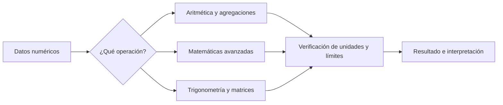
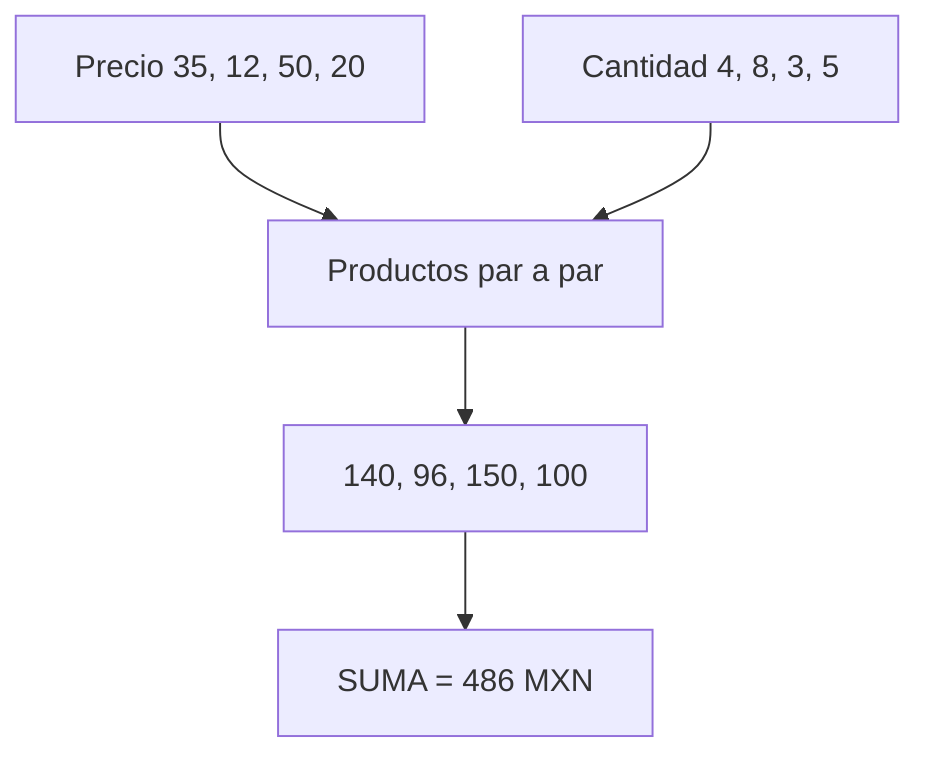
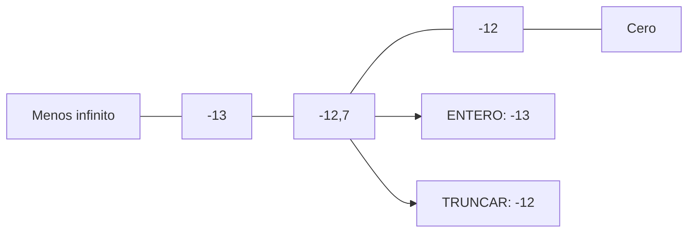
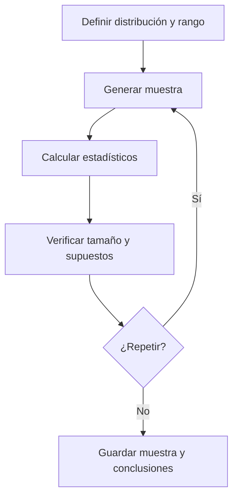
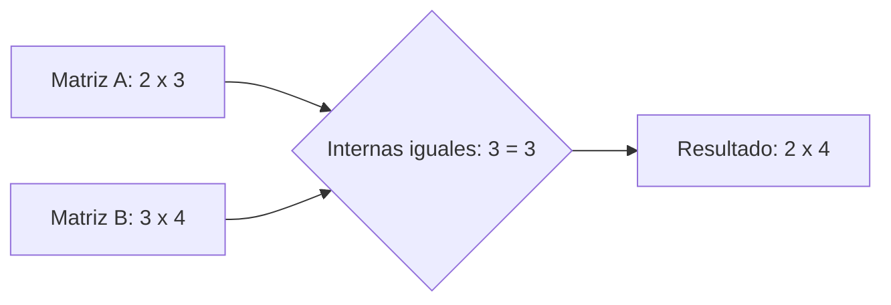
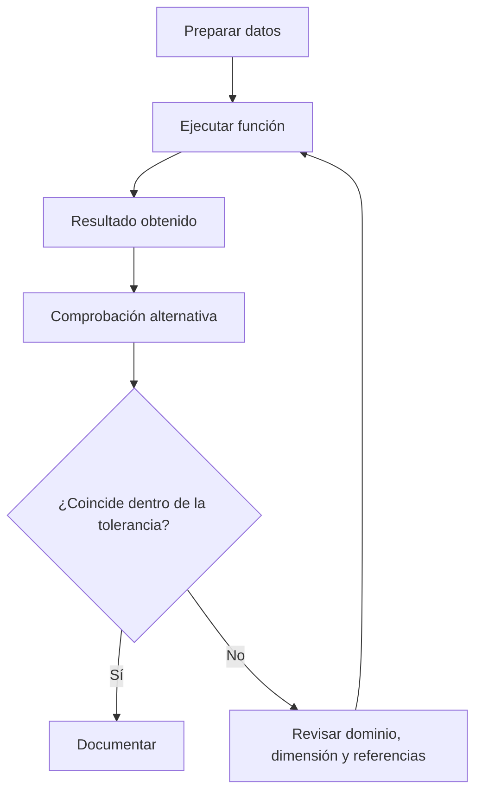

# H08 — Funciones matemáticas y trigonométricas de Excel

**Curso integral de Excel, Google Sheets, VBA y Google Apps Script**  
**Ruta H · Módulo H08 · Roadmap aprobado v2.0**  
**Nivel:** básico–intermedio, con extensión técnica avanzada · **Carga base:** 18 h (la consulta exhaustiva requiere tiempo adicional).  
**Fecha de revisión de referencias:** 24 de octubre de 2026 · **Estado:** material desarrollado, sujeto a práctica y aprobación académica.

> **Objetivo del manual.** Comprender las operaciones, no memorizar nombres. Cada cálculo se conecta con su fundamento matemático, condiciones de aplicación, sintaxis, interpretación, errores, alternativas y equivalencias en Google Sheets. El inventario de la referencia oficial se conserva incluso para funciones poco frecuentes.

## Cómo usar el material

1. Estudia las secciones H08.01, H08.02 y H08.03 en orden.
2. Reproduce las tablas de entrada y escribe las fórmulas en Excel; evita copiar resultados.
3. Observa los ejemplos de límites y números negativos; con frecuencia son los que revelan errores conceptuales.
4. Resuelve los **15 ejercicios** sin mirar el solucionario posterior.
5. Completa la evaluación, comprueba el proyecto integrador y registra funciones no disponibles en tu instalación.

**Entorno de referencia:** Excel Microsoft 365 de escritorio en español. Cuando se indica compatibilidad con Excel 2016/2019/2021/2024 se refiere a disponibilidad catalogada por Microsoft; pueden existir diferencias por canal, plataforma y actualización. Google Sheets se compara mediante la referencia oficial. **No se ejecutaron las fórmulas en Excel ni Google Sheets**: los resultados deterministas incluidos se comprobaron matemáticamente y con Python cuando correspondió. Las funciones aleatorias no tienen salida fija.

**Convención regional del curso:** fórmulas en español, separador de argumentos `;` y separador decimal `,` (p. ej., `=REDONDEAR(12,345;2)`). En configuraciones con funciones inglesas se puede usar `ROUND(12.345,2)`. No sustituyas todos los puntos y comas a ciegas: los separadores son una configuración regional.

## Índice del roadmap

| ID | Sección | Temas | Duración base |
|---|---|---|---:|
| H08.01 | Aritmética y agregaciones | SUMA, PRODUCTO, COCIENTE, RESIDUO, POTENCIA, RAIZ, redondeos y múltiplos | 6 h |
| H08.02 | Matemáticas avanzadas | Logaritmos, exponenciales, combinatoria, aleatoriedad y precisión | 6 h |
| H08.03 | Trigonometría y matrices | Ángulos, inversas, hiperbólicas, determinantes, inversas y productos | 6 h |

### Diagrama 1 — Ruta del cálculo



### Recurso visual: cómo encontrar funciones en Excel


*Figura 1. Captura pública de [ExcelMojo: Insert Function](https://www.excelmojo.com/insert-a-function-in-excel/) en Excel en inglés. Observa `fx`, el selector de categorías y la descripción inferior de cada función. La versión en español cambia los nombres, no los conceptos. La captura no representa necesariamente la última interfaz.*

Consulta además el procedimiento oficial [Microsoft — Insertar una función](https://support.microsoft.com/en-us/excel/insert-function-in-excel).

---

# H08.01 — Aritmética y agregaciones

## H08.01.01 — Operaciones

### H08.01.01.01 — Suma, producto y agregación de valores

**Fundamento.** Una suma combina valores compatibles: no deben sumarse pesos con unidades físicas sin una conversión o interpretación definida. Una multiplicación puede obtener un importe al combinar precio unitario por cantidad. La *agregación* resume varios registros en un único resultado.

Considera esta tabla desde **A1**:

| Fila | A: Producto | B: Precio (MXN) | C: Unidades | D: Importe |
|---:|---|---:|---:|---:|
| 1 | Producto | Precio | Unidades | Importe |
| 2 | Cuaderno | 35 | 4 | `=B2*C2` → 140 |
| 3 | Pluma | 12 | 8 | `=B3*C3` → 96 |
| 4 | Carpeta | 50 | 3 | `=B4*C4` → 150 |
| 5 | Marcador | 20 | 5 | `=B5*C5` → 100 |

- `=SUMA(D2:D5)` devuelve **486**.
- `=PRODUCTO(B2;C2)` devuelve **140**.
- `=SUMAPRODUCTO(B2:B5;C2:C5)` devuelve **486** sin columna auxiliar.
- `=SUMA.CUADRADOS(3;4)` devuelve **25**, útil para magnitudes y modelos numéricos.

**Interpretación:** `SUMAPRODUCTO` suma pares de valores multiplicados, mientras que `PRODUCTO` multiplica todos los argumentos. No son intercambiables. Un error frecuente es proporcionar arrays de distinto tamaño a SUMAPRODUCTO.

### Diagrama 2 — SUMA frente a SUMAPRODUCTO



### H08.01.01.02 — Cociente, residuos y aritmética modular

En la división `a / b`, el **cociente entero truncado** y el **residuo** responden a preguntas diferentes. Para cantidades positivas, `COCIENTE(17;5)=3` y `RESIDUO(17;5)=2`; de modo que `17=5×3+2`.

En Excel:

```excel
=17/5               → 3,4
=COCIENTE(17;5)     → 3
=RESIDUO(17;5)      → 2
```

Con números negativos, comprueba la convención: `RESIDUO(-17;5)` devuelve **3**, porque Excel define el signo del resto según el divisor. En cambio, `COCIENTE(-17;5)` devuelve **-3** por truncamiento hacia cero. **No reconstruyas siempre `a=b·COCIENTE(a;b)+RESIDUO(a;b)` para signos opuestos**: las funciones emplean reglas diferentes.

**Aplicación:** agrupar 127 unidades en cajas de capacidad 24. `COCIENTE(127;24)` → 5 cajas completas; `RESIDUO(127;24)` → 7 unidades sobrantes; se necesitan 6 cajas para transportar todo.

### H08.01.01.03 — Potencias, raíces, valor absoluto y signo

Una potencia `a^b` repite o generaliza la multiplicación de una base según un exponente. La raíz cuadrada positiva invierte el cuadrado en el dominio no negativo.

```excel
=POTENCIA(2;5)     → 32
=2^5               → 32
=RAIZ(81)          → 9
=ABS(-23)          → 23
=SIGNO(-23)        → -1
```

**Atención:** `RAIZ(-9)` devuelve `#¡NUM!` en el dominio real; `=RAIZ(ABS(-9))` produce 3 pero resuelve una pregunta matemática diferente. Para números complejos existe la familia de ingeniería, asignada a H15.

## H08.01.02 — Redondeo y representación

### H08.01.02.01 — Enteros, truncamiento y diferencias de signo

Separa cuatro operaciones: (1) **formato** (solo presentación), (2) **redondeo convencional**, (3) **truncamiento** hacia cero y (4) **piso matemático** hacia menos infinito.

| Fórmula | Resultado | Regla |
|---|---:|---|
| `=REDONDEAR(12,345;2)` | 12,35 | Aproxima a dos decimales |
| `=TRUNCAR(12,987;0)` | 12 | Suprime fracción hacia cero |
| `=TRUNCAR(-12,987;0)` | -12 | Hacia cero |
| `=ENTERO(-12,987)` | -13 | Piso hacia menos infinito |
| `=REDONDEAR.MAS(-12,01;0)` | -13 | Se aleja de cero |
| `=REDONDEAR.MENOS(-12,99;0)` | -12 | Se acerca a cero |

### Diagrama 3 — Dirección al redondear negativos



**Consecuencia práctica:** para facturación, mediciones y cantidades discretas, decide explícitamente cuál norma de redondeo aplica. Una regla contable no puede inferirse únicamente del nombre de una función.

### H08.01.02.02 — Múltiplos, pares e impares

`REDOND.MULT` aproxima al múltiplo más cercano. `MULTIPLO.SUPERIOR.MAT` y `MULTIPLO.INFERIOR.MAT` permiten trabajar con límites y reglas de signo que requieren atención. Las funciones heredadas `MULTIPLO.SUPERIOR`/`MULTIPLO.INFERIOR` se conservan por compatibilidad y **no deben asumirse idénticas** a las variantes modernas en números negativos.

| Necesidad | Fórmula | Resultado |
|---|---|---:|
| Precio más cercano en saltos de 5 | `=REDOND.MULT(47;5)` | 45 |
| Capacidad de cajas de 12, sin fracciones | `=REDONDEAR.MAS(25/12;0)` | 3 |
| Siguiente entero par, lejos de cero | `=REDONDEA.PAR(5)` | 6 |
| Siguiente entero impar, lejos de cero | `=REDONDEA.IMPAR(-4)` | -5 |

`REDOND.MULT(5;-2)` da `#¡NUM!` según la documentación actual de Microsoft por signos incompatibles.

### H08.01.02.03 — Cuándo elegir cada redondeo

- **Representación visual:** usar formato, sin modificar el cálculo subyacente.
- **Decimales de un informe:** `REDONDEAR` con precisión definida.
- **Cajas necesarias:** normalmente redondeo hacia arriba de una división de cantidades positivas.
- **Cotas y grillas numéricas:** funciones de múltiplos, estudiando las reglas negativas.
- **Eliminar la parte fraccionaria:** `TRUNCAR`, distinto de `ENTERO` en negativos.

---

# H08.02 — Matemáticas avanzadas

## H08.02.01 — Funciones matemáticas especializadas

### H08.02.01.01 — Logaritmos y exponenciales

**Exponencial:** `EXP(x)` calcula `e^x`, donde `e≈2,718281828`. **Logaritmo natural:** `LN(y)` es el exponente al que se eleva e para obtener y, siempre que y sea positivo. `LOG(y;base)` generaliza la operación y `LOG10(y)` usa base diez.

```excel
=EXP(0)          → 1
=LN(EXP(2))      → aproximadamente 2
=LOG(1000;10)    → 3
=LOG10(100)      → 2
```

**Dominios:** LN y LOG requieren número positivo. En LOG la base debe ser positiva y distinta de 1. Una inversión `LN(EXP(2))` puede mostrar una pequeña diferencia flotante respecto de 2; no todas las comparaciones de valores calculados deben exigir igualdad exacta.

**Aplicación:** crecimiento continuo: `monto=inicial*EXP(tasa_anual*años)`. Para 1,000 MXN, 5 % continuo y 2 años:

```excel
=1000*EXP(0,05*2)   → aproximadamente 1105,17
```

Este es un modelo matemático, no una predicción financiera garantizada. Otros esquemas de capitalización utilizarían ecuaciones distintas.

### H08.02.01.02 — Factoriales, combinaciones y números enteros

Un factorial `n!` multiplica los enteros de 1 hasta n y por convenio `0!=1`. Las **combinaciones** cuentan selecciones sin orden; la variante con repetición permite elegir el mismo tipo varias veces.

```excel
=FACT(5)          → 120
=FACT.DOBLE(7)    → 105    (7×5×3×1)
=COMBINAT(6;2)    → 15
=COMBINA(3;2)     → 6
=M.C.D(18;24)     → 6
=M.C.M(6;8)       → 24
=MULTINOMIAL(2;1;1) → 12
```

**Diferencia central:** `COMBINAT(n;k)=n!/[k!(n-k)!]`; `COMBINA(n;k)=(n+k-1)!/[k!(n-1)!]` para enteros válidos. Para elegir dos personas distintas de un equipo de seis se utiliza COMBINAT; para elegir dos unidades de tres sabores con repetición permitida, COMBINA.

**Precaución:** los factoriales crecen rápidamente y pueden desbordar los rangos representables. La familia estadística avanzada, incluidos modelos probabilísticos, se desarrollará en H09.

### H08.02.01.03 — Generación de números aleatorios

`ALEATORIO()` devuelve un real pseudoaleatorio dentro de `[0;1)`, `ALEATORIO.ENTRE(inferior;superior)` devuelve un entero dentro de ambos extremos y `MATRIZALEAT` devuelve una matriz dinámica configurable en versiones compatibles.

```excel
=ALEATORIO()
=ALEATORIO.ENTRE(1;6)
=MATRIZALEAT(3;2;1;10;VERDADERO)
```

Los resultados **cambian** al recalcular. No coloques números inventados como salidas esperadas. Las funciones de Excel no ofrecen por sí solas un parámetro de semilla reproducible; para simulaciones auditables conviene preservar una copia de las muestras o usar una herramienta de cómputo que controle la semilla.

### Diagrama 4 — Proceso de simulación



## H08.02.02 — Precisión y limitaciones numéricas

### H08.02.02.01 — Comparación mediante tolerancias

Excel suele representar números mediante aritmética binaria de punto flotante. Por esta razón, cálculos aparentemente exactos pueden contener pequeñas diferencias en los bits menos significativos.

**Evita:** `=A2=B2` cuando ambos resultados provienen de operaciones decimales y se requiere comparar equivalencia aproximada.

**Prefiere una tolerancia explícita:**

```excel
=ABS(A2-B2)<0,000001
```

Esto compara la diferencia absoluta con una tolerancia elegida por el modelo. Cuando las magnitudes varían mucho, considera una tolerancia relativa, por ejemplo `=ABS(A2-B2)<=0,000001*MAX(1;ABS(A2);ABS(B2))`. **La selección de tolerancias depende del contexto**, no existe un valor universal correcto.

### H08.02.02.02 — Errores numéricos, dominios y escala

| Problema | Ejemplo | Diagnóstico | Resolución |
|---|---|---|---|
| División por cero | `=1/0` | `#¡DIV/0!` | Validar divisor |
| Dominio inválido | `=RAIZ(-4)` | `#¡NUM!` | Corregir definición del problema |
| Logaritmo de cero | `=LN(0)` | `#¡NUM!` | Exigir valor positivo |
| Nombre de función mal escrito | `=SUMAR(1;2)` | `#¿NOMBRE?` si no existe esa función | Verificar catálogo y localización |
| Incompatibilidad de matrices | Rangos no conformables | `#¡VALOR!` u otro error según función | Verificar dimensiones |
| Derrame bloqueado | `=MATRIZALEAT(3;2)` junto a celdas ocupadas | `#¡DESBORDAMIENTO!` | Liberar el rango de salida |
| Redondeo temprano | Redondear cada transacción antes de sumar | Diferencia respecto de redondear el total | Documentar regla de negocio |

**Error de redondeo acumulado:** `REDONDEAR(0,335;2)` produce 0,34 y tres valores redondeados suman 1,02; redondear primero `0,335*3=1,005` a dos decimales puede producir un total diferente (1,01 en las reglas de Excel). No son procesos algebraicamente equivalentes.

---

# H08.03 — Trigonometría y matrices

## H08.03.01 — Trigonometría

### H08.03.01.01 — Ángulos, grados y radianes

**Radianes:** medida natural de ángulos definida como longitud del arco entre radio. Una vuelta completa equivale a `2π` radianes y a 360 grados.

```excel
=RADIANES(180)     → aproximadamente 3,141592654
=GRADOS(PI()/2)    → 90
=SENO(RADIANES(30)) → aproximadamente 0,5
```

Las funciones trigonométricas principales reciben **radianes**, no grados. `=SENO(30)` no representa el seno de 30°; representa el seno de 30 radianes.

### Diagrama 5 — Conversión angular


### H08.03.01.02 — Directas, inversas y coordenadas

Para un ángulo θ: `SENO(θ)` y `COS(θ)` representan razones trigonométricas; `TAN(θ)=SENO(θ)/COS(θ)` donde el denominador no sea cero. Las inversas `ASENO`, `ACOS`, `ATAN` recuperan valores angulares principales en radianes.

```excel
=COS(PI()/3)         → aproximadamente 0,5
=TAN(PI()/4)         → aproximadamente 1
=GRADOS(ASENO(0,5))  → aproximadamente 30
=GRADOS(ACOS(0,5))   → aproximadamente 60
=GRADOS(ATAN(1))     → aproximadamente 45
```

`ATAN2(x;y)` utiliza dos coordenadas y conserva información del cuadrante (a diferencia de ATAN(y/x)). Atención: el **orden de argumentos de ATAN2 en Excel es x, y**, diferente de muchos lenguajes de programación que usan `atan2(y,x)`.

La trigonometría inversa tiene dominios específicos (`ASENO` y `ACOS` exigen valores en `[-1;1]`). Cerca de singularidades como `TAN(π/2)`, el resultado numérico puede ser muy grande en vez de un error exacto, debido a aproximación de π.

### H08.03.01.03 — Funciones hiperbólicas

`SENOH(x)=(e^x-e^-x)/2`, `COSH(x)=(e^x+e^-x)/2`, `TANH(x)=SENOH(x)/COSH(x)`; las funciones hiperbólicas **no** son las trigonométricas ordinarias multiplicadas por alguna constante. Sus inversas y recíprocas tienen dominios distintos.

| Familia | Directa | Inversa | Reciproca |
|---|---|---|---|
| Seno | `SENO` | `ASENO` | `CSC` |
| Coseno | `COS` | `ACOS` | `SEC` |
| Tangente | `TAN` | `ATAN` | `COT` |
| Seno hiperbólico | `SENOH` | `ASENOH` | `CSCH` |
| Coseno hiperbólico | `COSH` | `ACOSH` | `SECH` |
| Tangente hiperbólica | `TANH` | `ATANH` | `COTH` |

`ACOTH` es la inversa hiperbólica de cotangente y `ACOT` la inversa de cotangente ordinaria; las ramas y dominios deben consultarse en la ficha oficial para casos límite.

## H08.03.02 — Matemática matricial

### H08.03.02.01 — Determinantes

Una **matriz** es una disposición rectangular de números. Una matriz `2×2` puede representar coeficientes de un sistema de ecuaciones, transformaciones geométricas y relaciones lineales.

Para la matriz:

| | A | B |
|---|---:|---:|
| 1 | 2 | 1 |
| 2 | 1 | 3 |

El determinante es `2×3−1×1 = 5`.

En Excel, una vez colocados los números en A1:B2:

```excel
=MDETERM(A1:B2)   → 5
```

Un determinante cero indica que una matriz cuadrada **no tiene inversa** y que sus columnas/filas son linealmente dependientes.

### H08.03.02.02 — Inversa y matriz identidad

La matriz inversa `A⁻¹` de una matriz cuadrada A satisface `A×A⁻¹=I` (matriz identidad). `MINVERSA(A1:B2)` devuelve una matriz de 2×2; en Excel moderno necesita espacio libre para derramar.

Para A = `[[2,1],[1,3]]`, su inversa es:

| | Col. 1 | Col. 2 |
|---|---:|---:|
| Fila 1 | 0,6 | -0,2 |
| Fila 2 | -0,2 | 0,4 |

`M.UNIDAD(2)` genera `[[1,0],[0,1]]`. Una inversa numérica puede introducir error flotante, de modo que sus productos pueden aproximarse a I sin coincidir exactamente en todos los decimales.

### H08.03.02.03 — Multiplicación matricial y condiciones dimensionales

Para multiplicar `A(m×n) · B(n×p)`, las dimensiones **internas n deben coincidir**. El resultado tiene tamaño `m×p`.

```excel
=MMULT(A1:B2;D1:E2)
```

Si D1:E2 contiene la identidad, el resultado es A. La operación **no equivale** al producto celda a celda y generalmente no es conmutativa: `AB` no necesariamente es igual a `BA`.

### Diagrama 6 — Dimensiones compatibles



**Aplicación:** sistemas lineales `Ax=b`. Se puede plantear `x=A⁻¹b`, aunque para problemas de gran escala o matrices mal condicionadas suele convenir una biblioteca numérica especializada en lugar de invertir A explícitamente.

---

## Equivalencias contrastadas con Google Sheets (selección verificable)

En el catálogo oficial de Sheets existen los siguientes nombres de función. Sus sintaxis concretas pueden variar con la configuración regional; una función con el mismo nombre no garantiza idéntico comportamiento ante errores, matrices o signos.

| Excel en español | Google Sheets en español | Consideración |
|---|---|---|
| `SUMA`, `PRODUCTO`, `ABS` | `SUMA`, `PRODUCTO`, `ABS` | Misma operación básica; comprobar coerción de texto |
| `POTENCIA`, `RAIZ`, `SIGNO` | `POTENCIA`, `RAIZ`, `SIGNO` | Dominios numéricos y tipos |
| `LN`, `LOG`, `LOG10`, `EXP` | `LN`, `LOG`, `LOG10`, `EXP` | Entradas válidas y precisión |
| `M.C.D`, `M.C.M`, `FACT` | `M.C.D`, `M.C.M`, `FACT` | Números enteros y rangos |
| `PI`, `GRADOS`, `RADIANES` | `PI`, `GRADOS`, `RADIANES` | Funciones angulares y aproximaciones |
| `SENO`, `COS`, `TAN` | `SENO`, `COS`, `TAN` | Reciben radianes |
| `ALEATORIO`, `ALEATORIO.ENTRE` | `ALEATORIO`, `ALEATORIO.ENTRE` | Volatilidad y falta de valores fijos |
| `REDONDEAR`, `TRUNCAR`, `ENTERO` | `REDONDEAR`, `TRUNCAR`, `ENTERO` | Revisar reglas de negativos y límites |
| `SUMA.CUADRADOS`, `SUMA.SERIES` | `SUMA.CUADRADOS`, `SUMA.SERIES` | Confirmar tamaño de argumentos |
| `SUMAR.SI`, `SUMAR.SI.CONJUNTO` | `SUMAR.SI`, `SUMAR.SI.CONJUNTO` | Su ficha principal está en H07 |

**No atribuir equivalencia automática:** las funciones específicas de versiones (`MATRIZALEAT`), variantes de techo/piso, funciones con comportamiento de matrices y funciones especializadas se contrastarán individualmente en G03. El registro de esas funciones está incluido aquí para evitar su omisión, pero su equivalencia en Sheets no se declara demostrada. [Fuente Google Sheets](https://support.google.com/docs/table/25273?hl=es).

## Inventario técnico del módulo H08

La [lista oficial de matemáticas y trigonometría de Microsoft](https://support.microsoft.com/es-es/excel/math-and-trigonometry-functions-reference) incluye **80 entradas** identificadas en el inventario de este manual. Se mantienen las funciones compartidas con H07 como **referencia cruzada**, no se reclasifican arbitrariamente. En este bloque aparecen las funciones de Excel en español y su denominación inglesa, la sintaxis orientativa, un ejemplo, el tipo de salida y una advertencia. Se agrupan por subtema.

> **Sobre nombres localizados.** Algunas páginas de Microsoft contienen encabezados automáticamente traducidos y ejemplos con nombres ingleses. Cuando una función figura con nombres contradictorios, manda la sintaxis confirmada en su página de función y el asistente **Insertar función** de la instalación. `RAIZ`, `REDONDEAR`, `ALEATORIO`, `SENOH`, `ASENOH` y `MATRIZALEAT` fueron contrastadas con sus páginas individuales. Si una variante no se reconoce, prueba el nombre inglés únicamente si tu Excel admite nombres ingleses.

> **Criterio de profundidad:** las fichas técnicas breves de las funciones raras son material de identificación y referencia; las lecciones H08.01–H08.03 y laboratorios desarrollan los fundamentos y aplicaciones. Las fichas de SUMAR.SI y SUMAR.SI.CONJUNTO se desarrollaron íntegramente en H07. Los ejemplos que dependen de tablas indican la configuración necesaria, no prometen valores en cualquier libro.

### Fichas funcionales: H08.01 — Operaciones y agregación

#### Ficha H08-F001 — `SUMA` / `SUM`

- **Categoría / objetivo:** Operaciones y agregación; agrega números para obtener un total.
- **Sintaxis Excel ES:** `SUMA(número1;[número2];...)`. **Sintaxis EN:** nombre `SUM`; ajusta los argumentos/separadores según locale.
- **Argumentos:** número1, (opcional: número2), .... Entre corchetes aparecen opcionales; los demás son obligatorios. Usa celdas, constantes o expresiones con el tipo que corresponda.
- **Valor devuelto:** número. **Ejemplo introductorio:** `=SUMA(3;4;5)` → **12**.
- **Ejemplo intermedio:** introduce los valores numéricos del ejemplo en celdas y sustituye parámetros constantes por referencias a celdas, sin cambiar el orden de argumentos. Verifica manualmente el caso básico anterior antes de extenderlo.
- **Aplicación profesional:** Agrega números para obtener un total. Selecciona datos coherentes con el proceso, documenta unidades y valida el resultado de manera independiente.
- **Errores / limitaciones:** En rangos omite texto; verifica celdas de error. Los argumentos de tipo incorrecto pueden producir `#¡VALOR!` y dominios inválidos `#¡NUM!`; no todos los fallos aplican a todas las funciones.
- **Alternativas / relaciones:** operadores matemáticos cuando equivalgan, composición con `ABS`, `REDONDEAR` o `SUMA` cuando proceda; consulta las funciones afines de este mismo inventario.
- **Google Sheets:** busca `SUMA` o `SUM` en el [catálogo oficial de Sheets](https://support.google.com/docs/table/25273?hl=es). No se garantiza equivalencia exacta para esta ficha sin comparar argumentos, resultados y límites en ambas plataformas.
- **Compatibilidad:** función catalogada por Microsoft en su familia de matemáticas/trigonometría; algunas funciones (por ejemplo MATRIZALEAT) son modernas o dependen del motor de matrices dinámicas. La ficha de la función prevalece sobre una inferencia general de disponibilidad.
- **Micropráctica:** reproduce el ejemplo, modifica un argumento válido, predice la salida e identifica al menos un caso extremo o inválido.

**Preparación:** puedes escribir el ejemplo directamente en una celda libre de Excel con el idioma y separadores especificados.

#### Ficha H08-F002 — `PRODUCTO` / `PRODUCT`

- **Categoría / objetivo:** Operaciones y agregación; multiplica factores, por ejemplo rendimiento compuesto.
- **Sintaxis Excel ES:** `PRODUCTO(número1;[número2];...)`. **Sintaxis EN:** nombre `PRODUCT`; ajusta los argumentos/separadores según locale.
- **Argumentos:** número1, (opcional: número2), .... Entre corchetes aparecen opcionales; los demás son obligatorios. Usa celdas, constantes o expresiones con el tipo que corresponda.
- **Valor devuelto:** número. **Ejemplo introductorio:** `=PRODUCTO(2;3;4)` → **24**.
- **Ejemplo intermedio:** introduce los valores numéricos del ejemplo en celdas y sustituye parámetros constantes por referencias a celdas, sin cambiar el orden de argumentos. Verifica manualmente el caso básico anterior antes de extenderlo.
- **Aplicación profesional:** Multiplica factores, por ejemplo rendimiento compuesto. Selecciona datos coherentes con el proceso, documenta unidades y valida el resultado de manera independiente.
- **Errores / limitaciones:** No sustituye SUMAPRODUCTO para pares de registros. Los argumentos de tipo incorrecto pueden producir `#¡VALOR!` y dominios inválidos `#¡NUM!`; no todos los fallos aplican a todas las funciones.
- **Alternativas / relaciones:** operadores matemáticos cuando equivalgan, composición con `ABS`, `REDONDEAR` o `SUMA` cuando proceda; consulta las funciones afines de este mismo inventario.
- **Google Sheets:** busca `PRODUCTO` o `PRODUCT` en el [catálogo oficial de Sheets](https://support.google.com/docs/table/25273?hl=es). No se garantiza equivalencia exacta para esta ficha sin comparar argumentos, resultados y límites en ambas plataformas.
- **Compatibilidad:** función catalogada por Microsoft en su familia de matemáticas/trigonometría; algunas funciones (por ejemplo MATRIZALEAT) son modernas o dependen del motor de matrices dinámicas. La ficha de la función prevalece sobre una inferencia general de disponibilidad.
- **Micropráctica:** reproduce el ejemplo, modifica un argumento válido, predice la salida e identifica al menos un caso extremo o inválido.

**Preparación:** puedes escribir el ejemplo directamente en una celda libre de Excel con el idioma y separadores especificados.

#### Ficha H08-F003 — `COCIENTE` / `QUOTIENT`

- **Categoría / objetivo:** Operaciones y agregación; obtiene parte entera de divisiones, útil para cajas llenas.
- **Sintaxis Excel ES:** `COCIENTE(numerador;denominador)`. **Sintaxis EN:** nombre `QUOTIENT`; ajusta los argumentos/separadores según locale.
- **Argumentos:** numerador, denominador. Entre corchetes aparecen opcionales; los demás son obligatorios. Usa celdas, constantes o expresiones con el tipo que corresponda.
- **Valor devuelto:** número. **Ejemplo introductorio:** `=COCIENTE(17;5)` → **3**.
- **Ejemplo intermedio:** introduce los valores numéricos del ejemplo en celdas y sustituye parámetros constantes por referencias a celdas, sin cambiar el orden de argumentos. Verifica manualmente el caso básico anterior antes de extenderlo.
- **Aplicación profesional:** Obtiene parte entera de divisiones, útil para cajas llenas. Selecciona datos coherentes con el proceso, documenta unidades y valida el resultado de manera independiente.
- **Errores / limitaciones:** Trunca hacia cero; divisor cero produce error. Los argumentos de tipo incorrecto pueden producir `#¡VALOR!` y dominios inválidos `#¡NUM!`; no todos los fallos aplican a todas las funciones.
- **Alternativas / relaciones:** operadores matemáticos cuando equivalgan, composición con `ABS`, `REDONDEAR` o `SUMA` cuando proceda; consulta las funciones afines de este mismo inventario.
- **Google Sheets:** busca `COCIENTE` o `QUOTIENT` en el [catálogo oficial de Sheets](https://support.google.com/docs/table/25273?hl=es). No se garantiza equivalencia exacta para esta ficha sin comparar argumentos, resultados y límites en ambas plataformas.
- **Compatibilidad:** función catalogada por Microsoft en su familia de matemáticas/trigonometría; algunas funciones (por ejemplo MATRIZALEAT) son modernas o dependen del motor de matrices dinámicas. La ficha de la función prevalece sobre una inferencia general de disponibilidad.
- **Micropráctica:** reproduce el ejemplo, modifica un argumento válido, predice la salida e identifica al menos un caso extremo o inválido.

**Preparación:** puedes escribir el ejemplo directamente en una celda libre de Excel con el idioma y separadores especificados.

#### Ficha H08-F004 — `RESIDUO` / `MOD`

- **Categoría / objetivo:** Operaciones y agregación; obtiene resto, útil en ciclos y agrupaciones.
- **Sintaxis Excel ES:** `RESIDUO(número;divisor)`. **Sintaxis EN:** nombre `MOD`; ajusta los argumentos/separadores según locale.
- **Argumentos:** número, divisor. Entre corchetes aparecen opcionales; los demás son obligatorios. Usa celdas, constantes o expresiones con el tipo que corresponda.
- **Valor devuelto:** número. **Ejemplo introductorio:** `=RESIDUO(17;5)` → **2**.
- **Ejemplo intermedio:** introduce los valores numéricos del ejemplo en celdas y sustituye parámetros constantes por referencias a celdas, sin cambiar el orden de argumentos. Verifica manualmente el caso básico anterior antes de extenderlo.
- **Aplicación profesional:** Obtiene resto, útil en ciclos y agrupaciones. Selecciona datos coherentes con el proceso, documenta unidades y valida el resultado de manera independiente.
- **Errores / limitaciones:** El signo del resultado depende del divisor. Los argumentos de tipo incorrecto pueden producir `#¡VALOR!` y dominios inválidos `#¡NUM!`; no todos los fallos aplican a todas las funciones.
- **Alternativas / relaciones:** operadores matemáticos cuando equivalgan, composición con `ABS`, `REDONDEAR` o `SUMA` cuando proceda; consulta las funciones afines de este mismo inventario.
- **Google Sheets:** busca `RESIDUO` o `MOD` en el [catálogo oficial de Sheets](https://support.google.com/docs/table/25273?hl=es). No se garantiza equivalencia exacta para esta ficha sin comparar argumentos, resultados y límites en ambas plataformas.
- **Compatibilidad:** función catalogada por Microsoft en su familia de matemáticas/trigonometría; algunas funciones (por ejemplo MATRIZALEAT) son modernas o dependen del motor de matrices dinámicas. La ficha de la función prevalece sobre una inferencia general de disponibilidad.
- **Micropráctica:** reproduce el ejemplo, modifica un argumento válido, predice la salida e identifica al menos un caso extremo o inválido.

**Preparación:** puedes escribir el ejemplo directamente en una celda libre de Excel con el idioma y separadores especificados.

#### Ficha H08-F005 — `POTENCIA` / `POWER`

- **Categoría / objetivo:** Operaciones y agregación; calcula crecimiento no lineal o elevaciones.
- **Sintaxis Excel ES:** `POTENCIA(número;potencia)`. **Sintaxis EN:** nombre `POWER`; ajusta los argumentos/separadores según locale.
- **Argumentos:** número, potencia. Entre corchetes aparecen opcionales; los demás son obligatorios. Usa celdas, constantes o expresiones con el tipo que corresponda.
- **Valor devuelto:** número. **Ejemplo introductorio:** `=POTENCIA(2;5)` → **32**.
- **Ejemplo intermedio:** introduce los valores numéricos del ejemplo en celdas y sustituye parámetros constantes por referencias a celdas, sin cambiar el orden de argumentos. Verifica manualmente el caso básico anterior antes de extenderlo.
- **Aplicación profesional:** Calcula crecimiento no lineal o elevaciones. Selecciona datos coherentes con el proceso, documenta unidades y valida el resultado de manera independiente.
- **Errores / limitaciones:** Bases negativas y exponentes fraccionarios pueden salir del dominio real. Los argumentos de tipo incorrecto pueden producir `#¡VALOR!` y dominios inválidos `#¡NUM!`; no todos los fallos aplican a todas las funciones.
- **Alternativas / relaciones:** operadores matemáticos cuando equivalgan, composición con `ABS`, `REDONDEAR` o `SUMA` cuando proceda; consulta las funciones afines de este mismo inventario.
- **Google Sheets:** busca `POTENCIA` o `POWER` en el [catálogo oficial de Sheets](https://support.google.com/docs/table/25273?hl=es). No se garantiza equivalencia exacta para esta ficha sin comparar argumentos, resultados y límites en ambas plataformas.
- **Compatibilidad:** función catalogada por Microsoft en su familia de matemáticas/trigonometría; algunas funciones (por ejemplo MATRIZALEAT) son modernas o dependen del motor de matrices dinámicas. La ficha de la función prevalece sobre una inferencia general de disponibilidad.
- **Micropráctica:** reproduce el ejemplo, modifica un argumento válido, predice la salida e identifica al menos un caso extremo o inválido.

**Preparación:** puedes escribir el ejemplo directamente en una celda libre de Excel con el idioma y separadores especificados.

#### Ficha H08-F006 — `RAIZ` / `SQRT`

- **Categoría / objetivo:** Operaciones y agregación; obtiene raíz cuadrada positiva, útil en distancias.
- **Sintaxis Excel ES:** `RAIZ(número)`. **Sintaxis EN:** nombre `SQRT`; ajusta los argumentos/separadores según locale.
- **Argumentos:** número. Entre corchetes aparecen opcionales; los demás son obligatorios. Usa celdas, constantes o expresiones con el tipo que corresponda.
- **Valor devuelto:** número. **Ejemplo introductorio:** `=RAIZ(81)` → **9**.
- **Ejemplo intermedio:** introduce los valores numéricos del ejemplo en celdas y sustituye parámetros constantes por referencias a celdas, sin cambiar el orden de argumentos. Verifica manualmente el caso básico anterior antes de extenderlo.
- **Aplicación profesional:** Obtiene raíz cuadrada positiva, útil en distancias. Selecciona datos coherentes con el proceso, documenta unidades y valida el resultado de manera independiente.
- **Errores / limitaciones:** Solo acepta números no negativos en números reales. Los argumentos de tipo incorrecto pueden producir `#¡VALOR!` y dominios inválidos `#¡NUM!`; no todos los fallos aplican a todas las funciones.
- **Alternativas / relaciones:** operadores matemáticos cuando equivalgan, composición con `ABS`, `REDONDEAR` o `SUMA` cuando proceda; consulta las funciones afines de este mismo inventario.
- **Google Sheets:** busca `RAIZ` o `SQRT` en el [catálogo oficial de Sheets](https://support.google.com/docs/table/25273?hl=es). No se garantiza equivalencia exacta para esta ficha sin comparar argumentos, resultados y límites en ambas plataformas.
- **Compatibilidad:** función catalogada por Microsoft en su familia de matemáticas/trigonometría; algunas funciones (por ejemplo MATRIZALEAT) son modernas o dependen del motor de matrices dinámicas. La ficha de la función prevalece sobre una inferencia general de disponibilidad.
- **Micropráctica:** reproduce el ejemplo, modifica un argumento válido, predice la salida e identifica al menos un caso extremo o inválido.

**Preparación:** puedes escribir el ejemplo directamente en una celda libre de Excel con el idioma y separadores especificados.

#### Ficha H08-F007 — `ABS` / `ABS`

- **Categoría / objetivo:** Operaciones y agregación; mide magnitud sin signo, como una desviación absoluta.
- **Sintaxis Excel ES:** `ABS(número)`. **Sintaxis EN:** nombre `ABS`; ajusta los argumentos/separadores según locale.
- **Argumentos:** número. Entre corchetes aparecen opcionales; los demás son obligatorios. Usa celdas, constantes o expresiones con el tipo que corresponda.
- **Valor devuelto:** número. **Ejemplo introductorio:** `=ABS(-15)` → **15**.
- **Ejemplo intermedio:** introduce los valores numéricos del ejemplo en celdas y sustituye parámetros constantes por referencias a celdas, sin cambiar el orden de argumentos. Verifica manualmente el caso básico anterior antes de extenderlo.
- **Aplicación profesional:** Mide magnitud sin signo, como una desviación absoluta. Selecciona datos coherentes con el proceso, documenta unidades y valida el resultado de manera independiente.
- **Errores / limitaciones:** No conserva dirección del cambio. Los argumentos de tipo incorrecto pueden producir `#¡VALOR!` y dominios inválidos `#¡NUM!`; no todos los fallos aplican a todas las funciones.
- **Alternativas / relaciones:** operadores matemáticos cuando equivalgan, composición con `ABS`, `REDONDEAR` o `SUMA` cuando proceda; consulta las funciones afines de este mismo inventario.
- **Google Sheets:** busca `ABS` o `ABS` en el [catálogo oficial de Sheets](https://support.google.com/docs/table/25273?hl=es). No se garantiza equivalencia exacta para esta ficha sin comparar argumentos, resultados y límites en ambas plataformas.
- **Compatibilidad:** función catalogada por Microsoft en su familia de matemáticas/trigonometría; algunas funciones (por ejemplo MATRIZALEAT) son modernas o dependen del motor de matrices dinámicas. La ficha de la función prevalece sobre una inferencia general de disponibilidad.
- **Micropráctica:** reproduce el ejemplo, modifica un argumento válido, predice la salida e identifica al menos un caso extremo o inválido.

**Preparación:** puedes escribir el ejemplo directamente en una celda libre de Excel con el idioma y separadores especificados.

#### Ficha H08-F008 — `SIGNO` / `SIGN`

- **Categoría / objetivo:** Operaciones y agregación; clasifica signo negativo, cero o positivo.
- **Sintaxis Excel ES:** `SIGNO(número)`. **Sintaxis EN:** nombre `SIGN`; ajusta los argumentos/separadores según locale.
- **Argumentos:** número. Entre corchetes aparecen opcionales; los demás son obligatorios. Usa celdas, constantes o expresiones con el tipo que corresponda.
- **Valor devuelto:** número. **Ejemplo introductorio:** `=SIGNO(-15)` → **-1**.
- **Ejemplo intermedio:** introduce los valores numéricos del ejemplo en celdas y sustituye parámetros constantes por referencias a celdas, sin cambiar el orden de argumentos. Verifica manualmente el caso básico anterior antes de extenderlo.
- **Aplicación profesional:** Clasifica signo negativo, cero o positivo. Selecciona datos coherentes con el proceso, documenta unidades y valida el resultado de manera independiente.
- **Errores / limitaciones:** No informa magnitud. Los argumentos de tipo incorrecto pueden producir `#¡VALOR!` y dominios inválidos `#¡NUM!`; no todos los fallos aplican a todas las funciones.
- **Alternativas / relaciones:** operadores matemáticos cuando equivalgan, composición con `ABS`, `REDONDEAR` o `SUMA` cuando proceda; consulta las funciones afines de este mismo inventario.
- **Google Sheets:** busca `SIGNO` o `SIGN` en el [catálogo oficial de Sheets](https://support.google.com/docs/table/25273?hl=es). No se garantiza equivalencia exacta para esta ficha sin comparar argumentos, resultados y límites en ambas plataformas.
- **Compatibilidad:** función catalogada por Microsoft en su familia de matemáticas/trigonometría; algunas funciones (por ejemplo MATRIZALEAT) son modernas o dependen del motor de matrices dinámicas. La ficha de la función prevalece sobre una inferencia general de disponibilidad.
- **Micropráctica:** reproduce el ejemplo, modifica un argumento válido, predice la salida e identifica al menos un caso extremo o inválido.

**Preparación:** puedes escribir el ejemplo directamente en una celda libre de Excel con el idioma y separadores especificados.

#### Ficha H08-F009 — `SUMAPRODUCTO` / `SUMPRODUCT`

- **Categoría / objetivo:** Operaciones y agregación; suma productos de cantidades por precios.
- **Sintaxis Excel ES:** `SUMAPRODUCTO(matriz1;[matriz2];...)`. **Sintaxis EN:** nombre `SUMPRODUCT`; ajusta los argumentos/separadores según locale.
- **Argumentos:** matriz1, (opcional: matriz2), .... Entre corchetes aparecen opcionales; los demás son obligatorios. Usa celdas, constantes o expresiones con el tipo que corresponda.
- **Valor devuelto:** número. **Ejemplo introductorio:** `=SUMAPRODUCTO(B2:B5;C2:C5)` → **486***.
- **Ejemplo intermedio:** introduce los valores numéricos del ejemplo en celdas y sustituye parámetros constantes por referencias a celdas, sin cambiar el orden de argumentos. Verifica manualmente el caso básico anterior antes de extenderlo.
- **Aplicación profesional:** Suma productos de cantidades por precios. Selecciona datos coherentes con el proceso, documenta unidades y valida el resultado de manera independiente.
- **Errores / limitaciones:** *Requiere datos de la tabla didáctica; dimensiones compatibles. Los argumentos de tipo incorrecto pueden producir `#¡VALOR!` y dominios inválidos `#¡NUM!`; no todos los fallos aplican a todas las funciones.
- **Alternativas / relaciones:** operadores matemáticos cuando equivalgan, composición con `ABS`, `REDONDEAR` o `SUMA` cuando proceda; consulta las funciones afines de este mismo inventario.
- **Google Sheets:** busca `SUMAPRODUCTO` o `SUMPRODUCT` en el [catálogo oficial de Sheets](https://support.google.com/docs/table/25273?hl=es). No se garantiza equivalencia exacta para esta ficha sin comparar argumentos, resultados y límites en ambas plataformas.
- **Compatibilidad:** función catalogada por Microsoft en su familia de matemáticas/trigonometría; algunas funciones (por ejemplo MATRIZALEAT) son modernas o dependen del motor de matrices dinámicas. La ficha de la función prevalece sobre una inferencia general de disponibilidad.
- **Micropráctica:** reproduce el ejemplo, modifica un argumento válido, predice la salida e identifica al menos un caso extremo o inválido.

**Preparación del ejemplo:** utiliza el rango citado y sus datos de muestra documentados en H08.01 o H08.03; si aparece un asterisco en el resultado, consulta la nota de la ficha.

#### Ficha H08-F010 — `SUMA.CUADRADOS` / `SUMSQ`

- **Categoría / objetivo:** Operaciones y agregación; agrega cuadrados para normas y error cuadrático.
- **Sintaxis Excel ES:** `SUMA.CUADRADOS(número1;[número2];...)`. **Sintaxis EN:** nombre `SUMSQ`; ajusta los argumentos/separadores según locale.
- **Argumentos:** número1, (opcional: número2), .... Entre corchetes aparecen opcionales; los demás son obligatorios. Usa celdas, constantes o expresiones con el tipo que corresponda.
- **Valor devuelto:** número. **Ejemplo introductorio:** `=SUMA.CUADRADOS(3;4)` → **25**.
- **Ejemplo intermedio:** introduce los valores numéricos del ejemplo en celdas y sustituye parámetros constantes por referencias a celdas, sin cambiar el orden de argumentos. Verifica manualmente el caso básico anterior antes de extenderlo.
- **Aplicación profesional:** Agrega cuadrados para normas y error cuadrático. Selecciona datos coherentes con el proceso, documenta unidades y valida el resultado de manera independiente.
- **Errores / limitaciones:** No equivale al cuadrado de la suma. Los argumentos de tipo incorrecto pueden producir `#¡VALOR!` y dominios inválidos `#¡NUM!`; no todos los fallos aplican a todas las funciones.
- **Alternativas / relaciones:** operadores matemáticos cuando equivalgan, composición con `ABS`, `REDONDEAR` o `SUMA` cuando proceda; consulta las funciones afines de este mismo inventario.
- **Google Sheets:** busca `SUMA.CUADRADOS` o `SUMSQ` en el [catálogo oficial de Sheets](https://support.google.com/docs/table/25273?hl=es). No se garantiza equivalencia exacta para esta ficha sin comparar argumentos, resultados y límites en ambas plataformas.
- **Compatibilidad:** función catalogada por Microsoft en su familia de matemáticas/trigonometría; algunas funciones (por ejemplo MATRIZALEAT) son modernas o dependen del motor de matrices dinámicas. La ficha de la función prevalece sobre una inferencia general de disponibilidad.
- **Micropráctica:** reproduce el ejemplo, modifica un argumento válido, predice la salida e identifica al menos un caso extremo o inválido.

**Preparación:** puedes escribir el ejemplo directamente en una celda libre de Excel con el idioma y separadores especificados.

#### Ficha H08-F011 — `SUMAX2MENOSY2` / `SUMX2MY2`

- **Categoría / objetivo:** Operaciones y agregación; suma diferencias de cuadrados emparejados.
- **Sintaxis Excel ES:** `SUMAX2MENOSY2(matriz_x;matriz_y)`. **Sintaxis EN:** nombre `SUMX2MY2`; ajusta los argumentos/separadores según locale.
- **Argumentos:** matriz_x, matriz_y. Entre corchetes aparecen opcionales; los demás son obligatorios. Usa celdas, constantes o expresiones con el tipo que corresponda.
- **Valor devuelto:** número. **Ejemplo introductorio:** `=SUMAX2MENOSY2(A1:A2;B1:B2)` → **-20****.
- **Ejemplo intermedio:** introduce los valores numéricos del ejemplo en celdas y sustituye parámetros constantes por referencias a celdas, sin cambiar el orden de argumentos. Verifica manualmente el caso básico anterior antes de extenderlo.
- **Aplicación profesional:** Suma diferencias de cuadrados emparejados. Selecciona datos coherentes con el proceso, documenta unidades y valida el resultado de manera independiente.
- **Errores / limitaciones:** **Para A={1,2} B={3,4}; debe haber igual tamaño. Los argumentos de tipo incorrecto pueden producir `#¡VALOR!` y dominios inválidos `#¡NUM!`; no todos los fallos aplican a todas las funciones.
- **Alternativas / relaciones:** operadores matemáticos cuando equivalgan, composición con `ABS`, `REDONDEAR` o `SUMA` cuando proceda; consulta las funciones afines de este mismo inventario.
- **Google Sheets:** busca `SUMAX2MENOSY2` o `SUMX2MY2` en el [catálogo oficial de Sheets](https://support.google.com/docs/table/25273?hl=es). No se garantiza equivalencia exacta para esta ficha sin comparar argumentos, resultados y límites en ambas plataformas.
- **Compatibilidad:** función catalogada por Microsoft en su familia de matemáticas/trigonometría; algunas funciones (por ejemplo MATRIZALEAT) son modernas o dependen del motor de matrices dinámicas. La ficha de la función prevalece sobre una inferencia general de disponibilidad.
- **Micropráctica:** reproduce el ejemplo, modifica un argumento válido, predice la salida e identifica al menos un caso extremo o inválido.

**Preparación del ejemplo:** utiliza el rango citado y sus datos de muestra documentados en H08.01 o H08.03; si aparece un asterisco en el resultado, consulta la nota de la ficha.

#### Ficha H08-F012 — `SUMAX2MASY2` / `SUMX2PY2`

- **Categoría / objetivo:** Operaciones y agregación; suma sumas de cuadrados, usa pares de matrices.
- **Sintaxis Excel ES:** `SUMAX2MASY2(matriz_x;matriz_y)`. **Sintaxis EN:** nombre `SUMX2PY2`; ajusta los argumentos/separadores según locale.
- **Argumentos:** matriz_x, matriz_y. Entre corchetes aparecen opcionales; los demás son obligatorios. Usa celdas, constantes o expresiones con el tipo que corresponda.
- **Valor devuelto:** número. **Ejemplo introductorio:** `=SUMAX2MASY2(A1:A2;B1:B2)` → **30****.
- **Ejemplo intermedio:** introduce los valores numéricos del ejemplo en celdas y sustituye parámetros constantes por referencias a celdas, sin cambiar el orden de argumentos. Verifica manualmente el caso básico anterior antes de extenderlo.
- **Aplicación profesional:** Suma sumas de cuadrados, usa pares de matrices. Selecciona datos coherentes con el proceso, documenta unidades y valida el resultado de manera independiente.
- **Errores / limitaciones:** **Para A={1,2} B={3,4}; tamaños iguales. Los argumentos de tipo incorrecto pueden producir `#¡VALOR!` y dominios inválidos `#¡NUM!`; no todos los fallos aplican a todas las funciones.
- **Alternativas / relaciones:** operadores matemáticos cuando equivalgan, composición con `ABS`, `REDONDEAR` o `SUMA` cuando proceda; consulta las funciones afines de este mismo inventario.
- **Google Sheets:** busca `SUMAX2MASY2` o `SUMX2PY2` en el [catálogo oficial de Sheets](https://support.google.com/docs/table/25273?hl=es). No se garantiza equivalencia exacta para esta ficha sin comparar argumentos, resultados y límites en ambas plataformas.
- **Compatibilidad:** función catalogada por Microsoft en su familia de matemáticas/trigonometría; algunas funciones (por ejemplo MATRIZALEAT) son modernas o dependen del motor de matrices dinámicas. La ficha de la función prevalece sobre una inferencia general de disponibilidad.
- **Micropráctica:** reproduce el ejemplo, modifica un argumento válido, predice la salida e identifica al menos un caso extremo o inválido.

**Preparación del ejemplo:** utiliza el rango citado y sus datos de muestra documentados en H08.01 o H08.03; si aparece un asterisco en el resultado, consulta la nota de la ficha.

#### Ficha H08-F013 — `SUMAXMENOSY2` / `SUMXMY2`

- **Categoría / objetivo:** Operaciones y agregación; suma cuadrados de diferencias, útil para error.
- **Sintaxis Excel ES:** `SUMAXMENOSY2(matriz_x;matriz_y)`. **Sintaxis EN:** nombre `SUMXMY2`; ajusta los argumentos/separadores según locale.
- **Argumentos:** matriz_x, matriz_y. Entre corchetes aparecen opcionales; los demás son obligatorios. Usa celdas, constantes o expresiones con el tipo que corresponda.
- **Valor devuelto:** número. **Ejemplo introductorio:** `=SUMAXMENOSY2(A1:A2;B1:B2)` → **8****.
- **Ejemplo intermedio:** introduce los valores numéricos del ejemplo en celdas y sustituye parámetros constantes por referencias a celdas, sin cambiar el orden de argumentos. Verifica manualmente el caso básico anterior antes de extenderlo.
- **Aplicación profesional:** Suma cuadrados de diferencias, útil para error. Selecciona datos coherentes con el proceso, documenta unidades y valida el resultado de manera independiente.
- **Errores / limitaciones:** **Para A={1,2} B={3,4}; tamaños iguales. Los argumentos de tipo incorrecto pueden producir `#¡VALOR!` y dominios inválidos `#¡NUM!`; no todos los fallos aplican a todas las funciones.
- **Alternativas / relaciones:** operadores matemáticos cuando equivalgan, composición con `ABS`, `REDONDEAR` o `SUMA` cuando proceda; consulta las funciones afines de este mismo inventario.
- **Google Sheets:** busca `SUMAXMENOSY2` o `SUMXMY2` en el [catálogo oficial de Sheets](https://support.google.com/docs/table/25273?hl=es). No se garantiza equivalencia exacta para esta ficha sin comparar argumentos, resultados y límites en ambas plataformas.
- **Compatibilidad:** función catalogada por Microsoft en su familia de matemáticas/trigonometría; algunas funciones (por ejemplo MATRIZALEAT) son modernas o dependen del motor de matrices dinámicas. La ficha de la función prevalece sobre una inferencia general de disponibilidad.
- **Micropráctica:** reproduce el ejemplo, modifica un argumento válido, predice la salida e identifica al menos un caso extremo o inválido.

**Preparación del ejemplo:** utiliza el rango citado y sus datos de muestra documentados en H08.01 o H08.03; si aparece un asterisco en el resultado, consulta la nota de la ficha.

#### Ficha H08-F014 — `REDONDEAR` / `ROUND`

- **Categoría / objetivo:** Operaciones y agregación; redondeo estándar a decimales solicitados.
- **Sintaxis Excel ES:** `REDONDEAR(número;núm_decimales)`. **Sintaxis EN:** nombre `ROUND`; ajusta los argumentos/separadores según locale.
- **Argumentos:** número, núm_decimales. Entre corchetes aparecen opcionales; los demás son obligatorios. Usa celdas, constantes o expresiones con el tipo que corresponda.
- **Valor devuelto:** número. **Ejemplo introductorio:** `=REDONDEAR(12,345;2)` → **12,35**.
- **Ejemplo intermedio:** introduce los valores numéricos del ejemplo en celdas y sustituye parámetros constantes por referencias a celdas, sin cambiar el orden de argumentos. Verifica manualmente el caso básico anterior antes de extenderlo.
- **Aplicación profesional:** Redondeo estándar a decimales solicitados. Selecciona datos coherentes con el proceso, documenta unidades y valida el resultado de manera independiente.
- **Errores / limitaciones:** Difiere del formato visual; revisar regla de negocio. Los argumentos de tipo incorrecto pueden producir `#¡VALOR!` y dominios inválidos `#¡NUM!`; no todos los fallos aplican a todas las funciones.
- **Alternativas / relaciones:** operadores matemáticos cuando equivalgan, composición con `ABS`, `REDONDEAR` o `SUMA` cuando proceda; consulta las funciones afines de este mismo inventario.
- **Google Sheets:** busca `REDONDEAR` o `ROUND` en el [catálogo oficial de Sheets](https://support.google.com/docs/table/25273?hl=es). No se garantiza equivalencia exacta para esta ficha sin comparar argumentos, resultados y límites en ambas plataformas.
- **Compatibilidad:** función catalogada por Microsoft en su familia de matemáticas/trigonometría; algunas funciones (por ejemplo MATRIZALEAT) son modernas o dependen del motor de matrices dinámicas. La ficha de la función prevalece sobre una inferencia general de disponibilidad.
- **Micropráctica:** reproduce el ejemplo, modifica un argumento válido, predice la salida e identifica al menos un caso extremo o inválido.

**Preparación:** puedes escribir el ejemplo directamente en una celda libre de Excel con el idioma y separadores especificados.

#### Ficha H08-F015 — `TRUNCAR` / `TRUNC`

- **Categoría / objetivo:** Operaciones y agregación; elimina decimales hacia cero.
- **Sintaxis Excel ES:** `TRUNCAR(número;[núm_decimales])`. **Sintaxis EN:** nombre `TRUNC`; ajusta los argumentos/separadores según locale.
- **Argumentos:** número, (opcional: núm_decimales). Entre corchetes aparecen opcionales; los demás son obligatorios. Usa celdas, constantes o expresiones con el tipo que corresponda.
- **Valor devuelto:** número. **Ejemplo introductorio:** `=TRUNCAR(-12,9;0)` → **-12**.
- **Ejemplo intermedio:** introduce los valores numéricos del ejemplo en celdas y sustituye parámetros constantes por referencias a celdas, sin cambiar el orden de argumentos. Verifica manualmente el caso básico anterior antes de extenderlo.
- **Aplicación profesional:** Elimina decimales hacia cero. Selecciona datos coherentes con el proceso, documenta unidades y valida el resultado de manera independiente.
- **Errores / limitaciones:** Difiere de ENTERO en negativos. Los argumentos de tipo incorrecto pueden producir `#¡VALOR!` y dominios inválidos `#¡NUM!`; no todos los fallos aplican a todas las funciones.
- **Alternativas / relaciones:** operadores matemáticos cuando equivalgan, composición con `ABS`, `REDONDEAR` o `SUMA` cuando proceda; consulta las funciones afines de este mismo inventario.
- **Google Sheets:** busca `TRUNCAR` o `TRUNC` en el [catálogo oficial de Sheets](https://support.google.com/docs/table/25273?hl=es). No se garantiza equivalencia exacta para esta ficha sin comparar argumentos, resultados y límites en ambas plataformas.
- **Compatibilidad:** función catalogada por Microsoft en su familia de matemáticas/trigonometría; algunas funciones (por ejemplo MATRIZALEAT) son modernas o dependen del motor de matrices dinámicas. La ficha de la función prevalece sobre una inferencia general de disponibilidad.
- **Micropráctica:** reproduce el ejemplo, modifica un argumento válido, predice la salida e identifica al menos un caso extremo o inválido.

**Preparación:** puedes escribir el ejemplo directamente en una celda libre de Excel con el idioma y separadores especificados.

#### Ficha H08-F016 — `ENTERO` / `INT`

- **Categoría / objetivo:** Operaciones y agregación; obtiene piso matemático.
- **Sintaxis Excel ES:** `ENTERO(número)`. **Sintaxis EN:** nombre `INT`; ajusta los argumentos/separadores según locale.
- **Argumentos:** número. Entre corchetes aparecen opcionales; los demás son obligatorios. Usa celdas, constantes o expresiones con el tipo que corresponda.
- **Valor devuelto:** número. **Ejemplo introductorio:** `=ENTERO(-12,9)` → **-13**.
- **Ejemplo intermedio:** introduce los valores numéricos del ejemplo en celdas y sustituye parámetros constantes por referencias a celdas, sin cambiar el orden de argumentos. Verifica manualmente el caso básico anterior antes de extenderlo.
- **Aplicación profesional:** Obtiene piso matemático. Selecciona datos coherentes con el proceso, documenta unidades y valida el resultado de manera independiente.
- **Errores / limitaciones:** Para negativos se aleja de cero. Los argumentos de tipo incorrecto pueden producir `#¡VALOR!` y dominios inválidos `#¡NUM!`; no todos los fallos aplican a todas las funciones.
- **Alternativas / relaciones:** operadores matemáticos cuando equivalgan, composición con `ABS`, `REDONDEAR` o `SUMA` cuando proceda; consulta las funciones afines de este mismo inventario.
- **Google Sheets:** busca `ENTERO` o `INT` en el [catálogo oficial de Sheets](https://support.google.com/docs/table/25273?hl=es). No se garantiza equivalencia exacta para esta ficha sin comparar argumentos, resultados y límites en ambas plataformas.
- **Compatibilidad:** función catalogada por Microsoft en su familia de matemáticas/trigonometría; algunas funciones (por ejemplo MATRIZALEAT) son modernas o dependen del motor de matrices dinámicas. La ficha de la función prevalece sobre una inferencia general de disponibilidad.
- **Micropráctica:** reproduce el ejemplo, modifica un argumento válido, predice la salida e identifica al menos un caso extremo o inválido.

**Preparación:** puedes escribir el ejemplo directamente en una celda libre de Excel con el idioma y separadores especificados.

#### Ficha H08-F017 — `REDONDEAR.MAS` / `ROUNDUP`

- **Categoría / objetivo:** Operaciones y agregación; redondea alejándose de cero.
- **Sintaxis Excel ES:** `REDONDEAR.MAS(número;núm_decimales)`. **Sintaxis EN:** nombre `ROUNDUP`; ajusta los argumentos/separadores según locale.
- **Argumentos:** número, núm_decimales. Entre corchetes aparecen opcionales; los demás son obligatorios. Usa celdas, constantes o expresiones con el tipo que corresponda.
- **Valor devuelto:** número. **Ejemplo introductorio:** `=REDONDEAR.MAS(12,01;0)` → **13**.
- **Ejemplo intermedio:** introduce los valores numéricos del ejemplo en celdas y sustituye parámetros constantes por referencias a celdas, sin cambiar el orden de argumentos. Verifica manualmente el caso básico anterior antes de extenderlo.
- **Aplicación profesional:** Redondea alejándose de cero. Selecciona datos coherentes con el proceso, documenta unidades y valida el resultado de manera independiente.
- **Errores / limitaciones:** En negativos produce número más negativo. Los argumentos de tipo incorrecto pueden producir `#¡VALOR!` y dominios inválidos `#¡NUM!`; no todos los fallos aplican a todas las funciones.
- **Alternativas / relaciones:** operadores matemáticos cuando equivalgan, composición con `ABS`, `REDONDEAR` o `SUMA` cuando proceda; consulta las funciones afines de este mismo inventario.
- **Google Sheets:** busca `REDONDEAR.MAS` o `ROUNDUP` en el [catálogo oficial de Sheets](https://support.google.com/docs/table/25273?hl=es). No se garantiza equivalencia exacta para esta ficha sin comparar argumentos, resultados y límites en ambas plataformas.
- **Compatibilidad:** función catalogada por Microsoft en su familia de matemáticas/trigonometría; algunas funciones (por ejemplo MATRIZALEAT) son modernas o dependen del motor de matrices dinámicas. La ficha de la función prevalece sobre una inferencia general de disponibilidad.
- **Micropráctica:** reproduce el ejemplo, modifica un argumento válido, predice la salida e identifica al menos un caso extremo o inválido.

**Preparación:** puedes escribir el ejemplo directamente en una celda libre de Excel con el idioma y separadores especificados.

#### Ficha H08-F018 — `REDONDEAR.MENOS` / `ROUNDDOWN`

- **Categoría / objetivo:** Operaciones y agregación; redondea acercándose a cero.
- **Sintaxis Excel ES:** `REDONDEAR.MENOS(número;núm_decimales)`. **Sintaxis EN:** nombre `ROUNDDOWN`; ajusta los argumentos/separadores según locale.
- **Argumentos:** número, núm_decimales. Entre corchetes aparecen opcionales; los demás son obligatorios. Usa celdas, constantes o expresiones con el tipo que corresponda.
- **Valor devuelto:** número. **Ejemplo introductorio:** `=REDONDEAR.MENOS(12,99;0)` → **12**.
- **Ejemplo intermedio:** introduce los valores numéricos del ejemplo en celdas y sustituye parámetros constantes por referencias a celdas, sin cambiar el orden de argumentos. Verifica manualmente el caso básico anterior antes de extenderlo.
- **Aplicación profesional:** Redondea acercándose a cero. Selecciona datos coherentes con el proceso, documenta unidades y valida el resultado de manera independiente.
- **Errores / limitaciones:** No es piso para negativos. Los argumentos de tipo incorrecto pueden producir `#¡VALOR!` y dominios inválidos `#¡NUM!`; no todos los fallos aplican a todas las funciones.
- **Alternativas / relaciones:** operadores matemáticos cuando equivalgan, composición con `ABS`, `REDONDEAR` o `SUMA` cuando proceda; consulta las funciones afines de este mismo inventario.
- **Google Sheets:** busca `REDONDEAR.MENOS` o `ROUNDDOWN` en el [catálogo oficial de Sheets](https://support.google.com/docs/table/25273?hl=es). No se garantiza equivalencia exacta para esta ficha sin comparar argumentos, resultados y límites en ambas plataformas.
- **Compatibilidad:** función catalogada por Microsoft en su familia de matemáticas/trigonometría; algunas funciones (por ejemplo MATRIZALEAT) son modernas o dependen del motor de matrices dinámicas. La ficha de la función prevalece sobre una inferencia general de disponibilidad.
- **Micropráctica:** reproduce el ejemplo, modifica un argumento válido, predice la salida e identifica al menos un caso extremo o inválido.

**Preparación:** puedes escribir el ejemplo directamente en una celda libre de Excel con el idioma y separadores especificados.

#### Ficha H08-F019 — `REDOND.MULT` / `MROUND`

- **Categoría / objetivo:** Operaciones y agregación; redondea al múltiplo más cercano.
- **Sintaxis Excel ES:** `REDOND.MULT(número;múltiplo)`. **Sintaxis EN:** nombre `MROUND`; ajusta los argumentos/separadores según locale.
- **Argumentos:** número, múltiplo. Entre corchetes aparecen opcionales; los demás son obligatorios. Usa celdas, constantes o expresiones con el tipo que corresponda.
- **Valor devuelto:** número. **Ejemplo introductorio:** `=REDOND.MULT(47;5)` → **45**.
- **Ejemplo intermedio:** introduce los valores numéricos del ejemplo en celdas y sustituye parámetros constantes por referencias a celdas, sin cambiar el orden de argumentos. Verifica manualmente el caso básico anterior antes de extenderlo.
- **Aplicación profesional:** Redondea al múltiplo más cercano. Selecciona datos coherentes con el proceso, documenta unidades y valida el resultado de manera independiente.
- **Errores / limitaciones:** Con signos distintos devuelve #¡NUM! en los casos documentados. Los argumentos de tipo incorrecto pueden producir `#¡VALOR!` y dominios inválidos `#¡NUM!`; no todos los fallos aplican a todas las funciones.
- **Alternativas / relaciones:** operadores matemáticos cuando equivalgan, composición con `ABS`, `REDONDEAR` o `SUMA` cuando proceda; consulta las funciones afines de este mismo inventario.
- **Google Sheets:** busca `REDOND.MULT` o `MROUND` en el [catálogo oficial de Sheets](https://support.google.com/docs/table/25273?hl=es). No se garantiza equivalencia exacta para esta ficha sin comparar argumentos, resultados y límites en ambas plataformas.
- **Compatibilidad:** función catalogada por Microsoft en su familia de matemáticas/trigonometría; algunas funciones (por ejemplo MATRIZALEAT) son modernas o dependen del motor de matrices dinámicas. La ficha de la función prevalece sobre una inferencia general de disponibilidad.
- **Micropráctica:** reproduce el ejemplo, modifica un argumento válido, predice la salida e identifica al menos un caso extremo o inválido.

**Preparación:** puedes escribir el ejemplo directamente en una celda libre de Excel con el idioma y separadores especificados.

#### Ficha H08-F020 — `REDONDEA.PAR` / `EVEN`

- **Categoría / objetivo:** Operaciones y agregación; aproxima a entero par alejándose de cero.
- **Sintaxis Excel ES:** `REDONDEA.PAR(número)`. **Sintaxis EN:** nombre `EVEN`; ajusta los argumentos/separadores según locale.
- **Argumentos:** número. Entre corchetes aparecen opcionales; los demás son obligatorios. Usa celdas, constantes o expresiones con el tipo que corresponda.
- **Valor devuelto:** número. **Ejemplo introductorio:** `=REDONDEA.PAR(5)` → **6**.
- **Ejemplo intermedio:** introduce los valores numéricos del ejemplo en celdas y sustituye parámetros constantes por referencias a celdas, sin cambiar el orden de argumentos. Verifica manualmente el caso básico anterior antes de extenderlo.
- **Aplicación profesional:** Aproxima a entero par alejándose de cero. Selecciona datos coherentes con el proceso, documenta unidades y valida el resultado de manera independiente.
- **Errores / limitaciones:** No significa «par más cercano» matemáticamente. Los argumentos de tipo incorrecto pueden producir `#¡VALOR!` y dominios inválidos `#¡NUM!`; no todos los fallos aplican a todas las funciones.
- **Alternativas / relaciones:** operadores matemáticos cuando equivalgan, composición con `ABS`, `REDONDEAR` o `SUMA` cuando proceda; consulta las funciones afines de este mismo inventario.
- **Google Sheets:** busca `REDONDEA.PAR` o `EVEN` en el [catálogo oficial de Sheets](https://support.google.com/docs/table/25273?hl=es). No se garantiza equivalencia exacta para esta ficha sin comparar argumentos, resultados y límites en ambas plataformas.
- **Compatibilidad:** función catalogada por Microsoft en su familia de matemáticas/trigonometría; algunas funciones (por ejemplo MATRIZALEAT) son modernas o dependen del motor de matrices dinámicas. La ficha de la función prevalece sobre una inferencia general de disponibilidad.
- **Micropráctica:** reproduce el ejemplo, modifica un argumento válido, predice la salida e identifica al menos un caso extremo o inválido.

**Preparación:** puedes escribir el ejemplo directamente en una celda libre de Excel con el idioma y separadores especificados.

#### Ficha H08-F021 — `REDONDEA.IMPAR` / `ODD`

- **Categoría / objetivo:** Operaciones y agregación; aproxima a entero impar alejándose de cero.
- **Sintaxis Excel ES:** `REDONDEA.IMPAR(número)`. **Sintaxis EN:** nombre `ODD`; ajusta los argumentos/separadores según locale.
- **Argumentos:** número. Entre corchetes aparecen opcionales; los demás son obligatorios. Usa celdas, constantes o expresiones con el tipo que corresponda.
- **Valor devuelto:** número. **Ejemplo introductorio:** `=REDONDEA.IMPAR(4)` → **5**.
- **Ejemplo intermedio:** introduce los valores numéricos del ejemplo en celdas y sustituye parámetros constantes por referencias a celdas, sin cambiar el orden de argumentos. Verifica manualmente el caso básico anterior antes de extenderlo.
- **Aplicación profesional:** Aproxima a entero impar alejándose de cero. Selecciona datos coherentes con el proceso, documenta unidades y valida el resultado de manera independiente.
- **Errores / limitaciones:** La dirección depende del signo. Los argumentos de tipo incorrecto pueden producir `#¡VALOR!` y dominios inválidos `#¡NUM!`; no todos los fallos aplican a todas las funciones.
- **Alternativas / relaciones:** operadores matemáticos cuando equivalgan, composición con `ABS`, `REDONDEAR` o `SUMA` cuando proceda; consulta las funciones afines de este mismo inventario.
- **Google Sheets:** busca `REDONDEA.IMPAR` o `ODD` en el [catálogo oficial de Sheets](https://support.google.com/docs/table/25273?hl=es). No se garantiza equivalencia exacta para esta ficha sin comparar argumentos, resultados y límites en ambas plataformas.
- **Compatibilidad:** función catalogada por Microsoft en su familia de matemáticas/trigonometría; algunas funciones (por ejemplo MATRIZALEAT) son modernas o dependen del motor de matrices dinámicas. La ficha de la función prevalece sobre una inferencia general de disponibilidad.
- **Micropráctica:** reproduce el ejemplo, modifica un argumento válido, predice la salida e identifica al menos un caso extremo o inválido.

**Preparación:** puedes escribir el ejemplo directamente en una celda libre de Excel con el idioma y separadores especificados.

#### Ficha H08-F022 — `MULTIPLO.SUPERIOR` / `CEILING`

- **Categoría / objetivo:** Operaciones y agregación; redondeo a múltiplos, versión heredada.
- **Sintaxis Excel ES:** `MULTIPLO.SUPERIOR(número;cifra_significativa)`. **Sintaxis EN:** nombre `CEILING`; ajusta los argumentos/separadores según locale.
- **Argumentos:** número, cifra_significativa. Entre corchetes aparecen opcionales; los demás son obligatorios. Usa celdas, constantes o expresiones con el tipo que corresponda.
- **Valor devuelto:** número. **Ejemplo introductorio:** `=MULTIPLO.SUPERIOR(11;5)` → **15**.
- **Ejemplo intermedio:** introduce los valores numéricos del ejemplo en celdas y sustituye parámetros constantes por referencias a celdas, sin cambiar el orden de argumentos. Verifica manualmente el caso básico anterior antes de extenderlo.
- **Aplicación profesional:** Redondeo a múltiplos, versión heredada. Selecciona datos coherentes con el proceso, documenta unidades y valida el resultado de manera independiente.
- **Errores / limitaciones:** Reglas especiales de signo; comparar con CEILING.MATH. Los argumentos de tipo incorrecto pueden producir `#¡VALOR!` y dominios inválidos `#¡NUM!`; no todos los fallos aplican a todas las funciones.
- **Alternativas / relaciones:** operadores matemáticos cuando equivalgan, composición con `ABS`, `REDONDEAR` o `SUMA` cuando proceda; consulta las funciones afines de este mismo inventario.
- **Google Sheets:** busca `MULTIPLO.SUPERIOR` o `CEILING` en el [catálogo oficial de Sheets](https://support.google.com/docs/table/25273?hl=es). No se garantiza equivalencia exacta para esta ficha sin comparar argumentos, resultados y límites en ambas plataformas.
- **Compatibilidad:** función catalogada por Microsoft en su familia de matemáticas/trigonometría; algunas funciones (por ejemplo MATRIZALEAT) son modernas o dependen del motor de matrices dinámicas. La ficha de la función prevalece sobre una inferencia general de disponibilidad.
- **Micropráctica:** reproduce el ejemplo, modifica un argumento válido, predice la salida e identifica al menos un caso extremo o inválido.

**Preparación:** puedes escribir el ejemplo directamente en una celda libre de Excel con el idioma y separadores especificados.

#### Ficha H08-F023 — `MULTIPLO.SUPERIOR.MAT` / `CEILING.MATH`

- **Categoría / objetivo:** Operaciones y agregación; redondeo matemático superior configurable.
- **Sintaxis Excel ES:** `MULTIPLO.SUPERIOR.MAT(número;[cifra_significativa];[modo])`. **Sintaxis EN:** nombre `CEILING.MATH`; ajusta los argumentos/separadores según locale.
- **Argumentos:** número, (opcional: cifra_significativa), (opcional: modo). Entre corchetes aparecen opcionales; los demás son obligatorios. Usa celdas, constantes o expresiones con el tipo que corresponda.
- **Valor devuelto:** número. **Ejemplo introductorio:** `=MULTIPLO.SUPERIOR.MAT(11;5)` → **15**.
- **Ejemplo intermedio:** introduce los valores numéricos del ejemplo en celdas y sustituye parámetros constantes por referencias a celdas, sin cambiar el orden de argumentos. Verifica manualmente el caso básico anterior antes de extenderlo.
- **Aplicación profesional:** Redondeo matemático superior configurable. Selecciona datos coherentes con el proceso, documenta unidades y valida el resultado de manera independiente.
- **Errores / limitaciones:** Opciones de signo afectan negativos. Los argumentos de tipo incorrecto pueden producir `#¡VALOR!` y dominios inválidos `#¡NUM!`; no todos los fallos aplican a todas las funciones.
- **Alternativas / relaciones:** operadores matemáticos cuando equivalgan, composición con `ABS`, `REDONDEAR` o `SUMA` cuando proceda; consulta las funciones afines de este mismo inventario.
- **Google Sheets:** busca `MULTIPLO.SUPERIOR.MAT` o `CEILING.MATH` en el [catálogo oficial de Sheets](https://support.google.com/docs/table/25273?hl=es). No se garantiza equivalencia exacta para esta ficha sin comparar argumentos, resultados y límites en ambas plataformas.
- **Compatibilidad:** función catalogada por Microsoft en su familia de matemáticas/trigonometría; algunas funciones (por ejemplo MATRIZALEAT) son modernas o dependen del motor de matrices dinámicas. La ficha de la función prevalece sobre una inferencia general de disponibilidad.
- **Micropráctica:** reproduce el ejemplo, modifica un argumento válido, predice la salida e identifica al menos un caso extremo o inválido.

**Preparación:** puedes escribir el ejemplo directamente en una celda libre de Excel con el idioma y separadores especificados.

#### Ficha H08-F024 — `MULTIPLO.SUPERIOR.EXACTO` / `CEILING.PRECISE`

- **Categoría / objetivo:** Operaciones y agregación; redondea hacia múltiplo superior en la recta numérica.
- **Sintaxis Excel ES:** `MULTIPLO.SUPERIOR.EXACTO(número;[cifra_significativa])`. **Sintaxis EN:** nombre `CEILING.PRECISE`; ajusta los argumentos/separadores según locale.
- **Argumentos:** número, (opcional: cifra_significativa). Entre corchetes aparecen opcionales; los demás son obligatorios. Usa celdas, constantes o expresiones con el tipo que corresponda.
- **Valor devuelto:** número. **Ejemplo introductorio:** `=MULTIPLO.SUPERIOR.EXACTO(11;5)` → **15**.
- **Ejemplo intermedio:** introduce los valores numéricos del ejemplo en celdas y sustituye parámetros constantes por referencias a celdas, sin cambiar el orden de argumentos. Verifica manualmente el caso básico anterior antes de extenderlo.
- **Aplicación profesional:** Redondea hacia múltiplo superior en la recta numérica. Selecciona datos coherentes con el proceso, documenta unidades y valida el resultado de manera independiente.
- **Errores / limitaciones:** Diferenciar del redondeo alejándose de cero. Los argumentos de tipo incorrecto pueden producir `#¡VALOR!` y dominios inválidos `#¡NUM!`; no todos los fallos aplican a todas las funciones.
- **Alternativas / relaciones:** operadores matemáticos cuando equivalgan, composición con `ABS`, `REDONDEAR` o `SUMA` cuando proceda; consulta las funciones afines de este mismo inventario.
- **Google Sheets:** busca `MULTIPLO.SUPERIOR.EXACTO` o `CEILING.PRECISE` en el [catálogo oficial de Sheets](https://support.google.com/docs/table/25273?hl=es). No se garantiza equivalencia exacta para esta ficha sin comparar argumentos, resultados y límites en ambas plataformas.
- **Compatibilidad:** función catalogada por Microsoft en su familia de matemáticas/trigonometría; algunas funciones (por ejemplo MATRIZALEAT) son modernas o dependen del motor de matrices dinámicas. La ficha de la función prevalece sobre una inferencia general de disponibilidad.
- **Micropráctica:** reproduce el ejemplo, modifica un argumento válido, predice la salida e identifica al menos un caso extremo o inválido.

**Preparación:** puedes escribir el ejemplo directamente en una celda libre de Excel con el idioma y separadores especificados.

#### Ficha H08-F025 — `MULTIPLO.INFERIOR` / `FLOOR`

- **Categoría / objetivo:** Operaciones y agregación; redondeo a múltiplos, versión heredada.
- **Sintaxis Excel ES:** `MULTIPLO.INFERIOR(número;cifra_significativa)`. **Sintaxis EN:** nombre `FLOOR`; ajusta los argumentos/separadores según locale.
- **Argumentos:** número, cifra_significativa. Entre corchetes aparecen opcionales; los demás son obligatorios. Usa celdas, constantes o expresiones con el tipo que corresponda.
- **Valor devuelto:** número. **Ejemplo introductorio:** `=MULTIPLO.INFERIOR(11;5)` → **10**.
- **Ejemplo intermedio:** introduce los valores numéricos del ejemplo en celdas y sustituye parámetros constantes por referencias a celdas, sin cambiar el orden de argumentos. Verifica manualmente el caso básico anterior antes de extenderlo.
- **Aplicación profesional:** Redondeo a múltiplos, versión heredada. Selecciona datos coherentes con el proceso, documenta unidades y valida el resultado de manera independiente.
- **Errores / limitaciones:** Reglas para negativos no son universales. Los argumentos de tipo incorrecto pueden producir `#¡VALOR!` y dominios inválidos `#¡NUM!`; no todos los fallos aplican a todas las funciones.
- **Alternativas / relaciones:** operadores matemáticos cuando equivalgan, composición con `ABS`, `REDONDEAR` o `SUMA` cuando proceda; consulta las funciones afines de este mismo inventario.
- **Google Sheets:** busca `MULTIPLO.INFERIOR` o `FLOOR` en el [catálogo oficial de Sheets](https://support.google.com/docs/table/25273?hl=es). No se garantiza equivalencia exacta para esta ficha sin comparar argumentos, resultados y límites en ambas plataformas.
- **Compatibilidad:** función catalogada por Microsoft en su familia de matemáticas/trigonometría; algunas funciones (por ejemplo MATRIZALEAT) son modernas o dependen del motor de matrices dinámicas. La ficha de la función prevalece sobre una inferencia general de disponibilidad.
- **Micropráctica:** reproduce el ejemplo, modifica un argumento válido, predice la salida e identifica al menos un caso extremo o inválido.

**Preparación:** puedes escribir el ejemplo directamente en una celda libre de Excel con el idioma y separadores especificados.

#### Ficha H08-F026 — `MULTIPLO.INFERIOR.MAT` / `FLOOR.MATH`

- **Categoría / objetivo:** Operaciones y agregación; redondeo matemático inferior configurable.
- **Sintaxis Excel ES:** `MULTIPLO.INFERIOR.MAT(número;[cifra_significativa];[modo])`. **Sintaxis EN:** nombre `FLOOR.MATH`; ajusta los argumentos/separadores según locale.
- **Argumentos:** número, (opcional: cifra_significativa), (opcional: modo). Entre corchetes aparecen opcionales; los demás son obligatorios. Usa celdas, constantes o expresiones con el tipo que corresponda.
- **Valor devuelto:** número. **Ejemplo introductorio:** `=MULTIPLO.INFERIOR.MAT(11;5)` → **10**.
- **Ejemplo intermedio:** introduce los valores numéricos del ejemplo en celdas y sustituye parámetros constantes por referencias a celdas, sin cambiar el orden de argumentos. Verifica manualmente el caso básico anterior antes de extenderlo.
- **Aplicación profesional:** Redondeo matemático inferior configurable. Selecciona datos coherentes con el proceso, documenta unidades y valida el resultado de manera independiente.
- **Errores / limitaciones:** El modo cambia el sentido en negativos. Los argumentos de tipo incorrecto pueden producir `#¡VALOR!` y dominios inválidos `#¡NUM!`; no todos los fallos aplican a todas las funciones.
- **Alternativas / relaciones:** operadores matemáticos cuando equivalgan, composición con `ABS`, `REDONDEAR` o `SUMA` cuando proceda; consulta las funciones afines de este mismo inventario.
- **Google Sheets:** busca `MULTIPLO.INFERIOR.MAT` o `FLOOR.MATH` en el [catálogo oficial de Sheets](https://support.google.com/docs/table/25273?hl=es). No se garantiza equivalencia exacta para esta ficha sin comparar argumentos, resultados y límites en ambas plataformas.
- **Compatibilidad:** función catalogada por Microsoft en su familia de matemáticas/trigonometría; algunas funciones (por ejemplo MATRIZALEAT) son modernas o dependen del motor de matrices dinámicas. La ficha de la función prevalece sobre una inferencia general de disponibilidad.
- **Micropráctica:** reproduce el ejemplo, modifica un argumento válido, predice la salida e identifica al menos un caso extremo o inválido.

**Preparación:** puedes escribir el ejemplo directamente en una celda libre de Excel con el idioma y separadores especificados.

#### Ficha H08-F027 — `MULTIPLO.INFERIOR.EXACTO` / `FLOOR.PRECISE`

- **Categoría / objetivo:** Operaciones y agregación; redondeo hacia múltiplo inferior numérico.
- **Sintaxis Excel ES:** `MULTIPLO.INFERIOR.EXACTO(número;[cifra_significativa])`. **Sintaxis EN:** nombre `FLOOR.PRECISE`; ajusta los argumentos/separadores según locale.
- **Argumentos:** número, (opcional: cifra_significativa). Entre corchetes aparecen opcionales; los demás son obligatorios. Usa celdas, constantes o expresiones con el tipo que corresponda.
- **Valor devuelto:** número. **Ejemplo introductorio:** `=MULTIPLO.INFERIOR.EXACTO(11;5)` → **10**.
- **Ejemplo intermedio:** introduce los valores numéricos del ejemplo en celdas y sustituye parámetros constantes por referencias a celdas, sin cambiar el orden de argumentos. Verifica manualmente el caso básico anterior antes de extenderlo.
- **Aplicación profesional:** Redondeo hacia múltiplo inferior numérico. Selecciona datos coherentes con el proceso, documenta unidades y valida el resultado de manera independiente.
- **Errores / limitaciones:** Consultar reglas para cero y signos. Los argumentos de tipo incorrecto pueden producir `#¡VALOR!` y dominios inválidos `#¡NUM!`; no todos los fallos aplican a todas las funciones.
- **Alternativas / relaciones:** operadores matemáticos cuando equivalgan, composición con `ABS`, `REDONDEAR` o `SUMA` cuando proceda; consulta las funciones afines de este mismo inventario.
- **Google Sheets:** busca `MULTIPLO.INFERIOR.EXACTO` o `FLOOR.PRECISE` en el [catálogo oficial de Sheets](https://support.google.com/docs/table/25273?hl=es). No se garantiza equivalencia exacta para esta ficha sin comparar argumentos, resultados y límites en ambas plataformas.
- **Compatibilidad:** función catalogada por Microsoft en su familia de matemáticas/trigonometría; algunas funciones (por ejemplo MATRIZALEAT) son modernas o dependen del motor de matrices dinámicas. La ficha de la función prevalece sobre una inferencia general de disponibilidad.
- **Micropráctica:** reproduce el ejemplo, modifica un argumento válido, predice la salida e identifica al menos un caso extremo o inválido.

**Preparación:** puedes escribir el ejemplo directamente en una celda libre de Excel con el idioma y separadores especificados.

#### Ficha H08-F028 — `ISO.CEILING` / `ISO.CEILING`

- **Categoría / objetivo:** Operaciones y agregación; variante ISO de techo.
- **Sintaxis Excel ES:** `ISO.CEILING(número;[cifra_significativa])`. **Sintaxis EN:** nombre `ISO.CEILING`; ajusta los argumentos/separadores según locale.
- **Argumentos:** número, (opcional: cifra_significativa). Entre corchetes aparecen opcionales; los demás son obligatorios. Usa celdas, constantes o expresiones con el tipo que corresponda.
- **Valor devuelto:** número. **Ejemplo introductorio:** `=ISO.CEILING(11;5)` → **15**.
- **Ejemplo intermedio:** introduce los valores numéricos del ejemplo en celdas y sustituye parámetros constantes por referencias a celdas, sin cambiar el orden de argumentos. Verifica manualmente el caso básico anterior antes de extenderlo.
- **Aplicación profesional:** Variante ISO de techo. Selecciona datos coherentes con el proceso, documenta unidades y valida el resultado de manera independiente.
- **Errores / limitaciones:** Nombre localizado puede variar; verificar diálogo Insertar función. Los argumentos de tipo incorrecto pueden producir `#¡VALOR!` y dominios inválidos `#¡NUM!`; no todos los fallos aplican a todas las funciones.
- **Alternativas / relaciones:** operadores matemáticos cuando equivalgan, composición con `ABS`, `REDONDEAR` o `SUMA` cuando proceda; consulta las funciones afines de este mismo inventario.
- **Google Sheets:** busca `ISO.CEILING` o `ISO.CEILING` en el [catálogo oficial de Sheets](https://support.google.com/docs/table/25273?hl=es). No se garantiza equivalencia exacta para esta ficha sin comparar argumentos, resultados y límites en ambas plataformas.
- **Compatibilidad:** función catalogada por Microsoft en su familia de matemáticas/trigonometría; algunas funciones (por ejemplo MATRIZALEAT) son modernas o dependen del motor de matrices dinámicas. La ficha de la función prevalece sobre una inferencia general de disponibilidad.
- **Micropráctica:** reproduce el ejemplo, modifica un argumento válido, predice la salida e identifica al menos un caso extremo o inválido.

**Preparación:** puedes escribir el ejemplo directamente en una celda libre de Excel con el idioma y separadores especificados.

#### Ficha H08-F029 — `AGREGAR` / `AGGREGATE`

- **Categoría / objetivo:** Operaciones y agregación; agregación configurable con exclusión de errores y filas.
- **Sintaxis Excel ES:** `AGREGAR(núm_función;opciones;matriz_o_ref;[k])`. **Sintaxis EN:** nombre `AGGREGATE`; ajusta los argumentos/separadores según locale.
- **Argumentos:** núm_función, opciones, matriz_o_ref, (opcional: k). Entre corchetes aparecen opcionales; los demás son obligatorios. Usa celdas, constantes o expresiones con el tipo que corresponda.
- **Valor devuelto:** número. **Ejemplo introductorio:** `=AGREGAR(9;6;A2:A5)` → **según datos**.
- **Ejemplo intermedio:** introduce los valores numéricos del ejemplo en celdas y sustituye parámetros constantes por referencias a celdas, sin cambiar el orden de argumentos. Verifica manualmente el caso básico anterior antes de extenderlo.
- **Aplicación profesional:** Agregación configurable con exclusión de errores y filas. Selecciona datos coherentes con el proceso, documenta unidades y valida el resultado de manera independiente.
- **Errores / limitaciones:** El argumento opciones controla qué valores ignorar. Los argumentos de tipo incorrecto pueden producir `#¡VALOR!` y dominios inválidos `#¡NUM!`; no todos los fallos aplican a todas las funciones.
- **Alternativas / relaciones:** operadores matemáticos cuando equivalgan, composición con `ABS`, `REDONDEAR` o `SUMA` cuando proceda; consulta las funciones afines de este mismo inventario.
- **Google Sheets:** busca `AGREGAR` o `AGGREGATE` en el [catálogo oficial de Sheets](https://support.google.com/docs/table/25273?hl=es). No se garantiza equivalencia exacta para esta ficha sin comparar argumentos, resultados y límites en ambas plataformas.
- **Compatibilidad:** función catalogada por Microsoft en su familia de matemáticas/trigonometría; algunas funciones (por ejemplo MATRIZALEAT) son modernas o dependen del motor de matrices dinámicas. La ficha de la función prevalece sobre una inferencia general de disponibilidad.
- **Micropráctica:** reproduce el ejemplo, modifica un argumento válido, predice la salida e identifica al menos un caso extremo o inválido.

**Preparación del ejemplo:** utiliza el rango citado y sus datos de muestra documentados en H08.01 o H08.03; si aparece un asterisco en el resultado, consulta la nota de la ficha.

#### Ficha H08-F030 — `SUBTOTALES` / `SUBTOTAL`

- **Categoría / objetivo:** Operaciones y agregación; agrega listas filtradas o no, según el código.
- **Sintaxis Excel ES:** `SUBTOTALES(núm_función;ref1;[ref2]...)`. **Sintaxis EN:** nombre `SUBTOTAL`; ajusta los argumentos/separadores según locale.
- **Argumentos:** núm_función, ref1, (opcional: ref2).... Entre corchetes aparecen opcionales; los demás son obligatorios. Usa celdas, constantes o expresiones con el tipo que corresponda.
- **Valor devuelto:** número. **Ejemplo introductorio:** `=SUBTOTALES(9;A2:A5)` → **según datos**.
- **Ejemplo intermedio:** introduce los valores numéricos del ejemplo en celdas y sustituye parámetros constantes por referencias a celdas, sin cambiar el orden de argumentos. Verifica manualmente el caso básico anterior antes de extenderlo.
- **Aplicación profesional:** Agrega listas filtradas o no, según el código. Selecciona datos coherentes con el proceso, documenta unidades y valida el resultado de manera independiente.
- **Errores / limitaciones:** Distingue códigos 1–11 de 101–111 y el filtrado. Los argumentos de tipo incorrecto pueden producir `#¡VALOR!` y dominios inválidos `#¡NUM!`; no todos los fallos aplican a todas las funciones.
- **Alternativas / relaciones:** operadores matemáticos cuando equivalgan, composición con `ABS`, `REDONDEAR` o `SUMA` cuando proceda; consulta las funciones afines de este mismo inventario.
- **Google Sheets:** busca `SUBTOTALES` o `SUBTOTAL` en el [catálogo oficial de Sheets](https://support.google.com/docs/table/25273?hl=es). No se garantiza equivalencia exacta para esta ficha sin comparar argumentos, resultados y límites en ambas plataformas.
- **Compatibilidad:** función catalogada por Microsoft en su familia de matemáticas/trigonometría; algunas funciones (por ejemplo MATRIZALEAT) son modernas o dependen del motor de matrices dinámicas. La ficha de la función prevalece sobre una inferencia general de disponibilidad.
- **Micropráctica:** reproduce el ejemplo, modifica un argumento válido, predice la salida e identifica al menos un caso extremo o inválido.

**Preparación del ejemplo:** utiliza el rango citado y sus datos de muestra documentados en H08.01 o H08.03; si aparece un asterisco en el resultado, consulta la nota de la ficha.

#### Ficha H08-F031 — `SUMAR.SI` / `SUMIF`

- **Categoría / objetivo:** Operaciones y agregación; suma según un criterio, estudiada en H07.
- **Sintaxis Excel ES:** `SUMAR.SI(rango;criterio;[rango_suma])`. **Sintaxis EN:** nombre `SUMIF`; ajusta los argumentos/separadores según locale.
- **Argumentos:** rango, criterio, (opcional: rango_suma). Entre corchetes aparecen opcionales; los demás son obligatorios. Usa celdas, constantes o expresiones con el tipo que corresponda.
- **Valor devuelto:** número. **Ejemplo introductorio:** `=SUMAR.SI(A2:A5;"Norte";B2:B5)` → **según datos**.
- **Ejemplo intermedio:** introduce los valores numéricos del ejemplo en celdas y sustituye parámetros constantes por referencias a celdas, sin cambiar el orden de argumentos. Verifica manualmente el caso básico anterior antes de extenderlo.
- **Aplicación profesional:** Suma según un criterio, estudiada en H07. Selecciona datos coherentes con el proceso, documenta unidades y valida el resultado de manera independiente.
- **Errores / limitaciones:** Ficha principal H07; aquí referencia cruzada. Los argumentos de tipo incorrecto pueden producir `#¡VALOR!` y dominios inválidos `#¡NUM!`; no todos los fallos aplican a todas las funciones.
- **Alternativas / relaciones:** operadores matemáticos cuando equivalgan, composición con `ABS`, `REDONDEAR` o `SUMA` cuando proceda; consulta las funciones afines de este mismo inventario.
- **Google Sheets:** busca `SUMAR.SI` o `SUMIF` en el [catálogo oficial de Sheets](https://support.google.com/docs/table/25273?hl=es). No se garantiza equivalencia exacta para esta ficha sin comparar argumentos, resultados y límites en ambas plataformas.
- **Compatibilidad:** función catalogada por Microsoft en su familia de matemáticas/trigonometría; algunas funciones (por ejemplo MATRIZALEAT) son modernas o dependen del motor de matrices dinámicas. La ficha de la función prevalece sobre una inferencia general de disponibilidad.
- **Micropráctica:** reproduce el ejemplo, modifica un argumento válido, predice la salida e identifica al menos un caso extremo o inválido.

**Preparación del ejemplo:** utiliza el rango citado y sus datos de muestra documentados en H08.01 o H08.03; si aparece un asterisco en el resultado, consulta la nota de la ficha.

#### Ficha H08-F032 — `SUMAR.SI.CONJUNTO` / `SUMIFS`

- **Categoría / objetivo:** Operaciones y agregación; suma con varios criterios, estudiada en H07.
- **Sintaxis Excel ES:** `SUMAR.SI.CONJUNTO(rango_suma;rango_criterio1;criterio1;...)`. **Sintaxis EN:** nombre `SUMIFS`; ajusta los argumentos/separadores según locale.
- **Argumentos:** rango_suma, rango_criterio1, criterio1, .... Entre corchetes aparecen opcionales; los demás son obligatorios. Usa celdas, constantes o expresiones con el tipo que corresponda.
- **Valor devuelto:** número. **Ejemplo introductorio:** `=SUMAR.SI.CONJUNTO(C2:C5;A2:A5;"Norte";B2:B5;"Pago")` → **según datos**.
- **Ejemplo intermedio:** introduce los valores numéricos del ejemplo en celdas y sustituye parámetros constantes por referencias a celdas, sin cambiar el orden de argumentos. Verifica manualmente el caso básico anterior antes de extenderlo.
- **Aplicación profesional:** Suma con varios criterios, estudiada en H07. Selecciona datos coherentes con el proceso, documenta unidades y valida el resultado de manera independiente.
- **Errores / limitaciones:** Ficha principal H07; aquí referencia cruzada. Los argumentos de tipo incorrecto pueden producir `#¡VALOR!` y dominios inválidos `#¡NUM!`; no todos los fallos aplican a todas las funciones.
- **Alternativas / relaciones:** operadores matemáticos cuando equivalgan, composición con `ABS`, `REDONDEAR` o `SUMA` cuando proceda; consulta las funciones afines de este mismo inventario.
- **Google Sheets:** busca `SUMAR.SI.CONJUNTO` o `SUMIFS` en el [catálogo oficial de Sheets](https://support.google.com/docs/table/25273?hl=es). No se garantiza equivalencia exacta para esta ficha sin comparar argumentos, resultados y límites en ambas plataformas.
- **Compatibilidad:** función catalogada por Microsoft en su familia de matemáticas/trigonometría; algunas funciones (por ejemplo MATRIZALEAT) son modernas o dependen del motor de matrices dinámicas. La ficha de la función prevalece sobre una inferencia general de disponibilidad.
- **Micropráctica:** reproduce el ejemplo, modifica un argumento válido, predice la salida e identifica al menos un caso extremo o inválido.

**Preparación del ejemplo:** utiliza el rango citado y sus datos de muestra documentados en H08.01 o H08.03; si aparece un asterisco en el resultado, consulta la nota de la ficha.

### Fichas funcionales: H08.02 — Matemáticas avanzadas

#### Ficha H08-F033 — `EXP` / `EXP`

- **Categoría / objetivo:** Matemáticas avanzadas; crecimiento exponencial y modelos continuos.
- **Sintaxis Excel ES:** `EXP(número)`. **Sintaxis EN:** nombre `EXP`; ajusta los argumentos/separadores según locale.
- **Argumentos:** número. Entre corchetes aparecen opcionales; los demás son obligatorios. Usa celdas, constantes o expresiones con el tipo que corresponda.
- **Valor devuelto:** número. **Ejemplo introductorio:** `=EXP(0)` → **1**.
- **Ejemplo intermedio:** introduce los valores numéricos del ejemplo en celdas y sustituye parámetros constantes por referencias a celdas, sin cambiar el orden de argumentos. Verifica manualmente el caso básico anterior antes de extenderlo.
- **Aplicación profesional:** Crecimiento exponencial y modelos continuos. Selecciona datos coherentes con el proceso, documenta unidades y valida el resultado de manera independiente.
- **Errores / limitaciones:** Salidas grandes pueden desbordar. Los argumentos de tipo incorrecto pueden producir `#¡VALOR!` y dominios inválidos `#¡NUM!`; no todos los fallos aplican a todas las funciones.
- **Alternativas / relaciones:** operadores matemáticos cuando equivalgan, composición con `ABS`, `REDONDEAR` o `SUMA` cuando proceda; consulta las funciones afines de este mismo inventario.
- **Google Sheets:** busca `EXP` o `EXP` en el [catálogo oficial de Sheets](https://support.google.com/docs/table/25273?hl=es). No se garantiza equivalencia exacta para esta ficha sin comparar argumentos, resultados y límites en ambas plataformas.
- **Compatibilidad:** función catalogada por Microsoft en su familia de matemáticas/trigonometría; algunas funciones (por ejemplo MATRIZALEAT) son modernas o dependen del motor de matrices dinámicas. La ficha de la función prevalece sobre una inferencia general de disponibilidad.
- **Micropráctica:** reproduce el ejemplo, modifica un argumento válido, predice la salida e identifica al menos un caso extremo o inválido.

**Preparación:** puedes escribir el ejemplo directamente en una celda libre de Excel con el idioma y separadores especificados.

#### Ficha H08-F034 — `LN` / `LN`

- **Categoría / objetivo:** Matemáticas avanzadas; logaritmo natural, inversa de EXP.
- **Sintaxis Excel ES:** `LN(número)`. **Sintaxis EN:** nombre `LN`; ajusta los argumentos/separadores según locale.
- **Argumentos:** número. Entre corchetes aparecen opcionales; los demás son obligatorios. Usa celdas, constantes o expresiones con el tipo que corresponda.
- **Valor devuelto:** número. **Ejemplo introductorio:** `=LN(1)` → **0**.
- **Ejemplo intermedio:** introduce los valores numéricos del ejemplo en celdas y sustituye parámetros constantes por referencias a celdas, sin cambiar el orden de argumentos. Verifica manualmente el caso básico anterior antes de extenderlo.
- **Aplicación profesional:** Logaritmo natural, inversa de EXP. Selecciona datos coherentes con el proceso, documenta unidades y valida el resultado de manera independiente.
- **Errores / limitaciones:** Argumento estrictamente positivo. Los argumentos de tipo incorrecto pueden producir `#¡VALOR!` y dominios inválidos `#¡NUM!`; no todos los fallos aplican a todas las funciones.
- **Alternativas / relaciones:** operadores matemáticos cuando equivalgan, composición con `ABS`, `REDONDEAR` o `SUMA` cuando proceda; consulta las funciones afines de este mismo inventario.
- **Google Sheets:** busca `LN` o `LN` en el [catálogo oficial de Sheets](https://support.google.com/docs/table/25273?hl=es). No se garantiza equivalencia exacta para esta ficha sin comparar argumentos, resultados y límites en ambas plataformas.
- **Compatibilidad:** función catalogada por Microsoft en su familia de matemáticas/trigonometría; algunas funciones (por ejemplo MATRIZALEAT) son modernas o dependen del motor de matrices dinámicas. La ficha de la función prevalece sobre una inferencia general de disponibilidad.
- **Micropráctica:** reproduce el ejemplo, modifica un argumento válido, predice la salida e identifica al menos un caso extremo o inválido.

**Preparación:** puedes escribir el ejemplo directamente en una celda libre de Excel con el idioma y separadores especificados.

#### Ficha H08-F035 — `LOG` / `LOG`

- **Categoría / objetivo:** Matemáticas avanzadas; logaritmo en base definida.
- **Sintaxis Excel ES:** `LOG(número;[base])`. **Sintaxis EN:** nombre `LOG`; ajusta los argumentos/separadores según locale.
- **Argumentos:** número, (opcional: base). Entre corchetes aparecen opcionales; los demás son obligatorios. Usa celdas, constantes o expresiones con el tipo que corresponda.
- **Valor devuelto:** número. **Ejemplo introductorio:** `=LOG(1000;10)` → **3**.
- **Ejemplo intermedio:** introduce los valores numéricos del ejemplo en celdas y sustituye parámetros constantes por referencias a celdas, sin cambiar el orden de argumentos. Verifica manualmente el caso básico anterior antes de extenderlo.
- **Aplicación profesional:** Logaritmo en base definida. Selecciona datos coherentes con el proceso, documenta unidades y valida el resultado de manera independiente.
- **Errores / limitaciones:** Base por defecto 10; positiva y distinta de 1. Los argumentos de tipo incorrecto pueden producir `#¡VALOR!` y dominios inválidos `#¡NUM!`; no todos los fallos aplican a todas las funciones.
- **Alternativas / relaciones:** operadores matemáticos cuando equivalgan, composición con `ABS`, `REDONDEAR` o `SUMA` cuando proceda; consulta las funciones afines de este mismo inventario.
- **Google Sheets:** busca `LOG` o `LOG` en el [catálogo oficial de Sheets](https://support.google.com/docs/table/25273?hl=es). No se garantiza equivalencia exacta para esta ficha sin comparar argumentos, resultados y límites en ambas plataformas.
- **Compatibilidad:** función catalogada por Microsoft en su familia de matemáticas/trigonometría; algunas funciones (por ejemplo MATRIZALEAT) son modernas o dependen del motor de matrices dinámicas. La ficha de la función prevalece sobre una inferencia general de disponibilidad.
- **Micropráctica:** reproduce el ejemplo, modifica un argumento válido, predice la salida e identifica al menos un caso extremo o inválido.

**Preparación:** puedes escribir el ejemplo directamente en una celda libre de Excel con el idioma y separadores especificados.

#### Ficha H08-F036 — `LOG10` / `LOG10`

- **Categoría / objetivo:** Matemáticas avanzadas; logaritmo decimal.
- **Sintaxis Excel ES:** `LOG10(número)`. **Sintaxis EN:** nombre `LOG10`; ajusta los argumentos/separadores según locale.
- **Argumentos:** número. Entre corchetes aparecen opcionales; los demás son obligatorios. Usa celdas, constantes o expresiones con el tipo que corresponda.
- **Valor devuelto:** número. **Ejemplo introductorio:** `=LOG10(100)` → **2**.
- **Ejemplo intermedio:** introduce los valores numéricos del ejemplo en celdas y sustituye parámetros constantes por referencias a celdas, sin cambiar el orden de argumentos. Verifica manualmente el caso básico anterior antes de extenderlo.
- **Aplicación profesional:** Logaritmo decimal. Selecciona datos coherentes con el proceso, documenta unidades y valida el resultado de manera independiente.
- **Errores / limitaciones:** Requiere número positivo. Los argumentos de tipo incorrecto pueden producir `#¡VALOR!` y dominios inválidos `#¡NUM!`; no todos los fallos aplican a todas las funciones.
- **Alternativas / relaciones:** operadores matemáticos cuando equivalgan, composición con `ABS`, `REDONDEAR` o `SUMA` cuando proceda; consulta las funciones afines de este mismo inventario.
- **Google Sheets:** busca `LOG10` o `LOG10` en el [catálogo oficial de Sheets](https://support.google.com/docs/table/25273?hl=es). No se garantiza equivalencia exacta para esta ficha sin comparar argumentos, resultados y límites en ambas plataformas.
- **Compatibilidad:** función catalogada por Microsoft en su familia de matemáticas/trigonometría; algunas funciones (por ejemplo MATRIZALEAT) son modernas o dependen del motor de matrices dinámicas. La ficha de la función prevalece sobre una inferencia general de disponibilidad.
- **Micropráctica:** reproduce el ejemplo, modifica un argumento válido, predice la salida e identifica al menos un caso extremo o inválido.

**Preparación:** puedes escribir el ejemplo directamente en una celda libre de Excel con el idioma y separadores especificados.

#### Ficha H08-F037 — `FACT` / `FACT`

- **Categoría / objetivo:** Matemáticas avanzadas; factorial para conteos combinatorios.
- **Sintaxis Excel ES:** `FACT(número)`. **Sintaxis EN:** nombre `FACT`; ajusta los argumentos/separadores según locale.
- **Argumentos:** número. Entre corchetes aparecen opcionales; los demás son obligatorios. Usa celdas, constantes o expresiones con el tipo que corresponda.
- **Valor devuelto:** número. **Ejemplo introductorio:** `=FACT(5)` → **120**.
- **Ejemplo intermedio:** introduce los valores numéricos del ejemplo en celdas y sustituye parámetros constantes por referencias a celdas, sin cambiar el orden de argumentos. Verifica manualmente el caso básico anterior antes de extenderlo.
- **Aplicación profesional:** Factorial para conteos combinatorios. Selecciona datos coherentes con el proceso, documenta unidades y valida el resultado de manera independiente.
- **Errores / limitaciones:** Entero no negativo; crece muy rápido. Los argumentos de tipo incorrecto pueden producir `#¡VALOR!` y dominios inválidos `#¡NUM!`; no todos los fallos aplican a todas las funciones.
- **Alternativas / relaciones:** operadores matemáticos cuando equivalgan, composición con `ABS`, `REDONDEAR` o `SUMA` cuando proceda; consulta las funciones afines de este mismo inventario.
- **Google Sheets:** busca `FACT` o `FACT` en el [catálogo oficial de Sheets](https://support.google.com/docs/table/25273?hl=es). No se garantiza equivalencia exacta para esta ficha sin comparar argumentos, resultados y límites en ambas plataformas.
- **Compatibilidad:** función catalogada por Microsoft en su familia de matemáticas/trigonometría; algunas funciones (por ejemplo MATRIZALEAT) son modernas o dependen del motor de matrices dinámicas. La ficha de la función prevalece sobre una inferencia general de disponibilidad.
- **Micropráctica:** reproduce el ejemplo, modifica un argumento válido, predice la salida e identifica al menos un caso extremo o inválido.

**Preparación:** puedes escribir el ejemplo directamente en una celda libre de Excel con el idioma y separadores especificados.

#### Ficha H08-F038 — `FACT.DOBLE` / `FACTDOUBLE`

- **Categoría / objetivo:** Matemáticas avanzadas; factorial con saltos de dos.
- **Sintaxis Excel ES:** `FACT.DOBLE(número)`. **Sintaxis EN:** nombre `FACTDOUBLE`; ajusta los argumentos/separadores según locale.
- **Argumentos:** número. Entre corchetes aparecen opcionales; los demás son obligatorios. Usa celdas, constantes o expresiones con el tipo que corresponda.
- **Valor devuelto:** número. **Ejemplo introductorio:** `=FACT.DOBLE(7)` → **105**.
- **Ejemplo intermedio:** introduce los valores numéricos del ejemplo en celdas y sustituye parámetros constantes por referencias a celdas, sin cambiar el orden de argumentos. Verifica manualmente el caso básico anterior antes de extenderlo.
- **Aplicación profesional:** Factorial con saltos de dos. Selecciona datos coherentes con el proceso, documenta unidades y valida el resultado de manera independiente.
- **Errores / limitaciones:** No equivale a FACT(n)/2. Los argumentos de tipo incorrecto pueden producir `#¡VALOR!` y dominios inválidos `#¡NUM!`; no todos los fallos aplican a todas las funciones.
- **Alternativas / relaciones:** operadores matemáticos cuando equivalgan, composición con `ABS`, `REDONDEAR` o `SUMA` cuando proceda; consulta las funciones afines de este mismo inventario.
- **Google Sheets:** busca `FACT.DOBLE` o `FACTDOUBLE` en el [catálogo oficial de Sheets](https://support.google.com/docs/table/25273?hl=es). No se garantiza equivalencia exacta para esta ficha sin comparar argumentos, resultados y límites en ambas plataformas.
- **Compatibilidad:** función catalogada por Microsoft en su familia de matemáticas/trigonometría; algunas funciones (por ejemplo MATRIZALEAT) son modernas o dependen del motor de matrices dinámicas. La ficha de la función prevalece sobre una inferencia general de disponibilidad.
- **Micropráctica:** reproduce el ejemplo, modifica un argumento válido, predice la salida e identifica al menos un caso extremo o inválido.

**Preparación:** puedes escribir el ejemplo directamente en una celda libre de Excel con el idioma y separadores especificados.

#### Ficha H08-F039 — `COMBINAT` / `COMBIN`

- **Categoría / objetivo:** Matemáticas avanzadas; combinaciones sin reemplazo ni orden.
- **Sintaxis Excel ES:** `COMBINAT(número;elementos_elegidos)`. **Sintaxis EN:** nombre `COMBIN`; ajusta los argumentos/separadores según locale.
- **Argumentos:** número, elementos_elegidos. Entre corchetes aparecen opcionales; los demás son obligatorios. Usa celdas, constantes o expresiones con el tipo que corresponda.
- **Valor devuelto:** número. **Ejemplo introductorio:** `=COMBINAT(6;2)` → **15**.
- **Ejemplo intermedio:** introduce los valores numéricos del ejemplo en celdas y sustituye parámetros constantes por referencias a celdas, sin cambiar el orden de argumentos. Verifica manualmente el caso básico anterior antes de extenderlo.
- **Aplicación profesional:** Combinaciones sin reemplazo ni orden. Selecciona datos coherentes con el proceso, documenta unidades y valida el resultado de manera independiente.
- **Errores / limitaciones:** Requiere enteros apropiados: 0≤k≤n. Los argumentos de tipo incorrecto pueden producir `#¡VALOR!` y dominios inválidos `#¡NUM!`; no todos los fallos aplican a todas las funciones.
- **Alternativas / relaciones:** operadores matemáticos cuando equivalgan, composición con `ABS`, `REDONDEAR` o `SUMA` cuando proceda; consulta las funciones afines de este mismo inventario.
- **Google Sheets:** busca `COMBINAT` o `COMBIN` en el [catálogo oficial de Sheets](https://support.google.com/docs/table/25273?hl=es). No se garantiza equivalencia exacta para esta ficha sin comparar argumentos, resultados y límites en ambas plataformas.
- **Compatibilidad:** función catalogada por Microsoft en su familia de matemáticas/trigonometría; algunas funciones (por ejemplo MATRIZALEAT) son modernas o dependen del motor de matrices dinámicas. La ficha de la función prevalece sobre una inferencia general de disponibilidad.
- **Micropráctica:** reproduce el ejemplo, modifica un argumento válido, predice la salida e identifica al menos un caso extremo o inválido.

**Preparación:** puedes escribir el ejemplo directamente en una celda libre de Excel con el idioma y separadores especificados.

#### Ficha H08-F040 — `COMBINA` / `COMBINA`

- **Categoría / objetivo:** Matemáticas avanzadas; combinaciones con repetición.
- **Sintaxis Excel ES:** `COMBINA(número;elementos_elegidos)`. **Sintaxis EN:** nombre `COMBINA`; ajusta los argumentos/separadores según locale.
- **Argumentos:** número, elementos_elegidos. Entre corchetes aparecen opcionales; los demás son obligatorios. Usa celdas, constantes o expresiones con el tipo que corresponda.
- **Valor devuelto:** número. **Ejemplo introductorio:** `=COMBINA(3;2)` → **6**.
- **Ejemplo intermedio:** introduce los valores numéricos del ejemplo en celdas y sustituye parámetros constantes por referencias a celdas, sin cambiar el orden de argumentos. Verifica manualmente el caso básico anterior antes de extenderlo.
- **Aplicación profesional:** Combinaciones con repetición. Selecciona datos coherentes con el proceso, documenta unidades y valida el resultado de manera independiente.
- **Errores / limitaciones:** Elecciones por tipo, no personas distintas. Los argumentos de tipo incorrecto pueden producir `#¡VALOR!` y dominios inválidos `#¡NUM!`; no todos los fallos aplican a todas las funciones.
- **Alternativas / relaciones:** operadores matemáticos cuando equivalgan, composición con `ABS`, `REDONDEAR` o `SUMA` cuando proceda; consulta las funciones afines de este mismo inventario.
- **Google Sheets:** busca `COMBINA` o `COMBINA` en el [catálogo oficial de Sheets](https://support.google.com/docs/table/25273?hl=es). No se garantiza equivalencia exacta para esta ficha sin comparar argumentos, resultados y límites en ambas plataformas.
- **Compatibilidad:** función catalogada por Microsoft en su familia de matemáticas/trigonometría; algunas funciones (por ejemplo MATRIZALEAT) son modernas o dependen del motor de matrices dinámicas. La ficha de la función prevalece sobre una inferencia general de disponibilidad.
- **Micropráctica:** reproduce el ejemplo, modifica un argumento válido, predice la salida e identifica al menos un caso extremo o inválido.

**Preparación:** puedes escribir el ejemplo directamente en una celda libre de Excel con el idioma y separadores especificados.

#### Ficha H08-F041 — `M.C.D` / `GCD`

- **Categoría / objetivo:** Matemáticas avanzadas; máximo común divisor.
- **Sintaxis Excel ES:** `M.C.D(número1;[número2]...)`. **Sintaxis EN:** nombre `GCD`; ajusta los argumentos/separadores según locale.
- **Argumentos:** número1, (opcional: número2).... Entre corchetes aparecen opcionales; los demás son obligatorios. Usa celdas, constantes o expresiones con el tipo que corresponda.
- **Valor devuelto:** número. **Ejemplo introductorio:** `=M.C.D(18;24)` → **6**.
- **Ejemplo intermedio:** introduce los valores numéricos del ejemplo en celdas y sustituye parámetros constantes por referencias a celdas, sin cambiar el orden de argumentos. Verifica manualmente el caso básico anterior antes de extenderlo.
- **Aplicación profesional:** Máximo común divisor. Selecciona datos coherentes con el proceso, documenta unidades y valida el resultado de manera independiente.
- **Errores / limitaciones:** Usar enteros no negativos; evitar mezclar unidades. Los argumentos de tipo incorrecto pueden producir `#¡VALOR!` y dominios inválidos `#¡NUM!`; no todos los fallos aplican a todas las funciones.
- **Alternativas / relaciones:** operadores matemáticos cuando equivalgan, composición con `ABS`, `REDONDEAR` o `SUMA` cuando proceda; consulta las funciones afines de este mismo inventario.
- **Google Sheets:** busca `M.C.D` o `GCD` en el [catálogo oficial de Sheets](https://support.google.com/docs/table/25273?hl=es). No se garantiza equivalencia exacta para esta ficha sin comparar argumentos, resultados y límites en ambas plataformas.
- **Compatibilidad:** función catalogada por Microsoft en su familia de matemáticas/trigonometría; algunas funciones (por ejemplo MATRIZALEAT) son modernas o dependen del motor de matrices dinámicas. La ficha de la función prevalece sobre una inferencia general de disponibilidad.
- **Micropráctica:** reproduce el ejemplo, modifica un argumento válido, predice la salida e identifica al menos un caso extremo o inválido.

**Preparación:** puedes escribir el ejemplo directamente en una celda libre de Excel con el idioma y separadores especificados.

#### Ficha H08-F042 — `M.C.M` / `LCM`

- **Categoría / objetivo:** Matemáticas avanzadas; mínimo común múltiplo para sincronizar ciclos.
- **Sintaxis Excel ES:** `M.C.M(número1;[número2]...)`. **Sintaxis EN:** nombre `LCM`; ajusta los argumentos/separadores según locale.
- **Argumentos:** número1, (opcional: número2).... Entre corchetes aparecen opcionales; los demás son obligatorios. Usa celdas, constantes o expresiones con el tipo que corresponda.
- **Valor devuelto:** número. **Ejemplo introductorio:** `=M.C.M(6;8)` → **24**.
- **Ejemplo intermedio:** introduce los valores numéricos del ejemplo en celdas y sustituye parámetros constantes por referencias a celdas, sin cambiar el orden de argumentos. Verifica manualmente el caso básico anterior antes de extenderlo.
- **Aplicación profesional:** Mínimo común múltiplo para sincronizar ciclos. Selecciona datos coherentes con el proceso, documenta unidades y valida el resultado de manera independiente.
- **Errores / limitaciones:** Enteros y escalas válidos. Los argumentos de tipo incorrecto pueden producir `#¡VALOR!` y dominios inválidos `#¡NUM!`; no todos los fallos aplican a todas las funciones.
- **Alternativas / relaciones:** operadores matemáticos cuando equivalgan, composición con `ABS`, `REDONDEAR` o `SUMA` cuando proceda; consulta las funciones afines de este mismo inventario.
- **Google Sheets:** busca `M.C.M` o `LCM` en el [catálogo oficial de Sheets](https://support.google.com/docs/table/25273?hl=es). No se garantiza equivalencia exacta para esta ficha sin comparar argumentos, resultados y límites en ambas plataformas.
- **Compatibilidad:** función catalogada por Microsoft en su familia de matemáticas/trigonometría; algunas funciones (por ejemplo MATRIZALEAT) son modernas o dependen del motor de matrices dinámicas. La ficha de la función prevalece sobre una inferencia general de disponibilidad.
- **Micropráctica:** reproduce el ejemplo, modifica un argumento válido, predice la salida e identifica al menos un caso extremo o inválido.

**Preparación:** puedes escribir el ejemplo directamente en una celda libre de Excel con el idioma y separadores especificados.

#### Ficha H08-F043 — `MULTINOMIAL` / `MULTINOMIAL`

- **Categoría / objetivo:** Matemáticas avanzadas; coeficiente multinomial en distribuciones de conteo.
- **Sintaxis Excel ES:** `MULTINOMIAL(número1;[número2]...)`. **Sintaxis EN:** nombre `MULTINOMIAL`; ajusta los argumentos/separadores según locale.
- **Argumentos:** número1, (opcional: número2).... Entre corchetes aparecen opcionales; los demás son obligatorios. Usa celdas, constantes o expresiones con el tipo que corresponda.
- **Valor devuelto:** número. **Ejemplo introductorio:** `=MULTINOMIAL(2;1;1)` → **12**.
- **Ejemplo intermedio:** introduce los valores numéricos del ejemplo en celdas y sustituye parámetros constantes por referencias a celdas, sin cambiar el orden de argumentos. Verifica manualmente el caso básico anterior antes de extenderlo.
- **Aplicación profesional:** Coeficiente multinomial en distribuciones de conteo. Selecciona datos coherentes con el proceso, documenta unidades y valida el resultado de manera independiente.
- **Errores / limitaciones:** Factoriales de enteros no negativos. Los argumentos de tipo incorrecto pueden producir `#¡VALOR!` y dominios inválidos `#¡NUM!`; no todos los fallos aplican a todas las funciones.
- **Alternativas / relaciones:** operadores matemáticos cuando equivalgan, composición con `ABS`, `REDONDEAR` o `SUMA` cuando proceda; consulta las funciones afines de este mismo inventario.
- **Google Sheets:** busca `MULTINOMIAL` o `MULTINOMIAL` en el [catálogo oficial de Sheets](https://support.google.com/docs/table/25273?hl=es). No se garantiza equivalencia exacta para esta ficha sin comparar argumentos, resultados y límites en ambas plataformas.
- **Compatibilidad:** función catalogada por Microsoft en su familia de matemáticas/trigonometría; algunas funciones (por ejemplo MATRIZALEAT) son modernas o dependen del motor de matrices dinámicas. La ficha de la función prevalece sobre una inferencia general de disponibilidad.
- **Micropráctica:** reproduce el ejemplo, modifica un argumento válido, predice la salida e identifica al menos un caso extremo o inválido.

**Preparación:** puedes escribir el ejemplo directamente en una celda libre de Excel con el idioma y separadores especificados.

#### Ficha H08-F044 — `ALEATORIO` / `RAND`

- **Categoría / objetivo:** Matemáticas avanzadas; simulación con real pseudoaleatorio uniforme.
- **Sintaxis Excel ES:** `ALEATORIO()`. **Sintaxis EN:** nombre `RAND`; ajusta los argumentos/separadores según locale.
- **Argumentos:** sin argumentos. Entre corchetes aparecen opcionales; los demás son obligatorios. Usa celdas, constantes o expresiones con el tipo que corresponda.
- **Valor devuelto:** número. **Ejemplo introductorio:** `=ALEATORIO()` → **variable [0;1)**.
- **Ejemplo intermedio:** introduce los valores numéricos del ejemplo en celdas y sustituye parámetros constantes por referencias a celdas, sin cambiar el orden de argumentos. Verifica manualmente el caso básico anterior antes de extenderlo.
- **Aplicación profesional:** Simulación con real pseudoaleatorio uniforme. Selecciona datos coherentes con el proceso, documenta unidades y valida el resultado de manera independiente.
- **Errores / limitaciones:** Volátil y sin salida reproducible garantizada. Los argumentos de tipo incorrecto pueden producir `#¡VALOR!` y dominios inválidos `#¡NUM!`; no todos los fallos aplican a todas las funciones.
- **Alternativas / relaciones:** operadores matemáticos cuando equivalgan, composición con `ABS`, `REDONDEAR` o `SUMA` cuando proceda; consulta las funciones afines de este mismo inventario.
- **Google Sheets:** busca `ALEATORIO` o `RAND` en el [catálogo oficial de Sheets](https://support.google.com/docs/table/25273?hl=es). No se garantiza equivalencia exacta para esta ficha sin comparar argumentos, resultados y límites en ambas plataformas.
- **Compatibilidad:** función catalogada por Microsoft en su familia de matemáticas/trigonometría; algunas funciones (por ejemplo MATRIZALEAT) son modernas o dependen del motor de matrices dinámicas. La ficha de la función prevalece sobre una inferencia general de disponibilidad.
- **Micropráctica:** reproduce el ejemplo, modifica un argumento válido, predice la salida e identifica al menos un caso extremo o inválido.

**Preparación:** puedes escribir el ejemplo directamente en una celda libre de Excel con el idioma y separadores especificados.

#### Ficha H08-F045 — `ALEATORIO.ENTRE` / `RANDBETWEEN`

- **Categoría / objetivo:** Matemáticas avanzadas; dado o muestra discreta.
- **Sintaxis Excel ES:** `ALEATORIO.ENTRE(inferior;superior)`. **Sintaxis EN:** nombre `RANDBETWEEN`; ajusta los argumentos/separadores según locale.
- **Argumentos:** inferior, superior. Entre corchetes aparecen opcionales; los demás son obligatorios. Usa celdas, constantes o expresiones con el tipo que corresponda.
- **Valor devuelto:** número. **Ejemplo introductorio:** `=ALEATORIO.ENTRE(1;6)` → **variable entero 1–6**.
- **Ejemplo intermedio:** introduce los valores numéricos del ejemplo en celdas y sustituye parámetros constantes por referencias a celdas, sin cambiar el orden de argumentos. Verifica manualmente el caso básico anterior antes de extenderlo.
- **Aplicación profesional:** Dado o muestra discreta. Selecciona datos coherentes con el proceso, documenta unidades y valida el resultado de manera independiente.
- **Errores / limitaciones:** Los dos extremos se incluyen. Los argumentos de tipo incorrecto pueden producir `#¡VALOR!` y dominios inválidos `#¡NUM!`; no todos los fallos aplican a todas las funciones.
- **Alternativas / relaciones:** operadores matemáticos cuando equivalgan, composición con `ABS`, `REDONDEAR` o `SUMA` cuando proceda; consulta las funciones afines de este mismo inventario.
- **Google Sheets:** busca `ALEATORIO.ENTRE` o `RANDBETWEEN` en el [catálogo oficial de Sheets](https://support.google.com/docs/table/25273?hl=es). No se garantiza equivalencia exacta para esta ficha sin comparar argumentos, resultados y límites en ambas plataformas.
- **Compatibilidad:** función catalogada por Microsoft en su familia de matemáticas/trigonometría; algunas funciones (por ejemplo MATRIZALEAT) son modernas o dependen del motor de matrices dinámicas. La ficha de la función prevalece sobre una inferencia general de disponibilidad.
- **Micropráctica:** reproduce el ejemplo, modifica un argumento válido, predice la salida e identifica al menos un caso extremo o inválido.

**Preparación:** puedes escribir el ejemplo directamente en una celda libre de Excel con el idioma y separadores especificados.

#### Ficha H08-F046 — `MATRIZALEAT` / `RANDARRAY`

- **Categoría / objetivo:** Matemáticas avanzadas; generación matricial moderna.
- **Sintaxis Excel ES:** `MATRIZALEAT([filas];[columnas];[min];[max];[entero])`. **Sintaxis EN:** nombre `RANDARRAY`; ajusta los argumentos/separadores según locale.
- **Argumentos:** (opcional: filas), (opcional: columnas), (opcional: min), (opcional: max), (opcional: entero). Entre corchetes aparecen opcionales; los demás son obligatorios. Usa celdas, constantes o expresiones con el tipo que corresponda.
- **Valor devuelto:** matriz numérica. **Ejemplo introductorio:** `=MATRIZALEAT(2;3;1;9;VERDADERO)` → **matriz 2×3 aleatoria**.
- **Ejemplo intermedio:** introduce los valores numéricos del ejemplo en celdas y sustituye parámetros constantes por referencias a celdas, sin cambiar el orden de argumentos. Verifica manualmente el caso básico anterior antes de extenderlo.
- **Aplicación profesional:** Generación matricial moderna. Selecciona datos coherentes con el proceso, documenta unidades y valida el resultado de manera independiente.
- **Errores / limitaciones:** Requiere matrices dinámicas y celdas libres para derrame. Los argumentos de tipo incorrecto pueden producir `#¡VALOR!` y dominios inválidos `#¡NUM!`; no todos los fallos aplican a todas las funciones.
- **Alternativas / relaciones:** operadores matemáticos cuando equivalgan, composición con `ABS`, `REDONDEAR` o `SUMA` cuando proceda; consulta las funciones afines de este mismo inventario.
- **Google Sheets:** busca `MATRIZALEAT` o `RANDARRAY` en el [catálogo oficial de Sheets](https://support.google.com/docs/table/25273?hl=es). No se garantiza equivalencia exacta para esta ficha sin comparar argumentos, resultados y límites en ambas plataformas.
- **Compatibilidad:** función catalogada por Microsoft en su familia de matemáticas/trigonometría; algunas funciones (por ejemplo MATRIZALEAT) son modernas o dependen del motor de matrices dinámicas. La ficha de la función prevalece sobre una inferencia general de disponibilidad.
- **Micropráctica:** reproduce el ejemplo, modifica un argumento válido, predice la salida e identifica al menos un caso extremo o inválido.

**Preparación:** puedes escribir el ejemplo directamente en una celda libre de Excel con el idioma y separadores especificados.

#### Ficha H08-F047 — `NUMERO.ARABE` / `ARABIC`

- **Categoría / objetivo:** Matemáticas avanzadas; convierte numeral romano a valor.
- **Sintaxis Excel ES:** `NUMERO.ARABE(texto)`. **Sintaxis EN:** nombre `ARABIC`; ajusta los argumentos/separadores según locale.
- **Argumentos:** texto. Entre corchetes aparecen opcionales; los demás son obligatorios. Usa celdas, constantes o expresiones con el tipo que corresponda.
- **Valor devuelto:** número. **Ejemplo introductorio:** `=NUMERO.ARABE("XIV")` → **14**.
- **Ejemplo intermedio:** introduce los valores numéricos del ejemplo en celdas y sustituye parámetros constantes por referencias a celdas, sin cambiar el orden de argumentos. Verifica manualmente el caso básico anterior antes de extenderlo.
- **Aplicación profesional:** Convierte numeral romano a valor. Selecciona datos coherentes con el proceso, documenta unidades y valida el resultado de manera independiente.
- **Errores / limitaciones:** Requiere un romano válido. Los argumentos de tipo incorrecto pueden producir `#¡VALOR!` y dominios inválidos `#¡NUM!`; no todos los fallos aplican a todas las funciones.
- **Alternativas / relaciones:** operadores matemáticos cuando equivalgan, composición con `ABS`, `REDONDEAR` o `SUMA` cuando proceda; consulta las funciones afines de este mismo inventario.
- **Google Sheets:** busca `NUMERO.ARABE` o `ARABIC` en el [catálogo oficial de Sheets](https://support.google.com/docs/table/25273?hl=es). No se garantiza equivalencia exacta para esta ficha sin comparar argumentos, resultados y límites en ambas plataformas.
- **Compatibilidad:** función catalogada por Microsoft en su familia de matemáticas/trigonometría; algunas funciones (por ejemplo MATRIZALEAT) son modernas o dependen del motor de matrices dinámicas. La ficha de la función prevalece sobre una inferencia general de disponibilidad.
- **Micropráctica:** reproduce el ejemplo, modifica un argumento válido, predice la salida e identifica al menos un caso extremo o inválido.

**Preparación:** puedes escribir el ejemplo directamente en una celda libre de Excel con el idioma y separadores especificados.

#### Ficha H08-F048 — `NUMERO.ROMANO` / `ROMAN`

- **Categoría / objetivo:** Matemáticas avanzadas; convierte entero a texto romano.
- **Sintaxis Excel ES:** `NUMERO.ROMANO(número;[forma])`. **Sintaxis EN:** nombre `ROMAN`; ajusta los argumentos/separadores según locale.
- **Argumentos:** número, (opcional: forma). Entre corchetes aparecen opcionales; los demás son obligatorios. Usa celdas, constantes o expresiones con el tipo que corresponda.
- **Valor devuelto:** texto. **Ejemplo introductorio:** `=NUMERO.ROMANO(14)` → **XIV**.
- **Ejemplo intermedio:** introduce los valores numéricos del ejemplo en celdas y sustituye parámetros constantes por referencias a celdas, sin cambiar el orden de argumentos. Verifica manualmente el caso básico anterior antes de extenderlo.
- **Aplicación profesional:** Convierte entero a texto romano. Selecciona datos coherentes con el proceso, documenta unidades y valida el resultado de manera independiente.
- **Errores / limitaciones:** Devuelve texto, no cantidad numérica. Los argumentos de tipo incorrecto pueden producir `#¡VALOR!` y dominios inválidos `#¡NUM!`; no todos los fallos aplican a todas las funciones.
- **Alternativas / relaciones:** operadores matemáticos cuando equivalgan, composición con `ABS`, `REDONDEAR` o `SUMA` cuando proceda; consulta las funciones afines de este mismo inventario.
- **Google Sheets:** busca `NUMERO.ROMANO` o `ROMAN` en el [catálogo oficial de Sheets](https://support.google.com/docs/table/25273?hl=es). No se garantiza equivalencia exacta para esta ficha sin comparar argumentos, resultados y límites en ambas plataformas.
- **Compatibilidad:** función catalogada por Microsoft en su familia de matemáticas/trigonometría; algunas funciones (por ejemplo MATRIZALEAT) son modernas o dependen del motor de matrices dinámicas. La ficha de la función prevalece sobre una inferencia general de disponibilidad.
- **Micropráctica:** reproduce el ejemplo, modifica un argumento válido, predice la salida e identifica al menos un caso extremo o inválido.

**Preparación:** puedes escribir el ejemplo directamente en una celda libre de Excel con el idioma y separadores especificados.

#### Ficha H08-F049 — `BASE` / `BASE`

- **Categoría / objetivo:** Matemáticas avanzadas; convierte entero en representación textual posicional.
- **Sintaxis Excel ES:** `BASE(número;base;[longitud_mínima])`. **Sintaxis EN:** nombre `BASE`; ajusta los argumentos/separadores según locale.
- **Argumentos:** número, base, (opcional: longitud_mínima). Entre corchetes aparecen opcionales; los demás son obligatorios. Usa celdas, constantes o expresiones con el tipo que corresponda.
- **Valor devuelto:** texto. **Ejemplo introductorio:** `=BASE(15;2)` → **1111**.
- **Ejemplo intermedio:** introduce los valores numéricos del ejemplo en celdas y sustituye parámetros constantes por referencias a celdas, sin cambiar el orden de argumentos. Verifica manualmente el caso básico anterior antes de extenderlo.
- **Aplicación profesional:** Convierte entero en representación textual posicional. Selecciona datos coherentes con el proceso, documenta unidades y valida el resultado de manera independiente.
- **Errores / limitaciones:** Salida es texto; rango de bases permitido limitado. Los argumentos de tipo incorrecto pueden producir `#¡VALOR!` y dominios inválidos `#¡NUM!`; no todos los fallos aplican a todas las funciones.
- **Alternativas / relaciones:** operadores matemáticos cuando equivalgan, composición con `ABS`, `REDONDEAR` o `SUMA` cuando proceda; consulta las funciones afines de este mismo inventario.
- **Google Sheets:** busca `BASE` o `BASE` en el [catálogo oficial de Sheets](https://support.google.com/docs/table/25273?hl=es). No se garantiza equivalencia exacta para esta ficha sin comparar argumentos, resultados y límites en ambas plataformas.
- **Compatibilidad:** función catalogada por Microsoft en su familia de matemáticas/trigonometría; algunas funciones (por ejemplo MATRIZALEAT) son modernas o dependen del motor de matrices dinámicas. La ficha de la función prevalece sobre una inferencia general de disponibilidad.
- **Micropráctica:** reproduce el ejemplo, modifica un argumento válido, predice la salida e identifica al menos un caso extremo o inválido.

**Preparación:** puedes escribir el ejemplo directamente en una celda libre de Excel con el idioma y separadores especificados.

#### Ficha H08-F050 — `CONV.DECIMAL` / `DECIMAL`

- **Categoría / objetivo:** Matemáticas avanzadas; convierte texto numérico en una base a valor decimal.
- **Sintaxis Excel ES:** `CONV.DECIMAL(texto;base)`. **Sintaxis EN:** nombre `DECIMAL`; ajusta los argumentos/separadores según locale.
- **Argumentos:** texto, base. Entre corchetes aparecen opcionales; los demás son obligatorios. Usa celdas, constantes o expresiones con el tipo que corresponda.
- **Valor devuelto:** número. **Ejemplo introductorio:** `=CONV.DECIMAL("1111";2)` → **15**.
- **Ejemplo intermedio:** introduce los valores numéricos del ejemplo en celdas y sustituye parámetros constantes por referencias a celdas, sin cambiar el orden de argumentos. Verifica manualmente el caso básico anterior antes de extenderlo.
- **Aplicación profesional:** Convierte texto numérico en una base a valor decimal. Selecciona datos coherentes con el proceso, documenta unidades y valida el resultado de manera independiente.
- **Errores / limitaciones:** No confundir con conversión a punto flotante decimal. Los argumentos de tipo incorrecto pueden producir `#¡VALOR!` y dominios inválidos `#¡NUM!`; no todos los fallos aplican a todas las funciones.
- **Alternativas / relaciones:** operadores matemáticos cuando equivalgan, composición con `ABS`, `REDONDEAR` o `SUMA` cuando proceda; consulta las funciones afines de este mismo inventario.
- **Google Sheets:** busca `CONV.DECIMAL` o `DECIMAL` en el [catálogo oficial de Sheets](https://support.google.com/docs/table/25273?hl=es). No se garantiza equivalencia exacta para esta ficha sin comparar argumentos, resultados y límites en ambas plataformas.
- **Compatibilidad:** función catalogada por Microsoft en su familia de matemáticas/trigonometría; algunas funciones (por ejemplo MATRIZALEAT) son modernas o dependen del motor de matrices dinámicas. La ficha de la función prevalece sobre una inferencia general de disponibilidad.
- **Micropráctica:** reproduce el ejemplo, modifica un argumento válido, predice la salida e identifica al menos un caso extremo o inválido.

**Preparación:** puedes escribir el ejemplo directamente en una celda libre de Excel con el idioma y separadores especificados.

#### Ficha H08-F051 — `SUMA.SERIES` / `SERIESSUM`

- **Categoría / objetivo:** Matemáticas avanzadas; evalúa serie de potencias con coeficientes.
- **Sintaxis Excel ES:** `SUMA.SERIES(x;n;m;coeficientes)`. **Sintaxis EN:** nombre `SERIESSUM`; ajusta los argumentos/separadores según locale.
- **Argumentos:** x, n, m, coeficientes. Entre corchetes aparecen opcionales; los demás son obligatorios. Usa celdas, constantes o expresiones con el tipo que corresponda.
- **Valor devuelto:** número. **Ejemplo introductorio:** `=SUMA.SERIES(2;0;1;A1:A3)` → **según datos**.
- **Ejemplo intermedio:** introduce los valores numéricos del ejemplo en celdas y sustituye parámetros constantes por referencias a celdas, sin cambiar el orden de argumentos. Verifica manualmente el caso básico anterior antes de extenderlo.
- **Aplicación profesional:** Evalúa serie de potencias con coeficientes. Selecciona datos coherentes con el proceso, documenta unidades y valida el resultado de manera independiente.
- **Errores / limitaciones:** Requiere vector de coeficientes y orden correcto. Los argumentos de tipo incorrecto pueden producir `#¡VALOR!` y dominios inválidos `#¡NUM!`; no todos los fallos aplican a todas las funciones.
- **Alternativas / relaciones:** operadores matemáticos cuando equivalgan, composición con `ABS`, `REDONDEAR` o `SUMA` cuando proceda; consulta las funciones afines de este mismo inventario.
- **Google Sheets:** busca `SUMA.SERIES` o `SERIESSUM` en el [catálogo oficial de Sheets](https://support.google.com/docs/table/25273?hl=es). No se garantiza equivalencia exacta para esta ficha sin comparar argumentos, resultados y límites en ambas plataformas.
- **Compatibilidad:** función catalogada por Microsoft en su familia de matemáticas/trigonometría; algunas funciones (por ejemplo MATRIZALEAT) son modernas o dependen del motor de matrices dinámicas. La ficha de la función prevalece sobre una inferencia general de disponibilidad.
- **Micropráctica:** reproduce el ejemplo, modifica un argumento válido, predice la salida e identifica al menos un caso extremo o inválido.

**Preparación del ejemplo:** utiliza el rango citado y sus datos de muestra documentados en H08.01 o H08.03; si aparece un asterisco en el resultado, consulta la nota de la ficha.

### Fichas funcionales: H08.03 — Trigonometría y matrices

#### Ficha H08-F052 — `PI` / `PI`

- **Categoría / objetivo:** Trigonometría y matrices; constante circular y conversión angular.
- **Sintaxis Excel ES:** `PI()`. **Sintaxis EN:** nombre `PI`; ajusta los argumentos/separadores según locale.
- **Argumentos:** sin argumentos. Entre corchetes aparecen opcionales; los demás son obligatorios. Usa celdas, constantes o expresiones con el tipo que corresponda.
- **Valor devuelto:** número. **Ejemplo introductorio:** `=PI()` → **≈3,141592654**.
- **Ejemplo intermedio:** introduce los valores numéricos del ejemplo en celdas y sustituye parámetros constantes por referencias a celdas, sin cambiar el orden de argumentos. Verifica manualmente el caso básico anterior antes de extenderlo.
- **Aplicación profesional:** Constante circular y conversión angular. Selecciona datos coherentes con el proceso, documenta unidades y valida el resultado de manera independiente.
- **Errores / limitaciones:** Resultado aproximado representado en punto flotante. Los argumentos de tipo incorrecto pueden producir `#¡VALOR!` y dominios inválidos `#¡NUM!`; no todos los fallos aplican a todas las funciones.
- **Alternativas / relaciones:** operadores matemáticos cuando equivalgan, composición con `ABS`, `REDONDEAR` o `SUMA` cuando proceda; consulta las funciones afines de este mismo inventario.
- **Google Sheets:** busca `PI` o `PI` en el [catálogo oficial de Sheets](https://support.google.com/docs/table/25273?hl=es). No se garantiza equivalencia exacta para esta ficha sin comparar argumentos, resultados y límites en ambas plataformas.
- **Compatibilidad:** función catalogada por Microsoft en su familia de matemáticas/trigonometría; algunas funciones (por ejemplo MATRIZALEAT) son modernas o dependen del motor de matrices dinámicas. La ficha de la función prevalece sobre una inferencia general de disponibilidad.
- **Micropráctica:** reproduce el ejemplo, modifica un argumento válido, predice la salida e identifica al menos un caso extremo o inválido.

**Preparación:** puedes escribir el ejemplo directamente en una celda libre de Excel con el idioma y separadores especificados.

#### Ficha H08-F053 — `RADIANES` / `RADIANS`

- **Categoría / objetivo:** Trigonometría y matrices; convierte grados a radianes.
- **Sintaxis Excel ES:** `RADIANES(grados)`. **Sintaxis EN:** nombre `RADIANS`; ajusta los argumentos/separadores según locale.
- **Argumentos:** grados. Entre corchetes aparecen opcionales; los demás son obligatorios. Usa celdas, constantes o expresiones con el tipo que corresponda.
- **Valor devuelto:** número. **Ejemplo introductorio:** `=RADIANES(180)` → **≈3,141592654**.
- **Ejemplo intermedio:** introduce los valores numéricos del ejemplo en celdas y sustituye parámetros constantes por referencias a celdas, sin cambiar el orden de argumentos. Verifica manualmente el caso básico anterior antes de extenderlo.
- **Aplicación profesional:** Convierte grados a radianes. Selecciona datos coherentes con el proceso, documenta unidades y valida el resultado de manera independiente.
- **Errores / limitaciones:** No pasar radianes de nuevo. Los argumentos de tipo incorrecto pueden producir `#¡VALOR!` y dominios inválidos `#¡NUM!`; no todos los fallos aplican a todas las funciones.
- **Alternativas / relaciones:** operadores matemáticos cuando equivalgan, composición con `ABS`, `REDONDEAR` o `SUMA` cuando proceda; consulta las funciones afines de este mismo inventario.
- **Google Sheets:** busca `RADIANES` o `RADIANS` en el [catálogo oficial de Sheets](https://support.google.com/docs/table/25273?hl=es). No se garantiza equivalencia exacta para esta ficha sin comparar argumentos, resultados y límites en ambas plataformas.
- **Compatibilidad:** función catalogada por Microsoft en su familia de matemáticas/trigonometría; algunas funciones (por ejemplo MATRIZALEAT) son modernas o dependen del motor de matrices dinámicas. La ficha de la función prevalece sobre una inferencia general de disponibilidad.
- **Micropráctica:** reproduce el ejemplo, modifica un argumento válido, predice la salida e identifica al menos un caso extremo o inválido.

**Preparación:** puedes escribir el ejemplo directamente en una celda libre de Excel con el idioma y separadores especificados.

#### Ficha H08-F054 — `GRADOS` / `DEGREES`

- **Categoría / objetivo:** Trigonometría y matrices; convierte radianes a grados.
- **Sintaxis Excel ES:** `GRADOS(radianes)`. **Sintaxis EN:** nombre `DEGREES`; ajusta los argumentos/separadores según locale.
- **Argumentos:** radianes. Entre corchetes aparecen opcionales; los demás son obligatorios. Usa celdas, constantes o expresiones con el tipo que corresponda.
- **Valor devuelto:** número. **Ejemplo introductorio:** `=GRADOS(PI()/2)` → **90**.
- **Ejemplo intermedio:** introduce los valores numéricos del ejemplo en celdas y sustituye parámetros constantes por referencias a celdas, sin cambiar el orden de argumentos. Verifica manualmente el caso básico anterior antes de extenderlo.
- **Aplicación profesional:** Convierte radianes a grados. Selecciona datos coherentes con el proceso, documenta unidades y valida el resultado de manera independiente.
- **Errores / limitaciones:** Mostrar unidades adecuadas. Los argumentos de tipo incorrecto pueden producir `#¡VALOR!` y dominios inválidos `#¡NUM!`; no todos los fallos aplican a todas las funciones.
- **Alternativas / relaciones:** operadores matemáticos cuando equivalgan, composición con `ABS`, `REDONDEAR` o `SUMA` cuando proceda; consulta las funciones afines de este mismo inventario.
- **Google Sheets:** busca `GRADOS` o `DEGREES` en el [catálogo oficial de Sheets](https://support.google.com/docs/table/25273?hl=es). No se garantiza equivalencia exacta para esta ficha sin comparar argumentos, resultados y límites en ambas plataformas.
- **Compatibilidad:** función catalogada por Microsoft en su familia de matemáticas/trigonometría; algunas funciones (por ejemplo MATRIZALEAT) son modernas o dependen del motor de matrices dinámicas. La ficha de la función prevalece sobre una inferencia general de disponibilidad.
- **Micropráctica:** reproduce el ejemplo, modifica un argumento válido, predice la salida e identifica al menos un caso extremo o inválido.

**Preparación:** puedes escribir el ejemplo directamente en una celda libre de Excel con el idioma y separadores especificados.

#### Ficha H08-F055 — `SENO` / `SIN`

- **Categoría / objetivo:** Trigonometría y matrices; seno trigonométrico.
- **Sintaxis Excel ES:** `SENO(ángulo_radianes)`. **Sintaxis EN:** nombre `SIN`; ajusta los argumentos/separadores según locale.
- **Argumentos:** ángulo_radianes. Entre corchetes aparecen opcionales; los demás son obligatorios. Usa celdas, constantes o expresiones con el tipo que corresponda.
- **Valor devuelto:** número. **Ejemplo introductorio:** `=SENO(PI()/2)` → **≈1**.
- **Ejemplo intermedio:** introduce los valores numéricos del ejemplo en celdas y sustituye parámetros constantes por referencias a celdas, sin cambiar el orden de argumentos. Verifica manualmente el caso básico anterior antes de extenderlo.
- **Aplicación profesional:** Seno trigonométrico. Selecciona datos coherentes con el proceso, documenta unidades y valida el resultado de manera independiente.
- **Errores / limitaciones:** Ángulo en radianes. Los argumentos de tipo incorrecto pueden producir `#¡VALOR!` y dominios inválidos `#¡NUM!`; no todos los fallos aplican a todas las funciones.
- **Alternativas / relaciones:** operadores matemáticos cuando equivalgan, composición con `ABS`, `REDONDEAR` o `SUMA` cuando proceda; consulta las funciones afines de este mismo inventario.
- **Google Sheets:** busca `SENO` o `SIN` en el [catálogo oficial de Sheets](https://support.google.com/docs/table/25273?hl=es). No se garantiza equivalencia exacta para esta ficha sin comparar argumentos, resultados y límites en ambas plataformas.
- **Compatibilidad:** función catalogada por Microsoft en su familia de matemáticas/trigonometría; algunas funciones (por ejemplo MATRIZALEAT) son modernas o dependen del motor de matrices dinámicas. La ficha de la función prevalece sobre una inferencia general de disponibilidad.
- **Micropráctica:** reproduce el ejemplo, modifica un argumento válido, predice la salida e identifica al menos un caso extremo o inválido.

**Preparación:** puedes escribir el ejemplo directamente en una celda libre de Excel con el idioma y separadores especificados.

#### Ficha H08-F056 — `COS` / `COS`

- **Categoría / objetivo:** Trigonometría y matrices; coseno trigonométrico.
- **Sintaxis Excel ES:** `COS(ángulo_radianes)`. **Sintaxis EN:** nombre `COS`; ajusta los argumentos/separadores según locale.
- **Argumentos:** ángulo_radianes. Entre corchetes aparecen opcionales; los demás son obligatorios. Usa celdas, constantes o expresiones con el tipo que corresponda.
- **Valor devuelto:** número. **Ejemplo introductorio:** `=COS(0)` → **1**.
- **Ejemplo intermedio:** introduce los valores numéricos del ejemplo en celdas y sustituye parámetros constantes por referencias a celdas, sin cambiar el orden de argumentos. Verifica manualmente el caso básico anterior antes de extenderlo.
- **Aplicación profesional:** Coseno trigonométrico. Selecciona datos coherentes con el proceso, documenta unidades y valida el resultado de manera independiente.
- **Errores / limitaciones:** Ángulo en radianes. Los argumentos de tipo incorrecto pueden producir `#¡VALOR!` y dominios inválidos `#¡NUM!`; no todos los fallos aplican a todas las funciones.
- **Alternativas / relaciones:** operadores matemáticos cuando equivalgan, composición con `ABS`, `REDONDEAR` o `SUMA` cuando proceda; consulta las funciones afines de este mismo inventario.
- **Google Sheets:** busca `COS` o `COS` en el [catálogo oficial de Sheets](https://support.google.com/docs/table/25273?hl=es). No se garantiza equivalencia exacta para esta ficha sin comparar argumentos, resultados y límites en ambas plataformas.
- **Compatibilidad:** función catalogada por Microsoft en su familia de matemáticas/trigonometría; algunas funciones (por ejemplo MATRIZALEAT) son modernas o dependen del motor de matrices dinámicas. La ficha de la función prevalece sobre una inferencia general de disponibilidad.
- **Micropráctica:** reproduce el ejemplo, modifica un argumento válido, predice la salida e identifica al menos un caso extremo o inválido.

**Preparación:** puedes escribir el ejemplo directamente en una celda libre de Excel con el idioma y separadores especificados.

#### Ficha H08-F057 — `TAN` / `TAN`

- **Categoría / objetivo:** Trigonometría y matrices; tangente trigonométrica.
- **Sintaxis Excel ES:** `TAN(ángulo_radianes)`. **Sintaxis EN:** nombre `TAN`; ajusta los argumentos/separadores según locale.
- **Argumentos:** ángulo_radianes. Entre corchetes aparecen opcionales; los demás son obligatorios. Usa celdas, constantes o expresiones con el tipo que corresponda.
- **Valor devuelto:** número. **Ejemplo introductorio:** `=TAN(PI()/4)` → **≈1**.
- **Ejemplo intermedio:** introduce los valores numéricos del ejemplo en celdas y sustituye parámetros constantes por referencias a celdas, sin cambiar el orden de argumentos. Verifica manualmente el caso básico anterior antes de extenderlo.
- **Aplicación profesional:** Tangente trigonométrica. Selecciona datos coherentes con el proceso, documenta unidades y valida el resultado de manera independiente.
- **Errores / limitaciones:** No definida si coseno es cero. Los argumentos de tipo incorrecto pueden producir `#¡VALOR!` y dominios inválidos `#¡NUM!`; no todos los fallos aplican a todas las funciones.
- **Alternativas / relaciones:** operadores matemáticos cuando equivalgan, composición con `ABS`, `REDONDEAR` o `SUMA` cuando proceda; consulta las funciones afines de este mismo inventario.
- **Google Sheets:** busca `TAN` o `TAN` en el [catálogo oficial de Sheets](https://support.google.com/docs/table/25273?hl=es). No se garantiza equivalencia exacta para esta ficha sin comparar argumentos, resultados y límites en ambas plataformas.
- **Compatibilidad:** función catalogada por Microsoft en su familia de matemáticas/trigonometría; algunas funciones (por ejemplo MATRIZALEAT) son modernas o dependen del motor de matrices dinámicas. La ficha de la función prevalece sobre una inferencia general de disponibilidad.
- **Micropráctica:** reproduce el ejemplo, modifica un argumento válido, predice la salida e identifica al menos un caso extremo o inválido.

**Preparación:** puedes escribir el ejemplo directamente en una celda libre de Excel con el idioma y separadores especificados.

#### Ficha H08-F058 — `ASENO` / `ASIN`

- **Categoría / objetivo:** Trigonometría y matrices; arcoseno o inversa principal.
- **Sintaxis Excel ES:** `ASENO(número)`. **Sintaxis EN:** nombre `ASIN`; ajusta los argumentos/separadores según locale.
- **Argumentos:** número. Entre corchetes aparecen opcionales; los demás son obligatorios. Usa celdas, constantes o expresiones con el tipo que corresponda.
- **Valor devuelto:** número. **Ejemplo introductorio:** `=GRADOS(ASENO(0,5))` → **≈30 grados**.
- **Ejemplo intermedio:** introduce los valores numéricos del ejemplo en celdas y sustituye parámetros constantes por referencias a celdas, sin cambiar el orden de argumentos. Verifica manualmente el caso básico anterior antes de extenderlo.
- **Aplicación profesional:** Arcoseno o inversa principal. Selecciona datos coherentes con el proceso, documenta unidades y valida el resultado de manera independiente.
- **Errores / limitaciones:** Entrada en [-1;1]; ángulo devuelto en radianes. Los argumentos de tipo incorrecto pueden producir `#¡VALOR!` y dominios inválidos `#¡NUM!`; no todos los fallos aplican a todas las funciones.
- **Alternativas / relaciones:** operadores matemáticos cuando equivalgan, composición con `ABS`, `REDONDEAR` o `SUMA` cuando proceda; consulta las funciones afines de este mismo inventario.
- **Google Sheets:** busca `ASENO` o `ASIN` en el [catálogo oficial de Sheets](https://support.google.com/docs/table/25273?hl=es). No se garantiza equivalencia exacta para esta ficha sin comparar argumentos, resultados y límites en ambas plataformas.
- **Compatibilidad:** función catalogada por Microsoft en su familia de matemáticas/trigonometría; algunas funciones (por ejemplo MATRIZALEAT) son modernas o dependen del motor de matrices dinámicas. La ficha de la función prevalece sobre una inferencia general de disponibilidad.
- **Micropráctica:** reproduce el ejemplo, modifica un argumento válido, predice la salida e identifica al menos un caso extremo o inválido.

**Preparación:** puedes escribir el ejemplo directamente en una celda libre de Excel con el idioma y separadores especificados.

#### Ficha H08-F059 — `ACOS` / `ACOS`

- **Categoría / objetivo:** Trigonometría y matrices; arcocoseno o inversa principal.
- **Sintaxis Excel ES:** `ACOS(número)`. **Sintaxis EN:** nombre `ACOS`; ajusta los argumentos/separadores según locale.
- **Argumentos:** número. Entre corchetes aparecen opcionales; los demás son obligatorios. Usa celdas, constantes o expresiones con el tipo que corresponda.
- **Valor devuelto:** número. **Ejemplo introductorio:** `=GRADOS(ACOS(0,5))` → **≈60 grados**.
- **Ejemplo intermedio:** introduce los valores numéricos del ejemplo en celdas y sustituye parámetros constantes por referencias a celdas, sin cambiar el orden de argumentos. Verifica manualmente el caso básico anterior antes de extenderlo.
- **Aplicación profesional:** Arcocoseno o inversa principal. Selecciona datos coherentes con el proceso, documenta unidades y valida el resultado de manera independiente.
- **Errores / limitaciones:** Entrada en [-1;1]. Los argumentos de tipo incorrecto pueden producir `#¡VALOR!` y dominios inválidos `#¡NUM!`; no todos los fallos aplican a todas las funciones.
- **Alternativas / relaciones:** operadores matemáticos cuando equivalgan, composición con `ABS`, `REDONDEAR` o `SUMA` cuando proceda; consulta las funciones afines de este mismo inventario.
- **Google Sheets:** busca `ACOS` o `ACOS` en el [catálogo oficial de Sheets](https://support.google.com/docs/table/25273?hl=es). No se garantiza equivalencia exacta para esta ficha sin comparar argumentos, resultados y límites en ambas plataformas.
- **Compatibilidad:** función catalogada por Microsoft en su familia de matemáticas/trigonometría; algunas funciones (por ejemplo MATRIZALEAT) son modernas o dependen del motor de matrices dinámicas. La ficha de la función prevalece sobre una inferencia general de disponibilidad.
- **Micropráctica:** reproduce el ejemplo, modifica un argumento válido, predice la salida e identifica al menos un caso extremo o inválido.

**Preparación:** puedes escribir el ejemplo directamente en una celda libre de Excel con el idioma y separadores especificados.

#### Ficha H08-F060 — `ATAN` / `ATAN`

- **Categoría / objetivo:** Trigonometría y matrices; arcotangente principal.
- **Sintaxis Excel ES:** `ATAN(número)`. **Sintaxis EN:** nombre `ATAN`; ajusta los argumentos/separadores según locale.
- **Argumentos:** número. Entre corchetes aparecen opcionales; los demás son obligatorios. Usa celdas, constantes o expresiones con el tipo que corresponda.
- **Valor devuelto:** número. **Ejemplo introductorio:** `=GRADOS(ATAN(1))` → **≈45 grados**.
- **Ejemplo intermedio:** introduce los valores numéricos del ejemplo en celdas y sustituye parámetros constantes por referencias a celdas, sin cambiar el orden de argumentos. Verifica manualmente el caso básico anterior antes de extenderlo.
- **Aplicación profesional:** Arcotangente principal. Selecciona datos coherentes con el proceso, documenta unidades y valida el resultado de manera independiente.
- **Errores / limitaciones:** Ángulo devuelto en radianes. Los argumentos de tipo incorrecto pueden producir `#¡VALOR!` y dominios inválidos `#¡NUM!`; no todos los fallos aplican a todas las funciones.
- **Alternativas / relaciones:** operadores matemáticos cuando equivalgan, composición con `ABS`, `REDONDEAR` o `SUMA` cuando proceda; consulta las funciones afines de este mismo inventario.
- **Google Sheets:** busca `ATAN` o `ATAN` en el [catálogo oficial de Sheets](https://support.google.com/docs/table/25273?hl=es). No se garantiza equivalencia exacta para esta ficha sin comparar argumentos, resultados y límites en ambas plataformas.
- **Compatibilidad:** función catalogada por Microsoft en su familia de matemáticas/trigonometría; algunas funciones (por ejemplo MATRIZALEAT) son modernas o dependen del motor de matrices dinámicas. La ficha de la función prevalece sobre una inferencia general de disponibilidad.
- **Micropráctica:** reproduce el ejemplo, modifica un argumento válido, predice la salida e identifica al menos un caso extremo o inválido.

**Preparación:** puedes escribir el ejemplo directamente en una celda libre de Excel con el idioma y separadores especificados.

#### Ficha H08-F061 — `ATAN2` / `ATAN2`

- **Categoría / objetivo:** Trigonometría y matrices; ángulo con información de cuadrante.
- **Sintaxis Excel ES:** `ATAN2(coord_x;coord_y)`. **Sintaxis EN:** nombre `ATAN2`; ajusta los argumentos/separadores según locale.
- **Argumentos:** coord_x, coord_y. Entre corchetes aparecen opcionales; los demás son obligatorios. Usa celdas, constantes o expresiones con el tipo que corresponda.
- **Valor devuelto:** número. **Ejemplo introductorio:** `=GRADOS(ATAN2(1;1))` → **≈45 grados**.
- **Ejemplo intermedio:** introduce los valores numéricos del ejemplo en celdas y sustituye parámetros constantes por referencias a celdas, sin cambiar el orden de argumentos. Verifica manualmente el caso básico anterior antes de extenderlo.
- **Aplicación profesional:** Ángulo con información de cuadrante. Selecciona datos coherentes con el proceso, documenta unidades y valida el resultado de manera independiente.
- **Errores / limitaciones:** Excel exige x, y; otros lenguajes suelen usar y, x. Los argumentos de tipo incorrecto pueden producir `#¡VALOR!` y dominios inválidos `#¡NUM!`; no todos los fallos aplican a todas las funciones.
- **Alternativas / relaciones:** operadores matemáticos cuando equivalgan, composición con `ABS`, `REDONDEAR` o `SUMA` cuando proceda; consulta las funciones afines de este mismo inventario.
- **Google Sheets:** busca `ATAN2` o `ATAN2` en el [catálogo oficial de Sheets](https://support.google.com/docs/table/25273?hl=es). No se garantiza equivalencia exacta para esta ficha sin comparar argumentos, resultados y límites en ambas plataformas.
- **Compatibilidad:** función catalogada por Microsoft en su familia de matemáticas/trigonometría; algunas funciones (por ejemplo MATRIZALEAT) son modernas o dependen del motor de matrices dinámicas. La ficha de la función prevalece sobre una inferencia general de disponibilidad.
- **Micropráctica:** reproduce el ejemplo, modifica un argumento válido, predice la salida e identifica al menos un caso extremo o inválido.

**Preparación:** puedes escribir el ejemplo directamente en una celda libre de Excel con el idioma y separadores especificados.

#### Ficha H08-F062 — `ACOT` / `ACOT`

- **Categoría / objetivo:** Trigonometría y matrices; arcocotangente principal.
- **Sintaxis Excel ES:** `ACOT(número)`. **Sintaxis EN:** nombre `ACOT`; ajusta los argumentos/separadores según locale.
- **Argumentos:** número. Entre corchetes aparecen opcionales; los demás son obligatorios. Usa celdas, constantes o expresiones con el tipo que corresponda.
- **Valor devuelto:** número. **Ejemplo introductorio:** `=GRADOS(ACOT(1))` → **≈45 grados**.
- **Ejemplo intermedio:** introduce los valores numéricos del ejemplo en celdas y sustituye parámetros constantes por referencias a celdas, sin cambiar el orden de argumentos. Verifica manualmente el caso básico anterior antes de extenderlo.
- **Aplicación profesional:** Arcocotangente principal. Selecciona datos coherentes con el proceso, documenta unidades y valida el resultado de manera independiente.
- **Errores / limitaciones:** Convención de rango: consultar documentación. Los argumentos de tipo incorrecto pueden producir `#¡VALOR!` y dominios inválidos `#¡NUM!`; no todos los fallos aplican a todas las funciones.
- **Alternativas / relaciones:** operadores matemáticos cuando equivalgan, composición con `ABS`, `REDONDEAR` o `SUMA` cuando proceda; consulta las funciones afines de este mismo inventario.
- **Google Sheets:** busca `ACOT` o `ACOT` en el [catálogo oficial de Sheets](https://support.google.com/docs/table/25273?hl=es). No se garantiza equivalencia exacta para esta ficha sin comparar argumentos, resultados y límites en ambas plataformas.
- **Compatibilidad:** función catalogada por Microsoft en su familia de matemáticas/trigonometría; algunas funciones (por ejemplo MATRIZALEAT) son modernas o dependen del motor de matrices dinámicas. La ficha de la función prevalece sobre una inferencia general de disponibilidad.
- **Micropráctica:** reproduce el ejemplo, modifica un argumento válido, predice la salida e identifica al menos un caso extremo o inválido.

**Preparación:** puedes escribir el ejemplo directamente en una celda libre de Excel con el idioma y separadores especificados.

#### Ficha H08-F063 — `COT` / `COT`

- **Categoría / objetivo:** Trigonometría y matrices; cotangente, coseno dividido entre seno.
- **Sintaxis Excel ES:** `COT(ángulo_radianes)`. **Sintaxis EN:** nombre `COT`; ajusta los argumentos/separadores según locale.
- **Argumentos:** ángulo_radianes. Entre corchetes aparecen opcionales; los demás son obligatorios. Usa celdas, constantes o expresiones con el tipo que corresponda.
- **Valor devuelto:** número. **Ejemplo introductorio:** `=COT(PI()/4)` → **≈1**.
- **Ejemplo intermedio:** introduce los valores numéricos del ejemplo en celdas y sustituye parámetros constantes por referencias a celdas, sin cambiar el orden de argumentos. Verifica manualmente el caso básico anterior antes de extenderlo.
- **Aplicación profesional:** Cotangente, coseno dividido entre seno. Selecciona datos coherentes con el proceso, documenta unidades y valida el resultado de manera independiente.
- **Errores / limitaciones:** Singular cuando seno vale cero. Los argumentos de tipo incorrecto pueden producir `#¡VALOR!` y dominios inválidos `#¡NUM!`; no todos los fallos aplican a todas las funciones.
- **Alternativas / relaciones:** operadores matemáticos cuando equivalgan, composición con `ABS`, `REDONDEAR` o `SUMA` cuando proceda; consulta las funciones afines de este mismo inventario.
- **Google Sheets:** busca `COT` o `COT` en el [catálogo oficial de Sheets](https://support.google.com/docs/table/25273?hl=es). No se garantiza equivalencia exacta para esta ficha sin comparar argumentos, resultados y límites en ambas plataformas.
- **Compatibilidad:** función catalogada por Microsoft en su familia de matemáticas/trigonometría; algunas funciones (por ejemplo MATRIZALEAT) son modernas o dependen del motor de matrices dinámicas. La ficha de la función prevalece sobre una inferencia general de disponibilidad.
- **Micropráctica:** reproduce el ejemplo, modifica un argumento válido, predice la salida e identifica al menos un caso extremo o inválido.

**Preparación:** puedes escribir el ejemplo directamente en una celda libre de Excel con el idioma y separadores especificados.

#### Ficha H08-F064 — `SEC` / `SEC`

- **Categoría / objetivo:** Trigonometría y matrices; secante recíproca de coseno.
- **Sintaxis Excel ES:** `SEC(ángulo_radianes)`. **Sintaxis EN:** nombre `SEC`; ajusta los argumentos/separadores según locale.
- **Argumentos:** ángulo_radianes. Entre corchetes aparecen opcionales; los demás son obligatorios. Usa celdas, constantes o expresiones con el tipo que corresponda.
- **Valor devuelto:** número. **Ejemplo introductorio:** `=SEC(0)` → **1**.
- **Ejemplo intermedio:** introduce los valores numéricos del ejemplo en celdas y sustituye parámetros constantes por referencias a celdas, sin cambiar el orden de argumentos. Verifica manualmente el caso básico anterior antes de extenderlo.
- **Aplicación profesional:** Secante recíproca de coseno. Selecciona datos coherentes con el proceso, documenta unidades y valida el resultado de manera independiente.
- **Errores / limitaciones:** Singular cuando coseno vale cero. Los argumentos de tipo incorrecto pueden producir `#¡VALOR!` y dominios inválidos `#¡NUM!`; no todos los fallos aplican a todas las funciones.
- **Alternativas / relaciones:** operadores matemáticos cuando equivalgan, composición con `ABS`, `REDONDEAR` o `SUMA` cuando proceda; consulta las funciones afines de este mismo inventario.
- **Google Sheets:** busca `SEC` o `SEC` en el [catálogo oficial de Sheets](https://support.google.com/docs/table/25273?hl=es). No se garantiza equivalencia exacta para esta ficha sin comparar argumentos, resultados y límites en ambas plataformas.
- **Compatibilidad:** función catalogada por Microsoft en su familia de matemáticas/trigonometría; algunas funciones (por ejemplo MATRIZALEAT) son modernas o dependen del motor de matrices dinámicas. La ficha de la función prevalece sobre una inferencia general de disponibilidad.
- **Micropráctica:** reproduce el ejemplo, modifica un argumento válido, predice la salida e identifica al menos un caso extremo o inválido.

**Preparación:** puedes escribir el ejemplo directamente en una celda libre de Excel con el idioma y separadores especificados.

#### Ficha H08-F065 — `CSC` / `CSC`

- **Categoría / objetivo:** Trigonometría y matrices; cosecante recíproca de seno.
- **Sintaxis Excel ES:** `CSC(ángulo_radianes)`. **Sintaxis EN:** nombre `CSC`; ajusta los argumentos/separadores según locale.
- **Argumentos:** ángulo_radianes. Entre corchetes aparecen opcionales; los demás son obligatorios. Usa celdas, constantes o expresiones con el tipo que corresponda.
- **Valor devuelto:** número. **Ejemplo introductorio:** `=CSC(PI()/2)` → **≈1**.
- **Ejemplo intermedio:** introduce los valores numéricos del ejemplo en celdas y sustituye parámetros constantes por referencias a celdas, sin cambiar el orden de argumentos. Verifica manualmente el caso básico anterior antes de extenderlo.
- **Aplicación profesional:** Cosecante recíproca de seno. Selecciona datos coherentes con el proceso, documenta unidades y valida el resultado de manera independiente.
- **Errores / limitaciones:** Singular cuando seno vale cero. Los argumentos de tipo incorrecto pueden producir `#¡VALOR!` y dominios inválidos `#¡NUM!`; no todos los fallos aplican a todas las funciones.
- **Alternativas / relaciones:** operadores matemáticos cuando equivalgan, composición con `ABS`, `REDONDEAR` o `SUMA` cuando proceda; consulta las funciones afines de este mismo inventario.
- **Google Sheets:** busca `CSC` o `CSC` en el [catálogo oficial de Sheets](https://support.google.com/docs/table/25273?hl=es). No se garantiza equivalencia exacta para esta ficha sin comparar argumentos, resultados y límites en ambas plataformas.
- **Compatibilidad:** función catalogada por Microsoft en su familia de matemáticas/trigonometría; algunas funciones (por ejemplo MATRIZALEAT) son modernas o dependen del motor de matrices dinámicas. La ficha de la función prevalece sobre una inferencia general de disponibilidad.
- **Micropráctica:** reproduce el ejemplo, modifica un argumento válido, predice la salida e identifica al menos un caso extremo o inválido.

**Preparación:** puedes escribir el ejemplo directamente en una celda libre de Excel con el idioma y separadores especificados.

#### Ficha H08-F066 — `SENOH` / `SINH`

- **Categoría / objetivo:** Trigonometría y matrices; seno hiperbólico.
- **Sintaxis Excel ES:** `SENOH(número)`. **Sintaxis EN:** nombre `SINH`; ajusta los argumentos/separadores según locale.
- **Argumentos:** número. Entre corchetes aparecen opcionales; los demás son obligatorios. Usa celdas, constantes o expresiones con el tipo que corresponda.
- **Valor devuelto:** número. **Ejemplo introductorio:** `=SENOH(0)` → **0**.
- **Ejemplo intermedio:** introduce los valores numéricos del ejemplo en celdas y sustituye parámetros constantes por referencias a celdas, sin cambiar el orden de argumentos. Verifica manualmente el caso básico anterior antes de extenderlo.
- **Aplicación profesional:** Seno hiperbólico. Selecciona datos coherentes con el proceso, documenta unidades y valida el resultado de manera independiente.
- **Errores / limitaciones:** No es SENO en grados. Los argumentos de tipo incorrecto pueden producir `#¡VALOR!` y dominios inválidos `#¡NUM!`; no todos los fallos aplican a todas las funciones.
- **Alternativas / relaciones:** operadores matemáticos cuando equivalgan, composición con `ABS`, `REDONDEAR` o `SUMA` cuando proceda; consulta las funciones afines de este mismo inventario.
- **Google Sheets:** busca `SENOH` o `SINH` en el [catálogo oficial de Sheets](https://support.google.com/docs/table/25273?hl=es). No se garantiza equivalencia exacta para esta ficha sin comparar argumentos, resultados y límites en ambas plataformas.
- **Compatibilidad:** función catalogada por Microsoft en su familia de matemáticas/trigonometría; algunas funciones (por ejemplo MATRIZALEAT) son modernas o dependen del motor de matrices dinámicas. La ficha de la función prevalece sobre una inferencia general de disponibilidad.
- **Micropráctica:** reproduce el ejemplo, modifica un argumento válido, predice la salida e identifica al menos un caso extremo o inválido.

**Preparación:** puedes escribir el ejemplo directamente en una celda libre de Excel con el idioma y separadores especificados.

#### Ficha H08-F067 — `COSH` / `COSH`

- **Categoría / objetivo:** Trigonometría y matrices; coseno hiperbólico.
- **Sintaxis Excel ES:** `COSH(número)`. **Sintaxis EN:** nombre `COSH`; ajusta los argumentos/separadores según locale.
- **Argumentos:** número. Entre corchetes aparecen opcionales; los demás son obligatorios. Usa celdas, constantes o expresiones con el tipo que corresponda.
- **Valor devuelto:** número. **Ejemplo introductorio:** `=COSH(0)` → **1**.
- **Ejemplo intermedio:** introduce los valores numéricos del ejemplo en celdas y sustituye parámetros constantes por referencias a celdas, sin cambiar el orden de argumentos. Verifica manualmente el caso básico anterior antes de extenderlo.
- **Aplicación profesional:** Coseno hiperbólico. Selecciona datos coherentes con el proceso, documenta unidades y valida el resultado de manera independiente.
- **Errores / limitaciones:** No tiene rango [-1;1]. Los argumentos de tipo incorrecto pueden producir `#¡VALOR!` y dominios inválidos `#¡NUM!`; no todos los fallos aplican a todas las funciones.
- **Alternativas / relaciones:** operadores matemáticos cuando equivalgan, composición con `ABS`, `REDONDEAR` o `SUMA` cuando proceda; consulta las funciones afines de este mismo inventario.
- **Google Sheets:** busca `COSH` o `COSH` en el [catálogo oficial de Sheets](https://support.google.com/docs/table/25273?hl=es). No se garantiza equivalencia exacta para esta ficha sin comparar argumentos, resultados y límites en ambas plataformas.
- **Compatibilidad:** función catalogada por Microsoft en su familia de matemáticas/trigonometría; algunas funciones (por ejemplo MATRIZALEAT) son modernas o dependen del motor de matrices dinámicas. La ficha de la función prevalece sobre una inferencia general de disponibilidad.
- **Micropráctica:** reproduce el ejemplo, modifica un argumento válido, predice la salida e identifica al menos un caso extremo o inválido.

**Preparación:** puedes escribir el ejemplo directamente en una celda libre de Excel con el idioma y separadores especificados.

#### Ficha H08-F068 — `TANH` / `TANH`

- **Categoría / objetivo:** Trigonometría y matrices; tangente hiperbólica.
- **Sintaxis Excel ES:** `TANH(número)`. **Sintaxis EN:** nombre `TANH`; ajusta los argumentos/separadores según locale.
- **Argumentos:** número. Entre corchetes aparecen opcionales; los demás son obligatorios. Usa celdas, constantes o expresiones con el tipo que corresponda.
- **Valor devuelto:** número. **Ejemplo introductorio:** `=TANH(0)` → **0**.
- **Ejemplo intermedio:** introduce los valores numéricos del ejemplo en celdas y sustituye parámetros constantes por referencias a celdas, sin cambiar el orden de argumentos. Verifica manualmente el caso básico anterior antes de extenderlo.
- **Aplicación profesional:** Tangente hiperbólica. Selecciona datos coherentes con el proceso, documenta unidades y valida el resultado de manera independiente.
- **Errores / limitaciones:** Su rango real está entre -1 y 1. Los argumentos de tipo incorrecto pueden producir `#¡VALOR!` y dominios inválidos `#¡NUM!`; no todos los fallos aplican a todas las funciones.
- **Alternativas / relaciones:** operadores matemáticos cuando equivalgan, composición con `ABS`, `REDONDEAR` o `SUMA` cuando proceda; consulta las funciones afines de este mismo inventario.
- **Google Sheets:** busca `TANH` o `TANH` en el [catálogo oficial de Sheets](https://support.google.com/docs/table/25273?hl=es). No se garantiza equivalencia exacta para esta ficha sin comparar argumentos, resultados y límites en ambas plataformas.
- **Compatibilidad:** función catalogada por Microsoft en su familia de matemáticas/trigonometría; algunas funciones (por ejemplo MATRIZALEAT) son modernas o dependen del motor de matrices dinámicas. La ficha de la función prevalece sobre una inferencia general de disponibilidad.
- **Micropráctica:** reproduce el ejemplo, modifica un argumento válido, predice la salida e identifica al menos un caso extremo o inválido.

**Preparación:** puedes escribir el ejemplo directamente en una celda libre de Excel con el idioma y separadores especificados.

#### Ficha H08-F069 — `ASENOH` / `ASINH`

- **Categoría / objetivo:** Trigonometría y matrices; seno hiperbólico inverso.
- **Sintaxis Excel ES:** `ASENOH(número)`. **Sintaxis EN:** nombre `ASINH`; ajusta los argumentos/separadores según locale.
- **Argumentos:** número. Entre corchetes aparecen opcionales; los demás son obligatorios. Usa celdas, constantes o expresiones con el tipo que corresponda.
- **Valor devuelto:** número. **Ejemplo introductorio:** `=ASENOH(0)` → **0**.
- **Ejemplo intermedio:** introduce los valores numéricos del ejemplo en celdas y sustituye parámetros constantes por referencias a celdas, sin cambiar el orden de argumentos. Verifica manualmente el caso básico anterior antes de extenderlo.
- **Aplicación profesional:** Seno hiperbólico inverso. Selecciona datos coherentes con el proceso, documenta unidades y valida el resultado de manera independiente.
- **Errores / limitaciones:** No usar ASENO para este resultado. Los argumentos de tipo incorrecto pueden producir `#¡VALOR!` y dominios inválidos `#¡NUM!`; no todos los fallos aplican a todas las funciones.
- **Alternativas / relaciones:** operadores matemáticos cuando equivalgan, composición con `ABS`, `REDONDEAR` o `SUMA` cuando proceda; consulta las funciones afines de este mismo inventario.
- **Google Sheets:** busca `ASENOH` o `ASINH` en el [catálogo oficial de Sheets](https://support.google.com/docs/table/25273?hl=es). No se garantiza equivalencia exacta para esta ficha sin comparar argumentos, resultados y límites en ambas plataformas.
- **Compatibilidad:** función catalogada por Microsoft en su familia de matemáticas/trigonometría; algunas funciones (por ejemplo MATRIZALEAT) son modernas o dependen del motor de matrices dinámicas. La ficha de la función prevalece sobre una inferencia general de disponibilidad.
- **Micropráctica:** reproduce el ejemplo, modifica un argumento válido, predice la salida e identifica al menos un caso extremo o inválido.

**Preparación:** puedes escribir el ejemplo directamente en una celda libre de Excel con el idioma y separadores especificados.

#### Ficha H08-F070 — `ACOSH` / `ACOSH`

- **Categoría / objetivo:** Trigonometría y matrices; coseno hiperbólico inverso.
- **Sintaxis Excel ES:** `ACOSH(número)`. **Sintaxis EN:** nombre `ACOSH`; ajusta los argumentos/separadores según locale.
- **Argumentos:** número. Entre corchetes aparecen opcionales; los demás son obligatorios. Usa celdas, constantes o expresiones con el tipo que corresponda.
- **Valor devuelto:** número. **Ejemplo introductorio:** `=ACOSH(1)` → **0**.
- **Ejemplo intermedio:** introduce los valores numéricos del ejemplo en celdas y sustituye parámetros constantes por referencias a celdas, sin cambiar el orden de argumentos. Verifica manualmente el caso básico anterior antes de extenderlo.
- **Aplicación profesional:** Coseno hiperbólico inverso. Selecciona datos coherentes con el proceso, documenta unidades y valida el resultado de manera independiente.
- **Errores / limitaciones:** Dominio real x≥1. Los argumentos de tipo incorrecto pueden producir `#¡VALOR!` y dominios inválidos `#¡NUM!`; no todos los fallos aplican a todas las funciones.
- **Alternativas / relaciones:** operadores matemáticos cuando equivalgan, composición con `ABS`, `REDONDEAR` o `SUMA` cuando proceda; consulta las funciones afines de este mismo inventario.
- **Google Sheets:** busca `ACOSH` o `ACOSH` en el [catálogo oficial de Sheets](https://support.google.com/docs/table/25273?hl=es). No se garantiza equivalencia exacta para esta ficha sin comparar argumentos, resultados y límites en ambas plataformas.
- **Compatibilidad:** función catalogada por Microsoft en su familia de matemáticas/trigonometría; algunas funciones (por ejemplo MATRIZALEAT) son modernas o dependen del motor de matrices dinámicas. La ficha de la función prevalece sobre una inferencia general de disponibilidad.
- **Micropráctica:** reproduce el ejemplo, modifica un argumento válido, predice la salida e identifica al menos un caso extremo o inválido.

**Preparación:** puedes escribir el ejemplo directamente en una celda libre de Excel con el idioma y separadores especificados.

#### Ficha H08-F071 — `ATANH` / `ATANH`

- **Categoría / objetivo:** Trigonometría y matrices; tangente hiperbólica inversa.
- **Sintaxis Excel ES:** `ATANH(número)`. **Sintaxis EN:** nombre `ATANH`; ajusta los argumentos/separadores según locale.
- **Argumentos:** número. Entre corchetes aparecen opcionales; los demás son obligatorios. Usa celdas, constantes o expresiones con el tipo que corresponda.
- **Valor devuelto:** número. **Ejemplo introductorio:** `=ATANH(0)` → **0**.
- **Ejemplo intermedio:** introduce los valores numéricos del ejemplo en celdas y sustituye parámetros constantes por referencias a celdas, sin cambiar el orden de argumentos. Verifica manualmente el caso básico anterior antes de extenderlo.
- **Aplicación profesional:** Tangente hiperbólica inversa. Selecciona datos coherentes con el proceso, documenta unidades y valida el resultado de manera independiente.
- **Errores / limitaciones:** Dominio real -1<x<1. Los argumentos de tipo incorrecto pueden producir `#¡VALOR!` y dominios inválidos `#¡NUM!`; no todos los fallos aplican a todas las funciones.
- **Alternativas / relaciones:** operadores matemáticos cuando equivalgan, composición con `ABS`, `REDONDEAR` o `SUMA` cuando proceda; consulta las funciones afines de este mismo inventario.
- **Google Sheets:** busca `ATANH` o `ATANH` en el [catálogo oficial de Sheets](https://support.google.com/docs/table/25273?hl=es). No se garantiza equivalencia exacta para esta ficha sin comparar argumentos, resultados y límites en ambas plataformas.
- **Compatibilidad:** función catalogada por Microsoft en su familia de matemáticas/trigonometría; algunas funciones (por ejemplo MATRIZALEAT) son modernas o dependen del motor de matrices dinámicas. La ficha de la función prevalece sobre una inferencia general de disponibilidad.
- **Micropráctica:** reproduce el ejemplo, modifica un argumento válido, predice la salida e identifica al menos un caso extremo o inválido.

**Preparación:** puedes escribir el ejemplo directamente en una celda libre de Excel con el idioma y separadores especificados.

#### Ficha H08-F072 — `ACOTH` / `ACOTH`

- **Categoría / objetivo:** Trigonometría y matrices; cotangente hiperbólica inversa.
- **Sintaxis Excel ES:** `ACOTH(número)`. **Sintaxis EN:** nombre `ACOTH`; ajusta los argumentos/separadores según locale.
- **Argumentos:** número. Entre corchetes aparecen opcionales; los demás son obligatorios. Usa celdas, constantes o expresiones con el tipo que corresponda.
- **Valor devuelto:** número. **Ejemplo introductorio:** `=ACOTH(2)` → **≈0,549306**.
- **Ejemplo intermedio:** introduce los valores numéricos del ejemplo en celdas y sustituye parámetros constantes por referencias a celdas, sin cambiar el orden de argumentos. Verifica manualmente el caso básico anterior antes de extenderlo.
- **Aplicación profesional:** Cotangente hiperbólica inversa. Selecciona datos coherentes con el proceso, documenta unidades y valida el resultado de manera independiente.
- **Errores / limitaciones:** Dominio real |x|>1. Los argumentos de tipo incorrecto pueden producir `#¡VALOR!` y dominios inválidos `#¡NUM!`; no todos los fallos aplican a todas las funciones.
- **Alternativas / relaciones:** operadores matemáticos cuando equivalgan, composición con `ABS`, `REDONDEAR` o `SUMA` cuando proceda; consulta las funciones afines de este mismo inventario.
- **Google Sheets:** busca `ACOTH` o `ACOTH` en el [catálogo oficial de Sheets](https://support.google.com/docs/table/25273?hl=es). No se garantiza equivalencia exacta para esta ficha sin comparar argumentos, resultados y límites en ambas plataformas.
- **Compatibilidad:** función catalogada por Microsoft en su familia de matemáticas/trigonometría; algunas funciones (por ejemplo MATRIZALEAT) son modernas o dependen del motor de matrices dinámicas. La ficha de la función prevalece sobre una inferencia general de disponibilidad.
- **Micropráctica:** reproduce el ejemplo, modifica un argumento válido, predice la salida e identifica al menos un caso extremo o inválido.

**Preparación:** puedes escribir el ejemplo directamente en una celda libre de Excel con el idioma y separadores especificados.

#### Ficha H08-F073 — `COTH` / `COTH`

- **Categoría / objetivo:** Trigonometría y matrices; cotangente hiperbólica.
- **Sintaxis Excel ES:** `COTH(número)`. **Sintaxis EN:** nombre `COTH`; ajusta los argumentos/separadores según locale.
- **Argumentos:** número. Entre corchetes aparecen opcionales; los demás son obligatorios. Usa celdas, constantes o expresiones con el tipo que corresponda.
- **Valor devuelto:** número. **Ejemplo introductorio:** `=COTH(1)` → **≈1,313035**.
- **Ejemplo intermedio:** introduce los valores numéricos del ejemplo en celdas y sustituye parámetros constantes por referencias a celdas, sin cambiar el orden de argumentos. Verifica manualmente el caso básico anterior antes de extenderlo.
- **Aplicación profesional:** Cotangente hiperbólica. Selecciona datos coherentes con el proceso, documenta unidades y valida el resultado de manera independiente.
- **Errores / limitaciones:** Indefinida en x=0. Los argumentos de tipo incorrecto pueden producir `#¡VALOR!` y dominios inválidos `#¡NUM!`; no todos los fallos aplican a todas las funciones.
- **Alternativas / relaciones:** operadores matemáticos cuando equivalgan, composición con `ABS`, `REDONDEAR` o `SUMA` cuando proceda; consulta las funciones afines de este mismo inventario.
- **Google Sheets:** busca `COTH` o `COTH` en el [catálogo oficial de Sheets](https://support.google.com/docs/table/25273?hl=es). No se garantiza equivalencia exacta para esta ficha sin comparar argumentos, resultados y límites en ambas plataformas.
- **Compatibilidad:** función catalogada por Microsoft en su familia de matemáticas/trigonometría; algunas funciones (por ejemplo MATRIZALEAT) son modernas o dependen del motor de matrices dinámicas. La ficha de la función prevalece sobre una inferencia general de disponibilidad.
- **Micropráctica:** reproduce el ejemplo, modifica un argumento válido, predice la salida e identifica al menos un caso extremo o inválido.

**Preparación:** puedes escribir el ejemplo directamente en una celda libre de Excel con el idioma y separadores especificados.

#### Ficha H08-F074 — `CSCH` / `CSCH`

- **Categoría / objetivo:** Trigonometría y matrices; cosecante hiperbólica.
- **Sintaxis Excel ES:** `CSCH(número)`. **Sintaxis EN:** nombre `CSCH`; ajusta los argumentos/separadores según locale.
- **Argumentos:** número. Entre corchetes aparecen opcionales; los demás son obligatorios. Usa celdas, constantes o expresiones con el tipo que corresponda.
- **Valor devuelto:** número. **Ejemplo introductorio:** `=CSCH(1)` → **≈0,850918**.
- **Ejemplo intermedio:** introduce los valores numéricos del ejemplo en celdas y sustituye parámetros constantes por referencias a celdas, sin cambiar el orden de argumentos. Verifica manualmente el caso básico anterior antes de extenderlo.
- **Aplicación profesional:** Cosecante hiperbólica. Selecciona datos coherentes con el proceso, documenta unidades y valida el resultado de manera independiente.
- **Errores / limitaciones:** Indefinida en x=0. Los argumentos de tipo incorrecto pueden producir `#¡VALOR!` y dominios inválidos `#¡NUM!`; no todos los fallos aplican a todas las funciones.
- **Alternativas / relaciones:** operadores matemáticos cuando equivalgan, composición con `ABS`, `REDONDEAR` o `SUMA` cuando proceda; consulta las funciones afines de este mismo inventario.
- **Google Sheets:** busca `CSCH` o `CSCH` en el [catálogo oficial de Sheets](https://support.google.com/docs/table/25273?hl=es). No se garantiza equivalencia exacta para esta ficha sin comparar argumentos, resultados y límites en ambas plataformas.
- **Compatibilidad:** función catalogada por Microsoft en su familia de matemáticas/trigonometría; algunas funciones (por ejemplo MATRIZALEAT) son modernas o dependen del motor de matrices dinámicas. La ficha de la función prevalece sobre una inferencia general de disponibilidad.
- **Micropráctica:** reproduce el ejemplo, modifica un argumento válido, predice la salida e identifica al menos un caso extremo o inválido.

**Preparación:** puedes escribir el ejemplo directamente en una celda libre de Excel con el idioma y separadores especificados.

#### Ficha H08-F075 — `SECH` / `SECH`

- **Categoría / objetivo:** Trigonometría y matrices; secante hiperbólica.
- **Sintaxis Excel ES:** `SECH(número)`. **Sintaxis EN:** nombre `SECH`; ajusta los argumentos/separadores según locale.
- **Argumentos:** número. Entre corchetes aparecen opcionales; los demás son obligatorios. Usa celdas, constantes o expresiones con el tipo que corresponda.
- **Valor devuelto:** número. **Ejemplo introductorio:** `=SECH(0)` → **1**.
- **Ejemplo intermedio:** introduce los valores numéricos del ejemplo en celdas y sustituye parámetros constantes por referencias a celdas, sin cambiar el orden de argumentos. Verifica manualmente el caso básico anterior antes de extenderlo.
- **Aplicación profesional:** Secante hiperbólica. Selecciona datos coherentes con el proceso, documenta unidades y valida el resultado de manera independiente.
- **Errores / limitaciones:** Depende de COSH, no de COS. Los argumentos de tipo incorrecto pueden producir `#¡VALOR!` y dominios inválidos `#¡NUM!`; no todos los fallos aplican a todas las funciones.
- **Alternativas / relaciones:** operadores matemáticos cuando equivalgan, composición con `ABS`, `REDONDEAR` o `SUMA` cuando proceda; consulta las funciones afines de este mismo inventario.
- **Google Sheets:** busca `SECH` o `SECH` en el [catálogo oficial de Sheets](https://support.google.com/docs/table/25273?hl=es). No se garantiza equivalencia exacta para esta ficha sin comparar argumentos, resultados y límites en ambas plataformas.
- **Compatibilidad:** función catalogada por Microsoft en su familia de matemáticas/trigonometría; algunas funciones (por ejemplo MATRIZALEAT) son modernas o dependen del motor de matrices dinámicas. La ficha de la función prevalece sobre una inferencia general de disponibilidad.
- **Micropráctica:** reproduce el ejemplo, modifica un argumento válido, predice la salida e identifica al menos un caso extremo o inválido.

**Preparación:** puedes escribir el ejemplo directamente en una celda libre de Excel con el idioma y separadores especificados.

#### Ficha H08-F076 — `RAIZ2PI` / `SQRTPI`

- **Categoría / objetivo:** Trigonometría y matrices; calcula raíz de x·π.
- **Sintaxis Excel ES:** `RAIZ2PI(número)`. **Sintaxis EN:** nombre `SQRTPI`; ajusta los argumentos/separadores según locale.
- **Argumentos:** número. Entre corchetes aparecen opcionales; los demás son obligatorios. Usa celdas, constantes o expresiones con el tipo que corresponda.
- **Valor devuelto:** número. **Ejemplo introductorio:** `=RAIZ2PI(1)` → **≈1,772454**.
- **Ejemplo intermedio:** introduce los valores numéricos del ejemplo en celdas y sustituye parámetros constantes por referencias a celdas, sin cambiar el orden de argumentos. Verifica manualmente el caso básico anterior antes de extenderlo.
- **Aplicación profesional:** Calcula raíz de x·π. Selecciona datos coherentes con el proceso, documenta unidades y valida el resultado de manera independiente.
- **Errores / limitaciones:** Requiere entrada no negativa. Los argumentos de tipo incorrecto pueden producir `#¡VALOR!` y dominios inválidos `#¡NUM!`; no todos los fallos aplican a todas las funciones.
- **Alternativas / relaciones:** operadores matemáticos cuando equivalgan, composición con `ABS`, `REDONDEAR` o `SUMA` cuando proceda; consulta las funciones afines de este mismo inventario.
- **Google Sheets:** busca `RAIZ2PI` o `SQRTPI` en el [catálogo oficial de Sheets](https://support.google.com/docs/table/25273?hl=es). No se garantiza equivalencia exacta para esta ficha sin comparar argumentos, resultados y límites en ambas plataformas.
- **Compatibilidad:** función catalogada por Microsoft en su familia de matemáticas/trigonometría; algunas funciones (por ejemplo MATRIZALEAT) son modernas o dependen del motor de matrices dinámicas. La ficha de la función prevalece sobre una inferencia general de disponibilidad.
- **Micropráctica:** reproduce el ejemplo, modifica un argumento válido, predice la salida e identifica al menos un caso extremo o inválido.

**Preparación:** puedes escribir el ejemplo directamente en una celda libre de Excel con el idioma y separadores especificados.

#### Ficha H08-F077 — `MDETERM` / `MDETERM`

- **Categoría / objetivo:** Trigonometría y matrices; determinante de una matriz cuadrada.
- **Sintaxis Excel ES:** `MDETERM(matriz)`. **Sintaxis EN:** nombre `MDETERM`; ajusta los argumentos/separadores según locale.
- **Argumentos:** matriz. Entre corchetes aparecen opcionales; los demás son obligatorios. Usa celdas, constantes o expresiones con el tipo que corresponda.
- **Valor devuelto:** número. **Ejemplo introductorio:** `=MDETERM(A1:B2)` → **5*****.
- **Ejemplo intermedio:** introduce los valores numéricos del ejemplo en celdas y sustituye parámetros constantes por referencias a celdas, sin cambiar el orden de argumentos. Verifica manualmente el caso básico anterior antes de extenderlo.
- **Aplicación profesional:** Determinante de una matriz cuadrada. Selecciona datos coherentes con el proceso, documenta unidades y valida el resultado de manera independiente.
- **Errores / limitaciones:** ***Matriz [[2,1],[1,3]] en A1:B2. Los argumentos de tipo incorrecto pueden producir `#¡VALOR!` y dominios inválidos `#¡NUM!`; no todos los fallos aplican a todas las funciones.
- **Alternativas / relaciones:** operadores matemáticos cuando equivalgan, composición con `ABS`, `REDONDEAR` o `SUMA` cuando proceda; consulta las funciones afines de este mismo inventario.
- **Google Sheets:** busca `MDETERM` o `MDETERM` en el [catálogo oficial de Sheets](https://support.google.com/docs/table/25273?hl=es). No se garantiza equivalencia exacta para esta ficha sin comparar argumentos, resultados y límites en ambas plataformas.
- **Compatibilidad:** función catalogada por Microsoft en su familia de matemáticas/trigonometría; algunas funciones (por ejemplo MATRIZALEAT) son modernas o dependen del motor de matrices dinámicas. La ficha de la función prevalece sobre una inferencia general de disponibilidad.
- **Micropráctica:** reproduce el ejemplo, modifica un argumento válido, predice la salida e identifica al menos un caso extremo o inválido.

**Preparación del ejemplo:** utiliza el rango citado y sus datos de muestra documentados en H08.01 o H08.03; si aparece un asterisco en el resultado, consulta la nota de la ficha.

#### Ficha H08-F078 — `MINVERSA` / `MINVERSE`

- **Categoría / objetivo:** Trigonometría y matrices; matriz inversa.
- **Sintaxis Excel ES:** `MINVERSA(matriz)`. **Sintaxis EN:** nombre `MINVERSE`; ajusta los argumentos/separadores según locale.
- **Argumentos:** matriz. Entre corchetes aparecen opcionales; los demás son obligatorios. Usa celdas, constantes o expresiones con el tipo que corresponda.
- **Valor devuelto:** matriz numérica. **Ejemplo introductorio:** `=MINVERSA(A1:B2)` → **matriz 2×2*****.
- **Ejemplo intermedio:** introduce los valores numéricos del ejemplo en celdas y sustituye parámetros constantes por referencias a celdas, sin cambiar el orden de argumentos. Verifica manualmente el caso básico anterior antes de extenderlo.
- **Aplicación profesional:** Matriz inversa. Selecciona datos coherentes con el proceso, documenta unidades y valida el resultado de manera independiente.
- **Errores / limitaciones:** ***Matriz [[2,1],[1,3]]; si determinante 0, no hay inversa. Los argumentos de tipo incorrecto pueden producir `#¡VALOR!` y dominios inválidos `#¡NUM!`; no todos los fallos aplican a todas las funciones.
- **Alternativas / relaciones:** operadores matemáticos cuando equivalgan, composición con `ABS`, `REDONDEAR` o `SUMA` cuando proceda; consulta las funciones afines de este mismo inventario.
- **Google Sheets:** busca `MINVERSA` o `MINVERSE` en el [catálogo oficial de Sheets](https://support.google.com/docs/table/25273?hl=es). No se garantiza equivalencia exacta para esta ficha sin comparar argumentos, resultados y límites en ambas plataformas.
- **Compatibilidad:** función catalogada por Microsoft en su familia de matemáticas/trigonometría; algunas funciones (por ejemplo MATRIZALEAT) son modernas o dependen del motor de matrices dinámicas. La ficha de la función prevalece sobre una inferencia general de disponibilidad.
- **Micropráctica:** reproduce el ejemplo, modifica un argumento válido, predice la salida e identifica al menos un caso extremo o inválido.

**Preparación del ejemplo:** utiliza el rango citado y sus datos de muestra documentados en H08.01 o H08.03; si aparece un asterisco en el resultado, consulta la nota de la ficha.

#### Ficha H08-F079 — `MMULT` / `MMULT`

- **Categoría / objetivo:** Trigonometría y matrices; multiplicación matricial.
- **Sintaxis Excel ES:** `MMULT(matriz1;matriz2)`. **Sintaxis EN:** nombre `MMULT`; ajusta los argumentos/separadores según locale.
- **Argumentos:** matriz1, matriz2. Entre corchetes aparecen opcionales; los demás son obligatorios. Usa celdas, constantes o expresiones con el tipo que corresponda.
- **Valor devuelto:** matriz numérica. **Ejemplo introductorio:** `=MMULT(A1:B2;D1:E2)` → **matriz 2×2**.
- **Ejemplo intermedio:** introduce los valores numéricos del ejemplo en celdas y sustituye parámetros constantes por referencias a celdas, sin cambiar el orden de argumentos. Verifica manualmente el caso básico anterior antes de extenderlo.
- **Aplicación profesional:** Multiplicación matricial. Selecciona datos coherentes con el proceso, documenta unidades y valida el resultado de manera independiente.
- **Errores / limitaciones:** Dimensiones internas compatibles; celdas libres. Los argumentos de tipo incorrecto pueden producir `#¡VALOR!` y dominios inválidos `#¡NUM!`; no todos los fallos aplican a todas las funciones.
- **Alternativas / relaciones:** operadores matemáticos cuando equivalgan, composición con `ABS`, `REDONDEAR` o `SUMA` cuando proceda; consulta las funciones afines de este mismo inventario.
- **Google Sheets:** busca `MMULT` o `MMULT` en el [catálogo oficial de Sheets](https://support.google.com/docs/table/25273?hl=es). No se garantiza equivalencia exacta para esta ficha sin comparar argumentos, resultados y límites en ambas plataformas.
- **Compatibilidad:** función catalogada por Microsoft en su familia de matemáticas/trigonometría; algunas funciones (por ejemplo MATRIZALEAT) son modernas o dependen del motor de matrices dinámicas. La ficha de la función prevalece sobre una inferencia general de disponibilidad.
- **Micropráctica:** reproduce el ejemplo, modifica un argumento válido, predice la salida e identifica al menos un caso extremo o inválido.

**Preparación del ejemplo:** utiliza el rango citado y sus datos de muestra documentados en H08.01 o H08.03; si aparece un asterisco en el resultado, consulta la nota de la ficha.

#### Ficha H08-F080 — `M.UNIDAD` / `MUNIT`

- **Categoría / objetivo:** Trigonometría y matrices; construye identidad para álgebra matricial.
- **Sintaxis Excel ES:** `M.UNIDAD(dimensiones)`. **Sintaxis EN:** nombre `MUNIT`; ajusta los argumentos/separadores según locale.
- **Argumentos:** dimensiones. Entre corchetes aparecen opcionales; los demás son obligatorios. Usa celdas, constantes o expresiones con el tipo que corresponda.
- **Valor devuelto:** matriz numérica. **Ejemplo introductorio:** `=M.UNIDAD(2)` → **matriz identidad 2×2**.
- **Ejemplo intermedio:** introduce los valores numéricos del ejemplo en celdas y sustituye parámetros constantes por referencias a celdas, sin cambiar el orden de argumentos. Verifica manualmente el caso básico anterior antes de extenderlo.
- **Aplicación profesional:** Construye identidad para álgebra matricial. Selecciona datos coherentes con el proceso, documenta unidades y valida el resultado de manera independiente.
- **Errores / limitaciones:** Requiere espacio suficiente para resultado de matriz. Los argumentos de tipo incorrecto pueden producir `#¡VALOR!` y dominios inválidos `#¡NUM!`; no todos los fallos aplican a todas las funciones.
- **Alternativas / relaciones:** operadores matemáticos cuando equivalgan, composición con `ABS`, `REDONDEAR` o `SUMA` cuando proceda; consulta las funciones afines de este mismo inventario.
- **Google Sheets:** busca `M.UNIDAD` o `MUNIT` en el [catálogo oficial de Sheets](https://support.google.com/docs/table/25273?hl=es). No se garantiza equivalencia exacta para esta ficha sin comparar argumentos, resultados y límites en ambas plataformas.
- **Compatibilidad:** función catalogada por Microsoft en su familia de matemáticas/trigonometría; algunas funciones (por ejemplo MATRIZALEAT) son modernas o dependen del motor de matrices dinámicas. La ficha de la función prevalece sobre una inferencia general de disponibilidad.
- **Micropráctica:** reproduce el ejemplo, modifica un argumento válido, predice la salida e identifica al menos un caso extremo o inválido.

**Preparación:** puedes escribir el ejemplo directamente en una celda libre de Excel con el idioma y separadores especificados.

---

# Laboratorios guiados

## Laboratorio L1 — Auditoría del redondeo de ventas

**Objetivo:** comparar un informe con importes redondeados por línea frente a otro que redondea únicamente el total.

1. En A1:C4 captura los encabezados `ID | Importe bruto | Importe redondeado` y en B2:B4 escribe **0,335** (valor decimal), tres veces.
2. En C2 coloca `=REDONDEAR(B2;2)` y copia hasta C4.
3. Calcula `=SUMA(C2:C4)` en C5 y `=REDONDEAR(SUMA(B2:B4);2)` en B5.
4. Comprueba **C5=1,02** y **B5=1,01** para esta configuración y valores.
5. Concluye por qué la suma de valores redondeados no siempre es igual al redondeo de la suma.

> En un proceso real, la norma de redondeo podría venir de regulaciones fiscales o políticas del negocio. La elección no debe hacerse en función del resultado que convenga.

## Laboratorio L2 — Trigonometría en una tabla de ángulos

| A: Grados | B: Radianes | C: Seno | D: Coseno | E: Tangente |
|---:|---|---|---|---|
| 0 | `=RADIANES(A2)` | `=SENO(B2)` | `=COS(B2)` | `=TAN(B2)` |
| 30 | Copiar | Copiar | Copiar | Copiar |
| 45 | Copiar | Copiar | Copiar | Copiar |
| 60 | Copiar | Copiar | Copiar | Copiar |
| 90 | Copiar | Copiar | Copiar | Copiar |

**Preparación:** escribe las etiquetas A1:E1, los ángulos en A2:A6 y las fórmulas de la fila 2; copia hasta fila 6. Para 90° la tangente es matemáticamente indefinida; Excel puede ofrecer un número de magnitud enorme por aproximación flotante: no lo interpretes como tangente finita.

## Laboratorio L3 — Método de comprobación matricial

1. Escribe `2  1` en A1:B1 y `1  3` en A2:B2.
2. Obtén `=MDETERM(A1:B2)` → 5.
3. En D1 coloca `=MINVERSA(A1:B2)`, asegurando el rango D1:E2 libre en Excel 365.
4. En G1 escribe `=MMULT(A1:B2;D1:E2)` y revisa la matriz G1:H2: debe aproximarse a `[[1,0],[0,1]]`.
5. Si hay pequeñas diferencias respecto a 0 o 1, identifica el efecto de punto flotante.

### Diagrama 7 — Validación de funciones complejas



---

# Parte A — Ejercicios para practicar (sin soluciones)

**Reglas:** utiliza Excel en español o convierte conscientemente los nombres al idioma de tu instalación. Los ejercicios están pensados para hacerse después de las lecciones; las referencias `H08.01-E##` etc. son permanentes. No se requieren macros, complementos ni fuentes externas. Para números aleatorios, los rangos de salida se validan por propiedades, no por una cifra específica.

## H08.01 — Cinco ejercicios

### H08.01-E01 — Agregaciones de ventas (básico)

**Objetivo:** distinguir SUMA, PRODUCTO y SUMAPRODUCTO. **Contexto:** reporte de papelería. **Datos:** los cuatro productos de la tabla H08.01.01.01. **Instrucciones:** construye la columna Importe mediante PRODUCTO o `*`, suma los importes con SUMA, y confirma el total usando SUMAPRODUCTO sin la columna auxiliar. **Restricción:** no escribas manualmente el total. **Resultado esperado:** cuatro importes y un total idéntico por ambos métodos. **Criterio:** fórmulas válidas, unidades y comprobación independiente.

### H08.01-E02 — Empaque y sobrantes (básico)

**Objetivo:** calcular cociente entero y residuo. **Datos:** 127 artículos, capacidad de 24 unidades por caja. **Instrucciones:** determina cajas completas, unidades sobrantes y número total de cajas necesarias. **Restricción:** no utilices resultados escritos manualmente. **Resultado esperado:** tres valores coherentes. **Criterio:** distinguir cajas completas de cajas necesarias.

### H08.01-E03 — Redondeo con números negativos (intermedio)

**Objetivo:** distinguir piso, truncamiento y redondeos. **Datos:** `-12,75`, `12,75`, `47` y múltiplo `5`. **Instrucciones:** compara `ENTERO`, `TRUNCAR`, `REDONDEAR.MAS`, `REDONDEAR.MENOS` para ambos signos y `REDOND.MULT(47;5)`. **Restricción:** explica el sentido en la recta numérica. **Resultado esperado:** tabla de al menos nueve cálculos con interpretación. **Criterio:** no confundir hacia cero con hacia menos infinito.

### H08.01-E04 — Plan de empaquetado (avanzado)

**Objetivo:** generalizar cálculo por lotes. **Datos:** Productos A, B y C con pedidos de 25, 38 y 52 unidades; cajas de 12 unidades para cada uno. **Instrucciones:** calcula por producto cajas completas, sobrantes y cajas necesarias; calcula el total de cajas necesarias. **Restricción:** no sumar cantidades de productos para redondear después, pues los artículos no pueden compartir caja. **Resultado esperado:** desglose y total. **Criterio:** claridad de los supuestos.

### H08.01-E05 — Detección de inconsistencias (reto profesional)

**Objetivo:** auditar resultados numéricos. **Datos:** Tres pares de valores: (2,3), (3,4) y (6,8). **Instrucciones:** obtén suma de cuadrados de las diferencias con `SUMAXMENOSY2`, suma de productos con `SUMAPRODUCTO` y compara ambas métricas; documenta qué significa cada una. **Restricción:** los arrays deben tener igual longitud. **Resultado esperado:** dos medidas y su significado. **Criterio:** comprender que son operaciones distintas.

## H08.02 — Cinco ejercicios

### H08.02-E01 — Logaritmos inversos (básico)

**Objetivo:** reconocer relaciones inversas. **Datos:** 2, 1000 y 10. **Instrucciones:** calcula `EXP(2)`, `LN(EXP(2))`, `LOG(1000;10)` y `LOG10(1000)`. **Resultado esperado:** valores y explicación. **Criterio:** dominio y tolerancia numérica.

### H08.02-E02 — Formar equipos (intermedio)

**Objetivo:** comparar combinaciones sin repetición y con repetición. **Datos:** ocho personas de las cuales se seleccionarán tres; tres sabores de los que se elegirán cuatro unidades con repetición permitida. **Instrucciones:** elige la función correcta en cada caso y justifica por qué el orden no importa. **Resultado esperado:** dos conteos. **Criterio:** selección de COMBINAT/COMBINA.

### H08.02-E03 — Sincronizar procesos (intermedio)

**Objetivo:** calcular MCD y MCM. **Datos:** ciclos de 18 y 24 minutos. **Instrucciones:** determina máximo divisor común y primer encuentro de ciclos que inician simultáneamente. **Resultado esperado:** tiempos y justificación. **Criterio:** interpretar unidades.

### H08.02-E04 — Simulación de inspección (avanzado)

**Objetivo:** usar aleatoriedad sin afirmar resultados fijos. **Datos:** veinte inspecciones, código entero entre 1 y 6. **Instrucciones:** genera 20 códigos con ALEATORIO.ENTRE o una matriz compatible, comprueba que todos pertenecen al rango y registra la muestra como valores estáticos para documentarla. **Restricción:** la segunda ejecución no tiene por qué coincidir. **Resultado esperado:** veinte enteros válidos y un registro reproducible. **Criterio:** dominio de volatilidad y preservación.

### H08.02-E05 — Precisión en presupuesto (reto profesional)

**Objetivo:** diferenciar redondeos por línea de redondeo final. **Datos:** tres cargos de 0,335 MXN cada uno. **Instrucciones:** calcula ambos métodos a dos decimales, explica la diferencia e indica qué regla documentarías en un sistema de cobro. **Resultado esperado:** dos totales diferentes y recomendación condicionada por la política aplicable. **Criterio:** evitar cambiar reglas para forzar igualdad.

## H08.03 — Cinco ejercicios

### H08.03-E01 — Convertir ángulos (básico)

**Objetivo:** dominar grados/radianes. **Datos:** 30°, 90°, 180°. **Instrucciones:** convierte a radianes, vuelve a convertir a grados y comprueba por tolerancia. **Resultado esperado:** radianes expresados con π y grados recuperados. **Criterio:** no confundir sistemas de unidades.

### H08.03-E02 — Componentes geométricas (intermedio)

**Objetivo:** aplicar seno y coseno. **Datos:** un vector de longitud 10 formando 30° con el eje positivo x. **Instrucciones:** calcula componente horizontal y vertical; verifica Pitágoras. **Resultado esperado:** componentes aproximadas y norma 10. **Criterio:** uso de RADIANES.

### H08.03-E03 — Ángulo por coordenadas (intermedio)

**Objetivo:** utilizar ATAN2 con cuadrantes. **Datos:** x=5, y=12. **Instrucciones:** calcula ángulo desde eje x con `ATAN2(x;y)` y compara con `ATAN(y/x)`. Explica qué pierde ATAN en general si x es negativo o cero. **Resultado esperado:** ángulo en grados, comparación y limitación. **Criterio:** orden correcto de argumentos.

### H08.03-E04 — Resolver un sistema con matrices (avanzado)

**Objetivo:** aplicar MDETERM, MINVERSA y MMULT. **Datos:** `2x + y = 5` y `x + 3y = 7`. **Instrucciones:** construye A y b; calcula determinante, inversa y solución mediante producto matriz-vector; verifica por sustitución. **Resultado esperado:** x, y y residuos aproximadamente cero. **Criterio:** interpretación de singularidad y dimensiones.

### H08.03-E05 — Operaciones matriciales y funciones hiperbólicas (reto profesional)

**Objetivo:** diferenciar productos matriciales y funciones hiperbólicas. **Datos:** A=`[[1,2,3],[4,5,6]]`, B=`[[1,0],[0,1],[1,1]]`. **Instrucciones:** calcula `MMULT(A;B)`, informa dimensiones y luego calcula `SENOH(0)`, `COSH(0)` y `TANH(1)`. **Restricción:** no multiplicar celda a celda. **Resultado esperado:** matriz de 2×2 y tres resultados escalares. **Criterio:** dimensión y significado matemático.

---

# Parte B — Solucionario detallado (consulta después de practicar)

## H08.01 — Soluciones

### H08.01-E01

Coloca los encabezados en A1:D1 y los productos en A2:C5 como en el capítulo. Introduce `=PRODUCTO(B2;C2)` en D2 y rellena hacia abajo. Obtendrás **140, 96, 150 y 100**. `=SUMA(D2:D5)` retorna **486 MXN** y `=SUMAPRODUCTO(B2:B5;C2:C5)` también retorna **486 MXN**. Comprueba manualmente `35×4+12×8+50×3+20×5=486`. Diferencia conceptual: PRODUCTO opera factores; SUMAPRODUCTO opera productos por pareja seguidos por suma.

### H08.01-E02

`=COCIENTE(127;24)` → **5**; `=RESIDUO(127;24)` → **7**. Para las cajas necesarias escribe `=REDONDEAR.MAS(127/24;0)` → **6**. Comprobación `5×24+7=127`. El sexto contenedor contiene siete unidades; no hay que usar cinco contenedores para toda la carga.

### H08.01-E03

| Fórmula | Salida | Interpretación |
|---|---:|---|
| `=ENTERO(-12,75)` | -13 | Piso, hacia menos infinito |
| `=TRUNCAR(-12,75;0)` | -12 | Truncamiento hacia cero |
| `=REDONDEAR.MAS(-12,75;0)` | -13 | Alejado de cero |
| `=REDONDEAR.MENOS(-12,75;0)` | -12 | Hacia cero |
| `=ENTERO(12,75)` | 12 | Piso |
| `=TRUNCAR(12,75;0)` | 12 | Hacia cero |
| `=REDONDEAR.MAS(12,75;0)` | 13 | Alejado de cero |
| `=REDONDEAR.MENOS(12,75;0)` | 12 | Hacia cero |
| `=REDOND.MULT(47;5)` | 45 | Múltiplo más cercano |

**Verificación:** dibuja el intervalo de -14 a -11 y comprueba la posición de -12,75; el piso es -13.

### H08.01-E04

| Producto | Unidades | Cajas completas `COCIENTE(n;12)` | Sobrantes `RESIDUO(n;12)` | Necesarias `REDONDEAR.MAS(n/12;0)` |
|---|---:|---:|---:|---:|
| A | 25 | 2 | 1 | 3 |
| B | 38 | 3 | 2 | 4 |
| C | 52 | 4 | 4 | 5 |
| **Total** | 115 | 9 | 7 | **12** |

**Verificación:** se requieren **12 cajas**. Si redondearas después de sumar las 115 unidades, obtendrías 10 cajas, lo cual incumpliría la restricción de que distintos productos no comparten caja.

### H08.01-E05

En A1:B4 introduce los encabezados `X`, `Y` y las filas `(2,3)`, `(3,4)`, `(6,8)`.

`=SUMAXMENOSY2(A2:A4;B2:B4)` → `(2−3)^2+(3−4)^2+(6−8)^2=1+1+4=6`.

`=SUMAPRODUCTO(A2:A4;B2:B4)` → `2×3+3×4+6×8=6+12+48=66`.

**Interpretación:** 6 representa suma de errores cuadráticos entre pares; 66 suma productos y no mide directamente error.

## H08.02 — Soluciones

### H08.02-E01

`=EXP(2)` → aproximadamente **7,389056**; `=LN(EXP(2))` → aproximadamente **2**; `=LOG(1000;10)` → **3**; `=LOG10(1000)` → **3**. Comprueba `10³=1000` y que EXP y LN son operaciones inversas para entradas válidas. Compara con tolerancia en lugar de exigir exactitud binaria universal.

### H08.02-E02

`=COMBINAT(8;3)` → **56** (ocho personas distintas, tres seleccionadas sin importar orden); `=COMBINA(3;4)` → **15** (cuatro unidades seleccionadas de tres sabores con repetición permitida). Comprobación `8!/(3!5!)=56` y `C(3+4−1;4)=C(6;4)=15`.

### H08.02-E03

`=M.C.D(18;24)` → **6 minutos** como divisor común máximo. `=M.C.M(18;24)` → **72 minutos**, primer instante positivo en que dos procesos periódicos, iniciados al mismo tiempo, coinciden de nuevo. Comprueba que 72 es múltiplo de 18 (4 ciclos) y de 24 (3 ciclos).

### H08.02-E04

En A2 escribe `=ALEATORIO.ENTRE(1;6)` y copia hasta A21. No existe una secuencia fija exigida. Usa una verificación por fila `=Y(ESNUMERO(A2);A2>=1;A2<=6;A2=ENTERO(A2))`, copiando hacia abajo; el predicado Y se estudió en H07. Después copia A2:A21 y usa **Pegar valores** para conservar una muestra auditada. En Excel 365 también puede emplearse `=MATRIZALEAT(20;1;1;6;VERDADERO)` en un rango libre. Si recalculas, la muestra dinámica puede cambiar.

### H08.02-E05

Por línea: `=REDONDEAR(0,335;2)` → **0,34** para cada uno; suma → **1,02**. Sobre el total: `=REDONDEAR(SUMA(B2:B4);2)` → **1,01** con tres cargos 0,335 en B2:B4. La diferencia es **0,01**. El procedimiento correcto depende del marco de cobro; documenta el nivel al que se exige el redondeo (línea, impuesto, subtotal, total) antes de aplicarlo.

## H08.03 — Soluciones

### H08.03-E01

| Grados | Radianes exactos | Aproximación |
|---:|---|---:|
| 30 | π/6 | 0,523598776 |
| 90 | π/2 | 1,570796327 |
| 180 | π | 3,141592654 |

Usa `=RADIANES(A2)` y `=GRADOS(B2)`. Verifica `=ABS(A2-C2)<0,000001` (VERDADERO en celdas correctas). El radian es la unidad de entrada de SENO, COS y TAN.

### H08.03-E02

Componente horizontal `=10*COS(RADIANES(30))` → **8,660254**; componente vertical `=10*SENO(RADIANES(30))` → **5**. Verificación `=RAIZ(B2^2+C2^2)` → aproximadamente **10**. Si escribes SENO(30) directamente sin convertir, el resultado será distinto.

### H08.03-E03

`=GRADOS(ATAN2(5;12))` → aproximadamente **67,380135°**. `=GRADOS(ATAN(12/5))` da el mismo valor en este primer cuadrante. Con `x<0`, `ATAN(y/x)` no identifica correctamente el cuadrante por sí sola; y con x=0 la división fallaría. ATAN2 evita ese problema al recibir las coordenadas por separado.

### H08.03-E04

Matriz A en A1:B2 = `[[2,1],[1,3]]`; vector b en D1:D2 = `[5,7]`.

Determinante `=MDETERM(A1:B2)` → **5**. Inversa `=MINVERSA(A1:B2)` → `[[0,6;-0,2],[-0,2;0,4]]`. Con inversa en F1:G2, `=MMULT(F1:G2;D1:D2)` → vector `[1,6;1,8]`, es decir, **x=1,6, y=1,8**.

Verifica: `2×1,6+1,8=5` y `1,6+3×1,8=7`. Si MDETERM fuese cero, no se podría obtener la inversa ordinaria.

### H08.03-E05

Multiplica A (2×3) por B (3×2); las dimensiones internas son 3.

```
[[1, 2, 3],       [[1, 0],       [[4, 5],
 [4, 5, 6]]   ×     [0, 1],  =     [10, 11]]
                    [1, 1]]
```

En Excel coloca A en A1:C2 y B en E1:F3. Escribe `=MMULT(A1:C2;E1:F3)` en un espacio vacío de 2×2. **No** significa multiplicación elemento a elemento.

Hiperbólicas: `=SENOH(0)` → **0**, `=COSH(0)` → **1** y `=TANH(1)` → aproximadamente **0,761594**. Verifica `TANH(x)=SENOH(x)/COSH(x)` para x=1.

---

# Proyecto integrador H08-P01 — Costos y empaquetado de pedidos

## 1. Problema y objetivos

Una papelería desea estimar el valor bruto de cinco pedidos y determinar cuántas cajas requiere cada referencia de producto. No se permite mezclar productos en una caja. La solución debe calcularse por fórmulas, mostrar resultados redondeados adecuadamente y detectar entradas inválidas (unidades o capacidad no positivas).

## 2. Datos de entrada

Crea una hoja `Pedidos` con estos campos desde A1:

| Fila | A Código | B Producto | C Precio unitario | D Cantidad | E Capacidad/caja |
|---:|---|---|---:|---:|---:|
| 2 | P01 | Cuaderno | 35 | 17 | 12 |
| 3 | P02 | Marcador | 19 | 26 | 10 |
| 4 | P03 | Carpeta | 58 | 13 | 8 |
| 5 | P04 | Goma | 9 | 41 | 20 |
| 6 | P05 | Pluma | 12 | 33 | 12 |

## 3. Requisitos funcionales

- `F` Importe bruto = Precio × Cantidad.
- `G` Cajas completas = `COCIENTE(Cantidad;Capacidad)`.
- `H` Unidades sobrantes = `RESIDUO(Cantidad;Capacidad)`.
- `I` Cajas necesarias = `REDONDEAR.MAS(Cantidad/Capacidad;0)`.
- `J` Validación de entradas: precio no negativo, cantidad entera no negativa y capacidad entera positiva.
- `K` Costo estimado de embalaje = Cajas necesarias × 6 MXN por caja.
- Total de importes, cajas necesarias y embalaje.

## 4. Desarrollo guiado

Introduce las siguientes fórmulas en la fila 2 y cópialas hasta la fila 6:

```excel
F2 = C2*D2
G2 = COCIENTE(D2;E2)
H2 = RESIDUO(D2;E2)
I2 = REDONDEAR.MAS(D2/E2;0)
J2 = SI(Y(ESNUMERO(C2);ESNUMERO(D2);ESNUMERO(E2));Y(C2>=0;D2>=0;D2=ENTERO(D2);E2>0;E2=ENTERO(E2));FALSO)
K2 = I2*6
```

**Advertencia de producción:** las columnas G–I pueden devolver errores si E≤0. En J2 se comprueban primero los tipos numéricos mediante SI para evitar aplicar ENTERO a texto. Para operar de modo seguro, **valida los datos antes de ejecutar la división**, mediante validación de datos (H06), una columna de estado, o control condicional `SI` (H07). Si usas `SI`, puedes envolver el cálculo de I2: `=SI(J2;REDONDEAR.MAS(D2/E2;0);"REVISAR")`. No ocultes el error con SI.ERROR sin registrar el problema.

En las fórmulas precedentes, el texto previo `F2 =` identifica **celda de destino**; introduce en Excel únicamente la expresión posterior al signo igual.

## 5. Resultados de referencia

| Producto | Importe F | Cajas completas G | Sobrantes H | Cajas necesarias I | Embalaje K |
|---|---:|---:|---:|---:|---:|
| Cuaderno | 595 | 1 | 5 | 2 | 12 |
| Marcador | 494 | 2 | 6 | 3 | 18 |
| Carpeta | 754 | 1 | 5 | 2 | 12 |
| Goma | 369 | 2 | 1 | 3 | 18 |
| Pluma | 396 | 2 | 9 | 3 | 18 |
| **Total** | **2608** | **8** | **26** | **13** | **78** |

**Interpretación:** los 13 embalajes son una suma **por producto**. No es correcto calcular `REDONDEAR.MAS(SUMA(D2:D6)/SUMA(E2:E6);0)`, porque las capacidades no se combinan de ese modo y los artículos no pueden compartir caja.

## 6. Pruebas y criterios de aceptación

1. Calcula `=SUMA(F2:F6)` → 2608.
2. Calcula `=SUMAPRODUCTO(C2:C6;D2:D6)` → 2608; compara ambos métodos.
3. Calcula `=SUMA(I2:I6)` → 13 cajas.
4. Calcula `=SUMA(K2:K6)` → 78 MXN.
5. Comprueba `=CONTAR.SI(J2:J6;VERDADERO)` → **5** registros válidos. Evita `SUMA(J2:J6)` como comprobación de un rango de resultados lógicos: SUMA normalmente omite valores booleanos almacenados en las celdas del rango.
6. Cambia temporalmente E2 a 0 y comprueba que la validación se vuelve FALSO; restituye 12 tras la prueba.
7. Conserva el libro como `H08_Proyecto_Embalaje.xlsx` y documenta unidades, supuestos y política de costos.

## 7. Riesgos, mejoras y diseño extensible

- Añadir costos variables de embalaje por producto.
- Incorporar validación de datos para impedir capacidades cero o negativas.
- Añadir una tabla de productos maestros y referencias estructuradas (H06).
- Usar análisis estadístico (H09) para modelar variación de pedidos.
- Separar costos de envío y consideraciones fiscales para evitar llamar «utilidad» a un resultado incompleto.

---

# Evaluación conceptual H08

Marca una respuesta y justifícala. **No consultes la clave hasta terminar.**

1. ¿Qué diferencia fundamental existe entre SUMA y SUMAPRODUCTO?
2. ¿Por qué ENTERO(-4,2) no coincide con TRUNCAR(-4,2)?
3. ¿Cuántas cajas de capacidad 10 se requieren para 21 unidades sin mezcla de productos?
4. ¿Qué resultado tiene RESIDUO(17;5)?
5. ¿Qué dominio admite LN en números reales?
6. ¿En qué se diferencian COMBINAT y COMBINA?
7. ¿Por qué ALEATORIO.ENTRE no genera una prueba con resultado numérico fijo?
8. ¿Cuánto es M.C.M(6;8)?
9. ¿Qué unidad angular reciben SENO y COS?
10. ¿Qué rango de entrada admite ASENO?
11. ¿En qué se diferencia ATAN2 de ATAN(y/x)?
12. ¿Qué significa que MDETERM(A)=0 para la inversa de A?
13. ¿Qué tamaño tiene una matriz producto (2×3)·(3×4)?
14. ¿Qué regla usarías para comparar dos números flotantes calculados?
15. ¿Qué diferencia existe entre redondear cada línea y redondear el total?

<details>
<summary>Clave orientativa de evaluación (abrir después de resolver)</summary>

1. SUMA agrega; SUMAPRODUCTO suma productos correspondientes.
2. ENTERO es piso (−5) mientras TRUNCAR va hacia cero (−4).
3. Tres cajas.
4. Dos.
5. Números estrictamente mayores que cero.
6. COMBINAT: sin repetición; COMBINA: con repetición.
7. La función devuelve una nueva muestra al recalcular.
8. Veinticuatro.
9. Radianes.
10. Valores reales entre −1 y 1.
11. ATAN2 conserva cuadrante y evita dividir entre x.
12. La matriz es singular y no tiene inversa ordinaria.
13. 2×4.
14. Comparar diferencia absoluta o relativa con tolerancia justificada.
15. Las operaciones de redondeo y suma no conmutan en general.

</details>

**Rúbrica sugerida:** 40 % cálculos y argumentos; 25 % razonamiento; 20 % ejercicios y comprobaciones; 15 % presentación, documentación y compatibilidad. Se recomienda al menos 90 % en la prueba conceptual y reproducibilidad correcta del proyecto integrador.

---

# Tabla de consulta: errores comunes y mejores prácticas

| Error | Causa habitual | Diagnóstico recomendado | Prevención |
|---|---|---|---|
| `#¡DIV/0!` | Divisor cero | Inspeccionar denominador | Validación previa |
| `#¡NUM!` | Dominio inválido o magnitud no representable | Comprobar signos, dominio y magnitud | Restricciones explícitas |
| `#¡VALOR!` | Tipo o dimensión incompatibles | Inspeccionar datos y arrays | Verificación de tipos y dimensiones |
| `#¡DESBORDAMIENTO!` | Rango de salida ocupado | Localizar las celdas afectadas | Liberar espacio en matrices dinámicas |
| Resultado negativo inesperado | Confusión de redondeo | Comparar ENTERO, TRUNCAR, REDONDEAR.MAS | Pruebas con positivos y negativos |
| Resultado trigonométrico incoherente | Grados frente a radianes | Revisar RADIANES | Unidades explícitas |
| Comparación falsa entre valores similares | Representación binaria | Comparar diferencia con tolerancia | Tolerancia documentada |
| Matriz sin inversa | Determinante nulo | MDETERM | Comprobar singularidad |
| Resultado aleatorio que cambia | Función volátil | Recalcular y observar | Congelar muestras cuando se audite |

# Glosario

| Concepto | Definición breve |
|---|---|
| Agregación | Reducir varios valores a un resumen |
| Aritmética modular | Estudio de residuos y clases de congruencia |
| Combinación | Elección de elementos sin considerar orden |
| Dominio | Conjunto de entradas válidas de una función |
| Factorial | Producto de enteros positivos hasta n |
| Función volátil | Función que puede recalcularse al activarse el recálculo |
| Logaritmo | Exponente que produce un número dado desde una base |
| Matriz | Arreglo rectangular de valores |
| Determinante | Escalar asociado a una matriz cuadrada |
| Inversa | Matriz que multiplicada por la original produce la identidad |
| Norma | Medida de tamaño o magnitud de vector |
| Radian | Medida de ángulo basada en arco/radio |
| Tolerancia | Margen aceptable para comparar resultados |
| Truncamiento | Eliminación de parte fraccionaria hacia cero |
| Punto flotante | Representación numérica finita y aproximada |

# Fuentes oficiales y recursos visuales

La documentación puede contener cambios y páginas localizadas con inconsistencias de nomenclatura; consulta la sintaxis propia de cada función antes de migrar procesos sensibles.

1. [Microsoft — Funciones matemáticas y trigonométricas de Excel](https://support.microsoft.com/es-es/excel/math-and-trigonometry-functions-reference) — catálogo base de este manual.
2. [Microsoft — Funciones Excel por categoría](https://support.microsoft.com/es-es/excel/excel-functions-by-category) — clasificación y referencias cruzadas.
3. [Microsoft — Redondear números](https://support.microsoft.com/es-es/excel/round-a-number) — redondeo y formatos.
4. [Microsoft — Función REDOND.MULT](https://support.microsoft.com/es-es/excel/functions/mround-function) — múltiplos y signos.
5. [Microsoft — Función REDONDEAR](https://support.microsoft.com/es-es/excel/functions/round-function) — precisión decimal.
6. [Microsoft — Función RAIZ](https://support.microsoft.com/es-es/excel/functions/sqrt-function) — dominio de raíz cuadrada.
7. [Microsoft — Función MATRIZALEAT](https://support.microsoft.com/es-es/excel/functions/randarray-function) — matrices dinámicas.
8. [Microsoft — Función SUMAPRODUCTO](https://support.microsoft.com/es-es/excel/functions/sumproduct-function) — productos emparejados.
9. [Google — Lista de funciones de Google Sheets](https://support.google.com/docs/table/25273?hl=es) — cotejo de disponibilidad.
10. [Microsoft — Insertar una función](https://support.microsoft.com/en-us/excel/insert-function-in-excel) — guía de interfaz.
11. [Captura pública de ExcelMojo](https://www.excelmojo.com/insert-a-function-in-excel/) — asistente de funciones, figura 1.

# Registro de control de cobertura y continuidad

- **Roadmap:** v2.0 aprobado, identificadores H01–H24.
- **Ruta:** H — Microsoft Excel.
- **Módulo:** H08 — Funciones matemáticas y trigonométricas.
- **Secciones desarrolladas:** H08.01, H08.02 y H08.03.
- **Último subtema desarrollado:** H08.03.02.03 — Producto matricial.
- **Fichas de inventario:** consultar recuento en el índice funcional. Las funciones con ficha principal H07 se citan por referencia cruzada.
- **Ejercicios entregados:** 15, con soluciones separadas (5 por sección).
- **Laboratorios:** 3.
- **Proyecto integrador:** H08-P01 (sistema de empaquetado, con pruebas y resultados de referencia).
- **Evaluación:** 15 preguntas con clave separada.
- **Pendiente de validación:** ejecución en Excel/Sheets y revisión del estudiante. Las funciones raras disponen de fichas concisas; ampliar casos intermedios/profesionales individuales sigue siendo una mejora posible antes de certificar exhaustividad pedagógica absoluta.
- **Siguiente módulo del roadmap:** H09 — Funciones estadísticas y análisis cuantitativo.

> **Nota editorial:** el presente documento preserva el catálogo identificado y desarrolla las competencias del módulo. No confunde la presencia de una ficha breve con haber completado todos los posibles casos especializados o comprobado su comportamiento en cada plataforma. Para afirmar compatibilidad en una versión determinada, utiliza siempre la página de esa función y una prueba en el entorno objetivo.

