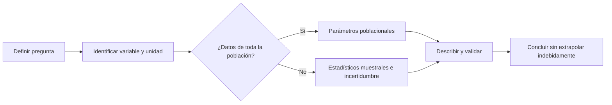
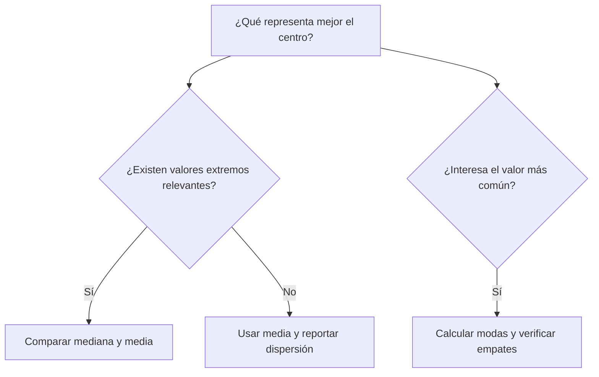
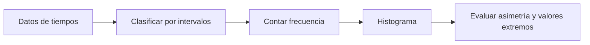
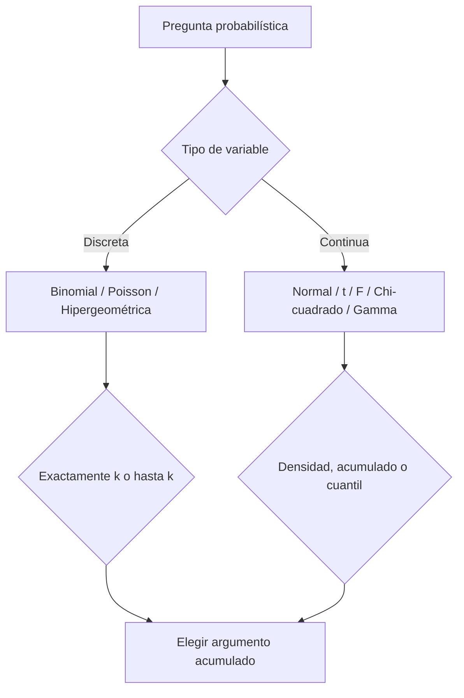
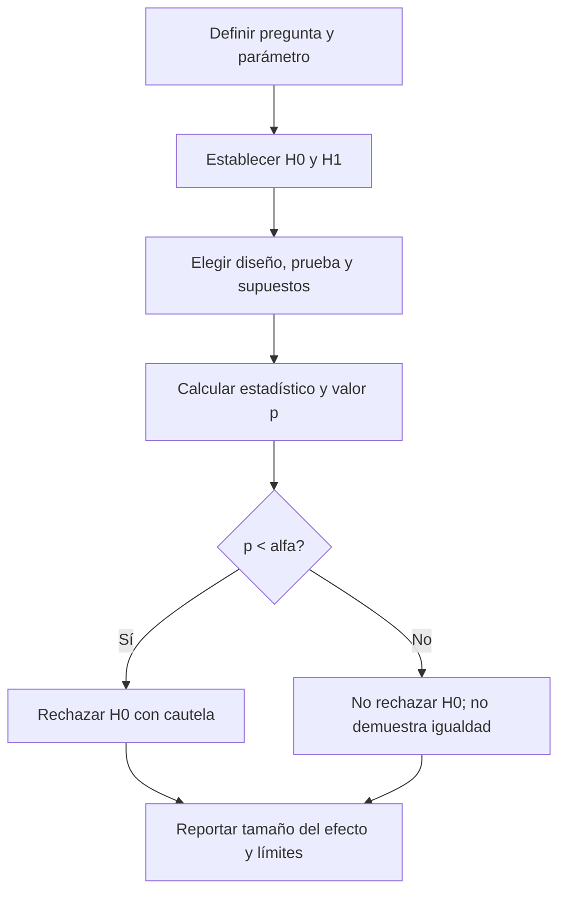
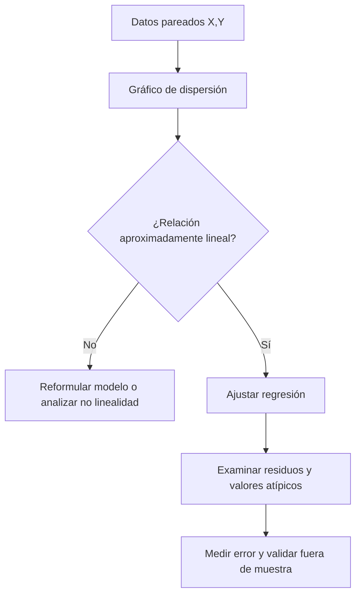
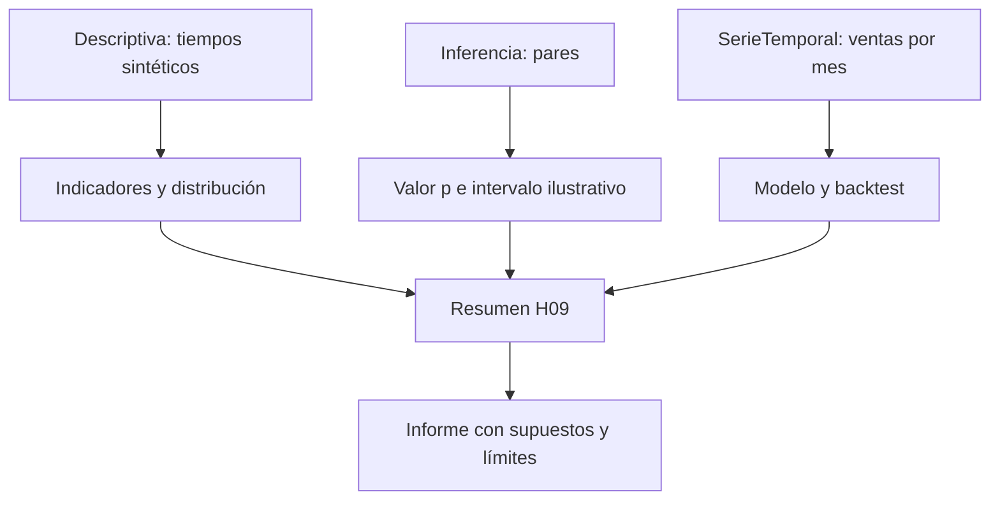

# H09 — Funciones estadísticas y análisis cuantitativo

> **Curso integral de Excel, Google Sheets, VBA y Google Apps Script**  
> **Ruta H — Excel · Módulo H09 de 24 · Roadmap aprobado v2.0**  
> **Nivel:** intermedio y avanzado inicial · **Carga base prevista:** 24 horas + ampliación del catálogo de funciones  
> **Estado editorial:** desarrollado para estudio y revisión; inventario especializado identificado por separado.  
> **Fecha de revisión de fuentes:** 24 de octubre de 2026.

## Cómo utilizar este manual

Este documento es independiente y se puede leer en GitHub, Visual Studio Code o cualquier editor Markdown. Los diagramas en bloques `mermaid` requieren un visor compatible; las capturas se enlazan desde sus sitios de publicación y necesitan conexión. Las figuras conceptuales y capturas reales se identifican claramente.

**Aprendizajes previos:** H05 (fórmulas y referencias), H06 (datos estructurados), H07 (criterios y errores) y H08 (matemáticas). La estadística no equivale a pulsar funciones: exige comprender **población, muestra, supuestos, variabilidad, incertidumbre y validez de la conclusión**.

### Objetivos de aprendizaje

1. Distinguir estadística descriptiva de inferencial y población de muestra.
2. Calcular, interpretar y auditar distribuciones de datos y medidas de dispersión.
3. Trabajar con probabilidades discretas y continuas y explicar los parámetros de sus distribuciones.
4. Formular hipótesis, elegir pruebas adecuadas e interpretar valores p e intervalos de confianza.
5. Evaluar asociación, ajustar regresiones y producir predicciones con limitaciones explícitas.
6. Aplicar validación temporal, métricas de error y prevención de filtración de información.
7. Distinguir la disponibilidad de funciones en Excel y Google Sheets.

### Índice académico (identificadores permanentes)

| Sección | Tema | Subtemas |
|---|---|---|
| **H09.01** Estadística descriptiva | **H09.01.01** Tendencia central | `.01` media; `.02` mediana; `.03` modas |
| | **H09.01.02** Dispersión y posición | `.01` varianza; `.02` desviación estándar; `.03` percentiles, cuartiles y rangos |
| **H09.02** Probabilidad e inferencia | **H09.02.01** Distribuciones | `.01` normal y binomial; `.02` Poisson e hipergeométrica; `.03` t, F, chi-cuadrado y otras |
| | **H09.02.02** Inferencia | `.01` pruebas estadísticas; `.02` intervalos de confianza; `.03` interpretación |
| **H09.03** Análisis relacional y predictivo | **H09.03.01** Relaciones | `.01` correlación; `.02` covarianza; `.03` regresión |
| | **H09.03.02** Predicción | `.01` tendencias y pronósticos; `.02` error y validación; `.03` series temporales |

**Convención regional en ejemplos:** funciones españolas de Excel con `;` como separador de argumentos y `,` como separador decimal (configuración frecuente en español). Los nombres ingleses se presentan por separado; una instalación en inglés normalmente utiliza `,` como separador de argumentos y `.` para decimales. Ajusta la configuración en tu equipo. Los números de resultado se muestran en notación decimal hispana; para copiar valores dentro de rangos, utiliza números enteros siempre que sea posible.

**Versión de referencia:** Excel Microsoft 365 para Windows; se indicarán funciones históricas y excepciones de Excel para web, Mac y otras ediciones. Las fórmulas principales de la categoría estadística están catalogadas oficialmente [MS-STAT]. Google Sheets contiene funciones equivalentes en muchos casos, pero **no asumas que todas las funciones coinciden** [G-FUNC].

---

## Laboratorio base: datos únicos para reproducir resultados

Crea un libro `H09_Laboratorios.xlsx` con hojas `Descriptiva`, `Probabilidad`, `Inferencia`, `Relacion`, `SerieTemporal` y `Proyecto`. En `Descriptiva`, pega la siguiente tabla comenzando en A1:

| A — Obs. | B — Tiempo de entrega (min) | C — Grupo | D — Retraso (sí/no) |
|---:|---:|---|---|
| 1 | 12 | A | No |
| 2 | 15 | B | No |
| 3 | 15 | A | No |
| 4 | 18 | B | No |
| 5 | 20 | A | No |
| 6 | 20 | B | No |
| 7 | 20 | A | No |
| 8 | 22 | B | No |
| 9 | 25 | A | Sí |
| 10 | 33 | B | Sí |

Las mediciones son **sintéticas**, no representan datos reales. El vector B2:B11 tiene suma 200, media 20, mediana 20 y moda única 20. Se utilizará como dataset común para verificar funciones. Asegúrate de introducir números reales y no texto numérico.


*Figura H09-F01 — Esquema conceptual (no captura): la estadística comienza por la pregunta y el origen de los datos.*

**Principio fundamental:** si los 10 pedidos representan **todos** los pedidos del periodo, son una población definida; si representan una selección de un universo mayor, son una muestra. La misma lista numérica puede justificar denominadores diferentes según el alcance del estudio.

---

# H09.01 — Estadística descriptiva

## H09.01.01 — Tendencia central

### H09.01.01.01 — Media

La **media aritmética** resume el centro de un conjunto mediante la suma dividida por la cantidad de valores numéricos. Para n mediciones:

\[\bar{x}=\frac{\sum_{i=1}^n x_i}{n}\]

No significa que un pedido concreto dure exactamente ese tiempo. Tampoco es robusta ante valores atípicos.

**Procedimiento:** (1) identifica la variable y unidad; (2) selecciona B2:B11; (3) escribe `=PROMEDIO(B2:B11)`; (4) verifica con `=SUMA(B2:B11)/CONTAR(B2:B11)`; (5) explica el resultado en minutos. Ambos procedimientos devuelven 20.

**Qué incluye Excel:** `PROMEDIO` omite celdas vacías y texto en un rango referenciado, pero no debes confundirla con `PROMEDIOA`, que trata de manera diferente los textos y los valores lógicos. Los ceros **sí** participan. En promedio simple cada observación recibe el mismo peso; para promedios ponderados se requiere un modelo específico, por ejemplo con `SUMAPRODUCTO` (véase H08).

**Ejemplo empresarial:** tiempos de despacho 12, 15, 15, 18, 20, 20, 20, 22, 25 y 33 min. El promedio es **20 minutos**; los pedidos de 33 y 12 min son relativamente extremos y pueden influir en esa media.

### H09.01.01.02 — Mediana

La **mediana** es el valor central tras ordenar las observaciones. Para n par, es el promedio de los valores centrales. En la secuencia ordenada de ejemplo, las posiciones centrales 5 y 6 son 20 y 20; la mediana es 20.

```excel
=MEDIANA(B2:B11)
```

**Por qué importa:** en sueldos, precios de viviendas o tiempos con valores extremos suele describir mejor el valor típico. Ejemplo extremo: `10, 10, 10, 10, 100`. Media 28, mediana 10. Ninguna medida es universalmente superior: responden a preguntas diferentes.

### H09.01.01.03 — Modas

La **moda** es el valor más frecuente. En B2:B11 aparece 20 tres veces; 15 aparece dos veces. `=MODA.UNO(B2:B11)` devuelve 20.

- `MODA.UNO` (`MODE.SNGL`): devuelve una de las modas; en caso de empates no resume toda la multimodalidad.
- `MODA.VARIOS` (`MODE.MULT`): devuelve las modas múltiples como matriz; su forma de expansión depende de la versión y de la manera de introducir fórmulas matriciales.
- No debe interpretarse un valor numérico como moda única si en realidad hay varias frecuencias máximas.

**Caso real:** conocer el tamaño de empaque más utilizado, la calificación más común o el tiempo de servicio habitual.

### Comparación de las medidas centrales

| Situación | Media | Mediana | Moda | Lectura recomendada |
|---|---:|---:|---|---|
| B2:B11 | 20 | 20 | 20 | Distribución relativamente centrada con cola derecha |
| 10,10,10,10,100 | 28 | 10 | 10 | La media aumenta por el extremo 100 |
| 1,2,3,4 | 2,5 | 2,5 | Sin moda | Todos los valores tienen misma frecuencia |


*Figura H09-F02 — Árbol conceptual de selección de medidas.*

## H09.01.02 — Dispersión y posición

### H09.01.02.01 — Varianza

La varianza mide el promedio de distancias **cuadráticas** respecto de la media. La versión poblacional divide entre N:

\[\sigma^2=\frac{\sum (x_i-\mu)^2}{N}\]

La versión muestral divide entre n−1:

\[s^2=\frac{\sum (x_i-\bar{x})^2}{n-1}\]

El denominador n−1 corrige sesgo de la estimación de la varianza poblacional bajo el supuesto clásico de observaciones independientes e idénticamente distribuidas. No significa que siempre debas elegir n−1.

| Función | Interpretación | Resultado B2:B11 |
|---|---|---:|
| `=VAR.P(B2:B11)` | población | 31,6 min² |
| `=VAR.S(B2:B11)` | muestra | 35,111111 min² |

Unidades al cuadrado: minutos², pesos², etc.; por eso suele ser más interpretable la desviación estándar.

### H09.01.02.02 — Desviación estándar

La desviación estándar es la raíz cuadrada de la varianza. En el conjunto:

- `DESVEST.P` (`STDEV.P`) ≈ **5,621388 min**.
- `DESVEST.M` (`STDEV.S`) ≈ **5,925463 min**.

No equivale al «error estándar de la media». Este último, para una muestra independiente bajo condiciones adecuadas, se estima con `s/RAIZ(n)`, y describe la incertidumbre de la media, no la dispersión entre pedidos.

Otros indicadores:

- **Rango total**: `=MAX(B2:B11)-MIN(B2:B11)` ⇒ 21 min; depende de los extremos.
- **Desviación absoluta media**: `DESVPROM` (`AVEDEV`), promedio de distancias absolutas a la media.
- **Coeficiente de variación**: `=DESVEST.M(B2:B11)/PROMEDIO(B2:B11)` ⇒ aprox. **29,6273 %**; evita usarlo cuando la media esté cerca de cero o en escalas sin cero significativo.
- **Asimetría y curtosis**: estudiar forma, no sustituir inspección gráfica.

### H09.01.02.03 — Percentiles, cuartiles y rangos

Un **percentil** sitúa una observación respecto a la distribución ordenada según una convención de interpolación. No todas las convenciones de cálculo dan idéntico resultado.

```excel
=PERCENTIL.INC(B2:B11;0,25)
=PERCENTIL.INC(B2:B11;0,75)
=CUARTIL.INC(B2:B11;1)
=CUARTIL.INC(B2:B11;3)
```

Resultados para los datos base con método inclusivo de Excel:

| Estadístico | Resultado |
|---|---:|
| P25 / Q1 | 15,75 min |
| P50 / mediana | 20 min |
| P75 / Q3 | 21,5 min |
| Rango intercuartílico (RIC) | 5,75 min |

`PERCENTIL.EXC` y `CUARTIL.EXC` emplean otra convención de cuantiles, con comportamiento distinto especialmente en muestras pequeñas o valores extremos de p. **No mezcles cuantiles INC y EXC dentro de un mismo informe sin documentarlo.**

Para detección exploratoria de valores extremos pueden utilizarse umbrales de Tukey: Q1−1,5·RIC = 7,125 y Q3+1,5·RIC = 30,125. Con ese método, 33 es una observación potencialmente atípica. **No debe borrarse por ser atípica:** comprueba fuente, contexto y significado.

**Funciones de posición:** `JERARQUIA.EQV`, `JERARQUIA.MEDIA`, `K.ESIMO.MAYOR`, `K.ESIMO.MENOR`, `RANGO.PERCENTIL.INC`, `RANGO.PERCENTIL.EXC`, `FRECUENCIA`. Esta última produce intervalos de frecuencias con límites superiores inclusivos, además del grupo de observaciones superiores al último límite.

### Visualización aplicada: histograma y caja


*Figura H09-F03 — Captura real publicada por [Excel Unlocked](https://excelunlocked.com/histogram-chart-in-excel). Observa la selección del tipo «Histograma» en el cuadro de gráficos. No es un resultado de nuestro dataset ni una imagen oficial de Microsoft.*

**Pasos de laboratorio:** selecciona B1:B11 → Insertar → gráfico estadístico → Histograma (si tu versión lo permite) → ajusta intervalos en el eje horizontal. Un histograma representa recuentos de valores en **intervalos**, no categorías arbitrarias. Comprueba que la suma de frecuencias sea 10 y evita elegir intervalos que distorsionen la distribución. [MS-HIST]


*Figura H09-F04 — Flujo conceptual desde observaciones hasta una distribución de frecuencias.*

**Laboratorio H09-L01:** calcula las tres medidas de centro, varianzas, desviaciones, Q1/Q3 y RIC. Verifica por cálculo independiente que la suma de los valores = 200 y que la población contiene 10 observaciones.

### Errores frecuentes en H09.01

| Error | Causa | Diagnóstico | Corrección / prevención |
|---|---|---|---|
| Varianza poblacional usada como muestral | No definir universo | Comparar denominador | Elegir y documentar P o S |
| Desviación mal interpretada como margen de error | Confusión de escala | Revisar fórmula `s/RAIZ(n)` | Reportar claramente ambas magnitudes |
| Media engañosa | Valores extremos | Comparar mediana y percentiles | Acompañar con distribución |
| Moda supuestamente única | Empate de frecuencias | Revisar recuentos | Considerar `MODA.VARIOS` |
| Percentiles inconsistentes | INC vs EXC | Comparar método usado | Fijar un método por proyecto |
| Datos numéricos como texto | Importación mal configurada | `CONTAR` vs `CONTARA` | Validar conversiones según H03 |

---

# H09.02 — Probabilidad e inferencia

## H09.02.01 — Distribuciones

### Fundamentos compartidos: variable aleatoria, eventos y densidad

Una **variable aleatoria** asigna valores a resultados inciertos. Las **discretas** tienen probabilidades puntuales `P(X=k)`; las **continuas** asignan probabilidad a intervalos y usan una densidad cuya área total es 1. Para una continua, `P(X=valor exacto)=0` en el modelo ideal.

- **PMF** (*Probability Mass Function*): función de masa de probabilidad de una discreta.
- **PDF** (*Probability Density Function*): densidad de una continua. Su valor **no es** una probabilidad puntual.
- **CDF** (*Cumulative Distribution Function*): probabilidad acumulada `P(X≤x)`.
- **Cuantil / inversa de distribución:** umbral x que corresponde a determinada probabilidad acumulada.


*Figura H09-F05 — Selección conceptual de distribuciones. El tipo depende también de los supuestos del proceso.*

### H09.02.01.01 — Normal y binomial

**Normal:** distribución continua con media `μ` y desviación `σ>0`. Una variable estándar Z se obtiene mediante `Z=(X−μ)/σ`. En una población modelada como `N(100,15²)`, la probabilidad de superar 130 es aproximadamente 2,275 %:

```excel
=1-DISTR.NORM.N(130;100;15;VERDADERO)
```

La normal es simétrica; no siempre es adecuada para tiempos no negativos con fuerte asimetría o recuentos pequeños. `DISTR.NORM.N(x;media;desv_estándar;acumulado)` (`NORM.DIST`) devuelve probabilidad acumulada si `acumulado=VERDADERO`, o **densidad** si `FALSO`. `INV.NORM` (`NORM.INV`) encuentra cuantiles. `DISTR.NORM.ESTAND.N` (`NORM.S.DIST`) y `INV.NORM.ESTAND` (`NORM.S.INV`) operan sobre Z.

**Binomial:** recuento de éxitos en n ensayos independientes con la **misma** probabilidad p de éxito. Para 5 pedidos, cada uno con p=0,2 de retrasarse, la probabilidad de exactamente 2 retrasos es:

\[P(X=2)=\binom{5}{2}(0,2)^2(0,8)^3=0,2048\]

```excel
=DISTR.BINOM.N(2;5;0,2;FALSO)
```

`VERDADERO` calcularía `P(X≤2)`. Si las probabilidades cambian entre pedidos, o los resultados son dependientes, el modelo binomial puede ser inapropiado. `INV.BINOM` (`BINOM.INV`) retorna cuantiles discretos.

### H09.02.01.02 — Poisson e hipergeométrica

**Poisson:** cuenta eventos en una unidad de tiempo/espacio, con tasa media λ bajo supuestos de independencia y tasa constante. Si llegan en promedio 3 solicitudes por hora, la probabilidad de exactamente 2 es:

\[P(X=2)=e^{-3}\frac{3^2}{2!}\approx0,2240418\]

```excel
=POISSON.DIST(2;3;FALSO)
```

**Hipergeométrica:** recuento de éxitos en una muestra sin reposición tomada de una población finita. Si hay 20 lotes, 5 defectuosos y seleccionas 4 sin reposición, la probabilidad de exactamente 1 defectuoso es:

\[P(X=1)=\frac{\binom 5 1\binom{15}3}{\binom{20}4}\approx0,469556\]

```excel
=DISTR.HIPERGEOM.N(1;4;5;20;FALSO)
```

**Diferencia clave:** la binomial supone ensayos independientes con p fija; la hipergeométrica modela extracción sin reemplazo donde la composición cambia.

### H09.02.01.03 — t, F, chi-cuadrado y otras familias

- **t de Student:** distribución usada con estadísticos de medias cuando la desviación poblacional es desconocida y se cumplen supuestos adecuados. Depende de grados de libertad. Las funciones incluyen `DISTR.T.N`, `DISTR.T.2C`, `DISTR.T.CD`, `INV.T`, `INV.T.2C`, `PRUEBA.T.N` (revisar nombre localizado).
- **F:** cociente de varianzas y análisis de varianza (ANOVA), con dos parámetros de grados de libertad. Funciones: `DISTR.F.CD`, `DISTR.F.RT`, `INV.F`, `INV.F.CD`, `PRUEBA.F.N`.
- **Chi-cuadrado:** contraste de independencia y análisis de variaciones bajo supuestos de frecuencias esperadas adecuadas. Funciones: `DISTR.CHICUAD`, `DISTR.CHICUAD.CD`, `INV.CHICUAD`, `INV.CHICUAD.CD`, `PRUEBA.CHICUAD`.
- **Exponencial, gamma, Weibull:** ejemplos de distribuciones continuas para esperas y fiabilidad; no todas imponen una tasa de fallos constante.
- **Beta:** variable continua acotada entre 0 y 1 (o en otro intervalo mediante reescalado).
- **Lognormal:** positiva y asimétrica, útil cuando el logaritmo se aproxima a una normal.
- **Binomial negativa:** cuenta fracasos hasta un número objetivo de éxitos bajo el modelo adoptado.

**No elijas una distribución porque está disponible en Excel**: primero deben justificarse la naturaleza de la variable, la estructura de muestreo y los supuestos.

## H09.02.02 — Inferencia estadística

### H09.02.02.01 — Pruebas estadísticas

En estadística inferencial una hipótesis nula **H₀** y una alternativa **H₁** plantean proposiciones sobre una población o parámetro. El **valor p** mide cuán incompatibles serían los resultados (o más extremos según el estadístico) con H₀ bajo el modelo estadístico elegido. **No** es la probabilidad de que H₀ sea verdadera.

- **Error tipo I:** rechazar H₀ siendo verdadera; su nivel nominal se controla con α bajo supuestos adecuados.
- **Error tipo II:** no rechazar H₀ cuando la alternativa es cierta.
- **Potencia:** probabilidad de detectar un efecto especificado cuando existe.
- **Tamaño del efecto:** magnitud práctica de la diferencia; no lo sustituye el valor p.


*Figura H09-F06 — Flujo de contraste estadístico; el umbral no reemplaza el juicio sobre diseño y supuestos.*

**Prueba t pareada reproducible:** en `Inferencia`, pon en A2:A6 `11,12,13,14,15` y en B2:B6 `10,11,11,13,14`. Considera los pares como mediciones *antes/después* con diferencias 1,1,2,1,1. La media de diferencias es 1,2, la desviación muestral de diferencias es ≈0,447214, la estadística t es 6 con 4 gl, y el valor p bilateral ≈0,00388254.

La referencia de Microsoft puede presentar un encabezado `PRUEBA.T` para la función nueva pero mostrar sintaxis `PRUEBA.T.N` en el contenido localizado. Para evitar ambigüedades regionales, consulta el autocompletado: en inglés la función moderna es `T.TEST`, y en ejemplos del fabricante aparece `=PRUEBA.T.N(A2:A6;B2:B6;2;1)` [MS-TTEST]. El argumento `tipo=1` indica pares; `colas=2`, contraste bilateral. No confundas un diseño pareado con dos muestras independientes.

### H09.02.02.02 — Intervalos de confianza

Un **intervalo de confianza del 95 %** es un procedimiento que, repetido bajo las mismas condiciones, contiene el parámetro verdadero aproximadamente el 95 % de las veces. Para un intervalo concreto, en la interpretación frecuentista clásica el parámetro está fijo; no se asigna probabilidad 95 % a ese parámetro tras observar los datos.

**Caso A — σ poblacional conocida**, estimación de la media, con condiciones normales/asintóticas pertinentes:

\[\bar{x}\pm z_{1-\alpha/2}\frac{\sigma}{\sqrt{n}}\]

En Excel, `INTERVALO.CONFIANZA.NORM(alfa;desv_estándar;tamaño)` devuelve **solo el margen** (semiancho), no los dos extremos del intervalo. Con α=0,05, σ=2,5 y n=50, margen ≈0,692952 [MS-CONF].

**Caso B — σ desconocida**, bajo condiciones t adecuadas:

\[\bar{x}\pm t_{1-\alpha/2,n-1}\frac{s}{\sqrt{n}}\]

Para los tiempos B2:B11, media 20, s≈5,925463, n=10: margen ≈4,238821 y el intervalo ≈**[15,761; 24,239]** min (suponiendo muestra independiente y modelo adecuado). Una forma reproducible sin depender del nombre localizado de CONFIDENCE.T:

```excel
=PROMEDIO(B2:B11)-INV.T.2C(0,05;CONTAR(B2:B11)-1)*DESVEST.M(B2:B11)/RAIZ(CONTAR(B2:B11))
=PROMEDIO(B2:B11)+INV.T.2C(0,05;CONTAR(B2:B11)-1)*DESVEST.M(B2:B11)/RAIZ(CONTAR(B2:B11))
```

**Limitación didáctica:** la muestra de diez observaciones con cola derecha podría violar la aproximación t normal. Este intervalo es ilustrativo del procedimiento, no una afirmación causal ni una garantía poblacional.

### H09.02.02.03 — Interpretación responsable

1. **Significación estadística ≠ relevancia comercial.** Un efecto minúsculo puede resultar significativo con muchos datos.
2. **No rechazar ≠ demostrar equivalencia.** Para equivalencia deben establecerse márgenes y un contraste apropiado.
3. **Asociación ≠ causalidad.** Diseño y variables de confusión importan.
4. **Pruebas múltiples** aumentan el riesgo de falsos positivos si no se corrige el análisis.
5. **Muestreo sesgado** puede invalidar una estimación aunque las fórmulas funcionen.
6. **Análisis posterior a observar los datos** debe distinguirse de una hipótesis preespecificada.

**Laboratorio H09-L02:** reproduce binomial, Poisson e hipergeométrica; el intervalo t y la prueba t pareada. Contrasta cada probabilidad con su fórmula teórica cuando sea posible.

### Errores frecuentes en H09.02

| Error | Riesgo | Corrección |
|---|---|---|
| Usar densidad como probabilidad | Interpretar una PDF como evento puntual | Usar CDF y restas de acumuladas |
| Usar binomial sin independencia | Probabilidades erróneas | Examinar proceso de generación |
| Elegir t pareada sin pares reales | p incorrecto | Confirmar correspondencia uno a uno |
| Afirmar que p es probabilidad de H0 | Interpretación falsa | Explicar probabilidad condicional de los datos |
| Confundir margen con intervalo | Intervalos incompletos | Reportar centro ± margen |
| Declarar certeza a partir de p≥0,05 | Sobreinterpretación | Reportar incertidumbre y potencia |

---

# H09.03 — Análisis relacional y predictivo

## H09.03.01 — Relaciones

Construye la hoja `Relacion` con:

| Fila | A — Semana X | B — Ventas Y (miles MXN) |
|---:|---:|---:|
| 2 | 1 | 11 |
| 3 | 2 | 13 |
| 4 | 3 | 14 |
| 5 | 4 | 18 |
| 6 | 5 | 19 |
| 7 | 6 | 24 |

### H09.03.01.01 — Correlación

El coeficiente de Pearson `r` mide intensidad y dirección de la asociación **lineal** entre pares numéricos. Varía entre −1 y +1 (si ambas variables tienen varianza positiva). No mide causalidad, ni detecta de manera adecuada todas las relaciones no lineales.

```excel
=COEF.DE.CORREL(A2:A7;B2:B7)
=PEARSON(A2:A7;B2:B7)
```

En los datos de ejemplo, `r ≈ 0,976051`, una relación lineal positiva fuerte **dentro del conjunto observado**. No justifica afirmar que aumentar el número de semana *causará* más ventas.

### H09.03.01.02 — Covarianza

La covarianza comparte el signo de la tendencia conjunta, pero su magnitud depende de las unidades de medición. La versión muestral:

\[s_{XY}=\frac{\sum_i(x_i-\bar{x})(y_i-\bar{y})}{n-1}\]

```excel
=COVARIANZA.M(A2:A7;B2:B7)
=COVARIANZA.P(A2:A7;B2:B7)
```

**Interpretación:** covarianza positiva ⇒ los incrementos sobre la media de X tienden a coincidir con incrementos sobre la media de Y. No permite comparar intensidades entre pares con distintas unidades sin normalizar.

### H09.03.01.03 — Regresión

La regresión lineal simple plantea:

\[\hat{y}=a+bx\]

con b pendiente (cambio medio estimado de Y por unidad de X) y a intercepto (predicción en X=0, que puede no ser relevante si X=0 está fuera del rango). `PENDIENTE(datos_y;datos_x)` y `INTERSECCION.EJE(datos_y;datos_x)` recuperan parámetros. En estos datos:

- b ≈ **2,485714** miles MXN/semana.
- a = **7,8** miles MXN.
- R² ≈ **0,952675** (proporción de variación de Y explicada *dentro de la muestra* por el modelo lineal).
- Predicción para semana 7 = **25,2** miles MXN (extrapolación de solo un periodo, no garantía).

```excel
=PENDIENTE(B2:B7;A2:A7)
=INTERSECCION.EJE(B2:B7;A2:A7)
=COEFICIENTE.R2(B2:B7;A2:A7)
=PRONOSTICO.LINEAL(7;B2:B7;A2:A7)
```

`ESTIMACION.LINEAL` (`LINEST`) permite recuperar varios coeficientes y estadísticas bajo la forma matricial apropiada; requiere cuidar la organización de entradas y resultados. `ERROR.TIPICO.XY` (`STEYX`) resume el error residual típico del ajuste, pero no es una garantía sobre cada predicción.


*Figura H09-F07 — Captura real publicada por [Storytelling With Data](https://www.storytellingwithdata.com/blog/how-to-make-a-scatter-plot-in-excel). Muestra la opción de tendencia lineal de un gráfico de dispersión; los datos fotografiados no corresponden a la práctica.*

**Procedimiento:** selecciona A1:B7 → Insertar → Dispersión (XY) → abre elementos del gráfico → Línea de tendencia lineal → mostrar ecuación y R² donde se encuentre la opción → compara coeficientes con funciones. Si observas curvas, patrones en residuos o valores influyentes, la línea puede no ser adecuada.


*Figura H09-F08 — Esquema conceptual para construir modelos explicativos.*

## H09.03.02 — Predicción

### H09.03.02.01 — Tendencias y pronósticos

`PRONOSTICO.LINEAL` (`FORECAST.LINEAR`) calcula una proyección basada en regresión. `TENDENCIA` (`TREND`) puede producir varios valores. `CRECIMIENTO` (`GROWTH`) estima una tendencia exponencial cuando el modelo es apropiado. No equivale a una función de predicción temporal con estacionalidad.

Excel también documenta `PRONOSTICO.ETS` (`FORECAST.ETS`) y funciones asociadas para modelos de suavizamiento exponencial triple cuando la línea temporal es regular. **Microsoft indica que PRONOSTICO.ETS no está disponible en Excel para la web, iOS o Android** [MS-ETS]. Antes de usarla, verifica la instalación de escritorio y la regularidad de fechas.

### H09.03.02.02 — Error y validación

Nunca evalúes una predicción solo con los puntos utilizados para construirla si quieres estimar su capacidad futura. Divide datos en entrenamiento y validación, especialmente respetando el tiempo en una serie temporal.

Métricas:

\[MAE=\frac{1}{n}\sum|y_i-\hat y_i|\]

\[MSE=\frac{1}{n}\sum(y_i-\hat y_i)^2\qquad RMSE=\sqrt{MSE}\]

\[MAPE=\frac{100}{n}\sum\left|\frac{y_i-\hat y_i}{y_i}\right|\]

**Limitación de MAPE:** no se define cuando un real es 0 y se vuelve inestable con valores cercanos a cero. Para ventas muy bajas o intermitentes, considera otras métricas y revisa sesgo.

**Ejemplo de validación:** reales 100, 120 y 80; pronósticos 90, 125 y 85. Errores absolutos 10, 5 y 5; MAE=20/3≈6,6667; MSE=(100+25+25)/3=50; RMSE≈7,0711. Un valor bajo solo es útil comparado con un modelo base y la escala de la variable.

### H09.03.02.03 — Series temporales

Una serie temporal registra observaciones ordenadas en el tiempo. Componentes que puede contener: nivel, tendencia, estacionalidad, ruido y cambios estructurales. Un ajuste de tendencia sin modelar estacionalidad puede producir previsiones sesgadas.

**Buenas prácticas operativas:**

1. Mantén una frecuencia temporal regular y fechas reales, no texto.
2. No utilices ventas del futuro para construir características del pasado (*data leakage*).
3. Separa entrenamiento y test cronológicamente.
4. Calcula pronósticos base (último valor o promedio histórico) antes de un modelo sofisticado.
5. Usa ventanas de validación desplazadas (*rolling origin*) cuando tengas suficientes datos.
6. Examina cambios de régimen, promociones, quiebres de stock y meses faltantes.
7. Documenta hipótesis, horizonte, unidades y fecha de actualización.


*Figura H09-F09 — Validación temporal: evitar entrenar con información que se conocerá después.*

**Laboratorio H09-L03:** ajusta el modelo semanal, elabora el gráfico de dispersión, calcula MAE de una pequeña serie y documenta el riesgo de extrapolar tendencias demasiado lejos. La implementación y evaluación sofisticadas de series se expandirán al abordar modelos analíticos y automatización.

### Errores frecuentes H09.03

| Error | Efecto | Mejora |
|---|---|---|
| Correlación = causalidad | Conclusión injustificada | Examinar confusores y diseño |
| Regresión sin revisar residuales | Mal ajuste no detectado | Analizar residuos, intervalos y atípicos |
| Pronosticar lejos del dominio observado | Extrapolación arriesgada | Limitar horizonte y validar |
| Entrenar con observaciones futuras | Métricas artificialmente optimistas | Separación temporal |
| Usar MAPE con ceros | División por cero | Elegir métrica apropiada |
| Ignorar estacionalidad | Pronóstico sesgado | Evaluar modelos estacionales cuando existan suficientes datos |

---


# Apéndice A — Fichas técnicas de funciones estadísticas

Estas fichas desarrollan funciones centrales; el **inventario completo de categorías** se presenta en el apéndice B. Una función inventariada **no** se considera estudiada individualmente hasta cubrir sus argumentos, casos, limitaciones y un ejercicio. Cuando Excel en inglés y español comparten semántica, solo cambia el nombre local y la convención regional; las equivalencias con Google Sheets se verifican individualmente cuando se trabaja en la ruta G.

**Estructura de cada ficha:** nombre ES/EN, categoría, finalidad, sintaxis, argumentos obligatorios y opcionales, valor devuelto, tres escenarios (básico, intermedio, profesional), interpretación, errores, alternativas, compatibilidad y práctica dirigida. Las fichas de este apéndice son versiones formativas y no sustituyen el detalle completo de la referencia oficial.

## A.1 PROMEDIO / AVERAGE — tendencia central

- **Categoría:** estadística descriptiva. **Propósito:** media aritmética de argumentos numéricos.
- **Sintaxis ES:** `PROMEDIO(número1;[número2];…)`. Obligatorio `número1`; los siguientes argumentos son opcionales. Cada argumento puede ser número, referencia o rango.
- **Devuelve:** número, o error si no hay datos numéricos válidos.
- **Básico:** `=PROMEDIO(10;20;30)` → 20.
- **Intermedio:** `=PROMEDIO(B2:B11)` → 20 minutos.
- **Profesional:** medir el tiempo promedio de despacho por una ventana de operaciones, sin confundirlo con el porcentaje de puntualidad.
- **Interpretación:** tiempo medio por pedido observado.
- **Errores:** no incluye cadenas de texto en rangos, pero sí incluye ceros; valores convertidos a texto pueden sesgar la muestra.
- **Alternativas y relacionadas:** `PROMEDIOA`, `PROMEDIO.SI` y `PROMEDIO.SI.CONJUNTO` (H07); `MEDIANA`.
- **Sheets / compatibilidad:** existe `AVERAGE` y su equivalente localizado según configuración de idioma; corroborar separadores en la aplicación. Disponible en ediciones modernas de Excel.
- **Practica:** agregar un pedido de 40 min y comparar la nueva media con la mediana.

## A.2 MEDIANA / MEDIAN — tendencia central robusta

- **Sintaxis:** `MEDIANA(número1;[número2];…)` con primer argumento obligatorio y otros opcionales; devuelve número.
- **Básico:** `=MEDIANA(2;3;99)` → 3.
- **Intermedio:** `=MEDIANA(B2:B11)` → 20.
- **Profesional:** resumen de tiempos de entrega con posibles retrasos extremos.
- **Interpretación:** mitad de las observaciones queda a cada lado (en el sentido de orden estadístico).
- **Errores:** no asumir que mediana y media coinciden; evitar interpretar cadenas como números.
- **Alternativas:** `PROMEDIO`, percentiles 0,5. **Sheets:** `MEDIAN`/`MEDIANA`, sujeto a idioma y localización.
- **Práctica:** usa `5,6,7,100` y explica por qué la mediana es 6,5.

## A.3 MODA.UNO / MODE.SNGL — valor más frecuente

- **Sintaxis:** `MODA.UNO(número1;[número2];…)` → número o error si ningún valor se repite.
- **Básico:** `=MODA.UNO(1;2;2;3)` → 2.
- **Intermedio:** `=MODA.UNO(B2:B11)` → 20.
- **Profesional:** identificar la cantidad más solicitada por pedido en un almacén.
- **Errores:** no resuelve por sí misma un conjunto multimodal; no confundir con el promedio.
- **Alternativas:** `MODA.VARIOS` (`MODE.MULT`). **Sheets:** MODE y variantes según catálogo e idioma.
- **Práctica:** determina las dos modas de `2,2,3,3,5` y explica la limitación de MODA.UNO.

## A.4 VAR.S / VAR.S — varianza muestral

- **Sintaxis:** `VAR.S(número1;[número2];…)`; primera observación obligatoria, restantes opcionales; requiere suficientes datos numéricos (al menos dos).
- **Resultado:** número no negativo en unidades al cuadrado. `=VAR.S(B2:B11)` → 35,111111 min².
- **Básico:** `=VAR.S(1;2;3)` → 1.
- **Intermedio:** comparar con `VAR.P(B2:B11)` → 31,6.
- **Profesional:** cuantificar variación en una muestra de tiempos del servicio.
- **Errores:** utilizarla sobre población completa si el objetivo era el parámetro poblacional, ignorar atípicos, mezclar unidades.
- **Alternativas:** `VAR.P`, `DESVEST.M`. **Sheets:** `VAR.S` documentada.
- **Práctica:** calcula con `SUMA((x-media)^2)/(n-1)` manualmente para tres puntos.

## A.5 VAR.P / VAR.P — varianza poblacional

- **Sintaxis:** `VAR.P(número1;[número2];…)` → número no negativo; requiere al menos una observación numérica.
- **Básico:** `=VAR.P(1;2;3)` → 0,666667.
- **Intermedio:** `=VAR.P(B2:B11)` → 31,6.
- **Profesional:** dispersión de todos los tiempos observados en un periodo cerrado.
- **Errores:** no interpretar `VAR.P` como estimador insesgado en muestras del universo más amplio.
- **Alternativas:** `VAR.S`, `DESVEST.P`. **Sheets:** `VAR.P` documentada.
- **Práctica:** explica por qué cambia el denominador al pasar de P a S.

## A.6 DESVEST.M / STDEV.S — desviación estándar muestral

- **Sintaxis:** `DESVEST.M(número1;[número2];…)` → número no negativo en unidades originales; mínimo dos valores numéricos.
- **Básico:** `=DESVEST.M(1;2;3)` → 1.
- **Intermedio:** `=DESVEST.M(B2:B11)` → 5,925463 min.
- **Profesional:** describir variación de tiempos entre pedidos.
- **Errores:** confundir con error estándar `s/√n` o afirmar que la mayoría de casos cae en ±1s sin distribución pertinente.
- **Alternativas:** `DESVEST.P`, `VAR.S`, `DESVPROM`. **Sheets:** `STDEV.S`/equivalente localizado.
- **Práctica:** comprueba `=RAIZ(VAR.S(B2:B11))`.

## A.7 DESVEST.P / STDEV.P — desviación estándar poblacional

- **Sintaxis:** `DESVEST.P(número1;[número2];…)` → número no negativo.
- **Básico:** `=DESVEST.P(1;2;3)` → 0,816497.
- **Intermedio:** `=DESVEST.P(B2:B11)` → 5,621388 min.
- **Profesional:** resumir todo el universo medido durante un turno.
- **Errores:** aplicar inadvertidamente P a una muestra sin justificarla.
- **Alternativas:** `DESVEST.M`, `VAR.P`. **Sheets:** `STDEV.P`/equivalente.
- **Práctica:** compara P contra M al aumentar n y manteniendo dispersión parecida.

## A.8 PERCENTIL.INC / PERCENTILE.INC — posición en una distribución

- **Sintaxis:** `PERCENTIL.INC(matriz;k)`; ambos obligatorios, `k` entre 0 y 1 inclusive; devuelve número interpolado.
- **Básico:** `=PERCENTIL.INC(B2:B11;0,5)` → 20.
- **Intermedio:** `=PERCENTIL.INC(B2:B11;0,75)` → 21,5.
- **Profesional:** definir umbral de desempeño de entregas (por ejemplo, p75), no confundirlo con un máximo garantizado.
- **Errores:** expresar 75 en lugar de 0,75; mezclar convenciones; inferir probabilidad futura automáticamente de una muestra pequeña.
- **Alternativas:** `PERCENTIL.EXC`, `CUARTIL.INC`. **Sheets:** `PERCENTILE` y `PERCENTILE.INC`/localización según catálogo.
- **Práctica:** calcula p25, p50, p75 y RIC.

## A.9 CUARTIL.INC / QUARTILE.INC — cuartiles inclusivos

- **Sintaxis:** `CUARTIL.INC(matriz;cuartil)`, cuartil entero de 0 a 4; devuelve número.
- **Básico:** `=CUARTIL.INC(B2:B11;2)` → 20.
- **Intermedio:** Q1 = 15,75 y Q3 = 21,5.
- **Profesional:** construir resumen de cinco números para servicio/logística.
- **Errores:** ignorar la metodología de interpolación; presentar Q1/Q3 como únicos posibles.
- **Alternativas:** `CUARTIL.EXC`, `PERCENTIL.INC`. **Sheets:** familia `QUARTILE`/equivalentes.
- **Práctica:** calcula umbrales de valores atípicos 1,5·RIC.

## A.10 FRECUENCIA / FREQUENCY — conteos por intervalos

- **Sintaxis:** `FRECUENCIA(datos;grupos)`; ambos obligatorios y en forma de rangos o matrices; devuelve matriz vertical con un grupo adicional de valores superiores al último límite.
- **Básico:** datos `1,2,3,4,5`, límites `2,4` ⇒ grupos `2,2,1`.
- **Intermedio:** sobre B2:B11 con límites 15,20,25 ⇒ frecuencias **3,4,2,1** (≤15; >15–20; >20–25; >25).
- **Profesional:** preparar tablas de frecuencias para un histograma y verificar suma contra `CONTAR`.
- **Errores:** perder el último grupo o asumir que los límites inferiores están incluidos.
- **Alternativas:** histogramas de Excel y `CONTAR.SI.CONJUNTO`. **Sheets:** `FREQUENCY` documentada.
- **Práctica:** compara el total de las cuatro frecuencias con 10.

## A.11 DISTR.NORM.N / NORM.DIST — normal

- **Sintaxis:** `DISTR.NORM.N(x;media;desv_estándar;acumulado)`, cuatro argumentos obligatorios; desv_estándar > 0 y acumulado lógico.
- **Devuelve:** CDF si verdadero, densidad si falso.
- **Básico:** `=DISTR.NORM.N(100;100;15;VERDADERO)` → 0,5.
- **Intermedio:** `=1-DISTR.NORM.N(130;100;15;VERDADERO)` → ≈0,0227501.
- **Profesional:** estimar proporción teórica de componentes que supera una tolerancia, tras validar ajuste normal.
- **Errores:** leer densidad como probabilidad; confundir σ con varianza.
- **Alternativas:** `INV.NORM`, `DISTR.NORM.ESTAND.N`, `NORMALIZACION`. **Sheets:** `NORMDIST` y variantes localizadas según versión/idioma.
- **Práctica:** determina la proporción entre 85 y 115 para N(100,15²).

## A.12 DISTR.BINOM.N / BINOM.DIST — binomial

- **Sintaxis:** `DISTR.BINOM.N(núm_éxitos;ensayos;prob_éxito;acumulado)`. Cuatro argumentos obligatorios; recuentos enteros y p∈[0,1].
- **Devuelve:** probabilidad puntual o acumulada.
- **Básico:** `=DISTR.BINOM.N(2;5;0,2;FALSO)` → 0,2048.
- **Intermedio:** `=DISTR.BINOM.N(2;5;0,2;VERDADERO)` → P(X≤2)=0,94208.
- **Profesional:** retrasos en pedidos independientes con igual riesgo.
- **Errores:** ensayos dependientes o distintas probabilidades por pedido.
- **Alternativas:** `INV.BINOM`, `DISTR.BINOM.SERIE`. **Sheets:** familia `BINOMDIST` y `BINOM.DIST` según idioma/catálogo.
- **Práctica:** calcula probabilidad de ≥1 retraso: `1-P(X=0)`.

## A.13 POISSON.DIST / POISSON.DIST — eventos por intervalo

- **Sintaxis:** `POISSON.DIST(x;media;acumulado)`, tres argumentos obligatorios, x entero no negativo y media positiva.
- **Básico:** `=POISSON.DIST(2;3;FALSO)` → ≈0,2240418.
- **Intermedio:** `=1-POISSON.DIST(2;3;VERDADERO)` ⇒ probabilidad de 3 o más eventos.
- **Profesional:** llamadas por hora en un sistema con intensidad aproximadamente estable.
- **Errores:** usar Poisson si las tasas cambian drásticamente o los eventos están agrupados.
- **Alternativas:** binomial para ensayos fijos, modelos de tasa variable. **Sheets:** `POISSON`/variante localizada.
- **Práctica:** estima la probabilidad de cero llamadas en una hora con λ=3.

## A.14 DISTR.HIPERGEOM.N / HYPGEOM.DIST — muestreo sin reposición

- **Sintaxis:** `DISTR.HIPERGEOM.N(éxitos_muestra;tamaño_muestra;éxitos_población;tamaño_población;acumulado)`; cinco obligatorios, coherencia de tamaños y recuentos.
- **Básico:** `=DISTR.HIPERGEOM.N(1;4;5;20;FALSO)` → ≈0,469556.
- **Intermedio:** acumulado verdadero para P(X≤1).
- **Profesional:** control de lotes defectuosos en inventario finito.
- **Errores:** tratar extracción sin reposición como binomial exacta cuando la fracción de muestreo importa.
- **Alternativas:** `DISTR.BINOM.N` con reposición o aproximación justificada. **Sheets:** familia hipergeométrica presente; revisar nombre concreto.
- **Práctica:** calcula P(X=0) para misma población y muestra.

## A.15 PRUEBA.T.N / T.TEST — contraste t de medias

- **Sintaxis:** `PRUEBA.T.N(matriz1;matriz2;colas;tipo)` según la referencia localizada vigente [MS-TTEST]. Los cuatro argumentos son obligatorios; colas∈{1,2}, tipo∈{1,2,3}.
- **Devuelve:** valor p del contraste bajo los supuestos elegidos.
- **Básico:** reproducir dos arreglos pareados A2:A6 y B2:B6 del laboratorio.
- **Intermedio:** `=PRUEBA.T.N(A2:A6;B2:B6;2;1)` → ≈0,00388254.
- **Profesional:** análisis antes/después sobre las mismas unidades con supuestos sobre las diferencias.
- **Errores:** elegir tipo=2 para pares o confundir diferencia estadísticamente detectable con impacto suficiente.
- **Alternativas:** pruebas robustas/no paramétricas fuera de la función, intervalos de diferencia. **Sheets:** `TTEST` y función localizada equivalente según catálogo.
- **Práctica:** explica cuál es el n del contraste: son **5 pares**, no 10 observaciones independientes.

## A.16 INTERVALO.CONFIANZA.NORM / CONFIDENCE.NORM — margen normal

- **Sintaxis:** `INTERVALO.CONFIANZA.NORM(alfa;desv_estándar;tamaño)`, tres obligatorios; 0<alfa<1, desviación positiva, tamaño válido.
- **Devuelve:** **semiancho**, no extremos del intervalo.
- **Básico:** `=INTERVALO.CONFIANZA.NORM(0,05;2,5;50)` → ≈0,692952.
- **Intermedio:** formar `media−margen` y `media+margen`.
- **Profesional:** estimación de tiempo medio cuando σ poblacional conocida es defendible.
- **Errores:** introducir s muestral como si fuera σ conocida sin justificar la aproximación; interpretar como intervalo predictivo individual.
- **Alternativas:** `INTERVALO.CONFIANZA.T`, `INV.T.2C`. **Sheets:** familias CONFIDENCE y CONFIDENCE.T documentadas.
- **Práctica:** centra el intervalo alrededor de media 30: aprox. [29,3070;30,6930].

## A.17 COEF.DE.CORREL / CORREL — Pearson

- **Sintaxis:** `COEF.DE.CORREL(matriz1;matriz2)`; dos rangos pareados obligatorios, misma longitud y varianza positiva.
- **Devuelve:** número entre −1 y 1 o error si datos insuficientes / constantes.
- **Básico:** `=COEF.DE.CORREL(A2:A7;B2:B7)` en hoja Relacion ⇒ ≈0,976051.
- **Intermedio:** contrasta `PEARSON(A2:A7;B2:B7)`.
- **Profesional:** explorar asociación entre inversión comercial y ventas, sin confundirla con efecto causal.
- **Errores:** emparejamiento incorrecto de filas; outliers; confusión de variables; relaciones curvas.
- **Alternativas:** gráficos XY, Spearman (requiere calcular rangos), regresión. **Sheets:** `CORREL` y equivalente localizado.
- **Práctica:** reordena Y sin reordenar X y explica por qué cambia r.

## A.18 COVARIANZA.M / COVARIANCE.S — covarianza muestral

- **Sintaxis:** `COVARIANZA.M(matriz1;matriz2)`; dos vectores pareados obligatorios con al menos dos pares válidos.
- **Básico:** `=COVARIANZA.M(A2:A7;B2:B7)` sobre Relacion.
- **Intermedio:** comparar covarianza y correlación tras multiplicar todas las ventas por 1000.
- **Profesional:** evaluar el signo de comovimientos entre indicadores.
- **Devuelve:** número con unidades multiplicadas (unidad X × unidad Y).
- **Errores:** comparar magnitudes entre escalas diferentes.
- **Alternativas:** `COVARIANZA.P`, `COEF.DE.CORREL`. **Sheets:** COVAR y variantes.
- **Práctica:** explica por qué el coeficiente r se mantiene si multiplicas Y por 1000 positivo.

## A.19 PENDIENTE / SLOPE — pendiente de regresión

- **Sintaxis:** `PENDIENTE(conocido_y;conocido_x)`; dos rangos obligatorios y pareados.
- **Básico:** `=PENDIENTE(B2:B7;A2:A7)` → 2,485714.
- **Intermedio:** combina con `INTERSECCION.EJE` para pronosticar semana 7.
- **Profesional:** estimar cambio medio por semana dentro de un periodo.
- **Devuelve:** número en unidades de Y por unidad de X.
- **Errores:** invertir X/Y; interpretar extrapolación como hecho futuro.
- **Alternativas:** `ESTIMACION.LINEAL`, `PRONOSTICO.LINEAL`. **Sheets:** SLOPE/PENDIENTE.
- **Práctica:** explica cómo cambia la pendiente si expresas Y en pesos en lugar de miles de pesos.

## A.20 INTERSECCION.EJE / INTERCEPT — intercepto de regresión

- **Sintaxis:** `INTERSECCION.EJE(conocido_y;conocido_x)`; dos rangos obligatorios.
- **Básico:** con Relacion devuelve 7,8.
- **Intermedio:** `=INTERSECCION.EJE(B2:B7;A2:A7)+7*PENDIENTE(B2:B7;A2:A7)` → 25,2.
- **Profesional:** completar ecuación de tendencia para planeación de corto plazo.
- **Errores:** interpretar el valor en X=0 como observable si está fuera del dominio.
- **Alternativas:** `ESTIMACION.LINEAL`, `PRONOSTICO.LINEAL`. **Sheets:** INTERCEPT y equivalente.
- **Práctica:** explica por qué semana 0 debe tratarse con cautela.

## A.21 COEFICIENTE.R2 / RSQ — proporción explicada en regresión lineal simple

- **Sintaxis:** `COEFICIENTE.R2(conocido_y;conocido_x)`; dos rangos obligatorios.
- **Básico:** con Relacion: ≈0,952675.
- **Intermedio:** comprobar que `COEF.DE.CORREL(A2:A7;B2:B7)^2` da el mismo resultado dentro del caso lineal simple con intercepto.
- **Profesional:** comparar ajuste dentro de muestra con restricciones explícitas.
- **Errores:** concluir que el modelo predice un 95 % de todos los futuros valores; ignorar validación fuera de muestra.
- **Alternativas:** análisis residual, métricas de validación. **Sheets:** RSQ y variantes.
- **Práctica:** explica por qué un R² alto puede coexistir con un problema causal.

## A.22 PRONOSTICO.LINEAL / FORECAST.LINEAR — proyección lineal

- **Sintaxis:** `PRONOSTICO.LINEAL(x;conocido_y;conocido_x)`; tres argumentos obligatorios.
- **Básico:** `=PRONOSTICO.LINEAL(7;B2:B7;A2:A7)` → 25,2.
- **Intermedio:** compara contra intercepto + pendiente × 7.
- **Profesional:** proyectar ventas de la siguiente semana con horizonte limitado.
- **Devuelve:** número de la misma unidad que Y.
- **Errores:** utilizarla ante fuerte estacionalidad, cambio estructural, pocos datos o largas extrapolaciones.
- **Alternativas:** `TENDENCIA`, `PRONOSTICO.ETS` si cumple requisitos y versión. **Sheets:** FORECAST y variantes; no atribuir ETS como idéntica sin comprobar.
- **Práctica:** estima el valor de la semana 8 y explica por qué la incertidumbre aumenta.

**Nota editorial de cobertura:** las fichas A.1–A.22 cubren 22 funciones seleccionadas. Otras funciones aparecen en el inventario B como *pendientes de ficha extensa*, con un criterio explícito para su posterior desarrollo. Las fichas no equivalen todavía al 100 % de la categoría estadística.

---
# Apéndice B — Inventario de cobertura de funciones estadísticas

**Fuente de enumeración:** [Microsoft — Funciones estadísticas (referencia)](https://support.microsoft.com/es-es/excel/statistical-functions-reference). La documentación oficial también puede presentar funciones heredadas en la categoría «Compatibilidad». Los nombres siguientes se transcriben según la categoría española publicada; un nombre no confirmado para tu instalación debe contrastarse con el autocompletado de Excel. Se emplea `F` para función con ficha técnica en el apéndice A, `I` para identificada pero pendiente de ficha individual extensa, y `R` para función cuya ficha didáctica principal corresponde a otro módulo aprobado (referencia cruzada). **Ninguna `I` se cuenta como unidad completada.**

### B.1 Estadística descriptiva, ranking y conteos

| Función ES | Nombre EN | Estado | Destino principal |
|---|---|---|---|
| PROMEDIO | AVERAGE | F | H09.01.01.01 |
| PROMEDIOA | AVERAGEA | I | H09.01.01.01 |
| MEDIANA | MEDIAN | F | H09.01.01.02 |
| MODA.UNO | MODE.SNGL | F | H09.01.01.03 |
| MODA.VARIOS | MODE.MULT | I | H09.01.01.03 |
| MEDIA.GEOM | GEOMEAN | I | H09.01.01.01 |
| MEDIA.ARMO | HARMEAN | I | H09.01.01.01 |
| MEDIA.ACOTADA | TRIMMEAN | I | H09.01.01.01 |
| MAX | MAX | R | H08 / H09.01.02.03 |
| MAXA | MAXA | I | H09.01.02.03 |
| MAX.SI.CONJUNTO | MAXIFS | I | H09.01.02.03 |
| MIN | MIN | R | H08 / H09.01.02.03 |
| MINA | MINA | I | H09.01.02.03 |
| MIN.SI.CONJUNTO | MINIFS | I | H09.01.02.03 |
| CONTAR | COUNT | R | H07 / H09.01 |
| CONTARA | COUNTA | R | H07 / H09.01 |
| CONTAR.BLANCO | COUNTBLANK | R | H07 / H09.01 |
| CONTAR.SI | COUNTIF | R | H07 |
| CONTAR.SI.CONJUNTO | COUNTIFS | R | H07 |
| PROMEDIO.SI | AVERAGEIF | R | H07 |
| PROMEDIO.SI.CONJUNTO | AVERAGEIFS | R | H07 |
| VAR.S | VAR.S | F | H09.01.02.01 |
| VAR.P | VAR.P | F | H09.01.02.01 |
| VARA | VARA | I | H09.01.02.01 |
| VARPA | VARPA | I | H09.01.02.01 |
| DESVEST.M | STDEV.S | F | H09.01.02.02 |
| DESVEST.P | STDEV.P | F | H09.01.02.02 |
| DESVESTA | STDEVA | I | H09.01.02.02 |
| DESVESTPA | STDEVPA | I | H09.01.02.02 |
| DESVPROM | AVEDEV | I | H09.01.02.02 |
| DESVIA2 | DEVSQ | I | H09.01.02.02 |
| CURTOSIS | KURT | I | H09.01.02.02 |
| COEFICIENTE.ASIMETRIA | SKEW | I | H09.01.02.02 |
| COEFICIENTE.ASIMETRIA.P | SKEW.P | I | H09.01.02.02 |
| PERCENTIL.INC | PERCENTILE.INC | F | H09.01.02.03 |
| PERCENTIL.EXC | PERCENTILE.EXC | I | H09.01.02.03 |
| CUARTIL.INC | QUARTILE.INC | F | H09.01.02.03 |
| CUARTIL.EXC | QUARTILE.EXC | I | H09.01.02.03 |
| RANGO.PERCENTIL.INC | PERCENTRANK.INC | I | H09.01.02.03 |
| RANGO.PERCENTIL.EXC | PERCENTRANK.EXC | I | H09.01.02.03 |
| JERARQUIA.EQV | RANK.EQ | I | H09.01.02.03 |
| JERARQUIA.MEDIA | RANK.AVG | I | H09.01.02.03 |
| K.ESIMO.MAYOR | LARGE | I | H09.01.02.03 |
| K.ESIMO.MENOR | SMALL | I | H09.01.02.03 |
| FRECUENCIA | FREQUENCY | F | H09.01.02.03 |
| NORMALIZACION | STANDARDIZE | I | H09.01.02.02 |

### B.2 Distribuciones e inferencia

| Función ES | Nombre EN | Estado | Destino principal |
|---|---|---|---|
| DISTR.BETA | BETA.DIST | I | H09.02.01.03 |
| DISTR.BETA.INV | BETA.INV | I | H09.02.01.03 |
| DISTR.BINOM.N | BINOM.DIST | F | H09.02.01.01 |
| DISTR.BINOM.SERIE | BINOM.DIST.RANGE | I | H09.02.01.01 |
| INV.BINOM | BINOM.INV | I | H09.02.01.01 |
| DISTR.NORM.N | NORM.DIST | F | H09.02.01.01 |
| INV.NORM | NORM.INV | I | H09.02.01.01 |
| DISTR.NORM.ESTAND.N | NORM.S.DIST | I | H09.02.01.01 |
| INV.NORM.ESTAND | NORM.S.INV | I | H09.02.01.01 |
| FI | PHI | I | H09.02.01.01 |
| GAUSS | GAUSS | I | H09.02.01.01 |
| POISSON.DIST | POISSON.DIST | F | H09.02.01.02 |
| DISTR.HIPERGEOM.N | HYPGEOM.DIST | F | H09.02.01.02 |
| NEGBINOM.DIST | NEGBINOM.DIST | I | H09.02.01.03 |
| DISTR.EXP.N | EXPON.DIST | I | H09.02.01.03 |
| DISTR.GAMMA | GAMMA.DIST | I | H09.02.01.03 |
| DISTR.GAMMA.INV | GAMMA.INV | I | H09.02.01.03 |
| GAMMA | GAMMA | I | H09.02.01.03 |
| GAMMA.LN | GAMMALN | I | H09.02.01.03 |
| GAMMA.LN.EXACTO | GAMMALN.PRECISE | I | H09.02.01.03 |
| DISTR.LOGNORM | LOGNORM.DIST | I | H09.02.01.03 |
| INV.LOGNORM | LOGNORM.INV | I | H09.02.01.03 |
| DISTR.WEIBULL | WEIBULL.DIST | I | H09.02.01.03 |
| DISTR.T.N | T.DIST | I | H09.02.01.03 |
| DISTR.T.2C | T.DIST.2T | I | H09.02.01.03 |
| DISTR.T.CD | T.DIST.RT | I | H09.02.01.03 |
| INV.T | T.INV | I | H09.02.01.03 |
| INV.T.2C | T.INV.2T | I | H09.02.01.03 |
| PRUEBA.T.N* | T.TEST | F | H09.02.02.01 |
| DISTR.F.CD | F.DIST | I | H09.02.01.03 |
| DISTR.F.RT | F.DIST.RT | I | H09.02.01.03 |
| INV.F | F.INV | I | H09.02.01.03 |
| INV.F.CD | F.INV.RT | I | H09.02.01.03 |
| PRUEBA.F.N | F.TEST | I | H09.02.02.01 |
| DISTR.CHICUAD | CHISQ.DIST | I | H09.02.01.03 |
| DISTR.CHICUAD.CD | CHISQ.DIST.RT | I | H09.02.01.03 |
| INV.CHICUAD | CHISQ.INV | I | H09.02.01.03 |
| INV.CHICUAD.CD | CHISQ.INV.RT | I | H09.02.01.03 |
| PRUEBA.CHICUAD | CHISQ.TEST | I | H09.02.02.01 |
| PRUEBA.Z | Z.TEST | I | H09.02.02.01 |
| INTERVALO.CONFIANZA.NORM | CONFIDENCE.NORM | F | H09.02.02.02 |
| INTERVALO.CONFIANZA.T | CONFIDENCE.T | I | H09.02.02.02 |
| FISHER | FISHER | I | H09.02.02.03 |
| PRUEBA.FISHER.INV | FISHERINV | I | H09.02.02.03 |
| PROBABILIDAD | PROB | I | H09.02.01 |
| PERMUTACIONES | PERMUT | R | H08 (combinatoria) |
| PERMUTACIONES.A | PERMUTATIONA | R | H08 (combinatoria) |

*Nota sobre `PRUEBA.T.N`: la referencia localizada de Microsoft presenta nomenclatura interna que puede diferir del encabezado visible de la página; comprueba en tu interfaz el nombre de función actual antes de copiarla, y usa `T.TEST` en instalaciones inglesas [MS-TTEST]. Las familias F y chi-cuadrado requieren confirmación de nombre localizado en Excel, especialmente por traducciones inconsistentes en algunas páginas de documentación.*

### B.3 Asociación, regresión, tendencias y pronósticos

| Función ES | Nombre EN | Estado | Destino principal |
|---|---|---|---|
| COEF.DE.CORREL | CORREL | F | H09.03.01.01 |
| PEARSON | PEARSON | I | H09.03.01.01 |
| COVARIANZA.M | COVARIANCE.S | F | H09.03.01.02 |
| COVARIANZA.P | COVARIANCE.P | I | H09.03.01.02 |
| PENDIENTE | SLOPE | F | H09.03.01.03 |
| INTERSECCION.EJE | INTERCEPT | F | H09.03.01.03 |
| COEFICIENTE.R2 | RSQ | F | H09.03.01.03 |
| ESTIMACION.LINEAL | LINEST | I | H09.03.01.03 |
| ESTIMACION.LOGARITMICA | LOGEST | I | H09.03.01.03 |
| ERROR.TIPICO.XY | STEYX | I | H09.03.01.03 |
| PRONOSTICO | FORECAST | I · heredada | H09.03.02.01 |
| PRONOSTICO.LINEAL | FORECAST.LINEAR | F | H09.03.02.01 |
| TENDENCIA | TREND | I | H09.03.02.01 |
| CRECIMIENTO | GROWTH | I | H09.03.02.01 |
| PRONOSTICO.ETS | FORECAST.ETS | I · compatibilidad | H09.03.02.03 |
| PRONOSTICO.ETS.CONFINT | FORECAST.ETS.CONFINT | I · compatibilidad | H09.03.02.03 |
| PRONOSTICO.ETS.ESTACIONALIDAD | FORECAST.ETS.SEASONALITY | I · compatibilidad | H09.03.02.03 |
| PRONOSTICO.ETS.ESTADISTICA | FORECAST.ETS.STAT | I · compatibilidad | H09.03.02.03 |

**Inventario histórico adicional:** las funciones heredadas `MODA`, `DESVEST`, `DESVESTP`, `VAR`, `VARP`, `PERCENTIL`, `CUARTIL`, `JERARQUIA`, `DISTR.NORM`, `DISTR.BINOM`, `POISSON`, `PRUEBA.T` y otras funciones de compatibilidad se documentarán individualmente al construir el registro maestro, sin sustituir sus sucesoras modernas. Una función heredada no debe eliminarse de libros existentes sin pruebas de regresión.

### B.4 Criterio de cierre de cobertura

Para marcar cada función como `Validada`, deben existir: nombre ES/EN, categoría, sintaxis exacta y argumentos, tipo de retorno, mínimo tres ejemplos, interpretación, errores, compatibilidad verificada, comparación con Sheets, ejercicio y solución. Este apéndice es un **mapa de cobertura inicial**, no una afirmación de exhaustividad final; se registrarán individualmente funciones nuevas o heredadas conforme cambie la documentación. Las funciones marcadas `I` continúan pendientes de desarrollo unitario extensivo aunque su familia conceptual se explique en H09.

---

# Parte práctica I — Enunciados (sin soluciones)

> **Regla de práctica autónoma:** no consultes el solucionario hasta haber obtenido resultados y anotado tu razonamiento. Conserva las hojas con las fórmulas; el valor final por sí solo no demuestra dominio. Cada sección contiene **cinco ejercicios** (total: 15), con dificultad progresiva.

## Ejercicios H09.01 — Estadística descriptiva

### H09.01-E01 · Media, mediana y moda — Básico

- **Objetivo:** distinguir medidas de tendencia central.
- **Contexto:** 10 tiempos de entrega de la hoja `Descriptiva`.
- **Datos iniciales:** B2:B11 del laboratorio base.
- **Instrucciones:** calcula suma, conteo, media, mediana y moda mediante funciones. Comprueba la media con suma/conteo. Explica qué representa cada valor en minutos.
- **Restricciones:** no escribas manualmente la suma ni el promedio.
- **Resultado esperado:** tres medidas de centro y dos verificaciones independientes.
- **Criterio:** fórmulas correctas, unidad indicada e interpretación no exagerada.

### H09.01-E02 · Sensibilidad a valores extremos — Intermedio

- **Objetivo:** comparar robustez de media y mediana.
- **Contexto:** un retraso extraordinario puede distorsionar la media.
- **Datos iniciales:** `10,10,10,10,100` en cinco celdas.
- **Instrucciones:** calcula media, mediana y moda. Reemplaza 100 por 1000 y repite. Explica qué indicador comunica mejor el centro del conjunto según el uso.
- **Restricciones:** no elimines el extremo sin documentarlo.
- **Resultado esperado:** dos juegos de resultados y una interpretación razonada.
- **Criterio:** explicación de cómo cada medida responde al valor extremo.

### H09.01-E03 · Población frente a muestra — Intermedio

- **Objetivo:** calcular y distinguir dos definiciones de varianza y desviación.
- **Datos iniciales:** B2:B11.
- **Instrucciones:** calcula `VAR.P`, `VAR.S`, `DESVEST.P` y `DESVEST.M`; valida las dos raíces de las varianzas. Supón primero que los 10 pedidos constituyen todos los pedidos y luego una muestra aleatoria de un sistema mayor: elige la versión apropiada en cada escenario.
- **Restricciones:** no mezcles las unidades min y min².
- **Resultado esperado:** cuatro medidas con decisión metodológica.
- **Criterio:** conocer por qué cambia el denominador.

### H09.01-E04 · Percentiles y atípicos — Avanzado

- **Objetivo:** calcular cuantiles y detectar candidatos a revisión.
- **Datos iniciales:** B2:B11.
- **Instrucciones:** estima Q1, mediana, Q3, RIC y cercas de Tukey (±1,5×RIC). Identifica observaciones exteriores. Describe por qué una observación fuera de cercas no debe borrarse automáticamente.
- **Restricciones:** utiliza exclusivamente la convención INC.
- **Resultado esperado:** tabla de percentiles y observaciones señaladas.
- **Criterio:** cálculo reproducible y criterio ético de calidad de datos.

### H09.01-E05 · Histograma y distribución de frecuencias — Reto profesional

- **Objetivo:** producir y validar una tabla de frecuencias.
- **Datos iniciales:** B2:B11.
- **Instrucciones:** introduce límites 15, 20 y 25; utiliza `FRECUENCIA`; crea un histograma (o una tabla + gráfico de columnas si la versión carece del gráfico dedicado). Escribe dos hallazgos y una limitación por el tamaño de la muestra.
- **Restricciones:** considera el cuarto grupo superior al último límite; comprueba que las frecuencias sumen 10.
- **Resultado esperado:** distribución 4 grupos, gráfico y breve nota interpretativa.
- **Criterio:** suma consistente, intervalos correctamente etiquetados y visualización clara.

## Ejercicios H09.02 — Probabilidad e inferencia

### H09.02-E06 · Probabilidad normal — Básico

- **Objetivo:** distinguir acumulada de densidad.
- **Contexto:** característica de fabricación idealizada normal con media 100 y desviación 15.
- **Datos iniciales:** μ=100, σ=15.
- **Instrucciones:** calcula P(X≤100), P(X>130) y P(85≤X≤115). Explica por qué la densidad `DISTR.NORM.N(100;100;15;FALSO)` no equivale a P(X=100).
- **Restricciones:** no uses tablas externas sin explicar la fórmula.
- **Resultado esperado:** tres probabilidades y una interpretación continua correcta.
- **Criterio:** usar `VERDADERO` para acumuladas y restar correctamente límites.

### H09.02-E07 · Binomial — Intermedio

- **Objetivo:** calcular probabilidades exactas y acumuladas.
- **Contexto:** 5 solicitudes con probabilidad independiente p=0,2 de fallo cada una.
- **Datos iniciales:** n=5, p=0,2.
- **Instrucciones:** calcula P(X=2), P(X≤2) y P(X≥1). Verifica P(X=2) con el desarrollo combinatorio.
- **Restricciones:** justifica independencia y p constante como supuestos, no como hechos observados.
- **Resultado esperado:** tres resultados y fórmula teórica.
- **Criterio:** distinguir exacta, acumulada y complemento.

### H09.02-E08 · Poisson contra hipergeométrica — Intermedio

- **Objetivo:** seleccionar la distribución pertinente.
- **Contexto A:** llegan en promedio 3 llamadas/h bajo un proceso Poisson.
- **Contexto B:** se inspeccionan 4 de 20 lotes; 5 están defectuosos, sin reposición.
- **Instrucciones:** en A calcula P(X=0) y P(X≥3). En B calcula P(X=1) y P(X=0). Explica qué supuesto hace que estas distribuciones no sean intercambiables.
- **Restricciones:** representa cada evento y sus parámetros.
- **Resultado esperado:** cuatro probabilidades y comparación conceptual.
- **Criterio:** parametrización y elección estadística justificadas.

### H09.02-E09 · Inferencia pareada e intervalo — Avanzado

- **Objetivo:** interpretar prueba t pareada e intervalo de media.
- **Datos iniciales:** hoja `Inferencia` con A2:A6 = 11,12,13,14,15; B2:B6 = 10,11,11,13,14. Dataset separado B2:B11 de `Descriptiva` para el intervalo t.
- **Instrucciones:** calcula diferencias por par, su media, su desviación muestral, t, valor p bilateral (`tipo=1`). Construye el intervalo t 95 % para la media de tiempos de la hoja `Descriptiva` e interpreta ambas salidas.
- **Restricciones:** no describas p como probabilidad de H0 ni el intervalo como predicción para un pedido individual.
- **Resultado esperado:** prueba t y extremos del intervalo con supuestos.
- **Criterio:** cinco pares y no diez datos independientes; semántica correcta de p.

### H09.02-E10 · Diseño de prueba estadística — Reto profesional

- **Objetivo:** justificar modelo y límites, aun cuando no se disponga de observaciones suficientes para probar.
- **Escenarios:** a) número de incidentes por turno; b) pesos continuos aproximadamente simétricos; c) independencia entre turno (mañana/tarde) y defectuoso (sí/no); d) dos mediciones sobre los mismos empleados; e) 3 grupos independientes con medias a comparar.
- **Instrucciones:** identifica tipo de variable, distribución o procedimiento candidato, datos adicionales necesarios, supuestos y un peligro de interpretación para cada escenario.
- **Restricciones:** no inventes valores p ni concluyas significación sin datos.
- **Resultado esperado:** matriz de decisiones estadísticas con cinco casos.
- **Criterio:** razonamiento estadístico previo a abrir Excel.

## Ejercicios H09.03 — Relaciones y predicción

### H09.03-E11 · Correlación y gráfico XY — Básico

- **Objetivo:** medir y representar asociación lineal.
- **Datos iniciales:** `Relacion!A2:B7`.
- **Instrucciones:** inserta gráfico XY, calcula Pearson con dos funciones (`COEF.DE.CORREL`, `PEARSON`), interpreta signo, magnitud y límites causales.
- **Restricciones:** no utilices gráfico de líneas categóricas en lugar de dispersión XY.
- **Resultado esperado:** r y gráfico reproducibles.
- **Criterio:** ejes identificados, r correcto y sin aseveraciones causales.

### H09.03-E12 · Covarianza y escala — Intermedio

- **Objetivo:** entender la dependencia de la covarianza de las unidades.
- **Datos iniciales:** hoja `Relacion`.
- **Instrucciones:** calcula `COVARIANZA.M` y `COVARIANZA.P`. Crea la columna C con B×1000 (ahora pesos en vez de miles) y recalcula covarianza y Pearson contra A. Explica qué cambia y qué no.
- **Restricciones:** no compares valores de covarianza sin sus unidades.
- **Resultado esperado:** cuatro covarianzas y dos correlaciones (original/escalada).
- **Criterio:** factor multiplicativo 1000 en covarianza; r invariante ante escala positiva.

### H09.03-E13 · Regresión y pronóstico lineal — Avanzado

- **Objetivo:** construir la recta de mínimos cuadrados de dos formas.
- **Datos iniciales:** `Relacion!A2:B7`.
- **Instrucciones:** calcula PENDIENTE, INTERSECCION.EJE, R² y la predicción de la semana 7 con `PRONOSTICO.LINEAL`. Comprueba la predicción con a+b×7 y crea un gráfico con línea de tendencia.
- **Restricciones:** distingue ajuste y pronóstico; documenta que semana 7 está fuera de los datos usados.
- **Resultado esperado:** ecuación, R² y pronóstico coherentes.
- **Criterio:** coeficientes e interpretación de unidades correctos.

### H09.03-E14 · Métricas de validación — Avanzado

- **Objetivo:** comparar error de predicción y limitaciones de métricas.
- **Datos iniciales:** reales 100, 120, 80; pronósticos 90, 125, 85.
- **Instrucciones:** calcula error (real−pronóstico), error absoluto, error cuadrático, MAE, MSE, RMSE y MAPE. Explica qué ocurre al intentar MAPE cuando un real es 0.
- **Restricciones:** no redondees resultados intermedios antes de calcular RMSE.
- **Resultado esperado:** tabla de errores y cuatro métricas.
- **Criterio:** errores calculados sobre observaciones pareadas y diagnóstico de división entre cero.

### H09.03-E15 · Validación temporal profesional — Reto profesional

- **Objetivo:** separar entrenamiento de validación cronológicamente.
- **Datos iniciales:** ventas mensuales (miles de MXN) para meses 1–12:

  `101, 107, 98, 114, 115, 118, 121, 126, 122, 139, 140, 145`.

- **Instrucciones:** usa meses 1–10 para entrenar regresión lineal, pronostica 11 y 12, calcula MAE y RMSE de validación. Compara contra un **baseline constante de 139** (último dato conocido del entrenamiento) para ambos meses, evitando usar el real del mes 11 para predecir el 12. Describe si la mejora es concluyente.
- **Restricciones:** no incluyas meses 11 y 12 en el ajuste; no proclames desempeño productivo con dos puntos de validación.
- **Resultado esperado:** predicciones, errores, comparación y límites.
- **Criterio:** no hay fuga de datos; métodos equivalentes producen los valores de referencia.

---
# Parte práctica II — Solucionario razonado

## Soluciones H09.01

### Solución H09.01-E01

En `Descriptiva` introduce en celdas libres:

```excel
=SUMA(B2:B11)
=CONTAR(B2:B11)
=PROMEDIO(B2:B11)
=MEDIANA(B2:B11)
=MODA.UNO(B2:B11)
```

**Nota de ejecución:** las anotaciones `// resultado ...` son comentarios del manual, **no** sintaxis Excel; cópialas sin los comentarios. Verificación alternativa: `=SUMA(B2:B11)/CONTAR(B2:B11)` devuelve 20. La media incluye todos los pedidos, la mediana divide observaciones ordenadas y la moda indica frecuencia máxima. Que las tres sean 20 no implica una distribución perfectamente simétrica.

### Solución H09.01-E02

| Dataset | Media | Mediana | Moda |
|---|---:|---:|---:|
| `10,10,10,10,100` | 28 | 10 | 10 |
| `10,10,10,10,1000` | 208 | 10 | 10 |

Interpretación: el valor extremo aumenta fuertemente el promedio, mientras que mediana y moda permanecen estables en este caso. No se concluye que la mediana siempre sea mejor; depende de si interesa costo total esperado o el valor típico.

### Solución H09.01-E03

```excel
=VAR.P(B2:B11)
=VAR.S(B2:B11)
=DESVEST.P(B2:B11)
=DESVEST.M(B2:B11)
```

Comprobaciones: `=RAIZ(VAR.P(B2:B11))` equivale a `DESVEST.P`; `=RAIZ(VAR.S(B2:B11))` equivale a `DESVEST.M`. La suma de los cuadrados de desviaciones a la media vale 316; dividiéndola entre 10 se obtiene 31,6 y entre 9 se obtiene 35,1111. Si son todos los pedidos de un turno definido, P describe ese conjunto; si son una muestra de la operación habitual, S es un estimador muestral de la varianza.

### Solución H09.01-E04

```excel
=CUARTIL.INC(B2:B11;1)
=MEDIANA(B2:B11)
=CUARTIL.INC(B2:B11;3)
```

RIC = 21,5 − 15,75 = **5,75**. Cerca inferior = 15,75 − 1,5×5,75 = **7,125**; superior = 21,5 + 1,5×5,75 = **30,125**. Solo **33** rebasa el umbral superior. Revisión pertinente: verificar registro de pedido o condiciones operativas; no es una orden automática de exclusión.

### Solución H09.01-E05

| Intervalo de minutos | Cantidad |
|---|---:|
| ≤15 | 3 |
| >15 y ≤20 | 4 |
| >20 y ≤25 | 2 |
| >25 | 1 |
| **Total** | **10** |

Para ejecutar `FRECUENCIA`, coloca los límites 15, 20 y 25 en un rango (por ejemplo F2:F4) e introduce `=FRECUENCIA(B2:B11;F2:F4)` en una celda libre de Excel 365, dejando cuatro posiciones verticales vacías para que se expanda. En versiones sin matrices dinámicas, la función puede requerir selección del rango de salida y una confirmación matricial heredada. Los intervalos de mayor frecuencia están en (15,20]; el grupo final recoge el 33. **Limitación:** n=10 es insuficiente para afirmar una forma de distribución estable.

## Soluciones H09.02

### Solución H09.02-E06

```excel
=DISTR.NORM.N(100;100;15;VERDADERO)
=1-DISTR.NORM.N(130;100;15;VERDADERO)
=DISTR.NORM.N(115;100;15;VERDADERO)-DISTR.NORM.N(85;100;15;VERDADERO)
```

Resultados aproximados: **0,5**, **0,0227501** y **0,6826895** (68,26895 %). Si se pasa `FALSO`, Excel devuelve la **altura de la densidad** normal en x=100; el área de un punto exacto es cero, mientras que el área en intervalos sí puede ser positiva. La modelización normal es una hipótesis que habría que evaluar con datos reales.

### Solución H09.02-E07

```excel
=DISTR.BINOM.N(2;5;0,2;FALSO)
=DISTR.BINOM.N(2;5;0,2;VERDADERO)
=1-DISTR.BINOM.N(0;5;0,2;FALSO)
```

Verificación manual del primer valor: `COMBINAT(5;2)×0,2²×0,8³ = 10×0,04×0,512 = 0,2048`. La función COMBINAT pertenece al grupo matemático estudiado en H08; si no recuerdas su sintaxis, basta el coeficiente combinatorio definido en H09.02.01.01. El último cálculo usa el complemento del evento «ningún fallo».

### Solución H09.02-E08

**Contexto A (Poisson):**

```excel
=POISSON.DIST(0;3;FALSO)
=1-POISSON.DIST(2;3;VERDADERO)
```

**Contexto B (hipergeométrica):**

```excel
=DISTR.HIPERGEOM.N(1;4;5;20;FALSO)
=DISTR.HIPERGEOM.N(0;4;5;20;FALSO)
```

Poisson cuenta llegadas por intervalo bajo una tasa media; hipergeométrica modela inspección sin reposición de una población de tamaño fijo. En un informe se incluiría el periodo de observación y la calidad de los supuestos.

### Solución H09.02-E09

Diferencias por pares: `1,1,2,1,1`. Media de diferencias = **1,2**, desviación muestral ≈ **0,4472136**, error estándar ≈ **0,2**, estadístico t = `1,2/0,2 = 6`, gl=4. Prueba bilateral: valor p ≈ **0,00388254**. Con α=0,05, los datos son incompatibles con media poblacional de diferencias igual a cero bajo el supuesto de diferencias independientes y aproximadamente normales; esto **no prueba** una relación causal si el diseño no permite atribuir el cambio a la intervención.

Para el intervalo de la media B2:B11, `n=10`, `s≈5,925463`, `t crítico de dos colas (α=0,05; gl=9)≈2,262157`; margen ≈ **4,238821**. Intervalo ilustrativo: **[15,761179; 24,238821]** minutos. El margen describe incertidumbre de la media, no la variación entre pedidos individuales. Para reproducirlo, aplica las fórmulas de H09.02.02.02.

### Solución H09.02-E10

| Caso | Método candidato | Supuestos y datos a solicitar | Riesgo |
|---|---|---|---|
| Incidentes por turno | Modelo Poisson (si procedente) | Intervalos comparables, tasa aproximadamente estable, independencia | Sobredispersión y cambios de tasa |
| Pesos continuos simétricos | Resumen normal y estimación de media | Muestra representativa, variabilidad, inspección gráfica | No detectar colas o atípicos |
| Turno × defectuoso | Chi-cuadrado de independencia | Tabla de contingencia y recuentos esperados adecuados | Frecuencias esperadas demasiado pequeñas |
| Antes/después por empleado | t pareada | Mismos empleados, diferencias aproximadamente normales si n pequeño | Pareo incorrecto o selección sesgada |
| Tres medias de grupos | ANOVA si sus supuestos son plausibles | Grupos independientes, distribución de errores, homogeneidad adecuada | Confundir diferencia global con qué grupos difieren |

**Validación:** no se calculan valores p porque faltan observaciones. Una buena selección justifica diseño y tamaño de muestra antes de elegir una función.

## Soluciones H09.03

### Solución H09.03-E11

```excel
=COEF.DE.CORREL(A2:A7;B2:B7)
=PEARSON(A2:A7;B2:B7)
```

Ambas ≈ **0,97605053** sobre `Relacion`. Eje X: Semana; eje Y: Ventas (miles de MXN). La recta visual parece ascendente. Este resultado no mide el efecto causal del paso de una semana ni descarta factores ocultos (promoción, crecimiento, temporada).

### Solución H09.03-E12

Resultados de referencia:

| Medida | Y en miles | Y en pesos (×1000) |
|---|---:|---:|
| Covarianza muestral | 8,7 | 8700 |
| Covarianza poblacional | 7,25 | 7250 |
| Pearson | 0,9760505 | 0,9760505 |

La covarianza multiplica su magnitud por 1000 al reescalar Y; la correlación no cambia porque normaliza por el producto de desviaciones estándar. Si la escala fuera negativa, cambiaría el signo de r, no su magnitud.

### Solución H09.03-E13

```excel
=PENDIENTE(B2:B7;A2:A7)
=INTERSECCION.EJE(B2:B7;A2:A7)
=COEFICIENTE.R2(B2:B7;A2:A7)
=PRONOSTICO.LINEAL(7;B2:B7;A2:A7)
```

Modelo: **ŷ = 7,8 + 2,485714·x** (Y en miles MXN). En semana 7 la proyección lineal es **25,2 mil MXN**. R²≈0,9526746 es **ajuste dentro de la muestra**; no se conoce el error de una semana futura sin validar fuera de entrenamiento.

### Solución H09.03-E14

| Observación | Real | Predicho | Error real−pred. | Error absoluto | Error² | Error porcentual absoluto |
|---|---:|---:|---:|---:|---:|---:|
| 1 | 100 | 90 | 10 | 10 | 100 | 10 % |
| 2 | 120 | 125 | −5 | 5 | 25 | 4,1667 % |
| 3 | 80 | 85 | −5 | 5 | 25 | 6,25 % |

**MAE = 6,666667**, **MSE = 50**, **RMSE ≈ 7,071068**, **MAPE ≈ 6,805556 %**. En Excel, si A2:A4 contiene reales y B2:B4 pronosticados, crea C2=`=A2-B2`, D2=`=ABS(C2)`, E2=`=C2^2`, F2=`=SI(A2=0;"No definido";ABS(C2/A2))` y copia hasta la fila 4. `=PROMEDIO(D2:D4)`, `=PROMEDIO(E2:E4)`, `=RAIZ(PROMEDIO(E2:E4))` y `=PROMEDIO(F2:F4)` producen las métricas cuando no hay reales cero. Si existen ceros, documenta exclusiones o usa otra medida en lugar de presentar un MAPE sesgado.

### Solución H09.03-E15

Crea A2:A13 con meses 1…12 y B2:B13 con las ventas indicadas. Entrena con A2:A11 y B2:B11. El ajuste de 10 periodos produce aproximadamente:

\[\hat y = 95,733333+3,7030303\cdot mes\]

Para meses 11 y 12:

| Mes | Real | Regresión | Baseline fijo (139) |
|---|---:|---:|---:|
| 11 | 140 | 136,466667 | 139 |
| 12 | 145 | 140,169697 | 139 |

**Errores absolutos de regresión:** 3,533333 y 4,830303 ⇒ **MAE ≈ 4,181818**, **RMSE ≈ 4,231801**. **Baseline:** errores 1 y 6 ⇒ **MAE = 3,5**, **RMSE ≈ 4,301163**. La regresión supera levemente al baseline según RMSE, pero pierde según MAE: **no existe un ganador inequívoco ni fundamento para afirmar robustez con solo dos meses de validación**.

Fórmulas propuestas (en `C12` y `C13`, con `A12=11`, `A13=12`):

```excel
=PRONOSTICO.LINEAL(A12;$B$2:$B$11;$A$2:$A$11)
=PRONOSTICO.LINEAL(A13;$B$2:$B$11;$A$2:$A$11)
```

Mantener los rangos absolutos previene la inclusión accidental de meses futuros al copiar. El baseline fijo en D12:D13 es 139; no uses B12=140 para calcular el baseline del mes 12 si el ejercicio especifica pronosticar ambos meses con la misma fecha de corte.

---

# Proyecto integrador H09-P01 — Diagnóstico estadístico y pronóstico de desempeño comercial

## Problema y objetivos

La gerencia de una operación comercial necesita describir tiempos de entrega, evaluar si existe evidencia de mejoras entre dos mediciones, explorar relación de ventas con el tiempo y producir un pronóstico transparente. Una solución útil debe **separar descripción, inferencia y predicción** en lugar de presentar todo bajo la etiqueta genérica «análisis».

**Objetivos de negocio:** entender el desempeño, identificar valores que requieren revisión, cuantificar incertidumbre y evaluar si un pronóstico lineal aporta valor contra un baseline sencillo.

### Requisitos funcionales

1. Mantener los registros originales de tiempos de entrega.
2. Calcular medidas centrales, dispersión, Q1/Q3 y una tabla de frecuencias.
3. Presentar los supuestos de una comparación pareada e interpretar su prueba.
4. Obtener coeficientes de regresión y correlación sobre seis puntos de referencia.
5. Pronosticar dos meses usando diez meses anteriores; comparar MAE y RMSE contra baseline.
6. Generar un resumen de decisión que incluya límites, incertidumbre y próximos datos por recopilar.

### Requisitos no funcionales

- **Reproducibilidad:** guardar datos de origen y parámetros; usar fórmulas vinculadas.
- **Legibilidad:** unidades, nombres de hojas, fechas, títulos y leyendas.
- **Auditoría:** no eliminar observaciones atípicas sin registrar la razón.
- **Compatibilidad:** si `PRONOSTICO.ETS` no está disponible, el proyecto debe seguir funcionando con regresión lineal.
- **Privacidad:** ejemplos sintéticos; si se sustituyen por datos reales, eliminar identificadores personales y limitar acceso.
- **Rendimiento:** rangos acotados y sin cálculos volátiles innecesarios.

## Arquitectura de hojas


*Figura H09-F10 — Arquitectura didáctica del libro del proyecto.*

| Hoja | Estructura recomendada | Control |
|---|---|---|
| `Descriptiva` | Registro por observación; columnas de tiempo y grupo | `CONTAR(B2:B11)=10` |
| `Inferencia` | Pares antes/después y diferencia | 5 pares sin filas desalineadas |
| `Relacion` | Semana y ventas (miles MXN) | 6 pares numéricos |
| `SerieTemporal` | Mes y ventas mensuales | Meses 1–12 ordenados |
| `Resumen` | Métrica, valor, unidad, método, limitación | Referencias a hojas fuente |

## Implementación sugerida

### Etapa 1 — Definir y validar datos

1. Captura los datos de cada laboratorio sin transformaciones ocultas.
2. Comprueba las cantidades de observaciones con `CONTAR`.
3. Introduce encabezados con unidades y documenta el periodo.
4. Evita cambios destructivos: conserva una copia de los datos originales.
5. Si aparece un `#¡VALOR!`, revisa texto, separadores y rangos desalineados.

### Etapa 2 — Modelos y verificaciones

1. Construye medidas descriptivas con las funciones de H09.01.
2. Crea histograma o tabla de frecuencias y verifica la suma.
3. Desarrolla contraste t pareado y un intervalo de media ilustrativo, diferenciando sus preguntas.
4. Ajusta la regresión de `Relacion` y valida R² contra `r²`.
5. Divide `SerieTemporal` en meses 1–10 (entrenamiento) y 11–12 (validación).
6. Compara métricas de regresión con las del baseline fijo sin filtrar información futura.

### Etapa 3 — Informe final

Elabora un resumen con esta estructura, completado únicamente con números obtenidos de fórmulas:

| Dimensión | Hallazgo | Limitación |
|---|---|---|
| Centro de tiempos | Media = 20 min, mediana = 20 min | n=10 |
| Dispersión | s ≈ 5,925 min | Sesgo y representatividad desconocidos |
| Observación atípica | 33 min supera cerca superior | Requiere validación de origen |
| Comparación pareada | p≈0,003883 bilateral | Diseño sintético, no prueba causal |
| Relación semanal | r≈0,97605 | No causal; solo seis observaciones |
| Pronóstico mensual | MAE lineal≈4,182 | Solo dos puntos de validación |
| Modelo base | MAE baseline=3,5 | Baseline fijo definido al corte |

**Pregunta ejecutiva obligatoria:** «¿Qué información adicional recopilarías antes de recomendar inversiones, cambiar un proceso o desplegar el modelo?». Una respuesta competente señalará muestra mayor, representatividad, indicadores de coste/impacto, variables explicativas, horizontes y nuevas validaciones temporales.

## Matriz de pruebas y criterios de aceptación

| Prueba | Procedimiento | Resultado esperado |
|---|---|---|
| P01-T01 | `SUMA` de tiempos | 200 |
| P01-T02 | `CONTAR` de tiempos | 10 |
| P01-T03 | `PROMEDIO` de tiempos | 20 |
| P01-T04 | `VAR.S` de tiempos | ≈35,111111 |
| P01-T05 | Frecuencias de intervalos | 3+4+2+1=10 |
| P01-T06 | Hipergeométrica exacta | ≈0,469556 |
| P01-T07 | Prueba t pareada bilateral | ≈0,00388254 |
| P01-T08 | `r²` vs `R²` | ≈0,9526746 |
| P01-T09 | Pronóstico lineal semana 7 | 25,2 miles MXN |
| P01-T10 | Entrenamiento del pronóstico mensual | Solo meses 1–10 |
| P01-T11 | MAE de regresión, test meses 11–12 | ≈4,181818 miles MXN |
| P01-T12 | MAE baseline fijo, test meses 11–12 | 3,5 miles MXN |

**Aprobación del proyecto:** 100 % de pruebas numéricas reproducibles, sin fuga de información futura y con informe que distingue supuestos, resultados e implicaciones. Un valor mostrado manualmente sin fórmula o sin fuente no cuenta como evidencia de cálculo.

## Ampliaciones opcionales (no obligatorias para completar H09)

- Contrastar visualmente normalidad con un gráfico Q-Q elaborado por métodos adecuados.
- Examinar autocorrelación, cambios de régimen y modelos de pronóstico de mayor complejidad en módulos analíticos posteriores.
- Incorporar segmentaciones de datos por turno, producto o ubicación con controles de comparabilidad.
- Migrar el conjunto sintético a Google Sheets y elaborar tabla de compatibilidad real de funciones.
- Integrar Power Query (H21) para preparar los datos y Power Pivot/DAX (H22) para análisis dimensional.

---

# Evaluación final H09 — 15 preguntas

Resuelve sin consultar el solucionario; se indican claves **al final** de esta evaluación.

1. Si B2:B11 representa una muestra, ¿qué distingue `VAR.S` de `VAR.P`?
2. ¿Qué medida es más resistente a cambiar el último dato de `10,10,10,10,100` por 1000: media o mediana?
3. ¿Qué diferencia existe entre desviación estándar y error estándar de la media?
4. ¿Qué significado tiene el percentil 75 de un conjunto de observaciones?
5. ¿Por qué `FRECUENCIA` genera un grupo adicional más allá del último límite?
6. ¿Qué significa pasar `FALSO` como `acumulado` en una distribución normal?
7. ¿Qué supuestos distinguen un recuento binomial de uno hipergeométrico?
8. ¿En qué situación es candidato un modelo Poisson?
9. ¿Es correcto afirmar que un valor p=0,01 significa 99 % de probabilidad de que la hipótesis alternativa sea verdadera?
10. ¿Qué devuelve `INTERVALO.CONFIANZA.NORM`: intervalo completo o semiancho?
11. ¿Por qué una correlación de 0,98 no demuestra causalidad?
12. ¿Qué mide la pendiente de una regresión Y sobre X?
13. ¿Un R² alto medido en entrenamiento prueba que las predicciones futuras serán buenas?
14. ¿Por qué es peligroso incluir observaciones futuras en el entrenamiento de una serie temporal?
15. ¿Qué ocurre con MAPE cuando un valor real es cero?

## Clave razonada de evaluación

1. `VAR.S` usa n−1 para estimación muestral; `VAR.P` divide entre N para el conjunto tratado como población.
2. La mediana; no varía en el ejemplo, mientras que la media crece de 28 a 208.
3. Desviación mide variación entre datos; error estándar estima incertidumbre de la media.
4. Según el método de cuantil, aproximadamente el 75 % de la muestra queda en o por debajo del umbral de orden/interpolación correspondiente.
5. Para contar observaciones superiores al último límite.
6. Devuelve una densidad, **no** una probabilidad en un punto.
7. Binomial: ensayos independientes y p constante; hipergeométrica: extracciones sin reposición de población finita.
8. Conteos por intervalo bajo intensidad estable e independencia compatible con ese modelo.
9. No; el valor p se calcula suponiendo H0 y un modelo de muestreo.
10. El margen, que debe sumarse/restarse del estimador central.
11. Confusión, variables omitidas, tendencia temporal común y diseños observacionales pueden generar asociación.
12. Cambio estimado de Y por una unidad de X en el modelo ajustado.
13. No; requiere validación fuera de muestra y análisis de errores.
14. Porque crea fuga de información y una evaluación artificialmente optimista.
15. Es indefinido por división entre cero; debe seleccionarse otra medida o definir tratamiento justificado.

### Rúbrica de dominio

| Componente | Peso |
|---|---:|
| Exactitud de fórmulas y resultados | 35 % |
| Interpretación estadística y supuestos | 30 % |
| Reproducibilidad y calidad de datos | 20 % |
| Validación predictiva y comunicación | 15 % |

**Criterio de avance recomendado:** al menos 85 % en ejercicios y evaluación, sin errores críticos de inferencia (valor p, causalidad o fuga temporal). La memorización de nombres de funciones no sustituye la explicación de supuestos.

---

# Glosario técnico de H09

| Concepto | Definición breve |
|---|---|
| Población | Universo completo definido por la pregunta de investigación |
| Muestra | Subconjunto seleccionado de la población |
| Parámetro | Medida numérica de una población |
| Estadístico | Medida calculada sobre una muestra |
| Media | Suma de valores dividida entre su número |
| Mediana | Valor central de los datos ordenados |
| Moda | Valor o valores de máxima frecuencia |
| Varianza | Dispersión cuadrática alrededor de la media |
| Desviación estándar | Raíz de la varianza, en unidades originales |
| Error estándar | Variabilidad estimada de un estimador en muestreos repetidos |
| Percentil | Cuantil de una distribución según convención |
| Rango intercuartílico (RIC) | Q3−Q1 |
| Valor atípico | Observación inusual respecto de un criterio, no necesariamente un error |
| Variable aleatoria | Función que asigna valor numérico a resultados inciertos |
| PMF | Probability Mass Function: probabilidad puntual para variable discreta |
| PDF | Probability Density Function: densidad de variable continua |
| CDF | Cumulative Distribution Function: probabilidad acumulada |
| Hipótesis nula | Afirmación de referencia contrastada por una prueba |
| Valor p | Probabilidad bajo el modelo nulo de un resultado al menos tan extremo según el contraste |
| Intervalo de confianza | Procedimiento intervalar con cobertura de largo plazo especificada |
| Correlación | Intensidad y dirección de asociación, según coeficiente elegido |
| Covarianza | Promedio ajustado de desviaciones conjuntas |
| Regresión | Relación modelada de una variable respuesta respecto de predictores |
| R² | Proporción de variación explicada por la recta en el contexto indicado |
| Residuo | Diferencia entre observado y ajustado |
| Baseline | Método de referencia contra el cual se compara un modelo |
| MAE | Mean Absolute Error: error absoluto medio |
| MSE | Mean Squared Error: error cuadrático medio |
| RMSE | Root Mean Squared Error: raíz del error cuadrático medio |
| MAPE | Mean Absolute Percentage Error: error porcentual absoluto medio |
| Data leakage | Uso indebido de información no disponible al momento de predecir |
| Estacionalidad | Patrón temporal que se repite en intervalos determinados |

---

# Fuentes y compatibilidad — consulta verificada

- **[MS-STAT]** Microsoft Support, «Funciones estadísticas (referencia)»: <https://support.microsoft.com/es-es/excel/statistical-functions-reference>. Catálogo canónico de funciones y denominaciones localizadas.
- **[MS-STAT-EN]** Microsoft Support, «Statistical functions (reference)»: <https://support.microsoft.com/en-us/excel/statistical-functions-reference>. Contraste de nombres ingleses.
- **[MS-ALPHA]** Microsoft Support, «Funciones de Excel por orden alfabético»: <https://support.microsoft.com/es-es/excel/excel-functions-alphabetical>. Información complementaria de compatibilidad y funciones heredadas.
- **[MS-TTEST]** Microsoft Support, «Función PRUEBA.T» (documentación de la función nueva con sintaxis localizada PRUEBA.T.N): <https://support.microsoft.com/es-es/excel/functions/t-test-function>. Verificar nombre en el autocompletado del Excel local.
- **[MS-CONF]** Microsoft Support, «Función INTERVALO.CONFIANZA.NORM»: <https://support.microsoft.com/es-es/excel/functions/confidence-norm-function>. Se documenta como **semiancho**.
- **[MS-ETS]** Microsoft Support, «PRONOSTICO.ETS»: <https://support.microsoft.com/es-es/excel/functions/forecast-ets-function>. Restricciones de web y móviles.
- **[MS-HIST]** Microsoft Support, «Create a histogram»: <https://support.microsoft.com/en-au/excel/create-a-histogram>. Conceptos de clases, frecuencia y controles de gráfico.
- **[G-FUNC]** Google Help, «Lista de funciones de Hojas de cálculo de Google»: <https://support.google.com/docs/table/25273?hl=es>. Equivalencias disponibles y diferencias de nomenclatura.
- **[MS-CHARTS]** Microsoft Support, «Available chart types in Office»: <https://support.microsoft.com/en-us/excel/available-chart-types-in-office>. Histogramas y diagramas de caja.

**Procedencia de elementos visuales:** figuras H09-F01, F02, F04, F05, F06, F08, F09 y F10 = diagramas conceptuales originales Mermaid; H09-F03 = captura externa de Excel Unlocked; H09-F07 = captura externa de Storytelling With Data. Las dos capturas externas son ejemplos de interfaz y no validan los resultados numéricos del curso.

**Advertencia de reproducción:** las fuentes oficiales pueden modificar nombres de enlaces, disponibilidad de funciones e interfaz después de la fecha de revisión. Las fórmulas del archivo se revisaron conceptualmente y sus resultados principales se contrastaron numéricamente con cálculos independientes en Python/SciPy. **No se ejecutaron dentro de Excel ni de Google Sheets.**

---

# Estado del curso — Control de continuidad

| Campo | Valor |
|---|---|
| Versión del roadmap | 2.0, aprobada |
| Ruta | H — Microsoft Excel |
| Módulo | H09 — Funciones estadísticas y análisis cuantitativo |
| Secciones desarrolladas | H09.01, H09.02, H09.03 |
| Último tema desarrollado | H09.03.02.03 — Series temporales |
| Ejercicios entregados | 15, con soluciones separadas |
| Evaluación | 15 preguntas, con clave y rúbrica |
| Proyecto integrador | H09-P01 — Diagnóstico estadístico y pronóstico |
| Estado de validación | Desarrollo didáctico entregado, pendiente de validación académica |
| Pendiente de cobertura | Fichas individuales `I` y heredadas del registro B; su mera inclusión en inventario no implica dominio |
| Siguiente contenido del roadmap | H10 — Funciones de texto y procesamiento de cadenas, **solo cuando el usuario lo solicite** |

**Cierre pedagógico:** antes de avanzar conviene poder explicar, sin mirar el manual, por qué cambia el denominador de la varianza, qué representa un valor p, cuándo usar cada distribución, qué significa una correlación y por qué la validación temporal es indispensable para juzgar pronósticos.
