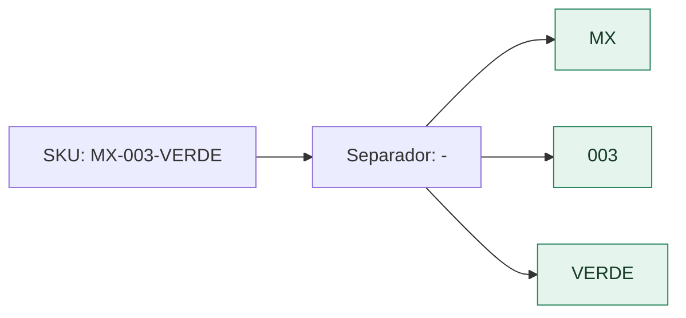
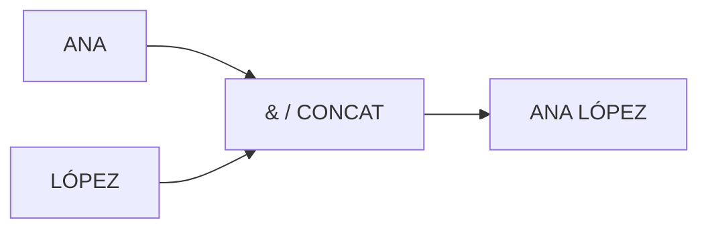
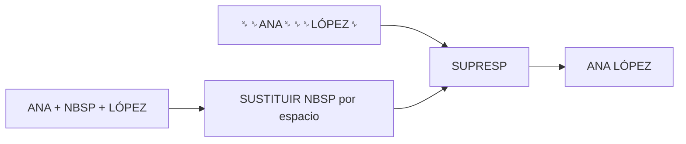
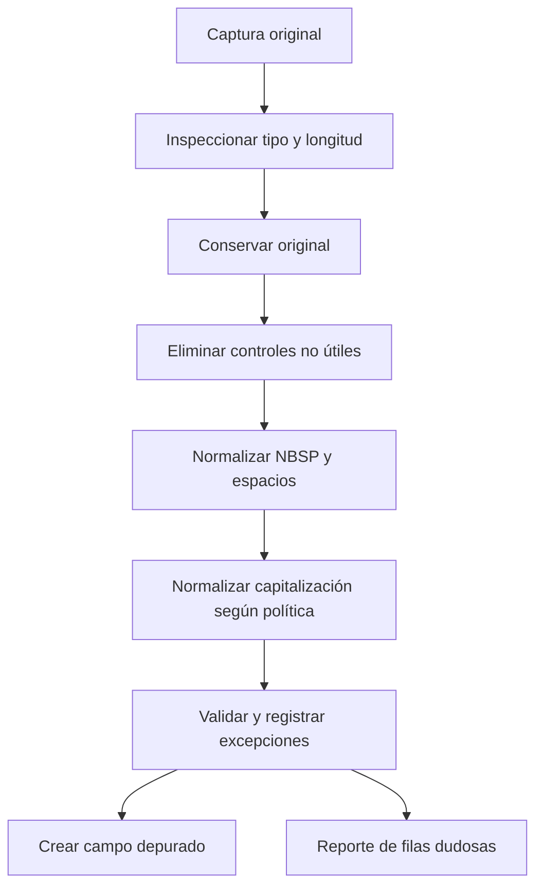
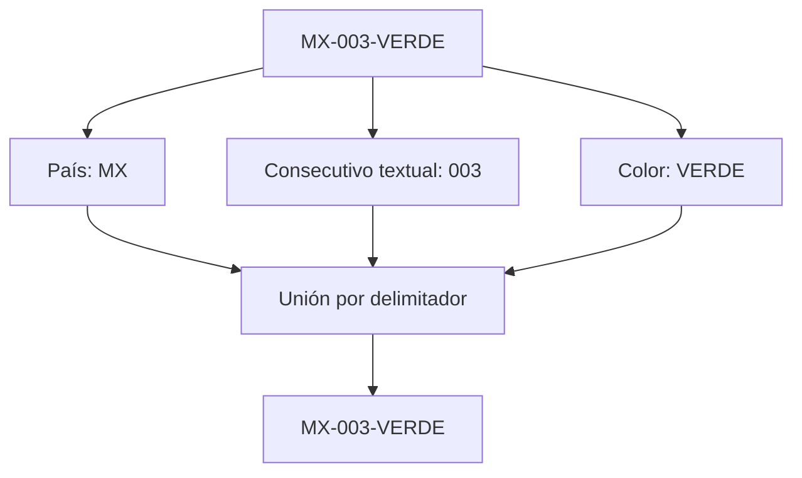
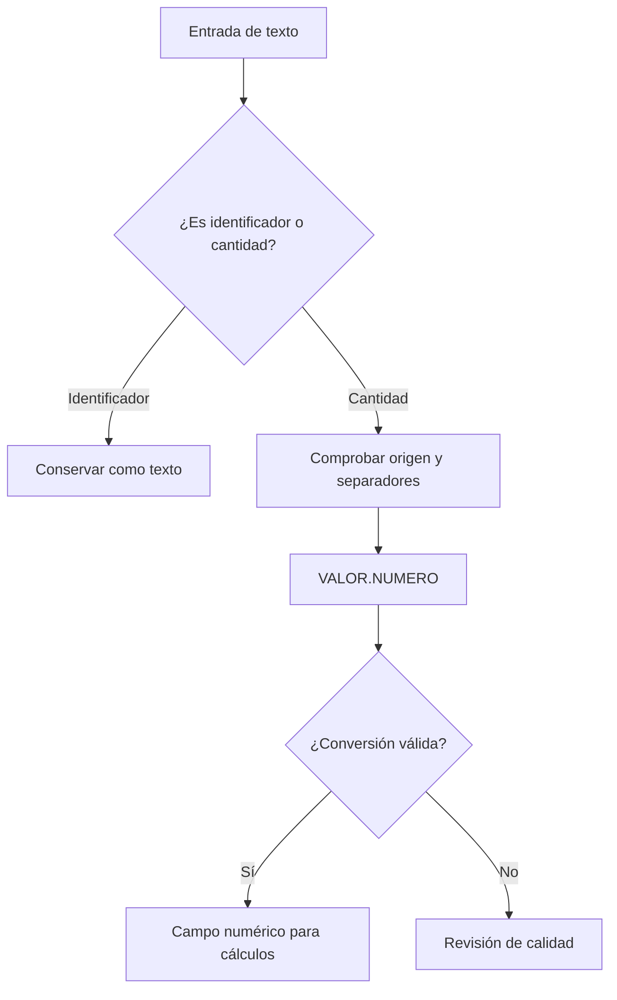
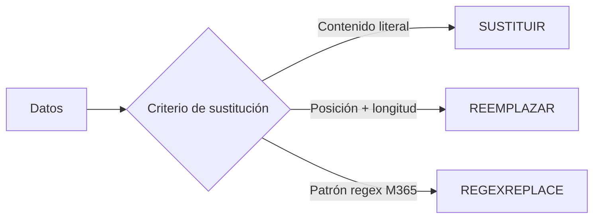
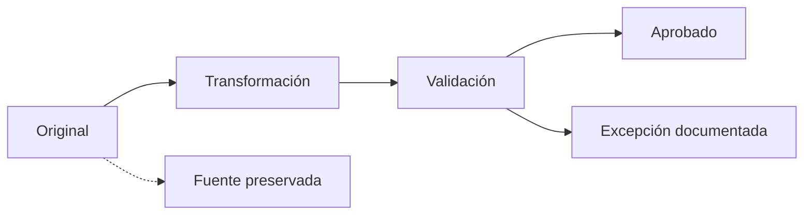
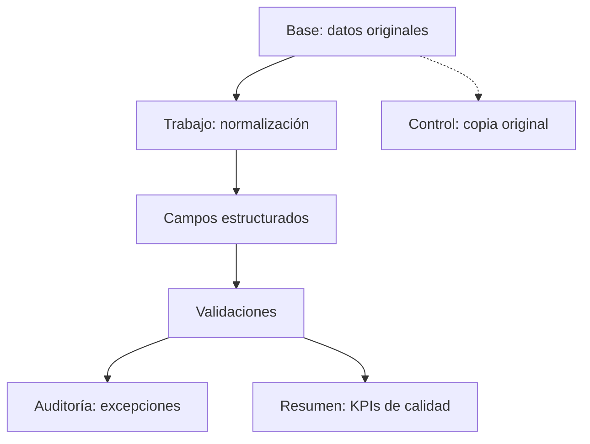

# H10 — Funciones de texto y procesamiento de cadenas

> **Curso integral de Microsoft Excel, Google Sheets, VBA y Google Apps Script**  
> **Ruta:** H — Microsoft Excel · **Módulo:** H10 de H01–H24 · **Roadmap:** v2.0 aprobado  
> **Nivel:** intermedio → avanzado · **Carga base:** 18 horas, ampliable por catálogo de funciones  
> **Actualización de referencias:** 24 de octubre de 2026 · **Estado:** desarrollado para estudio, pendiente de revisión y validación académica.

## Guía de uso del manual

Este capítulo es autónomo, pero presupone H03 (tipos de datos), H05 (fórmulas) y nociones de H07 (errores). Está organizado como **concepto → fundamento → demostración → aplicación → errores → práctica → evaluación**. Las prácticas y el solucionario están en partes separadas para no anticipar respuestas.

**Convención de fórmulas:** las fórmulas reproducibles usan funciones **en español con punto y coma `;`**, salvo donde la documentación oficial española presenta nombres inconsistentes: esos casos se muestran explícitamente en inglés, se enlaza su documentación y se indica cómo confirmar el nombre mediante autocompletado en la instalación local. En Excel configurado en inglés, sustituye los nombres de las funciones y usa `,` como separador de argumentos; el separador exacto depende de la configuración regional. Las **comas que aparecen dentro de cadenas** no son separadores de fórmula. Las fórmulas regex requieren versiones compatibles de **Microsoft 365** y se marcan **M365**. **Nunca conviertas identificadores con ceros iniciales en números si los ceros son parte del identificador.**

### Alcance aprobado y resultados de aprendizaje

| Sección | Temas y subtemas | Competencia demostrable |
|---|---|---|
| **H10.01 Manipulación** | H10.01.01: segmentación — izquierda, derecha, medio; longitud; separación moderna. H10.01.02: construcción — concatenación; delimitadores; repetición. | Extraer y construir cadenas sin destruir información. |
| **H10.02 Limpieza y búsqueda** | H10.02.01: espacios; caracteres no imprimibles; mayúsculas/minúsculas. H10.02.02: localizar texto; reemplazar; comparar. | Estandarizar y auditar textos empresariales. |
| **H10.03 Conversión y texto avanzado** | H10.03.01: texto y números; Unicode; formatos. H10.03.02: regex; extracción; sustitución. | Normalizar valores, comprender codificación y emplear patrones verificables. |

**Al finalizar debes poder:** (1) distinguir texto de números; (2) diseñar transformaciones no destructivas; (3) extraer códigos y dominios; (4) sanear espacios y controles; (5) convertir importes de forma explícita y regionalmente correcta; (6) validar patrones y documentar sus límites; (7) elegir alternativas compatibles con Google Sheets; (8) reproducir los 15 ejercicios y proyecto.

### Datos de laboratorio compartidos

En una hoja llamada `Base` introduce exactamente los siguientes valores como **texto** en las columnas A–F (puedes pegar primero en un editor y usar **Datos → Texto en columnas** según sea necesario). Los espacios exteriores indicados con `␠` son **visibles únicamente en esta documentación**: en Excel se representan mediante espacios normales. Evita copiar el carácter `␠` literalmente.

| Fila | A — ID original | B — Nombre original | C — Correo original | D — SKU original | E — Teléfono original | F — Importe original |
|---:|---|---|---|---|---|---|
| 2 | `␠C-001␠` | `␠␠ANA␠␠␠LÓPEZ␠` | `␠ANA.Lopez@Example.com␠` | `mx-001-azul` | `+52 55 1234 5678` | `1.234,50` |
| 3 | `C-002` | `luis␠␠pérez` | `LUIS.PEREZ@example.com` | `MX-002-ROJO` | `+52 55 2345 6789` | `480,00` |
| 4 | `C-003` | `MARÍA␠␠RUIZ` | `maria.ruiz@ejemplo.mx` | `MX-003-VERDE` | `+52 55 3456 7890` | `2.050,75` |
| 5 | `␠C-004` | `␠jOSe␠␠ramirez␠` | `jose.ramirez.example.com` | `MX-004-AZUL` | *(vacío)* | `125,20` |
| 6 | `C-005` | `EVA␠␠SOLÍS` | `eva.solis@example.com` | `MX-005-ROJO` | `+52 55 4567 8901` | `0,00` |
| 7 | `C-006` | `Raúl␠␠␠Díaz` | `raul.diaz@example.com` | `MX-006-NEGRO` | `+52 55 5678 9012` | `75,10` |

**Cómo obtener el conjunto de datos sin espacios ambiguos:** captura las celdas manualmente o genera sus valores con las siguientes fórmulas auxiliares: `="  ANA   LÓPEZ "` para B2, `=" C-001 "` para A2, etc. Guarda una copia intacta en `Base` y realiza tus transformaciones en una hoja `Trabajo`. En F2:F7 asigna formato Texto **antes** de capturar los importes: de otro modo Excel podría convertirlos automáticamente o interpretarlos según la configuración regional.

---

# H10.01 — Manipulación de cadenas

## H10.01.01 — Segmentación

### H10.01.01.01 — Extracción desde la izquierda, la derecha y una posición interna

Una **cadena** (*string*) es una secuencia de caracteres. Excel distingue la **posición** del carácter (se cuenta desde 1) y el **número de caracteres** solicitado. Los caracteres pueden ser letras, espacios, símbolos o dígitos almacenados como texto.

**Referencia mental:** `MX-001-AZUL` tiene la disposición:

```text
Posición:   01 02 03 04 05 06 07 08 09 10 11
Carácter:    M  X  -  0  0  1  -  A  Z  U  L
             |____|  |____|  |___________|
             país     serie        color
```

> El ejemplo anterior usa posiciones de caracteres para texto básico. Los detalles de pares sustitutos de Unicode, variantes regionales y funciones con sufijo `B` se estudian en H10.03.

**Familia principal:** `IZQUIERDA` (*LEFT*), `DERECHA` (*RIGHT*) y `EXTRAE` (*MID*).

| Función (ES/EN) | Sintaxis (ES) | Obligatorios | Opcionales | Devuelve |
|---|---|---|---|---|
| IZQUIERDA / LEFT | `=IZQUIERDA(texto;[núm_de_caracteres])` | texto | longitud, predeterminada 1 | texto |
| DERECHA / RIGHT | `=DERECHA(texto;[núm_de_caracteres])` | texto | longitud, predeterminada 1 | texto |
| EXTRAE / MID | `=EXTRAE(texto;posición_inicial;núm_de_caracteres)` | los tres | ninguno | texto |

**Tres niveles de ejemplo:**

- Básico: `=IZQUIERDA("MX-001-AZUL";2)` → `MX`.
- Intermedio: `=EXTRAE("MX-001-AZUL";4;3)` → `001` (sigue siendo texto).
- Profesional: `=DERECHA(D2;4)` → `azul` para el SKU de D2, siempre que el color tenga longitud fija de cuatro caracteres. Si el color puede ser `VERDE` o `NEGRO`, **esta regla falla**: utiliza una búsqueda de delimitador o una función moderna.

**Razonamiento:** la extracción basada en posiciones fijas presupone que todos los registros comparten longitud y estructura. Cuando la longitud es variable, es más robusto localizar separadores, por ejemplo el último guion.

**Errores y límites:** una longitud negativa da error; si pides más caracteres que los existentes, IZQUIERDA y DERECHA devuelven la cadena disponible. `EXTRAE` con una posición superior al largo devuelve texto vacío. Las posiciones comienzan en 1, no en 0. No confundas `"001"` con el número 1.

**Alternativas y compatibilidad:** Excel antiguo admite las tres; Sheets también tiene funciones equivalentes. Para delimitadores y estructuras variables, consulta `TEXTBEFORE`, `TEXTAFTER`, `TEXTSPLIT` o Sheets `SPLIT`.

### H10.01.01.02 — Longitud y medición de cadenas

**LARGO** (*LEN*) cuenta caracteres en un texto. Sintaxis: `=LARGO(texto)`. El argumento `texto` es obligatorio; devuelve un número entero no negativo. No excluye los espacios.

| Fórmula | Resultado | Interpretación |
|---|---:|---|
| `=LARGO("Excel")` | 5 | Cinco caracteres |
| `=LARGO(" AB ")` | 4 | Cuenta los espacios de ambos lados |
| `=LARGO("MX-001-AZUL")` | 11 | Tamaño del código completo |
| `=LARGO(SUPRESP("  Ana   Ruiz  "))` | 8 | Espacios normalizados: `Ana Ruiz` |

**Aplicación:** `=LARGO(SUPRESP(A2))` permite inspeccionar longitud de identificadores capturados. No uses `LARGO` como validador completo: una cadena de ocho caracteres puede tener el formato incorrecto.

**Detalle técnico de Unicode:** Excel moderno ha actualizado el comportamiento de algunas funciones de texto con la versión de compatibilidad 2 para tratar mejor los pares sustitutos; esto no convierte a `LARGO` en un contador universal de grafemas visibles. Un emoji compuesto o una letra con diacrítico combinante pueden ocupar varias unidades lógicas. Para comparar cantidades de caracteres en distintos sistemas, define primero si medirás **bytes**, **puntos de código** o **grafemas visibles**.

### H10.01.01.03 — Segmentación moderna por delimitadores

Cuando el texto tiene separadores, extraer por delimitador evita mantener números mágicos de posición.



Funciones modernas (Excel para **Microsoft 365** y **Excel 2024**, sujetas a versión efectiva):

| Nombre inglés / etiqueta española documentada | Sintaxis abreviada | Resultado sobre `MX-003-VERDE` |
|---|---|---|
| TEXTBEFORE / referencia oficial `TEXTBEFORE` | `=TEXTBEFORE(text,delimiter,[instance_num],...)` | antes del primer `-`: `MX` |
| TEXTAFTER / documentación española `TEXTODESPUES` | `=TEXTAFTER(text,delimiter,[instance_num],...)` | después del último `-` (`-1`): `VERDE` |
| TEXTSPLIT / documentación española `DIVIDIRTEXTO` | `=TEXTSPLIT(text,col_delimiter,[row_delimiter],...)` | `MX`, `003`, `VERDE` en tres celdas |

**Nota de idioma importante:** el catálogo oficial español y las páginas individuales de Microsoft mezclan denominaciones inglesas y localizadas en estas funciones. Para fórmulas en una instalación concreta usa **Insertar función / autocompletado**; las formas oficiales inglesas anteriores son referencia inequívoca. No supongas que `TEXTODESPUES` o `DIVIDIRTEXTO` son reconocidas en todos los entornos regionales.

**Ejemplo de fórmula canónica inglés (Excel moderno inglés):**

```excel
=TEXTAFTER("MX-003-VERDE","-",-1)
```

**Resultado:** `VERDE`. `-1` cuenta las ocurrencias desde el final, no es una posición negativa de carácter.

**Matrices:** `TEXTSPLIT("MX-003-VERDE","-")` devuelve tres elementos contiguos. Si las celdas destino ya contienen datos, puede producir `#SPILL!` (`#¡DESBORDAMIENTO!` en interfaces localizadas), no sobrescribirá silenciosamente su contenido.

**Profesional:** separar `correo@dominio` mediante `TEXTBEFORE` y `TEXTAFTER`, sin asumir una longitud fija. Si el delimitador no existe, puede surgir `#N/A`; no lo ocultes antes de diagnosticar el registro.

**Google Sheets:** utiliza `SPLIT(texto;delimitador;[dividir_por_carácter];[quitar_texto_vacío])`; no tiene exactamente las mismas opciones de búsqueda hacia atrás y relleno multidimensional de `TEXTSPLIT`.

## H10.01.02 — Construcción

### H10.01.02.01 — Concatenación de cadenas

**Concatenar** significa unir cadenas preservando su orden. No debe confundirse con sumar números.



| Mecanismo | Sintaxis | Uso | Restricciones |
|---|---|---|---|
| Operador `&` | `=A2&" - "&B2` | Pocos fragmentos | No permite omitir vacíos automáticamente |
| CONCAT / CONCAT | `=CONCAT(A2:C2)` | Unir un rango o varios textos | No añade separador |
| CONCATENAR / CONCATENATE | `=CONCATENAR(A2;" ";B2)` | Libros heredados | Mantener por compatibilidad; preferir CONCAT o UNIRCADENAS |

**Ejemplos:**

1. Básico: `="Hola"&" "&"mundo"` → `Hola mundo`.
2. Intermedio: si A2=`C-001` y B2=`Ana López`, `=A2&" | "&B2` → `C-001 | Ana López`.
3. Profesional: construir una clave documentada `=CONCAT(A2;"|";D2)`; **no** usarla como clave única sin comprobar que ambos campos estén controlados y que el delimitador no forme parte de las entradas.

**Error típico:** concatenar un número formateado como porcentaje o moneda suele utilizar el valor subyacente, no la presentación visual. Antes de unirlo, usa `TEXTO` con formato explícito cuando sea necesario.

### H10.01.02.02 — Unión con delimitadores y manejo de vacíos

**UNIRCADENAS** (*TEXTJOIN*) recibe `delimitador`, `ignorar_vacío` y uno o varios elementos. En Excel español:

```excel
=UNIRCADENAS(" | ";VERDADERO;A2;B2;C2)
```

Con A2=`C-001`, B2=`Ana López`, C2 vacía → `C-001 | Ana López`.

- `delimitador`: texto obligatorio; entre elementos incluidos.
- `ignorar_vacío`: obligatorio; `VERDADERO` omite las celdas vacías.
- `texto1`: obligatorio; cadena, referencia o rango.
- `texto2…`: opcionales; piezas adicionales.
- **Devuelve** texto. Límite de longitud de una celda: 32,767 caracteres; puede producir error si se excede.

**Básico:** `=UNIRCADENAS("-";VERDADERO;"MX";"001";"AZUL")` → `MX-001-AZUL`.

**Intermedio:** si B2 contiene espacios exteriores, se combina con `SUPRESP(B2)` para no introducir separadores vacíos visualmente.

**Profesional:** formar rutas lógicas o etiquetas para un informe (`Región | Categoría | ID`), indicando en la documentación si la omisión de partes vacías podría causar ambigüedades.

**Sheets:** ofrece `TEXTJOIN`, además de `JOIN` para arreglos unidimensionales. Verifica nombre local y separadores.

### H10.01.02.03 — Repetición y cadenas auxiliares

**REPETIR** (*REPT*) repite una cadena un número de veces: `=REPETIR(texto;número_de_veces)`. Ambos argumentos son obligatorios; devuelve texto.

| Fórmula | Resultado | Aplicación |
|---|---|---|
| `=REPETIR("-";5)` | `-----` | Separador visible |
| `=REPETIR("0";3)&"7"` | `0007` | Ejemplo ilustrativo de relleno |
| `=REPETIR("■";4)` | `■■■■` | Marcador visual de cuatro unidades |

**Advertencia profesional:** generar ceros con REPETIR es útil para visualizaciones, pero una clave con reglas de longitud fija debe construirse bajo una validación explícita. Repeticiones grandes pueden superar el límite de caracteres. Sheets también implementa `REPETIR`.

### Ejemplo guiado de H10.01: catálogo de SKU

1. Introduce `MX-003-VERDE` en A2.
2. Extrae el país con `=IZQUIERDA(A2;2)` → `MX`.
3. Extrae el número con `=EXTRAE(A2;4;3)` → `003` (texto).
4. Extrae el color con Excel moderno `=TEXTAFTER(A2,"-",-1)` (nombre inglés canónico) → `VERDE`.
5. Reconstruye con `=UNIRCADENAS("-";VERDADERO;B2;C2;D2)` si B2:D2 contienen los componentes → texto original.
6. Verifica con `=IGUAL(A2;E2)` donde E2 contiene la reconstrucción → `VERDADERO`.

**Validación:** la reconstrucción exacta permite detectar pérdidas accidentales de ceros o de delimitadores.

---

# H10.02 — Limpieza, búsqueda y normalización

## H10.02.01 — Normalización del texto

### H10.02.01.01 — Espacios normales y espacios no separables

No todos los caracteres visualmente parecidos a un espacio se comportan igual.

- **Espacio ordinario:** Unicode U+0020, código 32; `SUPRESP` (*TRIM*) elimina extremos y reduce repeticiones interiores de este espacio.
- **Espacio no separable:** Unicode U+00A0 (NBSP), código 160; se encuentra con frecuencia al copiar contenidos web y **SUPRESP por sí sola no lo elimina**.
- **Tabulador:** carácter de control que tampoco equivale a un espacio ordinario.



**SUPRESP / TRIM**: `=SUPRESP(texto)`; `texto` es obligatorio, devuelve texto. Ejemplo:

```excel
=SUPRESP("  ANA   LÓPEZ ")
```

Resultado `ANA LÓPEZ`.

**Limpieza más resistente a NBSP:**

```excel
=SUPRESP(SUSTITUIR(A2;UNICAR(160);" "))
```

Primero cambia NBSP por espacio normal; luego colapsa espacios ordinarios. Si la fuente trae controles invisibles, añade `LIMPIAR` como se explica después.

**Errores frecuentes:** confundir celda realmente vacía con `""`, eliminar todos los espacios entre nombres y apellidos o sustituir guiones significativos en un identificador.

### H10.02.01.02 — Caracteres no imprimibles

**LIMPIAR** (*CLEAN*) elimina principalmente los caracteres de control de ASCII de códigos 0–31. Sintaxis: `=LIMPIAR(texto)`; devuelve texto.

**Caso reproducible:**

```excel
=LARGO("A"&CARACTER(10)&"B")
```

Devuelve 3. `CARACTER(10)` representa un salto de línea. Después:

```excel
=LIMPIAR("A"&CARACTER(10)&"B")
```

Devuelve `AB`; el salto fue **eliminado**, no reemplazado por espacio. Si quieres conservar separación semántica:

```excel
=SUSTITUIR("A"&CARACTER(10)&"B";CARACTER(10);" ")
```

Devuelve `A B`.

**Importante:** LIMPIAR no elimina por completo todo carácter Unicode invisible (por ejemplo, NBSP o determinados caracteres de formato); una limpieza robusta depende de la procedencia de datos. No borres signos de control sin evaluar si separan campos importantes.

### H10.02.01.03 — Mayúsculas, minúsculas y capitalización

| Función (ES/EN) | Sintaxis | Salida ilustrativa |
|---|---|---|
| MAYUSC / UPPER | `=MAYUSC(texto)` | `ana` → `ANA` |
| MINUSC / LOWER | `=MINUSC(texto)` | `ANA` → `ana` |
| NOMPROPIO / PROPER | `=NOMPROPIO(texto)` | `aNA lÓPEZ` → `Ana López` |

**Secuencia práctica:**

```excel
=NOMPROPIO(MINUSC(SUPRESP(B2)))
```

Para B2 = `  ANA   LÓPEZ ` el resultado es `Ana López`.

**Advertencia:** NOMPROPIO utiliza reglas mecánicas y puede dar resultados no deseados en nombres con partículas, apóstrofes, guiones, siglas o preferencias personales. No debe sobreescribir directamente los nombres de origen. Guárdalos y revisa excepciones. Sheets tiene equivalentes `MAYUSC`, `MINUSC` y `NOMPROPIO`.

## H10.02.02 — Búsqueda, sustitución y comparación

### H10.02.02.01 — Localización de subcadenas

**ENCONTRAR** (*FIND*) distingue mayúsculas/minúsculas; **HALLAR** (*SEARCH*) normalmente no distingue y admite comodines `?` y `*`.

| Función | Sintaxis (ES) | Ejemplo | Resultado |
|---|---|---|---|
| ENCONTRAR / FIND | `=ENCONTRAR(buscar_dentro_de;texto_examinado;[núm_inicial])` | `=ENCONTRAR("A";"Casa")` | `#¡VALOR!` (no encuentra A mayúscula) |
| HALLAR / SEARCH | `=HALLAR(texto_buscado;dentro_del_texto;[núm_inicial])` | `=HALLAR("A";"Casa")` | `2` |

**Los resultados son posiciones 1-based**, no fragmentos de texto. Las cadenas deben distinguirse de los caracteres comodín; para buscar `?` o `*` literalmente con HALLAR se usan las reglas de escape de la función.

**Básico:** `=ENCONTRAR("@";"ana@empresa.mx")` → 4.

**Intermedio:** posición del primer guion: `=HALLAR("-";"MX-003-VERDE")` → 3.

**Profesional:** extraer una subcadena entre delimitadores mediante `HALLAR` + `EXTRAE` cuando `TEXTSPLIT` no esté disponible; hay que comprobar previamente que los delimitadores existen. H07 enseña cómo manejar errores de búsqueda, no cómo ocultarlos indiscriminadamente.

### H10.02.02.02 — Sustituir texto por contenido o por posición

| Función | Regla | Sintaxis |
|---|---|---|
| SUSTITUIR / SUBSTITUTE | Reemplaza fragmentos coincidentes | `=SUSTITUIR(texto;texto_antiguo;texto_nuevo;[núm_de_ocurrencia])` |
| REEMPLAZAR / REPLACE | Reemplaza a partir de una posición y longitud | `=REEMPLAZAR(texto;posición_inicial;núm_de_caracteres;texto_nuevo)` |

**Ejemplos reproducibles:**

```excel
=SUSTITUIR("MX-001-AZUL";"-";"/")
```

Devuelve `MX/001/AZUL` (todas las ocurrencias).

```excel
=SUSTITUIR("a-a-a";"a";"X";2)
```

Devuelve `a-X-a` (solo la segunda ocurrencia).

```excel
=REEMPLAZAR("MX-001-AZUL";4;3;"999")
```

Devuelve `MX-999-AZUL`.

**Elección correcta:** SUSTITUIR cuando conoces el texto buscado; REEMPLAZAR cuando conoces la posición y el tamaño. No uses REEMPLAZAR en datos de longitudes variables si no puedes garantizar las posiciones.

### H10.02.02.03 — Comparación y validación textual

**IGUAL** (*EXACT*) comprueba si dos textos son idénticos, con sensibilidad a mayúsculas y minúsculas, y devuelve VERDADERO o FALSO.

```excel
=IGUAL("ABC";"abc")
```

Devuelve `FALSO`.

```excel
=IGUAL(SUPRESP(" Ana ");"Ana")
```

Devuelve `VERDADERO`.

**Básico:** comprobar si una reconstrucción conserva el SKU original.

**Intermedio:** comparar `MINUSC(correo1)` con `MINUSC(correo2)` si tu política de negocio trata los correos como equivalentes al ignorar mayúsculas; no asumas que esta transformación preserva semántica en todos los sistemas externos.

**Profesional:** usar `IGUAL` entre el resultado depurado y un valor de control para identificar registros transformados; combina el resultado con una columna de auditoría, no sobrescribas la evidencia de entrada.

**Errores frecuentes:** presuponer que un mismo texto visual implica la misma secuencia Unicode, ignorar espacios ocultos y considerar que la igualdad demuestra unicidad global. Excel no normaliza automáticamente todos los equivalentes Unicode.

### Flujo profesional de limpieza



**Ejemplo para nombres:** `=NOMPROPIO(MINUSC(SUPRESP(SUSTITUIR(LIMPIAR(B2);UNICAR(160);" "))))` (fórmula larga solo apropiada si la política de normalización está documentada).

**Comprobación independiente:** compara `LARGO(B2)` con `LARGO(G2)` y revisa las discrepancias antes de concluir que todas son errores.

---

# H10.03 — Conversión, Unicode y expresiones regulares

## H10.03.01 — Representación y tipos

### H10.03.01.01 — Texto ↔ números: evitar errores de interpretación

**VALOR** (*VALUE*) convierte texto que Excel interpreta como número según la configuración regional. Sintaxis `=VALOR(texto)`. Devuelve número, pero la cadena debe tener un formato reconocido.

**VALOR.NUMERO** (*NUMBERVALUE*) hace explícitos los separadores decimal y de miles; sintaxis:

```excel
=VALOR.NUMERO(texto;separador_decimal;[separador_de_grupo])
```

**Ejemplo crucial:**

```excel
=VALOR.NUMERO("1.234,50";",";".")
```

Resultado numérico `1234,5` (la apariencia concreta depende del formato). Con entrada en F2 y los mismos separadores:

```excel
=VALOR.NUMERO(F2;",";".")
```

No uses `VALOR` a ciegas para mezclar cadenas `1,234.50` y `1.234,50`. Confirma configuración y origen.

**No convertir:** códigos como `000451`, CURP, SKU, folios o números telefónicos **no son cantidades aritméticas**; si los conviertes en números, perderás ceros iniciales y podrías destruir precisión en identificadores largos.

**Intermedio:** comparar `=VALOR.NUMERO("2.050,75";",";".")` → `2050,75` y `=VALOR.NUMERO("2,050.75";".";",")` → `2050,75`.

**Profesional:** conservar columnas `monto_original` (texto), `monto_numérico` y `estado_conversión` para identificar fallos antes de calcular totales. Si un importe representa dinero, define también moneda, redondeo y fuente de datos.

### H10.03.01.02 — Caracteres, códigos y Unicode

**Unicode** asigna puntos de código a caracteres; no equivale a la codificación de bytes utilizada para guardar una cadena. En Excel:

| Función ES/EN | Sintaxis | Uso |
|---|---|---|
| CARACTER / CHAR | `=CARACTER(número)` | Carácter de un código del conjunto usado por la plataforma |
| CODIGO / CODE | `=CODIGO(texto)` | Código del primer carácter según conjunto compatible |
| UNICAR / UNICHAR | `=UNICAR(número)` | Carácter correspondiente a un punto de código Unicode |
| UNICODE / UNICODE | `=UNICODE(texto)` | Punto de código del primer carácter Unicode |

**Ejemplos:**

```excel
=CARACTER(65)
```

Resultado `A` en los entornos habituales.

```excel
=UNICODE("A")
```

Resultado 65.

```excel
=UNICAR(160)
```

Genera NBSP, que parece un espacio pero no es igual al carácter de código 32.

**Evita mezclar conceptos:** `LARGO` cuenta caracteres según la implementación de Excel y su configuración de compatibilidad; `LARGOB` se refiere a convenciones de bytes de compatibilidad oriental, y está deprecada en ciertas versiones actuales. No la utilices como medidor universal de bytes UTF-8. Para alfabetos asiáticos o migraciones de hojas antiguas, verifica las funciones `ASC`, `DBCS`, `IZQUIERDAB`, `DERECHAB`, `EXTRAEB`, `ENCONTRARB`, `HALLARB`, `REEMPLAZARB`, `LARGOB` en el entorno específico.

### H10.03.01.03 — Formatos de salida y texto de presentación

**TEXTO** (*TEXT*) convierte un número a una cadena con un formato: `=TEXTO(valor;formato_texto)`. Los formatos dependen de idioma y separadores regionales.

```excel
=TEXTO(7;"0000")
```

Devuelve `0007` como **texto**.

```excel
="Folio "&TEXTO(25;"00000")
```

Devuelve `Folio 00025`.

Este formato es útil para **números ordinales generados internamente**. No transforma en seguro un identificador que ya perdió ceros en la captura original.

Otras funciones:

- **MONEDA** (*DOLLAR*): número → cadena con formato monetario; su símbolo puede variar por configuración.
- **FIXED**: número → texto con decimales fijos; la documentación localizada de esta función presenta variantes en el nombre español (p. ej., `DECIMAL`/`CORREGIDO`). Verifica autocompletado antes de usar una variante española.
- **TEXTOBAHT** (*BAHTTEXT*): conversión especial al formato monetario tailandés.
- **VALORATEXTO** (*VALUETOTEXT*): representación textual de valores; parámetro de formato `0` o `1`.
- **MATRIZATEXTO** (*ARRAYTOTEXT*): representación textual de un arreglo con formato conciso o estricto.
- **T** (*T*): devuelve el argumento si es texto, de lo contrario cadena vacía para valores ordinarios no textuales; se mantiene una referencia principal cruzada en H13.

**Errores:** `TEXTO` puede producir cadenas que no funcionan como valores numéricos; no debes usar esos resultados como único dato maestro financiero. La conversión de fechas en texto no es un sustituto de almacenar fechas auténticas.

## H10.03.02 — Expresiones regulares y funciones modernas

### H10.03.02.01 — Fundamentos de expresiones regulares (*regex*)

Una **expresión regular** es un patrón formal para identificar subcadenas, no un criterio universal de validez semántica.

| Símbolo de patrón | Significado | Ejemplo |
|---|---|---|
| `^` | Inicio del texto | `^MX` |
| `$` | Final del texto | `AZUL$` |
| `[0-9]` | Un dígito | `[0-9]{3}` |
| `[A-Z]` | Una mayúscula ASCII | `[A-Z]+` |
| `{3}` | Exactamente tres repeticiones | `[0-9]{3}` |
| `+` | Una o más repeticiones | `[A-Z]+` |
| `?` | Cero o una repetición | `-?` |
| `(...)` | Grupo de captura | `([A-Z]{2})` |

**Patrón del SKU del laboratorio:** `^MX-[0-9]{3}-(AZUL|ROJO|VERDE|NEGRO)$`.


`^` y `$` son importantes: sin ellos podría reconocerse un fragmento válido dentro de una cadena más larga e inválida. Este patrón únicamente valida la estructura, **no demuestra que el SKU exista en el catálogo**.

### H10.03.02.02 — Extraer y validar con REGEX

**Microsoft 365:** `REGEXTEST`, `REGEXEXTRACT`, `REGEXREPLACE` (nombres canónicos ingleses). Microsoft documenta en español rótulos `REGEXPRUEBA`, `REGEXEXTRACCION` y `REGEXREEMPLAZAR`, pero algunas fórmulas de sus páginas usan el inglés. Comprueba los nombres que acepta tu Excel antes de ejecutar. Las tres utilizan la variante **PCRE2** de expresiones regulares según Microsoft.

| Función canónica | Sintaxis abreviada | Retorno |
|---|---|---|
| REGEXTEST | `REGEXTEST(text,pattern,[case_sensitivity])` | booleano |
| REGEXEXTRACT | `REGEXEXTRACT(text,pattern,[return_mode],[case_sensitivity])` | texto o matriz de texto |
| REGEXREPLACE | `REGEXREPLACE(text,pattern,replacement,[occurrence],[case_sensitivity])` | texto |

**Básico (en Excel inglés M365):**

```excel
=REGEXTEST("MX-003-VERDE","^MX-[0-9]{3}-(AZUL|ROJO|VERDE|NEGRO)$")
```

→ `TRUE`.

**Intermedio:**

```excel
=REGEXEXTRACT("Pedido MX-003-VERDE","MX-[0-9]{3}-[A-Z]+")
```

→ `MX-003-VERDE`.

**Profesional:** sobre correos electrónicos, un patrón sencillo `^[^ @]+@[^ @]+\.[A-Za-z]{2,}$` puede identificar registros obviamente mal formados, pero **no prueba que la dirección exista ni cumple todas las reglas posibles de correo**. Para comunicaciones críticas añade verificación operativa y reglas de negocio. Si los datos contienen Unicode, define qué letras, espacios o símbolos esperas realmente.

**REGEXEXTRACT:** el modo `0` devuelve la primera coincidencia, `1` todas las coincidencias como matriz y `2` los grupos de captura de la primera coincidencia. No te bases en el orden de las coincidencias sin conocer el patrón.

**Diferencias con Google Sheets:** Sheets proporciona `REGEXMATCH`, `REGEXEXTRACT` y `REGEXREPLACE`, fundamentadas en **RE2**. PCRE2 y RE2 no tienen soporte idéntico para todos los constructos (en particular referencias hacia atrás o miradas avanzadas). Evita trasladar patrones complejos sin pruebas específicas.

### H10.03.02.03 — Sustitución por patrón, seguridad y portabilidad

**Ejemplo (inglés M365):**

```excel
=REGEXREPLACE("Tel: 5512345678","[0-9]","*")
```

Resultado `Tel: **********`.

**Aplicación:** anonimización visual básica de números antes de compartir una hoja; no equivale a anonimización criptográfica ni garantiza eliminación de información sensible de metadatos, archivos originales o historiales.

**Recomendaciones técnicas:** conserva el dato original en acceso controlado, aplica reglas de divulgación específicas, valida con registros positivos y negativos, prueba regionalización y revisa políticas de datos. Para patrones sencillos, `SUSTITUIR` y `HALLAR` son alternativas más portables en versiones antiguas de Excel. `TRADUCIR` (*TRANSLATE*) y `DETECTARIDIOMA` (*DETECTLANGUAGE*) son funciones relacionadas con texto, respaldadas por servicios en Microsoft 365; pueden depender de disponibilidad, cuotas, idiomas admitidos y conectividad, por lo que se incluyen en inventario y no se usan como base de resultados deterministas.

### Tabla de decisión

| Problema | Primera opción | Alternativa | Riesgo que debe vigilarse |
|---|---|---|---|
| Extraer prefijo fijo | IZQUIERDA | EXTRAE | Longitudes variables |
| Tomar parte tras `-` | TEXTAFTER (actual) | HALLAR + EXTRAE | Falta de delimitador |
| Unir con separador | UNIRCADENAS | `&` | Campos vacíos |
| Normalizar nombres | SUPRESP + MINUSC/NOMPROPIO | Power Query | Nombres propios especiales |
| Quitar NBSP | SUSTITUIR con UNICAR(160) | Power Query | Otros caracteres invisibles |
| Convertir `1.234,50` | VALOR.NUMERO | Importación configurada | Separador de origen |
| Validar estructura de SKU | REGEXTEST (M365) | Comparaciones y HALLAR | Forma vs existencia |
| Verificar igualdad exacta | IGUAL | Comparación controlada | Unicode/capitalización |

---

# Apéndice A — Fichas de aprendizaje individual de funciones

Cada ficha incluye los 18 campos requeridos por el estándar de este curso: ES/EN, categoría, propósito, sintaxis, argumentos y obligatoriedad, retorno, ejemplos básico/intermedio/profesional, interpretación, errores, límites, alternativas, Sheets, versión y práctica. Las funciones con sintaxis canónica inglesa se marcan de ese modo por las inconsistencias localizadas en la documentación. Las fichas son **explicadas y revisadas conceptualmente**, pero no equivalen a una ejecución de fórmulas en Excel real.


## H10-F01 — IZQUIERDA (LEFT)

- **Categoría:** Texto · **Propósito:** Extraer los caracteres iniciales.
- **Sintaxis:** `IZQUIERDA(texto;[núm_de_caracteres])`.
- **Argumentos obligatorios / opcionales:** texto obligatorio; núm_de_caracteres opcional, predeterminado 1.
- **Tipo de resultado:** texto.
- **Ejemplo básico:** `=IZQUIERDA("ABC-42";3)` → `ABC`.
- **Ejemplo intermedio:** `=IZQUIERDA("MX-003";2)` → `MX`.
- **Caso profesional:** ``=IZQUIERDA(D2;2)`` → **`mx` con el conjunto de laboratorio**.
- **Interpretación:** la función procesa los datos proporcionados conforme a su sintaxis; el resultado descrito debe contrastarse con la política de tipos, la región y el origen.
- **Errores frecuentes y limitaciones:** Longitudes variables: no asumas que el prefijo indica el país si la fuente cambia.
- **Alternativas y relacionadas:** TEXTBEFORE, EXTRAE.
- **Google Sheets / equivalencia:** IZQUIERDA/LEFT.
- **Disponibilidad:** Clásica, ampliamente compatible.
- **Ejercicio sugerido:** H10.01-E01; incorpora una fila válida, otra inválida y documenta el resultado.

## H10-F02 — DERECHA (RIGHT)

- **Categoría:** Texto · **Propósito:** Extraer los caracteres finales.
- **Sintaxis:** `DERECHA(texto;[núm_de_caracteres])`.
- **Argumentos obligatorios / opcionales:** texto obligatorio; longitud opcional, por defecto 1.
- **Tipo de resultado:** texto.
- **Ejemplo básico:** `=DERECHA("REPORTE.csv";3)` → `csv`.
- **Ejemplo intermedio:** `=DERECHA("MX-001-AZUL";4)` → `AZUL`.
- **Caso profesional:** ``=DERECHA(D3;4)`` → **`ROJO`**.
- **Interpretación:** la función procesa los datos proporcionados conforme a su sintaxis; el resultado descrito debe contrastarse con la política de tipos, la región y el origen.
- **Errores frecuentes y limitaciones:** El color VERDE tiene cinco letras; no extraigas los últimos cuatro siempre.
- **Alternativas y relacionadas:** TEXTAFTER.
- **Google Sheets / equivalencia:** DERECHA/RIGHT.
- **Disponibilidad:** Clásica.
- **Ejercicio sugerido:** H10.01-E01; incorpora una fila válida, otra inválida y documenta el resultado.

## H10-F03 — EXTRAE (MID)

- **Categoría:** Texto · **Propósito:** Extraer por posición y longitud.
- **Sintaxis:** `EXTRAE(texto;posición_inicial;núm_de_caracteres)`.
- **Argumentos obligatorios / opcionales:** tres argumentos obligatorios; posición inicia en 1.
- **Tipo de resultado:** texto.
- **Ejemplo básico:** `=EXTRAE("AB123CD";3;3)` → `123`.
- **Ejemplo intermedio:** `=EXTRAE("MX-003-VERDE";4;3)` → `003`.
- **Caso profesional:** ``=EXTRAE(D4;4;3)`` → **`003`**.
- **Interpretación:** la función procesa los datos proporcionados conforme a su sintaxis; el resultado descrito debe contrastarse con la política de tipos, la región y el origen.
- **Errores frecuentes y limitaciones:** Si la cadena carece del guion, las posiciones dejan de ser confiables.
- **Alternativas y relacionadas:** TEXTSPLIT, TEXTBEFORE.
- **Google Sheets / equivalencia:** EXTRAE/MID.
- **Disponibilidad:** Clásica.
- **Ejercicio sugerido:** H10.01-E02; incorpora una fila válida, otra inválida y documenta el resultado.

## H10-F04 — LARGO (LEN)

- **Categoría:** Texto · **Propósito:** Contar caracteres.
- **Sintaxis:** `LARGO(texto)`.
- **Argumentos obligatorios / opcionales:** texto obligatorio.
- **Tipo de resultado:** número entero.
- **Ejemplo básico:** `=LARGO("ABC")` → `3`.
- **Ejemplo intermedio:** `=LARGO("A B")` → `3`.
- **Caso profesional:** ``=LARGO(SUPRESP(B2))`` → **`9` para `ANA LÓPEZ`**.
- **Interpretación:** la función procesa los datos proporcionados conforme a su sintaxis; el resultado descrito debe contrastarse con la política de tipos, la región y el origen.
- **Errores frecuentes y limitaciones:** Los espacios cuentan; longitud no equivale a validación estructural ni conteo universal de grafemas.
- **Alternativas y relacionadas:** LARGOB (solo compatibilidad), regex.
- **Google Sheets / equivalencia:** LARGO/LEN.
- **Disponibilidad:** Clásica; precisión Unicode según versión de compatibilidad.
- **Ejercicio sugerido:** H10.01-E03; incorpora una fila válida, otra inválida y documenta el resultado.

## H10-F05 — CONCAT (CONCAT)

- **Categoría:** Texto · **Propósito:** Unir varios textos o rangos sin delimitador.
- **Sintaxis:** `CONCAT(texto1;[texto2];...)`.
- **Argumentos obligatorios / opcionales:** texto1 obligatorio; restantes opcionales; acepta rangos.
- **Tipo de resultado:** texto.
- **Ejemplo básico:** `=CONCAT("A";"B")` → `AB`.
- **Ejemplo intermedio:** `=CONCAT("MX";"-";"003")` → `MX-003`.
- **Caso profesional:** ``=CONCAT(IZQUIERDA(D4;2);"|";EXTRAE(D4;4;3))`` → **`MX|003`**.
- **Interpretación:** la función procesa los datos proporcionados conforme a su sintaxis; el resultado descrito debe contrastarse con la política de tipos, la región y el origen.
- **Errores frecuentes y limitaciones:** Algunos resultados numéricos pierden su presentación al concatenarse.
- **Alternativas y relacionadas:** & y UNIRCADENAS.
- **Google Sheets / equivalencia:** CONCAT.
- **Disponibilidad:** Excel 2019/2021/2024/M365; comprobar edición.
- **Ejercicio sugerido:** H10.01-E04; incorpora una fila válida, otra inválida y documenta el resultado.

## H10-F06 — CONCATENAR (CONCATENATE)

- **Categoría:** Texto · **Propósito:** Concatenar textos con una función heredada.
- **Sintaxis:** `CONCATENAR(texto1;[texto2];...)`.
- **Argumentos obligatorios / opcionales:** texto1 obligatorio; fragmentos posteriores opcionales.
- **Tipo de resultado:** texto.
- **Ejemplo básico:** `=CONCATENAR("A";"B")` → `AB`.
- **Ejemplo intermedio:** `=CONCATENAR("A";"-";"9")` → `A-9`.
- **Caso profesional:** ``=CONCATENAR("Cliente ";SUPRESP(A2))`` → **`Cliente C-001`**.
- **Interpretación:** la función procesa los datos proporcionados conforme a su sintaxis; el resultado descrito debe contrastarse con la política de tipos, la región y el origen.
- **Errores frecuentes y limitaciones:** No es preferible en diseños nuevos; se conserva sobre todo por compatibilidad.
- **Alternativas y relacionadas:** CONCAT, UNIRCADENAS, &.
- **Google Sheets / equivalencia:** CONCATENAR/CONCATENATE.
- **Disponibilidad:** Heredada, aún documentada.
- **Ejercicio sugerido:** H10.01-E04; incorpora una fila válida, otra inválida y documenta el resultado.

## H10-F07 — UNIRCADENAS (TEXTJOIN)

- **Categoría:** Texto · **Propósito:** Unir textos insertando un delimitador configurable.
- **Sintaxis:** `UNIRCADENAS(delimitador;ignorar_vacío;texto1;[texto2];...)`.
- **Argumentos obligatorios / opcionales:** delimitador, ignorar_vacío y texto1 obligatorios.
- **Tipo de resultado:** texto.
- **Ejemplo básico:** `=UNIRCADENAS("-";VERDADERO;"A";"B")` → `A-B`.
- **Ejemplo intermedio:** `=UNIRCADENAS(" - ";VERDADERO;"A";"";"B")` → `A - B`.
- **Caso profesional:** ``=UNIRCADENAS("|";VERDADERO;SUPRESP(A2);MAYUSC(D2))`` → **`C-001|MX-001-AZUL`**.
- **Interpretación:** la función procesa los datos proporcionados conforme a su sintaxis; el resultado descrito debe contrastarse con la política de tipos, la región y el origen.
- **Errores frecuentes y limitaciones:** Ignorar vacíos puede modificar la posición semántica de los campos.
- **Alternativas y relacionadas:** CONCAT, &, Sheets JOIN.
- **Google Sheets / equivalencia:** TEXTJOIN.
- **Disponibilidad:** Excel 2019 y posteriores/M365.
- **Ejercicio sugerido:** H10.01-E05; incorpora una fila válida, otra inválida y documenta el resultado.

## H10-F08 — REPETIR (REPT)

- **Categoría:** Texto · **Propósito:** Repetir un texto n veces.
- **Sintaxis:** `REPETIR(texto;número_de_veces)`.
- **Argumentos obligatorios / opcionales:** ambos obligatorios; contador numérico.
- **Tipo de resultado:** texto.
- **Ejemplo básico:** `=REPETIR("X";3)` → `XXX`.
- **Ejemplo intermedio:** `=REPETIR("0";3)&"7"` → `0007`.
- **Caso profesional:** ``="Nivel "&REPETIR("■";4)`` → **`Nivel ■■■■`**.
- **Interpretación:** la función procesa los datos proporcionados conforme a su sintaxis; el resultado descrito debe contrastarse con la política de tipos, la región y el origen.
- **Errores frecuentes y limitaciones:** No lo uses para generar identificadores sin comprobar longitud y tamaño máximo de celda.
- **Alternativas y relacionadas:** TEXTO con ceros fijos.
- **Google Sheets / equivalencia:** REPETIR/REPT.
- **Disponibilidad:** Clásica.
- **Ejercicio sugerido:** H10.01-E05; incorpora una fila válida, otra inválida y documenta el resultado.

## H10-F09 — SUPRESP (TRIM)

- **Categoría:** Texto · **Propósito:** Eliminar espacios normales exteriores y duplicados interiores.
- **Sintaxis:** `SUPRESP(texto)`.
- **Argumentos obligatorios / opcionales:** texto obligatorio.
- **Tipo de resultado:** texto.
- **Ejemplo básico:** `=SUPRESP(" A ")` → `A`.
- **Ejemplo intermedio:** `=SUPRESP("Ana   Ruiz")` → `Ana Ruiz`.
- **Caso profesional:** ``=SUPRESP(B2)`` → **`ANA LÓPEZ`**.
- **Interpretación:** la función procesa los datos proporcionados conforme a su sintaxis; el resultado descrito debe contrastarse con la política de tipos, la región y el origen.
- **Errores frecuentes y limitaciones:** No remueve directamente NBSP U+00A0 ni todos los caracteres invisibles.
- **Alternativas y relacionadas:** SUSTITUIR con UNICAR(160), Power Query.
- **Google Sheets / equivalencia:** ESPACIOS/TRIM en Sheets español (según catálogo).
- **Disponibilidad:** Clásica.
- **Ejercicio sugerido:** H10.02-E01; incorpora una fila válida, otra inválida y documenta el resultado.

## H10-F10 — LIMPIAR (CLEAN)

- **Categoría:** Texto · **Propósito:** Retirar caracteres ASCII no imprimibles 0–31.
- **Sintaxis:** `LIMPIAR(texto)`.
- **Argumentos obligatorios / opcionales:** texto obligatorio.
- **Tipo de resultado:** texto.
- **Ejemplo básico:** `=LIMPIAR("A"&CARACTER(10)&"B")` → `AB`.
- **Ejemplo intermedio:** `=LIMPIAR("X"&CARACTER(9)&"Y")` → `XY`.
- **Caso profesional:** ``=SUPRESP(LIMPIAR("  A"&CARACTER(10)&"B  "))`` → **`AB`**.
- **Interpretación:** la función procesa los datos proporcionados conforme a su sintaxis; el resultado descrito debe contrastarse con la política de tipos, la región y el origen.
- **Errores frecuentes y limitaciones:** Puede unir palabras al borrar separadores; no remueve NBSP.
- **Alternativas y relacionadas:** SUSTITUIR controles por espacios.
- **Google Sheets / equivalencia:** LIMPIAR/CLEAN.
- **Disponibilidad:** Clásica.
- **Ejercicio sugerido:** H10.02-E02; incorpora una fila válida, otra inválida y documenta el resultado.

## H10-F11 — MAYUSC (UPPER)

- **Categoría:** Texto · **Propósito:** Convertir letras a mayúsculas.
- **Sintaxis:** `MAYUSC(texto)`.
- **Argumentos obligatorios / opcionales:** texto obligatorio.
- **Tipo de resultado:** texto.
- **Ejemplo básico:** `=MAYUSC("mx")` → `MX`.
- **Ejemplo intermedio:** `=MAYUSC("café")` → `CAFÉ`.
- **Caso profesional:** ``=MAYUSC(D2)`` → **`MX-001-AZUL`**.
- **Interpretación:** la función procesa los datos proporcionados conforme a su sintaxis; el resultado descrito debe contrastarse con la política de tipos, la región y el origen.
- **Errores frecuentes y limitaciones:** No conviertas automáticamente nombres y marcas sin una política de datos.
- **Alternativas y relacionadas:** MINUSC, NOMPROPIO.
- **Google Sheets / equivalencia:** MAYUSC/UPPER.
- **Disponibilidad:** Clásica.
- **Ejercicio sugerido:** H10.02-E03; incorpora una fila válida, otra inválida y documenta el resultado.

## H10-F12 — MINUSC (LOWER)

- **Categoría:** Texto · **Propósito:** Convertir letras a minúsculas.
- **Sintaxis:** `MINUSC(texto)`.
- **Argumentos obligatorios / opcionales:** texto obligatorio.
- **Tipo de resultado:** texto.
- **Ejemplo básico:** `=MINUSC("ABC")` → `abc`.
- **Ejemplo intermedio:** `=MINUSC("Ana@EJEMPLO.mx")` → `ana@ejemplo.mx`.
- **Caso profesional:** ``=MINUSC(SUPRESP(C2))`` → **`ana.lopez@example.com`**.
- **Interpretación:** la función procesa los datos proporcionados conforme a su sintaxis; el resultado descrito debe contrastarse con la política de tipos, la región y el origen.
- **Errores frecuentes y limitaciones:** La conversión puede tener implicaciones semánticas en identificadores externos sensibles a mayúsculas.
- **Alternativas y relacionadas:** MAYUSC, NOMPROPIO.
- **Google Sheets / equivalencia:** MINUSC/LOWER.
- **Disponibilidad:** Clásica.
- **Ejercicio sugerido:** H10.02-E03; incorpora una fila válida, otra inválida y documenta el resultado.

## H10-F13 — NOMPROPIO (PROPER)

- **Categoría:** Texto · **Propósito:** Capitalizar mecánicamente palabras.
- **Sintaxis:** `NOMPROPIO(texto)`.
- **Argumentos obligatorios / opcionales:** texto obligatorio.
- **Tipo de resultado:** texto.
- **Ejemplo básico:** `=NOMPROPIO("ana lopez")` → `Ana Lopez`.
- **Ejemplo intermedio:** `=NOMPROPIO("maría ruiz")` → `María Ruiz`.
- **Caso profesional:** ``=NOMPROPIO(MINUSC(SUPRESP(B2)))`` → **`Ana López`**.
- **Interpretación:** la función procesa los datos proporcionados conforme a su sintaxis; el resultado descrito debe contrastarse con la política de tipos, la región y el origen.
- **Errores frecuentes y limitaciones:** Puede alterar siglas, apellidos compuestos y nombres de marca (p. ej., iPhone).
- **Alternativas y relacionadas:** Reglas específicas de negocio.
- **Google Sheets / equivalencia:** NOMPROPIO/PROPER.
- **Disponibilidad:** Clásica.
- **Ejercicio sugerido:** H10.02-E03; incorpora una fila válida, otra inválida y documenta el resultado.

## H10-F14 — ENCONTRAR (FIND)

- **Categoría:** Texto · **Propósito:** Obtener posición de un texto distinguiendo mayúsculas.
- **Sintaxis:** `ENCONTRAR(texto_buscado;dentro_del_texto;[núm_inicial])`.
- **Argumentos obligatorios / opcionales:** dos obligatorios; inicio opcional.
- **Tipo de resultado:** posición o error.
- **Ejemplo básico:** `=ENCONTRAR("@";"a@b.mx")` → `2`.
- **Ejemplo intermedio:** `=ENCONTRAR("A";"Casa")` → error al no encontrar.
- **Caso profesional:** ``=ENCONTRAR("@";SUPRESP(C2))`` → **`10`, correspondiente a `ana.lopez@...`**.
- **Interpretación:** la función procesa los datos proporcionados conforme a su sintaxis; el resultado descrito debe contrastarse con la política de tipos, la región y el origen.
- **Errores frecuentes y limitaciones:** Si no existe el texto devuelve error; distingue mayúsculas.
- **Alternativas y relacionadas:** HALLAR, TEXTBEFORE.
- **Google Sheets / equivalencia:** ENCONTRAR/FIND.
- **Disponibilidad:** Clásica.
- **Ejercicio sugerido:** H10.02-E04; incorpora una fila válida, otra inválida y documenta el resultado.

## H10-F15 — HALLAR (SEARCH)

- **Categoría:** Texto · **Propósito:** Ubicar texto sin distinguir mayúsculas.
- **Sintaxis:** `HALLAR(texto_buscado;dentro_del_texto;[núm_inicial])`.
- **Argumentos obligatorios / opcionales:** dos obligatorios; inicio opcional.
- **Tipo de resultado:** posición o error.
- **Ejemplo básico:** `=HALLAR("a";"Casa")` → `2`.
- **Ejemplo intermedio:** `=HALLAR("-";"MX-001-AZUL")` → `3`.
- **Caso profesional:** ``=HALLAR("@";SUPRESP(C3))`` → **`11`, correspondiente a `LUIS.PEREZ@...`**.
- **Interpretación:** la función procesa los datos proporcionados conforme a su sintaxis; el resultado descrito debe contrastarse con la política de tipos, la región y el origen.
- **Errores frecuentes y limitaciones:** Admite comodines; no usar para buscar `*` o `?` literales sin escape.
- **Alternativas y relacionadas:** ENCONTRAR, funciones regex.
- **Google Sheets / equivalencia:** HALLAR/SEARCH.
- **Disponibilidad:** Clásica.
- **Ejercicio sugerido:** H10.02-E04; incorpora una fila válida, otra inválida y documenta el resultado.

## H10-F16 — SUSTITUIR (SUBSTITUTE)

- **Categoría:** Texto · **Propósito:** Reemplazar por coincidencia literal.
- **Sintaxis:** `SUSTITUIR(texto;texto_antiguo;texto_nuevo;[núm_ocurrencia])`.
- **Argumentos obligatorios / opcionales:** tres obligatorios; número de ocurrencia opcional.
- **Tipo de resultado:** texto.
- **Ejemplo básico:** `=SUSTITUIR("a-b";"-";"/")` → `a/b`.
- **Ejemplo intermedio:** `=SUSTITUIR("a-a-a";"a";"X";2)` → `a-X-a`.
- **Caso profesional:** ``=SUSTITUIR(D2;"-";"|")`` → **`mx|001|azul`**.
- **Interpretación:** la función procesa los datos proporcionados conforme a su sintaxis; el resultado descrito debe contrastarse con la política de tipos, la región y el origen.
- **Errores frecuentes y limitaciones:** Por defecto sustituye todas las apariciones, incluso las que pudieran ser significativas.
- **Alternativas y relacionadas:** REEMPLAZAR, REGEXREPLACE.
- **Google Sheets / equivalencia:** SUSTITUIR/SUBSTITUTE.
- **Disponibilidad:** Clásica.
- **Ejercicio sugerido:** H10.02-E05; incorpora una fila válida, otra inválida y documenta el resultado.

## H10-F17 — REEMPLAZAR (REPLACE)

- **Categoría:** Texto · **Propósito:** Cambiar una porción por posición.
- **Sintaxis:** `REEMPLAZAR(texto_antiguo;posición_inicial;núm_caracteres;texto_nuevo)`.
- **Argumentos obligatorios / opcionales:** cuatro argumentos obligatorios.
- **Tipo de resultado:** texto.
- **Ejemplo básico:** `=REEMPLAZAR("A123B";2;3;"999")` → `A999B`.
- **Ejemplo intermedio:** `=REEMPLAZAR("MX-001-AZUL";4;3;"555")` → `MX-555-AZUL`.
- **Caso profesional:** ``=REEMPLAZAR(D4;4;3;"999")`` → **`MX-999-VERDE`**.
- **Interpretación:** la función procesa los datos proporcionados conforme a su sintaxis; el resultado descrito debe contrastarse con la política de tipos, la región y el origen.
- **Errores frecuentes y limitaciones:** En campos variables puedes reemplazar posiciones incorrectas.
- **Alternativas y relacionadas:** SUSTITUIR, REGEXREPLACE.
- **Google Sheets / equivalencia:** REEMPLAZAR/REPLACE.
- **Disponibilidad:** Clásica.
- **Ejercicio sugerido:** H10.02-E05; incorpora una fila válida, otra inválida y documenta el resultado.

## H10-F18 — IGUAL (EXACT)

- **Categoría:** Texto · **Propósito:** Comparar dos textos con sensibilidad a mayúsculas.
- **Sintaxis:** `IGUAL(texto1;texto2)`.
- **Argumentos obligatorios / opcionales:** ambos obligatorios.
- **Tipo de resultado:** booleano.
- **Ejemplo básico:** `=IGUAL("A";"A")` → VERDADERO.
- **Ejemplo intermedio:** `=IGUAL("A";"a")` → FALSO.
- **Caso profesional:** ``=IGUAL(MAYUSC(D2);"MX-001-AZUL")`` → **`VERDADERO`**.
- **Interpretación:** la función procesa los datos proporcionados conforme a su sintaxis; el resultado descrito debe contrastarse con la política de tipos, la región y el origen.
- **Errores frecuentes y limitaciones:** Los textos visualmente iguales pueden contener espacios o formas Unicode distintas.
- **Alternativas y relacionadas:** Comparación normalizada, validación por registros.
- **Google Sheets / equivalencia:** IGUAL/EXACT.
- **Disponibilidad:** Clásica.
- **Ejercicio sugerido:** H10.02-E05; incorpora una fila válida, otra inválida y documenta el resultado.

## H10-F19 — VALOR (VALUE)

- **Categoría:** Texto · **Propósito:** Convertir texto numérico interpretado regionalmente.
- **Sintaxis:** `VALOR(texto)`.
- **Argumentos obligatorios / opcionales:** texto obligatorio.
- **Tipo de resultado:** número o error.
- **Ejemplo básico:** `=VALOR("42")` → `42`.
- **Ejemplo intermedio:** `=VALOR("0012")` → `12`.
- **Caso profesional:** ``=VALOR("125")*2`` → **`250`**.
- **Interpretación:** la función procesa los datos proporcionados conforme a su sintaxis; el resultado descrito debe contrastarse con la política de tipos, la región y el origen.
- **Errores frecuentes y limitaciones:** No aplica a identificadores; depende de la configuración regional para miles y decimales.
- **Alternativas y relacionadas:** VALOR.NUMERO.
- **Google Sheets / equivalencia:** VALOR/VALUE.
- **Disponibilidad:** Clásica.
- **Ejercicio sugerido:** H10.03-E01; incorpora una fila válida, otra inválida y documenta el resultado.

## H10-F20 — VALOR.NUMERO (NUMBERVALUE)

- **Categoría:** Texto · **Propósito:** Convertir texto numérico con separadores explícitos.
- **Sintaxis:** `VALOR.NUMERO(texto;[separador_decimal];[separador_de_grupo])`.
- **Argumentos obligatorios / opcionales:** texto obligatorio; separadores opcionales (se recomienda explicitarlos).
- **Tipo de resultado:** número o error.
- **Ejemplo básico:** `=VALOR.NUMERO("12,5";",")` → 12,5.
- **Ejemplo intermedio:** `=VALOR.NUMERO("1.234,50";",";".")` → 1234,5.
- **Caso profesional:** ``=VALOR.NUMERO(F4;",";".")`` → **`2050,75`, como número real**.
- **Interpretación:** la función procesa los datos proporcionados conforme a su sintaxis; el resultado descrito debe contrastarse con la política de tipos, la región y el origen.
- **Errores frecuentes y limitaciones:** Si origen y separadores no coinciden habrá errores o interpretaciones incorrectas.
- **Alternativas y relacionadas:** VALOR tras importación controlada.
- **Google Sheets / equivalencia:** No asumir equivalencia exacta regional: revisar VALOR y VALUE en Sheets.
- **Disponibilidad:** Excel 2013 y posteriores.
- **Ejercicio sugerido:** H10.03-E01; incorpora una fila válida, otra inválida y documenta el resultado.

## H10-F21 — TEXTO (TEXT)

- **Categoría:** Texto · **Propósito:** Convertir número a texto con formato controlado.
- **Sintaxis:** `TEXTO(valor;formato_texto)`.
- **Argumentos obligatorios / opcionales:** ambos obligatorios.
- **Tipo de resultado:** texto.
- **Ejemplo básico:** `=TEXTO(7;"0000")` → `0007`.
- **Ejemplo intermedio:** `="Folio "&TEXTO(25;"00000")` → `Folio 00025`.
- **Caso profesional:** ``="Pedido-"&TEXTO(3;"000")`` → **`Pedido-003`**.
- **Interpretación:** la función procesa los datos proporcionados conforme a su sintaxis; el resultado descrito debe contrastarse con la política de tipos, la región y el origen.
- **Errores frecuentes y limitaciones:** La salida deja de ser número y el formato de fechas puede depender de idioma.
- **Alternativas y relacionadas:** Formato de celda, VALORATEXTO.
- **Google Sheets / equivalencia:** TEXTO/TEXT.
- **Disponibilidad:** Clásica.
- **Ejercicio sugerido:** H10.03-E02; incorpora una fila válida, otra inválida y documenta el resultado.

## H10-F22 — CARACTER (CHAR)

- **Categoría:** Texto · **Propósito:** Devolver carácter desde código del juego de caracteres.
- **Sintaxis:** `CARACTER(número)`.
- **Argumentos obligatorios / opcionales:** código obligatorio, generalmente en el intervalo adecuado.
- **Tipo de resultado:** texto.
- **Ejemplo básico:** `=CARACTER(65)` → `A`.
- **Ejemplo intermedio:** `=CARACTER(10)` → salto de línea.
- **Caso profesional:** ``="A"&CARACTER(10)&"B"`` → **`A`, salto de línea, `B` en una cadena**.
- **Interpretación:** la función procesa los datos proporcionados conforme a su sintaxis; el resultado descrito debe contrastarse con la política de tipos, la región y el origen.
- **Errores frecuentes y limitaciones:** No es función universal de Unicode; comparar con UNICAR.
- **Alternativas y relacionadas:** UNICAR.
- **Google Sheets / equivalencia:** CARACTER/CHAR.
- **Disponibilidad:** Clásica.
- **Ejercicio sugerido:** H10.03-E03; incorpora una fila válida, otra inválida y documenta el resultado.

## H10-F23 — CODIGO (CODE)

- **Categoría:** Texto · **Propósito:** Obtener código del primer carácter.
- **Sintaxis:** `CODIGO(texto)`.
- **Argumentos obligatorios / opcionales:** texto obligatorio.
- **Tipo de resultado:** número.
- **Ejemplo básico:** `=CODIGO("A")` → `65`.
- **Ejemplo intermedio:** `=CODIGO("ABC")` → `65`.
- **Caso profesional:** ``=CODIGO("Z9")`` → **`90` en plataformas ASCII compatibles**.
- **Interpretación:** la función procesa los datos proporcionados conforme a su sintaxis; el resultado descrito debe contrastarse con la política de tipos, la región y el origen.
- **Errores frecuentes y limitaciones:** Depende del conjunto de códigos y solo observa el primer carácter.
- **Alternativas y relacionadas:** UNICODE.
- **Google Sheets / equivalencia:** CODIGO/CODE.
- **Disponibilidad:** Clásica.
- **Ejercicio sugerido:** H10.03-E03; incorpora una fila válida, otra inválida y documenta el resultado.

## H10-F24 — UNICAR (UNICHAR)

- **Categoría:** Texto · **Propósito:** Devolver un carácter Unicode.
- **Sintaxis:** `UNICAR(número)`.
- **Argumentos obligatorios / opcionales:** código Unicode obligatorio.
- **Tipo de resultado:** texto.
- **Ejemplo básico:** `=UNICAR(9733)` → `★`.
- **Ejemplo intermedio:** `=UNICAR(65)` → `A`.
- **Caso profesional:** ``=SUSTITUIR("A"&UNICAR(160)&"B";UNICAR(160);" ")`` → **`A B`**.
- **Interpretación:** la función procesa los datos proporcionados conforme a su sintaxis; el resultado descrito debe contrastarse con la política de tipos, la región y el origen.
- **Errores frecuentes y limitaciones:** NBSP no es espacio ordinario; algunos códigos no son válidos.
- **Alternativas y relacionadas:** CARACTER.
- **Google Sheets / equivalencia:** UNICAR/UNICHAR.
- **Disponibilidad:** Excel 2013 y posteriores.
- **Ejercicio sugerido:** H10.03-E03; incorpora una fila válida, otra inválida y documenta el resultado.

## H10-F25 — UNICODE (UNICODE)

- **Categoría:** Texto · **Propósito:** Recuperar punto de código Unicode inicial.
- **Sintaxis:** `UNICODE(texto)`.
- **Argumentos obligatorios / opcionales:** texto obligatorio.
- **Tipo de resultado:** número.
- **Ejemplo básico:** `=UNICODE("A")` → `65`.
- **Ejemplo intermedio:** `=UNICODE("★")` → `9733`.
- **Caso profesional:** ``=UNICODE(UNICAR(160))`` → **`160`**.
- **Interpretación:** la función procesa los datos proporcionados conforme a su sintaxis; el resultado descrito debe contrastarse con la política de tipos, la región y el origen.
- **Errores frecuentes y limitaciones:** No mide bytes ni el resto de la cadena.
- **Alternativas y relacionadas:** CODIGO.
- **Google Sheets / equivalencia:** UNICODE.
- **Disponibilidad:** Excel 2013 y posteriores.
- **Ejercicio sugerido:** H10.03-E03; incorpora una fila válida, otra inválida y documenta el resultado.

## H10-F26 — TEXTBEFORE (TEXTBEFORE)

- **Categoría:** Texto · **Propósito:** Extraer texto antes de un delimitador.
- **Sintaxis:** `TEXTBEFORE(text,delimiter,[instance_num],[match_mode],[match_end],[if_not_found])`.
- **Argumentos obligatorios / opcionales:** text y delimiter obligatorios; ocurrencia y opciones opcionales.
- **Tipo de resultado:** texto o error.
- **Ejemplo básico:** `=TEXTBEFORE("ana@ejemplo.mx","@")` → `ana`.
- **Ejemplo intermedio:** `=TEXTBEFORE("A|B|C","|",2)` → `A|B`.
- **Caso profesional:** ``=TEXTBEFORE("MX-003-VERDE","-")`` → **`MX`**.
- **Interpretación:** la función procesa los datos proporcionados conforme a su sintaxis; el resultado descrito debe contrastarse con la política de tipos, la región y el origen.
- **Errores frecuentes y limitaciones:** Excel español mezcla nombres de documentación: verificar autocompletado antes de usar.
- **Alternativas y relacionadas:** ENCONTRAR + IZQUIERDA.
- **Google Sheets / equivalencia:** No equivalencia directa idéntica con Sheets; considerar SPLIT.
- **Disponibilidad:** Excel 2024/M365; fórmula inglesa de referencia.
- **Ejercicio sugerido:** H10.01-E02; incorpora una fila válida, otra inválida y documenta el resultado.

## H10-F27 — TEXTAFTER (TEXTAFTER)

- **Categoría:** Texto · **Propósito:** Extraer texto tras un delimitador.
- **Sintaxis:** `TEXTAFTER(text,delimiter,[instance_num],[match_mode],[match_end],[if_not_found])`.
- **Argumentos obligatorios / opcionales:** text y delimiter obligatorios; opciones restantes opcionales.
- **Tipo de resultado:** texto o error.
- **Ejemplo básico:** `=TEXTAFTER("ana@ejemplo.mx","@")` → `ejemplo.mx`.
- **Ejemplo intermedio:** `=TEXTAFTER("A|B|C","|",-1)` → `C`.
- **Caso profesional:** ``=TEXTAFTER("MX-003-VERDE","-",-1)`` → **`VERDE`**.
- **Interpretación:** la función procesa los datos proporcionados conforme a su sintaxis; el resultado descrito debe contrastarse con la política de tipos, la región y el origen.
- **Errores frecuentes y limitaciones:** La documentación española usa también TEXTODESPUES; comprobar nombre local.
- **Alternativas y relacionadas:** EXTRAE + HALLAR.
- **Google Sheets / equivalencia:** SPLIT e INDEX para determinados casos.
- **Disponibilidad:** Excel 2024/M365; canónica inglesa.
- **Ejercicio sugerido:** H10.01-E02; incorpora una fila válida, otra inválida y documenta el resultado.

## H10-F28 — TEXTSPLIT (TEXTSPLIT)

- **Categoría:** Texto · **Propósito:** Dividir una cadena en una matriz por delimitadores.
- **Sintaxis:** `TEXTSPLIT(text,col_delimiter,[row_delimiter],[ignore_empty],[match_mode],[pad_with])`.
- **Argumentos obligatorios / opcionales:** texto y delimitador de columnas obligatorios para división horizontal.
- **Tipo de resultado:** matriz.
- **Ejemplo básico:** `=TEXTSPLIT("A|B","|")` → A, B.
- **Ejemplo intermedio:** `=TEXTSPLIT("A,B;C,D",",",";")` → matriz 2×2.
- **Caso profesional:** ``=TEXTSPLIT("MX-003-VERDE","-")`` → **`MX`, `003`, `VERDE` (derrame horizontal)**.
- **Interpretación:** la función procesa los datos proporcionados conforme a su sintaxis; el resultado descrito debe contrastarse con la política de tipos, la región y el origen.
- **Errores frecuentes y limitaciones:** Puede causar #SPILL! si no hay espacio; el nombre español DIVIDIRTEXTO depende de la edición.
- **Alternativas y relacionadas:** Texto en columnas, HALLAR.
- **Google Sheets / equivalencia:** SPLIT no coincide en todas las opciones.
- **Disponibilidad:** Excel 2024/M365; canónica inglesa.
- **Ejercicio sugerido:** H10.01-E03; incorpora una fila válida, otra inválida y documenta el resultado.

## H10-F29 — REGEXTEST (REGEXTEST)

- **Categoría:** Texto · **Propósito:** Comprobar coincidencia regex.
- **Sintaxis:** `REGEXTEST(text,pattern,[case_sensitivity])`.
- **Argumentos obligatorios / opcionales:** texto y patrón obligatorios; sensibilidad opcional.
- **Tipo de resultado:** booleano.
- **Ejemplo básico:** `=REGEXTEST("MX-003","^MX-")` → TRUE.
- **Ejemplo intermedio:** `=REGEXTEST("MX-003-VERDE","^MX-[0-9]{3}-[A-Z]+$")` → TRUE.
- **Caso profesional:** ``=REGEXTEST("jose.ramirez.example.com","^[^ @]+@[^ @]+\.[A-Za-z]{2,}$")`` → **`FALSE`**.
- **Interpretación:** la función procesa los datos proporcionados conforme a su sintaxis; el resultado descrito debe contrastarse con la política de tipos, la región y el origen.
- **Errores frecuentes y limitaciones:** Un patrón válido no prueba existencia del SKU ni del correo; Excel PCRE2 vs Sheets RE2.
- **Alternativas y relacionadas:** IGUAL, HALLAR, POWER QUERY.
- **Google Sheets / equivalencia:** REGEXMATCH (RE2).
- **Disponibilidad:** Solo M365, canónica inglesa; rótulo ES REGEXPRUEBA.
- **Ejercicio sugerido:** H10.03-E04; incorpora una fila válida, otra inválida y documenta el resultado.

## H10-F30 — REGEXEXTRACT (REGEXEXTRACT)

- **Categoría:** Texto · **Propósito:** Extraer coincidencia o grupos regex.
- **Sintaxis:** `REGEXEXTRACT(text,pattern,[return_mode],[case_sensitivity])`.
- **Argumentos obligatorios / opcionales:** texto y patrón obligatorios; modo opcional 0, 1, 2.
- **Tipo de resultado:** texto o matriz.
- **Ejemplo básico:** `=REGEXEXTRACT("A12B","[0-9]+")` → `12`.
- **Ejemplo intermedio:** `=REGEXEXTRACT("Orden MX-003-VERDE","MX-[0-9]{3}-[A-Z]+")` → `MX-003-VERDE`.
- **Caso profesional:** ``=REGEXEXTRACT("Pedido 123-A","[0-9]+")`` → **`123` como texto**.
- **Interpretación:** la función procesa los datos proporcionados conforme a su sintaxis; el resultado descrito debe contrastarse con la política de tipos, la región y el origen.
- **Errores frecuentes y limitaciones:** Los resultados numéricos extraídos siguen siendo texto; revisa modo y celdas de derrame.
- **Alternativas y relacionadas:** EXTRAE, HALLAR.
- **Google Sheets / equivalencia:** REGEXEXTRACT con motor RE2.
- **Disponibilidad:** Solo M365, canónica inglesa; rótulo ES REGEXEXTRACCION.
- **Ejercicio sugerido:** H10.03-E04; incorpora una fila válida, otra inválida y documenta el resultado.

## H10-F31 — REGEXREPLACE (REGEXREPLACE)

- **Categoría:** Texto · **Propósito:** Sustituir coincidencias por patrón regex.
- **Sintaxis:** `REGEXREPLACE(text,pattern,replacement,[occurrence],[case_sensitivity])`.
- **Argumentos obligatorios / opcionales:** texto, patrón, reemplazo obligatorios; ocurrencia y sensibilidad opcionales.
- **Tipo de resultado:** texto.
- **Ejemplo básico:** `=REGEXREPLACE("A12B","[0-9]","*")` → `A**B`.
- **Ejemplo intermedio:** `=REGEXREPLACE("Tel 5512345678","[0-9]","#")` → `Tel ##########`.
- **Caso profesional:** ``=REGEXREPLACE("C-001","[0-9]","X")`` → **`C-XXX`**.
- **Interpretación:** la función procesa los datos proporcionados conforme a su sintaxis; el resultado descrito debe contrastarse con la política de tipos, la región y el origen.
- **Errores frecuentes y limitaciones:** La sustitución visual no es anonimización de origen ni evita riesgos de filtración.
- **Alternativas y relacionadas:** SUSTITUIR.
- **Google Sheets / equivalencia:** REGEXREPLACE, motor RE2.
- **Disponibilidad:** Solo M365, canónica inglesa; rótulo ES REGEXREEMPLAZAR.
- **Ejercicio sugerido:** H10.03-E05; incorpora una fila válida, otra inválida y documenta el resultado.

# Apéndice B — Inventario de cobertura y funciones especializadas

## B.1 — Estado de cobertura del catálogo H10

El inventario se basa en las categorías oficiales Microsoft **Funciones de texto (referencia)** y **Funciones de Excel por categoría**, complementadas por la documentación específica de las funciones regex, idioma y localización. **No se presenta este inventario como censo inmutable ni universal**: Microsoft actualiza categorías y nombres; el inventario se volverá a contrastar en cada revisión del curso. Las 31 fichas del apéndice A están desarrolladas; las funciones siguientes están **identificadas, pero no cuentan aún con una ficha individual completa de 18 campos**:

| ID pendiente | ES / nombre de referencia | EN | Función y motivo para estudiarla | Observación |
|---|---|---|---|---|
| H10-P01 | ASC | ASC | Convertir ancho completo a medio ancho | Alfabetos asiáticos; depende de entorno |
| H10-P02 | DBCS | DBCS | Convertir ancho medio a completo | Uso regional |
| H10-P03 | TEXTOBAHT | BAHTTEXT | Expresión monetaria tailandesa | Especializada |
| H10-P04 | MONEDA | DOLLAR | Número a texto en formato moneda | Símbolo y formato regional |
| H10-P05 | FIXED, nombre ES a validar | FIXED | Texto numérico con decimales fijos | Documentación ES inconsistente |
| H10-P06 | FONETICO | PHONETIC | Extraer anotaciones fonéticas *furigana* | Función especializada |
| H10-P07 | T | T | Convertir a texto cuando proceda | Ficha principal H13; referencia cruzada |
| H10-P08 | VALORATEXTO | VALUETOTEXT | Valores a representación textual | Modo conciso y estricto |
| H10-P09 | MATRIZATEXTO | ARRAYTOTEXT | Arrays a representación textual | Forma de salida según modo |
| H10-P10 | ENCONTRARB | FINDB | Búsqueda de texto por bytes heredados | Compatibilidad; deprecación a revisar |
| H10-P11 | HALLARB | SEARCHB | Búsqueda insensible al caso por bytes | Compatibilidad; regional |
| H10-P12 | IZQUIERDAB | LEFTB | Extracción izquierda basada en bytes | Deprecada según documentación actual |
| H10-P13 | DERECHAB | RIGHTB | Extracción derecha basada en bytes | Compatibilidad heredada |
| H10-P14 | EXTRAEB | MIDB | Extracción interna basada en bytes | Compatibilidad heredada |
| H10-P15 | REEMPLAZARB | REPLACEB | Reemplazo posicional por bytes | Compatibilidad heredada |
| H10-P16 | LARGOB | LENB | Longitud según bytes heredados | No significa longitud UTF-8 |
| H10-P17 | TRADUCIR | TRANSLATE | Traducción de texto como servicio | Microsoft 365; resultados no deterministas |
| H10-P18 | DETECTARIDIOMA | DETECTLANGUAGE | Detectar código de idioma | Microsoft 365; sujeto a cuota |

**Estado base auditado:** 49 funciones/entradas en la familia ampliada considerada: **31 fichas individuales** y **18 registros pendientes**, entre los que se incluye **una referencia cruzada principal en H13**. El registro es una fotografía documental; antes de certificar el 100 % se deberán elaborar las fichas restantes y volver a comparar el listado con Microsoft. La presencia de un nombre en este cuadro **no significa** que ya haya sido estudiado ni probado en Excel.

## B.2 — Reglas de nomenclatura y compatibilidad

| Función o familia | Excel de escritorio compatible | Excel web | Google Sheets |
|---|---|---|---|
| IZQUIERDA, DERECHA, EXTRAE, LARGO | Clásicas | Generalmente compatibles | Equivalentes |
| UNIRCADENAS | Excel 2019 y posteriores/M365 | Según despliegue | TEXTJOIN disponible |
| TEXTBEFORE/AFTER/SPLIT | Excel 2024/M365 | Sujeto a disponibilidad de versión y actualización | No equivalencia exacta; `SPLIT` |
| REGEXTEST/EXTRACT/REPLACE | M365 actual compatible | No asumir disponibilidad sin comprobar | REGEXMATCH/EXTRACT/REPLACE, motor RE2 |
| TRADUCIR/DETECTARIDIOMA | M365 con servicio disponible | Verificar cuenta y soporte | GOOGLETRANSLATE y DETECTLANGUAGE, servicios distintos |
| Familia `*B` | Legado; revisar actualización de Unicode | Varía | Variantes específicas según catálogo |

No todas las funciones se traducen palabra por palabra. Los nombres de la cinta y del catálogo web pueden diferir del nombre que acepta el motor de fórmulas. Consulta siempre el cuadro de función en tu Excel y la referencia oficial correspondiente.

## B.3 — Ilustraciones y capturas públicas


**Figura 1 — Captura real, histórica.** Fuente: [University of Houston Libraries / Business Computer Information Systems, capítulo 10.1](https://uhlibraries.pressbooks.pub/bcis1305/chapter/10-1-cleaning-and-restructuring-data-in-excel/). Observa la pestaña **Fórmulas**, el grupo **Texto** y ejemplos de `FIND`, `SEARCH`, `UPPER`, `LOWER`, `VALUE` y `TEXT`. La interfaz puede diferir de Excel Microsoft 365 de 2026; su objetivo es reconocer la ubicación conceptual de estas herramientas, **no seguir un clic exacto**.


**Figura 2 — Captura real, versión anterior.** Fuente: [Wall Street Oasis — REPLACE function](https://www.wallstreetoasis.com/resources/excel/functions/replace-function). Identifica la categoría **Text** dentro de **Formulas**, la lista de funciones y la opción de reemplazo; no confundas `REPLACE` posicional con `SUBSTITUTE` por coincidencia textual.

**Figura 3 — Esquema conceptual: cadena → componentes.**



**Figura 4 — Modelo de errores de conversión:**



**Figura 5 — Diferencia conceptual entre `SUSTITUIR` y `REEMPLAZAR`:**



**Figura 6 — Auditoría no destructiva:**



> Las imágenes remotas requieren acceso a Internet. Los esquemas Mermaid requieren un visor Markdown que soporte Mermaid (por ejemplo, GitHub). Las imágenes y diagramas no contienen información necesaria que no esté también explicada en texto.

---

# Parte I — Ejercicios prácticos (ENUNCIADOS)

> **Regla:** resuelve los 15 ejercicios sin consultar la Parte II. Cada sección contiene cinco actividades. Entrega una hoja o un libro con datos originales intactos, fórmulas, resultados y breve interpretación de los controles de calidad. Cuando se pida una función de Microsoft 365, indica si tu instalación la admite; de no estar disponible, utiliza una alternativa y documenta la adaptación.

## H10.01 — Cinco ejercicios de manipulación

### H10.01-E01 — Componentes de un código (básico)

- **Objetivo:** utilizar IZQUIERDA y DERECHA sin modificar el valor de origen.
- **Contexto:** un área logística recibe `MX-001-AZUL` y `MX-002-ROJO`.
- **Datos:** A2=`MX-001-AZUL`, A3=`MX-002-ROJO`.
- **Instrucciones:** extrae prefijo de país y cuatro caracteres finales; utiliza únicamente fórmulas.
- **Restricciones:** los resultados deben ser texto, no valores escritos manualmente; no asumir que el procedimiento servirá para códigos con colores más largos.
- **Resultado esperado:** B2=`MX`, C2=`AZUL`; B3=`MX`, C3=`ROJO`.
- **Evaluación:** 2 fórmulas correctas, arrastre correcto y limitación de longitud explicada.

### H10.01-E02 — Extracción de folios y sufijos (intermedio)

- **Objetivo:** combinar EXTRAE y una función por delimitadores.
- **Datos:** A2=`MX-003-VERDE`, A3=`MX-006-NEGRO`.
- **Instrucciones:** recupera el folio de tres dígitos sin pérdida de ceros y el color de longitud variable. Usa EXTRAE para el folio; si hay Excel moderno usa TEXTAFTER con ocurrencia -1; de otro modo explica un procedimiento mediante delimitadores.
- **Restricciones:** no convertir los folios en números.
- **Resultado esperado:** `003` y `VERDE`; `006` y `NEGRO`.
- **Evaluación:** conservación de tipos, extracción variable y compatibilidad declarada.

### H10.01-E03 — Separación con derrame (intermedio)

- **Objetivo:** comprender TEXTSPLIT y matrices dinámicas.
- **Datos:** `A|B|C` y `1,2,3;4,5,6`.
- **Instrucciones:** divide la primera cadena en tres columnas y la segunda en una matriz de dos filas por tres columnas; coloca las fórmulas en rangos vacíos.
- **Restricciones:** Excel compatible con TEXTSPLIT; si no, describir la alternativa mediante Datos → Texto en columnas sin fingir ejecución.
- **Resultado esperado:** fila `A B C`; matriz `1 2 3` y `4 5 6`.
- **Evaluación:** orientación correcta de las matrices y ausencia de conflicto de derrame.

### H10.01-E04 — Identificador compuesto (avanzado)

- **Objetivo:** comparar `&`, CONCAT y CONCATENAR.
- **Datos:** A2=`C-001`, B2=`Ana López`, C2=`Norte`.
- **Instrucciones:** construye `C-001 | Ana López | Norte` con `&` y otra fórmula; identifica una diferencia de mantenimiento entre ambos métodos.
- **Restricciones:** insertar separadores solo entre campos; no modificar el origen.
- **Resultado esperado:** dos celdas con exactamente el mismo texto.
- **Evaluación:** igualdad verificada mediante IGUAL.

### H10.01-E05 — Etiquetas dinámicas (reto profesional)

- **Objetivo:** unir campos opcionales y usar REPETIR.
- **Datos:** A2=`Pedido`, B2=``, C2=`Urgente`, D2=`MX`; en otra fila A3=`Pedido`, B3=`Revisado`, C3=``, D3=`MX`.
- **Instrucciones:** unir valores no vacíos con ` | ` y generar en otra columna cuatro marcadores `■`.
- **Restricciones:** omitir celdas vacías y explicar cuándo esto produciría ambigüedad de columnas.
- **Resultado esperado:** `Pedido | Urgente | MX` y `Pedido | Revisado | MX`; marcador `■■■■`.
- **Evaluación:** separadores exactos y correcta gestión de vacíos.

## H10.02 — Cinco ejercicios de limpieza y búsqueda

### H10.02-E01 — Espacios en nombres (básico)

- **Objetivo:** aplicar SUPRESP.
- **Datos:** `  Ana   López  `, `  Luis  Pérez` (introducir espacios reales, no el símbolo ␠).
- **Instrucciones:** limpiar exterior e interior y medir longitud antes/después con LARGO.
- **Resultado esperado:** `Ana López`, `Luis Pérez`.
- **Restricciones:** preservar acentos y no sobrescribir la celda original.
- **Evaluación:** nombres y longitudes explicadas.

### H10.02-E02 — Controles y NBSP (intermedio)

- **Objetivo:** distinguir LIMPIAR, SUPRESP y SUSTITUIR.
- **Datos:** `="Ana"&CARACTER(10)&"Ruiz"` y `="A"&UNICAR(160)&"B"`.
- **Instrucciones:** generar `Ana Ruiz` y `A B` manteniendo un espacio normal, y explicar por qué LIMPIAR por sí sola no basta.
- **Restricciones:** no usar buscar y reemplazar manualmente.
- **Resultado esperado:** ambas cadenas correctamente separadas.
- **Evaluación:** explicar la diferencia entre eliminar y reemplazar controles.

### H10.02-E03 — Capitalización de clientes (intermedio)

- **Objetivo:** combinar MINUSC, NOMPROPIO y SUPRESP.
- **Datos:** las seis entradas de la columna B del laboratorio.
- **Instrucciones:** construir una columna `nombre_normalizado`. Identificar un caso en que capitalización automática de nombres reales requiera revisión humana.
- **Resultado esperado:** `Ana López`, `Luis Pérez`, `María Ruiz`, `Jose Ramirez`, `Eva Solís`, `Raúl Díaz`.
- **Restricciones:** no inventar acentos para nombres que no los contienen.
- **Evaluación:** seis salidas y riesgo documentado.

### H10.02-E04 — Ubicar delimitadores (avanzado)

- **Objetivo:** emplear HALLAR y ENCONTRAR.
- **Datos:** `ana@empresa.mx`, `Casa`, `MX-003-VERDE`.
- **Instrucciones:** localizar `@`, localizar `A` mayúscula en `Casa` con ambas funciones y buscar el primer guion del SKU.
- **Resultado esperado:** 4, error ENCONTRAR para `A` mayúscula, 2 con HALLAR y 3 para primer guion.
- **Restricciones:** explicar el origen del error y no ocultarlo.
- **Evaluación:** sensibilidad a mayúsculas justificada.

### H10.02-E05 — Sustitución y comparación (reto profesional)

- **Objetivo:** contrastar SUSTITUIR, REEMPLAZAR e IGUAL.
- **Datos:** `MX-001-AZUL`, `a-a-a`.
- **Instrucciones:** cambiar los guiones por barras, reemplazar el folio `001` por `999`, sustituir solo la segunda `a` por `X`, reconstruir el SKU original a partir de partes y verificar igualdad exacta.
- **Resultado esperado:** `MX/001/AZUL`, `MX-999-AZUL`, `a-X-a`, comparación VERDADERO para la reconstrucción exacta.
- **Evaluación:** cuatro resultados y razonamiento sobre posición vs contenido.

## H10.03 — Cinco ejercicios de conversiones y regex

### H10.03-E01 — Importes regionales (básico)

- **Objetivo:** convertir texto a números sin ambigüedad.
- **Datos:** F2:F7 del laboratorio: `1.234,50`, `480,00`, `2.050,75`, `125,20`, `0,00`, `75,10`.
- **Instrucciones:** usar VALOR.NUMERO y calcular total; conservar originales.
- **Restricciones:** decimal `,`, miles `.`; no usar conversión automática durante la captura.
- **Resultado esperado:** 1234,50; 480; 2050,75; 125,20; 0; 75,10. Total: **3965,55**.
- **Evaluación:** valores numéricos, total y advertencia de región.

### H10.03-E02 — Folios con ceros (intermedio)

- **Objetivo:** distinguir texto de número con formato.
- **Datos:** número 7 y código de texto `0007`.
- **Instrucciones:** obtener `0007` usando TEXTO desde el número 7, explicar por qué no debe convertir a número un código original `0007`; construir `Pedido-0007`.
- **Resultado esperado:** `0007`, `Pedido-0007`.
- **Evaluación:** explicar diferencia de tipo.

### H10.03-E03 — Unicode y caracteres invisibles (intermedio)

- **Objetivo:** utilizar UNICAR, UNICODE, CARACTER y CODIGO.
- **Instrucciones:** crear `★` desde su punto de código, obtener su número Unicode, generar un salto de línea con CARACTER(10), y demostrar la diferencia entre espacio ordinario y NBSP.
- **Resultado esperado:** estrella, código 9733, texto con salto y codificaciones 32/160.
- **Restricciones:** explicar que los códigos Unicode no equivalen a conteos de bytes.
- **Evaluación:** cuatro resultados reproducibles.

### H10.03-E04 — Reglas de validación regex (avanzado)

- **Objetivo:** aplicar REGEXTEST y REGEXEXTRACT o equivalentes documentados.
- **Datos:** `MX-003-VERDE`, `MX-ABC-VERDE`, `Pedido MX-006-NEGRO`, `jose.ramirez.example.com`.
- **Instrucciones:** validar los dos SKU contra `^MX-[0-9]{3}-(AZUL|ROJO|VERDE|NEGRO)$`; extraer el SKU incluido en la descripción; aplicar un filtro estructural sencillo al correo inválido.
- **Restricciones:** marcar el ejercicio como M365; en Sheets escribir la variante REGEXMATCH y explicar RE2/PCRE2.
- **Resultado esperado:** VERDADERO, FALSO, `MX-006-NEGRO`, FALSO.
- **Evaluación:** patrones anclados, interpretación y compatibilidad.

### H10.03-E05 — Enmascaramiento y trazabilidad (reto profesional)

- **Objetivo:** usar REGEXREPLACE y preservar trazabilidad.
- **Datos:** `Tel: 5512345678`, `Clave C-001`.
- **Instrucciones:** reemplazar dígitos por `*`, mantener originales en hoja controlada y describir dos riesgos de divulgación si se comparte el libro.
- **Restricciones:** no borrar los valores originales antes de verificar los resultados; esta demostración no constituye anonimización segura.
- **Resultado esperado:** `Tel: **********` y `Clave C-***`.
- **Evaluación:** coincidencias correctas y límites de privacidad explicados.

---

# Parte II — Soluciones razonadas (CONSULTAR DESPUÉS DE PRACTICAR)

> Las soluciones asumen Excel en español para funciones clásicas (`;`) y muestran nombres ingleses canónicos en funciones modernas cuando Microsoft publica nombres localizados contradictorios. Un resultado no depende de que se muestre automáticamente como texto o número: la **interpretación de tipos** se indica donde importa.

## Soluciones H10.01

### Solución H10.01-E01

En B2 escribe `=IZQUIERDA(A2;2)` y en C2 `=DERECHA(A2;4)`. Copia hacia abajo.

| Registro | B — País | C — Sufijo |
|---|---|---|
| MX-001-AZUL | MX | AZUL |
| MX-002-ROJO | MX | ROJO |

**Por qué funciona:** extraes dos caracteres al inicio y cuatro al final. **Cómo verificarlo:** contrasta visualmente con la entrada. **Limitación:** con `MX-003-VERDE`, `DERECHA(...;4)` devuelve `ERDE`, que sería incorrecto para interpretar el color. Alternativa: TEXTAFTER con ocurrencia -1.

### Solución H10.01-E02

Introduce B2 `=EXTRAE(A2;4;3)` → `003`; B3 → `006`. Fórmula canónica inglesa moderna para color en C2:

```excel
=TEXTAFTER(A2,"-",-1)
```

Resultados: `VERDE`, `NEGRO`. Para versiones antiguas y con exactamente dos guiones, también puedes usar:

```excel
=EXTRAE(A2;ENCONTRAR("-";A2;ENCONTRAR("-";A2)+1)+1;LARGO(A2))
```

**Razonamiento:** busca el segundo guion empezando un carácter después del primero, y extrae el resto; la longitud solicitada es suficiente para cubrir hasta el final. **Advertencia:** si falta alguno de los guiones, producirá error y debe revisarse el dato. **Verificación:** los folios conservan los ceros y los sufijos son colores completos.

### Solución H10.01-E03

Usa las fórmulas inglesas canónicas:

```excel
=TEXTSPLIT("A|B|C","|")
=TEXTSPLIT("1,2,3;4,5,6",",",";")
```

Primera salida: una fila con A, B y C. Segunda salida:

| | Columna 1 | Columna 2 | Columna 3 |
|---|---|---|---|
| Fila 1 | 1 | 2 | 3 |
| Fila 2 | 4 | 5 | 6 |

**Nota de tipos:** dependiendo de los argumentos y del motor, la separación devuelve fragmentos de texto: si necesitas hacer cálculos con ellos, convierte explícitamente los valores adecuados. **Validación:** selecciona la celda ancla y comprueba el rango derramado. Con `#SPILL!` libera las celdas destino.

### Solución H10.01-E04

Por ejemplo, en D2:

```excel
=A2&" | "&B2&" | "&C2
```

En E2:

```excel
=CONCAT(A2;" | ";B2;" | ";C2)
```

En F2: `=IGUAL(D2;E2)` → VERDADERO. **Interpretación:** el operador `&` es directo y legible con pocos fragmentos; CONCAT simplifica la concatenación de rangos, pero no agrega delimitadores. Si los campos pueden estar vacíos, UNIRCADENAS suele ser mejor.

### Solución H10.01-E05

En E2 escribe:

```excel
=UNIRCADENAS(" | ";VERDADERO;A2:D2)
```

En E3 copia la fórmula. En F2 escribe `=REPETIR("■";4)`.

**Resultados:** `Pedido | Urgente | MX`, `Pedido | Revisado | MX`, y `■■■■`.

**Revisión de negocio:** si A, B, C y D representan un esquema de campos fijo, omitir B puede hacer ambiguo qué campo aparece en segunda posición. En ese caso, conserva columnas separadas o crea un formato con etiquetas de campos.

## Soluciones H10.02

### Solución H10.02-E01

Si A2 tiene `  Ana   López  `, en B2:

```excel
=SUPRESP(A2)
```

Resultado `Ana López`. En B3, con `  Luis  Pérez`, resultado `Luis Pérez`.

Para obtener longitudes: C2 `=LARGO(A2)` y D2 `=LARGO(B2)`. Si copiaste exactamente dos espacios iniciales, tres entre Ana y López y dos al final, los tamaños serán 15 y 9, respectivamente (3 letras + 5 letras + 7 espacios en la entrada). La longitud posterior es inequívocamente 9. Las longitudes iniciales dependen de si se capturaron todos los espacios del enunciado; no calificarlas como incorrectas sin inspección.

**Verificación adicional:** `=IGUAL(B2;"Ana López")` → VERDADERO.

### Solución H10.02-E02

Para reemplazar el salto de línea y conservar separación:

```excel
=SUSTITUIR("Ana"&CARACTER(10)&"Ruiz";CARACTER(10);" ")
```

Devuelve `Ana Ruiz`. `LIMPIAR("Ana"&CARACTER(10)&"Ruiz")` devolvería `AnaRuiz` porque **quita** el salto, no inserta un espacio.

Para NBSP:

```excel
=SUSTITUIR("A"&UNICAR(160)&"B";UNICAR(160);" ")
```

Devuelve `A B` con espacio normal. **Validación:** el texto final tiene 3 caracteres y el central tiene código 32. LIMPIAR solo no remueve NBSP.

### Solución H10.02-E03

En G2:

```excel
=NOMPROPIO(MINUSC(SUPRESP(B2)))
```

Copiar hasta G7.

| Fila | Normalizado |
|---:|---|
| 2 | Ana López |
| 3 | Luis Pérez |
| 4 | María Ruiz |
| 5 | Jose Ramirez |
| 6 | Eva Solís |
| 7 | Raúl Díaz |

**Precaución:** no se infiere que “Jose” deba llevar tilde si el dato original no la incluía. Los nombres reales, apellidos compuestos y marcas requieren políticas específicas y revisión de excepciones.

### Solución H10.02-E04

| Fórmula | Resultado | Motivo |
|---|---:|---|
| `=ENCONTRAR("@";"ana@empresa.mx")` | 4 | Coincidencia exacta en la posición 4 |
| `=ENCONTRAR("A";"Casa")` | `#¡VALOR!` | La A mayúscula no aparece |
| `=HALLAR("A";"Casa")` | 2 | No distingue mayúsculas |
| `=HALLAR("-";"MX-003-VERDE")` | 3 | Primer guion |

**Verificación:** cuenta caracteres empezando en 1. Si no aparece el delimitador, registra el error como problema de datos o protocolo de entrada, no lo silencies con un texto por defecto sin justificar.

### Solución H10.02-E05

```excel
=SUSTITUIR("MX-001-AZUL";"-";"/")
=REEMPLAZAR("MX-001-AZUL";4;3;"999")
=SUSTITUIR("a-a-a";"a";"X";2)
=IGUAL("MX"&"-"&"001"&"-"&"AZUL";"MX-001-AZUL")
```

Resultados: `MX/001/AZUL`; `MX-999-AZUL`; `a-X-a`; VERDADERO.

**Diferencia conceptual:** SUSTITUIR busca contenido; REEMPLAZAR modifica una posición. Si aumenta la longitud del prefijo del SKU, la regla posicional tendría que revisarse.

## Soluciones H10.03

### Solución H10.03-E01

En G2 introduce:

```excel
=VALOR.NUMERO(F2;",";".")
```

Copia a G7 y en G8 calcula `=SUMA(G2:G7)`.

| Fila | Texto original | Número obtenido |
|---:|---|---:|
| 2 | 1.234,50 | 1234,50 |
| 3 | 480,00 | 480,00 |
| 4 | 2.050,75 | 2050,75 |
| 5 | 125,20 | 125,20 |
| 6 | 0,00 | 0,00 |
| 7 | 75,10 | 75,10 |
| **Total** | | **3965,55** |

**Verificación independiente:** sumar por grupos: 1234,50 + 480 + 2050,75 = 3765,25; 125,20 + 0 + 75,10 = 200,30; total 3965,55. Si tu instalación usa `.` como decimal visual, puede mostrar `3965.55` sin cambiar el valor numérico.

### Solución H10.03-E02

```excel
=TEXTO(7;"0000")
="Pedido-"&TEXTO(7;"0000")
```

Resultados: `0007` y `Pedido-0007`. La función TEXTO devuelve una **cadena**. Si el dato original `0007` se convierte en el número 7, ya se perdió información sobre cuántos ceros contenía el original: volver a mostrar cuatro dígitos solo reconstruye una presentación **si conoces la regla de longitud**.

### Solución H10.03-E03

```excel
=UNICAR(9733)
=UNICODE("★")
="A"&CARACTER(10)&"B"
=UNICODE(" ")
=UNICODE(UNICAR(160))
```

Resultados: `★`; 9733; cadena con salto de línea; 32; 160. **Verificación:** utiliza Ajustar texto para ver el salto de línea. Si comparas `" "` y `UNICAR(160)` con IGUAL, obtendrás FALSO. Esta diferencia explica algunos problemas de SUPRESP.

### Solución H10.03-E04

En Microsoft 365 con nombres canónicos en inglés:

```excel
=REGEXTEST("MX-003-VERDE","^MX-[0-9]{3}-(AZUL|ROJO|VERDE|NEGRO)$")
=REGEXTEST("MX-ABC-VERDE","^MX-[0-9]{3}-(AZUL|ROJO|VERDE|NEGRO)$")
=REGEXEXTRACT("Pedido MX-006-NEGRO","MX-[0-9]{3}-(?:AZUL|ROJO|VERDE|NEGRO)")
=REGEXTEST("jose.ramirez.example.com","^[^ @]+@[^ @]+\.[A-Za-z]{2,}$")
```

Resultados: TRUE, FALSE, `MX-006-NEGRO`, FALSE.

**En Google Sheets:** sustituye `REGEXTEST` por `REGEXMATCH` y prueba los patrones con su motor RE2. El patrón del ejercicio usa constructos relativamente portables, pero patrones con referencias hacia atrás, lookbehind u otras funciones avanzadas PCRE2 podrían fallar. **Precaución:** el patrón de correo es un control estructural simplificado y no una verificación real del buzón.

### Solución H10.03-E05

```excel
=REGEXREPLACE("Tel: 5512345678","[0-9]","*")
=REGEXREPLACE("Clave C-001","[0-9]","*")
```

Resultados: `Tel: **********` y `Clave C-***`.

**Riesgos de divulgación:** (1) el dato original puede seguir accesible en otra hoja, archivo, historial o respaldo; (2) las reglas visuales pueden dejar otros identificadores sin cubrir. **Control:** separación de accesos, revisión de columnas exportadas y políticas de minimización; no tratar una sustitución visual como anonimización verificable.

---

# Proyecto integrador H10-PROY01 — Limpieza y enriquecimiento de datos de clientes

## 1. Problema

La empresa recibe registros con nombres inconsistentes, correos en mayúsculas, SKU heterogéneos e importes que contienen separadores decimales europeos. El análisis de ventas falla cuando Excel interpreta mal los tipos o cuando las cadenas contienen espacios ocultos. Se requiere construir una **capa de limpieza transparente, auditable y sin sobrescribir el origen**.

## 2. Objetivos

Diseñar un libro que preserve la captura original, transforme datos, aplique controles de calidad, genere un informe de excepciones y produzca importes numéricos correctos. El proyecto integra H10.01–H10.03 con referencias a H05, H06 y H07.

## 3. Requisitos funcionales

1. Mantener hoja `Base` intacta con columnas A:F del laboratorio.
2. Crear hoja `Trabajo` con columnas: `ID`, `Nombre`, `Correo`, `SKU`, `País`, `Serie`, `Color`, `Importe`, `Correo_estructura`, `SKU_estructura`, `Estado`.
3. Eliminar espacios externos y normalizar capitalización según políticas documentadas.
4. Conservar los números de serie de SKU como texto.
5. Convertir importes mediante separadores explícitos.
6. Marcar correos mal formados y SKU que no cumplan el patrón establecido, sin eliminar filas.
7. Generar hoja `Auditoría` con el registro de excepciones y una conciliación total.
8. Informar qué funciones requieren Excel M365 y proponer alternativas cuando no estén disponibles.

## 4. Requisitos no funcionales

- Datos originales inmutables en el flujo; reproducibilidad; separación entre registros válidos e inválidos; ausencia de macros obligatorias; documentación de región y versión; permisos acordes con la sensibilidad de la información.
- Una hoja de cálculo no es por sí sola un repositorio seguro de secretos ni un sistema de control de acceso granular. No utilizar datos reales sensibles para esta práctica.

## 5. Diseño de arquitectura



## 6. Desarrollo paso a paso

**Paso 1 — Copia vinculada:** en `Trabajo!A2` usa `=SUPRESP(Base!A2)` y arrastra hasta A7. La columna A de Trabajo almacena la ID normalizada, mientras Base conserva el texto original. No usar referencias externas innecesarias.

**Paso 2 — Nombres:** en B2 escribe:

```excel
=NOMPROPIO(MINUSC(SUPRESP(Base!B2)))
```

**Paso 3 — Correos:** en C2 escribe:

```excel
=MINUSC(SUPRESP(Base!C2))
```

**Paso 4 — SKU:** en D2 escribe `=MAYUSC(SUPRESP(Base!D2))`.

**Paso 5 — Componentes:** en E2 `=IZQUIERDA(D2;2)`, en F2 `=EXTRAE(D2;4;3)`, y en G2, para Excel moderno con función canónica inglesa:

```excel
=TEXTAFTER(D2,"-",-1)
```

En Excel antiguo, si el SKU tiene exactamente dos guiones, adapta la fórmula con ENCONTRAR + EXTRAE como en H10.01-E02.

**Paso 6 — Importe:** en H2 escribe:

```excel
=VALOR.NUMERO(Base!F2;",";".")
```

**Paso 7 — Comprobación simple del correo (función M365):** en I2 usa:

```excel
=REGEXTEST(C2,"^[^ @]+@[^ @]+\.[A-Za-z]{2,}$")
```

En Excel sin regex se puede detectar, de manera menos robusta, si aparece un `@` y un punto posterior, usando funciones clásicas y controles de error; documenta que esa prueba no equivale a validación integral.

**Paso 8 — Comprobación estructural SKU (función M365):** en J2 usa:

```excel
=REGEXTEST(D2,"^MX-[0-9]{3}-(AZUL|ROJO|VERDE|NEGRO)$")
```

**Paso 9 — Estado:** en K2:

```excel
=SI(Y(I2;J2);"REVISIÓN BÁSICA SUPERADA";"REVISAR")
```

La expresión dice **revisión básica**, no cliente «verificado»: únicamente valida patrones y estructura. Copia H2:K2 hasta la fila 7.

**Paso 10 — Auditoría:** en `Auditoría` registra identificador, motivo y responsable de resolución de las filas marcadas REVISAR. Compara `SUMA(Trabajo!H2:H7)` con el total calculado directamente a partir de todos los importes correctamente interpretados. La conciliación debe realizarse **sobre todas las filas**, no solo las válidas, y reportar la parte excluida en controles de calidad.

## 7. Resultados esperados (solución de referencia)

| ID | Nombre | Correo normalizado | SKU | País | Serie | Color | Importe | Correo forma | SKU forma |
|---|---|---|---|---|---|---|---:|---|---|
| C-001 | Ana López | ana.lopez@example.com | MX-001-AZUL | MX | 001 | AZUL | 1234,50 | Sí | Sí |
| C-002 | Luis Pérez | luis.perez@example.com | MX-002-ROJO | MX | 002 | ROJO | 480,00 | Sí | Sí |
| C-003 | María Ruiz | maria.ruiz@ejemplo.mx | MX-003-VERDE | MX | 003 | VERDE | 2050,75 | Sí | Sí |
| C-004 | Jose Ramirez | jose.ramirez.example.com | MX-004-AZUL | MX | 004 | AZUL | 125,20 | **No** | Sí |
| C-005 | Eva Solís | eva.solis@example.com | MX-005-ROJO | MX | 005 | ROJO | 0,00 | Sí | Sí |
| C-006 | Raúl Díaz | raul.diaz@example.com | MX-006-NEGRO | MX | 006 | NEGRO | 75,10 | Sí | Sí |

**Conciliación numérica:** suma de importes = **3965,55** (unidades monetarias del ejemplo); registros = **6**; correos con estructura básica aceptada = **5**; correos a revisar = **1**; SKU estructuralmente válidos = **6**. Suma de filas con correo de forma aceptada = **3840,35**; importe en fila por revisar = **125,20**; suma = 3965,55.

## 8. Pruebas de aceptación

| Prueba | Entrada | Salida exigida | Por qué importa |
|---|---|---|---|
| T01 — cero inicial | `MX-003-VERDE` | serie `003`, texto | Evita pérdida de ID |
| T02 — delimitador | `MX-003-VERDE` | color `VERDE` | Longitud variable |
| T03 — espacio externo | ` C-001 ` | `C-001` | Normalización |
| T04 — correo inválido | `jose.ramirez.example.com` | REVISAR | Trazabilidad |
| T05 — importe decimal | `2.050,75` | número 2050,75 | Región explícita |
| T06 — conciliación | seis filas | 3965,55 | Integridad de totales |
| T07 — dato alterado | `MX-ABC-ROJO` | SKU no válido | Reglas de forma |
| T08 — copia y pegado | NBSP en nombre | espacio normal | Higiene de fuente |

## 9. Alternativas y mejoras futuras

- Power Query (H21): ingestión y pasos tipados reproducibles.
- Validación de datos (H06): prevenir nuevas capturas incorrectas.
- Búsqueda y referencia (H12): comprobar que los ID existan en un catálogo maestro.
- Google Sheets (G04–G05): SPLIT, REGEXMATCH, REGEXEXTRACT, REGEXREPLACE mediante RE2.
- VBA (V07) o Apps Script (A06): automatizar importación y trazabilidad cuando se justifique.
- Pruebas de regresión con casos acentuados, emojis, controles Unicode y nombres con partículas.

---

# Evaluación final de conocimientos H10

Resuelve sin consultar el solucionario. **Dominio sugerido:** al menos 13/15 y todas las prácticas básicas reproducidas correctamente.

| Nº | Pregunta | Opciones |
|---:|---|---|
| 1 | ¿En qué posición comienza EXTRAE a contar caracteres? | A) 0 · B) 1 · C) depende de longitud |
| 2 | ¿Qué devuelve `=IZQUIERDA("MX-003";2)`? | A) MX · B) 00 · C) 03 |
| 3 | ¿Cuál devuelve el sufijo completo si varía su longitud tras el último guion? | A) DERECHA(4) · B) TEXTAFTER con ocurrencia -1 · C) LARGO |
| 4 | ¿Qué hace SUPRESP con espacios ordinarios? | A) solo los finales · B) elimina exteriores y reduce repetidos interiores · C) elimina todas las letras |
| 5 | ¿Qué carácter invisible no elimina SUPRESP por sí sola? | A) NBSP 160 · B) espacio normal 32 · C) ninguno |
| 6 | ¿Qué hace LIMPIAR ante CARACTER(10)? | A) lo elimina · B) lo convierte a guion · C) lo transforma en número |
| 7 | ¿Qué función distingue mayúsculas al buscar texto? | A) HALLAR · B) ENCONTRAR · C) SUPRESP |
| 8 | ¿Cuál es la salida de `=SUSTITUIR("a-a-a";"a";"X";2)`? | A) X-X-X · B) a-X-a · C) a-a-X |
| 9 | ¿Qué convierte un importe europeo a número controlando delimitadores? | A) VALOR.NUMERO · B) NOMPROPIO · C) UNIRCADENAS |
| 10 | Si el ID `0007` debe conservar ceros, ¿qué tipo se recomienda? | A) número sin formato · B) texto · C) fecha |
| 11 | ¿Qué función convierte número a cadena aplicando formato? | A) TEXTO · B) VALOR · C) LARGO |
| 12 | ¿Qué devuelve UNICODE("★")? | A) 32 · B) 9733 · C) "★" |
| 13 | ¿Qué ocurre si TEXTSPLIT necesita ocupar una celda no vacía? | A) sobrescribe datos · B) puede producir error de derrame · C) omite el dato |
| 14 | ¿Cuál es el motor regex documentado para Excel M365? | A) PCRE2 · B) exclusivamente POSIX básico · C) solo RE2 |
| 15 | ¿Qué prueba demuestra existencia real de un correo? | A) un patrón regex simple · B) que contiene @ · C) ninguna de las dos |

## Clave de autocorrección (no consultar antes)

| Nº | Correcta | Razonamiento |
|---:|---|---|
| 1 | B | Excel usa posiciones de caracteres desde 1. |
| 2 | A | Los dos caracteres iniciales son MX. |
| 3 | B | La ocurrencia -1 comienza a contar desde el final. |
| 4 | B | Actúa sobre espacios ordinarios, no todo Unicode. |
| 5 | A | NBSP es Unicode 160. |
| 6 | A | LIMPIAR elimina el control ASCII de salto de línea. |
| 7 | B | ENCONTRAR distingue mayúsculas; HALLAR no. |
| 8 | B | Número de ocurrencia 2 cambia solo la segunda coincidencia. |
| 9 | A | Explicita separadores de decimal y agrupación. |
| 10 | B | Los ceros pertenecen al identificador. |
| 11 | A | TEXTO produce una cadena con formato. |
| 12 | B | U+2605 equivale a 9733 decimal. |
| 13 | B | El rango de derrame debe estar disponible. |
| 14 | A | Las funciones regex de Excel usan PCRE2 según Microsoft. |
| 15 | C | La estructura no demuestra existencia ni posibilidad de entrega. |

## Rúbrica práctica y criterios de aceptación

| Competencia | Peso | Evidencia |
|---|---:|---|
| Manipulación precisa y preservación de IDs | 25 % | E01–E05 y campos SKU del proyecto |
| Limpieza y trazabilidad | 25 % | Datos originales, resultados y excepciones |
| Conversión y Unicode | 20 % | Importes, NBSP y caracteres de control |
| Regex, compatibilidad y seguridad | 20 % | Patrones, versiones y límites declarados |
| Documentación, reproducibilidad y buenas prácticas | 10 % | Hoja de instrucciones, controles y validaciones |
| **Total** | **100 %** | Aprobación orientativa: 90 % y pruebas críticas completadas |

**Fallo crítico:** pérdida silenciosa de ceros en ID, transformación destructiva de la fuente, interpretación incorrecta de importes, exposición innecesaria de datos o reporte falso de que un correo está verificado. Cualquiera de estos puntos exige corrección antes de validar el módulo.

# Glosario H10

| Término | Definición |
|---|---|
| Cadena (*string*) | Secuencia de caracteres interpretada como texto. |
| Subcadena | Fragmento continuo de una cadena. |
| Delimitador | Carácter o secuencia que separa componentes de una cadena. |
| Concatenación | Operación de unir cadenas preservando el orden. |
| Extracción posicional | Recuperación mediante índice inicial y cantidad de caracteres. |
| Texto de entrada | Representación original capturada; puede diferir del dato tipado. |
| Normalización | Aplicación de reglas consistentes a valores, dejando constancia de la transformación. |
| Tipo de dato | Categoría que determina cómo se interpreta y opera con un valor. |
| Coerción | Conversión automática o implícita entre tipos. |
| NBSP | *Non-Breaking Space*; espacio no separable Unicode U+00A0. |
| ASCII | *American Standard Code for Information Interchange*; codificación histórica de caracteres. |
| Unicode | Estándar de puntos de código para caracteres y símbolos. |
| Punto de código | Identificador abstracto asignado a un carácter Unicode. |
| UTF-8 | Codificación Unicode de longitud variable en bytes. |
| Grafema | Unidad de escritura percibida por el lector, que puede agrupar varios puntos de código. |
| Regex | Expresión regular: patrón para encontrar, extraer o reemplazar texto. |
| PCRE2 | *Perl Compatible Regular Expressions 2*, motor/patrón documentado para regex de Excel. |
| RE2 | Motor de expresiones regulares utilizado por funciones de Google Sheets. |
| Derrame (*spill*) | Expansión de resultados matriciales a varias celdas contiguas. |
| Validación estructural | Comprobación de que el dato cumple una forma determinada. |
| Validación semántica | Confirmación de que el contenido corresponde a una regla, entidad o hecho real. |
| Anonimización | Proceso que, si es efectivo, impide identificar individuos a partir de datos; no equivale a ocultar visualmente caracteres. |
| M365 | Microsoft 365, familia de productos y servicios con disponibilidad dependiente del plan y despliegue. |

# Referencias oficiales verificadas

Consulta estos enlaces al desarrollar unidades individuales o resolver dudas de versión. Los catálogos pueden actualizarse después de la fecha de este manual.

1. **Microsoft — Funciones de texto (referencia, ES):** https://support.microsoft.com/es-es/excel/text-functions-reference
2. **Microsoft — Funciones por categoría (ES):** https://support.microsoft.com/es-es/excel/excel-functions-by-category
3. **Microsoft — Funciones de texto (EN):** https://support.microsoft.com/en-us/excel/text-functions-reference
4. **Microsoft — TEXTBEFORE:** https://support.microsoft.com/es-es/excel/functions/textbefore-function
5. **Microsoft — TEXTAFTER:** https://support.microsoft.com/es-es/excel/functions/textafter-function
6. **Microsoft — TEXTSPLIT:** https://support.microsoft.com/es-es/excel/functions/textsplit-function
7. **Microsoft — TEXTJOIN / UNIRCADENAS:** https://support.microsoft.com/es-es/excel/functions/textjoin-function
8. **Microsoft — REGEXTEST:** https://support.microsoft.com/en-us/excel/functions/regextest-function
9. **Microsoft — REGEXEXTRACT:** https://support.microsoft.com/en-us/excel/functions/regexextract-function
10. **Microsoft — REGEXREPLACE:** https://support.microsoft.com/es-es/excel/functions/regexreplace-function
11. **Microsoft — TEXT y números:** https://support.microsoft.com/es-es/excel/combine-text-and-numbers
12. **Microsoft — VALOR:** https://support.microsoft.com/es-es/excel/functions/value-function
13. **Microsoft — VALORATEXTO:** https://support.microsoft.com/es-es/excel/functions/valuetotext-function
14. **Microsoft — MATRIZATEXTO:** https://support.microsoft.com/es-es/excel/functions/arraytotext-function
15. **Microsoft — TRADUCIR:** https://support.microsoft.com/es-es/excel/functions/translate-function
16. **Microsoft — DETECTARIDIOMA:** https://support.microsoft.com/es-es/excel/functions/detectlanguage-function
17. **Google — Lista de funciones de Sheets:** https://support.google.com/docs/table/25273?hl=es
18. **Microsoft — LEFT, compatibilidad Unicode:** https://support.microsoft.com/en-us/excel/functions/left-function

**Nota de calidad de fuentes:** Microsoft muestra en algunas páginas españolas títulos localizados (por ejemplo `REGEXPRUEBA` o `DIVIDIRTEXTO`) junto a ejemplos en inglés (`REGEXTEST`, `TEXTSPLIT`) e incluso inconsistencias editoriales. En el manual se ha priorizado el nombre canónico inglés en fórmulas modernas cuando existe ambigüedad. También pueden cambiar las opciones de idioma y configuración de los separadores regionales.

# Registro de continuidad del curso

| Campo | Estado |
|---|---|
| Versión del roadmap | v2.0 aprobada |
| Ruta | H — Microsoft Excel |
| Módulo | H10 — Funciones de texto y procesamiento de cadenas |
| Secciones desarrolladas | H10.01, H10.02, H10.03 |
| Último tema desarrollado | H10.03.02.03 — Sustitución por patrón, seguridad y portabilidad |
| Funciones del inventario ampliado | 49 registros documentales |
| Fichas individuales | 31 desarrolladas |
| Pendientes de ficha individual | 18 registros, incluida referencia cruzada T con H13 |
| Ejercicios entregados | 15 enunciados y 15 soluciones razonadas |
| Proyecto | H10-PROY01 — Depuración de clientes |
| Evaluación | 15 preguntas con clave, rúbrica y glosario |
| Compatibilidad | Clásicas en Excel compatible; regex y servicios marcados M365; referencias a Google Sheets |
| Verificación | Ejemplos revisados conceptualmente; operaciones comprobables con Python; no se ha ejecutado Microsoft Excel en este entorno |
| Validación académica | Pendiente de revisión por el estudiante; la categoría NO alcanza todavía 100 % de fichas |
| Siguiente módulo según roadmap | H11 — Funciones de fecha, hora y calendarios |
| Avance automático | No; esperar instrucción |

**Control de calidad final:** el documento diferencia **planificación, desarrollo y validación**. Tener una función en el inventario no equivale a dominarla. La ampliación de funciones especializadas H10-P01–H10-P18 queda pendiente antes de certificar el cierre exhaustivo del catálogo H10.
