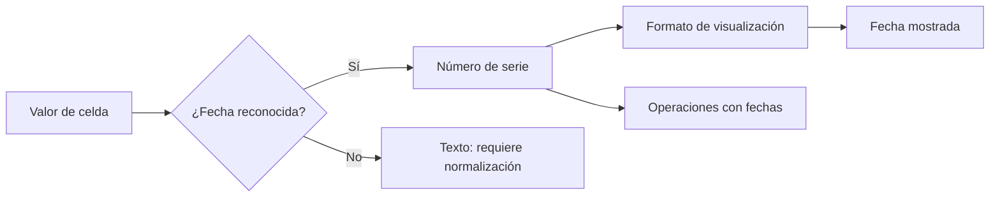
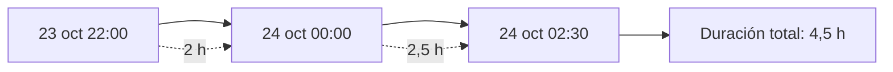
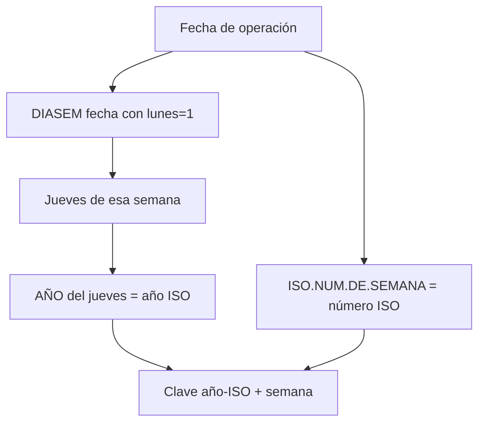
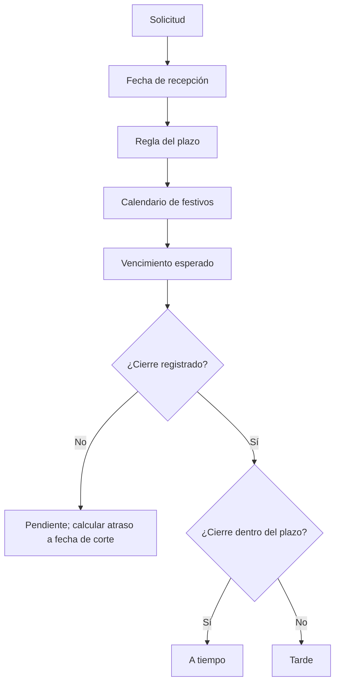
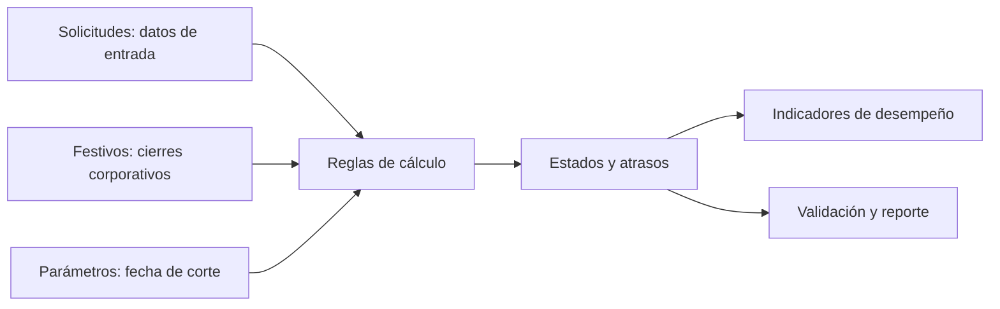

# H11 — Funciones de fecha, hora y calendarios

> **Curso integral Excel · Google Sheets · VBA · Google Apps Script**  
> **Roadmap oficial:** v2.0 · **Ruta:** H · **Módulo:** H11/24  
> **Nivel:** básico-intermedio con extensiones profesionales · **Carga orientativa:** 14 horas  
> **Fecha de revisión documental:** 24 de octubre de 2026 · **Estado:** desarrollado; pendiente de validación del estudiante

**Propósito.** Comprender qué significa una fecha en un modelo numérico, cómo representar el tiempo correctamente, y cómo calcular vencimientos, antigüedad, semanas, días hábiles y plazos sin introducir errores de calendario. Este documento funciona como manual de aprendizaje y referencia rápida de las funciones de fecha y hora de Excel.

**Entorno de referencia:** Excel para Microsoft 365 (escritorio Windows); se identifican variantes según Excel 2024/2021 y Google Sheets. Todas las fórmulas de Excel en español usan `;` como separador de argumentos, `,` como separador decimal y años completos; una instalación distinta puede usar otras convenciones. Si tu Excel reconoce nombres ingleses, consulta la columna en inglés de cada función. Los códigos `yyyy`/`aaaa`, `mm` y `dd` de formato dependen de la interfaz/región y del contexto (minuto frente a mes). **No confundas el separador de argumentos con el separador de fecha.**

**Nota de validación:** las cuentas de calendario deterministas de esta guía se han comprobado con la biblioteca estándar `datetime` de Python. Eso **no equivale** a ejecutar cada fórmula en Excel, especialmente en bordes del calendario de 1900 o en localizaciones de funciones que Microsoft documenta de forma inconsistente.

## Índice curricular aprobado

| Sección / tema | Unidades de contenido |
|---|---|
| **H11.01 — Representación temporal** | H11.01.01 Sistema de fechas: números de serie; horas; sistemas de fecha. H11.01.02 Construcción y extracción: fecha/hora; componentes; conversiones. |
| **H11.02 — Cálculos temporales** | H11.02.01 Intervalos: diferencias; fracciones de año; meses y fines de mes. H11.02.02 Calendarios: días laborales; festivos; semanas ISO. |
| **H11.03 — Aplicaciones** | H11.03.01 Procesos: vencimientos; antigüedad; indicadores de cumplimiento. |

**Resultados de aprendizaje**

1. Distinguir valor temporal, presentación, fecha civil, instante, zona horaria y duración.
2. Construir fechas sin ambigüedad con `FECHA` y comprobar sus componentes.
3. Interpretar números de serie y fracciones de día; evitar truncar duraciones superiores a 24 h.
4. Elegir entre días naturales, años fraccionarios, meses completos y días laborables.
5. Configurar calendarios de empresa con fines de semana y festivos.
6. Reconocer año ISO distinto del año de calendario.
7. Documentar fórmulas reproducibles y probarlas en límites de mes, año y bisiesto.

---

# H11.01 — Representación temporal

## H11.01.01 — Sistema de fechas

### H11.01.01.01 — Números de serie

**Concepto.** Excel modela una fecha como un número de serie (cantidad de días desde el origen de un sistema de fechas) y la hora como su parte fraccionaria. Una fecha **no** es simplemente el texto visible `24/10/2026`: el valor interno es numérico si Excel la reconoció correctamente. La presentación `24/10/2026`, `24-oct-26` o `sábado 24` puede variar sin cambiar el instante representado en el libro.



**Figura 1.** Representación conceptual: valor y formato son capas distintas.

En el sistema predeterminado **1900** de Excel, `01/01/1900` corresponde al serial `1` y `01/01/2025` al serial `45658`. Por compatibilidad histórica, Excel considera incorrectamente que 1900 fue bisiesto: el serial 60 representa la fecha ficticia `29/02/1900`. Por ello, evita análisis históricos cerca de febrero de 1900 sin tratamiento especial. Para fechas contemporáneas, la resta de números de serie devuelve diferencias de días. [Microsoft: sistemas de fechas](https://support.microsoft.com/es-es/excel/date-systems-in-excel) y [Microsoft: año bisiesto](https://learn.microsoft.com/es-es/troubleshoot/microsoft-365-apps/excel/determine-a-leap-year).

**Laboratorio reproducible 1:**

1. En A1 escribe `=FECHA(2026;10;24)`; aplica formato **Fecha**.
2. Copia A1 en A2 mediante `=A1` y cambia solamente el formato de A2 a **General**.
3. En A3 escribe `=A1+7` y aplica formato **Fecha**.
4. Compara A1, A2 y A3: A2 muestra la representación numérica y A3 corresponde al **31/10/2026**.
5. En B1 prueba `=ESNUMERO(A1)`. Debe devolver **VERDADERO**; consulta la ficha de `ESNUMERO` en H13 para su explicación completa.

**Por qué es importante.** Si importas `24/10/2026` como texto, restar dos fechas o comparar vencimientos puede fallar. La apariencia de una fecha no demuestra por sí sola que Excel la almacenó como valor temporal.

**Esquema de captura real recomendado:** abre Excel de escritorio → **Inicio → Número → Formato de celdas** (Ctrl+1) y compara **Fecha** con **General**. Captura pública de referencia del cuadro Formato de celdas: 

*Figura 2. Captura pública de [Excel Easy](https://www.excel-easy.com/examples/add-subtract-time.html), no creada por el curso. Observa la lista de formatos y el campo de vista previa; la apariencia puede diferir en Microsoft 365 actual.*

### H11.01.01.02 — Horas como fracciones de un día

Una hora es una fracción de 24 horas: **12:00 = 0,5; 06:00 = 0,25; 18:00 = 0,75**. Un valor de fecha y hora combina una parte entera y otra decimal.

\[
\text{serial de fecha-hora}=\text{días completos}+\frac{\text{segundos desde medianoche}}{86400}
\]

| Hora | Fracción | Interpretación |
|---|---:|---|
| 00:00 | 0 | Inicio del día |
| 06:00 | 0,25 | Un cuarto de día |
| 12:00 | 0,5 | Medio día |
| 18:00 | 0,75 | Tres cuartos de día |
| 21:30 | 0,895833333… | 21,5 horas de 24 |

**Ejemplo básico:** `=FECHA(2026;10;24)+0,5` representa el 24/10/2026 a las 12:00 (aplica formato de fecha y hora). **Ejemplo intermedio:** `=(B2-A2)*24` expresa en horas una duración entre dos marcas de tiempo numéricas. **Ejemplo empresarial:** si una tarea comenzó el 23/10/2026 a las 22:00 y terminó el 24/10/2026 a las 02:30, entonces duró **4,5 horas**, no −19,5, siempre que las dos celdas incluyan la fecha correcta.



**Figura 3.** Duración que atraviesa medianoche.

**Formato de duración frente a reloj:** `[h]:mm` muestra horas acumuladas superiores a 24; `h:mm` representa la hora dentro del día y puede reiniciarse tras 24 horas. Con 27 horas de duración, `[h]:mm` muestra `27:00` y `h:mm` puede mostrar `3:00`.

**Limitación importante:** Excel almacena fechas y horas como números flotantes; no gestiona automáticamente zonas horarias ni cambios de horario de verano. Una hora civil local no equivale siempre a un instante UTC. Registra explícitamente zona horaria, offset y fuente si estás integrando transacciones globales (la ingeniería de datos temporales externos se desarrollará más adelante).

### H11.01.01.03 — Sistemas 1900 y 1904

Excel admite dos sistemas de fecha. La **misma fecha civil** tiene números de serie separados por **1.462 días** entre ambos sistemas. El de 1900 es el predeterminado actual. El de 1904 existe por compatibilidad con libros y equipos Mac antiguos; **no debes asumir que un Mac moderno utiliza 1904**.

| Fecha civil | Sistema 1900 | Sistema 1904 |
|---|---:|---:|
| 05/07/2011 | 40729 | 39267 |

**Riesgo:** al mezclar valores de libros con sistemas diferentes sin conversión, las fechas pueden desplazarse aproximadamente cuatro años. Para comprobarlo en Excel de Windows: **Archivo → Opciones → Avanzadas → Al calcular este libro → Usar sistema de fechas de 1904**. No cambies esta configuración en un archivo productivo sin una copia y una comprobación de conversión de datos. Fuente: [Microsoft — sistemas de fechas](https://support.microsoft.com/es-es/excel/date-systems-in-excel).

---

## H11.01.02 — Construcción y extracción

### H11.01.02.01 — Construir fecha y hora

**Regla preferida:** en fórmulas reutilizables, utiliza `=FECHA(año;mes;día)` para evitar interpretaciones regionales de fechas escritas como texto. `FECHA(2026;2;29)` normaliza la fecha al 01/03/2026, en vez de rechazarla: verifica si los componentes fueron normalizados cuando una fecha inválida deba considerarse error.

| Fórmula | Resultado |
|---|---|
| `=FECHA(2026;10;24)` | 24/10/2026 |
| `=FECHA(2026;13;1)` | 01/01/2027 |
| `=FECHA(2026;11;0)` | 31/10/2026 |
| `=FECHA(2024;2;29)` | 29/02/2024 |
| `=FECHA(2026;2;29)` | 01/03/2026 |

Para construir horas, la función inglesa es `TIME`. **Advertencia de localización:** el listado de referencia de Microsoft en español presenta `HORA.DET`, pero su artículo individual intercala los nombres `NSHORA`, `HORA` y `TIEMPO`; antes de utilizarla en un libro real, comprueba el nombre reconocido en **Insertar función** o cambia la interfaz al inglés y usa `TIME`. En la guía se utilizará **`NSHORA` en ejemplos de acuerdo con los ejemplos de Microsoft**, siempre etiquetados como dependientes de la localización. Un método alternativo independiente de ese nombre es sumar fracciones: `=FECHA(2026;10;24)+(16*3600+30*60)/86400` → 24/10/2026 16:30. [Documentación Microsoft TIME](https://support.microsoft.com/es-es/excel/functions/time-function).

### H11.01.02.02 — Extraer componentes

Extraer componentes significa convertir una fecha-hora a atributos como año, mes, día, hora, minuto y segundo. Si A2 contiene `24/10/2026 16:35:20` como fecha y hora numéricas:

| Fórmula | Resultado | Uso |
|---|---:|---|
| `=AÑO(A2)` | 2026 | Agrupar por año |
| `=MES(A2)` | 10 | Agrupar por mes |
| `=DIA(A2)` | 24 | Filtrar por día de mes |
| `=HORA(A2)` | 16 | Distribución horaria |
| `=MINUTO(A2)` | 35 | Inspeccionar minutos |
| `=SEGUNDO(A2)` | 20 | Granularidad de segundos |
| `=DIASEM(A2;2)` | 6 | Sábado cuando lunes=1 |

**Error frecuente:** obtener el número de mes `10` no preserva automáticamente el **año**. Agrupar ventas de octubre de 2025 y 2026 solo por `MES` mezclaría periodos distintos. Crea claves año-mes o conserva fechas de inicio de mes, por ejemplo `=FECHA(AÑO(A2);MES(A2);1)`.

### H11.01.02.03 — Convertir texto en fecha y hora

`FECHANUMERO` (inglés `DATEVALUE`) convierte una representación textual de fecha válida **según la configuración regional**. `HORANUMERO` (`TIMEVALUE`) hace lo equivalente con horas. Nunca asumas que el texto `03/04/2026` significa inequívocamente el 3 de abril o el 4 de marzo.

**Método robusto si una fecha proviene de una cadena estricta ISO `YYYY-MM-DD` en A2:**

```excel
=FECHA(VALOR(IZQUIERDA(A2;4));VALOR(EXTRAE(A2;6;2));VALOR(DERECHA(A2;2)))
```

Esta fórmula reconstruye componentes sin depender de la interpretación regional del texto. **Precaución:** `FECHA` normaliza componentes no válidos, así que en procesos críticos valida adicionalmente que el formato y el calendario sean correctos. `VALOR`, `IZQUIERDA`, `EXTRAE` y `DERECHA` se estudian en H10.

**Prueba de comprobación:** A2 = `2026-10-24` (texto) → 24/10/2026 como fecha numérica. A2 = `2026-02-30` no es una fecha válida; una transformación estricta deberá rechazarla, no aceptar silenciosamente el 02/03/2026.

---

# H11.02 — Cálculos temporales

## H11.02.01 — Intervalos

### H11.02.01.01 — Diferencias de días y tiempo

Hay que distinguir tres preguntas diferentes:

1. **¿Cuántos días naturales transcurrieron?** → `=fecha_fin-fecha_inicio` o `=DIAS(fecha_fin;fecha_inicio)`.
2. **¿Cuántos meses o años completos transcurrieron?** → `SIFECHA` con unidades `"m"` o `"y"`, con cautelas.
3. **¿Cuántos días de trabajo existen en el intervalo?** → `DIAS.LAB` o `DIAS.LAB.INTL`, que incluyen extremos laborables.

**Ejemplo:** entre 01/10/2026 y 06/10/2026 transcurrieron **5 días naturales**, pero el recuento de lunes a viernes **incluyendo los extremos** contiene **4 días hábiles** (1, 2, 5 y 6 de octubre). Son métricas diferentes, ambas válidas dependiendo del objetivo.

Para horas entre dos marcas de tiempo `B2` (fin) y `A2` (inicio):

- Horas decimales: `=(B2-A2)*24`.
- Minutos: `=(B2-A2)*1440`.
- Segundos: `=(B2-A2)*86400`.
- Visualización de duración: `=B2-A2` con formato `[h]:mm`.

**Precisión:** redondea solo para presentar o facturar según reglas explícitas; no cortes silenciosamente los decimales antes de sumar.

### H11.02.01.02 — Fracción de año y antigüedad

`FRAC.AÑO` (`YEARFRAC`) expresa parte de un año en función de una **convención de recuento de días**. Sus bases habituales son 0 = US NASD 30/360, 1 = real/real, 2 = real/360, 3 = real/365 y 4 = europea 30/360. La elección **cambia el resultado** y debe corresponder al contrato o estándar financiero.

Ejemplo reproducible: entre el 01/01/2026 y el 31/01/2026 hay **30 días de diferencia** (sin incluir ambos extremos como recuento inclusivo). Con base 3, `=FRAC.AÑO(FECHA(2026;1;1);FECHA(2026;1;31);3)` devuelve `30/365 ≈ 0,08219178`. Con base 2 devuelve `30/360 ≈ 0,08333333`.

`SIFECHA` (`DATEDIF`) mide años, meses o días completos, pero Microsoft advierte que el argumento `"MD"` puede ser incorrecto. **No uses `"MD"` en modelos críticos**; valida rangos, fechas iniciales superiores a las finales y fechas de nacimiento de 29 de febrero contra la política definida por la organización. Fuente: [Microsoft — SIFECHA](https://support.microsoft.com/es-es/excel/functions/datedif-function).

### H11.02.01.03 — Meses, finales de mes y convenciones

`FECHA.MES` (`EDATE`) suma o resta meses conservando en lo posible el día del mes; `FIN.MES` (`EOMONTH`) devuelve la última fecha del mes desplazado.

| Fórmula | Resultado | Observación |
|---|---|---|
| `=FECHA.MES(FECHA(2026;1;31);1)` | 28/02/2026 | Ajusta día a fin de febrero |
| `=FECHA.MES(FECHA(2024;1;31);1)` | 29/02/2024 | Año bisiesto |
| `=FIN.MES(FECHA(2026;2;14);0)` | 28/02/2026 | Fin del mes actual |
| `=FIN.MES(FECHA(2026;10;15);1)` | 30/11/2026 | Fin del siguiente mes |
| `=FIN.MES(FECHA(2026;10;15);-1)+1` | 01/10/2026 | Inicio del mes actual |

**Distinción:** `=FECHA(2026;1;31)+30` suma 30 días naturales; `=FECHA.MES(FECHA(2026;1;31);1)` suma un mes calendario. No son equivalentes.

---

## H11.02.02 — Calendarios

### H11.02.02.01 — Días laborables

`DIA.LAB` (`WORKDAY`) calcula una fecha tras cierto número de **días laborales**; `DIAS.LAB` (`NETWORKDAYS`) cuenta días laborales entre dos fechas **inclusive**. Por defecto excluyen sábados y domingos. El día de inicio **no** es el día laboral 1 al desplazar una fecha mediante `DIA.LAB`; en cambio, `DIAS.LAB` cuenta los extremos que sean laborables.

**Ejemplo:** `=DIA.LAB(FECHA(2026;10;1);3)` → **06/10/2026**, pues los días laborales siguientes son viernes 2, lunes 5 y martes 6. `=DIAS.LAB(FECHA(2026;10;1);FECHA(2026;10;6))` → **4** (jueves 1, viernes 2, lunes 5, martes 6).


**Figura 4.** Contar días hábiles no equivale a sumar días naturales.

### H11.02.02.02 — Festivos y fines de semana alternativos

Las funciones `.INTL` permiten personalizar el fin de semana. Los argumentos `fin_de_semana` incluyen `1` (sábado y domingo), `7` (viernes y sábado), `11` (solo domingo) y máscaras de siete caracteres desde el **lunes**: `0` laborable / `1` no laborable. Ejemplo: `"0000011"` = sábado-domingo; `"0000110"` = viernes-sábado.

**Importante:** las siguientes fechas son un **calendario de simulación**, no un calendario de festivos oficiales de México. En el proyecto de práctica, escribe en `Festivos!A2:A3`:

| Celda | Fecha no laborable de simulación | Descripción |
|---|---|---|
| Festivos!A2 | `=FECHA(2026;10;12)` | Cierre interno de capacitación |
| Festivos!A3 | `=FECHA(2026;11;2)` | Cierre interno de operación |

`=DIA.LAB(FECHA(2026;10;9);3;Festivos!$A$2:$A$3)` → **15/10/2026**, porque omite fin de semana y lunes 12. `=DIA.LAB(FECHA(2026;10;30);2;Festivos!$A$2:$A$3)` → **04/11/2026**, por la exclusión del lunes 2 de noviembre.

**Errores frecuentes:** contar dos veces un festivo que cae en fin de semana; introducir festivos como texto no reconocido; usar una máscara con longitud distinta de siete; asumir que los días feriados de un país aplican a todos los calendarios corporativos. Define responsable, país, región, turno y vigencia de cada lista. La función `.INTL` no convierte una fecha local a zona horaria de otra región.

### H11.02.02.03 — Semanas ISO

La norma ISO 8601 define semanas que comienzan en lunes. La semana 1 es la que contiene el primer jueves del año (equivalentemente, el 4 de enero). Por tanto, el **año de semana ISO** puede diferir del año de calendario.

| Fecha | Día | Año calendario | Año ISO | Semana ISO |
|---|---|---:|---:|---:|
| 28/12/2026 | Lunes | 2026 | 2026 | 53 |
| 01/01/2027 | Viernes | 2027 | 2026 | 53 |
| 04/01/2027 | Lunes | 2027 | 2027 | 1 |

En Excel, `=ISO.NUM.DE.SEMANA(FECHA(2027;1;1))` devuelve **53**, aunque `=AÑO(FECHA(2027;1;1))` devuelve **2027**. Para calcular el **año ISO** de la fecha ubicada en A2, utiliza `=AÑO(A2-DIASEM(A2;2)+4)`, que desplaza al jueves de su semana.



**Figura 5.** Evitar agrupar únicamente por número de semana: `2026-W53` y `2027-W01` son periodos diferentes. Fuente: [Microsoft ISO.NUM.DE.SEMANA](https://support.microsoft.com/es-es/excel/functions/isoweeknum-function).

---

# H11.03 — Aplicaciones empresariales

## H11.03.01 — Procesos

### H11.03.01.01 — Vencimientos y obligaciones

Una **fecha de vencimiento** puede depender de reglas contractuales diferentes: (a) N días naturales después de la emisión; (b) N días laborales después; (c) fin de mes; (d) mismo día del mes siguiente. **No sustituyas una regla por otra** sin confirmarlo.

Ejemplo: fecha de emisión = 30/10/2026 y plazo de 2 días laborables, con cierre simulado el 02/11/2026. La fecha de vencimiento es **04/11/2026**, pero sumar simplemente `+2` produciría **01/11/2026** (domingo) y sería incorrecto para esa política.

**Reglas de negocio recomendadas:** especificar si se incluye el día inicial, cómo se cuentan los festivos, qué ocurre al vencer en fin de semana, qué hora y zona establecen el corte, si puede corregirse retrospectivamente el calendario y quién aprueba excepciones.

### H11.03.01.02 — Antigüedad de clientes, activos y saldos

La antigüedad de un saldo puede medirse en días desde su fecha de emisión o en días vencidos a partir de la fecha límite. Son indicadores distintos. Para un documento con vencimiento en C2 y fecha de corte fija en F1:

```excel
=MAX(0;$F$1-C2)
```

El resultado representa **días de atraso no negativos** (usa el concepto de `MAX`, desarrollado en H09). Si quieres saber cuántos días faltan antes del vencimiento: `=MAX(0;C2-$F$1)`.

**Diseño de indicadores:** para antigüedad de deuda se suelen aplicar categorías configurables como `0`, `1–7`, `8–30` y `31+` días vencidos. Los umbrales son decisiones de negocio, no reglas universales.

**Advertencia:** `=HOY()` es dinámico; el resultado puede cambiar al recalcularse mañana. Una auditoría reproducible debe usar una **fecha de corte almacenada**, por ejemplo `=FECHA(2026;11;5)` en `Parametros!B2`.

### H11.03.01.03 — Indicadores de cumplimiento y nivel de servicio

**SLA (Service Level Agreement, acuerdo de nivel de servicio)** puede medirse respecto de días naturales, hábiles o ventanas horarias específicas. Es obligatorio documentar qué métrica usa el acuerdo. Ejemplo de cumplimiento por fecha (vencimiento en C2, cierre real en D2):

```excel
=SI(D2="";"Pendiente";SI(D2<=C2;"A tiempo";"Tarde"))
```

**Limitación:** esta fórmula compara **fechas y/o horas tal como estén almacenadas**. Si C2 está a medianoche y D2 incluye una hora posterior del mismo día, considerará tarde la tarea. Para acuerdos que consideren solo la fecha, usa `=SI(D2="";"Pendiente";SI(ENTERO(D2)<=ENTERO(C2);"A tiempo";"Tarde"))` y documenta explícitamente la decisión. `SI` se desarrolla en H07 y `ENTERO` en H08.



**Figura 6.** Evaluación conceptual de cumplimiento sobre un calendario controlado.

### Laboratorio de integración: modelo de plazos

Crea tres hojas: `Solicitudes`, `Festivos`, `Parametros`. Los encabezados de `Solicitudes!A1:G1` serán `ID`, `Emisión`, `Plazo_hábil`, `Vencimiento`, `Cierre`, `Estado`, `Atraso_días`. Las fechas de `Festivos` son los dos cierres simulados descritos antes. En `Parametros!B2` registra **05/11/2026** como fecha de corte **fija**. Introduce:

| ID | Emisión | Plazo hábil | Cierre real |
|---|---|---:|---|
| S01 | 01/10/2026 | 3 | 06/10/2026 |
| S02 | 02/10/2026 | 5 | 12/10/2026 |
| S03 | 09/10/2026 | 3 | 16/10/2026 |
| S04 | 15/10/2026 | 4 | (vacío) |
| S05 | 30/10/2026 | 2 | 04/11/2026 |

**Fórmulas (a partir de fila 2, copiar hacia abajo):**

```excel
D2: =DIA.LAB(B2;C2;Festivos!$A$2:$A$3)
F2: =SI(E2="";"Pendiente";SI(ENTERO(E2)<=D2;"A tiempo";"Tarde"))
G2: =SI(E2="";MAX(0;Parametros!$B$2-D2);MAX(0;ENTERO(E2)-D2))
```

**Resultados esperados (sistema lunes–viernes, sin otros festivos):**

*El registro S02 se recibe por un canal digital incluso durante el cierre interno del 12 de octubre; es un caso de prueba deliberado. Si la organización prohíbe registrar cierres durante sus fechas no laborables, este registro también debe marcarse como anomalía de calidad.*

| ID | Vencimiento | Estado | Atraso_días |
|---|---|---|---:|
| S01 | 06/10/2026 | A tiempo | 0 |
| S02 | 09/10/2026 | Tarde | 3 |
| S03 | 15/10/2026 | Tarde | 1 |
| S04 | 21/10/2026 | Pendiente | 15 |
| S05 | 04/11/2026 | A tiempo | 0 |

> El atributo `Atraso_días` expresa **días naturales** transcurridos después de la fecha límite. Aunque el vencimiento se calculó con días laborables, el atraso no lo hace. Cambia la fórmula a `DIAS.LAB` con límites controlados si el indicador contractual exige atraso laboral.

---

# Guía de compatibilidad Excel y Google Sheets

Google Sheets ofrece gran parte de las funciones homólogas, pero hay diferencias de sintaxis localizadas y de nombres. En particular, Google documenta `EPOCHTODATE` para transformar marcas de tiempo Unix, una función de Sheets que no pertenece a la categoría tradicional de Excel aquí inventariada. Para operaciones con marcas Unix, considera si el dato representa segundos, milisegundos o microsegundos y qué zona horaria se aplicará.

| Concepto | Excel (ES) | Excel (EN) | Sheets: referencia general |
|---|---|---|---|
| Fecha | FECHA | DATE | DATE / FECHA |
| Fecha actual | HOY | TODAY | TODAY / HOY |
| Fecha y hora actual | AHORA | NOW | NOW / AHORA |
| Último día de mes | FIN.MES | EOMONTH | EOMONTH |
| Desplazamiento en meses | FECHA.MES | EDATE | EDATE |
| Días laborables | DIAS.LAB | NETWORKDAYS | NETWORKDAYS |
| Días laborables personalizados | DIAS.LAB.INTL | NETWORKDAYS.INTL | NETWORKDAYS.INTL |
| Fecha laboral futura | DIA.LAB | WORKDAY | WORKDAY |
| Semana ISO | ISO.NUM.DE.SEMANA | ISOWEEKNUM | ISOWEEKNUM |
| Marca Unix a fecha | Sin función básica equivalente | — | EPOCHTODATE |

No presupongas que una fórmula localizada puede copiarse literalmente entre ambas plataformas: configuración regional, nombres traducidos, orden de argumentos y tipos pueden diferir. Referencias: [Microsoft — funciones fecha y hora](https://support.microsoft.com/es-es/excel/date-and-time-functions-reference), [Google — lista de funciones](https://support.google.com/docs/table/25273?hl=es).

---

# Catálogo maestro de funciones H11

Las fichas se estructuran como referencia de aprendizaje. El catálogo de Excel se basa en la categoría oficial **Fecha y hora** (25 funciones), no en una selección informal. Algunas funciones tienen nombres de documentación española inconsistentes; se conserva el nombre inglés inequívoco y se señala expresamente dónde aplicar una prueba de localización. Cada ficha incluye propósito, sintaxis, argumentos, tres ejemplos de aplicación, retorno, precauciones y equivalencia general. Los ejemplos señalan explícitamente el separador `;` en fórmulas españolas.

## Inventario trazable (25 funciones oficiales)

| ID de ficha | ES (según referencia/documentación) | EN | Tema responsable |
|---|---|---|---|
| H11-F01 | `FECHA` | `DATE` | H11.01.02.01 |
| H11-F02 | `SIFECHA` | `DATEDIF` | H11.02.01.02 |
| H11-F03 | `FECHANUMERO` | `DATEVALUE` | H11.01.02.03 |
| H11-F04 | `DIA` | `DAY` | H11.01.02.02 |
| H11-F05 | `DIAS` | `DAYS` | H11.02.01.01 |
| H11-F06 | `DIAS360` | `DAYS360` | H11.02.01.02 |
| H11-F07 | `FECHA.MES` | `EDATE` | H11.02.01.03 |
| H11-F08 | `FIN.MES` | `EOMONTH` | H11.02.01.03 |
| H11-F09 | `HORA` | `HOUR` | H11.01.02.02 |
| H11-F10 | `ISO.NUM.DE.SEMANA` | `ISOWEEKNUM` | H11.02.02.03 |
| H11-F11 | `MINUTO` | `MINUTE` | H11.01.02.02 |
| H11-F12 | `MES` | `MONTH` | H11.01.02.02 |
| H11-F13 | `DIAS.LAB` | `NETWORKDAYS` | H11.02.02.01 |
| H11-F14 | `DIAS.LAB.INTL` | `NETWORKDAYS.INTL` | H11.02.02.02 |
| H11-F15 | `AHORA` | `NOW` | H11.01.02.01 |
| H11-F16 | `SEGUNDO` | `SECOND` | H11.01.02.02 |
| H11-F17 | `HORA.DET [ver nota]` | `TIME` | H11.01.02.01 |
| H11-F18 | `HORANUMERO` | `TIMEVALUE` | H11.01.02.03 |
| H11-F19 | `HOY` | `TODAY` | H11.01.02.01 |
| H11-F20 | `DIASEM` | `WEEKDAY` | H11.02.02.03 |
| H11-F21 | `NUM.DE.SEMANA` | `WEEKNUM` | H11.02.02.03 |
| H11-F22 | `DIA.LAB` | `WORKDAY` | H11.02.02.01 |
| H11-F23 | `DIA.LAB.INTL` | `WORKDAY.INTL` | H11.02.02.02 |
| H11-F24 | `AÑO` | `YEAR` | H11.01.02.02 |
| H11-F25 | `FRAC.AÑO` | `YEARFRAC` | H11.02.01.02 |

**Nota sobre nomenclatura:** `DATEVALUE` aparece en algunas páginas traducidas como `DATEVALUE`, pero la categoría general y el uso español documentan `FECHANUMERO`. Para `TIME`, la página oficial en español no mantiene una sola forma consistente: la ficha identifica inequívocamente la función por su nombre inglés. No se afirma que los nombres localizados inconsistentes sean intercambiables.

## Fichas individuales de referencia

### H11-F01 — `FECHA` / `DATE`

**Unidad principal:** `H11.01.02.01`. **Categoría:** fecha y hora. **Propósito:** construir fechas a partir de componentes.

- **Sintaxis:** `FECHA(año;mes;día)`.
- **Argumentos:** año (oblig.); mes (oblig.); día (oblig.). **Valor devuelto:** Serial de fecha.
- **Ejemplo básico:** `=FECHA(2026;10;24)` → **24/10/2026**.
- **Ejemplo intermedio:** `=FECHA(2026;13;1)` → **01/01/2027**.
- **Caso profesional:** `=FECHA(AÑO(A2);MES(A2);1)` → Primer día del mes de A2.
- **Interpretación:** el resultado debe leerse conforme al valor devuelto; si es un serial de fecha/hora, aplica un formato temporal apropiado sin alterar el número.
- **Errores/limitaciones:** Normaliza días y meses fuera del calendario; valida la fecha original antes de aceptarla.
- **Excel ↔ Sheets:** consulta la tabla de equivalencias de esta guía y verifica nombres locales, separadores y disponibilidad; evita suponer equivalencia exacta de interpretación regional. **Funciones relacionadas:** revisa las demás fichas del grupo temporal y los ejemplos de la sección `H11.01.02.01`.
- **Micropráctica:** cambia las fechas del ejemplo a un fin de mes o de año, anticipa el resultado y verifica que el modelo no confunda días naturales con días hábiles.

### H11-F02 — `SIFECHA` / `DATEDIF`

**Unidad principal:** `H11.02.01.02`. **Categoría:** fecha y hora. **Propósito:** medir periodos completos entre dos fechas.

- **Sintaxis:** `SIFECHA(fecha_inicial;fecha_final;unidad)`.
- **Argumentos:** inicio (oblig.); fin (oblig.); unidad Y/M/D/YM/YD/MD (oblig.). **Valor devuelto:** Número de periodos completos.
- **Ejemplo básico:** `=SIFECHA(FECHA(2020;1;1);FECHA(2026;1;1);"Y")` → **6 años**.
- **Ejemplo intermedio:** `=SIFECHA(FECHA(2026;1;1);FECHA(2026;10;24);"M")` → **9 meses completos**.
- **Caso profesional:** `=SIFECHA(B2;C2;"Y")` → Antigüedad en años completos.
- **Interpretación:** el resultado debe leerse conforme al valor devuelto; si es un serial de fecha/hora, aplica un formato temporal apropiado sin alterar el número.
- **Errores/limitaciones:** Evitar la unidad "MD" por problemas conocidos; el inicio no puede ser posterior al final.
- **Excel ↔ Sheets:** consulta la tabla de equivalencias de esta guía y verifica nombres locales, separadores y disponibilidad; evita suponer equivalencia exacta de interpretación regional. **Funciones relacionadas:** revisa las demás fichas del grupo temporal y los ejemplos de la sección `H11.02.01.02`.
- **Micropráctica:** cambia las fechas del ejemplo a un fin de mes o de año, anticipa el resultado y verifica que el modelo no confunda días naturales con días hábiles.

### H11-F03 — `FECHANUMERO` / `DATEVALUE`

**Unidad principal:** `H11.01.02.03`. **Categoría:** fecha y hora. **Propósito:** convertir texto de fecha a serial.

- **Sintaxis:** `FECHANUMERO(texto_de_fecha)`.
- **Argumentos:** texto (oblig.; reconocido según región). **Valor devuelto:** Serial de fecha.
- **Ejemplo básico:** `=FECHANUMERO("24/10/2026")` → **24/10/2026 solo si la región interpreta día/mes/año**.
- **Ejemplo intermedio:** `=ESNUMERO(FECHANUMERO(A2))` → **VERDADERO para texto de fecha reconocido**.
- **Caso profesional:** `=FECHANUMERO(B2)` → Convertir fecha de origen textual validado.
- **Interpretación:** el resultado debe leerse conforme al valor devuelto; si es un serial de fecha/hora, aplica un formato temporal apropiado sin alterar el número.
- **Errores/limitaciones:** Depende del idioma y de la configuración regional; preferir FECHA con componentes si el origen es ISO estricto.
- **Excel ↔ Sheets:** consulta la tabla de equivalencias de esta guía y verifica nombres locales, separadores y disponibilidad; evita suponer equivalencia exacta de interpretación regional. **Funciones relacionadas:** revisa las demás fichas del grupo temporal y los ejemplos de la sección `H11.01.02.03`.
- **Micropráctica:** cambia las fechas del ejemplo a un fin de mes o de año, anticipa el resultado y verifica que el modelo no confunda días naturales con días hábiles.

### H11-F04 — `DIA` / `DAY`

**Unidad principal:** `H11.01.02.02`. **Categoría:** fecha y hora. **Propósito:** extraer día de mes.

- **Sintaxis:** `DIA(núm_de_serie)`.
- **Argumentos:** fecha/serial (oblig.). **Valor devuelto:** Entero de 1 a 31.
- **Ejemplo básico:** `=DIA(FECHA(2026;10;24))` → **24**.
- **Ejemplo intermedio:** `=DIA(FIN.MES(FECHA(2024;2;1);0))` → **29**.
- **Caso profesional:** `=DIA(B2)` → Día del vencimiento de B2.
- **Interpretación:** el resultado debe leerse conforme al valor devuelto; si es un serial de fecha/hora, aplica un formato temporal apropiado sin alterar el número.
- **Errores/limitaciones:** No devuelve el día de la semana. Para ello utiliza DIASEM.
- **Excel ↔ Sheets:** consulta la tabla de equivalencias de esta guía y verifica nombres locales, separadores y disponibilidad; evita suponer equivalencia exacta de interpretación regional. **Funciones relacionadas:** revisa las demás fichas del grupo temporal y los ejemplos de la sección `H11.01.02.02`.
- **Micropráctica:** cambia las fechas del ejemplo a un fin de mes o de año, anticipa el resultado y verifica que el modelo no confunda días naturales con días hábiles.

### H11-F05 — `DIAS` / `DAYS`

**Unidad principal:** `H11.02.01.01`. **Categoría:** fecha y hora. **Propósito:** medir diferencia de días naturales.

- **Sintaxis:** `DIAS(fecha_final;fecha_inicial)`.
- **Argumentos:** fecha final (oblig.); inicial (oblig.). **Valor devuelto:** Número entero o decimal de días.
- **Ejemplo básico:** `=DIAS(FECHA(2026;10;6);FECHA(2026;10;1))` → **5 días**.
- **Ejemplo intermedio:** `=DIAS(FECHA(2026;10;1);FECHA(2026;10;6))` → **−5 días**.
- **Caso profesional:** `=DIAS(C2;B2)` → Días naturales entre dos fechas.
- **Interpretación:** el resultado debe leerse conforme al valor devuelto; si es un serial de fecha/hora, aplica un formato temporal apropiado sin alterar el número.
- **Errores/limitaciones:** No cuenta automáticamente ambos extremos como días incluidos; no excluye fines de semana.
- **Excel ↔ Sheets:** consulta la tabla de equivalencias de esta guía y verifica nombres locales, separadores y disponibilidad; evita suponer equivalencia exacta de interpretación regional. **Funciones relacionadas:** revisa las demás fichas del grupo temporal y los ejemplos de la sección `H11.02.01.01`.
- **Micropráctica:** cambia las fechas del ejemplo a un fin de mes o de año, anticipa el resultado y verifica que el modelo no confunda días naturales con días hábiles.

### H11-F06 — `DIAS360` / `DAYS360`

**Unidad principal:** `H11.02.01.02`. **Categoría:** fecha y hora. **Propósito:** aplicar convención de año financiero de 360 días.

- **Sintaxis:** `DIAS360(fecha_inicial;fecha_final;[método])`.
- **Argumentos:** inicio (oblig.); fin (oblig.); método opcional FALSO US/VERDADERO europeo. **Valor devuelto:** Número de días convencionales 30/360.
- **Ejemplo básico:** `=DIAS360(FECHA(2026;1;1);FECHA(2026;2;1))` → **30**.
- **Ejemplo intermedio:** `=DIAS360(FECHA(2026;2;1);FECHA(2026;3;1);VERDADERO)` → **30**.
- **Caso profesional:** `=DIAS360(B2;C2;VERDADERO)` → Interés contractual europeo 30/360.
- **Interpretación:** el resultado debe leerse conforme al valor devuelto; si es un serial de fecha/hora, aplica un formato temporal apropiado sin alterar el número.
- **Errores/limitaciones:** No cuenta días reales del calendario; convenciones US y europea difieren cerca de fin de mes.
- **Excel ↔ Sheets:** consulta la tabla de equivalencias de esta guía y verifica nombres locales, separadores y disponibilidad; evita suponer equivalencia exacta de interpretación regional. **Funciones relacionadas:** revisa las demás fichas del grupo temporal y los ejemplos de la sección `H11.02.01.02`.
- **Micropráctica:** cambia las fechas del ejemplo a un fin de mes o de año, anticipa el resultado y verifica que el modelo no confunda días naturales con días hábiles.

### H11-F07 — `FECHA.MES` / `EDATE`

**Unidad principal:** `H11.02.01.03`. **Categoría:** fecha y hora. **Propósito:** desplazar fechas por meses calendario.

- **Sintaxis:** `FECHA.MES(fecha_inicial;meses)`.
- **Argumentos:** fecha inicial (oblig.); desplazamiento de meses (oblig.). **Valor devuelto:** Serial de fecha.
- **Ejemplo básico:** `=FECHA.MES(FECHA(2026;1;31);1)` → **28/02/2026**.
- **Ejemplo intermedio:** `=FECHA.MES(FECHA(2024;1;31);1)` → **29/02/2024**.
- **Caso profesional:** `=FECHA.MES(B2;12)` → Renovación contractual un año calendario posterior.
- **Interpretación:** el resultado debe leerse conforme al valor devuelto; si es un serial de fecha/hora, aplica un formato temporal apropiado sin alterar el número.
- **Errores/limitaciones:** No es igual a sumar 30, 31 o 365 días; validar política de fechas de fin de mes.
- **Excel ↔ Sheets:** consulta la tabla de equivalencias de esta guía y verifica nombres locales, separadores y disponibilidad; evita suponer equivalencia exacta de interpretación regional. **Funciones relacionadas:** revisa las demás fichas del grupo temporal y los ejemplos de la sección `H11.02.01.03`.
- **Micropráctica:** cambia las fechas del ejemplo a un fin de mes o de año, anticipa el resultado y verifica que el modelo no confunda días naturales con días hábiles.

### H11-F08 — `FIN.MES` / `EOMONTH`

**Unidad principal:** `H11.02.01.03`. **Categoría:** fecha y hora. **Propósito:** obtener la última fecha de mes.

- **Sintaxis:** `FIN.MES(fecha_inicial;meses)`.
- **Argumentos:** fecha inicial (oblig.); desplazamiento en meses (oblig.). **Valor devuelto:** Serial de último día del mes.
- **Ejemplo básico:** `=FIN.MES(FECHA(2026;2;14);0)` → **28/02/2026**.
- **Ejemplo intermedio:** `=FIN.MES(FECHA(2026;10;15);1)` → **30/11/2026**.
- **Caso profesional:** `=FIN.MES(B2;0)` → Cierre del mes de una factura.
- **Interpretación:** el resultado debe leerse conforme al valor devuelto; si es un serial de fecha/hora, aplica un formato temporal apropiado sin alterar el número.
- **Errores/limitaciones:** Para primer día del mes usar FIN.MES(fecha;−1)+1.
- **Excel ↔ Sheets:** consulta la tabla de equivalencias de esta guía y verifica nombres locales, separadores y disponibilidad; evita suponer equivalencia exacta de interpretación regional. **Funciones relacionadas:** revisa las demás fichas del grupo temporal y los ejemplos de la sección `H11.02.01.03`.
- **Micropráctica:** cambia las fechas del ejemplo a un fin de mes o de año, anticipa el resultado y verifica que el modelo no confunda días naturales con días hábiles.

### H11-F09 — `HORA` / `HOUR`

**Unidad principal:** `H11.01.02.02`. **Categoría:** fecha y hora. **Propósito:** extraer la hora del reloj.

- **Sintaxis:** `HORA(núm_de_serie)`.
- **Argumentos:** fecha-hora (oblig.). **Valor devuelto:** Entero 0 a 23.
- **Ejemplo básico:** `=HORA(0,75)` → **18**.
- **Ejemplo intermedio:** `=HORA(FECHA(2026;10;24)+0,5)` → **12**.
- **Caso profesional:** `=HORA(B2)` → Hora de recepción de un ticket.
- **Interpretación:** el resultado debe leerse conforme al valor devuelto; si es un serial de fecha/hora, aplica un formato temporal apropiado sin alterar el número.
- **Errores/limitaciones:** Extrae hora de reloj; no mide horas transcurridas ni duraciones mayores de 24 horas.
- **Excel ↔ Sheets:** consulta la tabla de equivalencias de esta guía y verifica nombres locales, separadores y disponibilidad; evita suponer equivalencia exacta de interpretación regional. **Funciones relacionadas:** revisa las demás fichas del grupo temporal y los ejemplos de la sección `H11.01.02.02`.
- **Micropráctica:** cambia las fechas del ejemplo a un fin de mes o de año, anticipa el resultado y verifica que el modelo no confunda días naturales con días hábiles.

### H11-F10 — `ISO.NUM.DE.SEMANA` / `ISOWEEKNUM`

**Unidad principal:** `H11.02.02.03`. **Categoría:** fecha y hora. **Propósito:** calcular semana ISO.

- **Sintaxis:** `ISO.NUM.DE.SEMANA(fecha)`.
- **Argumentos:** fecha (oblig.). **Valor devuelto:** Semana ISO 1 a 53.
- **Ejemplo básico:** `=ISO.NUM.DE.SEMANA(FECHA(2027;1;1))` → **53**.
- **Ejemplo intermedio:** `=ISO.NUM.DE.SEMANA(FECHA(2027;1;4))` → **1**.
- **Caso profesional:** `=ISO.NUM.DE.SEMANA(B2)` → Número de semana operativa ISO.
- **Interpretación:** el resultado debe leerse conforme al valor devuelto; si es un serial de fecha/hora, aplica un formato temporal apropiado sin alterar el número.
- **Errores/limitaciones:** Año ISO puede ser distinto del año calendario: calcula ambos.
- **Excel ↔ Sheets:** consulta la tabla de equivalencias de esta guía y verifica nombres locales, separadores y disponibilidad; evita suponer equivalencia exacta de interpretación regional. **Funciones relacionadas:** revisa las demás fichas del grupo temporal y los ejemplos de la sección `H11.02.02.03`.
- **Micropráctica:** cambia las fechas del ejemplo a un fin de mes o de año, anticipa el resultado y verifica que el modelo no confunda días naturales con días hábiles.

### H11-F11 — `MINUTO` / `MINUTE`

**Unidad principal:** `H11.01.02.02`. **Categoría:** fecha y hora. **Propósito:** extraer componente de minuto.

- **Sintaxis:** `MINUTO(núm_de_serie)`.
- **Argumentos:** fecha-hora (oblig.). **Valor devuelto:** Entero 0 a 59.
- **Ejemplo básico:** `=MINUTO(0,5)` → **0**.
- **Ejemplo intermedio:** `=MINUTO(0,25+30/1440)` → **30**.
- **Caso profesional:** `=MINUTO(B2)` → Minuto de registro de un evento.
- **Interpretación:** el resultado debe leerse conforme al valor devuelto; si es un serial de fecha/hora, aplica un formato temporal apropiado sin alterar el número.
- **Errores/limitaciones:** No devuelve minutos acumulados de una duración.
- **Excel ↔ Sheets:** consulta la tabla de equivalencias de esta guía y verifica nombres locales, separadores y disponibilidad; evita suponer equivalencia exacta de interpretación regional. **Funciones relacionadas:** revisa las demás fichas del grupo temporal y los ejemplos de la sección `H11.01.02.02`.
- **Micropráctica:** cambia las fechas del ejemplo a un fin de mes o de año, anticipa el resultado y verifica que el modelo no confunda días naturales con días hábiles.

### H11-F12 — `MES` / `MONTH`

**Unidad principal:** `H11.01.02.02`. **Categoría:** fecha y hora. **Propósito:** extraer mes calendario.

- **Sintaxis:** `MES(núm_de_serie)`.
- **Argumentos:** fecha (oblig.). **Valor devuelto:** Entero 1 a 12.
- **Ejemplo básico:** `=MES(FECHA(2026;10;24))` → **10**.
- **Ejemplo intermedio:** `=MES(FECHA(2027;1;1))` → **1**.
- **Caso profesional:** `=MES(B2)` → Mes de una operación.
- **Interpretación:** el resultado debe leerse conforme al valor devuelto; si es un serial de fecha/hora, aplica un formato temporal apropiado sin alterar el número.
- **Errores/limitaciones:** Para agregaciones multianuales, agrupa por AÑO y MES conjuntamente.
- **Excel ↔ Sheets:** consulta la tabla de equivalencias de esta guía y verifica nombres locales, separadores y disponibilidad; evita suponer equivalencia exacta de interpretación regional. **Funciones relacionadas:** revisa las demás fichas del grupo temporal y los ejemplos de la sección `H11.01.02.02`.
- **Micropráctica:** cambia las fechas del ejemplo a un fin de mes o de año, anticipa el resultado y verifica que el modelo no confunda días naturales con días hábiles.

### H11-F13 — `DIAS.LAB` / `NETWORKDAYS`

**Unidad principal:** `H11.02.02.01`. **Categoría:** fecha y hora. **Propósito:** contar días hábiles con sábado/domingo libres.

- **Sintaxis:** `DIAS.LAB(fecha_inicial;fecha_final;[vacaciones])`.
- **Argumentos:** inicio y fin (oblig.); festivos opcionales. **Valor devuelto:** Días hábiles inclusivos.
- **Ejemplo básico:** `=DIAS.LAB(FECHA(2026;10;1);FECHA(2026;10;6))` → **4**.
- **Ejemplo intermedio:** `=DIAS.LAB(FECHA(2026;10;9);FECHA(2026;10;15);Festivos!$A$2:$A$3)` → **4: vie 9, mar 13, mié 14, jue 15**.
- **Caso profesional:** `=DIAS.LAB(B2;C2;Festivos!$A$2:$A$3)` → Días hábiles dentro de un periodo.
- **Interpretación:** el resultado debe leerse conforme al valor devuelto; si es un serial de fecha/hora, aplica un formato temporal apropiado sin alterar el número.
- **Errores/limitaciones:** Incluye los extremos laborables; no cuenta jornadas parciales ni horas de servicio.
- **Excel ↔ Sheets:** consulta la tabla de equivalencias de esta guía y verifica nombres locales, separadores y disponibilidad; evita suponer equivalencia exacta de interpretación regional. **Funciones relacionadas:** revisa las demás fichas del grupo temporal y los ejemplos de la sección `H11.02.02.01`.
- **Micropráctica:** cambia las fechas del ejemplo a un fin de mes o de año, anticipa el resultado y verifica que el modelo no confunda días naturales con días hábiles.

### H11-F14 — `DIAS.LAB.INTL` / `NETWORKDAYS.INTL`

**Unidad principal:** `H11.02.02.02`. **Categoría:** fecha y hora. **Propósito:** contar días hábiles con descanso flexible.

- **Sintaxis:** `DIAS.LAB.INTL(fecha_inicial;fecha_final;[fin_de_semana];[vacaciones])`.
- **Argumentos:** inicio/fin (oblig.); máscara o código opcional; festivos opcionales. **Valor devuelto:** Días laborables inclusivos personalizados.
- **Ejemplo básico:** `=DIAS.LAB.INTL(FECHA(2026;10;1);FECHA(2026;10;7);11)` → **6 (solo domingo no laborable)**.
- **Ejemplo intermedio:** `=DIAS.LAB.INTL(FECHA(2026;10;1);FECHA(2026;10;7);"0000011")` → **5 (sábado y domingo no laborables)**.
- **Caso profesional:** `=DIAS.LAB.INTL(B2;C2;"0000110";Festivos!$A$2:$A$3)` → Jornadas con descanso viernes-sábado.
- **Interpretación:** el resultado debe leerse conforme al valor devuelto; si es un serial de fecha/hora, aplica un formato temporal apropiado sin alterar el número.
- **Errores/limitaciones:** La máscara de 7 posiciones comienza en lunes; 1 significa descanso.
- **Excel ↔ Sheets:** consulta la tabla de equivalencias de esta guía y verifica nombres locales, separadores y disponibilidad; evita suponer equivalencia exacta de interpretación regional. **Funciones relacionadas:** revisa las demás fichas del grupo temporal y los ejemplos de la sección `H11.02.02.02`.
- **Micropráctica:** cambia las fechas del ejemplo a un fin de mes o de año, anticipa el resultado y verifica que el modelo no confunda días naturales con días hábiles.

### H11-F15 — `AHORA` / `NOW`

**Unidad principal:** `H11.01.02.01`. **Categoría:** fecha y hora. **Propósito:** obtener fecha-hora actual al recálculo.

- **Sintaxis:** `AHORA()`.
- **Argumentos:** sin argumentos. **Valor devuelto:** Serial con fecha y hora actuales.
- **Ejemplo básico:** `=AHORA()` → **Fecha-hora local al recálculo (resultado variable)**.
- **Ejemplo intermedio:** `=AHORA()-0,5` → **Doce horas antes del instante de recálculo**.
- **Caso profesional:** `=AHORA()-B2` → Antigüedad instantánea en días.
- **Interpretación:** el resultado debe leerse conforme al valor devuelto; si es un serial de fecha/hora, aplica un formato temporal apropiado sin alterar el número.
- **Errores/limitaciones:** Es volátil y NO un reloj que se actualice cada segundo; evita usarlo como marca de auditoría fija.
- **Excel ↔ Sheets:** consulta la tabla de equivalencias de esta guía y verifica nombres locales, separadores y disponibilidad; evita suponer equivalencia exacta de interpretación regional. **Funciones relacionadas:** revisa las demás fichas del grupo temporal y los ejemplos de la sección `H11.01.02.01`.
- **Micropráctica:** cambia las fechas del ejemplo a un fin de mes o de año, anticipa el resultado y verifica que el modelo no confunda días naturales con días hábiles.

### H11-F16 — `SEGUNDO` / `SECOND`

**Unidad principal:** `H11.01.02.02`. **Categoría:** fecha y hora. **Propósito:** extraer segundo.

- **Sintaxis:** `SEGUNDO(núm_de_serie)`.
- **Argumentos:** fecha-hora (oblig.). **Valor devuelto:** Entero 0 a 59.
- **Ejemplo básico:** `=SEGUNDO(0,5)` → **0**.
- **Ejemplo intermedio:** `=SEGUNDO(30/86400)` → **30**.
- **Caso profesional:** `=SEGUNDO(B2)` → Segundo de un timestamp.
- **Interpretación:** el resultado debe leerse conforme al valor devuelto; si es un serial de fecha/hora, aplica un formato temporal apropiado sin alterar el número.
- **Errores/limitaciones:** Redondeos de representación pueden afectar cálculos con fracciones muy pequeñas.
- **Excel ↔ Sheets:** consulta la tabla de equivalencias de esta guía y verifica nombres locales, separadores y disponibilidad; evita suponer equivalencia exacta de interpretación regional. **Funciones relacionadas:** revisa las demás fichas del grupo temporal y los ejemplos de la sección `H11.01.02.02`.
- **Micropráctica:** cambia las fechas del ejemplo a un fin de mes o de año, anticipa el resultado y verifica que el modelo no confunda días naturales con días hábiles.

### H11-F17 — `HORA.DET [ver nota]` / `TIME`

**Unidad principal:** `H11.01.02.01`. **Categoría:** fecha y hora. **Propósito:** construir fracción de día a partir de componentes.

- **Sintaxis:** `TIME(hora;minuto;segundo) [nombre inglés sin ambigüedad]`.
- **Argumentos:** hora, minuto y segundo (los tres obligatorios). **Valor devuelto:** Fracción de día.
- **Ejemplo básico:** `=TIME(12,0,0) [Excel en inglés]` → **0,5**.
- **Ejemplo intermedio:** `=TIME(27,0,0) [Excel en inglés]` → **03:00 en formato de reloj**.
- **Caso profesional:** `=FECHA(2026;10;24)+(16*3600+30*60)/86400` → 24/10/2026 16:30 sin depender del nombre localizado.
- **Interpretación:** el resultado debe leerse conforme al valor devuelto; si es un serial de fecha/hora, aplica un formato temporal apropiado sin alterar el número.
- **Errores/limitaciones:** Referencia en español de Microsoft inconsistente: muestra HORA.DET/NSHORA/HORA/TIEMPO. Verificar el identificador reconocido en tu Excel.
- **Excel ↔ Sheets:** consulta la tabla de equivalencias de esta guía y verifica nombres locales, separadores y disponibilidad; evita suponer equivalencia exacta de interpretación regional. **Funciones relacionadas:** revisa las demás fichas del grupo temporal y los ejemplos de la sección `H11.01.02.01`.
- **Micropráctica:** cambia las fechas del ejemplo a un fin de mes o de año, anticipa el resultado y verifica que el modelo no confunda días naturales con días hábiles.

### H11-F18 — `HORANUMERO` / `TIMEVALUE`

**Unidad principal:** `H11.01.02.03`. **Categoría:** fecha y hora. **Propósito:** convertir hora textual.

- **Sintaxis:** `HORANUMERO(texto_de_hora)`.
- **Argumentos:** hora escrita como texto reconocido (oblig.). **Valor devuelto:** Fracción de día.
- **Ejemplo básico:** `=HORANUMERO("18:00")` → **0,75 en región que reconoce 18:00**.
- **Ejemplo intermedio:** `=HORANUMERO("06:30")` → **0,270833333…**.
- **Caso profesional:** `=HORANUMERO(B2)` → Convertir una hora textual importada.
- **Interpretación:** el resultado debe leerse conforme al valor devuelto; si es un serial de fecha/hora, aplica un formato temporal apropiado sin alterar el número.
- **Errores/limitaciones:** No entrega fecha; la interpretación de texto depende de la configuración regional.
- **Excel ↔ Sheets:** consulta la tabla de equivalencias de esta guía y verifica nombres locales, separadores y disponibilidad; evita suponer equivalencia exacta de interpretación regional. **Funciones relacionadas:** revisa las demás fichas del grupo temporal y los ejemplos de la sección `H11.01.02.03`.
- **Micropráctica:** cambia las fechas del ejemplo a un fin de mes o de año, anticipa el resultado y verifica que el modelo no confunda días naturales con días hábiles.

### H11-F19 — `HOY` / `TODAY`

**Unidad principal:** `H11.01.02.01`. **Categoría:** fecha y hora. **Propósito:** obtener fecha actual al recálculo.

- **Sintaxis:** `HOY()`.
- **Argumentos:** sin argumentos. **Valor devuelto:** Serial de fecha actual sin hora.
- **Ejemplo básico:** `=HOY()` → **Fecha local al recálculo (variable)**.
- **Ejemplo intermedio:** `=HOY()+7` → **Siete días naturales después**.
- **Caso profesional:** `=HOY()-B2` → Antigüedad variable en días.
- **Interpretación:** el resultado debe leerse conforme al valor devuelto; si es un serial de fecha/hora, aplica un formato temporal apropiado sin alterar el número.
- **Errores/limitaciones:** No usar como fecha de corte fija para informes históricos; recálculo configurable.
- **Excel ↔ Sheets:** consulta la tabla de equivalencias de esta guía y verifica nombres locales, separadores y disponibilidad; evita suponer equivalencia exacta de interpretación regional. **Funciones relacionadas:** revisa las demás fichas del grupo temporal y los ejemplos de la sección `H11.01.02.01`.
- **Micropráctica:** cambia las fechas del ejemplo a un fin de mes o de año, anticipa el resultado y verifica que el modelo no confunda días naturales con días hábiles.

### H11-F20 — `DIASEM` / `WEEKDAY`

**Unidad principal:** `H11.02.02.03`. **Categoría:** fecha y hora. **Propósito:** codificar día de semana.

- **Sintaxis:** `DIASEM(núm_de_serie;[tipo])`.
- **Argumentos:** fecha obligatoria; tipo opcional. **Valor devuelto:** Día de semana numérico.
- **Ejemplo básico:** `=DIASEM(FECHA(2026;10;24);2)` → **6 (sábado)**.
- **Ejemplo intermedio:** `=DIASEM(FECHA(2026;10;26);2)` → **1 (lunes)**.
- **Caso profesional:** `=DIASEM(B2;2)` → Número de día en calendario lunes=1.
- **Interpretación:** el resultado debe leerse conforme al valor devuelto; si es un serial de fecha/hora, aplica un formato temporal apropiado sin alterar el número.
- **Errores/limitaciones:** Sin tipo, el domingo es 1; con tipo=2, el lunes es 1.
- **Excel ↔ Sheets:** consulta la tabla de equivalencias de esta guía y verifica nombres locales, separadores y disponibilidad; evita suponer equivalencia exacta de interpretación regional. **Funciones relacionadas:** revisa las demás fichas del grupo temporal y los ejemplos de la sección `H11.02.02.03`.
- **Micropráctica:** cambia las fechas del ejemplo a un fin de mes o de año, anticipa el resultado y verifica que el modelo no confunda días naturales con días hábiles.

### H11-F21 — `NUM.DE.SEMANA` / `WEEKNUM`

**Unidad principal:** `H11.02.02.03`. **Categoría:** fecha y hora. **Propósito:** numerar semanas según un sistema.

- **Sintaxis:** `NUM.DE.SEMANA(núm_de_serie;[tipo])`.
- **Argumentos:** fecha obligatoria; tipo opcional. **Valor devuelto:** Número de semana con sistema configurable.
- **Ejemplo básico:** `=NUM.DE.SEMANA(FECHA(2026;10;24);2)` → **43**.
- **Ejemplo intermedio:** `=NUM.DE.SEMANA(FECHA(2027;1;1);21)` → **53 con tipo ISO 21**.
- **Caso profesional:** `=NUM.DE.SEMANA(B2;2)` → Semana con lunes de inicio y primera semana según sistema 1.
- **Interpretación:** el resultado debe leerse conforme al valor devuelto; si es un serial de fecha/hora, aplica un formato temporal apropiado sin alterar el número.
- **Errores/limitaciones:** No presupongas que tipo=2 es ISO: ISO es tipo=21 o ISOWEEKNUM.
- **Excel ↔ Sheets:** consulta la tabla de equivalencias de esta guía y verifica nombres locales, separadores y disponibilidad; evita suponer equivalencia exacta de interpretación regional. **Funciones relacionadas:** revisa las demás fichas del grupo temporal y los ejemplos de la sección `H11.02.02.03`.
- **Micropráctica:** cambia las fechas del ejemplo a un fin de mes o de año, anticipa el resultado y verifica que el modelo no confunda días naturales con días hábiles.

### H11-F22 — `DIA.LAB` / `WORKDAY`

**Unidad principal:** `H11.02.02.01`. **Categoría:** fecha y hora. **Propósito:** desplazar una fecha por días laborales.

- **Sintaxis:** `DIA.LAB(fecha_inicial;días;[vacaciones])`.
- **Argumentos:** inicio y número de días obligatorios; festivos opcionales. **Valor devuelto:** Fecha al desplazar N días laborables.
- **Ejemplo básico:** `=DIA.LAB(FECHA(2026;10;1);3)` → **06/10/2026**.
- **Ejemplo intermedio:** `=DIA.LAB(FECHA(2026;10;9);3;Festivos!$A$2:$A$3)` → **15/10/2026**.
- **Caso profesional:** `=DIA.LAB(B2;C2;Festivos!$A$2:$A$3)` → Vencimiento operativo.
- **Interpretación:** el resultado debe leerse conforme al valor devuelto; si es un serial de fecha/hora, aplica un formato temporal apropiado sin alterar el número.
- **Errores/limitaciones:** No cuenta el propio día de inicio como día +1; valida festivos como fechas reales.
- **Excel ↔ Sheets:** consulta la tabla de equivalencias de esta guía y verifica nombres locales, separadores y disponibilidad; evita suponer equivalencia exacta de interpretación regional. **Funciones relacionadas:** revisa las demás fichas del grupo temporal y los ejemplos de la sección `H11.02.02.01`.
- **Micropráctica:** cambia las fechas del ejemplo a un fin de mes o de año, anticipa el resultado y verifica que el modelo no confunda días naturales con días hábiles.

### H11-F23 — `DIA.LAB.INTL` / `WORKDAY.INTL`

**Unidad principal:** `H11.02.02.02`. **Categoría:** fecha y hora. **Propósito:** desplazar fecha con descanso personalizado.

- **Sintaxis:** `DIA.LAB.INTL(fecha_inicial;días;[fin_de_semana];[vacaciones])`.
- **Argumentos:** inicio y días obligatorios; fin de semana y festivos opcionales. **Valor devuelto:** Fecha laboral con calendario personalizado.
- **Ejemplo básico:** `=DIA.LAB.INTL(FECHA(2026;10;1);3;11)` → **05/10/2026**.
- **Ejemplo intermedio:** `=DIA.LAB.INTL(FECHA(2026;10;1);3;"0000011")` → **06/10/2026**.
- **Caso profesional:** `=DIA.LAB.INTL(B2;C2;"0000110";Festivos!$A$2:$A$3)` → Entrega en calendario viernes-sábado libre.
- **Interpretación:** el resultado debe leerse conforme al valor devuelto; si es un serial de fecha/hora, aplica un formato temporal apropiado sin alterar el número.
- **Errores/limitaciones:** La máscara se define lunes a domingo; evita usar código de sábado-domingo si tu operación es distinta.
- **Excel ↔ Sheets:** consulta la tabla de equivalencias de esta guía y verifica nombres locales, separadores y disponibilidad; evita suponer equivalencia exacta de interpretación regional. **Funciones relacionadas:** revisa las demás fichas del grupo temporal y los ejemplos de la sección `H11.02.02.02`.
- **Micropráctica:** cambia las fechas del ejemplo a un fin de mes o de año, anticipa el resultado y verifica que el modelo no confunda días naturales con días hábiles.

### H11-F24 — `AÑO` / `YEAR`

**Unidad principal:** `H11.01.02.02`. **Categoría:** fecha y hora. **Propósito:** extraer año civil.

- **Sintaxis:** `AÑO(núm_de_serie)`.
- **Argumentos:** fecha obligatoria. **Valor devuelto:** Entero con año civil.
- **Ejemplo básico:** `=AÑO(FECHA(2027;1;1))` → **2027**.
- **Ejemplo intermedio:** `=AÑO(FECHA(2024;2;29))` → **2024**.
- **Caso profesional:** `=AÑO(B2)` → Agrupación por ejercicio civil.
- **Interpretación:** el resultado debe leerse conforme al valor devuelto; si es un serial de fecha/hora, aplica un formato temporal apropiado sin alterar el número.
- **Errores/limitaciones:** No representa necesariamente el año ISO ni el año fiscal.
- **Excel ↔ Sheets:** consulta la tabla de equivalencias de esta guía y verifica nombres locales, separadores y disponibilidad; evita suponer equivalencia exacta de interpretación regional. **Funciones relacionadas:** revisa las demás fichas del grupo temporal y los ejemplos de la sección `H11.01.02.02`.
- **Micropráctica:** cambia las fechas del ejemplo a un fin de mes o de año, anticipa el resultado y verifica que el modelo no confunda días naturales con días hábiles.

### H11-F25 — `FRAC.AÑO` / `YEARFRAC`

**Unidad principal:** `H11.02.01.02`. **Categoría:** fecha y hora. **Propósito:** medir fracciones de año con convención.

- **Sintaxis:** `FRAC.AÑO(fecha_inicial;fecha_final;[base])`.
- **Argumentos:** inicio y fin obligatorios; base 0–4 opcional. **Valor devuelto:** Fracción de año numérica.
- **Ejemplo básico:** `=FRAC.AÑO(FECHA(2026;1;1);FECHA(2026;1;31);3)` → **30/365 ≈ 0,08219178**.
- **Ejemplo intermedio:** `=FRAC.AÑO(FECHA(2026;1;1);FECHA(2026;1;31);2)` → **30/360 ≈ 0,08333333**.
- **Caso profesional:** `=FRAC.AÑO(B2;C2;3)` → Devengo proporcional con base real/365.
- **Interpretación:** el resultado debe leerse conforme al valor devuelto; si es un serial de fecha/hora, aplica un formato temporal apropiado sin alterar el número.
- **Errores/limitaciones:** La base predeterminada=0 usa 30/360 US; la metodología elegida afecta intereses y reportes.
- **Excel ↔ Sheets:** consulta la tabla de equivalencias de esta guía y verifica nombres locales, separadores y disponibilidad; evita suponer equivalencia exacta de interpretación regional. **Funciones relacionadas:** revisa las demás fichas del grupo temporal y los ejemplos de la sección `H11.02.01.02`.
- **Micropráctica:** cambia las fechas del ejemplo a un fin de mes o de año, anticipa el resultado y verifica que el modelo no confunda días naturales con días hábiles.

---

# Parte A — Ejercicios para práctica autónoma (sin soluciones)

**Instrucciones generales:** crea un libro denominado `Practicas_H11.xlsx` con las hojas `Representacion`, `Intervalos`, `Calendario`, `Festivos` y `Parametros`. No cambies el sistema de fechas durante las prácticas. Todas las fechas de prueba deben construirse mediante `FECHA` salvo que el ejercicio pida evaluar texto explícitamente. Conserva tus fórmulas y escribe brevemente tu razonamiento. Las soluciones están en una sección separada.

## H11.01 — Representación temporal (5 ejercicios)

### H11.01-E01 — Serial y presentación · Básico
**Objetivo:** separar valor numérico y formato. **Datos:** 24/10/2026. **Pasos:** escribe `=FECHA(2026;10;24)` en A2; cambia su formato entre Fecha y General; en B2 calcula `=A2+7`; explica por qué el valor cambia de aspecto sin modificar el día. **Restricción:** no introduzcas la fecha como texto. **Resultado esperado:** número de serie, fecha inicial y fecha siete días posterior. **Evaluación:** exactitud y explicación.

### H11.01-E02 — Descomposición de timestamp · Básico
**Objetivo:** extraer componentes. **Datos:** A2 debe contener `=FECHA(2026;10;24)+((16*3600)+(35*60)+20)/86400`. **Pasos:** en B:G utiliza AÑO, MES, DIA, HORA, MINUTO y SEGUNDO; verifica el resultado. **Restricción:** no copies los componentes como constantes. **Esperado:** seis valores que reconstruyan la fecha-hora original.

### H11.01-E03 — Horas y duraciones · Intermedio
**Objetivo:** distinguir hora civil de duración. **Datos:** inicio 23/10/2026 22:00, final 24/10/2026 02:30. **Pasos:** construye ambos números de serie y calcula diferencia en horas y minutos; aplica formato `[h]:mm`. **Restricción:** no utilices solo horas sin la fecha. **Esperado:** diferencia positiva de 4 h 30 min.

### H11.01-E04 — Depuración de fechas textuales · Avanzado
**Objetivo:** evitar errores regionales y normalización silenciosa. **Datos:** cadenas `2026-10-24`, `2026-02-30`, `2024-02-29`, `2026-13-01`. **Pasos:** descompón año, mes y día; construye con FECHA; establece un método para comparar componentes reconstruidos y detectar registros inválidos. **Restricción:** no aceptar como válidos los valores normalizados. **Esperado:** dos válidas y dos inválidas.

### H11.01-E05 — Diagnóstico de migración de fechas · Reto profesional
**Objetivo:** explicar los sistemas 1900 y 1904. **Datos:** fecha 05/07/2011 con seriales oficiales 40729 (1900) y 39267 (1904). **Pasos:** calcula diferencia, razona el efecto sobre un archivo migrado; documenta controles antes/después de importar. **Restricción:** no cambies una configuración productiva sin copia de respaldo. **Esperado:** un protocolo de migración y explicación de desplazamiento de 1.462 días.

## H11.02 — Cálculos temporales (5 ejercicios)

### H11.02-E01 — Días naturales frente a laborables · Básico
**Datos:** del 01/10/2026 al 06/10/2026. **Pasos:** usa resta, DIAS, DIAS.LAB; compara cantidades y explica la inclusión de extremos. **Esperado:** dos conceptos de intervalo distintos.

### H11.02-E02 — Meses y días bisiestos · Intermedio
**Datos:** 31/01/2024 y 31/01/2026. **Pasos:** suma un mes con FECHA.MES y calcula fin de mes con FIN.MES; compara con añadir 30 días. **Esperado:** diferencias entre año bisiesto y no bisiesto, y entre mes calendario y días naturales.

### H11.02-E03 — Calendario con festivo sintético · Intermedio
**Datos:** emisión 09/10/2026, plazo 3 días laborales, `Festivos!A2` = 12/10/2026. **Pasos:** usa DIA.LAB con/sin rango de festivos; registra ambas fechas y explica el cambio. **Esperado:** una fecha de entrega ajustada por cierre corporativo.

### H11.02-E04 — Calendario operativo alternativo · Avanzado
**Datos:** fecha inicial 01/10/2026, plazo 3 días; el negocio trabaja lunes a sábado y descansa domingo. **Pasos:** usa `DIA.LAB.INTL` con `11` y con máscara equivalente; compara con `DIA.LAB` estándar. **Esperado:** fechas distintas según calendario empresarial.

### H11.02-E05 — Semana ISO y año ISO · Reto profesional
**Datos:** 28/12/2026, 01/01/2027, 04/01/2027. **Pasos:** calcula AÑO, DIASEM(…;2), ISO.NUM.DE.SEMANA y año ISO mediante jueves; construye etiquetas `AAAA-W##` sin agrupar incorrectamente 01/01/2027. **Esperado:** fechas limítrofes correctamente asignadas a años ISO.

## H11.03 — Aplicaciones (5 ejercicios)

### H11.03-E01 — Vencimiento de facturas · Básico
**Datos:** una factura emitida el 30/10/2026 con plazo de 2 días laborales; cierre simulado el 02/11/2026. **Pasos:** calcula el vencimiento con DIA.LAB y compara con sumar `+2`. **Esperado:** demostrar por qué los dos procedimientos no son equivalentes.

### H11.03-E02 — Antigüedad a fecha de corte · Intermedio
**Datos:** vencimiento 21/10/2026, fecha de corte fija 05/11/2026. **Pasos:** calcula días naturales de retraso (no negativos), clasifica en `0`, `1–7`, `8–30`, `31+`. **Restricción:** no utilices HOY. **Esperado:** atraso reproducible, con categoría.

### H11.03-E03 — Cumplimiento de SLA · Intermedio
**Datos:** vencimiento 09/10/2026; cierre 12/10/2026. **Pasos:** evalúa estado a tiempo/tarde, atraso en días y diferencia entre timestamp y fecha civil. **Esperado:** clasificación de incumplimiento y tres días de atraso natural.

### H11.03-E04 — Tablero de solicitudes · Avanzado
**Datos:** usa las cinco solicitudes del laboratorio de integración de H11.03. **Pasos:** calcula vencimientos, estados y atrasos; agrega número de solicitudes a tiempo, tarde y pendientes; calcula porcentaje de cumplimento de solicitudes cerradas. **Restricción:** no incluyas pendientes en el denominador de «cerradas». **Esperado:** tablero verificable.

### H11.03-E05 — Diseño de política temporal empresarial · Reto profesional
**Contexto:** un operador logístico tiene cierres a las 17:00, sábados laborables, domingos libres y festivos locales. **Pasos:** redacta una especificación de reglas de vencimiento, zona horaria, calendario por sede, horas de corte, festivos y auditoría. Diseña un esquema conceptual sin inventar normas legales. **Esperado:** documento de requisitos con al menos ocho reglas comprobables y cinco casos de prueba (fin de mes, fin de año, bisiesto, domingo y cambio de zona).

---

# Parte B — Soluciones y comprobaciones

> Esta parte está deliberadamente separada de los enunciados. **Intenta primero los ejercicios**, comprueba resultados en Excel y luego compara con las respuestas aquí propuestas.

## Soluciones de H11.01

### H11.01-E01
`=FECHA(2026;10;24)` → 24/10/2026; en el sistema 1900 su serial es **46319**. `=A2+7` → **31/10/2026**. Al cambiar el formato no se cambia el valor numérico subyacente. **Verificación:** aplica General y luego Fecha al mismo contenido. **Error típico:** interpretar 46319 como un identificador arbitrario ajeno al calendario.

### H11.01-E02
Para `A2=FECHA(2026;10;24)+(16*3600+35*60+20)/86400`, se esperan `AÑO=2026`, `MES=10`, `DIA=24`, `HORA=16`, `MINUTO=35`, `SEGUNDO=20`. Ejemplo `=HORA($A$2)`. **Verificación:** reconstruye las partes y compara fecha y hora. **Advertencia:** la fracción de día no expresa zona horaria.

### H11.01-E03
Construye el inicio `=FECHA(2026;10;23)+22/24` y el fin `=FECHA(2026;10;24)+2,5/24`. Fórmula horas `=(B2-A2)*24` → **4,5**; minutos `=(B2-A2)*1440` → **270**. La diferencia con formato `[h]:mm` aparece como **4:30**. **Verificación:** 2 h hasta medianoche + 2,5 h después = 4,5 h. **Error típico:** restar únicamente horas de reloj sin fechas.

### H11.01-E04
Extracción segura para texto ISO en A2: año `=VALOR(IZQUIERDA(A2;4))`, mes `=VALOR(EXTRAE(A2;6;2))`, día `=VALOR(DERECHA(A2;2))`. En B2 usa `=FECHA(VALOR(IZQUIERDA(A2;4));VALOR(EXTRAE(A2;6;2));VALOR(DERECHA(A2;2)))`. En C2 valida `=Y(AÑO(B2)=VALOR(IZQUIERDA(A2;4));MES(B2)=VALOR(EXTRAE(A2;6;2));DIA(B2)=VALOR(DERECHA(A2;2)))`. Adicionalmente exige que el texto tenga 10 caracteres, guiones en posiciones 5 y 8 y dígitos correctos (H10/H07). **Válidas:** `2026-10-24`, `2024-02-29`. **Inválidas:** `2026-02-30`, `2026-13-01`. **Verificación:** las fechas inválidas son normalizadas por FECHA y no superan la comparación de componentes.

### H11.01-E05
`40729−39267 = 1462` días. Protocolo: copia de respaldo; identifica sistema de origen y destino; prueba fechas conocidas (incluidos extremos); aplica conversión si procede; registra resultados y conserva evidencia. **No renombres extensiones** ni apliques correcciones a ojo. **Nota:** particularidad histórica del 29/02/1900.

## Soluciones de H11.02

### H11.02-E01
Resta `=FECHA(2026;10;6)-FECHA(2026;10;1)` → **5**. `=DIAS(FECHA(2026;10;6);FECHA(2026;10;1))` → **5**. `=DIAS.LAB(FECHA(2026;10;1);FECHA(2026;10;6))` → **4** (jueves 1, viernes 2, lunes 5, martes 6). **Error típico:** interpretar 4 como diferencia de días naturales.

### H11.02-E02
`=FECHA.MES(FECHA(2024;1;31);1)` → **29/02/2024**; `=FECHA.MES(FECHA(2026;1;31);1)` → **28/02/2026**. `=FIN.MES(FECHA(2024;1;31);1)` → **29/02/2024**. En cambio sumar 30 días a 31/01/2024 → **01/03/2024** (2024 tiene 29 días de febrero), y sumar 30 días a 31/01/2026 → **02/03/2026**. **Verificación:** utiliza un calendario gregoriano y comprueba ambas fechas.

### H11.02-E03
Sin festivos `=DIA.LAB(FECHA(2026;10;9);3)` → **14/10/2026** (lunes 12, martes 13, miércoles 14). Con festivo el 12: `=DIA.LAB(FECHA(2026;10;9);3;Festivos!$A$2:$A$3)` → **15/10/2026**. **Importante:** 12/10/2026 es un cierre **simulado** para el ejercicio, no afirmación de feriado legal.

### H11.02-E04
`=DIA.LAB.INTL(FECHA(2026;10;1);3;11)` → **05/10/2026** (viernes 2, sábado 3 y lunes 5). Máscara equivalente: `"0000001"` (solo domingo libre). Con `DIA.LAB` estándar → **06/10/2026**. **Verificación:** el fin de semana personalizado cambia el conteo.

### H11.02-E05
| Fecha | Año civil | Año ISO | Semana ISO | Etiqueta |
|---|---:|---:|---:|---|
| 28/12/2026 | 2026 | 2026 | 53 | 2026-W53 |
| 01/01/2027 | 2027 | 2026 | 53 | 2026-W53 |
| 04/01/2027 | 2027 | 2027 | 1 | 2027-W01 |

En A2 la fecha, B2 `=AÑO(A2-DIASEM(A2;2)+4)` y C2 `=ISO.NUM.DE.SEMANA(A2)`. Para etiqueta (sin depender de `TEXTO` para semana): `=B2&"-W"&DERECHA("0"&C2;2)`. **Verificación:** 01/01/2027 pertenece a la última semana del año ISO 2026.

## Soluciones de H11.03

### H11.03-E01
Con `Festivos!A3 = FECHA(2026;11;2)`, `=DIA.LAB(FECHA(2026;10;30);2;Festivos!$A$2:$A$3)` → **04/11/2026**. Sumar 2 días naturales → **01/11/2026**, domingo. Diferencia: las reglas naturales ignoran fines de semana y cierres; las laborales los excluyen.

### H11.03-E02
`=MAX(0;FECHA(2026;11;5)-FECHA(2026;10;21))` → **15 días naturales vencidos**. La categoría es **8–30**. Para hacer el corte reproducible, almacena la fecha fija en una celda y referencia su dirección absoluta.

### H11.03-E03
Vencimiento 09/10/2026, cierre 12/10/2026 → **Tarde**, `=MAX(0;Cierre-Vencimiento)` → **3 días naturales**. Si el cierre incluye hora y el acuerdo solamente considera días, compara partes enteras de los dos seriales. No debe inferirse el SLA sin una definición previa.

### H11.03-E04
Se esperan: **2 a tiempo** (S01 y S05), **2 tarde** (S02 y S03), **1 pendiente** (S04). Solicitudes cerradas = 4. Cumplimiento entre cerradas = `2/4` = **50 %**. Días naturales de atraso = `0, 3, 1, 15, 0` según el laboratorio. Fórmulas posibles `=CONTAR.SI(F2:F6;"A tiempo")`, `=CONTAR.SI(F2:F6;"Tarde")`, `=CONTAR.SI(F2:F6;"Pendiente")`, y proporción `=CONTAR.SI(F2:F6;"A tiempo")/(CONTAR.SI(F2:F6;"A tiempo")+CONTAR.SI(F2:F6;"Tarde"))`. La categoría `CONTAR.SI` se estudió en H07. **Verificación cruzada:** 2+2+1=5 registros.

### H11.03-E05
Una solución válida documenta, como mínimo: (1) calendario por sede, (2) zona IANA de cada sede, (3) horario de corte 17:00 local, (4) reglas de si la recepción posterior al corte se considera del siguiente día, (5) sábados laborables, (6) domingos no laborables, (7) festivos versionados por sede, (8) tratamiento de días parcialmente operativos, (9) regla de plazos y comienzo del conteo, (10) fuente de timestamp y bitácora de cambios. Casos de prueba: fecha 31/01; 29/02 de año bisiesto; transición 31/12 al año siguiente; solicitud recibida domingo; operación remitida entre sedes con zonas horarias diferentes. **Mejora opcional:** separar almacenamiento de instantes UTC y presentación de hora local, y mantener un historial de versiones de calendarios.

---

# Proyecto integrador H11 — Motor de vencimientos y cumplimiento

## H11-P01 — Problema

El equipo de operaciones registra solicitudes con fecha de emisión, días hábiles comprometidos y fecha de cierre. Debe calcular plazos verificables, evitar confusiones entre calendario civil y laboral, y presentar indicadores a una fecha de corte **estable**, incluso cuando cambie la fecha actual del equipo.

## Objetivos y requisitos

**Funcionales:** registrar solicitudes; mantener calendario de cierres; derivar vencimiento mediante días laborales; clasificar estados; calcular días de atraso natural; obtener indicadores; conservar fecha de corte. **No funcionales:** fórmulas claras y copiables, auditoría de festivos, controles de datos, compatibilidad con versión declarada y prevención de alteración accidental de parámetros.

## Arquitectura conceptual



**Figura 7.** Hojas y dependencias del proyecto.

## Modelo de datos

`Solicitudes`: `ID`, `Emisión`, `Plazo_hábil`, `Vencimiento`, `Cierre`, `Estado`, `Atraso_días`.  
`Festivos`: una columna de fechas de cierre, descritas claramente como **simuladas**.  
`Parametros`: fecha de corte fija `05/11/2026`, nombre y versión del calendario, responsable de cambios.

## Plan de implementación

1. Captura los cinco casos del laboratorio de H11.03 con las fechas en columnas de tipo fecha.
2. En `Festivos!A2:A3`, crea los cierres simulados 12/10 y 02/11 mediante FECHA.
3. En `Parametros!B2`, crea una fecha de corte fija con FECHA (no HOY).
4. Calcula vencimientos con `DIA.LAB`; aplica referencias absolutas al calendario.
5. Clasifica cierres mediante `SI`; deja Pendiente cuando no existe fecha de cierre.
6. Calcula atraso natural sin valores negativos; distingue cierre real de fecha de corte.
7. Calcula indicadores: total de solicitudes, cerradas, a tiempo, tarde, pendientes, % a tiempo entre cerradas.
8. Agrega un control de integridad: los recuentos de estados deben sumar el total de registros.
9. Prueba: mes, fin de semana, festivo, cierre tardío y solicitud pendiente.
10. Documenta el calendario y los supuestos; conserva una copia del archivo.

## Matriz de pruebas de aceptación

| Prueba | Entrada | Salida esperada |
|---|---|---|
| P1 | S01 | 06/10/2026 · A tiempo · 0 |
| P2 | S02 | 09/10/2026 · Tarde · 3 |
| P3 | S03 | 15/10/2026 · Tarde · 1 |
| P4 | S04 | 21/10/2026 · Pendiente · 15 al corte 05/11 |
| P5 | S05 | 04/11/2026 · A tiempo · 0 |
| P6 | Resultado total | 2 a tiempo, 2 tarde, 1 pendiente |
| P7 | % cerradas a tiempo | 50 % |

**Limitaciones:** este proyecto trabaja con fechas sin turnos horarios y un calendario simulado. No cubre, por sí mismo, operaciones de múltiples zonas horarias, turnos fraccionados o múltiples calendarios por sede. Esos casos requieren especificación adicional.

**Solución de referencia:** fórmulas y resultados incluidos en el laboratorio H11.03 y en H11.03-E04. La revisión numérica no sustituye ejecutar el modelo y comprobarlo en Excel de tu instalación.

---

# Evaluación conceptual H11 (15 preguntas)

Responde sin consultar las soluciones. Puntaje sugerido: 1 punto por respuesta exacta y justificada.

1. ¿Por qué `24/10/2026` puede ser texto o fecha numérica?
2. ¿Qué significa `0,75` en una celda formateada como hora?
3. ¿Por qué existe un desplazamiento de 1.462 días entre libros con sistemas 1900 y 1904?
4. ¿Qué problema histórico presenta febrero de 1900 en Excel?
5. ¿Cuál es la diferencia entre `=FECHA(2026;2;29)` y una validación estricta de fecha?
6. ¿Qué diferencia hay entre la hora de reloj `03:00` y una duración de 27 horas?
7. ¿Qué hace `DIASEM(fecha;2)`?
8. ¿Cuál es el resultado de `DIAS(06/10/2026;01/10/2026)` si ambos argumentos son fechas numéricas válidas?
9. ¿Por qué `DIAS.LAB` puede contar más días que `fin−inicio` en un intervalo muy corto?
10. ¿Qué regla distinta implementan `FECHA.MES` y sumar 30 días?
11. ¿Qué representan las bases 2 y 3 de `FRAC.AÑO`?
12. ¿Por qué no se recomienda `SIFECHA(...;"MD")` para auditorías críticas?
13. ¿En qué se diferencian `DIA.LAB` y `DIAS.LAB`?
14. ¿Qué año ISO corresponde a 01/01/2027 y por qué?
15. ¿Por qué un informe de mora reproducible debe almacenar una fecha de corte fija?

## Clave de autocorrección

1. Porque el texto visible no garantiza el tipo almacenado. 2. 18:00. 3. Los sistemas tienen orígenes distintos. 4. Excel asume ficticiamente 29/02/1900. 5. FECHA normaliza al 01/03/2026 en lugar de rechazar. 6. 27 h requiere formato de duración `[h]:mm`; 03:00 es hora de reloj. 7. Codifica lunes=1 a domingo=7. 8. 5. 9. Porque cuenta los extremos que sean laborables, mientras la resta mide diferencia entre fechas. 10. Un mes calendario varía en días. 11. 2=real/360, 3=real/365. 12. Limitaciones documentadas en resultados `MD`. 13. WORKDAY desplaza fecha, NETWORKDAYS cuenta días. 14. 2026, semana ISO 53. 15. Para reproducir resultados históricos sin depender del día de recálculo.

### Rúbrica

| Dimensión | Peso |
|---|---:|
| Definiciones correctas y explicación de modelo temporal | 25 % |
| Resultados numéricos reproducibles | 30 % |
| Calendario, festivos y semanas ISO | 20 % |
| Controles, trazabilidad y buenas prácticas | 15 % |
| Presentación clara y fuentes | 10 % |

**Criterio de dominio recomendado:** ≥ 90 % en preguntas y pruebas del proyecto; ausencia de errores en vencimientos, y distinción explícita entre días naturales y laborales.

---

# Diagnóstico de errores frecuente (consulta rápida)

| Síntoma | Causa probable | Cómo detectarlo | Corrección/previsión |
|---|---|---|---|
| `#¡VALOR!` al restar fechas | Alguna fecha es texto | `ESNUMERO` y revisar origen | Reconstruir con FECHA o convertir bajo formato conocido |
| Fecha desplazada cuatro años | Sistemas 1900/1904 mezclados | Inspeccionar configuración de libro y fecha testigo | Convertir seriales con protocolo documentado |
| Horas de duración reiniciadas | Formato `h:mm` en lugar de `[h]:mm` | Duración >24 h | Formato de duración acumulada |
| Falso vencimiento | Se sumaron días naturales, no hábiles | Comparar con calendario del contrato | DIA.LAB y festivos versionados |
| Una semana de enero aparece en el año anterior | Año ISO distinto del civil | Comparar AÑO con año del jueves | Guardar año ISO + semana ISO |
| Fecha inválida aceptada | FECHA normalizó día o mes | Comparación de componentes | Validación estricta antes de almacenar |
| Fecha dinámica en informe histórico | HOY/AHORA se recalculan | Revisar fórmulas volátiles | Fecha de corte fija y registrada |
| `SIFECHA` con resultado inesperado | Uso de `MD`/fechas invertidas | Inspeccionar unidad y límites | Evitar MD, documentar algoritmo alternativo |
| Máscara `.INTL` incorrecta | Posiciones mal interpretadas | Confirmar lunes a domingo | Mantener máscaras documentadas junto al calendario |
| Marcas temporales de sedes no cuadran | Zona horaria ausente | Revisar origen, offset y cambios de horario | Identificar timezone y convertir con método externo adecuado |

---

# Glosario técnico

| Término | Definición |
|---|---|
| Fecha civil | Día de calendario según una convención local |
| Timestamp | Registro de fecha y hora, que necesita zona u offset para representar un instante global sin ambigüedad |
| Serial | Número que representa fecha y/o hora bajo un sistema específico |
| Duración | Diferencia entre dos instantes/fechas, expresada en unidades de tiempo |
| Año bisiesto | Año del calendario gregoriano con 366 días |
| Día natural | Día calendario sin exclusión automática de fines de semana |
| Día laborable | Día definido como de trabajo por el calendario operativo |
| Festivo/cierre | Fecha excluida de operaciones por política o legislación aplicable |
| Semana ISO | Semana de lunes a domingo, con semana 1 asociada al primer jueves del año |
| Año ISO | Año al cual pertenece la semana ISO, que puede diferir del civil |
| SLA | Service Level Agreement, acuerdo de nivel de servicio |
| Fecha de corte | Momento fijo al que se refieren los resultados de un informe |
| Fracción de año | Proporción temporal calculada con una convención financiera |
| Zona horaria | Conjunto de reglas que relaciona hora local e instante de referencia |

---

# Referencias oficiales y recursos visuales

1. Microsoft — [Funciones de fecha y hora (referencia)](https://support.microsoft.com/es-es/excel/date-and-time-functions-reference). Catálogo canónico de esta unidad.
2. Microsoft — [Sistemas de fechas en Excel](https://support.microsoft.com/es-es/excel/date-systems-in-excel). Sistemas 1900/1904 y diferencia de 1.462 días.
3. Microsoft Learn — [Determinar si un año es bisiesto](https://learn.microsoft.com/es-es/troubleshoot/microsoft-365-apps/excel/determine-a-leap-year). Excepción histórica de 1900.
4. Microsoft — [Función SIFECHA](https://support.microsoft.com/es-es/excel/functions/datedif-function). Unidades y problema conocido de `MD`.
5. Microsoft — [Función DIAS.LAB.INTL](https://support.microsoft.com/es-es/excel/functions/networkdays-intl-function). Máscaras y calendarios alternativos.
6. Microsoft — [Función DIA.LAB](https://support.microsoft.com/es-es/excel/functions/workday-function). Fecha de trabajo desplazada.
7. Microsoft — [Función ISO.NUM.DE.SEMANA](https://support.microsoft.com/es-es/excel/functions/isoweeknum-function). Semanas ISO.
8. Microsoft — [Función AHORA](https://support.microsoft.com/es-es/excel/functions/now-function). Actualización al recálculo.
9. Microsoft — [Función TIME, página española con nombres inconsistentes](https://support.microsoft.com/es-es/excel/functions/time-function). Comprobación de localización.
10. Google — [Lista de funciones de Google Sheets](https://support.google.com/docs/table/25273?hl=es). Comparativa y `EPOCHTODATE`.
11. Captura externa informativa (no oficial): [Excel Easy — Añadir/restar tiempo](https://www.excel-easy.com/examples/add-subtract-time.html). Cuadro de formato horario de Excel.

**Recursos del documento:** 6 diagramas Mermaid conceptuales, una captura externa enlazada, tablas de calendario y fórmulas anotadas. Las figuras conceptuales no representan capturas reales de una instalación. Los enlaces externos pueden requerir conexión.

---

# Registro de control académico

| Campo | Estado |
|---|---|
| Roadmap | v2.0 (66 módulos, aprobado) |
| Ruta | H — Excel |
| Módulo | H11 — Funciones de fecha, hora y calendarios |
| Secciones desarrolladas | H11.01, H11.02, H11.03 |
| Último tema | H11.03.01.03 — Indicadores de cumplimiento |
| Inventario oficial de Excel en H11 | 25 funciones de fecha/hora, con ficha de consulta individual |
| Ejercicios | 15 enunciados + 15 soluciones independientes |
| Laboratorios y proyecto | 2 laboratorios guiados + H11-P01 |
| Evaluación | 15 preguntas y clave separada |
| Pendiente | Validación manual en Excel por versión/localización; ampliación de las fichas si se exige investigación de cada excepción de versión individual |
| Estado | Desarrollado; pendiente de revisión académica |
| Siguiente módulo | H12 — Funciones de búsqueda y referencia (sin iniciar) |

*Fin de H11. No se ha iniciado H12.*

