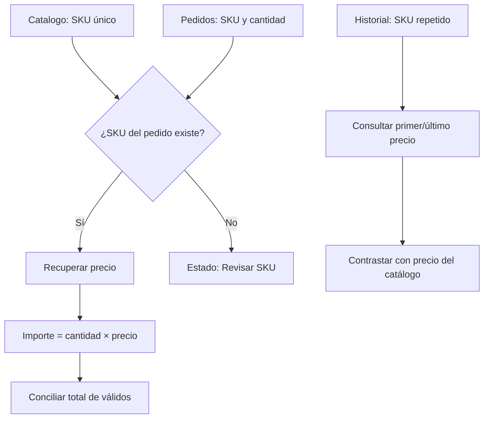
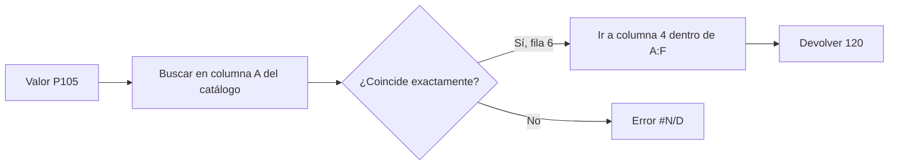
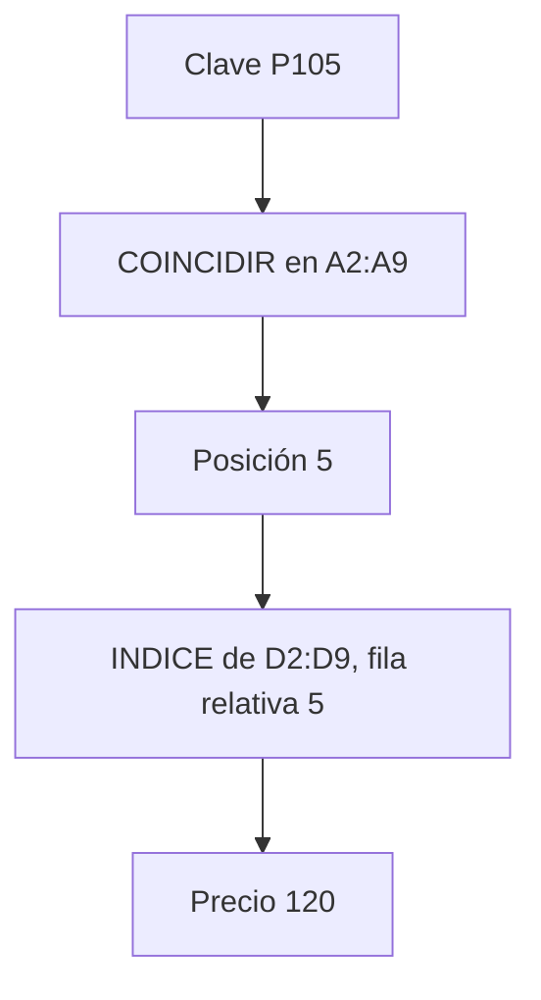
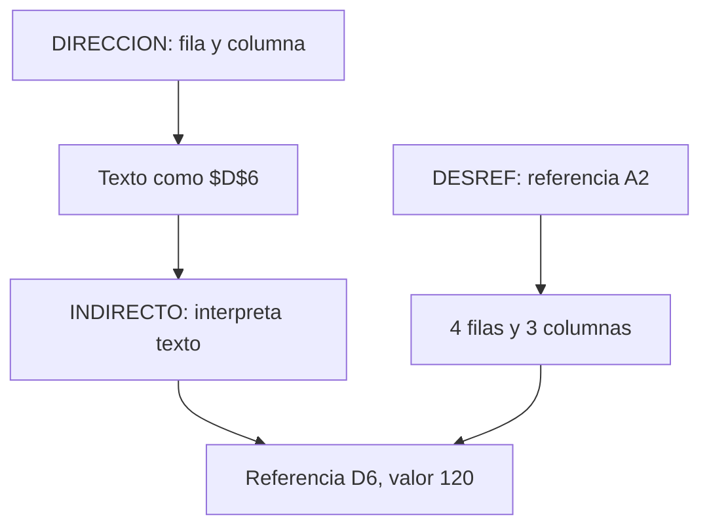
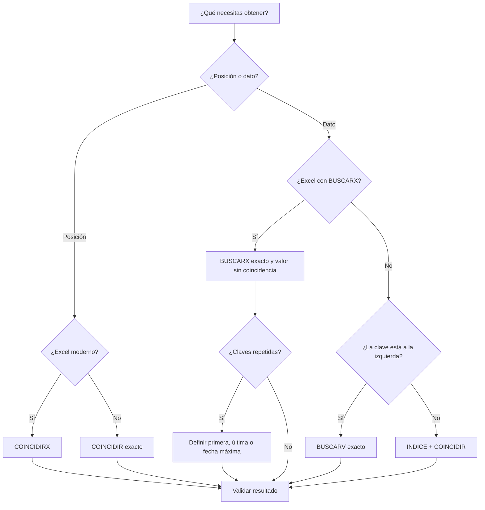
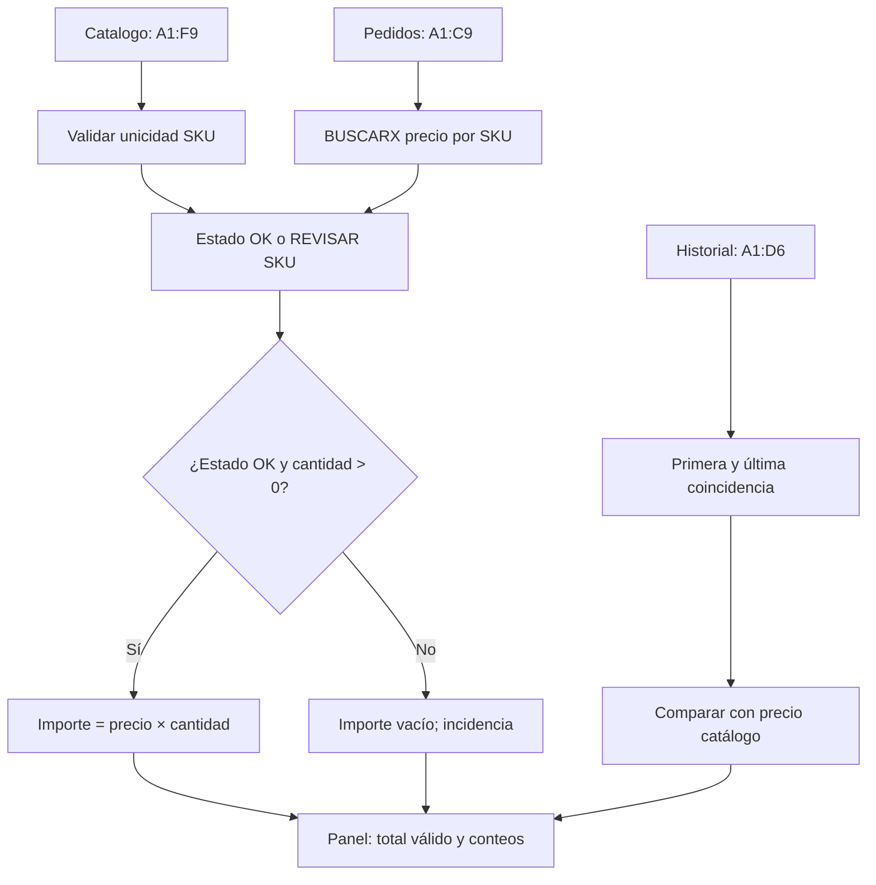

# H12 — Funciones de búsqueda y referencia

> **Curso integral:** Microsoft Excel, Google Sheets, VBA y Google Apps Script  
> **Roadmap aprobado:** v2.0 · **Ruta:** H — Excel · **Módulo:** H12/24  
> **Carga orientativa:** 22 horas (el catálogo completo puede requerir horas adicionales)  
> **Entorno principal:** Excel Microsoft 365 para Windows; notas para Excel 2024, 2021, 2019 y Google Sheets  
> **Revisión documental:** 25 de octubre de 2026 · **Estado:** material desarrollado, pendiente de validación directa en Excel

**Objetivo.** Localizar registros, relacionar tablas mediante claves, recuperar información sin depender de la posición física de las columnas, aplicar búsquedas exactas y aproximadas, construir referencias dinámicas y auditar resultados. La prioridad será comprender *qué valor se busca, dónde se busca, qué se devuelve y qué ocurre si no existe*.

**Convención de fórmulas:** se escriben nombres españoles de Excel y separador de argumentos `;`. El separador real puede ser `,` según la configuración del equipo. En hojas con interfaz inglesa utiliza los nombres ingleses de las fichas. No confundas delimitadores de argumentos con separadores dentro de datos de texto. Las fórmulas modernas requieren una edición compatible; en instalaciones antiguas emplea alternativas indicadas.

**Alcance:** este módulo tiene unidad principal para las funciones centrales de búsqueda y referencias. Las funciones de transformación de matrices (`FILTRAR`, `ORDENAR`, `ELEGIRCOLS`, `APILARV`, etc.) pertenecen a H16 y aparecen aquí como *referencias cruzadas*, no como fichas terminadas. Los cuadros con resultados describen valores calculados a partir de datos reproducibles; **no se afirma que todas las fórmulas se hayan ejecutado en Excel**.

## Mapa curricular aprobado

| Código | Sección / tema | Subtemas obligatorios |
|---|---|---|
| H12.01 | Búsquedas tradicionales | H12.01.01 métodos: BUSCARV, BUSCARH, BUSCAR, COINCIDIR; H12.01.02 composición: INDICE, INDICE+COINCIDIR, coincidencias exactas/aproximadas |
| H12.02 | Búsquedas modernas | H12.02.01 BUSCARX, COINCIDIRX y búsquedas múltiples; H12.02.02 búsqueda inversa, criterios compuestos y errores |
| H12.03 | Referencias dinámicas | H12.03.01 DIRECCION, INDIRECTO, DESREF; H12.03.02 FILA/COLUMNA, ELEGIR, AREAS y dimensiones |

**Competencias al finalizar:**

1. Explicar clave primaria, rango buscado, rango devuelto y coincidencia exacta frente a aproximada.
2. Resolver búsquedas verticales y horizontales con funciones tradicionales.
3. Implementar INDICE+COINCIDIR sin depender del orden de las columnas.
4. Construir BUSCARX y COINCIDIRX con modos de coincidencia y de búsqueda explícitos.
5. Detectar duplicados y recuperar la primera o última coincidencia cuando corresponda.
6. Combinar condiciones para recuperar registros, documentando la política de duplicados.
7. Usar referencias dinámicas con conciencia de volatilidad, rendimiento y riesgos de #¡REF!.
8. Verificar integridad, conciliación y calidad de registros mediante pruebas independientes.

---

# Laboratorio base: libros, datos y ubicaciones

Antes de estudiar las funciones crea un libro nuevo llamado `H12_Laboratorio_Busquedas.xlsx` con las hojas **Catalogo**, **Pedidos**, **Historial**, **Tarifas** y **Panel**. Escribe los siguientes conjuntos *tal como aparecen*, con los encabezados en la fila 1. Si utilizas CSV, importa los códigos como **texto** para evitar modificaciones automáticas.

## Tabla 1 — Hoja Catalogo (A1:F9)

| Fila | A SKU | B Producto | C Categoría | D Precio_MXN | E Stock | F Proveedor |
|---:|---|---|---|---:|---:|---|
| 1 | SKU | Producto | Categoría | Precio_MXN | Stock | Proveedor |
| 2 | P101 | Cuaderno | Papelería | 35 | 40 | Norte |
| 3 | P102 | Pluma azul | Papelería | 12 | 120 | Central |
| 4 | P103 | Carpeta carta | Papelería | 50 | 18 | Norte |
| 5 | P104 | Marcador negro | Papelería | 20 | 55 | Sur |
| 6 | P105 | Cable USB-C | Tecnología | 120 | 9 | Central |
| 7 | P106 | Mouse | Tecnología | 250 | 25 | Norte |
| 8 | P107 | Libreta | Papelería | 65 | 32 | Sur |
| 9 | P108 | Adaptador | Tecnología | 180 | 6 | Central |

**Reglas del catálogo:** `SKU` identifica un producto único; el precio es un valor numérico expresado en pesos mexicanos, no texto que incluya `$`. El stock representa unidades disponibles. Los ocho SKU del catálogo son únicos; habrá SKU inválidos deliberadamente en los pedidos.

## Tabla 2 — Hoja Pedidos (A1:C9; columnas D:F calculadas)

| Fila | A Orden | B SKU | C Cantidad |
|---:|---|---|---:|
| 1 | Orden | SKU | Cantidad |
| 2 | O001 | P101 | 4 |
| 3 | O002 | P105 | 2 |
| 4 | O003 | P999 | 1 |
| 5 | O004 | P103 | 3 |
| 6 | O005 | P102 | 10 |
| 7 | O006 | P108 | 2 |
| 8 | O007 | P106 | 1 |
| 9 | O008 | P105 | 1 |

Añade los encabezados D1=`PrecioUnit`, E1=`Importe`, F1=`Estado`. `P999` no existe; **nunca** debe considerarse un pedido válido por defecto ni tener precio cero ocultando el error.

## Tabla 3 — Hoja Historial (A1:D6)

| Fila | A SKU | B Fecha_revision | C Precio | D Nota |
|---:|---|---|---:|---|
| 1 | SKU | Fecha_revision | Precio | Nota |
| 2 | P105 | 01/09/2026 | 110 | Alta |
| 3 | P102 | 10/09/2026 | 10 | Alta |
| 4 | P105 | 05/10/2026 | 120 | Cambio |
| 5 | P108 | 11/10/2026 | 180 | Alta |
| 6 | P105 | 20/10/2026 | 125 | Cambio |

Las fechas se guardan como fechas reales, por ejemplo `=FECHA(2026;9;1)`. La tabla está ordenada cronológicamente para este ejemplo. **No asumas que el último registro de un SKU es el más reciente si los datos no están ordenados por fecha.** El precio vigente de `Catalogo!D6` es 120 y el último precio del historial P105 es 125: los sistemas difieren deliberadamente para ejercitar reconciliación, sin asumir cuál es la fuente oficial.

## Tabla 4 — Hoja Tarifas (A1:B6)

| A Mínimo_unidades | B Descuento |
|---:|---:|
| 0 | 0% |
| 10 | 2% |
| 30 | 5% |
| 60 | 8% |
| 100 | 10% |

Escribe los encabezados en la fila 1 y los umbrales en A2:A6. El intervalo **debe estar ordenado de menor a mayor** para las búsquedas aproximadas tradicionales. La tabla representa descuentos por cantidad pedida, no descuentos por importe monetario.

## Mapa de dependencias de los datos



**Figura 1 — Esquema conceptual, no captura.** Observa que una búsqueda no es sinónimo de conciliación: la primera recupera información; la segunda verifica que el conjunto de datos cumple reglas de negocio.

## Imágenes públicas de referencia


*Figura 2 — Captura pública de [Nexel — Función BUSCARX](https://nexel.com.mx/formulas/funcion-buscarx/). Observa los colores que marcan el valor buscado y la columna que contiene el resultado. Es una captura externa: los datos no corresponden al laboratorio del curso.*


*Figura 3 — Captura pública de [Esther Anagu — VLOOKUP, HLOOKUP y XLOOKUP](https://estheranagu.medium.com/excel-vlookup-hlookup-and-xlookup-5f1fb937fd0f). Fíjate en el argumento numérico que indica la columna de devolución. Los nombres de funciones y los separadores aparecen en inglés en la imagen.*

---

# H12.01 — Búsquedas tradicionales

## H12.01.01 — Métodos de búsqueda

### H12.01.01.01 — BUSCARV: búsqueda vertical

**Fundamento.** `BUSCARV` (*VLOOKUP*) busca una clave en la **primera columna del rango** y devuelve un dato de la misma fila ubicado en otra columna **a la derecha**. La posición relativa de la columna devuelta se indica con un número que comienza en 1. No es capaz de recuperar directamente una columna situada a la izquierda de la primera columna de su rango de búsqueda.



**Figura 4.** La búsqueda exacta no depende de que los SKU estén ordenados. La búsqueda aproximada tradicional sí requiere un rango ordenado apropiadamente.

**Demostración:** en `Panel!B2` escribe `P105`. En `Panel!C2`:

```excel
=BUSCARV(B2;Catalogo!$A$2:$F$9;4;FALSO)
```

Resultado: **120**. La fórmula busca `P105` en la primera columna de `Catalogo!A2:F9` y devuelve la cuarta columna del rango (D). El argumento final `FALSO` evita una coincidencia aproximada no deseada.

**Ejemplo aplicado:** en `Pedidos!D2`:

```excel
=BUSCARV(B2;Catalogo!$A$2:$F$9;4;FALSO)
```

Copia hasta D9; el pedido O003 mostrará `#N/D`, porque P999 no existe. No sustituyas silenciosamente este error por `0` antes de comprobar la calidad del pedido.

**Consecuencia de insertar columnas:** si se cambia la estructura de la tabla y el índice 4 apunta a otro campo, BUSCARV puede seguir devolviendo un valor formalmente válido pero del campo equivocado. Esta fragilidad es una razón para preferir BUSCARX cuando esté disponible.

### H12.01.01.02 — BUSCARH: búsqueda horizontal

`BUSCARH` (*HLOOKUP*) busca en la **primera fila** de un rango y devuelve el elemento de una fila inferior, en la misma columna. Conviene usarla cuando los periodos o encabezados están dispuestos horizontalmente.

En `Panel!J1:M2` escribe:

| | J | K | L | M |
|---|---|---|---|---|
| Fila 1 | Ene | Feb | Mar | Abr |
| Fila 2 | 100 | 150 | 200 | 180 |

En otra celda:

```excel
=BUSCARH("Mar";Panel!$J$1:$M$2;2;FALSO)
```

Resultado **200**. La primera fila contiene las claves y la fila 2 los resultados. Si reorganizas esta tabla a formato largo (mes en una columna), puedes utilizar búsquedas verticales, normalmente más fáciles de integrar con modelos tabulares.

### H12.01.01.03 — BUSCAR: búsqueda vectorial y compatibilidad

`BUSCAR` (*LOOKUP*) en su forma vectorial recupera el valor correspondiente al último elemento **menor o igual** que la clave si el rango está ordenado de manera ascendente. No es una búsqueda exacta por defecto. Su forma de matriz existe por compatibilidad, pero para modelos nuevos suelen ser preferibles otras funciones.

```excel
=BUSCAR(75;Tarifas!$A$2:$A$6;Tarifas!$B$2:$B$6)
```

Resultado **8 %**: el umbral más grande que no supera 75 es 60. Si el vector está desordenado, el resultado puede ser incorrecto. Si la clave es menor que el mínimo, puede devolver `#N/D`.

### H12.01.01.04 — COINCIDIR: posición, no valor

`COINCIDIR` (*MATCH*) devuelve una **posición relativa** dentro de un rango unidimensional. No devuelve el contenido de la columna vecina.

```excel
=COINCIDIR("P105";Catalogo!$A$2:$A$9;0)
```

Resultado **5**, pues P105 es el quinto registro de A2:A9, aunque esté ubicado en la fila 6 de Excel.

**Tipos tradicionales:** `0` exacta (recomendada para identificadores), `1` coincidencia exacta o siguiente menor en rango ascendente (predeterminado si se omite), `-1` coincidencia exacta o siguiente mayor en rango descendente. No confundas la posición relativa `5` con el número de fila absoluta `6`.

## H12.01.02 — Composición de búsquedas

### H12.01.02.01 — INDICE: valor de una fila y columna

`INDICE` (*INDEX*) utiliza posiciones para recuperar un valor o referencia en la intersección de una matriz. Su forma de matriz admite fila y columna; su forma de referencia permite seleccionar entre varias áreas. En el catálogo:

```excel
=INDICE(Catalogo!$D$2:$D$9;5)
```

Resultado: **120**, el quinto elemento del rango de precios.

La misma función puede devolver una intersección bidimensional. En `Catalogo!B2:D9`, la posición fila 5 y columna 3 corresponde a D6, precio 120:

```excel
=INDICE(Catalogo!$B$2:$D$9;5;3)
```

### H12.01.02.02 — INDICE + COINCIDIR

Combina la localización de una posición con la recuperación de un valor. Esta composición no exige que la columna devuelta esté a la derecha de la clave.

```excel
=INDICE(Catalogo!$D$2:$D$9;COINCIDIR("P105";Catalogo!$A$2:$A$9;0))
```

Evaluación por partes:

1. `COINCIDIR("P105";A2:A9;0)` devuelve `5`.
2. `INDICE(D2:D9;5)` devuelve `D6`, cuyo valor es **120**.
3. La fórmula compuesta devuelve **120**.

**Búsqueda a la izquierda:** `=INDICE(Catalogo!$A$2:$A$9;COINCIDIR("Mouse";Catalogo!$B$2:$B$9;0))` devuelve `P106`. No se requiere reorganizar físicamente las columnas.



**Figura 5.** Separación entre localizar la posición y devolver el dato.

### H12.01.02.03 — Coincidencia exacta y aproximada

**Exacta:** úsala para SKU, identificadores, cuentas, folios y claves que identifican registros discretos. No encontrar el valor debe activar una investigación o un estado pendiente.

**Aproximada:** úsala cuando los datos representan un rango de valores mediante umbrales o intervalos (por ejemplo tarifas por volumen). Hay que documentar si se elige el límite inferior o superior.

| Cantidad | Umbral inferior aplicable | Descuento |
|---:|---:|---:|
| 0 | 0 | 0 % |
| 9 | 0 | 0 % |
| 10 | 10 | 2 % |
| 29 | 10 | 2 % |
| 30 | 30 | 5 % |
| 75 | 60 | 8 % |
| 100 | 100 | 10 % |

```excel
=BUSCARV(75;Tarifas!$A$2:$B$6;2;VERDADERO)
```

Resultado: 8 %. `VERDADERO` con tabla de umbrales ascendentes es intencional. En búsquedas por SKU, usarlo sería riesgoso.

**Control de calidad:** confirma que `P101` y `"P101 "` son realmente equivalentes antes de normalizar; los espacios o tipos texto/número diferentes pueden explicar `#N/D`. Consulta H10 para limpieza y H13 para funciones de información.

---

# H12.02 — Búsquedas modernas

## H12.02.01 — BUSCARX, COINCIDIRX y recuperación múltiple

### H12.02.01.01 — BUSCARX (XLOOKUP)

`BUSCARX` permite especificar **por separado** el rango buscado y el rango de devolución. Realiza coincidencia exacta de forma predeterminada; puede buscar de abajo hacia arriba y controlar qué devolver cuando no exista coincidencia. No requiere que la clave esté en la primera columna de un bloque fijo.

```excel
=BUSCARX("P105";Catalogo!$A$2:$A$9;Catalogo!$D$2:$D$9;"No encontrado";0;1)
```

Resultado: **120**.


**Figura 6.** Una búsqueda exacta moderna conecta dos matrices de igual longitud en la dimensión de búsqueda.

**Distinción crítica:** Microsoft muestra `BUSCARX` en su página española, pero algunos índices oficiales también utilizan `XLOOKUP` sin traducir. En el curso se conserva nombre español y nombre canónico; verifica qué nombre admite tu instalación. BUSCARX **no está disponible en Excel 2016 ni Excel 2019**, aunque esos programas puedan abrir libros que contengan la fórmula. Refiérete a la matriz de compatibilidad al final.

### H12.02.01.02 — COINCIDIRX (XMATCH)

`COINCIDIRX` devuelve posición relativa con coincidencia exacta predeterminada, admite aproximación, comodines y búsqueda inversa o binaria. Para P105:

```excel
=COINCIDIRX("P105";Catalogo!$A$2:$A$9;0;1)
```

Resultado **5**. Es apropiada cuando se necesita la posición para alimentar `INDICE`, localizar encabezados dinámicos o auditar la ubicación de un elemento.

### H12.02.01.03 — Devolver varios campos e intersecciones

En Excel con matrices dinámicas, BUSCARX puede devolver **varias columnas** desde una sola fórmula si el rango de retorno abarca B:D:

```excel
=BUSCARX("P105";Catalogo!$A$2:$A$9;Catalogo!$B$2:$D$9;"No encontrado")
```

Debe derramarse horizontalmente mostrando **Cable USB-C | Tecnología | 120**. La zona de salida debe estar libre: si hay contenido que impide el derrame, aparecerá `#¡DESBORDAMIENTO!` o el nombre equivalente según idioma. En versiones sin matrices dinámicas recupera cada campo con fórmulas individuales.

**Intersección de dos dimensiones:** supón la tabla mensual de Panel J1:M2. `=BUSCARX("Mar";J1:M1;J2:M2)` devolvería 200. Si la tabla tuviera varios productos y periodos, se podría anidar una búsqueda por filas y otra por columnas; este caso se amplía formalmente en H16.

## H12.02.02 — Búsqueda inversa, criterios compuestos y errores

### H12.02.02.01 — Primera coincidencia y última coincidencia

La clave P105 aparece tres veces en Historial. La búsqueda por defecto de BUSCARX devuelve la **primera** coincidencia; con modo de búsqueda `-1` devuelve la **última ocurrencia física**.

```excel
=BUSCARX("P105";Historial!$A$2:$A$6;Historial!$C$2:$C$6;"Sin historial";0;1)
```

Resultado: **110**.

```excel
=BUSCARX("P105";Historial!$A$2:$A$6;Historial!$C$2:$C$6;"Sin historial";0;-1)
```

Resultado: **125**.

**Advertencia:** `última fila` no equivale necesariamente a `fecha máxima`. Para identificar el registro cronológicamente más reciente, primero hay que ordenar por fecha o construir una selección por fecha máxima y reglas de desempate. No ocultes esta diferencia al gestionar precios o contratos.

### H12.02.02.02 — Criterios compuestos y claves únicas

Puedes buscar un valor por varias condiciones sin agregar necesariamente una columna física. Por ejemplo, obtener el precio de **P105** de la categoría **Tecnología**:

```excel
=BUSCARX(1;(Catalogo!$A$2:$A$9="P105")*(Catalogo!$C$2:$C$9="Tecnología");Catalogo!$D$2:$D$9;"No encontrado")
```

Las comparaciones generan matrices de VERDADERO/FALSO que se transforman en 1/0 al multiplicarse. Sólo la fila en la que ambas condiciones se cumplen produce un 1 y devuelve **120**. En Excel antiguo puede ser necesaria una columna auxiliar que materialice la clave compuesta.

**Modelo recomendable en producción:** si la combinación de campos identifica un registro, valida su unicidad. BUSCARX no resuelve por sí sola el problema de tener dos filas que satisfagan la misma clave compuesta; devuelve una de ellas según el modo de búsqueda.

### H12.02.02.03 — Errores, comodines y búsqueda binaria

**Comodines:** con `modo_de_coincidencia=2`, `*` representa secuencias de caracteres, `?` un carácter y `~` permite buscar el carácter comodín literalmente. Sirven para patrones simples, **no sustituyen expresiones regulares**.

```excel
=BUSCARX("Cable*";Catalogo!$B$2:$B$9;Catalogo!$D$2:$D$9;"Sin resultados";2)
```

Resultado **120** (Cable USB-C). Sin `2` se buscaría la cadena literal `Cable*`.

**Búsqueda binaria:** modos de búsqueda `2` y `-2` son eficientes para rangos grandes, pero **exigen que el rango buscado esté ordenado respectivamente en sentido ascendente o descendente**. Si se incumple esa precondición pueden devolverse resultados incorrectos **sin error visible**. No se usan en este laboratorio para el catálogo de SKU a menos que se documente y verifique el orden requerido.

**Diferencias entre tipos de error:**

- `#N/D`: búsqueda sin coincidencia; puede indicar ausencia genuina, tipos inconsistentes o espacios invisibles.
- `#¡REF!`: referencia inválida tras eliminar un rango o construir una dirección inexistente.
- `#¡VALOR!`: tipos o dimensiones incompatibles en determinados argumentos.
- `#¡DESBORDAMIENTO!`: salida matricial bloqueada por contenido adyacente (nombre exacto según interfaz).
- `#¿NOMBRE?`: función no reconocida (nombre localizado, versión o error tipográfico).

No confíes únicamente en `SI.ERROR(...;0)`: reemplazar todos los errores con cero puede transformar un SKU ausente en una venta aparentemente válida. Para el flujo de pedidos es preferible un estado explícito.

---

# H12.03 — Referencias dinámicas

## H12.03.01 — Construcción de referencias

### H12.03.01.01 — DIRECCION: dirección como texto

`DIRECCION` (*ADDRESS*) transforma índices de fila y columna en una **cadena de texto** que describe una referencia. No recupera, por sí misma, el valor de la celda.

```excel
=DIRECCION(6;4)
```

Resultado textual: **`$D$6`**. La referencia absoluta señala la celda D6; si quieres obtener su valor mediante texto necesitarías un paso adicional, por ejemplo `INDIRECTO` (con implicaciones de rendimiento).

```excel
=DIRECCION(6;4;4)
```

Resultado textual: **`D6`** (referencia relativa). El tercer argumento selecciona el estilo absoluto/mixto/relativo.

### H12.03.01.02 — INDIRECTO: convertir texto en referencia

`INDIRECTO` (*INDIRECT*) interpreta texto válido como una referencia. Ejemplo:

- `Panel!A12` contiene el texto `Catalogo!D6`.
- `Panel!B12` contiene la fórmula `=INDIRECTO(A12)`.
- Resultado: **120**.

**Riesgo:** `INDIRECTO` no actualiza necesariamente las cadenas textuales cuando renombramos/movemos elementos y para referencias a otros libros suele exigir que el archivo de origen esté abierto. También es volátil para el motor de cálculo de Excel; no conviene usar miles de llamadas sin justificación.

### H12.03.01.03 — DESREF: desplazar una referencia

`DESREF` (*OFFSET*) devuelve una referencia desplazada desde un origen, con alto y ancho opcionales.

```excel
=DESREF(Catalogo!$A$2;4;3)
```

Partimos de `A2`, bajamos 4 filas hasta `A6` y nos desplazamos 3 columnas hasta `D6`: resultado **120**.

Para describir un bloque de dos filas y una columna desde `D6`:

```excel
=SUMA(DESREF(Catalogo!$D$6;0;0;2;1))
```

Las celdas D6 y D7 contienen 120 y 250: total **370**. `DESREF` es volátil. Cuando el rango es conocido o se puede expresar con `INDICE`, estudia alternativas que eviten recálculos innecesarios. Fuente: [Microsoft Learn, rendimiento del cálculo](https://learn.microsoft.com/es-es/office/vba/excel/concepts/excel-performance/excel-improving-calculation-performance).



**Figura 7.** Construcción de referencias: texto y referencia son conceptos distintos.

## H12.03.02 — Posición, dimensiones y selección

### H12.03.02.01 — FILA, FILAS, COLUMNA, COLUMNAS

Estas funciones describen la posición o la forma de un rango:

| Fórmula | Resultado | Interpretación |
|---|---:|---|
| `=FILA(Catalogo!D6)` | 6 | Número de fila de la referencia |
| `=COLUMNA(Catalogo!D6)` | 4 | Número de columna de la referencia |
| `=FILAS(Catalogo!A2:F9)` | 8 | Registros del rango excluyendo encabezado |
| `=COLUMNAS(Catalogo!A2:F9)` | 6 | Número de columnas del bloque |

Estas funciones son útiles para construir índices, validar el tamaño esperado de un conjunto de datos y preparar modelos que se actualicen cuando se amplíe un rango. No confundas `FILAS()` con la función `FILA()` ni `COLUMNAS()` con `COLUMNA()`.

### H12.03.02.02 — ELEGIR: seleccionar por índice

`ELEGIR` (*CHOOSE*) selecciona el elemento indicado de una lista explícita. El índice comienza en 1.

```excel
=ELEGIR(2;"Básico";"Intermedio";"Avanzado")
```

Resultado: **Intermedio**. Puedes utilizarlo para elegir uno de varios rangos: `=SUMA(ELEGIR(2;Catalogo!D2:D4;Catalogo!D5:D7))` devuelve **390** (D5:D7 = 20+120+250). Es útil para crear fórmulas con un pequeño conjunto de alternativas, sin construir referencias textuales.

### H12.03.02.03 — AREAS y dimensiones de una referencia

Una **área** es una región contigua de celdas o una celda individual. `AREAS` (*AREAS*) cuenta cuántas áreas independientes forman una referencia.

```excel
=AREAS((Catalogo!A2:B4;Catalogo!D6;Catalogo!F8:F9))
```

Resultado: **3**. Los dobles paréntesis agrupan las referencias de varias áreas para que Excel no interprete sus separadores como argumentos independientes.

### H12.03.02.04 — TRANSPONER e HIPERVINCULO: orientación y navegación

`TRANSPONER` (*TRANSPOSE*) cambia filas por columnas; en Excel moderno derrama automáticamente los valores si tiene espacio disponible. Ejemplo: una fila `Ene | Feb | Mar` se convierte en una columna vertical con tres entradas. `HIPERVINCULO` (*HYPERLINK*) genera un enlace clicable a una URL o referencia compatible; por sí sola **no verifica** que el destino exista ni que sea seguro.

```excel
=TRANSPONER(Panel!$J$1:$M$1)
```

Se obtendrán cuatro filas: Ene, Feb, Mar y Abr, si las celdas de destino están desocupadas y la versión admite derrame.

```excel
=HIPERVINCULO("https://support.microsoft.com/es-es/excel/lookup-and-reference-functions-reference";"Catálogo oficial")
```

Muestra el texto **Catálogo oficial** como vínculo a la documentación.

---

# Catálogo de fichas individuales — H12

Cada ficha recoge nombre ES/EN, propósito, sintaxis, argumentos obligatorios/opcionales, tipo devuelto, tres niveles de aplicación, interpretación, errores, limitaciones, alternativas, Sheets, compatibilidad y práctica vinculada. La documentación es técnica y los ejemplos se basan en el laboratorio anterior.

## F-H12-01 — BUSCARV (`VLOOKUP`)

**Categoría / unidad principal:** Búsqueda y referencia · H12.01. **Propósito:** Valor de la columna solicitada o error.

**Sintaxis (Excel en español):** `=BUSCARV(valor_buscado;matriz_buscar_en;indicador_columnas;[ordenado])`.

**Argumentos:** valor_buscado: clave (oblig.); matriz_buscar_en: tabla cuya primera columna contiene la clave (oblig.); indicador_columnas: número de columna dentro de la tabla, empezando en 1 (oblig.); ordenado: FALSO/VERDADERO, opcional y por defecto aproximado.

**Tipo devuelto:** Valor de la columna solicitada o error.

**Ejemplo introductorio:**

```excel
=BUSCARV("P105";Catalogo!A2:F9;4;FALSO)
```

**Ejemplo intermedio:**

```excel
=BUSCARV("P106";Catalogo!A2:F9;2;FALSO)
```

**Ejemplo profesional:**

```excel
=BUSCARV(Pedidos!B2;Catalogo!$A$2:$F$9;4;FALSO)
```

**Interpretación en orden:** 120; Mouse; y 35 para el pedido O001. Comprueba primero el rango buscado, después el resultado, finalmente el significado empresarial.

**Errores frecuentes / diagnóstico:** Omitir FALSO; usar índice 0/7; clave ausente; insertar columnas sin revisar el índice. Verifica primero los tipos de datos, la existencia de la clave y las dimensiones de los rangos; después examina la coincidencia y la versión.

**Limitaciones y buenas prácticas:** No busca a la izquierda y las coincidencias aproximadas necesitan rango ordenado. Usa rangos absolutos cuando vayas a copiar la fórmula, y documenta las claves duplicadas.

**Alternativas / relacionadas:** BUSCARX o INDICE+COINCIDIR.

**Google Sheets:** VLOOKUP; existen diferencias de nombres localizados y sintaxis regional. **Compatibilidad Excel:** Excel 2016+ y Microsoft 365, 2021, 2024.

**Ejercicio vinculado:** H12.01-E01 (véase Parte A de prácticas).

## F-H12-02 — BUSCARH (`HLOOKUP`)

**Categoría / unidad principal:** Búsqueda y referencia · H12.01. **Propósito:** Valor en la fila de devolución o error.

**Sintaxis (Excel en español):** `=BUSCARH(valor_buscado;matriz_buscar_en;indicador_filas;[ordenado])`.

**Argumentos:** valor_buscado: encabezado buscado (oblig.); matriz_buscar_en: tabla con clave en primera fila (oblig.); indicador_filas: número de fila interna (oblig.); ordenado: exacto FALSO o aproximado VERDADERO (opcional).

**Tipo devuelto:** Valor en la fila de devolución o error.

**Ejemplo introductorio:**

```excel
=BUSCARH("Mar";Panel!J1:M2;2;FALSO)
```

**Ejemplo intermedio:**

```excel
=BUSCARH("Feb";Panel!J1:M2;2;FALSO)
```

**Ejemplo profesional:**

```excel
=BUSCARH(Panel!K1;Panel!$J$1:$M$2;2;FALSO)
```

**Interpretación en orden:** 200; 150; y 150 para el encabezado Feb de K1. Comprueba primero el rango buscado, después el resultado, finalmente el significado empresarial.

**Errores frecuentes / diagnóstico:** Suponer que el índice de fila usa número de Excel; omitir coincidencia exacta. Verifica primero los tipos de datos, la existencia de la clave y las dimensiones de los rangos; después examina la coincidencia y la versión.

**Limitaciones y buenas prácticas:** Requiere claves en primera fila; una tabla larga suele ser más flexible. Usa rangos absolutos cuando vayas a copiar la fórmula, y documenta las claves duplicadas.

**Alternativas / relacionadas:** BUSCARX horizontal o INDICE+COINCIDIR.

**Google Sheets:** HLOOKUP, mismo concepto. **Compatibilidad Excel:** Excel tradicional y actual.

**Ejercicio vinculado:** H12.01-E02 (véase Parte A de prácticas).

## F-H12-03 — BUSCAR (`LOOKUP`)

**Categoría / unidad principal:** Búsqueda y referencia · H12.01. **Propósito:** Último resultado con clave no mayor que la buscada, o error.

**Sintaxis (Excel en español):** `=BUSCAR(valor_buscado;vector_de_comparación;[vector_resultado])`.

**Argumentos:** valor_buscado: umbral (oblig.); vector_de_comparación: una columna/fila ordenada ascendente (oblig.); vector_resultado: valores de devolución alineados (opcional en forma vectorial).

**Tipo devuelto:** Último resultado con clave no mayor que la buscada, o error.

**Ejemplo introductorio:**

```excel
=BUSCAR(75;Tarifas!A2:A6;Tarifas!B2:B6)
```

**Ejemplo intermedio:**

```excel
=BUSCAR(29;Tarifas!A2:A6;Tarifas!B2:B6)
```

**Ejemplo profesional:**

```excel
=BUSCAR(110;Tarifas!A2:A6;Tarifas!B2:B6)
```

**Interpretación en orden:** 8 %; 2 %; y 10 %. Comprueba primero el rango buscado, después el resultado, finalmente el significado empresarial.

**Errores frecuentes / diagnóstico:** Usar una tabla desordenada; usar BUSCAR para SKU exactos. Verifica primero los tipos de datos, la existencia de la clave y las dimensiones de los rangos; después examina la coincidencia y la versión.

**Limitaciones y buenas prácticas:** Diseñada principalmente para búsqueda aproximada; depende del orden. Usa rangos absolutos cuando vayas a copiar la fórmula, y documenta las claves duplicadas.

**Alternativas / relacionadas:** BUSCARX con modo -1, BUSCARV aproximado.

**Google Sheets:** LOOKUP, búsqueda aproximada con requisitos de orden similares. **Compatibilidad Excel:** Función tradicional.

**Ejercicio vinculado:** H12.01-E03 (véase Parte A de prácticas).

## F-H12-04 — COINCIDIR (`MATCH`)

**Categoría / unidad principal:** Búsqueda y referencia · H12.01. **Propósito:** Índice numérico relativo (o #N/D).

**Sintaxis (Excel en español):** `=COINCIDIR(valor_buscado;matriz_buscada;[tipo_de_coincidencia])`.

**Argumentos:** valor_buscado: clave (oblig.); matriz_buscada: vector (oblig.); tipo_de_coincidencia: 0 exacta; 1 ascendente (predeterminado); -1 descendente (opcional).

**Tipo devuelto:** Índice numérico relativo (o #N/D).

**Ejemplo introductorio:**

```excel
=COINCIDIR("P105";Catalogo!A2:A9;0)
```

**Ejemplo intermedio:**

```excel
=COINCIDIR("Mouse";Catalogo!B2:B9;0)
```

**Ejemplo profesional:**

```excel
=COINCIDIR(75;Tarifas!A2:A6;1)
```

**Interpretación en orden:** 5; 6; y 4 (umbral 60, cuarto elemento del rango). Comprueba primero el rango buscado, después el resultado, finalmente el significado empresarial.

**Errores frecuentes / diagnóstico:** Confundir índice relativo con fila absoluta; omitir el tipo de coincidencia. Verifica primero los tipos de datos, la existencia de la clave y las dimensiones de los rangos; después examina la coincidencia y la versión.

**Limitaciones y buenas prácticas:** Sólo devuelve posición; vector unidimensional. Usa rangos absolutos cuando vayas a copiar la fórmula, y documenta las claves duplicadas.

**Alternativas / relacionadas:** COINCIDIRX o complemento INDICE.

**Google Sheets:** MATCH, sintaxis equivalente salvo localización. **Compatibilidad Excel:** Excel tradicional y actual.

**Ejercicio vinculado:** H12.01-E04 (véase Parte A de prácticas).

## F-H12-05 — INDICE (`INDEX`)

**Categoría / unidad principal:** Búsqueda y referencia · H12.01. **Propósito:** Valor o referencia en la intersección.

**Sintaxis (Excel en español):** `=INDICE(matriz;núm_fila;[núm_columna])`.

**Argumentos:** matriz: rango (oblig.); núm_fila: posición relativa (oblig. salvo ciertas formas matriciales); núm_columna: posición de columna (opcional en una sola columna). Otra forma: INDICE(referencia;núm_fila;[núm_columna];[núm_área]).

**Tipo devuelto:** Valor o referencia en la intersección.

**Ejemplo introductorio:**

```excel
=INDICE(Catalogo!D2:D9;5)
```

**Ejemplo intermedio:**

```excel
=INDICE(Catalogo!B2:D9;5;3)
```

**Ejemplo profesional:**

```excel
=INDICE(Catalogo!D2:D9;COINCIDIR("P105";Catalogo!A2:A9;0))
```

**Interpretación en orden:** 120 en los tres casos. Comprueba primero el rango buscado, después el resultado, finalmente el significado empresarial.

**Errores frecuentes / diagnóstico:** Índice 0 o fuera de rango mal interpretado; coordenadas relativas desplazadas. Verifica primero los tipos de datos, la existencia de la clave y las dimensiones de los rangos; después examina la coincidencia y la versión.

**Limitaciones y buenas prácticas:** La forma de referencia con áreas tiene reglas propias; versiones antiguas requieren fórmulas matriciales especiales para ciertas salidas. Usa rangos absolutos cuando vayas a copiar la fórmula, y documenta las claves duplicadas.

**Alternativas / relacionadas:** BUSCARX o combinación con COINCIDIR.

**Google Sheets:** INDEX, ampliamente disponible. **Compatibilidad Excel:** Excel tradicional y actual.

**Ejercicio vinculado:** H12.01-E05 (véase Parte A de prácticas).

## F-H12-06 — BUSCARX (`XLOOKUP`)

**Categoría / unidad principal:** Búsqueda y referencia · H12.02. **Propósito:** Valor, referencia o matriz devuelta; o valor de ausencia.

**Sintaxis (Excel en español):** `=BUSCARX(valor_buscado;matriz_buscada;matriz_devuelta;[si_no_se_encuentra];[modo_de_coincidencia];[modo_de_búsqueda])`.

**Argumentos:** valor_buscado: clave (oblig., puede omitirse con matices en ciertas aplicaciones); matriz_buscada: vector de claves (oblig.); matriz_devuelta: valores alineados (oblig.); si_no_se_encuentra: resultado alternativo (opcional); modo_de_coincidencia: 0 exacta, -1 menor, 1 mayor, 2 comodín (opcional); modo_de_búsqueda: 1 principio, -1 final, 2 binaria ascendente, -2 binaria descendente (opcional).

**Tipo devuelto:** Valor, referencia o matriz devuelta; o valor de ausencia.

**Ejemplo introductorio:**

```excel
=BUSCARX("P105";Catalogo!A2:A9;Catalogo!D2:D9)
```

**Ejemplo intermedio:**

```excel
=BUSCARX("Mouse";Catalogo!B2:B9;Catalogo!A2:A9;"Ausente")
```

**Ejemplo profesional:**

```excel
=BUSCARX("P999";Catalogo!A2:A9;Catalogo!D2:D9;"REVISAR")
```

**Interpretación en orden:** 120; P106; y REVISAR. Comprueba primero el rango buscado, después el resultado, finalmente el significado empresarial.

**Errores frecuentes / diagnóstico:** Usar binaria sin ordenar; confundir -1 en coincidencia con -1 en búsqueda; ignorar duplicados. Verifica primero los tipos de datos, la existencia de la clave y las dimensiones de los rangos; después examina la coincidencia y la versión.

**Limitaciones y buenas prácticas:** Disponible sólo en versiones recientes; matrices de salida requieren espacio; tipos deben concordar. Usa rangos absolutos cuando vayas a copiar la fórmula, y documenta las claves duplicadas.

**Alternativas / relacionadas:** INDICE+COINCIDIR o BUSCARV según estructura.

**Google Sheets:** XLOOKUP con seis argumentos en Sheets; verifica nombres y variantes en la documentación oficial. **Compatibilidad Excel:** Excel Microsoft 365, 2021 y 2024; no en 2016/2019.

**Ejercicio vinculado:** H12.02-E01 (véase Parte A de prácticas).

## F-H12-07 — COINCIDIRX (`XMATCH`)

**Categoría / unidad principal:** Búsqueda y referencia · H12.02. **Propósito:** Posición relativa en rango, o #N/D.

**Sintaxis (Excel en español):** `=COINCIDIRX(valor_buscado;matriz_buscada;[modo_de_coincidencia];[modo_de_búsqueda])`.

**Argumentos:** valor_buscado: clave (oblig.); matriz_buscada: vector (oblig.); modo_de_coincidencia: 0 exacta predeterminada, -1 menor, 1 mayor, 2 comodín (opcional); modo_de_búsqueda: 1 inicial, -1 final, 2 binaria ascendente, -2 binaria descendente (opcional).

**Tipo devuelto:** Posición relativa en rango, o #N/D.

**Ejemplo introductorio:**

```excel
=COINCIDIRX("P105";Catalogo!A2:A9)
```

**Ejemplo intermedio:**

```excel
=COINCIDIRX("P105";Historial!A2:A6;0;-1)
```

**Ejemplo profesional:**

```excel
=INDICE(Historial!C2:C6;COINCIDIRX("P105";Historial!A2:A6;0;-1))
```

**Interpretación en orden:** 5; 5; y 125. Comprueba primero el rango buscado, después el resultado, finalmente el significado empresarial.

**Errores frecuentes / diagnóstico:** Confundir índice de datos con fila de Excel; interpretar última posición como fecha máxima. Verifica primero los tipos de datos, la existencia de la clave y las dimensiones de los rangos; después examina la coincidencia y la versión.

**Limitaciones y buenas prácticas:** Binaria requiere orden; no devuelve directamente valor asociado. Usa rangos absolutos cuando vayas a copiar la fórmula, y documenta las claves duplicadas.

**Alternativas / relacionadas:** COINCIDIR tradicional; BUSCARX para recuperar valor.

**Google Sheets:** XMATCH documentada en Sheets con modos equivalentes. **Compatibilidad Excel:** Excel Microsoft 365, 2021 y 2024.

**Ejercicio vinculado:** H12.02-E02 (véase Parte A de prácticas).

## F-H12-08 — DIRECCION (`ADDRESS`)

**Categoría / unidad principal:** Búsqueda y referencia · H12.03. **Propósito:** Texto que representa una dirección, no una referencia dereferenciada.

**Sintaxis (Excel en español):** `=DIRECCION(fila;columna;[abs];[a1];[hoja])`.

**Argumentos:** fila y columna: enteros positivos requeridos; abs: 1 absoluta, 2 fila absoluta, 3 columna absoluta, 4 relativa (opcional); a1: VERDADERO para A1 o FALSO para R1C1 (opcional); hoja: texto del nombre de hoja (opcional).

**Tipo devuelto:** Texto que representa una dirección, no una referencia dereferenciada.

**Ejemplo introductorio:**

```excel
=DIRECCION(6;4)
```

**Ejemplo intermedio:**

```excel
=DIRECCION(6;4;4)
```

**Ejemplo profesional:**

```excel
=DIRECCION(6;4;1;VERDADERO;"Catalogo")
```

**Interpretación en orden:** $D$6; D6; y Catalogo!$D$6 (representación textual). Comprueba primero el rango buscado, después el resultado, finalmente el significado empresarial.

**Errores frecuentes / diagnóstico:** Esperar 120 como resultado; número de fila o columna fuera del rango. Verifica primero los tipos de datos, la existencia de la clave y las dimensiones de los rangos; después examina la coincidencia y la versión.

**Limitaciones y buenas prácticas:** La dirección depende del estilo y nombres; texto no reacciona igual que una referencia nativa. Usa rangos absolutos cuando vayas a copiar la fórmula, y documenta las claves duplicadas.

**Alternativas / relacionadas:** Referencias directas, INDICE, INDIRECTO para interpretar texto.

**Google Sheets:** ADDRESS existe en Sheets; localización diferente según configuración. **Compatibilidad Excel:** Excel tradicional y actual.

**Ejercicio vinculado:** H12.03-E01 (véase Parte A de prácticas).

## F-H12-09 — INDIRECTO (`INDIRECT`)

**Categoría / unidad principal:** Búsqueda y referencia · H12.03. **Propósito:** Referencia y su valor según contexto.

**Sintaxis (Excel en español):** `=INDIRECTO(ref;[a1])`.

**Argumentos:** ref: cadena que representa referencia válida o nombre (oblig.); a1: VERDADERO A1, FALSO R1C1 (opcional).

**Tipo devuelto:** Referencia y su valor según contexto.

**Ejemplo introductorio:**

```excel
=INDIRECTO("Catalogo!D6")
```

**Ejemplo intermedio:**

```excel
=INDIRECTO("Catalogo!E6")
```

**Ejemplo profesional:**

```excel
=INDIRECTO(Panel!A12)
```

**Interpretación en orden:** 120; 9; y 120 si A12 contiene Catalogo!D6. Comprueba primero el rango buscado, después el resultado, finalmente el significado empresarial.

**Errores frecuentes / diagnóstico:** Texto mal escrito; nombre de hoja con espacios sin comillas apropiadas; libro externo cerrado. Verifica primero los tipos de datos, la existencia de la clave y las dimensiones de los rangos; después examina la coincidencia y la versión.

**Limitaciones y buenas prácticas:** Volátil; vínculos a libros externos pueden requerir archivo abierto; difícil de auditar. Usa rangos absolutos cuando vayas a copiar la fórmula, y documenta las claves duplicadas.

**Alternativas / relacionadas:** INDICE, ELEGIR, referencias estructuradas.

**Google Sheets:** INDIRECT en Sheets, dependencias y límites difieren del motor Excel. **Compatibilidad Excel:** Excel tradicional y actual.

**Ejercicio vinculado:** H12.03-E02 (véase Parte A de prácticas).

## F-H12-10 — DESREF (`OFFSET`)

**Categoría / unidad principal:** Búsqueda y referencia · H12.03. **Propósito:** Referencia a celda/rango desplazado.

**Sintaxis (Excel en español):** `=DESREF(ref;filas;columnas;[alto];[ancho])`.

**Argumentos:** ref: referencia inicial (oblig.); filas: desplazamiento vertical, + abajo / - arriba (oblig.); columnas: desplazamiento horizontal + derecha / - izquierda (oblig.); alto/ancho: tamaños positivos del resultado (opcional).

**Tipo devuelto:** Referencia a celda/rango desplazado.

**Ejemplo introductorio:**

```excel
=DESREF(Catalogo!A2;4;3)
```

**Ejemplo intermedio:**

```excel
=SUMA(DESREF(Catalogo!D6;0;0;2;1))
```

**Ejemplo profesional:**

```excel
=DESREF(Catalogo!A2;5;3)
```

**Interpretación en orden:** 120; 370; y 250. Comprueba primero el rango buscado, después el resultado, finalmente el significado empresarial.

**Errores frecuentes / diagnóstico:** Salir de los límites de la hoja; desplazamiento off-by-one; alto/ancho inválidos. Verifica primero los tipos de datos, la existencia de la clave y las dimensiones de los rangos; después examina la coincidencia y la versión.

**Limitaciones y buenas prácticas:** Volátil: muchas instancias incrementan recálculos. Usa rangos absolutos cuando vayas a copiar la fórmula, y documenta las claves duplicadas.

**Alternativas / relacionadas:** INDICE, tablas estructuradas, rangos explícitos.

**Google Sheets:** OFFSET en Sheets; no asumir idéntico rendimiento interno. **Compatibilidad Excel:** Excel tradicional y actual.

**Ejercicio vinculado:** H12.03-E03 (véase Parte A de prácticas).

## F-H12-11 — FILA (`ROW`)

**Categoría / unidad principal:** Búsqueda y referencia · H12.03. **Propósito:** Número de fila o matriz de números de fila.

**Sintaxis (Excel en español):** `=FILA([ref])`.

**Argumentos:** ref: referencia (opcional); si se omite devuelve la fila de la celda de fórmula.

**Tipo devuelto:** Número de fila o matriz de números de fila.

**Ejemplo introductorio:**

```excel
=FILA(Catalogo!D6)
```

**Ejemplo intermedio:**

```excel
=FILA(Catalogo!A9)
```

**Ejemplo profesional:**

```excel
=FILA(Catalogo!A6)-FILA(Catalogo!A2)+1
```

**Interpretación en orden:** 6; 9; y 5 (posición relativa contando A2 como 1). Comprueba primero el rango buscado, después el resultado, finalmente el significado empresarial.

**Errores frecuentes / diagnóstico:** Usar fila absoluta como índice de INDICE; olvidar fila inicial. Verifica primero los tipos de datos, la existencia de la clave y las dimensiones de los rangos; después examina la coincidencia y la versión.

**Limitaciones y buenas prácticas:** Rango de varias áreas no admitido en este uso. Usa rangos absolutos cuando vayas a copiar la fórmula, y documenta las claves duplicadas.

**Alternativas / relacionadas:** FILAS para contar cantidad; COINCIDIR para ubicación relativa.

**Google Sheets:** ROW en Sheets. **Compatibilidad Excel:** Excel tradicional y actual.

**Ejercicio vinculado:** H12.03-E04 (véase Parte A de prácticas).

## F-H12-12 — FILAS (`ROWS`)

**Categoría / unidad principal:** Búsqueda y referencia · H12.03. **Propósito:** Número de filas.

**Sintaxis (Excel en español):** `=FILAS(matriz)`.

**Argumentos:** matriz: referencia o matriz (oblig.).

**Tipo devuelto:** Número de filas.

**Ejemplo introductorio:**

```excel
=FILAS(Catalogo!A2:F9)
```

**Ejemplo intermedio:**

```excel
=FILAS(Catalogo!A2:A6)
```

**Ejemplo profesional:**

```excel
=FILAS(Pedidos!A2:A9)
```

**Interpretación en orden:** 8; 5; y 8. Comprueba primero el rango buscado, después el resultado, finalmente el significado empresarial.

**Errores frecuentes / diagnóstico:** Incluir encabezado por error; confundir última fila con cantidad. Verifica primero los tipos de datos, la existencia de la clave y las dimensiones de los rangos; después examina la coincidencia y la versión.

**Limitaciones y buenas prácticas:** No cuenta filas visibles tras filtro como si fueran sólo visibles. Usa rangos absolutos cuando vayas a copiar la fórmula, y documenta las claves duplicadas.

**Alternativas / relacionadas:** FILA para número absoluto; CONTARA con cautela para registros.

**Google Sheets:** ROWS en Sheets. **Compatibilidad Excel:** Excel tradicional y actual.

**Ejercicio vinculado:** H12.03-E04 (véase Parte A de prácticas).

## F-H12-13 — COLUMNA (`COLUMN`)

**Categoría / unidad principal:** Búsqueda y referencia · H12.03. **Propósito:** Número de columna o matriz.

**Sintaxis (Excel en español):** `=COLUMNA([ref])`.

**Argumentos:** ref: referencia (opcional); omitida toma la celda actual.

**Tipo devuelto:** Número de columna o matriz.

**Ejemplo introductorio:**

```excel
=COLUMNA(Catalogo!D6)
```

**Ejemplo intermedio:**

```excel
=COLUMNA(Catalogo!F9)
```

**Ejemplo profesional:**

```excel
=COLUMNA(Catalogo!D2)-COLUMNA(Catalogo!A2)+1
```

**Interpretación en orden:** 4; 6; y 4. Comprueba primero el rango buscado, después el resultado, finalmente el significado empresarial.

**Errores frecuentes / diagnóstico:** Confundir posición absoluta D=4 con índice de columna dentro de B:F. Verifica primero los tipos de datos, la existencia de la clave y las dimensiones de los rangos; después examina la coincidencia y la versión.

**Limitaciones y buenas prácticas:** Si usas una matriz de rangos puede devolver varios números en versiones modernas. Usa rangos absolutos cuando vayas a copiar la fórmula, y documenta las claves duplicadas.

**Alternativas / relacionadas:** COLUMNAS o COINCIDIR encabezados.

**Google Sheets:** COLUMN en Sheets. **Compatibilidad Excel:** Excel tradicional y actual.

**Ejercicio vinculado:** H12.03-E04 (véase Parte A de prácticas).

## F-H12-14 — COLUMNAS (`COLUMNS`)

**Categoría / unidad principal:** Búsqueda y referencia · H12.03. **Propósito:** Cantidad de columnas.

**Sintaxis (Excel en español):** `=COLUMNAS(matriz)`.

**Argumentos:** matriz: referencia/matriz (oblig.).

**Tipo devuelto:** Cantidad de columnas.

**Ejemplo introductorio:**

```excel
=COLUMNAS(Catalogo!A2:F9)
```

**Ejemplo intermedio:**

```excel
=COLUMNAS(Catalogo!B2:D9)
```

**Ejemplo profesional:**

```excel
=COLUMNAS(Panel!J1:M2)
```

**Interpretación en orden:** 6; 3; y 4. Comprueba primero el rango buscado, después el resultado, finalmente el significado empresarial.

**Errores frecuentes / diagnóstico:** Contar celdas en vez de columnas; contar cabeceras vacías por accidente. Verifica primero los tipos de datos, la existencia de la clave y las dimensiones de los rangos; después examina la coincidencia y la versión.

**Limitaciones y buenas prácticas:** No devuelve la ubicación absoluta de la última columna. Usa rangos absolutos cuando vayas a copiar la fórmula, y documenta las claves duplicadas.

**Alternativas / relacionadas:** COLUMNA o COINCIDIR.

**Google Sheets:** COLUMNS en Sheets. **Compatibilidad Excel:** Excel tradicional y actual.

**Ejercicio vinculado:** H12.03-E04 (véase Parte A de prácticas).

## F-H12-15 — ELEGIR (`CHOOSE`)

**Categoría / unidad principal:** Búsqueda y referencia · H12.03. **Propósito:** Valor o referencia de opción seleccionada.

**Sintaxis (Excel en español):** `=ELEGIR(núm_índice;valor1;[valor2];…)`.

**Argumentos:** núm_índice: entero que elige opción desde 1 (oblig.); valor1: primera alternativa (oblig.); valor2... opciones adicionales (opcionales, según límites del producto).

**Tipo devuelto:** Valor o referencia de opción seleccionada.

**Ejemplo introductorio:**

```excel
=ELEGIR(2;"Básico";"Intermedio";"Avanzado")
```

**Ejemplo intermedio:**

```excel
=ELEGIR(3;35;12;50)
```

**Ejemplo profesional:**

```excel
=SUMA(ELEGIR(2;Catalogo!D2:D4;Catalogo!D5:D7))
```

**Interpretación en orden:** Intermedio; 50; y 390. Comprueba primero el rango buscado, después el resultado, finalmente el significado empresarial.

**Errores frecuentes / diagnóstico:** Índice que empieza en 0; valores fuera de rango; confundir ELEGIR con búsqueda en tabla. Verifica primero los tipos de datos, la existencia de la clave y las dimensiones de los rangos; después examina la coincidencia y la versión.

**Limitaciones y buenas prácticas:** No reemplaza búsquedas dinámicas con cientos de filas; selección basada en índice explícito. Usa rangos absolutos cuando vayas a copiar la fórmula, y documenta las claves duplicadas.

**Alternativas / relacionadas:** BUSCARX, SI.CONJUNTO, INDICE.

**Google Sheets:** CHOOSE en Sheets. **Compatibilidad Excel:** Excel tradicional y actual.

**Ejercicio vinculado:** H12.03-E05 (véase Parte A de prácticas).

## F-H12-16 — AREAS (`AREAS`)

**Categoría / unidad principal:** Búsqueda y referencia · H12.03. **Propósito:** Número de áreas independientes.

**Sintaxis (Excel en español):** `=AREAS(ref)`.

**Argumentos:** ref: referencia a una o más áreas, obligatoria; en referencias múltiples agrupa con paréntesis adicionales.

**Tipo devuelto:** Número de áreas independientes.

**Ejemplo introductorio:**

```excel
=AREAS(Catalogo!A2:B4)
```

**Ejemplo intermedio:**

```excel
=AREAS((Catalogo!A2:B4;Catalogo!D6))
```

**Ejemplo profesional:**

```excel
=AREAS((Catalogo!A2:B4;Catalogo!D6;Catalogo!F8:F9))
```

**Interpretación en orden:** 1; 2; y 3. Comprueba primero el rango buscado, después el resultado, finalmente el significado empresarial.

**Errores frecuentes / diagnóstico:** Confundir cantidad de áreas con número de celdas; omitir paréntesis en referencias múltiples. Verifica primero los tipos de datos, la existencia de la clave y las dimensiones de los rangos; después examina la coincidencia y la versión.

**Limitaciones y buenas prácticas:** No mide filas ni columnas por área; depende del separador regional. Usa rangos absolutos cuando vayas a copiar la fórmula, y documenta las claves duplicadas.

**Alternativas / relacionadas:** FILAS, COLUMNAS.

**Google Sheets:** AREAS también existe en Sheets; revisar sintaxis regional. **Compatibilidad Excel:** Excel tradicional y actual.

**Ejercicio vinculado:** H12.03-E05 (véase Parte A de prácticas).

## F-H12-17 — TRANSPONER (`TRANSPOSE`)

**Categoría / unidad principal:** Búsqueda y referencia · H12.03. **Propósito:** Matriz con dimensiones invertidas.

**Sintaxis (Excel en español):** `=TRANSPONER(matriz)`.

**Argumentos:** matriz: rango o matriz para intercambiar filas y columnas (oblig.).

**Tipo devuelto:** Matriz con dimensiones invertidas.

**Ejemplo introductorio:**

```excel
=TRANSPONER(Panel!J1:M1)
```

**Ejemplo intermedio:**

```excel
=TRANSPONER(Catalogo!A2:A4)
```

**Ejemplo profesional:**

```excel
=TRANSPONER(Panel!J1:M2)
```

**Interpretación en orden:** Lista vertical de 4 meses; fila horizontal de 3 SKU; matriz de 4 filas y 2 columnas. Comprueba primero el rango buscado, después el resultado, finalmente el significado empresarial.

**Errores frecuentes / diagnóstico:** Bloquear el área de derrame; esperar que los formatos se transponen con los valores. Verifica primero los tipos de datos, la existencia de la clave y las dimensiones de los rangos; después examina la coincidencia y la versión.

**Limitaciones y buenas prácticas:** En Excel sin matrices dinámicas requiere modalidad matricial heredada para salidas extensas. Usa rangos absolutos cuando vayas a copiar la fórmula, y documenta las claves duplicadas.

**Alternativas / relacionadas:** Pegado especial transponer, si se desea copia estática; H16 para transformaciones.

**Google Sheets:** TRANSPOSE en Sheets con expansión de matrices. **Compatibilidad Excel:** Tradicional; comportamiento de salida varía por versión.

**Ejercicio vinculado:** H12.03-E05 (véase Parte A de prácticas).

## F-H12-18 — HIPERVINCULO (`HYPERLINK`)

**Categoría / unidad principal:** Búsqueda y referencia · H12.03. **Propósito:** Enlace navegable visible en celda.

**Sintaxis (Excel en español):** `=HIPERVINCULO(ubicación_del_vínculo;[nombre_descriptivo])`.

**Argumentos:** ubicación_del_vínculo: URL o localización compatible (oblig.); nombre_descriptivo: texto a mostrar (opcional).

**Tipo devuelto:** Enlace navegable visible en celda.

**Ejemplo introductorio:**

```excel
=HIPERVINCULO("https://www.microsoft.com";"Microsoft")
```

**Ejemplo intermedio:**

```excel
=HIPERVINCULO("#Catalogo!A1";"Ir al catálogo")
```

**Ejemplo profesional:**

```excel
=HIPERVINCULO("https://support.microsoft.com/es-es/excel/lookup-and-reference-functions-reference";"Ayuda de búsquedas")
```

**Interpretación en orden:** Texto Microsoft; acceso interno al catálogo en entornos compatibles; enlace de ayuda. Comprueba primero el rango buscado, después el resultado, finalmente el significado empresarial.

**Errores frecuentes / diagnóstico:** URL inválida; confiar en vínculos maliciosos; suponer que garantiza conectividad. Verifica primero los tipos de datos, la existencia de la clave y las dimensiones de los rangos; después examina la coincidencia y la versión.

**Limitaciones y buenas prácticas:** El destino puede bloquearse por políticas de seguridad y la sintaxis interna puede variar. Usa rangos absolutos cuando vayas a copiar la fórmula, y documenta las claves duplicadas.

**Alternativas / relacionadas:** Hipervínculo insertado desde la interfaz.

**Google Sheets:** HYPERLINK en Sheets; enlaces internos con diferente sintaxis. **Compatibilidad Excel:** Excel tradicional y actual; comportamiento de enlaces sujeto a seguridad.

**Ejercicio vinculado:** H12.03-E05 (véase Parte A de prácticas).

---

# Inventario de cobertura y referencias cruzadas

El inventario siguiente se basa en las funciones de la categoría **Búsqueda y referencia** del catálogo de Microsoft. No supone que todas están disponibles en cada versión ni que todas deban duplicarse en H12. **Estado `Ficha H12`** significa que se ha redactado una ficha en este módulo; **`Otra unidad`** es contenido formalmente asignado a otra parte del roadmap; **`Pendiente`** requiere ficha posterior o verificación específica. Las denominaciones localizadas en la web oficial no siempre coinciden con el nombre que entiende el motor de fórmulas; cuando existen variantes, la columna de comprobación usa los nombres canónicos en inglés.

| Función o familia (nombre canónico) | Unidad principal | Estado en este curso |
|---|---|---|
| VLOOKUP / BUSCARV | H12.01 | Ficha H12 |
| HLOOKUP / BUSCARH | H12.01 | Ficha H12 |
| LOOKUP / BUSCAR | H12.01 | Ficha H12 |
| MATCH / COINCIDIR | H12.01 | Ficha H12 |
| INDEX / INDICE | H12.01 | Ficha H12 |
| XLOOKUP / BUSCARX | H12.02 | Ficha H12 |
| XMATCH / COINCIDIRX | H12.02 | Ficha H12 |
| ADDRESS / DIRECCION | H12.03 | Ficha H12 |
| INDIRECT / INDIRECTO | H12.03 | Ficha H12 |
| OFFSET / DESREF | H12.03 | Ficha H12 |
| ROW / FILA; ROWS / FILAS | H12.03 | 2 fichas H12 |
| COLUMN / COLUMNA; COLUMNS / COLUMNAS | H12.03 | 2 fichas H12 |
| CHOOSE / ELEGIR; AREAS / AREAS | H12.03 | 2 fichas H12 |
| TRANSPOSE / TRANSPONER; HYPERLINK / HIPERVINCULO | H12.03 | 2 fichas H12 |
| FILTER, SORT, SORTBY, UNIQUE, TAKE, DROP, EXPAND | H16.01–H16.02 | Otra unidad |
| CHOOSECOLS, CHOOSEROWS, HSTACK, VSTACK | H16.02 | Otra unidad |
| TOROW, TOCOL, WRAPROWS, WRAPCOLS, TRIMRANGE | H16.02 | Otra unidad: validar disponibilidad |
| GROUPBY, PIVOTBY | H19/H16 según finalidad | Otra unidad: validar licencia y versión |
| GETPIVOTDATA / IMPORTARDATOSDINAMICOS | H19 | Otra unidad |
| FORMULATEXT / FORMULATEXTO | H13 | Otra unidad |
| RTD / RDTR | H15 | Otra unidad: Windows/COM y restricciones |
| IMAGE / IMAGEN | H15 / H18 | Otra unidad: verificar fuente y compatibilidad |

**Nota de cobertura:** 18 funciones cuentan aquí con ficha individual, mientras que las familias modernas y especializadas quedan explícitamente referenciadas a sus unidades propietarias. No se declara todavía cobertura individual completa de todo el inventario oficial. Fuente matriz: [Microsoft — funciones por categoría](https://support.microsoft.com/es-es/excel/excel-functions-by-category) y [referencia de búsqueda y referencia](https://support.microsoft.com/es-es/excel/lookup-and-reference-functions-reference).

## Matriz de elección de función



**Figura 8.** Selección de estrategias según requisitos y versión. El diagrama es conceptual: existe más de una solución válida para casi todos los escenarios.

## Comparación explícita: Excel frente a Google Sheets

| Concepto | Excel | Google Sheets | Precaución |
|---|---|---|---|
| Búsqueda tradicional vertical | BUSCARV / VLOOKUP | VLOOKUP | Exacta con `FALSO` |
| Búsqueda moderna | BUSCARX / XLOOKUP | XLOOKUP | Nombre localizado y comportamiento de matrices pueden variar |
| Posición moderna | COINCIDIRX / XMATCH | XMATCH | Ambas admiten búsqueda inversa y binaria; cuidado con el orden |
| Índice en matriz | INDICE / INDEX | INDEX | Argumentos regionalizados |
| Rango por texto | INDIRECTO / INDIRECT | INDIRECT | Rendimiento y tratamiento de referencias externas diferente |
| Desplazamiento | DESREF / OFFSET | OFFSET | Evitar dependencia innecesaria de volatilidad |
| Matrices dinámicas | Versión dependiente | Matrices expandidas | Espacio de salida y limitaciones distintas |

**Fuentes oficiales de Sheets:** [XLOOKUP](https://support.google.com/docs/answer/12405947?hl=es) y [XMATCH](https://support.google.com/docs/answer/12406049?hl=es). Para consultar el catálogo completo de Sheets: [lista de funciones de Google](https://support.google.com/docs/table/25273?hl=es).

---

# Parte A — Ejercicios prácticos (sin soluciones)

**Metodología:** ejecuta todos los ejercicios sobre el libro base. La dificultad aumenta progresivamente. No cambies las filas del catálogo a menos que se te indique explícitamente; crea una copia cuando una tarea pida alterar datos. Para cada resultado registra: fórmula, valor, explicación, prueba y posible error.

## H12.01 — Cinco ejercicios de búsqueda tradicional

### H12.01-E01 — Recuperar el precio por SKU · Básico

- **Objetivo:** usar BUSCARV con coincidencia exacta.
- **Datos:** `Catalogo!A1:F9`; en `Panel!B2` escribe `P105`.
- **Instrucciones:** escribe en `Panel!C2` una fórmula que recupere el precio; cambia B2 por P102 y vuelve a comprobar.
- **Restricciones:** utiliza BUSCARV con coincidencia exacta y referencias absolutas al catálogo.
- **Resultado esperado:** un precio para cada SKU.
- **Criterios:** resultado correcto, fórmula copiable y explicación del índice de columna.

### H12.01-E02 — Resumen por periodos horizontal · Básico

- **Objetivo:** utilizar BUSCARH para recuperar cantidades por periodo.
- **Datos:** `Panel!J1:M2` con meses Ene–Abr y valores 100, 150, 200, 180.
- **Instrucciones:** consulta Mar; después Ene y Abr; explica por qué el argumento de fila es 2.
- **Restricciones:** coincidencia exacta, sin reordenar la tabla.
- **Resultado esperado:** tres números.
- **Criterios:** identificar encabezado, matriz y fila de devolución.

### H12.01-E03 — Descuento por tramos · Intermedio

- **Objetivo:** seleccionar el umbral inferior correcto.
- **Datos:** `Tarifas!A1:B6`.
- **Instrucciones:** determina el descuento para 9, 10, 29, 30, 75 y 110 unidades. Usa BUSCAR o BUSCARV aproximado y justifica la necesidad del orden ascendente.
- **Restricciones:** no escribas seis resultados manuales; usa una fórmula arrastrable con la cantidad en una columna.
- **Resultado esperado:** seis tasas.
- **Criterios:** fronteras incluidas correctamente y sin suposiciones sobre el redondeo.

### H12.01-E04 — Posición relativa y número de fila · Intermedio

- **Objetivo:** diferenciar posición relativa de fila absoluta.
- **Datos:** P105 y Mouse dentro de `Catalogo`.
- **Instrucciones:** calcula con COINCIDIR la posición de P105 dentro de A2:A9 y de Mouse en B2:B9. Indica sus filas reales de Excel.
- **Restricciones:** coincidencia exacta.
- **Resultado esperado:** dos posiciones y dos filas absolutas.
- **Criterios:** razonamiento correcto acerca del desplazamiento por encabezados.

### H12.01-E05 — Búsqueda a la izquierda · Avanzado

- **Objetivo:** combinar INDICE y COINCIDIR para recuperar SKU desde un nombre de producto.
- **Datos:** `Catalogo!B2:B9` contiene nombres; `Catalogo!A2:A9` contiene SKU.
- **Instrucciones:** recupera SKU de Mouse y Carpeta carta. Explica por qué BUSCARV con una matriz que comience en B no puede devolver directamente una columna A.
- **Restricciones:** no cambies el orden físico del catálogo.
- **Resultado esperado:** dos SKU correctos y una explicación.
- **Criterios:** uso correcto de la misma posición relativa en ambos rangos.

## H12.02 — Cinco ejercicios de búsqueda moderna

### H12.02-E01 — Consulta moderna por SKU · Básico

- **Objetivo:** usar BUSCARX con manejo explícito de claves ausentes.
- **Datos:** `Catalogo!A2:A9` y D2:D9.
- **Instrucciones:** devuelve precio de P101, P108 y P999; para este último muestra el texto `REVISAR`.
- **Restricciones:** usa rango de búsqueda separado del de devolución.
- **Resultado esperado:** tres valores, uno textual.
- **Criterios:** coincidencia exacta y ausencia clara.

### H12.02-E02 — Primero y último precio · Intermedio

- **Objetivo:** controlar la dirección de búsqueda en datos duplicados.
- **Datos:** Historial P105 aparece tres veces.
- **Instrucciones:** calcula el primer precio histórico, el último precio registrado físicamente y su diferencia absoluta. Explica por qué el último sólo es el más reciente si el orden cronológico está garantizado.
- **Restricciones:** usa modos de búsqueda 1 y -1 y misma clave.
- **Resultado esperado:** tres valores.
- **Criterios:** interpretación de duplicados y orden temporal.

### H12.02-E03 — Búsqueda por dos condiciones · Avanzado

- **Objetivo:** realizar una búsqueda por condiciones combinadas.
- **Datos:** SKU P105 y categoría Tecnología.
- **Instrucciones:** recupera precio cuando ambos criterios coincidan; después sustituye categoría por Papelería y comprueba que se indique ausencia.
- **Restricciones:** no crees columnas auxiliares; usa Excel compatible con matrices dinámicas.
- **Resultado esperado:** un precio y una indicación de ausencia.
- **Criterios:** dimensiones correctas y política de coincidencias documentada.

### H12.02-E04 — Comodines y búsqueda inversa · Avanzado

- **Objetivo:** localizar un producto mediante prefijo y recuperar un registro duplicado mediante búsqueda inversa.
- **Datos:** productos del catálogo e historial de P105.
- **Instrucciones:** busca `Cable*` en nombres usando el modo de comodines y devuelve su precio; después busca desde abajo el último precio P105.
- **Restricciones:** especifica claramente modo de coincidencia y modo de búsqueda.
- **Resultado esperado:** dos precios que no necesariamente coinciden.
- **Criterios:** distinción entre coincidencia de patrones y dirección de recorrido.

### H12.02-E05 — Detectar pedidos inválidos · Reto profesional

- **Objetivo:** diseñar un control de integridad de pedidos.
- **Datos:** ocho pedidos y catálogo.
- **Instrucciones:** calcula en la hoja Pedidos el precio por SKU con BUSCARX; en F indica `OK` cuando existe el SKU y `REVISAR SKU` cuando no. Calcula cuántos pedidos requieren revisión.
- **Restricciones:** un SKU ausente no puede convertirse en importe cero con estado `OK`.
- **Resultado esperado:** siete coincidencias válidas y una incidencia explícita.
- **Criterios:** control de ausencia, no ocultación de errores, posibilidad de copiar la fórmula.

## H12.03 — Cinco ejercicios de referencias dinámicas

### H12.03-E01 — Generar direcciones · Básico

- **Objetivo:** distinguir texto de referencia.
- **Instrucciones:** calcula `DIRECCION(6;4)` y `DIRECCION(6;4;4)`; escribe el resultado de cada una y explica por qué ninguna devuelve directamente el número 120.
- **Restricciones:** no cambies la celda Catalogo!D6.
- **Resultado esperado:** dos textos de referencia.
- **Criterios:** interpretación de argumentos absolutos y relativos.

### H12.03-E02 — Interpretar una referencia textual · Intermedio

- **Objetivo:** utilizar INDIRECTO de forma controlada.
- **Datos:** en `Panel!A12` escribe el texto `Catalogo!D6`.
- **Instrucciones:** en B12 devuelve su valor utilizando INDIRECTO; sustituye A12 por `Catalogo!E6` y observa el cambio. Describe dos riesgos de mantener referencias como texto.
- **Restricciones:** no utilices la primera fila de encabezados como objetivo.
- **Resultado esperado:** dos valores y una advertencia técnica.
- **Criterios:** comprensión de volatilidad y fragilidad de referencias textuales.

### H12.03-E03 — Desplazamiento y rango dinámico · Intermedio

- **Objetivo:** componer desplazamientos y sumas de referencias.
- **Instrucciones:** desde `Catalogo!A2`, desplázate cuatro filas y tres columnas para obtener el precio correspondiente; a partir de `Catalogo!D6`, crea una referencia a dos filas por una columna y suma sus valores.
- **Restricciones:** utiliza DESREF; anota cómo reemplazarías la referencia por un rango fijo para este caso.
- **Resultado esperado:** un valor individual y una suma.
- **Criterios:** desplazamientos y dimensiones precisos.

### H12.03-E04 — Dimensiones y posiciones · Avanzado

- **Objetivo:** distinguir posiciones y tamaños de matriz.
- **Instrucciones:** calcula FILA(D6), COLUMNA(D6), FILAS(A2:F9), COLUMNAS(A2:F9); convierte la fila absoluta 6 a posición relativa dentro de A2:A9 usando sólo operaciones con FILA.
- **Restricciones:** usa referencias explícitas a Catalogo.
- **Resultado esperado:** cinco valores.
- **Criterios:** diferencia entre número absoluto y posición relativa.

### H12.03-E05 — Selección, áreas y transposición · Reto profesional

- **Objetivo:** utilizar ELEGIR, AREAS y TRANSPONER.
- **Instrucciones:** selecciona el tercer importe de la lista 35, 12 y 50; cuenta las áreas A2:B4, D6 y F8:F9 del catálogo; transpón los cuatro encabezados de meses Ene–Abr de Panel J1:M1 a una columna.
- **Restricciones:** usa fórmulas, no pegado manual para la transposición.
- **Resultado esperado:** un número, un recuento y una salida de cuatro filas.
- **Criterios:** manejo correcto de índices, agrupación de áreas y espacio para matriz derramada.

---

# Parte B — Solucionario paso a paso

> **No leas esta sección antes de intentar las prácticas.** Para cada solución se indica la fórmula, el resultado y una comprobación independiente. Si tu Excel utiliza nombres en inglés, emplea el nombre inglés indicado en las fichas y adapta separadores.

## Soluciones H12.01

### Solución H12.01-E01

1. Introduce `P105` en Panel!B2.
2. En Panel!C2 escribe:

   ```excel
   =BUSCARV(B2;Catalogo!$A$2:$F$9;4;FALSO)
   ```
3. Resultado **120**. Cambia B2 a `P102`: resultado **12**.
4. Verifica manualmente: P105 está en la fila 6 y D6=120; P102 está en la fila 3 y D3=12.
5. **Error típico:** escribir índice 5 y obtener stock en lugar del precio; la columna D es la cuarta desde A.

**Alternativa:** `=BUSCARX(B2;Catalogo!$A$2:$A$9;Catalogo!$D$2:$D$9;"REVISAR")`.

### Solución H12.01-E02

1. El rango J1:M2 incluye encabezados en la primera fila y valores en la segunda.
2. Para marzo utiliza `=BUSCARH("Mar";Panel!$J$1:$M$2;2;FALSO)` → **200**.
3. Cambia la clave a Ene → **100**; a Abr → **180**.
4. Verificación: los valores debajo de los encabezados coinciden respectivamente con la tabla original.
5. **Error típico:** interpretar el 2 como fila 2 de Excel sin notar que es posición relativa dentro del rango.

### Solución H12.01-E03

1. Coloca las cantidades en `Panel!A20:A25`: 9, 10, 29, 30, 75, 110.
2. En B20 escribe `=BUSCARV(A20;Tarifas!$A$2:$B$6;2;VERDADERO)` y copia hasta B25.
3. Resultados, en orden: **0 %, 2 %, 2 %, 5 %, 8 %, 10 %**.
4. Prueba manual: para 75 se elige umbral 60; para 110 se elige 100.
5. **Error típico:** ordenar descendentemente la tabla de tramos; esta forma aproximada supone umbrales ascendentes.

**Alternativa:** `=BUSCARX(A20;Tarifas!$A$2:$A$6;Tarifas!$B$2:$B$6;"Fuera de tabla";-1)`.

### Solución H12.01-E04

1. `=COINCIDIR("P105";Catalogo!A2:A9;0)` → **5**.
2. `=COINCIDIR("Mouse";Catalogo!B2:B9;0)` → **6**.
3. P105 se ubica físicamente en fila **6**, Mouse en fila **7**.
4. Regla de conversión en este caso: `fila_real=fila_inicial+posición-1`.
5. Comprueba: A2 es posición 1, A6 posición 5. **Error típico:** utilizar `6` en INDICE(D2:D9;6) para buscar el precio de P105; devuelve D7 (250), no D6 (120).

### Solución H12.01-E05

1. `=INDICE(Catalogo!$A$2:$A$9;COINCIDIR("Mouse";Catalogo!$B$2:$B$9;0))` → **P106**.
2. `=INDICE(Catalogo!$A$2:$A$9;COINCIDIR("Carpeta carta";Catalogo!$B$2:$B$9;0))` → **P103**.
3. En ambos casos la posición encontrada en B2:B9 se aplica a A2:A9; ambos rangos tienen ocho registros y comienzan en la misma fila.
4. Verificación: en catálogo B7=Mouse y A7=P106; B4=Carpeta carta y A4=P103.
5. **Error típico:** seleccionar rangos con distintas filas iniciales y desplazar accidentalmente el resultado.

**Alternativa moderna:** `=BUSCARX("Mouse";Catalogo!B2:B9;Catalogo!A2:A9;"Ausente")`.

## Soluciones H12.02

### Solución H12.02-E01

Usa la fórmula genérica:

```excel
=BUSCARX(Panel!B2;Catalogo!$A$2:$A$9;Catalogo!$D$2:$D$9;"REVISAR";0)
```

Colocando P101, P108 y P999 sucesivamente en B2, los resultados serán **35**, **180** y **REVISAR**. El quinto argumento `0` explicita coincidencia exacta, aunque sea el valor predeterminado.

**Comprobación:** P999 no aparece en A2:A9. La función no debe devolver el precio de P108 ni el de otro vecino.

### Solución H12.02-E02

1. Primera coincidencia de P105:

   ```excel
   =BUSCARX("P105";Historial!$A$2:$A$6;Historial!$C$2:$C$6;"Sin historial";0;1)
   ```
   Resultado **110**.
2. Última coincidencia física:

   ```excel
   =BUSCARX("P105";Historial!$A$2:$A$6;Historial!$C$2:$C$6;"Sin historial";0;-1)
   ```
   Resultado **125**.
3. Diferencia: `=125-110` → **15 MXN**.
4. Verifica en Historial las filas 2, 4 y 6.
5. **Error típico:** llamar «último precio cronológico» al último registro sin verificar la fecha y el orden de la fuente.

### Solución H12.02-E03

```excel
=BUSCARX(1;(Catalogo!$A$2:$A$9="P105")*(Catalogo!$C$2:$C$9="Tecnología");Catalogo!$D$2:$D$9;"No encontrado")
```

Resultado **120**. Si la segunda condición se cambia a `"Papelería"`, el resultado esperado es **No encontrado**. La multiplicación de dos pruebas produce 1 sólo cuando ambas son verdaderas.

**Validación:** verifica que cada rango tenga exactamente ocho filas. Si la combinación no fuera única, añade control de duplicados antes de confiar en el valor devuelto.

### Solución H12.02-E04

Búsqueda con comodín:

```excel
=BUSCARX("Cable*";Catalogo!$B$2:$B$9;Catalogo!$D$2:$D$9;"Sin coincidencia";2;1)
```

Resultado **120**. El `2` del quinto argumento indica coincidencia con comodines.

Búsqueda inversa:

```excel
=BUSCARX("P105";Historial!$A$2:$A$6;Historial!$C$2:$C$6;"Sin historial";0;-1)
```

Resultado **125**. El `-1` del sexto argumento recorre desde el final. **No sustituyas 120 por 125 en el catálogo sin una regla explícita de actualización.**

### Solución H12.02-E05

1. En `Pedidos!D2`:

   ```excel
   =BUSCARX(B2;Catalogo!$A$2:$A$9;Catalogo!$D$2:$D$9;"";0)
   ```
2. En `Pedidos!F2`:

   ```excel
   =SI(CONTAR.SI(Catalogo!$A$2:$A$9;B2)=1;"OK";"REVISAR SKU")
   ```
3. Copia D2 y F2 hasta la fila 9. P999 queda con precio vacío y estado **REVISAR SKU**; los otros siete con estado **OK**.
4. Cuenta incidencias con `=CONTAR.SI(Pedidos!F2:F9;"REVISAR SKU")` → **1**.
5. Verifica visualmente que sólo O003 contiene P999; la función `CONTAR.SI` se enseñó en H07.

**Nota de ingeniería:** `CONTAR.SI(...)=1` exige *exactamente* una coincidencia y también detecta duplicados en el catálogo. Si se crea una fórmula de importe, nunca conviertas un precio vacío en una venta válida. La solución del proyecto añade ese control.

## Soluciones H12.03

### Solución H12.03-E01

- `=DIRECCION(6;4)` → texto **`$D$6`**.
- `=DIRECCION(6;4;4)` → texto **`D6`**.

El primer resultado fija fila y columna; el segundo deja ambas relativas. Las dos fórmulas generan *texto*, no contenido de `Catalogo!D6`. Para obtener 120 utiliza referencia directa o un mecanismo de evaluación de la cadena, como INDIRECTO.

### Solución H12.03-E02

1. En `Panel!A12` escribe `Catalogo!D6` como texto.
2. En `Panel!B12`: `=INDIRECTO(A12)` → **120**.
3. Reemplaza A12 por `Catalogo!E6`: devuelve **9**, stock de P105.
4. Riesgos: la referencia como texto puede dejar de ser válida al renombrar hojas; INDIRECTO es volátil y puede elevar tiempos de recálculo.
5. Verificación: compara B12 con las celdas D6 y E6 del catálogo; la fórmula cambia sin editar B12.

### Solución H12.03-E03

```excel
=DESREF(Catalogo!A2;4;3)
```

Resultado **120** (A2 → A6 → D6).

```excel
=SUMA(DESREF(Catalogo!D6;0;0;2;1))
```

Resultado **370** (120+250). La suma equivalente, más sencilla para este rango estático, es `=SUMA(Catalogo!D6:D7)`.

**Error típico:** desplazar cinco filas desde A2 y alcanzar A7, no A6.

### Solución H12.03-E04

| Fórmula | Resultado |
|---|---:|
| `=FILA(Catalogo!D6)` | 6 |
| `=COLUMNA(Catalogo!D6)` | 4 |
| `=FILAS(Catalogo!A2:F9)` | 8 |
| `=COLUMNAS(Catalogo!A2:F9)` | 6 |
| `=FILA(Catalogo!A6)-FILA(Catalogo!A2)+1` | 5 |

Verifica con el catálogo: hay ocho filas de datos, seis campos y la fila absoluta 6 corresponde al quinto registro.

### Solución H12.03-E05

1. `=ELEGIR(3;35;12;50)` → **50**.
2. `=AREAS((Catalogo!A2:B4;Catalogo!D6;Catalogo!F8:F9))` → **3**.
3. `=TRANSPONER(Panel!J1:M1)` → **Ene, Feb, Mar, Abr** en cuatro celdas verticales.
4. Verificación: seleccionar la tercera opción no significa elegir la tercera fila de Excel; la cuenta de áreas no es una cuenta de celdas.
5. Si la matriz transpuesta no se expande, comprueba que no exista contenido bloqueando las celdas de salida y que la versión sea compatible con matrices dinámicas.

---
# Proyecto integrador — Conciliación de catálogo y pedidos

**Código:** H12-P01 · **Dificultad:** profesional introductoria · **Carga sugerida:** 3–4 horas (incluida en la estimación del módulo).  
**Problema:** una empresa dispone de un catálogo de productos, pedidos recibidos y un historial de cambios de precios. Necesita recuperar precios, calcular importes, marcar pedidos con claves inexistentes, detectar posibles incoherencias entre precio publicado e histórico y entregar un resumen verificable. Todo ello sin eliminar registros inválidos y sin ocultar problemas mediante ceros.

## 1. Objetivos y alcance

**Requisitos funcionales**

- Recuperar los precios de ocho pedidos mediante una clave SKU exacta.
- Detectar ausencias, claves repetidas en catálogo y cantidades inválidas.
- Calcular importes únicamente cuando el pedido esté validado.
- Determinar importe total de pedidos válidos y número de incidencias.
- Localizar el primer y último precio del historial para P105 y contrastarlos con el catálogo.
- Registrar evidencias de pruebas y explicación de las discrepancias.

**Requisitos no funcionales:** fórmulas auditables, referencias absolutas a rangos fuente, datos originales preservados, mensajes legibles para el usuario, separador regional documentado y resultados validados de forma independiente. La solución no pretende gestionar concurrencia ni reemplazar una base de datos transaccional.

## 2. Diseño de solución



**Figura 9.** Arquitectura conceptual del procesamiento; las fórmulas viven dentro del libro, no hay macros ni APIs externas.

## 3. Implementación paso a paso

### Paso 1. Preparar fuentes

1. Comprueba que `Catalogo!A2:A9` contiene ocho claves únicas. En `Catalogo!G1` escribe `Repeticiones` y en G2 utiliza `=CONTAR.SI($A$2:$A$9;A2)`; copia hasta G9. Todos deben dar **1**.
2. Revisa que los precios D2:D9 y las cantidades de pedidos C2:C9 sean números positivos; las fechas del Historial deben ser fechas auténticas si se usarán en ordenamientos.
3. Deja el SKU P999 como incidencia de prueba; nunca modifiques el catálogo para hacer que el caso incorrecto desaparezca durante la validación.

### Paso 2. Recuperar precios

En `Pedidos!D2`:

```excel
=BUSCARX(B2;Catalogo!$A$2:$A$9;Catalogo!$D$2:$D$9;"";0)
```

Copia hasta D9. Cuando no se encuentra la clave, el resultado alternativo será la cadena vacía. Esto es solamente una presentación: la ausencia debe quedar reflejada en el estado y no interpretarse como precio cero.

**Alternativa compatible con Excel antiguo:**

```excel
=SI.ND(BUSCARV(B2;Catalogo!$A$2:$F$9;4;FALSO);"")
```

La función `SI.ND` se estudió en H07; sólo intercepta la falta de coincidencia, no indiscriminadamente todos los errores de fórmula.

### Paso 3. Estado de la operación

En `Pedidos!F2`:

```excel
=SI(Y(CONTAR.SI(Catalogo!$A$2:$A$9;B2)=1;ESNUMERO(C2);C2>0);"OK";"REVISAR PEDIDO")
```

Copia hasta F9. La fórmula comprueba la unicidad de la clave, que la cantidad sea numérica y que sea positiva. Las funciones `SI`, `Y`, `CONTAR.SI` y `ESNUMERO` están vinculadas a H07/H13.

### Paso 4. Importes condicionados

En `Pedidos!E2`:

```excel
=SI(F2="OK";C2*D2;"")
```

Copia hasta E9. Este diseño conserva los importes de los pedidos válidos y evita que un pedido inválido aparezca como venta con importe cero. Comprueba que no hay un importe numérico positivo en la fila O003.

### Paso 5. Panel de conciliación

En `Panel`, utiliza por ejemplo:

| Indicador | Fórmula | Resultado base |
|---|---|---:|
| Pedidos recibidos | `=CONTARA(Pedidos!A2:A9)` | 8 |
| Pedidos válidos | `=CONTAR.SI(Pedidos!F2:F9;"OK")` | 7 |
| Pedidos a revisar | `=CONTAR.SI(Pedidos!F2:F9;"REVISAR PEDIDO")` | 1 |
| Total de pedidos válidos | `=SUMA(Pedidos!E2:E9)` | 1380 MXN |
| Unidades válidas | `=SUMAR.SI(Pedidos!F2:F9;"OK";Pedidos!C2:C9)` | 23 |
| Valor estimado del inventario | `=SUMAPRODUCTO(Catalogo!D2:D9;Catalogo!E2:E9)` | 15330 MXN |

**Interpretación:** los 1380 MXN corresponden a pedidos *válidos* del conjunto de prueba, no necesariamente a ingresos cobrados. El valor del inventario resulta de precio de catálogo × stock; es una aproximación de valor comercial y **no es valor contable de inventario al costo**.

### Paso 6. Reconciliar precio histórico

En `Panel` añade:

```excel
=BUSCARX("P105";Historial!$A$2:$A$6;Historial!$C$2:$C$6;"Sin historial";0;1)
```

Resultado **110** (primero de P105).

```excel
=BUSCARX("P105";Historial!$A$2:$A$6;Historial!$C$2:$C$6;"Sin historial";0;-1)
```

Resultado **125** (último registro de P105 en la fuente ordenada).

```excel
=BUSCARX("P105";Catalogo!$A$2:$A$9;Catalogo!$D$2:$D$9;"Sin catálogo")
```

Resultado **120**. La discrepancia es `125 - 120 = 5 MXN`. **No** puedes decidir cuál es el precio correcto únicamente con estos datos: documenta fecha de vigencia, responsable del sistema, reglas de publicación y confirmación de fuente oficial.

## 4. Resultado de referencia: pedidos

| Orden | SKU | Cantidad | Precio | Importe | Estado |
|---|---|---:|---:|---:|---|
| O001 | P101 | 4 | 35 | 140 | OK |
| O002 | P105 | 2 | 120 | 240 | OK |
| O003 | P999 | 1 | — | — | REVISAR PEDIDO |
| O004 | P103 | 3 | 50 | 150 | OK |
| O005 | P102 | 10 | 12 | 120 | OK |
| O006 | P108 | 2 | 180 | 360 | OK |
| O007 | P106 | 1 | 250 | 250 | OK |
| O008 | P105 | 1 | 120 | 120 | OK |
| **TOTAL VÁLIDO** | | **23** | | **1380** | **7 OK / 1 revisión** |

**Comprobación aritmética manual:**

\[
140+240+150+120+360+250+120=1380\text{ MXN}
\]

**Pruebas de borde adicionales (sobre una copia del libro):**

1. Sustituye P999 por P101: deben obtenerse 8 pedidos válidos y cambiar el importe total a **1415 MXN** (si cantidad=1).
2. Introduce un SKU duplicado en el catálogo: el estado debe marcar revisión para pedidos con ese SKU gracias al control `CONTAR.SI(...)=1`.
3. Coloca cantidad cero en O001: ese pedido debe pasar a revisión; el total válido disminuye en **140 MXN**, quedando 1240 MXN si todo lo demás permanece igual.
4. Ordena `Historial` por fecha descendente: ahora la búsqueda inversa física devolverá el precio más antiguo P105 (110), lo que demuestra que la lógica requiere un orden explícito.
5. Cambia el formato de P105 y agrega un espacio final en un SKU: debe detectarse como no coincidente en búsquedas exactas hasta que se normalice la clave bajo una regla controlada.

## 5. Rúbrica de proyecto

| Criterio | Ponderación |
|---|---:|
| Búsquedas correctas y control de unicidad | 25 % |
| Errores visibles y estados comprensibles | 25 % |
| Cálculos y conciliación independientes | 25 % |
| Organización, fórmulas copiables y trazabilidad | 15 % |
| Documentación de riesgos y compatibilidad | 10 % |
| **Total** | **100 %** |

Criterio de aceptación sugerido: **90 %** en rúbrica, cero registros inválidos clasificados como `OK`, y resultados base de conciliación correctos.

---

# Evaluación final — 15 preguntas

Anota tus respuestas sin consultar el solucionario. Cada pregunta vale un punto; objetivo recomendado: **13/15 o más**, acompañado de prácticas aprobadas.

1. ¿Qué columna debe contener la clave para que BUSCARV la encuentre en una matriz?
2. ¿Qué efecto tiene omitir el cuarto argumento de BUSCARV?
3. ¿Qué indica el `2` en `BUSCARH("Mar";J1:M2;2;FALSO)`?
4. ¿Qué devuelve COINCIDIR: la posición o el valor de una columna vecina?
5. ¿Qué resultado devuelve `=COINCIDIR("P105";Catalogo!A2:A9;0)`?
6. ¿Por qué INDICE+COINCIDIR puede buscar «a la izquierda»?
7. ¿Qué tipo de coincidencia aplica BUSCARX si se omite el quinto argumento?
8. ¿Qué significa el sexto argumento `-1` en BUSCARX?
9. ¿Por qué no es seguro equiparar «último resultado de una clave» con «fecha más reciente»?
10. ¿Qué condición exige una búsqueda binaria ascendente?
11. ¿Qué devuelve `DIRECCION(6;4)` y qué no devuelve?
12. ¿Qué función convierte una referencia textual válida en una referencia operativa?
13. ¿Por qué DESREF e INDIRECTO pueden complicar el rendimiento?
14. ¿Cuántas columnas tiene `Catalogo!A2:F9` y cuántas filas de datos contiene?
15. ¿Qué debe ocurrir con el pedido O003 que usa P999?

## Respuestas razonadas de la evaluación

1. En la primera columna del rango de BUSCARV.
2. La coincidencia aproximada es la predeterminada y puede ser incorrecta si no se busca un umbral ordenado.
3. Que se devuelva la segunda fila del rango seleccionado.
4. La posición relativa dentro de la matriz buscada.
5. **5**.
6. Porque COINCIDIR localiza posición en una columna e INDICE recupera un rango distinto situado en cualquier dirección.
7. Coincidencia exacta `0`.
8. Recorrer el rango desde el último registro físico hacia el primero.
9. Porque la ordenación del origen puede no ser cronológica.
10. Que la matriz de búsqueda esté correctamente ordenada de manera ascendente.
11. Devuelve el **texto `$D$6`**; no el contenido numérico de la celda.
12. INDIRECTO.
13. Son volátiles en Excel y pueden obligar a recalcular más fórmulas.
14. **6 columnas y 8 filas de datos**.
15. Debe quedar como revisión explícita, sin importe válido.

---

# Glosario técnico H12

| Término | Definición operativa |
|---|---|
| Clave de búsqueda | Valor utilizado para localizar un registro. |
| Identificador único | Campo o combinación de campos que distingue un registro sin duplicados. |
| Matriz buscada | Conjunto de claves en el que se comprueba coincidencia. |
| Matriz devuelta | Datos alineados con el rango de búsqueda que se retornan al hallar coincidencia. |
| Coincidencia exacta | Búsqueda que requiere igualdad de valor según las reglas de comparación. |
| Coincidencia aproximada | Selección de un vecino válido bajo un criterio de orden o umbral. |
| Posición relativa | Desplazamiento ordinal dentro de un rango, con índice inicial 1. |
| Fila absoluta | Número real de fila dentro de la hoja. |
| Búsqueda inversa | Recorrido desde el último elemento físico hacia el primero. |
| Búsqueda binaria | Algoritmo que reduce el espacio de búsqueda aprovechando un conjunto ordenado. |
| Referencia | Identificación de celda/rango que una fórmula puede utilizar. |
| Referencia textual | Cadena como `"Catalogo!D6"`, que no es una referencia activa hasta interpretarla. |
| Función volátil | Función que puede recalcularse durante ciclos de cálculo aunque no cambien sus argumentos directos. |
| Derrame | Expansión de la salida de una fórmula matricial a varias celdas. |
| Conciliación | Proceso de comprobar consistencia entre registros de distintas fuentes. |
| Prueba de regresión | Validación de que cambios de un modelo no alteren resultados previamente correctos. |

# Errores comunes y plan de diagnóstico

| Síntoma | Posibles causas | Procedimiento |
|---|---|---|
| `#N/D` en BUSCARV | Clave inexistente, tipos distintos, espacios, rango equivocado | Verificar existencia exacta, tipo y limpieza de clave; confirmar columna buscada |
| Precio equivocado sin error | Coincidencia aproximada por omisión, índice de columna desactualizado | Exigir coincidencia exacta; verificar índice y resultado contra catálogo |
| Resultado inesperado con búsqueda inversa | Origen sin orden temporal | Ordenar o recuperar registro con fecha máxima mediante lógica documentada |
| `#¡REF!` | Referencia fuera de hoja, rango borrado o INDIRECTO inválido | Validar la dirección, existencia de hoja y parámetros |
| Error de derrame | Hay contenido en rango de salida | Liberar las celdas destinadas a resultados |
| `#¿NOMBRE?` | Nombre de función o idioma/version incompatibles | Revisar nombre ES/EN y licencia/versión |
| Tiempo de recálculo excesivo | Muchas referencias volátiles o rangos completos innecesarios | Medir y sustituir INDIRECTO/DESREF cuando sea viable; acotar rangos |
| Duplicados no advertidos | Se buscó primera coincidencia sin control | Crear prueba de unicidad con CONTAR.SI o clave de negocio |

# Buenas prácticas para modelos de búsqueda empresariales

1. Emplea identificadores estables y documentados; no vincules registros por nombres que puedan cambiar.
2. Para SKU y folios, elige coincidencia exacta explícita.
3. Define una política verificable de duplicados: error, último cronológico, agregado u otra regla.
4. Distingue «ausencia de coincidencia» de precio cero. Las incidencias deben quedar visibles.
5. En sistemas nuevos compatibles, prioriza BUSCARX frente a depender de índices de columna rígidos.
6. Evita recorrer hojas completas sin necesidad cuando el modelo de datos es grande.
7. Prefiere referencias nativas y tablas estructuradas frente a construir referencias textuales volátiles si no existe una necesidad real.
8. Comprueba resultados con registros conocidos y controles independientes de totales.
9. Conserva el origen y registra fecha de actualización y versión del catálogo.
10. Separa obtención de datos, validación, cálculo y presentación para que los errores sean auditables.

# Fuentes oficiales y recursos visuales

> Los enlaces se proporcionan como referencias públicas; las páginas pueden actualizarse. Fecha de consulta documental: **25 de octubre de 2026**. La matriz de compatibilidad se refiere a versiones en que Microsoft o Google documentan la función, no a una prueba realizada en cada instalación.

### Excel y funciones de búsqueda

- [Microsoft — funciones de Excel por categoría](https://support.microsoft.com/es-es/excel/excel-functions-by-category)
- [Microsoft — funciones de búsqueda y referencia](https://support.microsoft.com/es-es/excel/lookup-and-reference-functions-reference)
- [Microsoft — BUSCARV / CONSULTAV (VLOOKUP)](https://support.microsoft.com/es-es/excel/functions/vlookup-function)
- [Microsoft — BUSCARH (HLOOKUP)](https://support.microsoft.com/es-es/excel/functions/hlookup-function)
- [Microsoft — BUSCAR (LOOKUP)](https://support.microsoft.com/es-es/excel/functions/lookup-function)
- [Microsoft — COINCIDIR (MATCH)](https://support.microsoft.com/es-es/excel/functions/match-function)
- [Microsoft — INDICE (INDEX)](https://support.microsoft.com/es-es/excel/functions/index-function)
- [Microsoft — BUSCARX (XLOOKUP)](https://support.microsoft.com/es-es/excel/functions/xlookup-function)
- [Microsoft — COINCIDIRX (XMATCH)](https://support.microsoft.com/es-es/excel/functions/xmatch-function)
- [Microsoft — Buscar valores con BUSCARV, INDICE o COINCIDIR](https://support.microsoft.com/es-es/excel/look-up-values-with-vlookup-index-or-match)

### Excel y funciones de referencia

- [Microsoft — DIRECCION (ADDRESS)](https://support.microsoft.com/es-es/excel/functions/address-function)
- [Microsoft — INDIRECTO (INDIRECT)](https://support.microsoft.com/es-es/excel/functions/indirect-function)
- [Microsoft — DESREF (OFFSET)](https://support.microsoft.com/es-es/excel/functions/offset-function)
- [Microsoft — ELEGIR (CHOOSE)](https://support.microsoft.com/es-es/excel/functions/choose-function)
- [Microsoft — AREAS](https://support.microsoft.com/es-es/excel/functions/areas-function)
- [Microsoft — FILA (ROW)](https://support.microsoft.com/es-es/excel/functions/row-function)
- [Microsoft — FILAS (ROWS)](https://support.microsoft.com/es-es/excel/functions/rows-function)
- [Microsoft — COLUMNAS (COLUMNS)](https://support.microsoft.com/es-es/excel/functions/columns-function)
- [Microsoft — TRANSPONER (TRANSPOSE)](https://support.microsoft.com/es-es/excel/functions/transpose-function)
- [Microsoft Learn — Rendimiento del cálculo, funciones volátiles](https://learn.microsoft.com/es-es/office/vba/excel/concepts/excel-performance/excel-improving-calculation-performance)

### Google Sheets

- [Google — XLOOKUP](https://support.google.com/docs/answer/12405947?hl=es)
- [Google — XMATCH](https://support.google.com/docs/answer/12406049?hl=es)
- [Google — Catálogo de funciones](https://support.google.com/docs/table/25273?hl=es)

### Capturas públicas utilizadas

- [Nexel — BUSCARX, ejemplo de rango y valor](https://nexel.com.mx/formulas/funcion-buscarx/)
- [Esther Anagu — comparación visual de VLOOKUP/HLOOKUP/XLOOKUP](https://estheranagu.medium.com/excel-vlookup-hlookup-and-xlookup-5f1fb937fd0f)

---

# Control académico y continuidad

| Campo | Estado |
|---|---|
| Versión del roadmap | 2.0 — aprobada |
| Ruta | H — Microsoft Excel |
| Módulo | H12 — Funciones de búsqueda y referencia |
| Secciones desarrolladas | H12.01, H12.02, H12.03 |
| Último subtema desarrollado | H12.03.02 — Posición, dimensiones y selección |
| Fichas individuales principales | 18 (otras funciones del inventario tienen referencias cruzadas) |
| Ejercicios entregados | 15 enunciados + 15 soluciones separadas |
| Proyecto | H12-P01 — conciliación de catálogo y pedidos |
| Evaluación | 15 preguntas y clave de respuestas |
| Estado de validación | Contenido redactado y resultados comprobables; pendiente de ejecución de fórmulas en Excel y revisión del estudiante |
| Pendientes dentro de H12 | Validación práctica en Excel; verificar variaciones ES/EN por instalación y ampliar casos especializados si se solicitan |
| Siguiente módulo según roadmap | H13 — Funciones de información, bases de datos y compatibilidad |

**Criterio de cierre:** considera H12 aprendido cuando puedas reproducir las 15 prácticas, explicar por qué aparece P999 como incidencia, justificar la diferencia entre el catálogo y el precio histórico, recuperar resultados sin dependencia de posiciones frágiles y completar la evaluación. El módulo **no** se da por aprobado académicamente sin esta validación.
