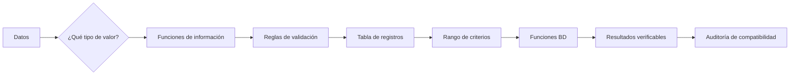
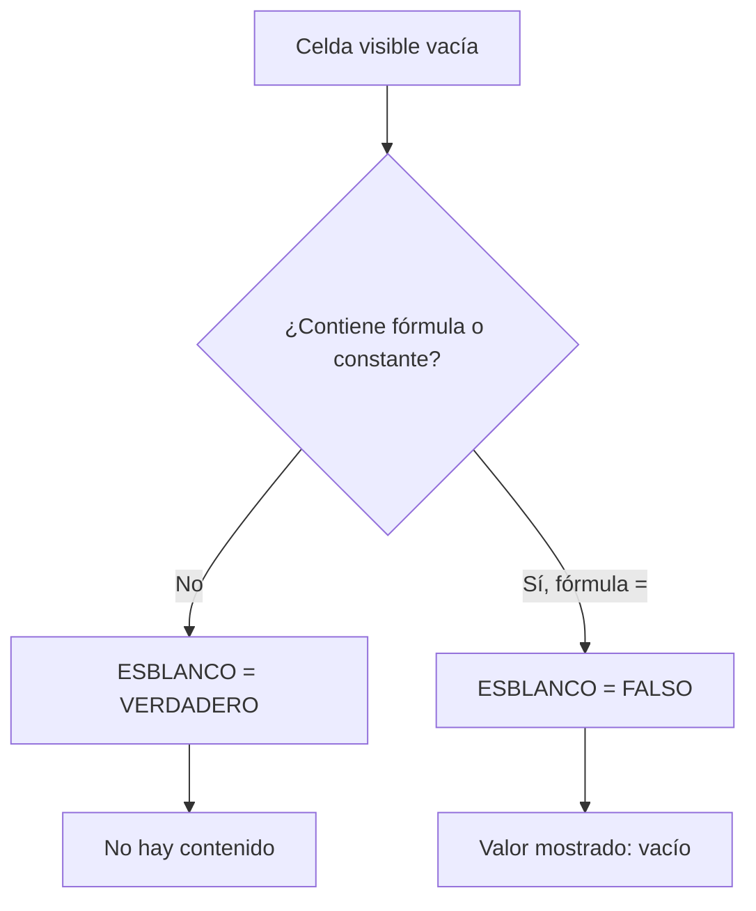
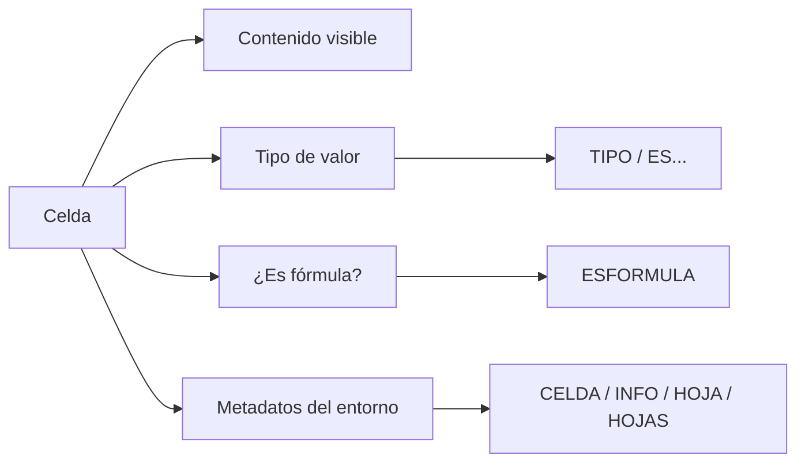
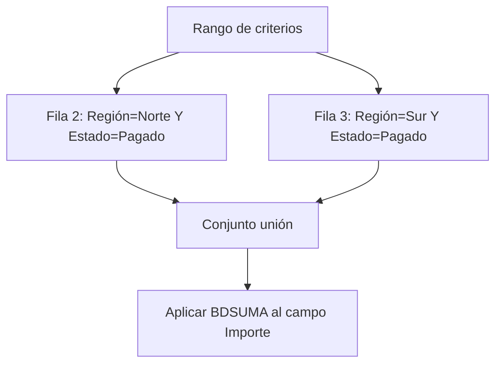
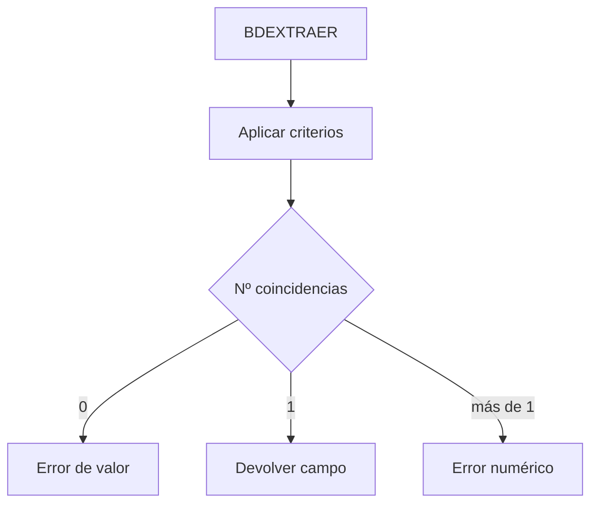
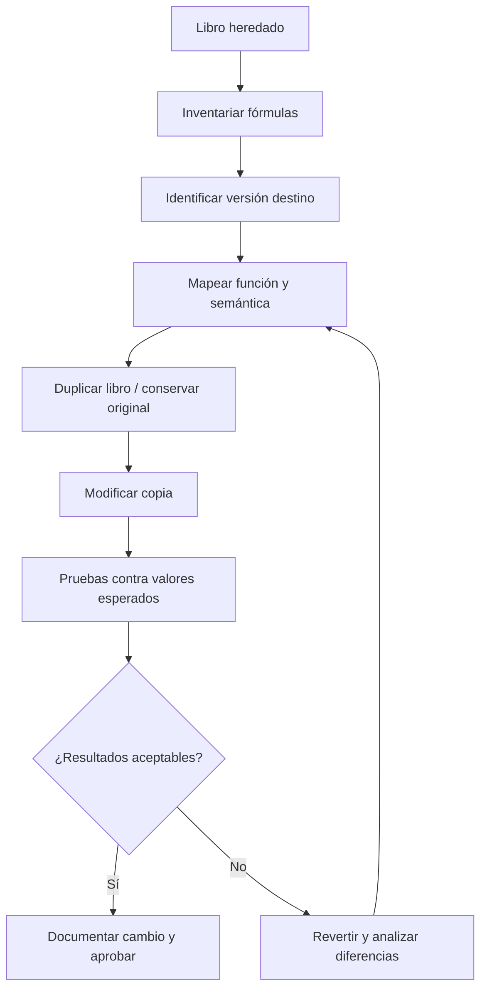
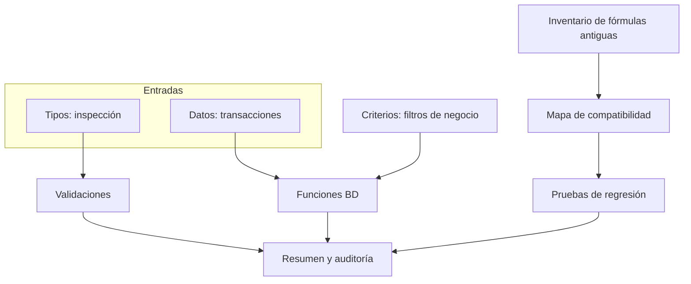

# H13 — Funciones de información, bases de datos y compatibilidad

> **Ruta I — Excel | Módulo H13 de H01–H24 | Roadmap oficial v2.0**  
> Nivel: intermedio | Dedicación inicial: 22 horas + ampliaciones del inventario | Fecha de referencia: 25/10/2026  
> Estado: **desarrollado para revisión**, no validado directamente en la aplicación Excel.  
> Prerrequisitos: H03 (tipos de datos), H05 (fórmulas), H06 (tablas) y H07 (lógica y errores).

## Guía de lectura

Este capítulo enseña a **reconocer qué contiene una celda**, operar con **funciones de base de datos que emplean rangos de criterios** y mantener **libros heredados** sin alterar inadvertidamente sus cálculos. Se distingue entre funciones explicadas a profundidad, funciones inventariadas y temas de otro módulo referenciados aquí.

| Sección | Tema | Competencia observable |
|---|---|---|
| **H13.01** | Información | Diagnosticar tipos, celdas, errores y metadatos del libro |
| **H13.02** | Base de datos | Construir criterios AND/OR y agregaciones sobre registros |
| **H13.03** | Compatibilidad | Identificar fórmulas heredadas, planear su migración y probar resultados |

**Configuración usada en los ejemplos:** interfaz de Excel en español, argumentos separados por `;`, decimales con `,` y fórmulas en celdas. Algunas configuraciones usan `,` para separar argumentos y `.` para separar decimales. **No cambies la puntuación de las fórmulas sin considerar tu configuración regional.** La sintaxis en inglés aparece en fichas para consulta técnica.

**Ámbito de compatibilidad:** Microsoft 365 (escritorio Windows, referencia), Excel 2024/2021 cuando las funciones estén admitidas, y comparación conceptual con Google Sheets. `CELDA` e `INFO` tienen limitaciones en Excel para la Web según la referencia oficial; `ISOMITTED` es una función avanzada de LAMBDA y su desarrollo central corresponde a H16. Los códigos de texto de `CELDA`/`INFO` pueden estar localizados. No se presupone que las equivalencias con Sheets tengan sintaxis idéntica.

## Objetivos de aprendizaje

1. Separar una celda realmente vacía de una celda que devuelve texto vacío.
2. Distinguir números, textos numéricos, valores lógicos, referencias y errores.
3. Conocer la semántica de `ESERROR`, `ESERR`, `ESNOD` y `TIPO.DE.ERROR`.
4. Diseñar bloques de criterios bien formados para `BD*`.
5. Identificar por qué `BDEXTRAER` solo sirve cuando hay exactamente un registro coincidente.
6. Distinguir funciones *heredadas* de sustitutas modernas y validar la semántica tras una migración.
7. Dejar evidencias de pruebas, reversibilidad y límites de compatibilidad.

## Ruta conceptual



**Figura H13-F01.** Esquema conceptual; no es una captura real de Excel. Cada bloque se corresponde con una etapa del módulo.

---

# H13.01 — Funciones de información

## H13.01.01 — Predicados sobre valores

### H13.01.01.01 — ESNUMERO, ESTEXTO, ESBLANCO, ESLOGICO y ESNOTEXTO

Un **predicado** es una operación cuya respuesta indica si una condición se cumple. Las funciones `ES...` suelen devolver `VERDADERO` o `FALSO`, de modo que pueden controlar una validación o una decisión posterior. El dato visible **no siempre representa el tipo interno**: `00123` puede ser texto y `123` puede ser número. El formato de una celda tampoco cambia por sí solo el tipo del valor.

**Laboratorio de tipos**. En una hoja llamada `Tipos`, escribe los siguientes valores. En A3 escribe un apóstrofo inicial antes de `00123` para conservarlo como texto; el apóstrofo no se mostrará en la celda.

| Celda | Entrada | Tipo esperado | Observación |
|---|---|---|---|
| A2 | `125` | Número | Puede participar directamente en suma |
| A3 | `'00123` | Texto | Identificador, no cantidad |
| A4 | *(dejar intacta)* | Celda realmente vacía | Sin contenido ni fórmula |
| A5 | `=""` | Fórmula que devuelve texto vacío | No es celda vacía |
| A6 | `=VERDADERO` | Lógico | Distinto del texto `"VERDADERO"` |
| A7 | `=1/0` | Error | Genera `#¡DIV/0!` |
| A8 | `=NOD()` | Error especial | Genera `#N/A` |
| A9 | `=25` | Número resultante de fórmula | Contenido diferente de una constante |

> Importante: en A5 introduce exactamente `=""` como fórmula: dos comillas dobles sin espacio entre ellas. La celda parecerá vacía, pero contiene una fórmula.

| Prueba | Fórmula en español | Resultado previsto |
|---|---|---|
| ¿Es número? | `=ESNUMERO(A2)` | `VERDADERO` |
| ¿Texto numérico? | `=ESTEXTO(A3)` | `VERDADERO` |
| ¿A4 está vacía? | `=ESBLANCO(A4)` | `VERDADERO` |
| ¿A5 está vacía? | `=ESBLANCO(A5)` | `FALSO` |
| ¿Valor lógico? | `=ESLOGICO(A6)` | `VERDADERO` |
| ¿No es texto? | `=ESNOTEXTO(A4)` | `VERDADERO` |
| ¿Contiene una fórmula? | `=ESFORMULA(A9)` | `VERDADERO` |

**Fundamento:** `ESBLANCO` inspecciona la presencia de contenido, no la apariencia visual. Una fórmula que devuelve `""` sigue siendo contenido. `ESNOTEXTO` acepta números, lógicos, errores e incluso celdas vacías como «no texto»; por tanto, no significa «es número».



**Figura H13-F02.** Diferencia entre ausencia de contenido y resultado visualmente vacío.

### H13.01.01.02 — Funciones de inspección de errores y referencias

Los errores no son un único estado. `#N/A` suele representar ausencia de coincidencia o dato no disponible; `#¡DIV/0!` revela una división por cero; `#¡REF!` indica una referencia inválida. El manejo apropiado depende del significado del error.

| Prueba | `#¡DIV/0!` | `#N/A` | Valor `25` |
|---|---:|---:|---:|
| `ESERROR(...)` | VERDADERO | VERDADERO | FALSO |
| `ESERR(...)` | VERDADERO | FALSO | FALSO |
| `ESNOD(...)` | FALSO | VERDADERO | FALSO |

**Regla de diseño:** no ocultes `#¡DIV/0!` con `SI.ERROR(...;0)` si el cero parece un dato real. En auditoría es preferible registrar `TipoError`, `Origen` y `Acción`, reservando valores sustitutivos para casos de negocio definidos.

`ESREF(A2)` devuelve `VERDADERO` porque el argumento es una referencia válida. Pero `ESREF(125)` da `FALSO`: un número no es una referencia. `ESFORMULA(A9)` reconoce una fórmula aunque el resultado parezca una constante.

### H13.01.01.03 — Paridad y predicados especializados

`ES.PAR`/`ISEVEN` y `ES.IMPAR`/`ISODD` prueban la paridad numérica. En los casos positivos, `ES.PAR(8)` es `VERDADERO` y `ES.IMPAR(9)` es `VERDADERO`. Evita emplearlas directamente como validación de identificadores textuales: el hecho de que un código contenga dígitos no significa que sea una cantidad.

`ISOMITTED` detecta argumentos opcionales omitidos **dentro de una expresión LAMBDA**; no es un predicado general sobre celdas vacías. Se inventaría en H13, pero su ficha principal corresponde a H16.03.

## H13.01.02 — Inspección y clasificación

### H13.01.02.01 — TIPO, TIPO.DE.ERROR, N y T

`TIPO(valor)` devuelve un **código**, no el texto `"número"` o `"texto"`. La referencia oficial incluye `1` (número), `2` (texto), `4` (lógico), `16` (error), `64` (matriz) y `128` (dato compuesto). El código se utiliza para construir comprobaciones de calidad; no debe interpretarse como valor matemático.

| Entrada | Fórmula | Resultado |
|---|---|---|
| `25` | `=TIPO(25)` | `1` |
| `"ABC"` | `=TIPO("ABC")` | `2` |
| `VERDADERO` | `=TIPO(VERDADERO)` | `4` |
| `1/0` | `=TIPO(1/0)` | `16` |

`TIPO.DE.ERROR` asocia códigos con errores clásicos: `#¡NULO!→1`, `#¡DIV/0!→2`, `#¡VALOR!→3`, `#¡REF!→4`, `#¿NOMBRE?→5`, `#¡NUM!→6`, `#N/A→7` y `#OBTENIENDO_DATOS→8` en el documento de referencia. Si el valor no es error, devuelve `#N/A`.

`N` permite convertir valores a números bajo reglas específicas: `N(VERDADERO)=1`, `N(FALSO)=0`, `N("125")=0` y `N(125)=125`. **No uses `N` para convertir importes almacenados como texto**; ese 0 puede ocultar un problema. Consulta H10 (`VALOR`/`VALOR.NUMERO`) para conversiones textuales controladas.

`T` devuelve texto cuando el argumento es texto; ante un número o un lógico devuelve `""`. Por ejemplo, `=T("ABC")` devuelve `ABC`, mientras `=T(125)` devuelve texto vacío. Puede servir al inspeccionar entradas heterogéneas, pero no reemplaza una validación de estructura.

### H13.01.02.02 — CELDA, INFO, HOJA y HOJAS

`CELDA(tipo_de_info;[referencia])` devuelve metadatos como número de fila, columna o tipo de contenido, sujetos a opciones compatibles y a **códigos de texto localizados**. Ejemplos de entorno español: `=CELDA("fila";A9)` devuelve 9; `=CELDA("tipo";A2)` devuelve `"v"` cuando A2 contiene un número; puede devolver `"r"` para texto y `"b"` para blanco. En una instalación en inglés, algunos códigos de texto son diferentes. Es conveniente pasar siempre `referencia` explícita.

`INFO(tipo)` devuelve información del entorno y depende de su disponibilidad. Un ejemplo es `=INFO("actual")` para consultar modo de recálculo según la documentación en español; su resultado depende de la configuración. Algunas tablas de ayuda contienen traducciones inconsistentes de argumentos; se recomienda probar estos indicadores en la instalación concreta y no usar su valor como criterio estable de negocio. **No disponible en Excel para la Web** según Microsoft.

`HOJA([valor])` entrega la posición de una hoja; `HOJAS([referencia])` cuenta hojas de una referencia (o el libro correspondiente según argumento). El resultado depende de hojas existentes, por lo que no deben codificarse indicadores de negocio suponiendo que una hoja siempre ocupará una posición fija.



**Figura H13-F03.** Distinguir el contenido, el tipo, la existencia de fórmula y los metadatos.

### H13.01.02.03 — Aplicación: calidad de un registro

Supón que recibes una columna **Importe** que debería contener números mayores o iguales a cero. No basta con verificar que la celda no esté vacía. Una estrategia progresiva es: (1) detectar vacíos, (2) reconocer errores, (3) reconocer números y (4) comprobar el rango permitido.

```excel
=SI(ESBLANCO(E2);"FALTA IMPORTE";SI(ESERROR(E2);"ERROR DE CÁLCULO";SI(NO(ESNUMERO(E2));"TIPO INVÁLIDO";SI(E2<0;"NEGATIVO";"OK"))))
```

En este caso `NO`, `SI` y los operadores se remiten a H07; aquí el objetivo es aprender a **diagnosticar el tipo del dato**. Una fórmula más corta no siempre es más clara; una columna de diagnóstico por condición ayuda a depurar y mantener el libro.

---

# H13.02 — Funciones de bases de datos

## H13.02.01 — Agregaciones condicionadas

### H13.02.01.01 — Estructura y criterios de una función BD

Las funciones de la familia `BD...` calculan sobre una **lista de registros** mediante tres argumentos. Aquí «base de datos» significa un rango tabular con encabezados; **no es una conexión automática a un motor SQL**.

```excel
=BDSUMA(base_de_datos;campo;criterios)
```

- `base_de_datos`: rango completo, encabezados incluidos.
- `campo`: nombre literal del encabezado entre comillas (`"Importe"`) o número de posición de columna (`5`, en el ejemplo).
- `criterios`: rango independiente con encabezado(s) que coinciden exactamente con los encabezados de la base y por lo menos una fila de criterios.

**Datos reproducibles:** crea una hoja `Datos` y pega la siguiente tabla en `A1:F11`.

| ID | Región | Estado | Vendedor | Importe | Unidades |
|---:|---|---|---|---:|---:|
| 101 | Norte | Pagado | Ana | 120 | 3 |
| 102 | Sur | Pendiente | Luis | 80 | 2 |
| 103 | Norte | Pagado | Ana | 250 | 5 |
| 104 | Centro | Pagado | Eva | 150 | 3 |
| 105 | Norte | Pendiente | Luis | 90 | 2 |
| 106 | Sur | Pagado | Eva | 210 | 4 |
| 107 | Centro | Pendiente | Ana | 60 | 1 |
| 108 | Norte | Pagado | Eva | 180 | 3 |
| 109 | Sur | Pagado | Luis | 130 | 2 |
| 110 | Centro | Pagado | Ana | 300 | 6 |

**Comprobaciones independientes:** 10 registros; suma total de importes = **1,570**; importes pagados = **1,340**; pendientes = **230**; unidades totales = **31**.

En `Criterios!A1:B2` crea:

| A | B |
|---|---|
| Región | Estado |
| Norte | Pagado |

En `Resumen!B2` escribe:

```excel
=BDSUMA(Datos!$A$1:$F$11;"Importe";Criterios!$A$1:$B$2)
```

**Resultado: 550**, correspondientes a IDs 101, 103 y 108.

**Regla lógica de los criterios:** columnas de una misma fila se combinan con **Y (AND)**; filas diferentes se combinan con **O (OR)**. No confundas los rangos de criterio con la cabecera de datos: el criterio se escribe en un bloque independiente.



**Figura H13-F04.** Cada fila es una conjunción (Y); las filas se unen mediante O. Para dos filas, el rango debe ser `A1:B3`.

**Captura pública de referencia** (interfaz real, procedente de Excel-Help):


*Figura H13-F05. Captura pública de una demostración de DSUM, fuente: [Excel-Help](https://excelhelp.in/2021/02/dsum-function-to-sum-for-specific-criteria/). Observa que la zona de datos y la zona de criterios están separadas; es un ejemplo externo distinto del laboratorio propio.*

### H13.02.01.02 — Suma, conteo y promedio

- `BDSUMA`: suma las celdas numéricas del campo correspondiente a registros coincidentes.
- `BDCONTAR`: cuenta **valores numéricos** del campo seleccionado en los registros coincidentes. Si necesitas contar registros con ID numérico, usa el campo `"ID"`.
- `BDCONTARA`: cuenta **valores no vacíos** del campo en los registros coincidentes; es útil con IDs de texto.
- `BDPROMEDIO`: devuelve la media aritmética de los valores numéricos que cumplan los criterios.

**Por qué elegir el campo importa:** `BDCONTAR(...;"Vendedor";...)` no contará nombres textuales. `BDCONTARA(...;"Vendedor";...)` sí contará celdas no vacías en ese campo. Si hay IDs repetidos, ninguna de las dos convierte el recuento en «clientes únicos»; solo cuenta valores.

### H13.02.01.03 — Máximos, mínimos, productos y variabilidad

`BDMAX`, `BDMIN` y `BDPRODUCTO` actúan sobre el campo seleccionado tras aplicar criterios. La multiplicación `BDPRODUCTO` puede crecer rápidamente y dar resultados poco interpretables si el campo incluye importes: úsala solo cuando exista una justificación matemática.

`BDDESVEST` y `BDVAR` trabajan con la **versión muestral**; `BDDESVESTP` y `BDVARP` usan la **versión poblacional**. Estas diferencias no se solucionan cambiando solo el nombre: debemos saber si trabajamos con una muestra o con el conjunto completo. Consultar H09 para fundamentos de inferencia.

## H13.02.02 — Selección y estadística por criterios

### H13.02.02.01 — BDEXTRAER y cardinalidad de registros

`BDEXTRAER` (`DGET`) recupera un campo cuando **exactamente un registro** cumple el criterio.

| Registros coincidentes | Comportamiento |
|---:|---|
| 0 | `#¡VALOR!` |
| 1 | Devuelve el valor del campo |
| 2 o más | `#¡NUM!` |

Ejemplo de una única coincidencia en `Criterios!D1:D2`:

| D |
|---|
| ID |
| 103 |

```excel
=BDEXTRAER(Datos!$A$1:$F$11;"Importe";Criterios!$D$1:$D$2)
```

Resultado: **250**. Si cambias el bloque a criterio `Región = Norte`, hay cuatro registros; el resultado no será «el primero», sino `#¡NUM!`. Es una excelente señal de diseño: el criterio no era una clave única.



**Figura H13-F06.** `BDEXTRAER` no implementa búsqueda del primer resultado; exige unicidad.

### H13.02.02.02 — Criterios complejos, texto y fechas

1. **Y**: `Región = Norte` y `Estado = Pagado` en la misma fila.
2. **O**: `Región = Norte` o `Región = Sur` en filas diferentes bajo un mismo encabezado.
3. **Condiciones numéricas:** en la celda de criterios de `Importe`, escribe `>150` para filtrar importes mayores que 150.
4. **Combinaciones:** para `Norte Y Pagado` o `Sur Y Pagado`, usa dos filas con ambos encabezados repetidos en el mismo rango rectangular.
5. **Reglas sobre fechas:** utiliza valores de fecha reales, no cadenas ambiguas que cambien con la región. Puede resultar útil crear celdas auxiliares y documentar los límites inclusivos/exclusivos.
6. **Coincidencia exacta de texto:** cuidado con criterios tipo `Norte*` y nombres que contienen espacios; conviene depurar entradas y revisar la sintaxis efectiva.

**Antipatrón:** colocar el rango de criterios dentro de la propia base puede sobrescribir registros o romper el diseño al agregar filas. Sitúa `Criterios` en hoja independiente, con encabezados idénticos.

### H13.02.02.03 — Comparación con SUMAR.SI.CONJUNTO y tablas dinámicas

| Alternativa | Ventaja principal | Advertencia |
|---|---|---|
| `BDSUMA` + criterios | Criterios complejos expresados en celdas | Estructura del rango de criterios sensible a encabezados |
| `SUMAR.SI.CONJUNTO` (H07) | Condiciones claras y repetibles en una fórmula | La lógica O entre varios conjuntos puede requerir composición |
| Tabla dinámica (H19) | Exploración interactiva por categorías | Requiere actualización, diseño y control de filtros |
| Power Query (H21) | Transformación reproducible | Introduce un flujo ETL y su propio lenguaje |

**Nota de compatibilidad con Sheets:** Google Sheets dispone de funciones del grupo `D*` como `DSUM`, `DCOUNT` y `DGET` en su catálogo. Deben verificarse los nombres localizados, el separador de argumentos y el comportamiento de casos límite en el entorno concreto; no presupongas paridad automática.

---

# H13.03 — Compatibilidad, funciones heredadas y auditoría

## H13.03.01 — Identificación y migración

### H13.03.01.01 — ¿Qué significa «heredada»?

Una función heredada (*legacy*) sigue disponible para abrir y calcular libros antiguos. Esto **no significa necesariamente que esté eliminada**. Muchas funciones estadísticas fueron renombradas a partir de Excel 2010 para mejorar claridad semántica o precisión, pero permanecen por compatibilidad. Microsoft recomienda usar las nuevas cuando no haya necesidad de mantener versiones anteriores.

La migración **no debe consistir en buscar y reemplazar texto masivamente**: pueden cambiar nombres, argumentos, convenciones de colas de distribución o supuestos estadísticos. El reemplazo requiere un mapa de equivalencia y pruebas con los mismos datos.



**Figura H13-F07.** Protocolo de migración con reversión y evidencia.

### H13.03.01.02 — Diferencias de precisión y comportamiento

La precisión numérica de una fórmula puede cambiar con la versión del algoritmo, sin que el cálculo sea intrínsecamente incorrecto. Al validar una migración, establece el nivel de tolerancia por dominio:

- Para importes, comparar con la política de redondeo establecida y la unidad monetaria; no usar una tolerancia arbitraria para contabilidad.
- Para estadística, comparar resultados con tolerancias absolutas y relativas justificadas.
- Para probabilidades muy pequeñas, interpretar errores relativos con cuidado; si el valor esperado es cercano a cero, una tolerancia absoluta suele ser informativa.
- Verificar también resultados de errores: un `#N/A` que pasa a cero puede alterar decisiones aunque «la fórmula no falle».

```text
Diferencia absoluta = |resultado_nuevo - resultado_antiguo|
Diferencia relativa = Diferencia_absoluta / |resultado_referencia|
```

Si el denominador de la diferencia relativa es cero, debe utilizarse otra regla (p. ej., diferencia absoluta), nunca forzar una división por cero.

### H13.03.01.03 — Migración de funciones: ejemplos semánticos

**Ejemplo A — DESVEST → DESVEST.M:** dos nombres de desviación estándar muestral. Para valores `10, 12, 14`, el promedio es `12`, la suma de cuadrados es `8`, la varianza muestral es `8/(3-1)=4` y la desviación muestral es `2`. `DESVEST.P` es otra pregunta: para población completa, la desviación es `√(8/3) ≈ 1,632993`.

**Ejemplo B — VAR → VAR.S:** para `10, 12, 14`, `VAR`/`VAR.S` producen `4`, pero `VAR.P` da `8/3`. La migración correcta conserva el criterio muestral/poblacional.

**Ejemplo C — DISTR.NORM → DISTR.NORM.N:** comprobar la bandera acumulativa. Con `x=0, media=0, desviación=1`, el resultado acumulativo es `0,5`. La densidad en 0 es aproximadamente `0,39894228`; una densidad no es una probabilidad puntual (revisar H09).

**Ejemplo D — CONCATENAR → CONCAT/UNIRCADENAS:** la sustitución depende de cómo se tratan separadores y celdas vacías. `=CONCATENAR("Ana";" ";"López")` devuelve `Ana López`. En H10 se estudia su comparación completa.

## H13.03.02 — Auditoría de cambios y regresiones

### H13.03.02.01 — Registro de pruebas

La migración debe dejar trazabilidad documental. Para cada fórmula registra:

| Campo | Ejemplo |
|---|---|
| Archivo origen | `Ventas_2012.xls` |
| Hoja/celda | `Resumen!F12` |
| Función heredada | `DESVEST` |
| Sustituta propuesta | `DESVEST.M` |
| Versión destino | Microsoft 365 escritorio |
| Resultado esperado | `2` para conjunto de prueba |
| Resultado observado | A completar tras ejecutar en Excel |
| Tolerancia | `0` para este ejemplo exacto |
| Riesgo | Diferencia muestral/poblacional |
| Estado | Pendiente de ejecución / validación |

**No confundir una revisión conceptual con una prueba en Excel:** las demostraciones matemáticas aquí se contrastan independientemente cuando es posible, pero las cadenas de fórmulas deben ensayarse en la versión objetivo antes de aprobar una migración de producción.

### H13.03.02.02 — Validación de regresión, protección y recuperación

1. Haz una copia de solo lectura del archivo original y documenta su origen.
2. Registra valores de referencia y el porcentaje de celdas con errores.
3. Construye pruebas de borde: vacíos, `#N/A`, datos negativos, fechas, un solo registro y varios registros.
4. Migra por grupos pequeños. No reemplaces todas las fórmulas simultáneamente.
5. Calcula diferencias y revisa resultados fuera de tolerancia.
6. Repite en otro archivo/versionado para detectar referencias externas rotas.
7. Conserva un procedimiento para revertir cambios si falla una prueba.

**Criterio de aceptación recomendado:** 100 % de los casos críticos pasan sus pruebas; no quedan diferencias no explicadas, y las diferencias permitidas están documentadas. Esto es un objetivo de calidad de este curso, no una garantía de equivalencia absoluta entre plataformas.

## H13.01.03 — Fichero de funciones de información (22 registros, 21 fichas desarrolladas)

La ficha siguiente sigue una estructura homogénea para facilitar su consulta posterior. Todas las fórmulas asumen los datos reproducibles de `Tipos` ya definidos. No se presenta como verificada en Excel: el resultado **esperado** se deriva de la semántica documentada.

### H13-INFO-01 — `ESBLANCO` / `ISBLANK`

**Categoría:** Información (o función de conversión asociada, caso de `T`). **Propósito:** Detecta una referencia verdaderamente sin contenido.

- **Sintaxis ES:** `ESBLANCO(valor)`. **Argumentos:** los argumentos sin corchetes son obligatorios; los comprendidos entre corchetes son opcionales. `valor` es un valor o referencia a comprobar; `referencia` identifica una celda; `tipo_de_info`/`tipo` es una cadena de consulta.
- **Tipo de salida:** Lógico (VERDADERO/FALSO).
- **Ejemplo básico:** `=ESBLANCO(Tipos!A4)` → **VERDADERO**.
- **Ejemplo intermedio:** incorpora la prueba a `=SI(ESBLANCO(Tipos!A4);"REVISAR";"CONTINUAR")` **solo si** el resultado de la función es lógico; de lo contrario, combina su salida con una comparación adecuada, como `TIPO(...)=1`. No pegues esta plantilla sin ajustar el tipo del resultado.
- **Aplicación profesional:** Campos obligatorios sin capturar. En producción se registraría la fuente y la regla de validación.
- **Interpretación:** el resultado permite clasificar o inspeccionar un aspecto concreto; no valida automáticamente todas las reglas del negocio.
- **Error típico / limitación:** Una fórmula que entrega "" NO equivale a celda vacía.
- **Alternativas:** `SI`, `SI.ERROR`, `SI.ND`, `ESNUMERO`, `ESTEXTO`, `TIPO` o funciones de transformación, según el problema (H07/H10).
- **Sheets y compatibilidad:** verificar nombre canónico `ISBLANK` y comportamiento en la [lista oficial de Sheets](https://support.google.com/docs/table/25273?hl=es); **no se garantiza** que el nombre localizado, todas las opciones ni los metadatos sean idénticos. Referencia base Excel Microsoft 365/2024; las limitaciones de `CELDA`/`INFO` web y los requisitos de `HOJA`/`HOJAS` dependen del entorno.
- **Miniejercicio:** modifica el tipo o contenido de la celda del ejemplo y predice si el resultado cambia. Luego inspecciona el resultado real y anota por qué.

### H13-INFO-02 — `ESNUMERO` / `ISNUMBER`

**Categoría:** Información (o función de conversión asociada, caso de `T`). **Propósito:** Comprueba si el valor tiene tipo numérico.

- **Sintaxis ES:** `ESNUMERO(valor)`. **Argumentos:** los argumentos sin corchetes son obligatorios; los comprendidos entre corchetes son opcionales. `valor` es un valor o referencia a comprobar; `referencia` identifica una celda; `tipo_de_info`/`tipo` es una cadena de consulta.
- **Tipo de salida:** Lógico (VERDADERO/FALSO).
- **Ejemplo básico:** `=ESNUMERO(Tipos!A2)` → **VERDADERO**.
- **Ejemplo intermedio:** incorpora la prueba a `=SI(ESNUMERO(Tipos!A2);"REVISAR";"CONTINUAR")` **solo si** el resultado de la función es lógico; de lo contrario, combina su salida con una comparación adecuada, como `TIPO(...)=1`. No pegues esta plantilla sin ajustar el tipo del resultado.
- **Aplicación profesional:** Importes, unidades y tasas. En producción se registraría la fuente y la regla de validación.
- **Interpretación:** el resultado permite clasificar o inspeccionar un aspecto concreto; no valida automáticamente todas las reglas del negocio.
- **Error típico / limitación:** La cadena "125" no es número por parecerlo.
- **Alternativas:** `SI`, `SI.ERROR`, `SI.ND`, `ESNUMERO`, `ESTEXTO`, `TIPO` o funciones de transformación, según el problema (H07/H10).
- **Sheets y compatibilidad:** verificar nombre canónico `ISNUMBER` y comportamiento en la [lista oficial de Sheets](https://support.google.com/docs/table/25273?hl=es); **no se garantiza** que el nombre localizado, todas las opciones ni los metadatos sean idénticos. Referencia base Excel Microsoft 365/2024; las limitaciones de `CELDA`/`INFO` web y los requisitos de `HOJA`/`HOJAS` dependen del entorno.
- **Miniejercicio:** modifica el tipo o contenido de la celda del ejemplo y predice si el resultado cambia. Luego inspecciona el resultado real y anota por qué.

### H13-INFO-03 — `ESTEXTO` / `ISTEXT`

**Categoría:** Información (o función de conversión asociada, caso de `T`). **Propósito:** Comprueba si el valor es texto.

- **Sintaxis ES:** `ESTEXTO(valor)`. **Argumentos:** los argumentos sin corchetes son obligatorios; los comprendidos entre corchetes son opcionales. `valor` es un valor o referencia a comprobar; `referencia` identifica una celda; `tipo_de_info`/`tipo` es una cadena de consulta.
- **Tipo de salida:** Lógico (VERDADERO/FALSO).
- **Ejemplo básico:** `=ESTEXTO(Tipos!A3)` → **VERDADERO**.
- **Ejemplo intermedio:** incorpora la prueba a `=SI(ESTEXTO(Tipos!A3);"REVISAR";"CONTINUAR")` **solo si** el resultado de la función es lógico; de lo contrario, combina su salida con una comparación adecuada, como `TIPO(...)=1`. No pegues esta plantilla sin ajustar el tipo del resultado.
- **Aplicación profesional:** IDs con ceros iniciales. En producción se registraría la fuente y la regla de validación.
- **Interpretación:** el resultado permite clasificar o inspeccionar un aspecto concreto; no valida automáticamente todas las reglas del negocio.
- **Error típico / limitación:** Las fechas reales suelen ser números de serie.
- **Alternativas:** `SI`, `SI.ERROR`, `SI.ND`, `ESNUMERO`, `ESTEXTO`, `TIPO` o funciones de transformación, según el problema (H07/H10).
- **Sheets y compatibilidad:** verificar nombre canónico `ISTEXT` y comportamiento en la [lista oficial de Sheets](https://support.google.com/docs/table/25273?hl=es); **no se garantiza** que el nombre localizado, todas las opciones ni los metadatos sean idénticos. Referencia base Excel Microsoft 365/2024; las limitaciones de `CELDA`/`INFO` web y los requisitos de `HOJA`/`HOJAS` dependen del entorno.
- **Miniejercicio:** modifica el tipo o contenido de la celda del ejemplo y predice si el resultado cambia. Luego inspecciona el resultado real y anota por qué.

### H13-INFO-04 — `ESLOGICO` / `ISLOGICAL`

**Categoría:** Información (o función de conversión asociada, caso de `T`). **Propósito:** Reconoce valores VERDADERO/FALSO.

- **Sintaxis ES:** `ESLOGICO(valor)`. **Argumentos:** los argumentos sin corchetes son obligatorios; los comprendidos entre corchetes son opcionales. `valor` es un valor o referencia a comprobar; `referencia` identifica una celda; `tipo_de_info`/`tipo` es una cadena de consulta.
- **Tipo de salida:** Lógico (VERDADERO/FALSO).
- **Ejemplo básico:** `=ESLOGICO(Tipos!A6)` → **VERDADERO**.
- **Ejemplo intermedio:** incorpora la prueba a `=SI(ESLOGICO(Tipos!A6);"REVISAR";"CONTINUAR")` **solo si** el resultado de la función es lógico; de lo contrario, combina su salida con una comparación adecuada, como `TIPO(...)=1`. No pegues esta plantilla sin ajustar el tipo del resultado.
- **Aplicación profesional:** Indicadores de validación. En producción se registraría la fuente y la regla de validación.
- **Interpretación:** el resultado permite clasificar o inspeccionar un aspecto concreto; no valida automáticamente todas las reglas del negocio.
- **Error típico / limitación:** La cadena "VERDADERO" no es el valor lógico VERDADERO.
- **Alternativas:** `SI`, `SI.ERROR`, `SI.ND`, `ESNUMERO`, `ESTEXTO`, `TIPO` o funciones de transformación, según el problema (H07/H10).
- **Sheets y compatibilidad:** verificar nombre canónico `ISLOGICAL` y comportamiento en la [lista oficial de Sheets](https://support.google.com/docs/table/25273?hl=es); **no se garantiza** que el nombre localizado, todas las opciones ni los metadatos sean idénticos. Referencia base Excel Microsoft 365/2024; las limitaciones de `CELDA`/`INFO` web y los requisitos de `HOJA`/`HOJAS` dependen del entorno.
- **Miniejercicio:** modifica el tipo o contenido de la celda del ejemplo y predice si el resultado cambia. Luego inspecciona el resultado real y anota por qué.

### H13-INFO-05 — `ESERROR` / `ISERROR`

**Categoría:** Información (o función de conversión asociada, caso de `T`). **Propósito:** Detecta cualquier error de fórmula, incluido #N/A.

- **Sintaxis ES:** `ESERROR(valor)`. **Argumentos:** los argumentos sin corchetes son obligatorios; los comprendidos entre corchetes son opcionales. `valor` es un valor o referencia a comprobar; `referencia` identifica una celda; `tipo_de_info`/`tipo` es una cadena de consulta.
- **Tipo de salida:** Lógico (VERDADERO/FALSO).
- **Ejemplo básico:** `=ESERROR(Tipos!A8)` → **VERDADERO**.
- **Ejemplo intermedio:** incorpora la prueba a `=SI(ESERROR(Tipos!A8);"REVISAR";"CONTINUAR")` **solo si** el resultado de la función es lógico; de lo contrario, combina su salida con una comparación adecuada, como `TIPO(...)=1`. No pegues esta plantilla sin ajustar el tipo del resultado.
- **Aplicación profesional:** Monitoreo de calidad del modelo. En producción se registraría la fuente y la regla de validación.
- **Interpretación:** el resultado permite clasificar o inspeccionar un aspecto concreto; no valida automáticamente todas las reglas del negocio.
- **Error típico / limitación:** No revela cuál error ocurrió; combinar con TIPO.DE.ERROR.
- **Alternativas:** `SI`, `SI.ERROR`, `SI.ND`, `ESNUMERO`, `ESTEXTO`, `TIPO` o funciones de transformación, según el problema (H07/H10).
- **Sheets y compatibilidad:** verificar nombre canónico `ISERROR` y comportamiento en la [lista oficial de Sheets](https://support.google.com/docs/table/25273?hl=es); **no se garantiza** que el nombre localizado, todas las opciones ni los metadatos sean idénticos. Referencia base Excel Microsoft 365/2024; las limitaciones de `CELDA`/`INFO` web y los requisitos de `HOJA`/`HOJAS` dependen del entorno.
- **Miniejercicio:** modifica el tipo o contenido de la celda del ejemplo y predice si el resultado cambia. Luego inspecciona el resultado real y anota por qué.

### H13-INFO-06 — `ESERR` / `ISERR`

**Categoría:** Información (o función de conversión asociada, caso de `T`). **Propósito:** Detecta errores distintos de #N/A.

- **Sintaxis ES:** `ESERR(valor)`. **Argumentos:** los argumentos sin corchetes son obligatorios; los comprendidos entre corchetes son opcionales. `valor` es un valor o referencia a comprobar; `referencia` identifica una celda; `tipo_de_info`/`tipo` es una cadena de consulta.
- **Tipo de salida:** Lógico (VERDADERO/FALSO).
- **Ejemplo básico:** `=ESERR(Tipos!A7)` → **VERDADERO**.
- **Ejemplo intermedio:** incorpora la prueba a `=SI(ESERR(Tipos!A7);"REVISAR";"CONTINUAR")` **solo si** el resultado de la función es lógico; de lo contrario, combina su salida con una comparación adecuada, como `TIPO(...)=1`. No pegues esta plantilla sin ajustar el tipo del resultado.
- **Aplicación profesional:** Separar fallos técnicos de ausencias esperadas. En producción se registraría la fuente y la regla de validación.
- **Interpretación:** el resultado permite clasificar o inspeccionar un aspecto concreto; no valida automáticamente todas las reglas del negocio.
- **Error típico / limitación:** ESERR(#N/A) = FALSO.
- **Alternativas:** `SI`, `SI.ERROR`, `SI.ND`, `ESNUMERO`, `ESTEXTO`, `TIPO` o funciones de transformación, según el problema (H07/H10).
- **Sheets y compatibilidad:** verificar nombre canónico `ISERR` y comportamiento en la [lista oficial de Sheets](https://support.google.com/docs/table/25273?hl=es); **no se garantiza** que el nombre localizado, todas las opciones ni los metadatos sean idénticos. Referencia base Excel Microsoft 365/2024; las limitaciones de `CELDA`/`INFO` web y los requisitos de `HOJA`/`HOJAS` dependen del entorno.
- **Miniejercicio:** modifica el tipo o contenido de la celda del ejemplo y predice si el resultado cambia. Luego inspecciona el resultado real y anota por qué.

### H13-INFO-07 — `ESNOD` / `ISNA`

**Categoría:** Información (o función de conversión asociada, caso de `T`). **Propósito:** Reconoce específicamente el error #N/A.

- **Sintaxis ES:** `ESNOD(valor)`. **Argumentos:** los argumentos sin corchetes son obligatorios; los comprendidos entre corchetes son opcionales. `valor` es un valor o referencia a comprobar; `referencia` identifica una celda; `tipo_de_info`/`tipo` es una cadena de consulta.
- **Tipo de salida:** Lógico (VERDADERO/FALSO).
- **Ejemplo básico:** `=ESNOD(Tipos!A8)` → **VERDADERO**.
- **Ejemplo intermedio:** incorpora la prueba a `=SI(ESNOD(Tipos!A8);"REVISAR";"CONTINUAR")` **solo si** el resultado de la función es lógico; de lo contrario, combina su salida con una comparación adecuada, como `TIPO(...)=1`. No pegues esta plantilla sin ajustar el tipo del resultado.
- **Aplicación profesional:** Búsquedas sin coincidencia. En producción se registraría la fuente y la regla de validación.
- **Interpretación:** el resultado permite clasificar o inspeccionar un aspecto concreto; no valida automáticamente todas las reglas del negocio.
- **Error típico / limitación:** Un texto literal "#N/A" no es necesariamente el error #N/A.
- **Alternativas:** `SI`, `SI.ERROR`, `SI.ND`, `ESNUMERO`, `ESTEXTO`, `TIPO` o funciones de transformación, según el problema (H07/H10).
- **Sheets y compatibilidad:** verificar nombre canónico `ISNA` y comportamiento en la [lista oficial de Sheets](https://support.google.com/docs/table/25273?hl=es); **no se garantiza** que el nombre localizado, todas las opciones ni los metadatos sean idénticos. Referencia base Excel Microsoft 365/2024; las limitaciones de `CELDA`/`INFO` web y los requisitos de `HOJA`/`HOJAS` dependen del entorno.
- **Miniejercicio:** modifica el tipo o contenido de la celda del ejemplo y predice si el resultado cambia. Luego inspecciona el resultado real y anota por qué.

### H13-INFO-08 — `ESNOTEXTO` / `ISNONTEXT`

**Categoría:** Información (o función de conversión asociada, caso de `T`). **Propósito:** Comprueba que un valor NO sea texto.

- **Sintaxis ES:** `ESNOTEXTO(valor)`. **Argumentos:** los argumentos sin corchetes son obligatorios; los comprendidos entre corchetes son opcionales. `valor` es un valor o referencia a comprobar; `referencia` identifica una celda; `tipo_de_info`/`tipo` es una cadena de consulta.
- **Tipo de salida:** Lógico (VERDADERO/FALSO).
- **Ejemplo básico:** `=ESNOTEXTO(Tipos!A4)` → **VERDADERO**.
- **Ejemplo intermedio:** incorpora la prueba a `=SI(ESNOTEXTO(Tipos!A4);"REVISAR";"CONTINUAR")` **solo si** el resultado de la función es lógico; de lo contrario, combina su salida con una comparación adecuada, como `TIPO(...)=1`. No pegues esta plantilla sin ajustar el tipo del resultado.
- **Aplicación profesional:** Clasificación de datos heterogéneos. En producción se registraría la fuente y la regla de validación.
- **Interpretación:** el resultado permite clasificar o inspeccionar un aspecto concreto; no valida automáticamente todas las reglas del negocio.
- **Error típico / limitación:** Acepta celdas vacías y errores; no equivale a ESNUMERO.
- **Alternativas:** `SI`, `SI.ERROR`, `SI.ND`, `ESNUMERO`, `ESTEXTO`, `TIPO` o funciones de transformación, según el problema (H07/H10).
- **Sheets y compatibilidad:** verificar nombre canónico `ISNONTEXT` y comportamiento en la [lista oficial de Sheets](https://support.google.com/docs/table/25273?hl=es); **no se garantiza** que el nombre localizado, todas las opciones ni los metadatos sean idénticos. Referencia base Excel Microsoft 365/2024; las limitaciones de `CELDA`/`INFO` web y los requisitos de `HOJA`/`HOJAS` dependen del entorno.
- **Miniejercicio:** modifica el tipo o contenido de la celda del ejemplo y predice si el resultado cambia. Luego inspecciona el resultado real y anota por qué.

### H13-INFO-09 — `ESREF` / `ISREF`

**Categoría:** Información (o función de conversión asociada, caso de `T`). **Propósito:** Comprueba si el argumento constituye una referencia.

- **Sintaxis ES:** `ESREF(valor)`. **Argumentos:** los argumentos sin corchetes son obligatorios; los comprendidos entre corchetes son opcionales. `valor` es un valor o referencia a comprobar; `referencia` identifica una celda; `tipo_de_info`/`tipo` es una cadena de consulta.
- **Tipo de salida:** Lógico (VERDADERO/FALSO).
- **Ejemplo básico:** `=ESREF(Tipos!A2)` → **VERDADERO**.
- **Ejemplo intermedio:** incorpora la prueba a `=SI(ESREF(Tipos!A2);"REVISAR";"CONTINUAR")` **solo si** el resultado de la función es lógico; de lo contrario, combina su salida con una comparación adecuada, como `TIPO(...)=1`. No pegues esta plantilla sin ajustar el tipo del resultado.
- **Aplicación profesional:** Comprobar resultados que deberían ser referencias. En producción se registraría la fuente y la regla de validación.
- **Interpretación:** el resultado permite clasificar o inspeccionar un aspecto concreto; no valida automáticamente todas las reglas del negocio.
- **Error típico / limitación:** Si la referencia es inválida puede fallar antes de evaluarse.
- **Alternativas:** `SI`, `SI.ERROR`, `SI.ND`, `ESNUMERO`, `ESTEXTO`, `TIPO` o funciones de transformación, según el problema (H07/H10).
- **Sheets y compatibilidad:** verificar nombre canónico `ISREF` y comportamiento en la [lista oficial de Sheets](https://support.google.com/docs/table/25273?hl=es); **no se garantiza** que el nombre localizado, todas las opciones ni los metadatos sean idénticos. Referencia base Excel Microsoft 365/2024; las limitaciones de `CELDA`/`INFO` web y los requisitos de `HOJA`/`HOJAS` dependen del entorno.
- **Miniejercicio:** modifica el tipo o contenido de la celda del ejemplo y predice si el resultado cambia. Luego inspecciona el resultado real y anota por qué.

### H13-INFO-10 — `ESFORMULA` / `ISFORMULA`

**Categoría:** Información (o función de conversión asociada, caso de `T`). **Propósito:** Indica si la celda referenciada contiene fórmula.

- **Sintaxis ES:** `ESFORMULA(referencia)`. **Argumentos:** los argumentos sin corchetes son obligatorios; los comprendidos entre corchetes son opcionales. `valor` es un valor o referencia a comprobar; `referencia` identifica una celda; `tipo_de_info`/`tipo` es una cadena de consulta.
- **Tipo de salida:** Lógico (VERDADERO/FALSO).
- **Ejemplo básico:** `=ESFORMULA(Tipos!A9)` → **VERDADERO**.
- **Ejemplo intermedio:** incorpora la prueba a `=SI(ESFORMULA(Tipos!A9);"REVISAR";"CONTINUAR")` **solo si** el resultado de la función es lógico; de lo contrario, combina su salida con una comparación adecuada, como `TIPO(...)=1`. No pegues esta plantilla sin ajustar el tipo del resultado.
- **Aplicación profesional:** Auditoría de fórmulas pegadas como valores. En producción se registraría la fuente y la regla de validación.
- **Interpretación:** el resultado permite clasificar o inspeccionar un aspecto concreto; no valida automáticamente todas las reglas del negocio.
- **Error típico / limitación:** Inspecciona fórmula, no el tipo del resultado.
- **Alternativas:** `SI`, `SI.ERROR`, `SI.ND`, `ESNUMERO`, `ESTEXTO`, `TIPO` o funciones de transformación, según el problema (H07/H10).
- **Sheets y compatibilidad:** verificar nombre canónico `ISFORMULA` y comportamiento en la [lista oficial de Sheets](https://support.google.com/docs/table/25273?hl=es); **no se garantiza** que el nombre localizado, todas las opciones ni los metadatos sean idénticos. Referencia base Excel Microsoft 365/2024; las limitaciones de `CELDA`/`INFO` web y los requisitos de `HOJA`/`HOJAS` dependen del entorno.
- **Miniejercicio:** modifica el tipo o contenido de la celda del ejemplo y predice si el resultado cambia. Luego inspecciona el resultado real y anota por qué.

### H13-INFO-11 — `ES.PAR` / `ISEVEN`

**Categoría:** Información (o función de conversión asociada, caso de `T`). **Propósito:** Indica si un número es par.

- **Sintaxis ES:** `ES.PAR(número)`. **Argumentos:** los argumentos sin corchetes son obligatorios; los comprendidos entre corchetes son opcionales. `valor` es un valor o referencia a comprobar; `referencia` identifica una celda; `tipo_de_info`/`tipo` es una cadena de consulta.
- **Tipo de salida:** Lógico (VERDADERO/FALSO).
- **Ejemplo básico:** `=ES.PAR(8)` → **VERDADERO**.
- **Ejemplo intermedio:** incorpora la prueba a `=SI(ES.PAR(8);"REVISAR";"CONTINUAR")` **solo si** el resultado de la función es lógico; de lo contrario, combina su salida con una comparación adecuada, como `TIPO(...)=1`. No pegues esta plantilla sin ajustar el tipo del resultado.
- **Aplicación profesional:** Clasificación por lotes alternos. En producción se registraría la fuente y la regla de validación.
- **Interpretación:** el resultado permite clasificar o inspeccionar un aspecto concreto; no valida automáticamente todas las reglas del negocio.
- **Error típico / limitación:** Valida la entrada; una ID textual no es una cantidad.
- **Alternativas:** `SI`, `SI.ERROR`, `SI.ND`, `ESNUMERO`, `ESTEXTO`, `TIPO` o funciones de transformación, según el problema (H07/H10).
- **Sheets y compatibilidad:** verificar nombre canónico `ISEVEN` y comportamiento en la [lista oficial de Sheets](https://support.google.com/docs/table/25273?hl=es); **no se garantiza** que el nombre localizado, todas las opciones ni los metadatos sean idénticos. Referencia base Excel Microsoft 365/2024; las limitaciones de `CELDA`/`INFO` web y los requisitos de `HOJA`/`HOJAS` dependen del entorno.
- **Miniejercicio:** modifica el tipo o contenido de la celda del ejemplo y predice si el resultado cambia. Luego inspecciona el resultado real y anota por qué.

### H13-INFO-12 — `ES.IMPAR` / `ISODD`

**Categoría:** Información (o función de conversión asociada, caso de `T`). **Propósito:** Indica si un número es impar.

- **Sintaxis ES:** `ES.IMPAR(número)`. **Argumentos:** los argumentos sin corchetes son obligatorios; los comprendidos entre corchetes son opcionales. `valor` es un valor o referencia a comprobar; `referencia` identifica una celda; `tipo_de_info`/`tipo` es una cadena de consulta.
- **Tipo de salida:** Lógico (VERDADERO/FALSO).
- **Ejemplo básico:** `=ES.IMPAR(9)` → **VERDADERO**.
- **Ejemplo intermedio:** incorpora la prueba a `=SI(ES.IMPAR(9);"REVISAR";"CONTINUAR")` **solo si** el resultado de la función es lógico; de lo contrario, combina su salida con una comparación adecuada, como `TIPO(...)=1`. No pegues esta plantilla sin ajustar el tipo del resultado.
- **Aplicación profesional:** Alternancia de turnos numerados. En producción se registraría la fuente y la regla de validación.
- **Interpretación:** el resultado permite clasificar o inspeccionar un aspecto concreto; no valida automáticamente todas las reglas del negocio.
- **Error típico / limitación:** No debe usarse como sustituto de una clave de negocio.
- **Alternativas:** `SI`, `SI.ERROR`, `SI.ND`, `ESNUMERO`, `ESTEXTO`, `TIPO` o funciones de transformación, según el problema (H07/H10).
- **Sheets y compatibilidad:** verificar nombre canónico `ISODD` y comportamiento en la [lista oficial de Sheets](https://support.google.com/docs/table/25273?hl=es); **no se garantiza** que el nombre localizado, todas las opciones ni los metadatos sean idénticos. Referencia base Excel Microsoft 365/2024; las limitaciones de `CELDA`/`INFO` web y los requisitos de `HOJA`/`HOJAS` dependen del entorno.
- **Miniejercicio:** modifica el tipo o contenido de la celda del ejemplo y predice si el resultado cambia. Luego inspecciona el resultado real y anota por qué.

### H13-INFO-13 — `TIPO` / `TYPE`

**Categoría:** Información (o función de conversión asociada, caso de `T`). **Propósito:** Devuelve el código del tipo de dato.

- **Sintaxis ES:** `TIPO(valor)`. **Argumentos:** los argumentos sin corchetes son obligatorios; los comprendidos entre corchetes son opcionales. `valor` es un valor o referencia a comprobar; `referencia` identifica una celda; `tipo_de_info`/`tipo` es una cadena de consulta.
- **Tipo de salida:** Numérico o código.
- **Ejemplo básico:** `=TIPO(VERDADERO)` → **4**.
- **Ejemplo intermedio:** incorpora la prueba a `=SI(TIPO(VERDADERO);"REVISAR";"CONTINUAR")` **solo si** el resultado de la función es lógico; de lo contrario, combina su salida con una comparación adecuada, como `TIPO(...)=1`. No pegues esta plantilla sin ajustar el tipo del resultado.
- **Aplicación profesional:** Inspección sistemática de columnas. En producción se registraría la fuente y la regla de validación.
- **Interpretación:** el resultado permite clasificar o inspeccionar un aspecto concreto; no valida automáticamente todas las reglas del negocio.
- **Error típico / limitación:** Los códigos no son porcentajes ni valores monetarios.
- **Alternativas:** `SI`, `SI.ERROR`, `SI.ND`, `ESNUMERO`, `ESTEXTO`, `TIPO` o funciones de transformación, según el problema (H07/H10).
- **Sheets y compatibilidad:** verificar nombre canónico `TYPE` y comportamiento en la [lista oficial de Sheets](https://support.google.com/docs/table/25273?hl=es); **no se garantiza** que el nombre localizado, todas las opciones ni los metadatos sean idénticos. Referencia base Excel Microsoft 365/2024; las limitaciones de `CELDA`/`INFO` web y los requisitos de `HOJA`/`HOJAS` dependen del entorno.
- **Miniejercicio:** modifica el tipo o contenido de la celda del ejemplo y predice si el resultado cambia. Luego inspecciona el resultado real y anota por qué.

### H13-INFO-14 — `TIPO.DE.ERROR` / `ERROR.TYPE`

**Categoría:** Información (o función de conversión asociada, caso de `T`). **Propósito:** Asigna código a errores de Excel.

- **Sintaxis ES:** `TIPO.DE.ERROR(valor_de_error)`. **Argumentos:** los argumentos sin corchetes son obligatorios; los comprendidos entre corchetes son opcionales. `valor` es un valor o referencia a comprobar; `referencia` identifica una celda; `tipo_de_info`/`tipo` es una cadena de consulta.
- **Tipo de salida:** Numérico o código.
- **Ejemplo básico:** `=TIPO.DE.ERROR(Tipos!A7)` → **2**.
- **Ejemplo intermedio:** incorpora la prueba a `=SI(TIPO.DE.ERROR(Tipos!A7);"REVISAR";"CONTINUAR")` **solo si** el resultado de la función es lógico; de lo contrario, combina su salida con una comparación adecuada, como `TIPO(...)=1`. No pegues esta plantilla sin ajustar el tipo del resultado.
- **Aplicación profesional:** Clasificar fallas por categoría. En producción se registraría la fuente y la regla de validación.
- **Interpretación:** el resultado permite clasificar o inspeccionar un aspecto concreto; no valida automáticamente todas las reglas del negocio.
- **Error típico / limitación:** Ante un dato correcto devuelve #N/A, no cero.
- **Alternativas:** `SI`, `SI.ERROR`, `SI.ND`, `ESNUMERO`, `ESTEXTO`, `TIPO` o funciones de transformación, según el problema (H07/H10).
- **Sheets y compatibilidad:** verificar nombre canónico `ERROR.TYPE` y comportamiento en la [lista oficial de Sheets](https://support.google.com/docs/table/25273?hl=es); **no se garantiza** que el nombre localizado, todas las opciones ni los metadatos sean idénticos. Referencia base Excel Microsoft 365/2024; las limitaciones de `CELDA`/`INFO` web y los requisitos de `HOJA`/`HOJAS` dependen del entorno.
- **Miniejercicio:** modifica el tipo o contenido de la celda del ejemplo y predice si el resultado cambia. Luego inspecciona el resultado real y anota por qué.

### H13-INFO-15 — `N` / `N`

**Categoría:** Información (o función de conversión asociada, caso de `T`). **Propósito:** Convierte a número según reglas propias (lógicos a 1/0, texto a 0).

- **Sintaxis ES:** `N(valor)`. **Argumentos:** los argumentos sin corchetes son obligatorios; los comprendidos entre corchetes son opcionales. `valor` es un valor o referencia a comprobar; `referencia` identifica una celda; `tipo_de_info`/`tipo` es una cadena de consulta.
- **Tipo de salida:** Numérico o código.
- **Ejemplo básico:** `=N(VERDADERO)` → **1**.
- **Ejemplo intermedio:** incorpora la prueba a `=SI(N(VERDADERO);"REVISAR";"CONTINUAR")` **solo si** el resultado de la función es lógico; de lo contrario, combina su salida con una comparación adecuada, como `TIPO(...)=1`. No pegues esta plantilla sin ajustar el tipo del resultado.
- **Aplicación profesional:** Normalización controlada de indicadores booleanos. En producción se registraría la fuente y la regla de validación.
- **Interpretación:** el resultado permite clasificar o inspeccionar un aspecto concreto; no valida automáticamente todas las reglas del negocio.
- **Error típico / limitación:** N("125") da 0; no sirve para recuperar números en texto.
- **Alternativas:** `SI`, `SI.ERROR`, `SI.ND`, `ESNUMERO`, `ESTEXTO`, `TIPO` o funciones de transformación, según el problema (H07/H10).
- **Sheets y compatibilidad:** verificar nombre canónico `N` y comportamiento en la [lista oficial de Sheets](https://support.google.com/docs/table/25273?hl=es); **no se garantiza** que el nombre localizado, todas las opciones ni los metadatos sean idénticos. Referencia base Excel Microsoft 365/2024; las limitaciones de `CELDA`/`INFO` web y los requisitos de `HOJA`/`HOJAS` dependen del entorno.
- **Miniejercicio:** modifica el tipo o contenido de la celda del ejemplo y predice si el resultado cambia. Luego inspecciona el resultado real y anota por qué.

### H13-INFO-16 — `T` / `T`

**Categoría:** Información (o función de conversión asociada, caso de `T`). **Propósito:** Conserva texto y para otros tipos devuelve cadena vacía.

- **Sintaxis ES:** `T(valor)`. **Argumentos:** los argumentos sin corchetes son obligatorios; los comprendidos entre corchetes son opcionales. `valor` es un valor o referencia a comprobar; `referencia` identifica una celda; `tipo_de_info`/`tipo` es una cadena de consulta.
- **Tipo de salida:** Texto, código o valor dependiente del entorno.
- **Ejemplo básico:** `=T("ABC")` → **ABC**.
- **Ejemplo intermedio:** incorpora la prueba a `=SI(T("ABC");"REVISAR";"CONTINUAR")` **solo si** el resultado de la función es lógico; de lo contrario, combina su salida con una comparación adecuada, como `TIPO(...)=1`. No pegues esta plantilla sin ajustar el tipo del resultado.
- **Aplicación profesional:** Separar fragmentos textuales en registros. En producción se registraría la fuente y la regla de validación.
- **Interpretación:** el resultado permite clasificar o inspeccionar un aspecto concreto; no valida automáticamente todas las reglas del negocio.
- **Error típico / limitación:** No convierte números en texto; usar TEXTO cuando se requiere formato.
- **Alternativas:** `SI`, `SI.ERROR`, `SI.ND`, `ESNUMERO`, `ESTEXTO`, `TIPO` o funciones de transformación, según el problema (H07/H10).
- **Sheets y compatibilidad:** verificar nombre canónico `T` y comportamiento en la [lista oficial de Sheets](https://support.google.com/docs/table/25273?hl=es); **no se garantiza** que el nombre localizado, todas las opciones ni los metadatos sean idénticos. Referencia base Excel Microsoft 365/2024; las limitaciones de `CELDA`/`INFO` web y los requisitos de `HOJA`/`HOJAS` dependen del entorno.
- **Miniejercicio:** modifica el tipo o contenido de la celda del ejemplo y predice si el resultado cambia. Luego inspecciona el resultado real y anota por qué.

### H13-INFO-17 — `NOD` / `NA`

**Categoría:** Información (o función de conversión asociada, caso de `T`). **Propósito:** Produce deliberadamente el error #N/A.

- **Sintaxis ES:** `NOD()`. **Argumentos:** los argumentos sin corchetes son obligatorios; los comprendidos entre corchetes son opcionales. `valor` es un valor o referencia a comprobar; `referencia` identifica una celda; `tipo_de_info`/`tipo` es una cadena de consulta.
- **Tipo de salida:** Error #N/A.
- **Ejemplo básico:** `=NOD()` → **#N/A**.
- **Ejemplo intermedio:** incorpora la prueba a `=SI(NOD();"REVISAR";"CONTINUAR")` **solo si** el resultado de la función es lógico; de lo contrario, combina su salida con una comparación adecuada, como `TIPO(...)=1`. No pegues esta plantilla sin ajustar el tipo del resultado.
- **Aplicación profesional:** Marcar registros sin dato válido. En producción se registraría la fuente y la regla de validación.
- **Interpretación:** el resultado permite clasificar o inspeccionar un aspecto concreto; no valida automáticamente todas las reglas del negocio.
- **Error típico / limitación:** No es una celda vacía ni un cero.
- **Alternativas:** `SI`, `SI.ERROR`, `SI.ND`, `ESNUMERO`, `ESTEXTO`, `TIPO` o funciones de transformación, según el problema (H07/H10).
- **Sheets y compatibilidad:** verificar nombre canónico `NA` y comportamiento en la [lista oficial de Sheets](https://support.google.com/docs/table/25273?hl=es); **no se garantiza** que el nombre localizado, todas las opciones ni los metadatos sean idénticos. Referencia base Excel Microsoft 365/2024; las limitaciones de `CELDA`/`INFO` web y los requisitos de `HOJA`/`HOJAS` dependen del entorno.
- **Miniejercicio:** modifica el tipo o contenido de la celda del ejemplo y predice si el resultado cambia. Luego inspecciona el resultado real y anota por qué.

### H13-INFO-18 — `CELDA` / `CELL`

**Categoría:** Información (o función de conversión asociada, caso de `T`). **Propósito:** Devuelve metadatos de celda, formato, posición o contenido.

- **Sintaxis ES:** `CELDA(tipo_de_info;[referencia])`. **Argumentos:** los argumentos sin corchetes son obligatorios; los comprendidos entre corchetes son opcionales. `valor` es un valor o referencia a comprobar; `referencia` identifica una celda; `tipo_de_info`/`tipo` es una cadena de consulta.
- **Tipo de salida:** Texto, código o valor dependiente del entorno.
- **Ejemplo básico:** `=CELDA("fila";Tipos!A9)` → **9**.
- **Ejemplo intermedio:** incorpora la prueba a `=SI(CELDA("fila";Tipos!A9);"REVISAR";"CONTINUAR")` **solo si** el resultado de la función es lógico; de lo contrario, combina su salida con una comparación adecuada, como `TIPO(...)=1`. No pegues esta plantilla sin ajustar el tipo del resultado.
- **Aplicación profesional:** Auditoría de ubicación y características. En producción se registraría la fuente y la regla de validación.
- **Interpretación:** el resultado permite clasificar o inspeccionar un aspecto concreto; no valida automáticamente todas las reglas del negocio.
- **Error típico / limitación:** Sus códigos de texto varían por idioma y opciones; web limitado.
- **Alternativas:** `SI`, `SI.ERROR`, `SI.ND`, `ESNUMERO`, `ESTEXTO`, `TIPO` o funciones de transformación, según el problema (H07/H10).
- **Sheets y compatibilidad:** verificar nombre canónico `CELL` y comportamiento en la [lista oficial de Sheets](https://support.google.com/docs/table/25273?hl=es); **no se garantiza** que el nombre localizado, todas las opciones ni los metadatos sean idénticos. Referencia base Excel Microsoft 365/2024; las limitaciones de `CELDA`/`INFO` web y los requisitos de `HOJA`/`HOJAS` dependen del entorno.
- **Miniejercicio:** modifica el tipo o contenido de la celda del ejemplo y predice si el resultado cambia. Luego inspecciona el resultado real y anota por qué.

### H13-INFO-19 — `INFO` / `INFO`

**Categoría:** Información (o función de conversión asociada, caso de `T`). **Propósito:** Devuelve información del entorno activo.

- **Sintaxis ES:** `INFO(tipo)`. **Argumentos:** los argumentos sin corchetes son obligatorios; los comprendidos entre corchetes son opcionales. `valor` es un valor o referencia a comprobar; `referencia` identifica una celda; `tipo_de_info`/`tipo` es una cadena de consulta.
- **Tipo de salida:** Texto, código o valor dependiente del entorno.
- **Ejemplo básico:** `=INFO("actual")` → **Automático o Manual, según configuración**.
- **Ejemplo intermedio:** incorpora la prueba a `=SI(INFO("actual");"REVISAR";"CONTINUAR")` **solo si** el resultado de la función es lógico; de lo contrario, combina su salida con una comparación adecuada, como `TIPO(...)=1`. No pegues esta plantilla sin ajustar el tipo del resultado.
- **Aplicación profesional:** Diagnosticar configuración de recálculo. En producción se registraría la fuente y la regla de validación.
- **Interpretación:** el resultado permite clasificar o inspeccionar un aspecto concreto; no valida automáticamente todas las reglas del negocio.
- **Error típico / limitación:** Dependiente de entorno; no disponible para Excel web.
- **Alternativas:** `SI`, `SI.ERROR`, `SI.ND`, `ESNUMERO`, `ESTEXTO`, `TIPO` o funciones de transformación, según el problema (H07/H10).
- **Sheets y compatibilidad:** verificar nombre canónico `INFO` y comportamiento en la [lista oficial de Sheets](https://support.google.com/docs/table/25273?hl=es); **no se garantiza** que el nombre localizado, todas las opciones ni los metadatos sean idénticos. Referencia base Excel Microsoft 365/2024; las limitaciones de `CELDA`/`INFO` web y los requisitos de `HOJA`/`HOJAS` dependen del entorno.
- **Miniejercicio:** modifica el tipo o contenido de la celda del ejemplo y predice si el resultado cambia. Luego inspecciona el resultado real y anota por qué.

### H13-INFO-20 — `HOJA` / `SHEET`

**Categoría:** Información (o función de conversión asociada, caso de `T`). **Propósito:** Devuelve número de posición de una hoja.

- **Sintaxis ES:** `HOJA([valor])`. **Argumentos:** los argumentos sin corchetes son obligatorios; los comprendidos entre corchetes son opcionales. `valor` es un valor o referencia a comprobar; `referencia` identifica una celda; `tipo_de_info`/`tipo` es una cadena de consulta.
- **Tipo de salida:** Numérico o código.
- **Ejemplo básico:** `=HOJA(Datos!A1)` → **Depende del orden de pestañas**.
- **Ejemplo intermedio:** incorpora la prueba a `=SI(HOJA(Datos!A1);"REVISAR";"CONTINUAR")` **solo si** el resultado de la función es lógico; de lo contrario, combina su salida con una comparación adecuada, como `TIPO(...)=1`. No pegues esta plantilla sin ajustar el tipo del resultado.
- **Aplicación profesional:** Verificar organización del libro. En producción se registraría la fuente y la regla de validación.
- **Interpretación:** el resultado permite clasificar o inspeccionar un aspecto concreto; no valida automáticamente todas las reglas del negocio.
- **Error típico / limitación:** La posición cambia al mover pestañas.
- **Alternativas:** `SI`, `SI.ERROR`, `SI.ND`, `ESNUMERO`, `ESTEXTO`, `TIPO` o funciones de transformación, según el problema (H07/H10).
- **Sheets y compatibilidad:** verificar nombre canónico `SHEET` y comportamiento en la [lista oficial de Sheets](https://support.google.com/docs/table/25273?hl=es); **no se garantiza** que el nombre localizado, todas las opciones ni los metadatos sean idénticos. Referencia base Excel Microsoft 365/2024; las limitaciones de `CELDA`/`INFO` web y los requisitos de `HOJA`/`HOJAS` dependen del entorno.
- **Miniejercicio:** modifica el tipo o contenido de la celda del ejemplo y predice si el resultado cambia. Luego inspecciona el resultado real y anota por qué.

### H13-INFO-21 — `HOJAS` / `SHEETS`

**Categoría:** Información (o función de conversión asociada, caso de `T`). **Propósito:** Devuelve número de hojas del argumento o referencia.

- **Sintaxis ES:** `HOJAS([referencia])`. **Argumentos:** los argumentos sin corchetes son obligatorios; los comprendidos entre corchetes son opcionales. `valor` es un valor o referencia a comprobar; `referencia` identifica una celda; `tipo_de_info`/`tipo` es una cadena de consulta.
- **Tipo de salida:** Numérico o código.
- **Ejemplo básico:** `=HOJAS()` → **Depende del libro**.
- **Ejemplo intermedio:** incorpora la prueba a `=SI(HOJAS();"REVISAR";"CONTINUAR")` **solo si** el resultado de la función es lógico; de lo contrario, combina su salida con una comparación adecuada, como `TIPO(...)=1`. No pegues esta plantilla sin ajustar el tipo del resultado.
- **Aplicación profesional:** Detectar cambios en la estructura del libro. En producción se registraría la fuente y la regla de validación.
- **Interpretación:** el resultado permite clasificar o inspeccionar un aspecto concreto; no valida automáticamente todas las reglas del negocio.
- **Error típico / limitación:** No es un identificador estable de una hoja.
- **Alternativas:** `SI`, `SI.ERROR`, `SI.ND`, `ESNUMERO`, `ESTEXTO`, `TIPO` o funciones de transformación, según el problema (H07/H10).
- **Sheets y compatibilidad:** verificar nombre canónico `SHEETS` y comportamiento en la [lista oficial de Sheets](https://support.google.com/docs/table/25273?hl=es); **no se garantiza** que el nombre localizado, todas las opciones ni los metadatos sean idénticos. Referencia base Excel Microsoft 365/2024; las limitaciones de `CELDA`/`INFO` web y los requisitos de `HOJA`/`HOJAS` dependen del entorno.
- **Miniejercicio:** modifica el tipo o contenido de la celda del ejemplo y predice si el resultado cambia. Luego inspecciona el resultado real y anota por qué.

### H13-INFO-22 — `ISOMITTED` (referencia cruzada)

**Categoría:** información/lógica de LAMBDA. **Propósito:** detectar parámetros opcionales omitidos de una función LAMBDA. **Sintaxis canónica:** `ISOMITTED(argument)`; requiere contexto LAMBDA. **No es lo mismo** que una celda vacía. Ejemplo de uso conceptual: si no se proporcionó un parámetro opcional, emplear un valor por defecto en la implementación de una función personalizada. **Unidad principal:** H16.03 (programación funcional). **Estado:** inventariada aquí, pendiente de ficha profunda en H16. Fuente: [Funciones de información de Microsoft](https://support.microsoft.com/es-es/excel/information-functions-reference).

## H13.02.03 — Fichas del catálogo oficial de funciones BD

Las **12 funciones** de esta sección proceden de la referencia oficial de Microsoft. Todas usan **tres argumentos obligatorios** `base_de_datos;campo;criterios`; el rango debe incluir encabezados. En el bloque de criterios `Criterios!$A$1:$B$2` se seleccionan las tres ventas **Norte + Pagado**: 120, 250 y 180. Salvo `BDEXTRAER`, las fichas usarán el mismo conjunto para permitir compararlas matemáticamente. Las diferencias en redondeo de visualización no implican por sí mismas diferencias en la precisión de la fórmula.

### H13-BD-01 — `BDPROMEDIO` / `DAVERAGE`

**Categoría:** Bases de datos. **Propósito:** calcula el/la **media de registros coincidentes** entre registros que cumplen el rango de criterios.

- **Sintaxis:** `BDPROMEDIO(base_de_datos;campo;criterios)`. Los **tres argumentos son obligatorios**. `base_de_datos`: rango con encabezados; `campo`: encabezado como texto o índice de columna; `criterios`: rango con encabezados y condiciones.
- **Salida:** Numérica; errores posibles si no hay datos válidos, criterios incorrectos o dominio insuficiente.
- **Ejemplo introductorio (criterio compartido):**

```excel
=BDPROMEDIO(Datos!$A$1:$F$11;"Importe";Criterios!$A$1:$B$2)
```

- **Resultado previsto:** **183,3333333333**.
- **Ejemplo intermedio:** sustituye los criterios `Norte/Pagado` por `Sur/Pagado` en la misma fila; comprueba contra IDs 106 y 109 antes de aceptar el resultado. Para `BDEXTRAER`, utiliza una ID única como 103 y nunca una región con varios registros.
- **Caso profesional:** generar resúmenes de facturación por grupo, región, estado, turno o campaña sin alterar la tabla original.
- **Interpretación:** el resultado deriva de **registros seleccionados por condición**, no de toda la columna. Para conteos verifica el tipo de `campo`; para varianza y desviación, verifica muestra/población.
- **Errores y limitaciones:** los encabezados del criterio deben coincidir con los de la base; un campo textual en BDCONTAR no cuenta números; `BDEXTRAER` devuelve errores con 0 o múltiples coincidencias; para dispersión muestral se requieren suficientes registros.
- **Alternativas:** `SUMAR.SI.CONJUNTO`, `CONTAR.SI.CONJUNTO`, `PROMEDIO.SI.CONJUNTO` (H07), funciones estadísticas (H09), tabla dinámica (H19) o Power Query (H21).
- **Sheets/compatibilidad:** nombre canónico en inglés `DAVERAGE`; comprobar disponibilidad y nombres localizados directamente en Google Sheets. Microsoft documenta esta función en su [catálogo oficial BD](https://support.microsoft.com/es-es/excel/database-functions-reference), aplicable a Microsoft 365 y versiones recientes indicadas en la referencia.
- **Ejercicio rápido:** reproduce el cálculo con filtrado manual y reconcilia el valor; después modifica solo el rango de criterios y explica la diferencia.

### H13-BD-02 — `BDCONTAR` / `DCOUNT`

**Categoría:** Bases de datos. **Propósito:** calcula el/la **número de campos numéricos no vacíos** entre registros que cumplen el rango de criterios.

- **Sintaxis:** `BDCONTAR(base_de_datos;campo;criterios)`. Los **tres argumentos son obligatorios**. `base_de_datos`: rango con encabezados; `campo`: encabezado como texto o índice de columna; `criterios`: rango con encabezados y condiciones.
- **Salida:** Numérica; errores posibles si no hay datos válidos, criterios incorrectos o dominio insuficiente.
- **Ejemplo introductorio (criterio compartido):**

```excel
=BDCONTAR(Datos!$A$1:$F$11;"Importe";Criterios!$A$1:$B$2)
```

- **Resultado previsto:** **3**.
- **Ejemplo intermedio:** sustituye los criterios `Norte/Pagado` por `Sur/Pagado` en la misma fila; comprueba contra IDs 106 y 109 antes de aceptar el resultado. Para `BDEXTRAER`, utiliza una ID única como 103 y nunca una región con varios registros.
- **Caso profesional:** generar resúmenes de facturación por grupo, región, estado, turno o campaña sin alterar la tabla original.
- **Interpretación:** el resultado deriva de **registros seleccionados por condición**, no de toda la columna. Para conteos verifica el tipo de `campo`; para varianza y desviación, verifica muestra/población.
- **Errores y limitaciones:** los encabezados del criterio deben coincidir con los de la base; un campo textual en BDCONTAR no cuenta números; `BDEXTRAER` devuelve errores con 0 o múltiples coincidencias; para dispersión muestral se requieren suficientes registros.
- **Alternativas:** `SUMAR.SI.CONJUNTO`, `CONTAR.SI.CONJUNTO`, `PROMEDIO.SI.CONJUNTO` (H07), funciones estadísticas (H09), tabla dinámica (H19) o Power Query (H21).
- **Sheets/compatibilidad:** nombre canónico en inglés `DCOUNT`; comprobar disponibilidad y nombres localizados directamente en Google Sheets. Microsoft documenta esta función en su [catálogo oficial BD](https://support.microsoft.com/es-es/excel/database-functions-reference), aplicable a Microsoft 365 y versiones recientes indicadas en la referencia.
- **Ejercicio rápido:** reproduce el cálculo con filtrado manual y reconcilia el valor; después modifica solo el rango de criterios y explica la diferencia.

### H13-BD-03 — `BDCONTARA` / `DCOUNTA`

**Categoría:** Bases de datos. **Propósito:** calcula el/la **número de campos no vacíos** entre registros que cumplen el rango de criterios.

- **Sintaxis:** `BDCONTARA(base_de_datos;campo;criterios)`. Los **tres argumentos son obligatorios**. `base_de_datos`: rango con encabezados; `campo`: encabezado como texto o índice de columna; `criterios`: rango con encabezados y condiciones.
- **Salida:** Numérica; errores posibles si no hay datos válidos, criterios incorrectos o dominio insuficiente.
- **Ejemplo introductorio (criterio compartido):**

```excel
=BDCONTARA(Datos!$A$1:$F$11;"Vendedor";Criterios!$A$1:$B$2)
```

- **Resultado previsto:** **3**.
- **Ejemplo intermedio:** sustituye los criterios `Norte/Pagado` por `Sur/Pagado` en la misma fila; comprueba contra IDs 106 y 109 antes de aceptar el resultado. Para `BDEXTRAER`, utiliza una ID única como 103 y nunca una región con varios registros.
- **Caso profesional:** generar resúmenes de facturación por grupo, región, estado, turno o campaña sin alterar la tabla original.
- **Interpretación:** el resultado deriva de **registros seleccionados por condición**, no de toda la columna. Para conteos verifica el tipo de `campo`; para varianza y desviación, verifica muestra/población.
- **Errores y limitaciones:** los encabezados del criterio deben coincidir con los de la base; un campo textual en BDCONTAR no cuenta números; `BDEXTRAER` devuelve errores con 0 o múltiples coincidencias; para dispersión muestral se requieren suficientes registros.
- **Alternativas:** `SUMAR.SI.CONJUNTO`, `CONTAR.SI.CONJUNTO`, `PROMEDIO.SI.CONJUNTO` (H07), funciones estadísticas (H09), tabla dinámica (H19) o Power Query (H21).
- **Sheets/compatibilidad:** nombre canónico en inglés `DCOUNTA`; comprobar disponibilidad y nombres localizados directamente en Google Sheets. Microsoft documenta esta función en su [catálogo oficial BD](https://support.microsoft.com/es-es/excel/database-functions-reference), aplicable a Microsoft 365 y versiones recientes indicadas en la referencia.
- **Ejercicio rápido:** reproduce el cálculo con filtrado manual y reconcilia el valor; después modifica solo el rango de criterios y explica la diferencia.

### H13-BD-04 — `BDEXTRAER` / `DGET`

**Categoría:** Bases de datos. **Propósito:** calcula el/la **único valor de campo de un registro** entre registros que cumplen el rango de criterios.

- **Sintaxis:** `BDEXTRAER(base_de_datos;campo;criterios)`. Los **tres argumentos son obligatorios**. `base_de_datos`: rango con encabezados; `campo`: encabezado como texto o índice de columna; `criterios`: rango con encabezados y condiciones.
- **Salida:** Numérica o error de cardinalidad.
- **Ejemplo introductorio (criterio compartido):**

```excel
=BDEXTRAER(Datos!$A$1:$F$11;"Importe";Criterios!$D$1:$D$2)
```

- **Resultado previsto:** **250 si criterio ID=103**.
- **Ejemplo intermedio:** sustituye los criterios `Norte/Pagado` por `Sur/Pagado` en la misma fila; comprueba contra IDs 106 y 109 antes de aceptar el resultado. Para `BDEXTRAER`, utiliza una ID única como 103 y nunca una región con varios registros.
- **Caso profesional:** generar resúmenes de facturación por grupo, región, estado, turno o campaña sin alterar la tabla original.
- **Interpretación:** el resultado deriva de **registros seleccionados por condición**, no de toda la columna. Para conteos verifica el tipo de `campo`; para varianza y desviación, verifica muestra/población.
- **Errores y limitaciones:** los encabezados del criterio deben coincidir con los de la base; un campo textual en BDCONTAR no cuenta números; `BDEXTRAER` devuelve errores con 0 o múltiples coincidencias; para dispersión muestral se requieren suficientes registros.
- **Alternativas:** `SUMAR.SI.CONJUNTO`, `CONTAR.SI.CONJUNTO`, `PROMEDIO.SI.CONJUNTO` (H07), funciones estadísticas (H09), tabla dinámica (H19) o Power Query (H21).
- **Sheets/compatibilidad:** nombre canónico en inglés `DGET`; comprobar disponibilidad y nombres localizados directamente en Google Sheets. Microsoft documenta esta función en su [catálogo oficial BD](https://support.microsoft.com/es-es/excel/database-functions-reference), aplicable a Microsoft 365 y versiones recientes indicadas en la referencia.
- **Ejercicio rápido:** reproduce el cálculo con filtrado manual y reconcilia el valor; después modifica solo el rango de criterios y explica la diferencia.

### H13-BD-05 — `BDMAX` / `DMAX`

**Categoría:** Bases de datos. **Propósito:** calcula el/la **máximo de los valores seleccionados** entre registros que cumplen el rango de criterios.

- **Sintaxis:** `BDMAX(base_de_datos;campo;criterios)`. Los **tres argumentos son obligatorios**. `base_de_datos`: rango con encabezados; `campo`: encabezado como texto o índice de columna; `criterios`: rango con encabezados y condiciones.
- **Salida:** Numérica; errores posibles si no hay datos válidos, criterios incorrectos o dominio insuficiente.
- **Ejemplo introductorio (criterio compartido):**

```excel
=BDMAX(Datos!$A$1:$F$11;"Importe";Criterios!$A$1:$B$2)
```

- **Resultado previsto:** **250**.
- **Ejemplo intermedio:** sustituye los criterios `Norte/Pagado` por `Sur/Pagado` en la misma fila; comprueba contra IDs 106 y 109 antes de aceptar el resultado. Para `BDEXTRAER`, utiliza una ID única como 103 y nunca una región con varios registros.
- **Caso profesional:** generar resúmenes de facturación por grupo, región, estado, turno o campaña sin alterar la tabla original.
- **Interpretación:** el resultado deriva de **registros seleccionados por condición**, no de toda la columna. Para conteos verifica el tipo de `campo`; para varianza y desviación, verifica muestra/población.
- **Errores y limitaciones:** los encabezados del criterio deben coincidir con los de la base; un campo textual en BDCONTAR no cuenta números; `BDEXTRAER` devuelve errores con 0 o múltiples coincidencias; para dispersión muestral se requieren suficientes registros.
- **Alternativas:** `SUMAR.SI.CONJUNTO`, `CONTAR.SI.CONJUNTO`, `PROMEDIO.SI.CONJUNTO` (H07), funciones estadísticas (H09), tabla dinámica (H19) o Power Query (H21).
- **Sheets/compatibilidad:** nombre canónico en inglés `DMAX`; comprobar disponibilidad y nombres localizados directamente en Google Sheets. Microsoft documenta esta función en su [catálogo oficial BD](https://support.microsoft.com/es-es/excel/database-functions-reference), aplicable a Microsoft 365 y versiones recientes indicadas en la referencia.
- **Ejercicio rápido:** reproduce el cálculo con filtrado manual y reconcilia el valor; después modifica solo el rango de criterios y explica la diferencia.

### H13-BD-06 — `BDMIN` / `DMIN`

**Categoría:** Bases de datos. **Propósito:** calcula el/la **mínimo de los valores seleccionados** entre registros que cumplen el rango de criterios.

- **Sintaxis:** `BDMIN(base_de_datos;campo;criterios)`. Los **tres argumentos son obligatorios**. `base_de_datos`: rango con encabezados; `campo`: encabezado como texto o índice de columna; `criterios`: rango con encabezados y condiciones.
- **Salida:** Numérica; errores posibles si no hay datos válidos, criterios incorrectos o dominio insuficiente.
- **Ejemplo introductorio (criterio compartido):**

```excel
=BDMIN(Datos!$A$1:$F$11;"Importe";Criterios!$A$1:$B$2)
```

- **Resultado previsto:** **120**.
- **Ejemplo intermedio:** sustituye los criterios `Norte/Pagado` por `Sur/Pagado` en la misma fila; comprueba contra IDs 106 y 109 antes de aceptar el resultado. Para `BDEXTRAER`, utiliza una ID única como 103 y nunca una región con varios registros.
- **Caso profesional:** generar resúmenes de facturación por grupo, región, estado, turno o campaña sin alterar la tabla original.
- **Interpretación:** el resultado deriva de **registros seleccionados por condición**, no de toda la columna. Para conteos verifica el tipo de `campo`; para varianza y desviación, verifica muestra/población.
- **Errores y limitaciones:** los encabezados del criterio deben coincidir con los de la base; un campo textual en BDCONTAR no cuenta números; `BDEXTRAER` devuelve errores con 0 o múltiples coincidencias; para dispersión muestral se requieren suficientes registros.
- **Alternativas:** `SUMAR.SI.CONJUNTO`, `CONTAR.SI.CONJUNTO`, `PROMEDIO.SI.CONJUNTO` (H07), funciones estadísticas (H09), tabla dinámica (H19) o Power Query (H21).
- **Sheets/compatibilidad:** nombre canónico en inglés `DMIN`; comprobar disponibilidad y nombres localizados directamente en Google Sheets. Microsoft documenta esta función en su [catálogo oficial BD](https://support.microsoft.com/es-es/excel/database-functions-reference), aplicable a Microsoft 365 y versiones recientes indicadas en la referencia.
- **Ejercicio rápido:** reproduce el cálculo con filtrado manual y reconcilia el valor; después modifica solo el rango de criterios y explica la diferencia.

### H13-BD-07 — `BDPRODUCTO` / `DPRODUCT`

**Categoría:** Bases de datos. **Propósito:** calcula el/la **producto de los valores seleccionados** entre registros que cumplen el rango de criterios.

- **Sintaxis:** `BDPRODUCTO(base_de_datos;campo;criterios)`. Los **tres argumentos son obligatorios**. `base_de_datos`: rango con encabezados; `campo`: encabezado como texto o índice de columna; `criterios`: rango con encabezados y condiciones.
- **Salida:** Numérica; errores posibles si no hay datos válidos, criterios incorrectos o dominio insuficiente.
- **Ejemplo introductorio (criterio compartido):**

```excel
=BDPRODUCTO(Datos!$A$1:$F$11;"Importe";Criterios!$A$1:$B$2)
```

- **Resultado previsto:** **5 400 000**.
- **Ejemplo intermedio:** sustituye los criterios `Norte/Pagado` por `Sur/Pagado` en la misma fila; comprueba contra IDs 106 y 109 antes de aceptar el resultado. Para `BDEXTRAER`, utiliza una ID única como 103 y nunca una región con varios registros.
- **Caso profesional:** generar resúmenes de facturación por grupo, región, estado, turno o campaña sin alterar la tabla original.
- **Interpretación:** el resultado deriva de **registros seleccionados por condición**, no de toda la columna. Para conteos verifica el tipo de `campo`; para varianza y desviación, verifica muestra/población.
- **Errores y limitaciones:** los encabezados del criterio deben coincidir con los de la base; un campo textual en BDCONTAR no cuenta números; `BDEXTRAER` devuelve errores con 0 o múltiples coincidencias; para dispersión muestral se requieren suficientes registros.
- **Alternativas:** `SUMAR.SI.CONJUNTO`, `CONTAR.SI.CONJUNTO`, `PROMEDIO.SI.CONJUNTO` (H07), funciones estadísticas (H09), tabla dinámica (H19) o Power Query (H21).
- **Sheets/compatibilidad:** nombre canónico en inglés `DPRODUCT`; comprobar disponibilidad y nombres localizados directamente en Google Sheets. Microsoft documenta esta función en su [catálogo oficial BD](https://support.microsoft.com/es-es/excel/database-functions-reference), aplicable a Microsoft 365 y versiones recientes indicadas en la referencia.
- **Ejercicio rápido:** reproduce el cálculo con filtrado manual y reconcilia el valor; después modifica solo el rango de criterios y explica la diferencia.

### H13-BD-08 — `BDDESVEST` / `DSTDEV`

**Categoría:** Bases de datos. **Propósito:** calcula el/la **desviación estándar muestral** entre registros que cumplen el rango de criterios.

- **Sintaxis:** `BDDESVEST(base_de_datos;campo;criterios)`. Los **tres argumentos son obligatorios**. `base_de_datos`: rango con encabezados; `campo`: encabezado como texto o índice de columna; `criterios`: rango con encabezados y condiciones.
- **Salida:** Numérica; errores posibles si no hay datos válidos, criterios incorrectos o dominio insuficiente.
- **Ejemplo introductorio (criterio compartido):**

```excel
=BDDESVEST(Datos!$A$1:$F$11;"Importe";Criterios!$A$1:$B$2)
```

- **Resultado previsto:** **65,0640709865**.
- **Ejemplo intermedio:** sustituye los criterios `Norte/Pagado` por `Sur/Pagado` en la misma fila; comprueba contra IDs 106 y 109 antes de aceptar el resultado. Para `BDEXTRAER`, utiliza una ID única como 103 y nunca una región con varios registros.
- **Caso profesional:** generar resúmenes de facturación por grupo, región, estado, turno o campaña sin alterar la tabla original.
- **Interpretación:** el resultado deriva de **registros seleccionados por condición**, no de toda la columna. Para conteos verifica el tipo de `campo`; para varianza y desviación, verifica muestra/población.
- **Errores y limitaciones:** los encabezados del criterio deben coincidir con los de la base; un campo textual en BDCONTAR no cuenta números; `BDEXTRAER` devuelve errores con 0 o múltiples coincidencias; para dispersión muestral se requieren suficientes registros.
- **Alternativas:** `SUMAR.SI.CONJUNTO`, `CONTAR.SI.CONJUNTO`, `PROMEDIO.SI.CONJUNTO` (H07), funciones estadísticas (H09), tabla dinámica (H19) o Power Query (H21).
- **Sheets/compatibilidad:** nombre canónico en inglés `DSTDEV`; comprobar disponibilidad y nombres localizados directamente en Google Sheets. Microsoft documenta esta función en su [catálogo oficial BD](https://support.microsoft.com/es-es/excel/database-functions-reference), aplicable a Microsoft 365 y versiones recientes indicadas en la referencia.
- **Ejercicio rápido:** reproduce el cálculo con filtrado manual y reconcilia el valor; después modifica solo el rango de criterios y explica la diferencia.

### H13-BD-09 — `BDDESVESTP` / `DSTDEVP`

**Categoría:** Bases de datos. **Propósito:** calcula el/la **desviación estándar poblacional** entre registros que cumplen el rango de criterios.

- **Sintaxis:** `BDDESVESTP(base_de_datos;campo;criterios)`. Los **tres argumentos son obligatorios**. `base_de_datos`: rango con encabezados; `campo`: encabezado como texto o índice de columna; `criterios`: rango con encabezados y condiciones.
- **Salida:** Numérica; errores posibles si no hay datos válidos, criterios incorrectos o dominio insuficiente.
- **Ejemplo introductorio (criterio compartido):**

```excel
=BDDESVESTP(Datos!$A$1:$F$11;"Importe";Criterios!$A$1:$B$2)
```

- **Resultado previsto:** **53,1245915017**.
- **Ejemplo intermedio:** sustituye los criterios `Norte/Pagado` por `Sur/Pagado` en la misma fila; comprueba contra IDs 106 y 109 antes de aceptar el resultado. Para `BDEXTRAER`, utiliza una ID única como 103 y nunca una región con varios registros.
- **Caso profesional:** generar resúmenes de facturación por grupo, región, estado, turno o campaña sin alterar la tabla original.
- **Interpretación:** el resultado deriva de **registros seleccionados por condición**, no de toda la columna. Para conteos verifica el tipo de `campo`; para varianza y desviación, verifica muestra/población.
- **Errores y limitaciones:** los encabezados del criterio deben coincidir con los de la base; un campo textual en BDCONTAR no cuenta números; `BDEXTRAER` devuelve errores con 0 o múltiples coincidencias; para dispersión muestral se requieren suficientes registros.
- **Alternativas:** `SUMAR.SI.CONJUNTO`, `CONTAR.SI.CONJUNTO`, `PROMEDIO.SI.CONJUNTO` (H07), funciones estadísticas (H09), tabla dinámica (H19) o Power Query (H21).
- **Sheets/compatibilidad:** nombre canónico en inglés `DSTDEVP`; comprobar disponibilidad y nombres localizados directamente en Google Sheets. Microsoft documenta esta función en su [catálogo oficial BD](https://support.microsoft.com/es-es/excel/database-functions-reference), aplicable a Microsoft 365 y versiones recientes indicadas en la referencia.
- **Ejercicio rápido:** reproduce el cálculo con filtrado manual y reconcilia el valor; después modifica solo el rango de criterios y explica la diferencia.

### H13-BD-10 — `BDSUMA` / `DSUM`

**Categoría:** Bases de datos. **Propósito:** calcula el/la **suma del campo filtrado** entre registros que cumplen el rango de criterios.

- **Sintaxis:** `BDSUMA(base_de_datos;campo;criterios)`. Los **tres argumentos son obligatorios**. `base_de_datos`: rango con encabezados; `campo`: encabezado como texto o índice de columna; `criterios`: rango con encabezados y condiciones.
- **Salida:** Numérica; errores posibles si no hay datos válidos, criterios incorrectos o dominio insuficiente.
- **Ejemplo introductorio (criterio compartido):**

```excel
=BDSUMA(Datos!$A$1:$F$11;"Importe";Criterios!$A$1:$B$2)
```

- **Resultado previsto:** **550**.
- **Ejemplo intermedio:** sustituye los criterios `Norte/Pagado` por `Sur/Pagado` en la misma fila; comprueba contra IDs 106 y 109 antes de aceptar el resultado. Para `BDEXTRAER`, utiliza una ID única como 103 y nunca una región con varios registros.
- **Caso profesional:** generar resúmenes de facturación por grupo, región, estado, turno o campaña sin alterar la tabla original.
- **Interpretación:** el resultado deriva de **registros seleccionados por condición**, no de toda la columna. Para conteos verifica el tipo de `campo`; para varianza y desviación, verifica muestra/población.
- **Errores y limitaciones:** los encabezados del criterio deben coincidir con los de la base; un campo textual en BDCONTAR no cuenta números; `BDEXTRAER` devuelve errores con 0 o múltiples coincidencias; para dispersión muestral se requieren suficientes registros.
- **Alternativas:** `SUMAR.SI.CONJUNTO`, `CONTAR.SI.CONJUNTO`, `PROMEDIO.SI.CONJUNTO` (H07), funciones estadísticas (H09), tabla dinámica (H19) o Power Query (H21).
- **Sheets/compatibilidad:** nombre canónico en inglés `DSUM`; comprobar disponibilidad y nombres localizados directamente en Google Sheets. Microsoft documenta esta función en su [catálogo oficial BD](https://support.microsoft.com/es-es/excel/database-functions-reference), aplicable a Microsoft 365 y versiones recientes indicadas en la referencia.
- **Ejercicio rápido:** reproduce el cálculo con filtrado manual y reconcilia el valor; después modifica solo el rango de criterios y explica la diferencia.

### H13-BD-11 — `BDVAR` / `DVAR`

**Categoría:** Bases de datos. **Propósito:** calcula el/la **varianza muestral** entre registros que cumplen el rango de criterios.

- **Sintaxis:** `BDVAR(base_de_datos;campo;criterios)`. Los **tres argumentos son obligatorios**. `base_de_datos`: rango con encabezados; `campo`: encabezado como texto o índice de columna; `criterios`: rango con encabezados y condiciones.
- **Salida:** Numérica; errores posibles si no hay datos válidos, criterios incorrectos o dominio insuficiente.
- **Ejemplo introductorio (criterio compartido):**

```excel
=BDVAR(Datos!$A$1:$F$11;"Importe";Criterios!$A$1:$B$2)
```

- **Resultado previsto:** **4 233,3333333333**.
- **Ejemplo intermedio:** sustituye los criterios `Norte/Pagado` por `Sur/Pagado` en la misma fila; comprueba contra IDs 106 y 109 antes de aceptar el resultado. Para `BDEXTRAER`, utiliza una ID única como 103 y nunca una región con varios registros.
- **Caso profesional:** generar resúmenes de facturación por grupo, región, estado, turno o campaña sin alterar la tabla original.
- **Interpretación:** el resultado deriva de **registros seleccionados por condición**, no de toda la columna. Para conteos verifica el tipo de `campo`; para varianza y desviación, verifica muestra/población.
- **Errores y limitaciones:** los encabezados del criterio deben coincidir con los de la base; un campo textual en BDCONTAR no cuenta números; `BDEXTRAER` devuelve errores con 0 o múltiples coincidencias; para dispersión muestral se requieren suficientes registros.
- **Alternativas:** `SUMAR.SI.CONJUNTO`, `CONTAR.SI.CONJUNTO`, `PROMEDIO.SI.CONJUNTO` (H07), funciones estadísticas (H09), tabla dinámica (H19) o Power Query (H21).
- **Sheets/compatibilidad:** nombre canónico en inglés `DVAR`; comprobar disponibilidad y nombres localizados directamente en Google Sheets. Microsoft documenta esta función en su [catálogo oficial BD](https://support.microsoft.com/es-es/excel/database-functions-reference), aplicable a Microsoft 365 y versiones recientes indicadas en la referencia.
- **Ejercicio rápido:** reproduce el cálculo con filtrado manual y reconcilia el valor; después modifica solo el rango de criterios y explica la diferencia.

### H13-BD-12 — `BDVARP` / `DVARP`

**Categoría:** Bases de datos. **Propósito:** calcula el/la **varianza poblacional** entre registros que cumplen el rango de criterios.

- **Sintaxis:** `BDVARP(base_de_datos;campo;criterios)`. Los **tres argumentos son obligatorios**. `base_de_datos`: rango con encabezados; `campo`: encabezado como texto o índice de columna; `criterios`: rango con encabezados y condiciones.
- **Salida:** Numérica; errores posibles si no hay datos válidos, criterios incorrectos o dominio insuficiente.
- **Ejemplo introductorio (criterio compartido):**

```excel
=BDVARP(Datos!$A$1:$F$11;"Importe";Criterios!$A$1:$B$2)
```

- **Resultado previsto:** **2 822,2222222222**.
- **Ejemplo intermedio:** sustituye los criterios `Norte/Pagado` por `Sur/Pagado` en la misma fila; comprueba contra IDs 106 y 109 antes de aceptar el resultado. Para `BDEXTRAER`, utiliza una ID única como 103 y nunca una región con varios registros.
- **Caso profesional:** generar resúmenes de facturación por grupo, región, estado, turno o campaña sin alterar la tabla original.
- **Interpretación:** el resultado deriva de **registros seleccionados por condición**, no de toda la columna. Para conteos verifica el tipo de `campo`; para varianza y desviación, verifica muestra/población.
- **Errores y limitaciones:** los encabezados del criterio deben coincidir con los de la base; un campo textual en BDCONTAR no cuenta números; `BDEXTRAER` devuelve errores con 0 o múltiples coincidencias; para dispersión muestral se requieren suficientes registros.
- **Alternativas:** `SUMAR.SI.CONJUNTO`, `CONTAR.SI.CONJUNTO`, `PROMEDIO.SI.CONJUNTO` (H07), funciones estadísticas (H09), tabla dinámica (H19) o Power Query (H21).
- **Sheets/compatibilidad:** nombre canónico en inglés `DVARP`; comprobar disponibilidad y nombres localizados directamente en Google Sheets. Microsoft documenta esta función en su [catálogo oficial BD](https://support.microsoft.com/es-es/excel/database-functions-reference), aplicable a Microsoft 365 y versiones recientes indicadas en la referencia.
- **Ejercicio rápido:** reproduce el cálculo con filtrado manual y reconcilia el valor; después modifica solo el rango de criterios y explica la diferencia.

## H13.03.03 — Inventario de funciones de compatibilidad

Los siguientes nombres históricos se extraen del listado de compatibilidad de Microsoft. La columna de sustitución usa el **nombre canónico inglés**; **no** constituye una fórmula directamente pegable en una instalación localizada en español. Debe consultarse la documentación detallada al migrar, porque varios cambios son semánticos y no únicamente ortográficos.

| Función histórica ES | Nombre histórico EN | Sustituta / alternativa EN | Advertencia |
|---|---|---|---|

| `DISTR.BETA` | `BETADIST` | `BETA.DIST` | Distribución beta; verificar acumulada/densidad. |

| `DISTR.BETA.INV` | `BETAINV` | `BETA.INV` | Inversa beta. |

| `DISTR.BINOM` | `BINOMDIST` | `BINOM.DIST` | Probabilidad binomial. |

| `DISTR.CHI` | `CHIDIST` | `CHISQ.DIST.RT` | Cola derecha de chi-cuadrado. |

| `PRUEBA.CHI.INV` | `CHIINV` | `CHISQ.INV.RT` | Inversa de cola derecha. |

| `PRUEBA.CHI` | `CHITEST` | `CHISQ.TEST` | Prueba de independencia. |

| `CONCATENAR` | `CONCATENATE` | `CONCAT / TEXTJOIN` | Texto; funciones modernas no tienen idénticas opciones. |

| `INTERVALO.CONFIANZA` | `CONFIDENCE` | `CONFIDENCE.NORM` | Intervalo con supuesto normal. |

| `COVAR` | `COVAR` | `COVARIANCE.P` | Covarianza poblacional. |

| `BINOM.CRIT` | `CRITBINOM` | `BINOM.INV` | Valor crítico discreto. |

| `DISTR.EXP` | `EXPONDIST` | `EXPON.DIST` | Exponencial. |

| `DISTR.F` | `FDIST` | `F.DIST.RT` | Cola derecha F. |

| `DISTR.F.INV` | `FINV` | `F.INV.RT` | Inversa de cola derecha F. |

| `PRONOSTICO` | `FORECAST` | `FORECAST.LINEAR` | Predicción lineal; H09. |

| `MULTIPLO.INFERIOR` | `FLOOR` | `FLOOR.MATH / FLOOR.PRECISE` | Atención a signos y reglas de redondeo. |

| `PRUEBA.F` | `FTEST` | `F.TEST` | Prueba F. |

| `DISTR.GAMMA` | `GAMMADIST` | `GAMMA.DIST` | Gamma. |

| `INV.GAMMA` | `GAMMAINV` | `GAMMA.INV` | Inversa gamma. |

| `DISTR.HIPERGEOM` | `HYPGEOMDIST` | `HYPGEOM.DIST` | Hipergeométrica. |

| `DISTR.LOG.INV` | `LOGINV` | `LOGNORM.INV` | Inversa lognormal. |

| `DISTR.LOG.NORM` | `LOGNORMDIST` | `LOGNORM.DIST` | Lognormal. |

| `MODA` | `MODE` | `MODE.SNGL` | Moda individual; H09. |

| `NEGBINOMDIST` | `NEGBINOMDIST` | `NEGBINOM.DIST` | Binomial negativa. |

| `DISTR.NORM` | `NORMDIST` | `NORM.DIST` | Normal general. |

| `DISTR.NORM.INV` | `NORMINV` | `NORM.INV` | Inversa normal general. |

| `DISTR.NORM.ESTAND` | `NORMSDIST` | `NORM.S.DIST` | Normal estándar. |

| `DISTR.NORM.ESTAND.INV` | `NORMSINV` | `NORM.S.INV` | Inversa normal estándar. |

| `PERCENTIL` | `PERCENTILE` | `PERCENTILE.INC` | Percentil inclusivo. |

| `RANGO.PERCENTIL` | `PERCENTRANK` | `PERCENTRANK.INC` | Rango porcentual inclusivo. |

| `POISSON` | `POISSON` | `POISSON.DIST` | Poisson. |

| `CUARTIL` | `QUARTILE` | `QUARTILE.INC` | Cuartiles inclusivos. |

| `JERARQUIA` | `RANK` | `RANK.EQ` | Rango de valor con empate. |

| `DESVEST` | `STDEV` | `STDEV.S` | Desviación muestral. |

| `DESVESTP` | `STDEVP` | `STDEV.P` | Desviación poblacional. |

| `DISTR.T` | `TDIST` | `T.DIST.RT / T.DIST.2T` | Una o dos colas según argumento heredado. |

| `DISTR.T.INV` | `TINV` | `T.INV.2T` | Inversa de dos colas. |

| `PRUEBA.T` | `TTEST` | `T.TEST` | Prueba t. |

| `VAR` | `VAR` | `VAR.S` | Varianza muestral. |

| `VARP` | `VARP` | `VAR.P` | Varianza poblacional. |

| `DIST.WEIBULL` | `WEIBULL` | `WEIBULL.DIST` | Weibull. |

| `PRUEBA.Z` | `ZTEST` | `Z.TEST` | Prueba Z. |

### Fichas desarrolladas de migraciones representativas

**H13-LEG-01 — `DESVEST` / `STDEV` → `DESVEST.M` / `STDEV.S`.** Propósito: desviación estándar **muestral**; sintaxis `DESVEST(número1;[número2];...)`. Argumentos: primera observación obligatoria, posteriores opcionales; también acepta rangos numéricos. Salida: número (o error si hay menos de dos observaciones numéricas). Ejemplo básico con B2:B4 = 10,12,14: resultado `2`. Intermedio: cambiar el conjunto a 10,12,14,16 implica revisar de nuevo la media y el divisor `n-1`. Caso: dispersión de tiempos muestreados. Riesgo: reemplazarla por versión poblacional alteraría resultados. Equivalencia Sheets: comprobar `STDEV` y `STDEV.S`, según catálogo. Fuente: [Cambios en funciones de Excel](https://support.microsoft.com/en-us/excel/what-s-new-changes-made-to-excel-functions).

**H13-LEG-02 — `DESVESTP` / `STDEVP` → `DESVEST.P` / `STDEV.P`.** Propósito: desviación **poblacional**; sintaxis `DESVESTP(número1;[número2];...)`; `10,12,14` → aproximadamente `1,632993`. Intermedio: comparar con resultado muestral `2`. Caso: medir una población completa. Límite: el supuesto de población debe justificarse; no elegir por el resultado menor. Alternativa: DESVEST.M cuando se trata de una muestra. Sheets: comparar `STDEVP`/`STDEV.P` y su soporte localizado.

**H13-LEG-03 — `VAR` / `VAR` → `VAR.S` / `VAR.S`.** Propósito: varianza muestral; sintaxis `VAR(número1;[número2];...)`; muestra `10,12,14` → `4`. Intermedio: comparar con `VAR.P`, que devuelve `2,666666...`. Caso: control estadístico de tiempos de despacho. Atención: tiene unidades elevadas al cuadrado. Sheets: verificar variantes `VAR`/`VAR.S`. Referencia cruzada H09.

**H13-LEG-04 — `VARP` / `VARP` → `VAR.P` / `VAR.P`.** Propósito: varianza poblacional; sintaxis `VARP(número1;[número2];...)`; `10,12,14` → `8/3`. Caso: dispersión de todos los registros del universo estudiado. No es sustitución directa de `VAR` cuando la hipótesis muestral es la correcta.

**H13-LEG-05 — `DISTR.NORM` / `NORMDIST` → `NORM.DIST`.** Propósito: distribución normal general. Sintaxis canónica histórica EN: `NORMDIST(x,mean,standard_dev,cumulative)`, cuatro argumentos obligatorios. Ejemplo básico: `x=0`, media `0`, desv. `1` y acumulativa `TRUE` → `0,5`. Ejemplo intermedio: mismo punto con `FALSE` → densidad `~0,39894228`, **no** probabilidad de que X sea exactamente 0. Caso profesional: análisis de defectos bajo supuestos estadísticos válidos; revisar H09. Riesgo: elegir incorrectamente la modalidad acumulativa. Sheets: comprobar nombres `NORMDIST`/`NORM.DIST` y localización.

**H13-LEG-06 — `CONCATENAR` / `CONCATENATE` → `CONCAT` o `TEXTJOIN` (no intercambiables sin revisar).** Sintaxis heredada `CONCATENAR(texto1;[texto2];...)`. Ejemplo: `=CONCATENAR("Ana";" ";"López")` → `Ana López`. La alternativa de unión con separador añade parámetros y semántica propia. Caso: crear etiquetas descriptivas; puede ser preferible mantener código de producto en una columna separada. Referencia principal H10.

### Ejercicio de compatibilidad asistido

Una migración correcta debe responder a cuatro preguntas por fórmula: **(1)** ¿qué representa estadísticamente?, **(2)** ¿qué argumentos tenía?, **(3)** ¿qué devuelve en extremos?, **(4)** ¿puede ejecutarse en la versión y región de destino? Solo después se decide su sustitución.

---

# H13.04 — Laboratorios reproducibles

## Laboratorio L01 — Clasificador de tipos y errores

1. Crea la hoja `Tipos` con la tabla de H13.01.01.
2. Añade columnas `¿Vacío?`, `¿Número?`, `¿Texto?`, `¿Error?` y `Tipo`.
3. Escribe respectivamente `=ESBLANCO(A2)`, `=ESNUMERO(A2)`, `=ESTEXTO(A2)`, `=ESERROR(A2)` y `=TIPO(A2)` en la primera fila de datos, pero **no copies a filas con errores sin considerar qué funciones propagan o reconocen errores**.
4. Repite para cada caso y registra capturas o valores observados.
5. Añade una columna `Diagnóstico` que distinga valores válidos, vacíos, texto numérico y error.
6. Contrasta: A4 es blanco; A5 parece blanco pero contiene fórmula.

**Salida esperada:** tabla de pruebas con al menos seis clases diferentes, con errores reales preservados.

## Laboratorio L02 — Lógica Y/O en criterios BD

1. Crea `Datos`, `Criterios` y `Resumen` conforme al ejemplo.
2. Calcula `BDSUMA` para `Norte` y `Pagado` → **550**.
3. Añade una segunda fila `Sur/Pagado`; ajusta el rango de criterios a `$A$1:$B$3` → **890**.
4. Cambia a criterio `Estado=Pendiente`, una sola columna y fila → **230**.
5. Contrasta cada resultado con una tabla de registros enumerados manualmente.
6. Verifica que un segundo criterio escrito en una fila diferente implica O, no Y.

**Salida esperada:** tres resúmenes reconciliados, sin modificar los datos originales.

## Laboratorio L03 — Valor único con BDEXTRAER

1. Escribe el criterio `ID=103` y evalúa `BDEXTRAER` del campo `Importe`: **250**.
2. Sustituye el criterio por `Región=Norte`, con varias coincidencias: **#¡NUM!**.
3. Sustitúyelo por `ID=999`, que no existe: **#¡VALOR!**.
4. Explica por qué ninguna de las dos salidas debe convertirse automáticamente a cero.
5. Redacta una validación previa sobre unicidad usando un recuento coherente.

**Salida esperada:** diagnóstico de 0/1/muchas coincidencias.

## Laboratorio L04 — Distinguir muestra y población

Usa el conjunto 10, 12, 14. Calcula media, varianza y desviación con ambas convenciones. Explica cómo influye el divisor `n` frente a `n−1`, por qué la varianza conserva unidades al cuadrado y en qué condiciones elegirías cada método. **Resultado:** media 12; varianza muestral 4, poblacional 2,6666667; desviación muestral 2, poblacional aproximadamente 1,632993.

---

# H13.05 — Ejercicios propuestos (sin soluciones en esta parte)

Los ejercicios se identifican mediante `H13.SECCIÓN-E##`. En todos debes entregar una captura o tabla de resultados y una explicación de la conclusión; las fórmulas deben quedar visibles en la barra de fórmulas y la respuesta final debe justificar cada validación.

### H13.01-E01 — Reconocimiento de tipos

- **Dificultad:** Básico.
- **Objetivo:** demostrar una competencia específica de la sección y justificar la lógica empleada.
- **Contexto y datos iniciales:** utiliza exclusivamente `Tipos`, `Datos` y `Criterios` documentados en este módulo, salvo que el enunciado indique construir un registro auxiliar.
- **Instrucciones:** Con la hoja Tipos, determina qué devuelven ESBLANCO(A4), ESBLANCO(A5), ESTEXTO(A3), ESNUMERO(A3) y ESFORMULA(A9).
- **Restricciones:** no sobrescribas fuentes; separa datos y criterios; anota la localización de fórmulas. Si realizas una comparación de funciones antiguas y nuevas, conserva ambas versiones en columnas diferentes.
- **Resultado esperado:** Cinco respuestas justificadas, con énfasis en el texto vacío.
- **Criterios de evaluación:** exactitud (40 %), procedimiento reproducible (30 %), interpretación (20 %) y buena práctica/seguridad (10 %).

### H13.01-E02 — Errores diferenciados

- **Dificultad:** Básico.
- **Objetivo:** demostrar una competencia específica de la sección y justificar la lógica empleada.
- **Contexto y datos iniciales:** utiliza exclusivamente `Tipos`, `Datos` y `Criterios` documentados en este módulo, salvo que el enunciado indique construir un registro auxiliar.
- **Instrucciones:** Calcula ESERROR, ESERR y ESNOD para A7 y A8. Construye una tabla de verdad y explica qué error merece intervención.
- **Restricciones:** no sobrescribas fuentes; separa datos y criterios; anota la localización de fórmulas. Si realizas una comparación de funciones antiguas y nuevas, conserva ambas versiones en columnas diferentes.
- **Resultado esperado:** Seis valores lógicos y razonamiento.
- **Criterios de evaluación:** exactitud (40 %), procedimiento reproducible (30 %), interpretación (20 %) y buena práctica/seguridad (10 %).

### H13.01-E03 — Clasificación TIPO

- **Dificultad:** Intermedio.
- **Objetivo:** demostrar una competencia específica de la sección y justificar la lógica empleada.
- **Contexto y datos iniciales:** utiliza exclusivamente `Tipos`, `Datos` y `Criterios` documentados en este módulo, salvo que el enunciado indique construir un registro auxiliar.
- **Instrucciones:** Usa TIPO con 15, "ABC", VERDADERO y 1/0; crea una columna con códigos y otra con interpretación.
- **Restricciones:** no sobrescribas fuentes; separa datos y criterios; anota la localización de fórmulas. Si realizas una comparación de funciones antiguas y nuevas, conserva ambas versiones en columnas diferentes.
- **Resultado esperado:** Cuatro códigos distintos y mapeo correcto.
- **Criterios de evaluación:** exactitud (40 %), procedimiento reproducible (30 %), interpretación (20 %) y buena práctica/seguridad (10 %).

### H13.01-E04 — Conversión N y T

- **Dificultad:** Avanzado.
- **Objetivo:** demostrar una competencia específica de la sección y justificar la lógica empleada.
- **Contexto y datos iniciales:** utiliza exclusivamente `Tipos`, `Datos` y `Criterios` documentados en este módulo, salvo que el enunciado indique construir un registro auxiliar.
- **Instrucciones:** Compara N(VERDADERO), N("125"), N(125), T("ABC") y T(125). Explica por qué N no resuelve una importación defectuosa.
- **Restricciones:** no sobrescribas fuentes; separa datos y criterios; anota la localización de fórmulas. Si realizas una comparación de funciones antiguas y nuevas, conserva ambas versiones en columnas diferentes.
- **Resultado esperado:** Cinco resultados y advertencia.
- **Criterios de evaluación:** exactitud (40 %), procedimiento reproducible (30 %), interpretación (20 %) y buena práctica/seguridad (10 %).

### H13.01-E05 — Regla de calidad del importe

- **Dificultad:** Reto profesional.
- **Objetivo:** demostrar una competencia específica de la sección y justificar la lógica empleada.
- **Contexto y datos iniciales:** utiliza exclusivamente `Tipos`, `Datos` y `Criterios` documentados en este módulo, salvo que el enunciado indique construir un registro auxiliar.
- **Instrucciones:** Diseña una fórmula que clasifique una celda como vacía, error, no numérica, negativa o válida. Prueba con vacío, "125", 125, -5 y =1/0.
- **Restricciones:** no sobrescribas fuentes; separa datos y criterios; anota la localización de fórmulas. Si realizas una comparación de funciones antiguas y nuevas, conserva ambas versiones en columnas diferentes.
- **Resultado esperado:** Cinco diagnósticos y criterios bien definidos.
- **Criterios de evaluación:** exactitud (40 %), procedimiento reproducible (30 %), interpretación (20 %) y buena práctica/seguridad (10 %).

### H13.02-E01 — Suma por región y estado

- **Dificultad:** Básico.
- **Objetivo:** demostrar una competencia específica de la sección y justificar la lógica empleada.
- **Contexto y datos iniciales:** utiliza exclusivamente `Tipos`, `Datos` y `Criterios` documentados en este módulo, salvo que el enunciado indique construir un registro auxiliar.
- **Instrucciones:** Calcula BDSUMA de Importe para Norte/Pagado y para Norte/Pendiente con criterios separados.
- **Restricciones:** no sobrescribas fuentes; separa datos y criterios; anota la localización de fórmulas. Si realizas una comparación de funciones antiguas y nuevas, conserva ambas versiones en columnas diferentes.
- **Resultado esperado:** Dos sumas contrastadas con IDs.
- **Criterios de evaluación:** exactitud (40 %), procedimiento reproducible (30 %), interpretación (20 %) y buena práctica/seguridad (10 %).

### H13.02-E02 — AND frente a OR

- **Dificultad:** Intermedio.
- **Objetivo:** demostrar una competencia específica de la sección y justificar la lógica empleada.
- **Contexto y datos iniciales:** utiliza exclusivamente `Tipos`, `Datos` y `Criterios` documentados en este módulo, salvo que el enunciado indique construir un registro auxiliar.
- **Instrucciones:** Crea criterios para Norte/Pagado O Sur/Pagado y después Norte O Sur, independientemente del estado. Calcula cada total.
- **Restricciones:** no sobrescribas fuentes; separa datos y criterios; anota la localización de fórmulas. Si realizas una comparación de funciones antiguas y nuevas, conserva ambas versiones en columnas diferentes.
- **Resultado esperado:** Distinguir 890 de 1 060.
- **Criterios de evaluación:** exactitud (40 %), procedimiento reproducible (30 %), interpretación (20 %) y buena práctica/seguridad (10 %).

### H13.02-E03 — Conteo por campo

- **Dificultad:** Intermedio.
- **Objetivo:** demostrar una competencia específica de la sección y justificar la lógica empleada.
- **Contexto y datos iniciales:** utiliza exclusivamente `Tipos`, `Datos` y `Criterios` documentados en este módulo, salvo que el enunciado indique construir un registro auxiliar.
- **Instrucciones:** Para Norte/Pagado, compara BDCONTAR de Importe y BDCONTAR de Vendedor con BDCONTARA de Vendedor.
- **Restricciones:** no sobrescribas fuentes; separa datos y criterios; anota la localización de fórmulas. Si realizas una comparación de funciones antiguas y nuevas, conserva ambas versiones en columnas diferentes.
- **Resultado esperado:** 3, 0 y 3, con explicación.
- **Criterios de evaluación:** exactitud (40 %), procedimiento reproducible (30 %), interpretación (20 %) y buena práctica/seguridad (10 %).

### H13.02-E04 — Desviación y varianza

- **Dificultad:** Avanzado.
- **Objetivo:** demostrar una competencia específica de la sección y justificar la lógica empleada.
- **Contexto y datos iniciales:** utiliza exclusivamente `Tipos`, `Datos` y `Criterios` documentados en este módulo, salvo que el enunciado indique construir un registro auxiliar.
- **Instrucciones:** Para Norte/Pagado, calcula promedio, desviación muestral/poblacional y varianza muestral/poblacional.
- **Restricciones:** no sobrescribas fuentes; separa datos y criterios; anota la localización de fórmulas. Si realizas una comparación de funciones antiguas y nuevas, conserva ambas versiones en columnas diferentes.
- **Resultado esperado:** Cinco indicadores con justificación.
- **Criterios de evaluación:** exactitud (40 %), procedimiento reproducible (30 %), interpretación (20 %) y buena práctica/seguridad (10 %).

### H13.02-E05 — Cardinalidad de BDEXTRAER

- **Dificultad:** Reto profesional.
- **Objetivo:** demostrar una competencia específica de la sección y justificar la lógica empleada.
- **Contexto y datos iniciales:** utiliza exclusivamente `Tipos`, `Datos` y `Criterios` documentados en este módulo, salvo que el enunciado indique construir un registro auxiliar.
- **Instrucciones:** Prueba BDEXTRAER de Importe para ID 103, ID 999 y Región Norte; explica por qué se producen dos errores diferentes.
- **Restricciones:** no sobrescribas fuentes; separa datos y criterios; anota la localización de fórmulas. Si realizas una comparación de funciones antiguas y nuevas, conserva ambas versiones en columnas diferentes.
- **Resultado esperado:** 250, error sin registro y error por múltiples registros.
- **Criterios de evaluación:** exactitud (40 %), procedimiento reproducible (30 %), interpretación (20 %) y buena práctica/seguridad (10 %).

### H13.03-E01 — Identificar herencia

- **Dificultad:** Básico.
- **Objetivo:** demostrar una competencia específica de la sección y justificar la lógica empleada.
- **Contexto y datos iniciales:** utiliza exclusivamente `Tipos`, `Datos` y `Criterios` documentados en este módulo, salvo que el enunciado indique construir un registro auxiliar.
- **Instrucciones:** Explica por qué DESVEST, VAR y DISTR.NORM son heredadas y qué indica Microsoft sobre su uso.
- **Restricciones:** no sobrescribas fuentes; separa datos y criterios; anota la localización de fórmulas. Si realizas una comparación de funciones antiguas y nuevas, conserva ambas versiones en columnas diferentes.
- **Resultado esperado:** Tres pares y una recomendación.
- **Criterios de evaluación:** exactitud (40 %), procedimiento reproducible (30 %), interpretación (20 %) y buena práctica/seguridad (10 %).

### H13.03-E02 — Mapa de migración

- **Dificultad:** Intermedio.
- **Objetivo:** demostrar una competencia específica de la sección y justificar la lógica empleada.
- **Contexto y datos iniciales:** utiliza exclusivamente `Tipos`, `Datos` y `Criterios` documentados en este módulo, salvo que el enunciado indique construir un registro auxiliar.
- **Instrucciones:** Crea matriz para DESVEST, DESVESTP, VAR, VARP, DISTR.NORM, CONCATENAR y PRONOSTICO.
- **Restricciones:** no sobrescribas fuentes; separa datos y criterios; anota la localización de fórmulas. Si realizas una comparación de funciones antiguas y nuevas, conserva ambas versiones en columnas diferentes.
- **Resultado esperado:** Siete candidatos con riesgos y unidades principales.
- **Criterios de evaluación:** exactitud (40 %), procedimiento reproducible (30 %), interpretación (20 %) y buena práctica/seguridad (10 %).

### H13.03-E03 — Prueba estadística

- **Dificultad:** Intermedio.
- **Objetivo:** demostrar una competencia específica de la sección y justificar la lógica empleada.
- **Contexto y datos iniciales:** utiliza exclusivamente `Tipos`, `Datos` y `Criterios` documentados en este módulo, salvo que el enunciado indique construir un registro auxiliar.
- **Instrucciones:** Compara para 10,12,14 los resultados de desviación y varianza en sus versiones muestral y poblacional.
- **Restricciones:** no sobrescribas fuentes; separa datos y criterios; anota la localización de fórmulas. Si realizas una comparación de funciones antiguas y nuevas, conserva ambas versiones en columnas diferentes.
- **Resultado esperado:** Cuatro cifras exactas o redondeadas con tolerancia.
- **Criterios de evaluación:** exactitud (40 %), procedimiento reproducible (30 %), interpretación (20 %) y buena práctica/seguridad (10 %).

### H13.03-E04 — Plan de regresión

- **Dificultad:** Avanzado.
- **Objetivo:** demostrar una competencia específica de la sección y justificar la lógica empleada.
- **Contexto y datos iniciales:** utiliza exclusivamente `Tipos`, `Datos` y `Criterios` documentados en este módulo, salvo que el enunciado indique construir un registro auxiliar.
- **Instrucciones:** Escribe un protocolo de migración de 12 fórmulas antiguas incluyendo respaldo, casos límite, tolerancia, responsables y reversión.
- **Restricciones:** no sobrescribas fuentes; separa datos y criterios; anota la localización de fórmulas. Si realizas una comparación de funciones antiguas y nuevas, conserva ambas versiones en columnas diferentes.
- **Resultado esperado:** Lista verificable de procedimientos.
- **Criterios de evaluación:** exactitud (40 %), procedimiento reproducible (30 %), interpretación (20 %) y buena práctica/seguridad (10 %).

### H13.03-E05 — Auditoría completa

- **Dificultad:** Reto profesional.
- **Objetivo:** demostrar una competencia específica de la sección y justificar la lógica empleada.
- **Contexto y datos iniciales:** utiliza exclusivamente `Tipos`, `Datos` y `Criterios` documentados en este módulo, salvo que el enunciado indique construir un registro auxiliar.
- **Instrucciones:** Combina la hoja Tipos y la tabla Datos: crea un informe con errores, total pagado, total pendiente, Norte/Pagado y un apartado de migración estadística.
- **Restricciones:** no sobrescribas fuentes; separa datos y criterios; anota la localización de fórmulas. Si realizas una comparación de funciones antiguas y nuevas, conserva ambas versiones en columnas diferentes.
- **Resultado esperado:** Informe final que distinga hallazgos, resultados y pendientes.
- **Criterios de evaluación:** exactitud (40 %), procedimiento reproducible (30 %), interpretación (20 %) y buena práctica/seguridad (10 %).

---

# H13.06 — Solucionario separado de los enunciados

**Uso recomendado:** resuelve los 15 ejercicios antes de leer esta parte. Los cálculos numéricos se contrastan con aritmética independiente; las fórmulas localizadas no han sido ejecutadas directamente en Microsoft Excel.

### Solución H13.01-E01

**Procedimiento y resultado:** `ESBLANCO(A4)=VERDADERO`; `ESBLANCO(A5)=FALSO`; `ESTEXTO(A3)=VERDADERO`; `ESNUMERO(A3)=FALSO`; `ESFORMULA(A9)=VERDADERO`.

**Razonamiento e interpretación:** A5 contiene una fórmula aunque se vea vacía; el código 00123 permanece texto.

**Verificación independiente:** Comprueba con F2 en A5 y con ESFORMULA(A5).

**Error común que debes evitar:** copiar el valor del solucionario como constante; la evidencia debe provenir de una fórmula que use los datos iniciales. **Alternativa:** cuando el objetivo sea agregación, cotejar los mismos registros mediante una tabla dinámica (H19) o `SUMAR.SI.CONJUNTO` (H07).

### Solución H13.01-E02

**Procedimiento y resultado:** Para `A7=#¡DIV/0!`: ESERROR=VERDADERO, ESERR=VERDADERO, ESNOD=FALSO. Para `A8=#N/A`: ESERROR=VERDADERO, ESERR=FALSO, ESNOD=VERDADERO.

**Razonamiento e interpretación:** ESERR excluye #N/A por diseño.

**Verificación independiente:** Genera errores mediante =1/0 y =NOD(), no pegues sus nombres como texto.

**Error común que debes evitar:** copiar el valor del solucionario como constante; la evidencia debe provenir de una fórmula que use los datos iniciales. **Alternativa:** cuando el objetivo sea agregación, cotejar los mismos registros mediante una tabla dinámica (H19) o `SUMAR.SI.CONJUNTO` (H07).

### Solución H13.01-E03

**Procedimiento y resultado:** `TIPO(15)=1`, `TIPO("ABC")=2`, `TIPO(VERDADERO)=4`, `TIPO(1/0)=16`.

**Razonamiento e interpretación:** Los códigos distinguen valor numérico, texto, lógico y error.

**Verificación independiente:** Escribe códigos y nombres en columnas separadas; evita usar TIPO como conversor.

**Error común que debes evitar:** copiar el valor del solucionario como constante; la evidencia debe provenir de una fórmula que use los datos iniciales. **Alternativa:** cuando el objetivo sea agregación, cotejar los mismos registros mediante una tabla dinámica (H19) o `SUMAR.SI.CONJUNTO` (H07).

### Solución H13.01-E04

**Procedimiento y resultado:** `N(VERDADERO)=1`, `N("125")=0`, `N(125)=125`, `T("ABC")="ABC"`, `T(125)=""`.

**Razonamiento e interpretación:** El 0 de N("125") es una conversión definida por la función, no la recuperación del importe 125.

**Verificación independiente:** Compara =ESNUMERO("125") y =N("125"); T(125) se ve vacío.

**Error común que debes evitar:** copiar el valor del solucionario como constante; la evidencia debe provenir de una fórmula que use los datos iniciales. **Alternativa:** cuando el objetivo sea agregación, cotejar los mismos registros mediante una tabla dinámica (H19) o `SUMAR.SI.CONJUNTO` (H07).

### Solución H13.01-E05

**Procedimiento y resultado:** `=SI(ESBLANCO(A2);"VACÍO";SI(ESERROR(A2);"ERROR";SI(NO(ESNUMERO(A2));"NO NUMÉRICO";SI(A2<0;"NEGATIVO";"VÁLIDO"))))`. Para las cinco entradas: VACÍO, NO NUMÉRICO, VÁLIDO, NEGATIVO, ERROR.

**Razonamiento e interpretación:** La condición de error debe anteceder a la comparación numérica; una cadena "125" no debe aceptarse por aparente valor.

**Verificación independiente:** Verifica por separado el caso de fórmula que devuelve "": no es verdadero vacío; clasifica como NO NUMÉRICO.

**Error común que debes evitar:** copiar el valor del solucionario como constante; la evidencia debe provenir de una fórmula que use los datos iniciales. **Alternativa:** cuando el objetivo sea agregación, cotejar los mismos registros mediante una tabla dinámica (H19) o `SUMAR.SI.CONJUNTO` (H07).

### Solución H13.02-E01

**Procedimiento y resultado:** `=BDSUMA(Datos!$A$1:$F$11;"Importe";Criterios!$A$1:$B$2)` con Norte/Pagado: 550. Cambiando la fila de criterios a Norte/Pendiente: 90.

**Razonamiento e interpretación:** Norte/Pagado contiene 120+250+180; el pendiente corresponde al ID 105 con 90.

**Verificación independiente:** Revisa que el encabezado sea Región/Estado y que el rango incluya la cabecera.

**Error común que debes evitar:** copiar el valor del solucionario como constante; la evidencia debe provenir de una fórmula que use los datos iniciales. **Alternativa:** cuando el objetivo sea agregación, cotejar los mismos registros mediante una tabla dinámica (H19) o `SUMAR.SI.CONJUNTO` (H07).

### Solución H13.02-E02

**Procedimiento y resultado:** Norte/Pagado O Sur/Pagado: `550+340=890`. Norte O Sur, todos los estados: `640+420=1060`. Dos filas de criterios separadas producen OR.

**Razonamiento e interpretación:** Los importes pendientes de Norte y Sur suman 90+80=170, que explica la diferencia entre ambos resultados.

**Verificación independiente:** Construye rangos rectangulares completos y compara los IDs incluidos.

**Error común que debes evitar:** copiar el valor del solucionario como constante; la evidencia debe provenir de una fórmula que use los datos iniciales. **Alternativa:** cuando el objetivo sea agregación, cotejar los mismos registros mediante una tabla dinámica (H19) o `SUMAR.SI.CONJUNTO` (H07).

### Solución H13.02-E03

**Procedimiento y resultado:** `BDCONTAR(...;"Importe";...)=3`; `BDCONTAR(...;"Vendedor";...)=0`; `BDCONTARA(...;"Vendedor";...)=3`.

**Razonamiento e interpretación:** BDCONTAR solo cuenta valores numéricos en el campo indicado; no cuenta nombres.

**Verificación independiente:** Usa un campo de ID para contar registros, si está poblado y su tipo es consistente.

**Error común que debes evitar:** copiar el valor del solucionario como constante; la evidencia debe provenir de una fórmula que use los datos iniciales. **Alternativa:** cuando el objetivo sea agregación, cotejar los mismos registros mediante una tabla dinámica (H19) o `SUMAR.SI.CONJUNTO` (H07).

### Solución H13.02-E04

**Procedimiento y resultado:** Para 120,250,180: media = `550/3=183,333333...`; varianza muestral = `4233,333333...`; poblacional = `2822,222222...`; desviación muestral ≈ `65,064071`; poblacional ≈ `53,124592`.

**Razonamiento e interpretación:** La suma de cuadrados respecto a la media es 8466,666666..., por ello los divisores son 2 y 3 respectivamente.

**Verificación independiente:** Contrasta con estadísticas de H09 sobre los mismos tres valores.

**Error común que debes evitar:** copiar el valor del solucionario como constante; la evidencia debe provenir de una fórmula que use los datos iniciales. **Alternativa:** cuando el objetivo sea agregación, cotejar los mismos registros mediante una tabla dinámica (H19) o `SUMAR.SI.CONJUNTO` (H07).

### Solución H13.02-E05

**Procedimiento y resultado:** `BDEXTRAER(...;"Importe";criterio ID=103)` → 250; ID=999 → #¡VALOR!; Región=Norte → #¡NUM!.

**Razonamiento e interpretación:** La función exige exactamente un registro coincidente.

**Verificación independiente:** Cuenta registros antes de ejecutar BDEXTRAER: 1 / 0 / 4.

**Error común que debes evitar:** copiar el valor del solucionario como constante; la evidencia debe provenir de una fórmula que use los datos iniciales. **Alternativa:** cuando el objetivo sea agregación, cotejar los mismos registros mediante una tabla dinámica (H19) o `SUMAR.SI.CONJUNTO` (H07).

### Solución H13.03-E01

**Procedimiento y resultado:** Pares recomendados: DESVEST→DESVEST.M (`STDEV.S`), VAR→VAR.S, DISTR.NORM→familia moderna `NORM.DIST`.

**Razonamiento e interpretación:** Microsoft mantiene nombres antiguos para abrir libros anteriores, pero recomienda nuevos cuando no se requiere compatibilidad histórica.

**Verificación independiente:** Consulta la referencia de compatibilidad oficial antes de cambiar sintaxis.

**Error común que debes evitar:** copiar el valor del solucionario como constante; la evidencia debe provenir de una fórmula que use los datos iniciales. **Alternativa:** cuando el objetivo sea agregación, cotejar los mismos registros mediante una tabla dinámica (H19) o `SUMAR.SI.CONJUNTO` (H07).

### Solución H13.03-E02

**Procedimiento y resultado:** DESVEST→STDEV.S; DESVESTP→STDEV.P; VAR→VAR.S; VARP→VAR.P; DISTR.NORM→NORM.DIST; CONCATENAR→CONCAT o TEXTJOIN tras revisar delimitadores; PRONOSTICO→FORECAST.LINEAR.

**Razonamiento e interpretación:** Las columnas de la tabla deben distinguir equivalencia semántica, diferente firma y versión destino.

**Verificación independiente:** Especial cuidado con funciones estadísticas que cambian el tipo de cola o parámetros.

**Error común que debes evitar:** copiar el valor del solucionario como constante; la evidencia debe provenir de una fórmula que use los datos iniciales. **Alternativa:** cuando el objetivo sea agregación, cotejar los mismos registros mediante una tabla dinámica (H19) o `SUMAR.SI.CONJUNTO` (H07).

### Solución H13.03-E03

**Procedimiento y resultado:** Datos 10,12,14: media 12. Muestra: VAR.S=4, STDEV.S=2. Población: VAR.P=2,66666667, STDEV.P=1,63299316.

**Razonamiento e interpretación:** La suma de cuadrados es 8; muestra divide entre 2 y población entre 3.

**Verificación independiente:** Redondea a 6 decimales solo para mostrar resultados, no alteres celdas base.

**Error común que debes evitar:** copiar el valor del solucionario como constante; la evidencia debe provenir de una fórmula que use los datos iniciales. **Alternativa:** cuando el objetivo sea agregación, cotejar los mismos registros mediante una tabla dinámica (H19) o `SUMAR.SI.CONJUNTO` (H07).

### Solución H13.03-E04

**Procedimiento y resultado:** Protocolo: copia inmutable; inventario de 12 fórmulas; captura de valor esperado; mapa semántico; definición de tolerancias; modificación por bloques; pruebas normales y de error; diferencias; revisión; aprobación; versión liberada; reversión.

**Razonamiento e interpretación:** No se considera válida una migración únicamente porque el libro abre sin errores.

**Verificación independiente:** Usa control de cambios, registro de responsables y evidencia de casos extremos.

**Error común que debes evitar:** copiar el valor del solucionario como constante; la evidencia debe provenir de una fórmula que use los datos iniciales. **Alternativa:** cuando el objetivo sea agregación, cotejar los mismos registros mediante una tabla dinámica (H19) o `SUMAR.SI.CONJUNTO` (H07).

### Solución H13.03-E05

**Procedimiento y resultado:** Informe: valor total=1570; pagados=1340; pendientes=230; Norte/Pagado=550; errores en Tipos A7 (#DIV/0!) y A8 (#N/A). Registrar el caso A5 (fórmula de texto vacío) por riesgo de interpretación. Migración: DESVEST→STDEV.S y VAR→VAR.S con pruebas para 10,12,14.

**Razonamiento e interpretación:** El informe separa resultados comerciales de diagnósticos de calidad y decisiones de migración.

**Verificación independiente:** Conciliación: 1340+230=1570; el resultado H13-BD-10 para Norte/Pagado es 550.

**Error común que debes evitar:** copiar el valor del solucionario como constante; la evidencia debe provenir de una fórmula que use los datos iniciales. **Alternativa:** cuando el objetivo sea agregación, cotejar los mismos registros mediante una tabla dinámica (H19) o `SUMAR.SI.CONJUNTO` (H07).

---

# H13.07 — Proyecto integrador: auditoría de un libro de operaciones heredado

## P-H13 — Reconciliación de ventas y control de fórmulas

**Problema empresarial:** una empresa recibe un libro de ventas con registros diversos. Algunos importes son texto numérico, otros son resultados de fórmulas, y parte del tablero de resumen fue desarrollado con funciones antiguas. Se requiere diseñar una propuesta de auditoría que distinga integridad de datos, evaluación de criterios y validación de migración.

### Objetivos y competencias

1. Distinguir tipos antes de agregar importes.
2. Reconciliar los resultados comerciales por estado y región.
3. Detectar criterios ambiguos para extracción de un único registro.
4. Proponer reemplazos de funciones de compatibilidad sin perder semántica.
5. Entregar un reporte de hallazgos, evidencias y decisiones pendientes.

### Requisitos funcionales

- `RF01`: calcular total de importes, pagados, pendientes y Norte/Pagado.
- `RF02`: producir diagnósticos de los casos de tipo y error de `Tipos`.
- `RF03`: distinguir el caso `BDEXTRAER` de 0, 1 y múltiples coincidencias.
- `RF04`: registrar un mapeo mínimo de cinco funciones antiguas a alternativas modernas.
- `RF05`: declarar cuáles resultados se verificaron independientemente y cuáles requieren prueba en Excel.

### Requisitos no funcionales

- **Reproducibilidad:** conservar un juego de datos inmutable y rangos de criterios separados.
- **Trazabilidad:** cada indicador debe mostrar fórmula, origen de datos y valor de referencia.
- **Seguridad:** no usar vínculos externos no controlados ni habilitar macros desconocidas.
- **Mantenimiento:** encabezados claros; sin fórmulas escondidas en resultados pegados.
- **Portabilidad:** no depender de `INFO` ni de propiedades de ventana como requisito de cálculo de negocio.

### Arquitectura propuesta



**Figura H13-F08.** Arquitectura conceptual, no una captura de software.

### Pasos de implementación

**Paso 1 — Preparar libro.** Crea `Proyecto_H13.xlsx` con `Tipos`, `Datos`, `Criterios`, `Resumen`, `Compatibilidad` y `Pruebas`. Incluye valores y encabezados exactamente como fueron definidos. Revisa que el campo `Importe` sea numérico y que el campo `ID` tenga una sola entrada por registro; no supone que una ID válida garantiza unicidad en todos los archivos.

**Paso 2 — Crear indicadores.** En la hoja `Resumen`, agrega estas medidas:

| Indicador | Criterio | Resultado de referencia |
|---|---|---:|
| Total bruto | Sin restricción | 1570 |
| Pagados | Estado = Pagado | 1340 |
| Pendientes | Estado = Pendiente | 230 |
| Norte pagado | Región = Norte y Estado = Pagado | 550 |
| Norte + Sur pagados | (Norte y Pagado) o (Sur y Pagado) | 890 |
| Nº registros | Todos | 10 |

Escribe los bloques de criterios de cada indicador por separado o establece nombres de rango claros; no apuntes todos los indicadores accidentalmente al mismo rango de criterios.

**Paso 3 — Validar resultados.** Comprueba `Pagados + Pendientes = Total`. Esta igualdad aplica al conjunto de datos diseñado porque cada registro tiene exactamente uno de esos dos estados; en una base real pueden existir estados adicionales y habría que replantear la conciliación.

**Paso 4 — Auditar tipos.** Aplica los predicados a `Tipos`. Separa al menos cuatro condiciones: verdadero vacío, texto numérico, error de cálculo y error #N/A. Conserva el caso de fórmula que devuelve texto vacío como prueba de borde.

**Paso 5 — Validar unicidad.** Diseña los criterios `ID=103`, `ID=999` y `Región=Norte`, documenta los resultados previstos de `BDEXTRAER` e indica cuál sirve para recuperar un importe único.

**Paso 6 — Auditar funciones heredadas.** En `Compatibilidad` crea el inventario de `DESVEST`, `DESVESTP`, `VAR`, `VARP` y `DISTR.NORM`. Añade función sustituta inglesa, alternativa en español cuando esté verificada, justificación y caso de prueba.

**Paso 7 — Pruebas y cierre.** En `Pruebas` registra valores esperados, observados, diferencia, estado y comentarios. No marques `Validado en Excel` hasta que se haya ejecutado en la versión y configuración requeridas.

### Casos de prueba de referencia

| Caso | Esperado | Tipo de control |
|---|---|---|
| T-01 — suma total | 1570 | Aritmética |
| T-02 — suma pagados | 1340 | Filtro |
| T-03 — suma pendientes | 230 | Filtro |
| T-04 — conciliación | 1340 + 230 = 1570 | Invariante |
| T-05 — Norte/Pagado | 550 | Condición Y |
| T-06 — Norte/Sur pagados | 890 | Condición O de filas |
| T-07 — BDEXTRAER ID103 | 250 | Unicidad |
| T-08 — BDEXTRAER ID999 | #¡VALOR! | Ausencia |
| T-09 — BDEXTRAER Región Norte | #¡NUM! | Duplicidad |
| T-10 — fórmula de texto vacío | ESBLANCO = FALSO | Tipo de dato |

### Entregables

1. Libro estructurado con seis hojas y datos iniciales intactos.
2. Resumen empresarial con resultados verificables.
3. Registro de errores y causas.
4. Mapa de migración histórica con riesgos semánticos.
5. Informe de pruebas, compatibilidad y decisiones pendientes.

### Mejoras futuras

- Convertir `Datos` en una tabla estructurada (H06) y ajustar la metodología a tablas que crecen.
- Complementar con `SUMAR.SI.CONJUNTO` (H07) y tabla dinámica (H19) como contrastes.
- Reemplazar importaciones manuales por Power Query (H21).
- Automatizar pruebas con VBA (V14) una vez desarrollada esa ruta.

---

# H13.08 — Evaluación conceptual (15 preguntas)

Resuelve antes de consultar la clave. No se necesita Excel para responder; en las preguntas operativas, razona sobre los datos del manual.

1. ¿Por qué `ESBLANCO` es FALSO si una fórmula devuelve `""`?
2. ¿Qué diferencia existe entre `ESERR` y `ESERROR` ante `#N/A`?
3. ¿Cuál es el resultado de `TIPO("123")` y por qué?
4. ¿Por qué `N("125")` puede causar un error de negocio?
5. ¿Qué resultado entrega `T(25)`?
6. ¿Qué campo resulta más apropiado para `BDCONTAR` si los IDs son numéricos y completos?
7. ¿Qué significa escribir dos condiciones en la misma fila de criterios?
8. ¿Qué significa escribir dos filas distintas de criterios?
9. ¿Cuántos registros cumplen `Norte` y `Pagado` en los datos del módulo?
10. ¿Qué diferencia existe entre `BDCONTAR` y `BDCONTARA` cuando el campo es Vendedor?
11. ¿Por qué BDEXTRAER con región Norte no devuelve el primer importe?
12. ¿Qué resultado devuelve BDEXTRAER cuando no existe coincidencia?
13. ¿Por qué no debe sustituirse `DESVEST` por una función de desviación poblacional?
14. ¿Qué diferencia esencial hay entre una densidad normal y su distribución acumulada?
15. ¿Cuáles son tres condiciones necesarias para aprobar una migración de fórmulas?

## Clave de evaluación razonada

1. La celda contiene fórmula y por tanto no está sin contenido.
2. ESERR excluye #N/A, ESERROR lo incluye.
3. `2`: es texto pese a representar dígitos.
4. N convierte texto a cero, no recupera el 125 numérico.
5. Texto vacío `""`.
6. `ID`, si son numéricos y no vacíos.
7. Conjunción lógica Y.
8. Disyunción lógica O.
9. Tres registros: IDs 101, 103 y 108.
10. Con campo Vendedor textual, BDCONTAR devuelve 0 y BDCONTARA cuenta nombres no vacíos (3 para Norte/Pagado).
11. Se exige exactamente una coincidencia; la región tiene cuatro.
12. `#¡VALOR!` (según la referencia de DGET).
13. Cambia el divisor y el significado estadístico.
14. La densidad es una altura de curva; la acumulada resume probabilidad hasta un umbral.
15. Ejemplos: respaldo; equivalencias semánticas verificadas; pruebas normales/extremas superadas; tolerancias justificadas; resultados revisados; posibilidad de reversión.

## Rúbrica de evaluación

| Dimensión | Peso |
|---|---:|
| Identificación de tipos y errores | 25 % |
| Diseño correcto de criterios y BD | 30 % |
| Compatibilidad y análisis de riesgos | 20 % |
| Pruebas y documentación | 15 % |
| Interpretación y claridad | 10 % |

Criterio sugerido de dominio: al menos 90 % de respuestas correctas y todos los ejercicios críticos de `BDEXTRAER` y criterios Y/O resueltos de forma reproducible.

---

# H13.09 — Glosario

| Término | Definición aplicada |
|---|---|
| Predicado | Operación que comprueba una condición y devuelve un valor lógico |
| Tipo de dato | Clasificación del valor interpretado por Excel |
| Texto numérico | Cadena compuesta por dígitos que no es necesariamente una cantidad |
| Celda verdaderamente vacía | Celda sin constante ni fórmula |
| Error #N/A | Valor especial de ausencia o no disponibilidad |
| Campo | Columna identificada por su encabezado |
| Registro | Fila que representa una observación o transacción |
| Criterio | Condición que selecciona registros |
| AND / Y | Condiciones que deben cumplirse simultáneamente |
| OR / O | Condiciones alternativas, al menos una verdadera |
| Cardinalidad | Cantidad de registros que cumplen una búsqueda |
| Muestra | Subconjunto de observaciones de una población |
| Población | Conjunto completo bajo el alcance de análisis |
| Función heredada | Función conservada por compatibilidad con modelos históricos |
| Regresión | Cambio inesperado de comportamiento tras modificar un modelo |
| Prueba de regresión | Comprobación de que una modificación no rompe resultados esperados |
| Línea base (*baseline*) | Estado y conjunto de resultados antes de un cambio |
| Tolerancia | Desviación permitida explícitamente para una comprobación |
| Reversión (*rollback*) | Procedimiento de retorno a una versión anterior |

# H13.10 — Recursos visuales y referencias verificables

Estas URLs son las páginas de referencia, no capturas inventadas. Las imágenes externas requieren conexión a Internet y pueden cambiar si el propietario modifica la web.

1. [Microsoft — Funciones de información](https://support.microsoft.com/es-es/excel/information-functions-reference): inventario y notas de disponibilidad.
2. [Microsoft — Funciones ES](https://support.microsoft.com/es-es/excel/functions/is-functions): semántica de predicados.
3. [Microsoft — Función TIPO](https://support.microsoft.com/es-es/excel/functions/type-function): códigos de tipos.
4. [Microsoft — Función TIPO.DE.ERROR](https://support.microsoft.com/es-es/excel/functions/error-type-function): códigos de errores.
5. [Microsoft — Función CELDA](https://support.microsoft.com/es-es/excel/functions/cell-function): opciones localizadas y limitaciones.
6. [Microsoft — Función INFO](https://support.microsoft.com/es-es/excel/functions/info-function): metadatos dependientes del entorno.
7. [Microsoft — Funciones de bases de datos](https://support.microsoft.com/es-es/excel/database-functions-reference): doce funciones.
8. [Microsoft — Función BDSUMA](https://support.microsoft.com/es-es/excel/functions/dsum-function): sintaxis y argumentos.
9. [Microsoft — Función BDEXTRAER, enlace canónico inglés](https://support.microsoft.com/en-us/excel/functions/dget-function): resultados de cero, uno o varios registros.
10. [Microsoft — Funciones de compatibilidad](https://support.microsoft.com/es-es/excel/compatibility-functions-reference): inventario histórico.
11. [Microsoft — Cambios en las funciones de Excel](https://support.microsoft.com/en-us/excel/what-s-new-changes-made-to-excel-functions): criterios de sustitución.
12. [Google Sheets — Lista oficial de funciones](https://support.google.com/docs/table/25273?hl=es): revisión de equivalencias.
13. [Excel-Help — Ejemplo DSUM con captura](https://excelhelp.in/2021/02/dsum-function-to-sum-for-specific-criteria/): imagen externa didáctica, distinta de las muestras propias.

## Checklist para consultas futuras

- [ ] Verificar idioma y separador regional.
- [ ] Identificar si el valor es dato o resultado de una fórmula.
- [ ] Evitar ocultar errores relevantes mediante conversiones a cero.
- [ ] Comprobar si el encabezado de criterio coincide exactamente.
- [ ] Interpretar filas de criterios como OR y columnas como AND.
- [ ] Verificar cardinalidad antes de BDEXTRAER.
- [ ] Distinguir muestra y población en funciones de dispersión.
- [ ] Conservar original y valores esperados antes de migrar.
- [ ] Probar en la versión concreta de Excel antes de liberar un libro.

# H13.11 — Registro de cobertura y continuidad

| Campo | Estado |
|---|---|
| Roadmap oficial | v2.0 aprobado |
| Ruta | I — Excel |
| Módulo | H13 — Información, BD y compatibilidad |
| Secciones desarrolladas | H13.01, H13.02 y H13.03 |
| Contenido cubierto | Predicados; clasificación; CELDA/INFO/N/T/HOJA/HOJAS; 12 funciones BD; catálogo de funciones heredadas; migración y auditoría |
| Funciones de información | 21 fichas + ISOMITTED como referencia cruzada a H16 |
| Funciones BD | 12 fichas |
| Compatibilidad | 41 funciones históricas inventariadas; 6 migraciones con ficha desarrollada; restantes pendientes de profundizar en H09/H10 y ampliaciones temáticas |
| Ejercicios | 15, repartidos 5 por sección |
| Soluciones | 15, separadas |
| Laboratorios | 4 |
| Proyecto | Auditoría y conciliación de operaciones históricas |
| Estado académico | Desarrollado; pendiente de validación en Excel y revisión del usuario |
| Siguiente módulo | H14 — Funciones financieras y modelos económicos |

**Regla de continuidad:** ninguna función se declarará dominada únicamente por aparecer en el catálogo. Las fichas históricas aún pendientes de profundidad permanecen en el registro de cobertura de H13/H09/H10. La siguiente entrega se inicia solamente a petición del estudiante.

