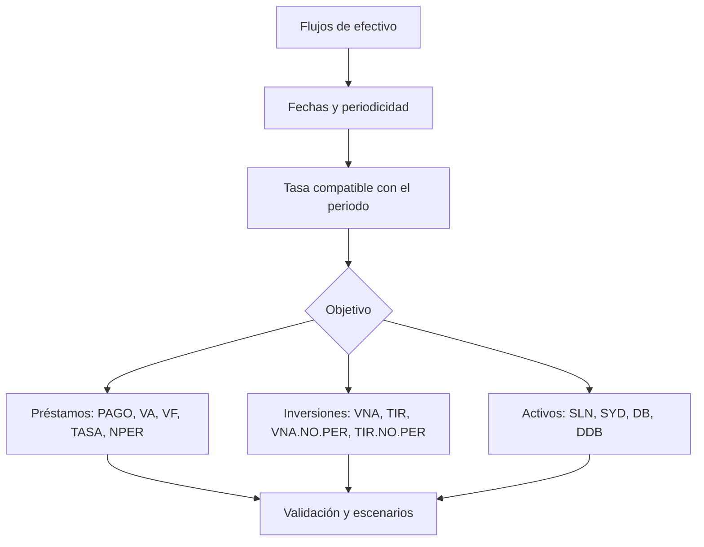
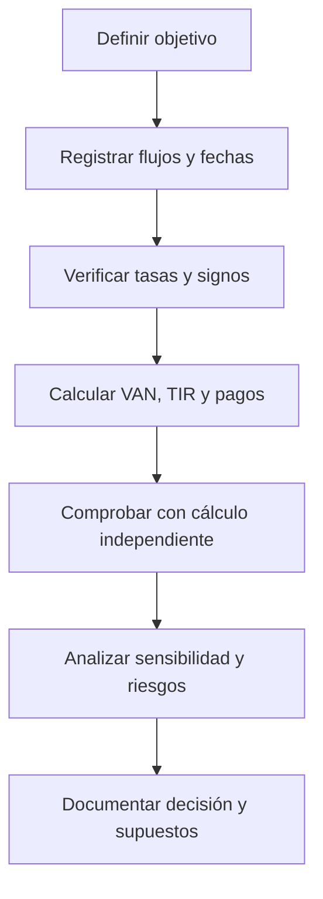

# H14 — Funciones financieras y modelos económicos

> **Curso integral v2.0 · Ruta H · Módulo 14/24**  
> Entorno principal: Excel para Microsoft 365 (escritorio). Idioma de fórmulas: español; separador de argumentos `;`. Las traducciones y disponibilidad deben comprobarse en la instalación concreta.  
> **Estado:** material didáctico desarrollado; compatibilidad y ejecución en Excel pendientes de validación.

## Propósito y prerrequisitos

Construir modelos financieros auditables, interpretar el valor temporal del dinero, valorar préstamos e inversiones y comprender los límites de las funciones financieras. Se requieren referencias y fórmulas (H05), funciones matemáticas (H08) y fechas (H11).

**Alcance:** H14.01 Valor temporal y préstamos; H14.02 Inversiones y flujos; H14.03 Depreciación, instrumentos y decisiones financieras.

## Mapa conceptual



**Convención de signos:** desde la perspectiva de quien calcula, entradas de dinero positivas y salidas negativas. **Las tasas y periodos deben tener la misma unidad temporal.** Una tasa nominal anual de 12% con pagos mensuales no equivale necesariamente a una tasa efectiva anual de 12%.

# H14.01 — Valor temporal del dinero y préstamos

## H14.01.01 — Capitalización, descuento y equivalencia temporal

### H14.01.01.01 — Interés simple y compuesto

El interés simple se calcula sobre el principal inicial: `VF = P(1+i·n)`. El compuesto incorpora intereses al capital: `VF = P(1+i)^n`. Para $10,000 al 10% anual durante tres años: interés simple = $13,000; compuesto = $13,310. La diferencia de $310 surge de capitalizar los intereses.

### H14.01.01.02 — Tasas nominales y efectivas

Con tasa nominal anual `j` convertible `m` veces, la tasa por periodo es `j/m` y la tasa efectiva anual es `(1+j/m)^m-1`. Para 12% nominal con capitalización mensual: `(1+0.12/12)^12-1 ≈ 12.6825%`. La equivalencia inversa para una tasa efectiva anual `e` es `(1+e)^(1/12)-1` para meses. No dividas una tasa efectiva anual entre 12 si necesitas equivalencia exacta.

### H14.01.01.03 — Valor presente y valor futuro

El valor presente de un flujo único `F` a `n` periodos es `F/(1+i)^n`; su valor futuro es `P(1+i)^n`. El descuento permite comparar dinero recibido en momentos distintos, bajo supuestos explícitos sobre la tasa.

## H14.01.02 — Anualidades y amortización

### H14.01.02.01 — PAGO, VA y VF

**PAGO / PMT:** `=PAGO(tasa;nper;va;[vf];[tipo])` devuelve el pago periódico constante de una anualidad con tasa constante. `tipo=0` (predeterminado) indica pagos al final; `tipo=1`, al inicio. Para un préstamo de $120,000 a 12% nominal anual, 12 pagos mensuales, `=PAGO(12%/12;12;120000)` devuelve aproximadamente **−$10,661.85** (salida para el prestatario).

**VA / PV:** `=VA(tasa;nper;pago;[vf];[tipo])`, valor actual de pagos constantes.  
**VF / FV:** `=VF(tasa;nper;pago;[va];[tipo])`, valor futuro de una serie o capital.  
Ejemplo: `=VF(10%;3;0;-10000)` devuelve $13,310.

### H14.01.02.02 — TASA, NPER y pagos de principal/interés

**TASA / RATE:** `=TASA(nper;pago;va;[vf];[tipo];[estimar])`; calcula numéricamente una tasa por periodo, puede fallar por falta de convergencia.  
**NPER / NPER:** `=NPER(tasa;pago;va;[vf];[tipo])`; número de periodos bajo pagos constantes.  
**PAGOINT / IPMT:** `=PAGOINT(tasa;per;nper;va;[vf];[tipo])`; interés del periodo.  
**PAGOPRIN / PPMT:** `=PAGOPRIN(tasa;per;nper;va;[vf];[tipo])`; amortización de principal del periodo.

Para una cuota, verifica: `PAGO = PAGOINT + PAGOPRIN`, con signos coherentes. El saldo final de un préstamo completamente amortizado debe aproximarse a cero (puede existir diferencia de centavos por redondeo).

### H14.01.02.03 — Interés acumulado y principal acumulado

**PAGO.INT.ENTRE / CUMIPMT** y **PAGO.PRINC.ENTRE / CUMPRINC** acumulan interés o principal entre periodos; consulta su localización en tu versión. En un préstamo, los intereses suelen disminuir conforme se amortiza el saldo. No confundas un préstamo amortizable con uno de interés solamente.

**Caso empresarial:** una pyme evalúa crédito para equipo. Debe comparar la tasa efectiva, comisiones, calendario, penalizaciones, impuestos y capacidad de pago; `PAGO` por sí sola no representa el costo total del financiamiento.

# H14.02 — Inversiones y flujos de efectivo

## H14.02.01 — Valoración de proyectos

### H14.02.01.01 — VNA y valor presente neto

**VNA / NPV:** `=VNA(tasa;valor1;[valor2];...)` descuenta los flujos del final de los periodos 1, 2, etc. **No** incluye automáticamente la inversión inicial de tiempo cero: esta debe sumarse fuera de VNA.

Ejemplo: inversión inicial −$10,000; cobros $4,000 al final de cada uno de tres años; descuento 10%:

```excel
=VNA(10%;4000;4000;4000)-10000
```

Resultado ≈ **−$52.59**. Un VAN negativo indica que, bajo esa tasa y esos flujos, el proyecto no alcanza la rentabilidad exigida. No equivale a una pérdida contable de $52.59.

### H14.02.01.02 — TIR y múltiples soluciones

**TIR / IRR:** `=TIR(valores;[estimar])` obtiene una tasa que hace cero el VAN para flujos periódicos. Los flujos deben incluir al menos un valor positivo y uno negativo. Con cambios de signo múltiples pueden existir varias TIR; por ello es importante inspeccionar el VAN y considerar **TIRM / MIRR**, que introduce tasas de financiamiento y reinversión.

```excel
=TIR(A2:A5)
```

Para la inversión de −10000 y tres entradas de 4000, TIR ≈ **9.70%**. Una TIR inferior a la tasa exigida del 10% es consistente con el VAN negativo.

### H14.02.01.03 — VNA.NO.PER y TIR.NO.PER

**VNA.NO.PER / XNPV:** `=VNA.NO.PER(tasa;valores;fechas)` para flujos con fechas reales no necesariamente periódicas.  
**TIR.NO.PER / XIRR:** `=TIR.NO.PER(valores;fechas;[estimar])` estima la tasa anualizada de esos flujos. Debe verificarse que las fechas y valores estén alineados, y que haya flujos positivos y negativos. No sustituyas una función por otra sin revisar el calendario.

## H14.02.02 — Riesgo y escenarios

### H14.02.02.01 — Sensibilidad

Evalúa VAN frente a cambios de tasa de descuento, volumen, precio, costos y crecimiento. Una sensibilidad de una variable no representa automáticamente un escenario probabilístico.

### H14.02.02.02 — Rentabilidad y reinversión

**TIRM / MIRR:** `=TIRM(valores;tasa_financiamiento;tasa_reinversion)` permite separar la financiación de los flujos negativos de la reinversión de los positivos. Sus supuestos deben explicarse.

### H14.02.02.03 — Evaluación responsable

Una decisión de inversión también depende de liquidez, impuestos, inflación, riesgo, oportunidad de capital y restricciones estratégicas. No selecciones proyectos mutuamente excluyentes basándote exclusivamente en la TIR.

# H14.03 — Depreciación, instrumentos y decisiones financieras

## H14.03.01 — Depreciación de activos

### H14.03.01.01 — SLN y SYD

**SLN / SLN:** `=SLN(costo;valor_residual;vida)` aplica depreciación lineal. Equipo de $50,000, residual $5,000 y vida de 5 años: **$9,000 anuales**.

**SYD / SYD:** `=SYD(costo;valor_residual;vida;periodo)` aplica suma de dígitos de años. Para ese equipo, en el primer año: `(50000-5000)*5/15 = $15,000`.

### H14.03.01.02 — DB, DDB y VDB

**DB / DB:** `=DB(costo;valor_residual;vida;periodo;[mes])`, depreciación mediante saldo decreciente con tasa fija.  
**DDB / DDB:** `=DDB(costo;valor_residual;vida;periodo;[factor])`, doble saldo decreciente si se usa factor 2.  
**DVS / VDB:** `=DVS(costo;valor_residual;vida;periodo_inicial;periodo_final;[factor];[sin_cambio])` permite calcular depreciación de un intervalo, con posibles cambios de método según parámetros.

Estas funciones no sustituyen el criterio contable ni la normativa fiscal local.

## H14.03.02 — Instrumentos de renta fija

### H14.03.02.01 — Precio, rendimiento y cupones

Familias de funciones: `PRECIO / PRICE`, `RENDTO / YIELD`, `DURACION / DURATION`, `DURACION.MODIF / MDURATION`, `INT.ACUM / ACCRINT`, y funciones de cupones `CUPON.* / COUP*`. Sus resultados dependen de liquidación, vencimiento, frecuencia, base de días y convenciones de mercado. **No deben aplicarse sin verificar la sintaxis y los calendarios del instrumento.**

### H14.03.02.02 — Tasas y conversiones

`INT.EFECTIVO / EFFECT` y `TASA.NOMINAL / NOMINAL` permiten convertir tasas nominales y efectivas cuando se conoce el número de periodos de capitalización. Las funciones de títulos descontados y letras del Tesoro siguen convenciones específicas; deben estudiarse con su ficha individual antes de usarlas en producción.

### H14.03.02.03 — Modelo de decisión financiera



**Errores habituales:** mezclar tasas mensuales con periodos anuales; omitir la inversión inicial en VNA; confundir flujos nominales y reales; usar TIR con flujos no periódicos; ignorar comisiones; asumir que depreciación contable equivale a salida de caja.

# Catálogo de cobertura y compatibilidad

| Familia | Funciones en inglés (referencia) | Estado en H14 |
|---|---|---|
| Anualidades | PV, FV, PMT, RATE, NPER | Desarrolladas |
| Amortización | IPMT, PPMT, CUMIPMT, CUMPRINC, ISPMT | IPMT/PPMT desarrolladas; acumuladas e ISPMT pendientes de ficha exhaustiva |
| Proyectos | NPV, IRR, MIRR, XNPV, XIRR | Desarrolladas |
| Depreciación | SLN, SYD, DB, DDB, VDB, AMORDEGRC, AMORLINC | Primeras cinco desarrolladas; AMOR* pendientes |
| Tasas | EFFECT, NOMINAL, RRI, PDURATION | Dos primeras descritas; RRI y PDURATION pendientes |
| Títulos y cupones | PRICE, YIELD, DURATION, MDURATION, ACCRINT, ACCRINTM, COUPDAYBS, COUPDAYS, COUPDAYSNC, COUPNCD, COUPNUM, COUPPCD | Inventariadas; fichas individuales pendientes |
| Instrumentos especiales | DISC, INTRATE, PRICEDISC, PRICEMAT, RECEIVED, YIELDDISC, YIELDMAT, TBILLEQ, TBILLPRICE, TBILLYIELD, ODDFPRICE, ODDFYIELD, ODDLPRICE, ODDLYIELD | Inventariadas; fichas individuales pendientes |
| Moneda fraccionaria | DOLLARDE, DOLLARFR | Inventariadas; fichas individuales pendientes |

**Importante:** el inventario es una lista de seguimiento, **no una declaración de cobertura exhaustiva** de todas las funciones financieras existentes. Los nombres traducidos y la disponibilidad pueden variar; para un modelo en producción confirma cada función en la referencia oficial de la versión de Excel y en Google Sheets. La equivalencia de nombres no implica equivalencia total de comportamiento.

## H14-E01 — Interés simple

**Nivel:** Básico. **Objetivo:** aplicar e interpretar el cálculo con unidades y signos correctos.

**Enunciado:** Calcula el valor de $10,000 al 10% simple durante 3 años.

**Entregable:** fórmula o cálculo reproducible, resultado, interpretación y verificación independiente.

## H14-E02 — Capitalización compuesta

**Nivel:** Básico. **Objetivo:** aplicar e interpretar el cálculo con unidades y signos correctos.

**Enunciado:** Calcula el valor futuro del mismo capital con capitalización anual.

**Entregable:** fórmula o cálculo reproducible, resultado, interpretación y verificación independiente.

## H14-E03 — Tasa efectiva

**Nivel:** Básico. **Objetivo:** aplicar e interpretar el cálculo con unidades y signos correctos.

**Enunciado:** Convierte 12% nominal anual con capitalización mensual a efectiva anual.

**Entregable:** fórmula o cálculo reproducible, resultado, interpretación y verificación independiente.

## H14-E04 — Descuento

**Nivel:** Básico. **Objetivo:** aplicar e interpretar el cálculo con unidades y signos correctos.

**Enunciado:** Calcula el valor presente de $12,100 dentro de 2 años al 10%.

**Entregable:** fórmula o cálculo reproducible, resultado, interpretación y verificación independiente.

## H14-E05 — Cuota de préstamo

**Nivel:** Básico. **Objetivo:** aplicar e interpretar el cálculo con unidades y signos correctos.

**Enunciado:** Calcula la cuota de $120,000 a 12% nominal anual con 12 mensualidades.

**Entregable:** fórmula o cálculo reproducible, resultado, interpretación y verificación independiente.

## H14-E06 — Interés del primer periodo

**Nivel:** Intermedio. **Objetivo:** aplicar e interpretar el cálculo con unidades y signos correctos.

**Enunciado:** Para el préstamo anterior, calcula el interés del primer mes.

**Entregable:** fórmula o cálculo reproducible, resultado, interpretación y verificación independiente.

## H14-E07 — Principal del primer periodo

**Nivel:** Intermedio. **Objetivo:** aplicar e interpretar el cálculo con unidades y signos correctos.

**Enunciado:** Obtén principal amortizado del primer pago.

**Entregable:** fórmula o cálculo reproducible, resultado, interpretación y verificación independiente.

## H14-E08 — Valor futuro de ahorro

**Nivel:** Intermedio. **Objetivo:** aplicar e interpretar el cálculo con unidades y signos correctos.

**Enunciado:** Invierte $10,000 al 10% durante tres años sin aportaciones.

**Entregable:** fórmula o cálculo reproducible, resultado, interpretación y verificación independiente.

## H14-E09 — VAN de inversión

**Nivel:** Intermedio. **Objetivo:** aplicar e interpretar el cálculo con unidades y signos correctos.

**Enunciado:** Invierte $10,000 hoy y recibe $4,000 al final de cada uno de tres años, tasa 10%.

**Entregable:** fórmula o cálculo reproducible, resultado, interpretación y verificación independiente.

## H14-E10 — TIR de inversión

**Nivel:** Intermedio. **Objetivo:** aplicar e interpretar el cálculo con unidades y signos correctos.

**Enunciado:** Calcula la TIR del flujo [-10000,4000,4000,4000].

**Entregable:** fórmula o cálculo reproducible, resultado, interpretación y verificación independiente.

## H14-E11 — VAN por fechas

**Nivel:** Avanzado / profesional. **Objetivo:** aplicar e interpretar el cálculo con unidades y signos correctos.

**Enunciado:** Diseña cuatro fechas separadas por intervalos irregulares y explica qué función corresponde.

**Entregable:** fórmula o cálculo reproducible, resultado, interpretación y verificación independiente.

## H14-E12 — Depreciación lineal

**Nivel:** Avanzado / profesional. **Objetivo:** aplicar e interpretar el cálculo con unidades y signos correctos.

**Enunciado:** Activo de $50,000, residual $5,000, vida 5 años.

**Entregable:** fórmula o cálculo reproducible, resultado, interpretación y verificación independiente.

## H14-E13 — Suma de dígitos

**Nivel:** Avanzado / profesional. **Objetivo:** aplicar e interpretar el cálculo con unidades y signos correctos.

**Enunciado:** Calcula depreciación del primer año del activo anterior.

**Entregable:** fórmula o cálculo reproducible, resultado, interpretación y verificación independiente.

## H14-E14 — Auditoría de signos

**Nivel:** Avanzado / profesional. **Objetivo:** aplicar e interpretar el cálculo con unidades y signos correctos.

**Enunciado:** Explica por qué PAGO devuelve un valor negativo con VA positivo.

**Entregable:** fórmula o cálculo reproducible, resultado, interpretación y verificación independiente.

## H14-E15 — Decisión profesional

**Nivel:** Avanzado / profesional. **Objetivo:** aplicar e interpretar el cálculo con unidades y signos correctos.

**Enunciado:** Compara VAN -$52.59 a tasa exigida 10% y TIR 9.70%; formula recomendación condicionada.

**Entregable:** fórmula o cálculo reproducible, resultado, interpretación y verificación independiente.

# Solucionario — H14

> Comprueba primero tus resultados. Los valores aproximados pueden variar por redondeo.

### H14-E01

10000*(1+0.10*3) = 13000.

### H14-E02

10000*(1.10)^3 = 13310.

### H14-E03

(1+0.12/12)^12-1 ≈ 12.6825%.

### H14-E04

12100/(1.1)^2 = 10000.

### H14-E05

=PAGO(12%/12;12;120000) ≈ -10661.85.

### H14-E06

=PAGOINT(1%;1;12;120000) = -1200.

### H14-E07

=PAGOPRIN(1%;1;12;120000) ≈ -9461.85.

### H14-E08

=VF(10%;3;0;-10000) = 13310.

### H14-E09

=VNA(10%;4000;4000;4000)-10000 ≈ -52.59.

### H14-E10

=TIR(A2:A5) ≈ 9.70%, con esos flujos en A2:A5.

### H14-E11

VNA.NO.PER con valores y fechas alineados; no usar VNA si se quiere descontar por fechas reales.

### H14-E12

=SLN(50000;5000;5) = 9000.

### H14-E13

=SYD(50000;5000;5;1) = 15000.

### H14-E14

El préstamo se recibe (+) y las cuotas son salidas (-) desde la misma perspectiva.

### H14-E15

No cumple el rendimiento exigido bajo esos supuestos; revisar sensibilidad, riesgo y flujos antes de decidir.

