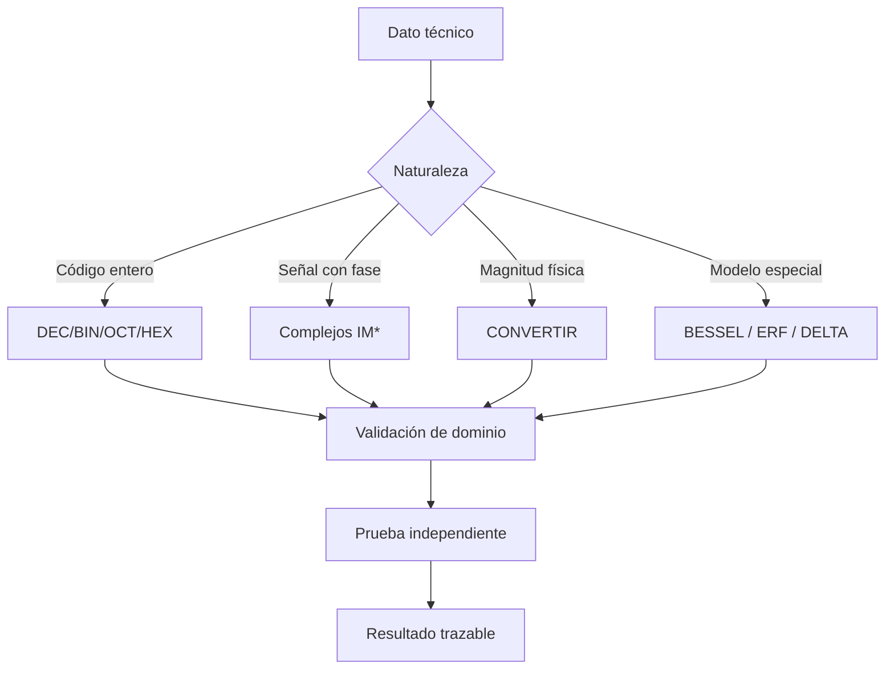
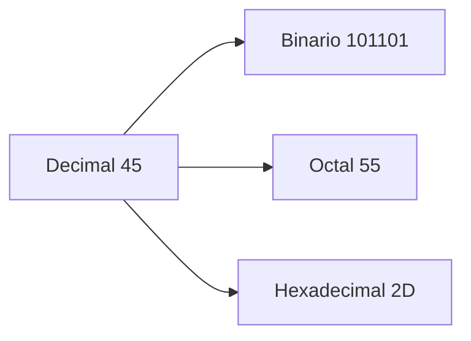
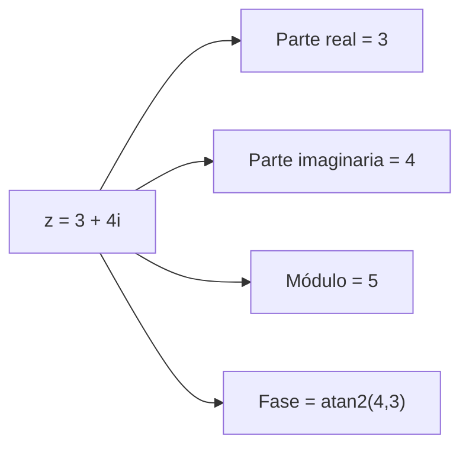
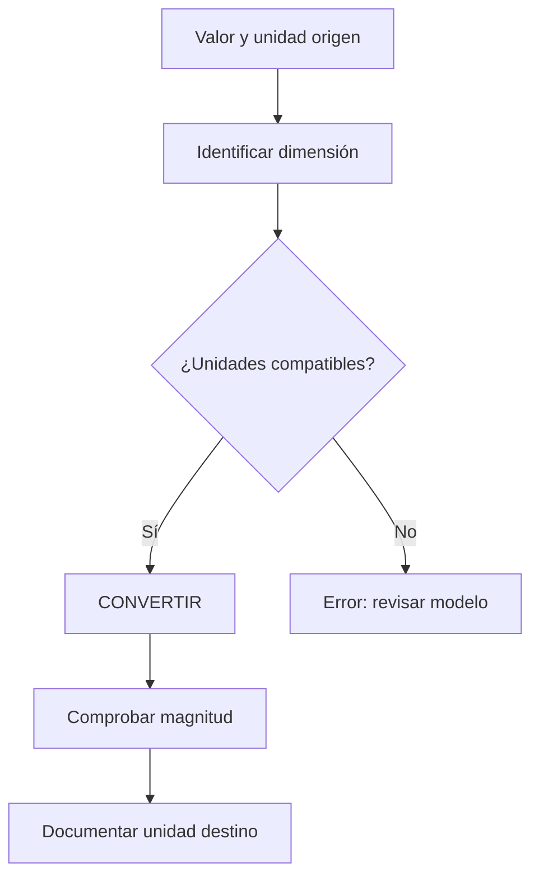

# H15 — Funciones de ingeniería y aplicaciones especializadas

**Curso integral de Excel y Google Sheets · Ruta H · Módulo H15/24 · Versión 1.0**

**Propósito.** Dominar las funciones de ingeniería para sistemas numéricos, números complejos, conversiones de unidades y cálculos técnicos, con énfasis en precisión, trazabilidad y verificación. Incluye casos de telecomunicaciones, instrumentación, energía, inventarios y análisis de señales.

**Requisitos:** H05 (fórmulas y referencias), H08 (matemáticas), H09 (estadística). **Entorno:** Excel Microsoft 365 en español; separador `;` y decimal `,` en configuración española. En otras configuraciones, adaptar separadores y nombres.

**Método por sección:** concepto → fundamento → demostración → aplicación → errores → práctica → evaluación.

## Resultados de aprendizaje

1. Convertir números entre decimal, binario, octal y hexadecimal, explicando rango y representación.
2. Interpretar números complejos y calcular sus operaciones.
3. Convertir unidades de forma dimensionalmente coherente.
4. Aplicar funciones de ingeniería especializadas sin confundir su disponibilidad con la de Google Sheets.
5. Verificar cálculos y documentar supuestos, errores y límites.

## Índice

- H15.01 — Sistemas de numeración y conversiones de bases
- H15.02 — Números complejos y aplicaciones técnicas
- H15.03 — Unidades, funciones especiales y modelos de ingeniería
- Laboratorios, proyecto integrador, ejercicios, solucionario, evaluación y fuentes

## Mapa conceptual



> **Advertencia de compatibilidad:** Excel y Google Sheets no comparten necesariamente todas las funciones, nombres traducidos, rangos ni reglas de coerción. Las fichas siguientes documentan principalmente Excel; comprueba cada equivalencia en la lista oficial de funciones de Sheets.

# H15.01 — Sistemas de numeración y conversiones de bases

## H15.01.01 — Fundamentos

Un número representa una cantidad; una **base** determina los símbolos y pesos posicionales usados para escribirlo. En base `b`, el número de dígitos `dₖ…d₀` representa `Σ dᵢ·bⁱ`. Por ejemplo, `101101₂ = 1·2⁵ + 1·2³ + 1·2² + 1 = 45₁₀`. Hexadecimal utiliza los símbolos `0–9` y `A–F`, por lo que `2D₁₆ = 45₁₀`.

**No confundir** un código de identificación con una cantidad. `001011` puede ser un identificador que debe conservar ceros a la izquierda; convertirlo a número puede destruir información.



## H15.01.02 — Rangos y negativos

Las funciones clásicas de Excel `DEC.A.BIN`, `DEC.A.OCT` y `DEC.A.HEX` tienen límites específicos; `DEC.A.BIN` admite enteros entre −512 y 511. Las representaciones negativas pueden mostrarse como cadenas de longitud fija en complemento a dos, según la función. **No** generalices este comportamiento a enteros arbitrarios de 64 bits. El parámetro opcional `caracteres` sirve para rellenar con ceros resultados no negativos; no es una ampliación del rango.

## H15.01.03 — Errores típicos

- `#¡NUM!`: argumento fuera de rango o número de posiciones no permitido.
- `#¡VALOR!`: entrada no convertible o argumento de tipo incorrecto.
- Ceros iniciales perdidos por importar códigos como números.
- Confundir bytes, bits y representación textual.
- Comparar resultados de funciones de bases sin normalizar su representación.

## H15.01.04 — Ejemplo empresarial

Un sistema recibe el estado de un dispositivo como `2D` hexadecimal. Convertir a decimal (`45`) y después a binario (`101101`) permite examinar banderas; para inspeccionar ocho bits, usa `DEC.A.BIN(45;8)` → `00101101`. Para una bandera concreta, considera funciones de bits (por ejemplo `BIT.Y` en versiones compatibles), sin asumir que el texto hexadecimal ya es un entero decimal.

## H15.01.05 — Fichas individuales de conversión

### Ficha H15-B01 — DEC.A.BIN (`DEC2BIN`)

**Qué hace:** convierte entre bases posicionales, devolviendo el resultado en la base de destino.

**Sintaxis (Excel español):** `DEC.A.BIN(número;[caracteres])`.

**Parámetros:** Entero decimal; longitud mínima opcional.

**Ejemplo reproducible:** `=DEC.A.BIN(45;8)` → **`00101101`**.

**Aplicación:** normalización de códigos técnicos, banderas de dispositivos y lectura de registros.

**Consideración:** Rango decimal limitado; ceros de relleno solo para valores no negativos.

**Error a detectar:** comprobar entrada vacía, símbolos fuera de la base, desbordamiento y preservación de ceros iniciales.

### Ficha H15-B02 — DEC.A.HEX (`DEC2HEX`)

**Qué hace:** convierte entre bases posicionales, devolviendo el resultado en la base de destino.

**Sintaxis (Excel español):** `DEC.A.HEX(número;[caracteres])`.

**Parámetros:** Entero decimal; longitud opcional.

**Ejemplo reproducible:** `=DEC.A.HEX(45;4)` → **`002D`**.

**Aplicación:** normalización de códigos técnicos, banderas de dispositivos y lectura de registros.

**Consideración:** No utilizar para enteros fuera de rango de la función.

**Error a detectar:** comprobar entrada vacía, símbolos fuera de la base, desbordamiento y preservación de ceros iniciales.

### Ficha H15-B03 — DEC.A.OCT (`DEC2OCT`)

**Qué hace:** convierte entre bases posicionales, devolviendo el resultado en la base de destino.

**Sintaxis (Excel español):** `DEC.A.OCT(número;[caracteres])`.

**Parámetros:** Entero decimal; longitud opcional.

**Ejemplo reproducible:** `=DEC.A.OCT(45;4)` → **`0055`**.

**Aplicación:** normalización de códigos técnicos, banderas de dispositivos y lectura de registros.

**Consideración:** La salida es texto.

**Error a detectar:** comprobar entrada vacía, símbolos fuera de la base, desbordamiento y preservación de ceros iniciales.

### Ficha H15-B04 — BIN.A.DEC (`BIN2DEC`)

**Qué hace:** convierte entre bases posicionales, devolviendo el resultado en la base de destino.

**Sintaxis (Excel español):** `BIN.A.DEC(número)`.

**Parámetros:** Cadena binaria válida.

**Ejemplo reproducible:** `=BIN.A.DEC("101101")` → **`45`**.

**Aplicación:** normalización de códigos técnicos, banderas de dispositivos y lectura de registros.

**Consideración:** Las cadenas negativas siguen reglas de representación de la función.

**Error a detectar:** comprobar entrada vacía, símbolos fuera de la base, desbordamiento y preservación de ceros iniciales.

### Ficha H15-B05 — BIN.A.HEX (`BIN2HEX`)

**Qué hace:** convierte entre bases posicionales, devolviendo el resultado en la base de destino.

**Sintaxis (Excel español):** `BIN.A.HEX(número;[caracteres])`.

**Parámetros:** Cadena binaria; longitud opcional.

**Ejemplo reproducible:** `=BIN.A.HEX("101101")` → **`2D`**.

**Aplicación:** normalización de códigos técnicos, banderas de dispositivos y lectura de registros.

**Consideración:** No confundir el resultado con decimal.

**Error a detectar:** comprobar entrada vacía, símbolos fuera de la base, desbordamiento y preservación de ceros iniciales.

### Ficha H15-B06 — BIN.A.OCT (`BIN2OCT`)

**Qué hace:** convierte entre bases posicionales, devolviendo el resultado en la base de destino.

**Sintaxis (Excel español):** `BIN.A.OCT(número;[caracteres])`.

**Parámetros:** Cadena binaria; longitud opcional.

**Ejemplo reproducible:** `=BIN.A.OCT("101101")` → **`55`**.

**Aplicación:** normalización de códigos técnicos, banderas de dispositivos y lectura de registros.

**Consideración:** Revisar límites para cadenas largas.

**Error a detectar:** comprobar entrada vacía, símbolos fuera de la base, desbordamiento y preservación de ceros iniciales.

### Ficha H15-B07 — HEX.A.DEC (`HEX2DEC`)

**Qué hace:** convierte entre bases posicionales, devolviendo el resultado en la base de destino.

**Sintaxis (Excel español):** `HEX.A.DEC(número)`.

**Parámetros:** Cadena hexadecimal.

**Ejemplo reproducible:** `=HEX.A.DEC("2D")` → **`45`**.

**Aplicación:** normalización de códigos técnicos, banderas de dispositivos y lectura de registros.

**Consideración:** Hexadecimal admite A–F.

**Error a detectar:** comprobar entrada vacía, símbolos fuera de la base, desbordamiento y preservación de ceros iniciales.

### Ficha H15-B08 — HEX.A.BIN (`HEX2BIN`)

**Qué hace:** convierte entre bases posicionales, devolviendo el resultado en la base de destino.

**Sintaxis (Excel español):** `HEX.A.BIN(número;[caracteres])`.

**Parámetros:** Cadena hexadecimal; longitud opcional.

**Ejemplo reproducible:** `=HEX.A.BIN("2D";8)` → **`00101101`**.

**Aplicación:** normalización de códigos técnicos, banderas de dispositivos y lectura de registros.

**Consideración:** La conversión a binario tiene límites propios.

**Error a detectar:** comprobar entrada vacía, símbolos fuera de la base, desbordamiento y preservación de ceros iniciales.

### Ficha H15-B09 — HEX.A.OCT (`HEX2OCT`)

**Qué hace:** convierte entre bases posicionales, devolviendo el resultado en la base de destino.

**Sintaxis (Excel español):** `HEX.A.OCT(número;[caracteres])`.

**Parámetros:** Cadena hexadecimal; longitud opcional.

**Ejemplo reproducible:** `=HEX.A.OCT("2D")` → **`55`**.

**Aplicación:** normalización de códigos técnicos, banderas de dispositivos y lectura de registros.

**Consideración:** Conservar los códigos originales en otra columna.

**Error a detectar:** comprobar entrada vacía, símbolos fuera de la base, desbordamiento y preservación de ceros iniciales.

### Ficha H15-B10 — OCT.A.DEC (`OCT2DEC`)

**Qué hace:** convierte entre bases posicionales, devolviendo el resultado en la base de destino.

**Sintaxis (Excel español):** `OCT.A.DEC(número)`.

**Parámetros:** Cadena octal.

**Ejemplo reproducible:** `=OCT.A.DEC("55")` → **`45`**.

**Aplicación:** normalización de códigos técnicos, banderas de dispositivos y lectura de registros.

**Consideración:** Solo dígitos 0–7.

**Error a detectar:** comprobar entrada vacía, símbolos fuera de la base, desbordamiento y preservación de ceros iniciales.

### Ficha H15-B11 — OCT.A.BIN (`OCT2BIN`)

**Qué hace:** convierte entre bases posicionales, devolviendo el resultado en la base de destino.

**Sintaxis (Excel español):** `OCT.A.BIN(número;[caracteres])`.

**Parámetros:** Cadena octal; longitud opcional.

**Ejemplo reproducible:** `=OCT.A.BIN("55";8)` → **`00101101`**.

**Aplicación:** normalización de códigos técnicos, banderas de dispositivos y lectura de registros.

**Consideración:** Puede fallar si se excede el rango.

**Error a detectar:** comprobar entrada vacía, símbolos fuera de la base, desbordamiento y preservación de ceros iniciales.

### Ficha H15-B12 — OCT.A.HEX (`OCT2HEX`)

**Qué hace:** convierte entre bases posicionales, devolviendo el resultado en la base de destino.

**Sintaxis (Excel español):** `OCT.A.HEX(número;[caracteres])`.

**Parámetros:** Cadena octal; longitud opcional.

**Ejemplo reproducible:** `=OCT.A.HEX("55")` → **`2D`**.

**Aplicación:** normalización de códigos técnicos, banderas de dispositivos y lectura de registros.

**Consideración:** Salida de texto.

**Error a detectar:** comprobar entrada vacía, símbolos fuera de la base, desbordamiento y preservación de ceros iniciales.

# H15.02 — Números complejos y aplicaciones técnicas

## H15.02.01 — Modelo matemático

Un número complejo se expresa como `z = a + bi`, donde `a` es parte real, `b` parte imaginaria e `i² = −1`. Su módulo es `|z| = √(a²+b²)` y su argumento es el ángulo de fase `atan2(b,a)`. En electricidad de corriente alterna, las impedancias y los fasores utilizan esta representación.

En Excel, muchas funciones complejas operan sobre **cadenas de texto** como `"3+4i"` o `"3+4j"`, no sobre un tipo numérico complejo universal. Mantén consistente el sufijo imaginario.



## H15.02.02 — Ejemplo de impedancias

Si `Z₁ = 3+4i` Ω y `Z₂ = 2−i` Ω, la impedancia serie es `Z₁+Z₂ = 5+3i` Ω. El módulo resultante es `√34 ≈ 5,831` Ω. La suma de impedancias en paralelo no es directa: `1/Zeq = 1/Z₁ + 1/Z₂`. Siempre especifica si los elementos están en serie o paralelo.

## H15.02.03 — Errores comunes

- Mezclar sufijos `i` y `j` en el mismo cálculo.
- Confundir grados con radianes al interpretar `IM.ANGULO`.
- Sumar módulos en vez de sumar los complejos.
- Introducir números con separadores decimales inconsistentes.
- Usar `IM.DIV` con divisor cero.

## H15.02.04 — Fichas de funciones complejas

**Nota de nomenclatura:** la traducción de nombres `IM*` cambia entre versiones e idiomas. Los nombres ingleses en la segunda columna son la referencia estable para verificar la función en la documentación de Microsoft. No copies una fórmula localizada sin comprobar que tu Excel la reconoce.

### Ficha H15-C01 — COMPLEJO (`COMPLEX`)

**Propósito:** Construye un complejo textual.

**Sintaxis orientativa en español:** `COMPLEJO(parte_real;parte_imaginaria;[sufijo])`.

**Parámetros:** números complejos expresados como texto y, cuando corresponda, exponente o segundo operando.

**Ejemplo:** `=COMPLEJO(3;4)` → **`3+4i`** (representación matemática; Excel puede mostrar decimales residuales por precisión numérica).

**Aplicación:** fasores, circuitos de corriente alterna, señales y operaciones algebraicas.

**Validación:** comparar con la operación manual; comprobar unidad de ángulo y consistencia de `i`/`j`.

### Ficha H15-C02 — IM.REAL (`IMREAL`)

**Propósito:** Extrae la componente real.

**Sintaxis orientativa en español:** `IM.REAL(número_complejo)`.

**Parámetros:** números complejos expresados como texto y, cuando corresponda, exponente o segundo operando.

**Ejemplo:** `=IM.REAL("3+4i")` → **`3`** (representación matemática; Excel puede mostrar decimales residuales por precisión numérica).

**Aplicación:** fasores, circuitos de corriente alterna, señales y operaciones algebraicas.

**Validación:** comparar con la operación manual; comprobar unidad de ángulo y consistencia de `i`/`j`.

### Ficha H15-C03 — IM.IMAGINARIO (`IMAGINARY`)

**Propósito:** Extrae la componente imaginaria.

**Sintaxis orientativa en español:** `IM.IMAGINARIO(número_complejo)`.

**Parámetros:** números complejos expresados como texto y, cuando corresponda, exponente o segundo operando.

**Ejemplo:** `=IM.IMAGINARIO("3+4i")` → **`4`** (representación matemática; Excel puede mostrar decimales residuales por precisión numérica).

**Aplicación:** fasores, circuitos de corriente alterna, señales y operaciones algebraicas.

**Validación:** comparar con la operación manual; comprobar unidad de ángulo y consistencia de `i`/`j`.

### Ficha H15-C04 — IM.ABS (`IMABS`)

**Propósito:** Módulo euclidiano.

**Sintaxis orientativa en español:** `IM.ABS(número_complejo)`.

**Parámetros:** números complejos expresados como texto y, cuando corresponda, exponente o segundo operando.

**Ejemplo:** `=IM.ABS("3+4i")` → **`5`** (representación matemática; Excel puede mostrar decimales residuales por precisión numérica).

**Aplicación:** fasores, circuitos de corriente alterna, señales y operaciones algebraicas.

**Validación:** comparar con la operación manual; comprobar unidad de ángulo y consistencia de `i`/`j`.

### Ficha H15-C05 — IM.ANGULO (`IMARGUMENT`)

**Propósito:** Devuelve radianes.

**Sintaxis orientativa en español:** `IM.ANGULO(número_complejo)`.

**Parámetros:** números complejos expresados como texto y, cuando corresponda, exponente o segundo operando.

**Ejemplo:** `=IM.ANGULO("1+i")` → **`π/4 rad`** (representación matemática; Excel puede mostrar decimales residuales por precisión numérica).

**Aplicación:** fasores, circuitos de corriente alterna, señales y operaciones algebraicas.

**Validación:** comparar con la operación manual; comprobar unidad de ángulo y consistencia de `i`/`j`.

### Ficha H15-C06 — IM.CONJUGADA (`IMCONJUGATE`)

**Propósito:** Cambia el signo imaginario.

**Sintaxis orientativa en español:** `IM.CONJUGADA(número_complejo)`.

**Parámetros:** números complejos expresados como texto y, cuando corresponda, exponente o segundo operando.

**Ejemplo:** `=IM.CONJUGADA("3+4i")` → **`3-4i`** (representación matemática; Excel puede mostrar decimales residuales por precisión numérica).

**Aplicación:** fasores, circuitos de corriente alterna, señales y operaciones algebraicas.

**Validación:** comparar con la operación manual; comprobar unidad de ángulo y consistencia de `i`/`j`.

### Ficha H15-C07 — IM.SUM (`IMSUM`)

**Propósito:** Suma complejos.

**Sintaxis orientativa en español:** `IM.SUM(número_complejo1;[número_complejo2];...)`.

**Parámetros:** números complejos expresados como texto y, cuando corresponda, exponente o segundo operando.

**Ejemplo:** `=IM.SUM("3+4i";"2-i")` → **`5+3i`** (representación matemática; Excel puede mostrar decimales residuales por precisión numérica).

**Aplicación:** fasores, circuitos de corriente alterna, señales y operaciones algebraicas.

**Validación:** comparar con la operación manual; comprobar unidad de ángulo y consistencia de `i`/`j`.

### Ficha H15-C08 — IM.SUSTR (`IMSUB`)

**Propósito:** Resta complejos.

**Sintaxis orientativa en español:** `IM.SUSTR(número_complejo1;número_complejo2)`.

**Parámetros:** números complejos expresados como texto y, cuando corresponda, exponente o segundo operando.

**Ejemplo:** `=IM.SUSTR("3+4i";"2-i")` → **`1+5i`** (representación matemática; Excel puede mostrar decimales residuales por precisión numérica).

**Aplicación:** fasores, circuitos de corriente alterna, señales y operaciones algebraicas.

**Validación:** comparar con la operación manual; comprobar unidad de ángulo y consistencia de `i`/`j`.

### Ficha H15-C09 — IM.PRODUCT (`IMPRODUCT`)

**Propósito:** Multiplica complejos.

**Sintaxis orientativa en español:** `IM.PRODUCT(número_complejo1;[número_complejo2];...)`.

**Parámetros:** números complejos expresados como texto y, cuando corresponda, exponente o segundo operando.

**Ejemplo:** `=IM.PRODUCT("1+i";"1-i")` → **`2`** (representación matemática; Excel puede mostrar decimales residuales por precisión numérica).

**Aplicación:** fasores, circuitos de corriente alterna, señales y operaciones algebraicas.

**Validación:** comparar con la operación manual; comprobar unidad de ángulo y consistencia de `i`/`j`.

### Ficha H15-C10 — IM.DIV (`IMDIV`)

**Propósito:** Divide complejos.

**Sintaxis orientativa en español:** `IM.DIV(número_complejo1;número_complejo2)`.

**Parámetros:** números complejos expresados como texto y, cuando corresponda, exponente o segundo operando.

**Ejemplo:** `=IM.DIV("4+2i";"2")` → **`2+i`** (representación matemática; Excel puede mostrar decimales residuales por precisión numérica).

**Aplicación:** fasores, circuitos de corriente alterna, señales y operaciones algebraicas.

**Validación:** comparar con la operación manual; comprobar unidad de ángulo y consistencia de `i`/`j`.

### Ficha H15-C11 — IM.POT (`IMPOWER`)

**Propósito:** Potencia compleja.

**Sintaxis orientativa en español:** `IM.POT(número_complejo;número)`.

**Parámetros:** números complejos expresados como texto y, cuando corresponda, exponente o segundo operando.

**Ejemplo:** `=IM.POT("1+i";2)` → **`2i`** (representación matemática; Excel puede mostrar decimales residuales por precisión numérica).

**Aplicación:** fasores, circuitos de corriente alterna, señales y operaciones algebraicas.

**Validación:** comparar con la operación manual; comprobar unidad de ángulo y consistencia de `i`/`j`.

### Ficha H15-C12 — IM.RAIZ2 (`IMSQRT`)

**Propósito:** Raíz cuadrada principal.

**Sintaxis orientativa en español:** `IM.RAIZ2(número_complejo)`.

**Parámetros:** números complejos expresados como texto y, cuando corresponda, exponente o segundo operando.

**Ejemplo:** `=IM.RAIZ2("-1")` → **`i`** (representación matemática; Excel puede mostrar decimales residuales por precisión numérica).

**Aplicación:** fasores, circuitos de corriente alterna, señales y operaciones algebraicas.

**Validación:** comparar con la operación manual; comprobar unidad de ángulo y consistencia de `i`/`j`.

### Ficha H15-C13 — IM.EXP (`IMEXP`)

**Propósito:** Exponencial compleja.

**Sintaxis orientativa en español:** `IM.EXP(número_complejo)`.

**Parámetros:** números complejos expresados como texto y, cuando corresponda, exponente o segundo operando.

**Ejemplo:** `=IM.EXP("0")` → **`1`** (representación matemática; Excel puede mostrar decimales residuales por precisión numérica).

**Aplicación:** fasores, circuitos de corriente alterna, señales y operaciones algebraicas.

**Validación:** comparar con la operación manual; comprobar unidad de ángulo y consistencia de `i`/`j`.

### Ficha H15-C14 — IM.LN (`IMLN`)

**Propósito:** Logaritmo natural principal.

**Sintaxis orientativa en español:** `IM.LN(número_complejo)`.

**Parámetros:** números complejos expresados como texto y, cuando corresponda, exponente o segundo operando.

**Ejemplo:** `=IM.LN("1")` → **`0`** (representación matemática; Excel puede mostrar decimales residuales por precisión numérica).

**Aplicación:** fasores, circuitos de corriente alterna, señales y operaciones algebraicas.

**Validación:** comparar con la operación manual; comprobar unidad de ángulo y consistencia de `i`/`j`.

### Ficha H15-C15 — IM.LOG10 (`IMLOG10`)

**Propósito:** Logaritmo base diez.

**Sintaxis orientativa en español:** `IM.LOG10(número_complejo)`.

**Parámetros:** números complejos expresados como texto y, cuando corresponda, exponente o segundo operando.

**Ejemplo:** `=IM.LOG10("1")` → **`0`** (representación matemática; Excel puede mostrar decimales residuales por precisión numérica).

**Aplicación:** fasores, circuitos de corriente alterna, señales y operaciones algebraicas.

**Validación:** comparar con la operación manual; comprobar unidad de ángulo y consistencia de `i`/`j`.

### Ficha H15-C16 — IM.SENO (`IMSIN`)

**Propósito:** Seno complejo.

**Sintaxis orientativa en español:** `IM.SENO(número_complejo)`.

**Parámetros:** números complejos expresados como texto y, cuando corresponda, exponente o segundo operando.

**Ejemplo:** `=IM.SENO("0")` → **`0`** (representación matemática; Excel puede mostrar decimales residuales por precisión numérica).

**Aplicación:** fasores, circuitos de corriente alterna, señales y operaciones algebraicas.

**Validación:** comparar con la operación manual; comprobar unidad de ángulo y consistencia de `i`/`j`.

### Ficha H15-C17 — IM.COS (`IMCOS`)

**Propósito:** Coseno complejo.

**Sintaxis orientativa en español:** `IM.COS(número_complejo)`.

**Parámetros:** números complejos expresados como texto y, cuando corresponda, exponente o segundo operando.

**Ejemplo:** `=IM.COS("0")` → **`1`** (representación matemática; Excel puede mostrar decimales residuales por precisión numérica).

**Aplicación:** fasores, circuitos de corriente alterna, señales y operaciones algebraicas.

**Validación:** comparar con la operación manual; comprobar unidad de ángulo y consistencia de `i`/`j`.

# H15.03 — Unidades, funciones especiales y modelos de ingeniería

## H15.03.01 — Análisis dimensional

Una conversión correcta transforma el valor numérico **sin cambiar la magnitud física**. Por ejemplo, `5 km = 5000 m`; `20 °C = 68 °F`. Las temperaturas absolutas no se convierten mediante un factor multiplicativo simple: interviene un desplazamiento de origen.



## H15.03.02 — CONVERTIR / CONVERT

**Sintaxis:** `=CONVERTIR(número;desde_unidad;hasta_unidad)` (en Excel en inglés `CONVERT`). Los códigos de unidad se escriben como cadenas; dependen de la tabla admitida por la versión. Ejemplos habituales:

- `=CONVERTIR(5;"km";"m")` → `5000`.
- `=CONVERTIR(100;"cm";"m")` → `1`.
- `=CONVERTIR(20;"C";"F")` → `68`.
- `=CONVERTIR(1;"kg";"g")` → `1000`.

**Advertencia:** `m` y `M` no son intercambiables, y ciertos prefijos o códigos distinguen mayúsculas. Los códigos y funciones deben validarse en Excel. Google Sheets también dispone de `CONVERT`, pero comprueba la tabla de unidades admitidas antes de migrar.

## H15.03.03 — Funciones de precisión y comparación

### DELTA (`DELTA`)

`=DELTA(número1;[número2])` devuelve `1` si ambos números son iguales y `0` en caso contrario. Ejemplo: `=DELTA(7;7)` → `1`. **No sirve para comparar valores medidos con tolerancia**: en ese caso usar `=--(ABS(A2-B2)<=0,001)`.

### MAYOR.O.IGUAL (`GESTEP`)

`=MAYOR.O.IGUAL(número;[valor_ref])` devuelve `1` si el número es mayor o igual al umbral y `0` en caso contrario. Ejemplo: `=MAYOR.O.IGUAL(5;4)` → `1`. Verifica el nombre localizado en tu instalación.

## H15.03.04 — Funciones especiales

**Función de error:** `FUN.ERROR / ERF` y `FUN.ERROR.COMPL / ERFC`, relacionadas con integrales gaussianas y modelos probabilísticos. En Excel moderno pueden coexistir variantes `.PRECISO` o `.EXACTO` según la localización. Ejemplo matemático: `erf(0)=0`, `erfc(0)=1`.

**Funciones de Bessel:** `BESSELI`, `BESSELJ`, `BESSELK`, `BESSELY`, útiles en difusión, ondas y problemas con simetría cilíndrica. Requieren argumentos reales y orden, con dominios y restricciones específicos. **No** se presentan aquí fórmulas localizadas sin verificación; consultar las fichas oficiales antes de copiar.

**Operaciones de bits:** `BIT.Y / BITAND`, `BIT.O / BITOR`, `BIT.XO / BITXOR`, `BIT.DESPLIZQ / BITLSHIFT`, `BIT.DESPLDCHA / BITRSHIFT` (los nombres españoles exactos requieren confirmación por versión). Se aplican a enteros no negativos en rangos restringidos. Ejemplo conceptual: `5 AND 3 = 1`, porque `0101₂ AND 0011₂ = 0001₂`.

## H15.03.05 — Arquitectura de un modelo técnico reproducible

Separa hojas `Entradas`, `Unidades`, `Cálculos`, `Pruebas` y `Reporte`. Nunca sustituyas un valor bruto por el convertido: conserva ambos y la unidad. Documenta la precisión requerida, el método de redondeo y el rango aceptado de cada sensor.

**Caso profesional:** una empresa recibe datos de temperatura en °F, longitudes en pies y códigos de estado hexadecimales. El reporte operativo necesita °C, metros y banderas binarias. Cada conversión debe quedar asociada a una unidad, fuente y validación.

# Laboratorios guiados

## Laboratorio 1 — Diagnóstico de banderas binarias

1. En `A2:A5` introduce los códigos hexadecimales `00`, `01`, `2D`, `FF`.
2. En `B2` usa `=HEX.A.DEC(A2)` y copia hacia abajo.
3. En `C2` usa `=DEC.A.BIN(B2;8)` y copia.
4. Resultados esperados: `0/00000000`, `1/00000001`, `45/00101101`, `255/11111111`.
5. Verifica la cantidad de bits activados manualmente o mediante una función auxiliar; no confundas una máscara con un valor decimal.

## Laboratorio 2 — Fasores y módulo

1. Introduce `"3+4i"` y `"2-i"` en `A2:B2`.
2. Calcula suma con `IMSUM` y módulo con `IMABS` (verifica nombre español).
3. Resultado esperado: suma `5+3i`; módulo `√34 ≈ 5,831`.
4. Repite con valores que produzcan un divisor cero y registra el error.

## Laboratorio 3 — Control dimensional

1. Crea columnas `valor`, `unidad_origen`, `unidad_destino`, `resultado`, `validación`.
2. Registra 5 km→m, 100 cm→m, 20 °C→°F, 1 kg→g.
3. Usa `CONVERTIR` y comprueba los resultados `5000`, `1`, `68`, `1000`.
4. Agrega una conversión incompatible (km→kg), explica el error y no lo ocultes con un cero.

## Laboratorio 4 — Prueba de tolerancia

1. Introduce medición `A2=5,0004` y referencia `B2=5`.
2. `=DELTA(A2;B2)` produce `0` (no igualdad exacta).
3. `=--(ABS(A2-B2)<=0,001)` produce `1` (dentro de tolerancia).
4. Documenta por qué la tolerancia depende de la precisión del instrumento.

# Proyecto integrador — Normalización de telemetría industrial

**Escenario:** una planta recibe lecturas heterogéneas de cuatro dispositivos. Se requiere un reporte consistente sin perder datos de origen.

## Datos de entrada

| Equipo | Estado HEX | Temperatura °F | Distancia km | Impedancia Ω |
|---|---|---:|---:|---|
| E-01 | 01 | 68 | 1,5 | 3+4i |
| E-02 | 2D | 86 | 0,8 | 2-i |
| E-03 | FF | 104 | 2,0 | 5 |
| E-04 | 00 | 50 | 0,3 | 1+i |

## Diseño del libro

- `Datos_brutos`: tabla original inmutable, con fecha y procedencia.
- `Transformacion`: decimal, binario a 8 posiciones, °C, metros y módulo de impedancia.
- `Validaciones`: dominios, datos faltantes, rangos y conversiones inversas.
- `Dashboard`: conteo de estados, promedio de temperatura y distancia total.

## Fórmulas sugeridas (fila 2)

```excel
=HEX.A.DEC(B2)
=DEC.A.BIN(F2;8)
=CONVERTIR(C2;"F";"C")
=CONVERTIR(D2;"km";"m")
=IM.ABS(E2)
```

Ajusta referencias a las columnas efectivas del diseño. Para `E-01` los resultados esperados son estado `1`, bits `00000001`, temperatura `20 °C`, distancia `1500 m`, módulo `5 Ω`.

## Criterios de aceptación

1. Todos los datos originales permanecen intactos.
2. Cada columna derivada tiene unidad y explicación.
3. El código hexadecimal se conserva como texto.
4. Hay una prueba positiva y una prueba de error por familia.
5. Los cuatro equipos generan resultados reproducibles.
6. Los valores agregados se comprueban manualmente.

**Comprobaciones de control:** temperaturas °C = `20`, `30`, `40`, `10`; promedio `25 °C`. Distancias en metros = `1500`, `800`, `2000`, `300`; total `4600 m`. Estados decimales = `1`, `45`, `255`, `0`.

## Rúbrica (100 puntos)

- Datos y trazabilidad: 20
- Conversiones numéricas: 20
- Unidades: 20
- Complejos: 15
- Validación y tratamiento de errores: 15
- Interpretación y presentación: 10

**Extensión avanzada:** detectar banderas de error mediante máscaras de bits y explicar su significado en un diccionario de datos.

# Prácticas por sección — 15 ejercicios

> Cinco ejercicios por sección. Resolver antes de consultar el solucionario.

### Ejercicio E01 · H15.01

**Enunciado:** Convierte `101101₂` a decimal por expansión posicional.

**Entrega:** cálculo, fórmula si aplica, resultado, interpretación y comprobación independiente.

### Ejercicio E02 · H15.01

**Enunciado:** Convierte `45₁₀` a hexadecimal y octal.

**Entrega:** cálculo, fórmula si aplica, resultado, interpretación y comprobación independiente.

### Ejercicio E03 · H15.01

**Enunciado:** Usa Excel para representar `45` con ocho bits.

**Entrega:** cálculo, fórmula si aplica, resultado, interpretación y comprobación independiente.

### Ejercicio E04 · H15.01

**Enunciado:** Explica por qué `0011` debe mantenerse como texto si es un identificador.

**Entrega:** cálculo, fórmula si aplica, resultado, interpretación y comprobación independiente.

### Ejercicio E05 · H15.01

**Enunciado:** Determina el valor de `FF₁₆` en decimal.

**Entrega:** cálculo, fórmula si aplica, resultado, interpretación y comprobación independiente.

### Ejercicio E06 · H15.02

**Enunciado:** Calcula módulo y conjugado de `3+4i`.

**Entrega:** cálculo, fórmula si aplica, resultado, interpretación y comprobación independiente.

### Ejercicio E07 · H15.02

**Enunciado:** Suma `3+4i` y `2-i`.

**Entrega:** cálculo, fórmula si aplica, resultado, interpretación y comprobación independiente.

### Ejercicio E08 · H15.02

**Enunciado:** Multiplica `(1+i)(1-i)`.

**Entrega:** cálculo, fórmula si aplica, resultado, interpretación y comprobación independiente.

### Ejercicio E09 · H15.02

**Enunciado:** Calcula `(4+2i)/2`.

**Entrega:** cálculo, fórmula si aplica, resultado, interpretación y comprobación independiente.

### Ejercicio E10 · H15.02

**Enunciado:** Explica por qué el argumento de `1+i` no es 45 radianes.

**Entrega:** cálculo, fórmula si aplica, resultado, interpretación y comprobación independiente.

### Ejercicio E11 · H15.03

**Enunciado:** Convierte 5 km a metros.

**Entrega:** cálculo, fórmula si aplica, resultado, interpretación y comprobación independiente.

### Ejercicio E12 · H15.03

**Enunciado:** Convierte 20 °C a °F.

**Entrega:** cálculo, fórmula si aplica, resultado, interpretación y comprobación independiente.

### Ejercicio E13 · H15.03

**Enunciado:** Compara 5,0004 y 5 con tolerancia 0,001.

**Entrega:** cálculo, fórmula si aplica, resultado, interpretación y comprobación independiente.

### Ejercicio E14 · H15.03

**Enunciado:** Calcula `5 AND 3` bit a bit.

**Entrega:** cálculo, fórmula si aplica, resultado, interpretación y comprobación independiente.

### Ejercicio E15 · H15.03

**Enunciado:** Obtén temperatura promedio y distancia total del proyecto.

**Entrega:** cálculo, fórmula si aplica, resultado, interpretación y comprobación independiente.

# Solucionario separado

> Las soluciones se presentan aquí para facilitar la autoevaluación.

### Solución E01

**Resultado:** 45.

**Verificación:** reconstruir el resultado mediante definición matemática, conversión inversa o comprobación manual; explicar límites de la función.

### Solución E02

**Resultado:** `2D₁₆` y `55₈`.

**Verificación:** reconstruir el resultado mediante definición matemática, conversión inversa o comprobación manual; explicar límites de la función.

### Solución E03

**Resultado:** `=DEC.A.BIN(45;8)` → `00101101`.

**Verificación:** reconstruir el resultado mediante definición matemática, conversión inversa o comprobación manual; explicar límites de la función.

### Solución E04

**Resultado:** La conversión a número pierde ceros iniciales y cambia el identificador.

**Verificación:** reconstruir el resultado mediante definición matemática, conversión inversa o comprobación manual; explicar límites de la función.

### Solución E05

**Resultado:** `15·16+15=255`.

**Verificación:** reconstruir el resultado mediante definición matemática, conversión inversa o comprobación manual; explicar límites de la función.

### Solución E06

**Resultado:** Módulo `5`; conjugado `3-4i`.

**Verificación:** reconstruir el resultado mediante definición matemática, conversión inversa o comprobación manual; explicar límites de la función.

### Solución E07

**Resultado:** `5+3i`.

**Verificación:** reconstruir el resultado mediante definición matemática, conversión inversa o comprobación manual; explicar límites de la función.

### Solución E08

**Resultado:** `1-i²=2`.

**Verificación:** reconstruir el resultado mediante definición matemática, conversión inversa o comprobación manual; explicar límites de la función.

### Solución E09

**Resultado:** `2+i`.

**Verificación:** reconstruir el resultado mediante definición matemática, conversión inversa o comprobación manual; explicar límites de la función.

### Solución E10

**Resultado:** Es `π/4` radianes, equivalente a 45 grados.

**Verificación:** reconstruir el resultado mediante definición matemática, conversión inversa o comprobación manual; explicar límites de la función.

### Solución E11

**Resultado:** `5000 m`.

**Verificación:** reconstruir el resultado mediante definición matemática, conversión inversa o comprobación manual; explicar límites de la función.

### Solución E12

**Resultado:** `68 °F`.

**Verificación:** reconstruir el resultado mediante definición matemática, conversión inversa o comprobación manual; explicar límites de la función.

### Solución E13

**Resultado:** No son exactamente iguales; sí cumplen la tolerancia.

**Verificación:** reconstruir el resultado mediante definición matemática, conversión inversa o comprobación manual; explicar límites de la función.

### Solución E14

**Resultado:** `1`.

**Verificación:** reconstruir el resultado mediante definición matemática, conversión inversa o comprobación manual; explicar límites de la función.

### Solución E15

**Resultado:** `25 °C` y `4600 m`.

**Verificación:** reconstruir el resultado mediante definición matemática, conversión inversa o comprobación manual; explicar límites de la función.

# Evaluación final — 15 preguntas de comprensión

1. ¿Qué diferencia existe entre un número y su representación?
2. ¿Por qué `FF` no es un número decimal válido?
3. ¿Qué ocurre con los ceros a la izquierda al importar identificadores?
4. ¿Qué limita las conversiones clásicas de bases en Excel?
5. ¿Qué significa `i² = −1`?
6. ¿Cómo se calcula el módulo de `a+bi`?
7. ¿Qué representa el conjugado?
8. ¿Por qué se suman complejos antes de calcular el módulo resultante?
9. ¿Qué unidad devuelve `IMARGUMENT`?
10. ¿Por qué es importante no mezclar `i` y `j`?
11. ¿Qué es el análisis dimensional?
12. ¿Por qué °C→°F no es solo una multiplicación?
13. ¿Qué diferencia existe entre igualdad exacta y tolerancia?
14. ¿Qué hace una operación AND bit a bit?
15. ¿Qué pruebas mínimas debe incluir un modelo técnico auditable?

**Criterio de aprobación sugerido:** 12/15 respuestas correctas y proyecto integrador ≥80/100.

# Glosario

**Base:** cantidad de símbolos del sistema posicional. **Bit:** dígito binario. **Byte:** conjunto habitual de ocho bits. **Complemento a dos:** representación de enteros signados. **Número complejo:** suma de parte real e imaginaria. **Fasor:** representación compleja de una señal sinusoidal. **Impedancia:** oposición compleja al paso de corriente alterna. **Módulo:** magnitud de un complejo. **Radian:** unidad angular. **Análisis dimensional:** verificación de coherencia de unidades. **Tolerancia:** desviación admisible de una medición. **Trazabilidad:** capacidad de reconstruir el origen y las transformaciones de un dato.

# Documentación y referencias

Fuentes oficiales recomendadas para confirmar nombres, sintaxis, dominios y compatibilidad:

1. [Microsoft Support — Funciones de Excel por categoría](https://support.microsoft.com/es-es/office/funciones-de-excel-por-categor%C3%ADa-5f91f4e9-7b42-46d2-9bd1-63f26a86c0eb).
2. [Microsoft Support — Excel functions (by category)](https://support.microsoft.com/en-us/office/excel-functions-by-category-5f91f4e9-7b42-46d2-9bd1-63f26a86c0eb).
3. [Google Docs Editors Help — Google Sheets function list](https://support.google.com/docs/table/25273?hl=en).
4. [Microsoft Learn — Excel reference](https://learn.microsoft.com/en-us/office/client-developer/excel/excel-home).

**Alcance de las fuentes:** los enlaces son referencias de consulta; la disponibilidad específica de cada función debe contrastarse en la versión instalada. Este documento no afirma que todas las funciones inventariadas tengan equivalencia exacta en Google Sheets.

# Estado del curso

| Campo | Estado |
|---|---|
| Ruta | H — Excel |
| Módulo | H15 — Funciones de ingeniería y aplicaciones especializadas |
| Secciones | H15.01, H15.02, H15.03 |
| Prácticas | 15 ejercicios; 5 por sección |
| Soluciones | 15 respuestas separadas |
| Laboratorios | 4 |
| Proyecto | Normalización de telemetría industrial |
| Funciones con ficha | 12 conversiones de base + 17 complejas |
| Otras funciones | CONVERTIR, DELTA y MAYOR.O.IGUAL desarrolladas; familias especiales inventariadas |
| Validación | Verificación conceptual y de resultados esperados; ejecución real en Excel pendiente |
| Pendiente | Ampliar fichas de Bessel, error, operaciones de bits y matriz completa de Google Sheets |
| Próximo módulo | H16 — pendiente de confirmar título exacto en roadmap aprobado |

**Nota de calidad:** las fórmulas se presentan como ejemplos de estudio. Antes de utilizarlas en un sistema productivo, validar nombres localizados, rangos, separadores, resultados y manejo de errores con la versión real de Excel.

