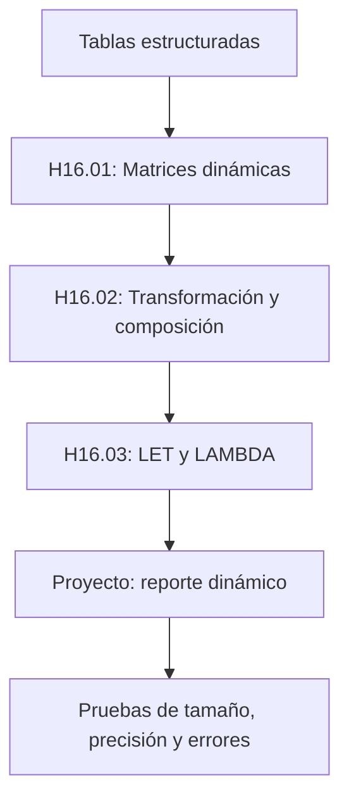
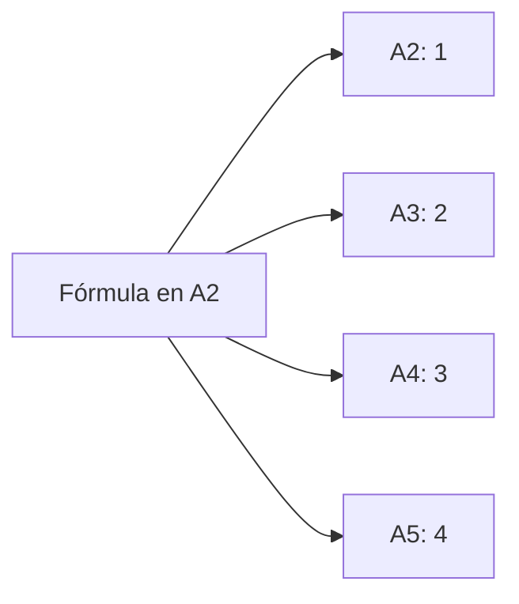
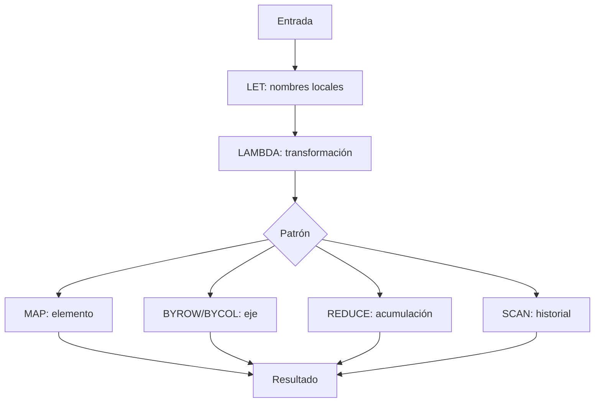
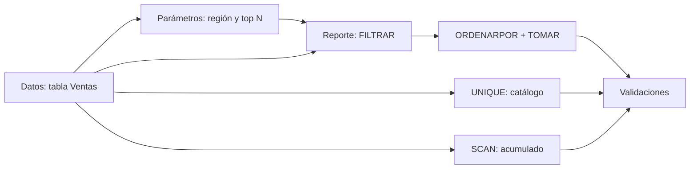

# H16 — Matrices dinámicas, LET, LAMBDA y fórmulas avanzadas

**Curso integral Excel y Google Sheets · Roadmap v2.0 · H16/24**  
**Duración orientativa:** 28 horas · **Prerrequisitos:** H07–H13  
**Secciones oficiales:** H16.01 Cálculo matricial · H16.02 Transformaciones avanzadas · H16.03 Programación funcional en Excel.

> **Alcance y validación:** documento didáctico para Excel Microsoft 365. Las funciones nuevas pueden no existir en Excel 2019/2021 o en todas las versiones de Sheets. Fórmulas de ejemplo con separador `;` y nombres localizados; comprueba los nombres en tu instalación. Los ejemplos están diseñados para ser reproducibles, pero no se han ejecutado en Excel.

## Objetivos

- Comprender cómo una fórmula devuelve múltiples resultados y se derrama en celdas contiguas.
- Combinar filtros, ordenamientos, selecciones, matrices horizontales y verticales.
- Crear fórmulas legibles con `LET`, reutilizables con `LAMBDA` y funcionales con `MAP`, `REDUCE`, `SCAN`, `BYROW` y `BYCOL`.
- Resolver errores de tamaño, derrame, referencias y rendimiento.
- Construir un reporte de ventas dinámico sin macros.

## Mapa de aprendizaje

## Datos comunes de práctica

Crea una tabla de Excel llamada `Ventas` con estas columnas (en este orden):

| ID | Región | Producto | Unidades | Precio |
|---|---|---|---:|---:|
| V01 | Norte | Teclado | 3 | 400 |
| V02 | Sur | Mouse | 5 | 200 |
| V03 | Norte | Monitor | 2 | 2500 |
| V04 | Centro | Teclado | 4 | 400 |
| V05 | Sur | Monitor | 1 | 2500 |
| V06 | Norte | Mouse | 6 | 200 |

Agrega la columna calculada `Importe` con `=[@Unidades]*[@Precio]`. Los importes son 1200, 1000, 5000, 1600, 2500, 1200; total **12500**. El nombre de la tabla permite que las fórmulas se expandan al agregar registros.

# H16.01 — Cálculo matricial

## H16.01.01 Concepto: matriz, dimensión y derrame

Una **matriz** es un conjunto de valores con filas y columnas. Una fórmula matricial dinámica puede devolver un rango de tamaño variable desde una sola celda. Por ejemplo, `=SECUENCIA(4)` genera cuatro filas; `=SECUENCIA(2;3)` genera dos filas por tres columnas. Las celdas de salida se denominan **rango de derrame**; la fórmula solo se edita en su celda de origen.

`#¡DESBORDAMIENTO!` (`#SPILL!`) aparece cuando no hay espacio para devolver la matriz o existen otras restricciones, como intentar derramar dentro de una tabla estructurada. Coloca las fórmulas dinámicas fuera de las tablas y deja libre su destino. El operador `#` permite referirse a un rango derramado, por ejemplo `=SUMA(H2#)`.

## H16.01.02 Funciones fundamentales

### Ficha 01 — SECUENCIA (`SEQUENCE`)

**Sintaxis:** `=SECUENCIA(filas;[columnas];[inicio];[paso])`.  
**Qué hace:** genera números consecutivos en forma matricial.  
**Ejemplo:** `=SECUENCIA(3;2;10;5)` → matriz con filas `10,15`; `20,25`; `30,35`.  
**Errores:** dimensiones no válidas o derrame obstruido.  
**Uso:** índices, simulaciones, periodos y tablas de calendario.

### Ficha 02 — FILTRAR (`FILTER`)

**Sintaxis:** `=FILTRAR(matriz;incluir;[si_vacío])`.  
**Qué hace:** conserva filas o columnas según una condición booleana compatible en dimensiones.  
**Ejemplo:** `=FILTRAR(Ventas[[ID]:[Importe]];Ventas[Región]="Norte";"Sin resultados")` devuelve V01, V03 y V06.  
**Uso:** reportes por región, cartera vencida, órdenes activas.  
**Errores:** tamaños incompatibles, ningún resultado sin alternativa o criterios que devuelven errores.

### Ficha 03 — ORDENAR (`SORT`)

**Sintaxis:** `=ORDENAR(matriz;[índice_ordenación];[orden];[por_col])`.  
**Ejemplo:** `=ORDENAR(Ventas[[ID]:[Importe]];6;-1)` ordena por importe descendente.  
**Uso:** rankings. **Atención:** índice de ordenación relativo a la matriz suministrada.

### Ficha 04 — ORDENARPOR (`SORTBY`)

**Sintaxis:** `=ORDENARPOR(matriz;por_matriz1;[orden1];...)`.  
**Ejemplo:** `=ORDENARPOR(Ventas[ID];Ventas[Importe];-1)` devuelve identificadores según importe descendente.  
**Ventaja:** separa los valores a mostrar de la clave de ordenamiento.

### Ficha 05 — UNICOS (`UNIQUE`)

**Sintaxis:** `=UNICOS(matriz;[por_col];[exactamente_una_vez])`.  
**Ejemplo:** `=UNICOS(Ventas[Región])` devuelve Norte, Sur, Centro en orden de aparición.  
**Advertencia:** `exactamente_una_vez=VERDADERO` no equivale a eliminar duplicados: conserva solo valores que aparecen una vez.

### Ficha 06 — MATRIZALEAT (`RANDARRAY`)

**Sintaxis:** `=MATRIZALEAT([filas];[columnas];[mínimo];[máximo];[entero])`.  
**Ejemplo:** `=MATRIZALEAT(3;2;1;10;VERDADERO)` genera enteros entre 1 y 10.  
**Advertencia:** es volátil; no utilizar resultados aleatorios sin fijar semilla externa o guardar valores cuando se requiera reproducibilidad.

## H16.01.03 Demostración

Para obtener los productos de la región Norte: `=FILTRAR(Ventas[Producto];Ventas[Región]="Norte";"Sin resultados")` → Teclado, Monitor, Mouse. Para sumar sus importes: `=SUMA(FILTRAR(Ventas[Importe];Ventas[Región]="Norte";0))` → **7400**. Compara con `=SUMAR.SI(Ventas[Región];"Norte";Ventas[Importe])`.

## H16.01.04 Consideraciones

- Una tabla de Excel crece automáticamente, pero la fórmula que derrama debe colocarse fuera de ella.
- Un filtro no reemplaza la seguridad de acceso a datos.
- Las matrices grandes pueden aumentar consumo de memoria y tiempo de recálculo.
- Usa `SI.ERROR` con criterio: no ocultes errores estructurales indiscriminadamente.

# H16.02 — Transformaciones avanzadas

## H16.02.01 Composición de matrices

El objetivo es transformar conjuntos completos sin fórmulas auxiliares por fila. Es importante distinguir **selección**, **apilamiento**, **cambio de forma** y **reducción**.

### Ficha 07 — ELEGIRCOLS (`CHOOSECOLS`)

**Sintaxis:** `=ELEGIRCOLS(matriz;num_col1;[num_col2];...)`.  
**Ejemplo:** `=ELEGIRCOLS(Ventas[[ID]:[Importe]];1;3;6)` devuelve ID, Producto e Importe.  
**Uso:** proyecciones de datos sin copiar columnas.

### Ficha 08 — ELEGIRFILAS (`CHOOSEROWS`)

**Sintaxis:** `=ELEGIRFILAS(matriz;num_fila1;[num_fila2];...)`.  
**Ejemplo:** `=ELEGIRFILAS(Ventas[[ID]:[Importe]];1;3)` devuelve V01 y V03.  
**Atención:** los índices son relativos al argumento matriz, no a la fila de la hoja.

### Ficha 09 — TOMAR (`TAKE`)

**Sintaxis:** `=TOMAR(matriz;filas;[columnas])`.  
**Ejemplo:** `=TOMAR(ORDENARPOR(Ventas[[ID]:[Importe]];Ventas[Importe];-1);3)` devuelve las tres primeras ventas tras ordenar.  
**Uso:** top N. Si hay empates, define una segunda clave cuando el orden deba ser determinista.

### Ficha 10 — EXCLUIR (`DROP`)

**Sintaxis:** `=EXCLUIR(matriz;filas;[columnas])`.  
**Ejemplo:** `=EXCLUIR(SECUENCIA(5);2)` devuelve 3, 4 y 5.  
**Uso:** quitar filas o columnas de encabezados importados.

### Ficha 11 — APILARV (`VSTACK`)

**Sintaxis:** `=APILARV(matriz1;[matriz2];...)`.  
**Ejemplo:** `=APILARV(SECUENCIA(2);SECUENCIA(2;1;3))` → 1, 2, 3, 4.  
**Advertencia:** matrices con diferente ancho pueden rellenarse con errores `#N/D`; define un esquema común.

### Ficha 12 — APILARH (`HSTACK`)

**Sintaxis:** `=APILARH(matriz1;[matriz2];...)`.  
**Ejemplo:** `=APILARH(SECUENCIA(3);SECUENCIA(3;1;10))` devuelve dos columnas: 1/10, 2/11, 3/12.  
**Uso:** combinar columnas alineadas por posición. No equivale a unir tablas por clave.

### Ficha 13 — ENCOL (`TOCOL`)

**Sintaxis:** `=ENCOL(matriz;[ignorar];[examinar_por_columna])`.  
**Ejemplo:** `=ENCOL(SECUENCIA(2;2))` devuelve 1, 2, 3, 4 en una columna.  
**Uso:** normalización de listas matriciales.

### Ficha 14 — ENFILA (`TOROW`)

**Sintaxis:** `=ENFILA(matriz;[ignorar];[examinar_por_columna])`.  
**Ejemplo:** `=ENFILA(SECUENCIA(2;2))` devuelve 1, 2, 3, 4 en una fila.

### Ficha 15 — AJUSTARFILAS (`WRAPROWS`)

**Sintaxis:** `=AJUSTARFILAS(vector;recuento_ajuste;[rellenar_con])`.  
**Ejemplo:** `=AJUSTARFILAS(SECUENCIA(5);2;0)` genera filas (1,2), (3,4), (5,0).  
**Uso:** cuadrículas de visualización.

### Ficha 16 — AJUSTARCOLS (`WRAPCOLS`)

**Sintaxis:** `=AJUSTARCOLS(vector;recuento_ajuste;[rellenar_con])`.  
**Ejemplo:** `=AJUSTARCOLS(SECUENCIA(5);2;0)` organiza el vector en columnas de dos elementos.

### Ficha 17 — EXPANDIR (`EXPAND`)

**Sintaxis:** `=EXPANDIR(matriz;filas;[columnas];[rellenar_con])`.  
**Ejemplo:** `=EXPANDIR(SECUENCIA(2);4;1;0)` → 1,2,0,0.  
**Uso:** completar matrices hasta dimensiones fijas.

### Ficha 18 — TRANSPONER (`TRANSPOSE`)

**Sintaxis:** `=TRANSPONER(matriz)`.  
**Ejemplo:** `=TRANSPONER(SECUENCIA(1;3))` convierte una fila 1,2,3 en una columna.  
**Uso:** cambiar orientación de datos.

## H16.02.02 Composición práctica

`=TOMAR(ORDENARPOR(ELEGIRCOLS(Ventas[[ID]:[Importe]];1;3;6);Ventas[Importe];-1);3)` produce un top 3 con ID, Producto e Importe. El rango de ordenación contiene seis filas, al igual que la matriz seleccionada; esa compatibilidad es indispensable.

## H16.02.03 Riesgos

- `APILARH` combina por posición, **no** por ID.
- Los resultados que cambian de tamaño pueden desplazar referencias dependientes.
- Los valores de relleno deben diferenciarse de datos reales.
- Una selección de columnas no impide que los datos sensibles sigan presentes en el libro original.

# H16.03 — Programación funcional en Excel

## H16.03.01 Fundamentos

La programación funcional describe transformaciones mediante funciones. En Excel, `LET` asigna nombres locales a expresiones; `LAMBDA` permite definir una función reutilizable sin VBA; las funciones auxiliares aplican operaciones a elementos, filas, columnas o acumulaciones.

### Ficha 19 — LET (`LET`)

**Sintaxis:** `=LET(nombre1;valor1;[nombre2;valor2];...;cálculo)`.  
**Ejemplo:** `=LET(precio;400;cantidad;3;precio*cantidad)` → **1200**.  
**Ventaja:** legibilidad y evitar repetir expresiones costosas.  
**Error frecuente:** nombres inválidos, ausencia del cálculo final o referencias circulares.

### Ficha 20 — LAMBDA (`LAMBDA`)

**Sintaxis:** `=LAMBDA([parámetro1;parámetro2;...];cálculo)`.  
**Ejemplo inmediato:** `=LAMBDA(x;x*1,16)(100)` → **116**.  
**Uso:** funciones de negocio, cálculos reutilizables y pruebas unitarias. Para reutilizar en todo el libro, define un nombre mediante el Administrador de nombres. Una LAMBDA definida sin invocación ni nombre puede mostrar `#¡CALC!`.

### Ficha 21 — MAP (`MAP`)

**Sintaxis:** `=MAP(matriz1;[matriz2];...;lambda)`.  
**Ejemplo:** `=MAP(Ventas[Unidades];Ventas[Precio];LAMBDA(u;p;u*p))` → los seis importes de la tabla.  
**Uso:** transformación elemento a elemento. El número de parámetros de la lambda debe corresponder al número de matrices.

### Ficha 22 — BYROW (`BYROW`)

**Sintaxis:** `=BYROW(matriz;lambda)`.  
**Ejemplo:** `=BYROW(A2:C4;LAMBDA(f;SUMA(f)))` suma cada fila.  
**Uso:** agregados por registro; comprueba que cada llamada devuelve un resultado compatible.

### Ficha 23 — BYCOL (`BYCOL`)

**Sintaxis:** `=BYCOL(matriz;lambda)`.  
**Ejemplo:** `=BYCOL(A2:C4;LAMBDA(c;MAX(c)))` devuelve el máximo de cada columna.

### Ficha 24 — REDUCE (`REDUCE`)

**Sintaxis:** `=REDUCE([valor_inicial];matriz;lambda)`.  
**Ejemplo:** `=REDUCE(0;Ventas[Importe];LAMBDA(acum;valor;acum+valor))` → **12500**.  
**Uso:** acumulación hacia un único resultado. Evita utilizarlo cuando `SUMA` resuelve la tarea más claramente.

### Ficha 25 — SCAN (`SCAN`)

**Sintaxis:** `=SCAN([valor_inicial];matriz;lambda)`.  
**Ejemplo:** `=SCAN(0;Ventas[Importe];LAMBDA(acum;valor;acum+valor))` devuelve **1200, 2200, 7200, 8800, 11300, 12500**.  
**Diferencia:** `REDUCE` devuelve el resultado final; `SCAN` devuelve cada estado intermedio.

### Ficha 26 — MAKEARRAY (`MAKEARRAY`)

**Sintaxis:** `=MAKEARRAY(filas;columnas;lambda)`.  
**Ejemplo:** `=MAKEARRAY(3;3;LAMBDA(f;c;f*c))` produce la tabla de multiplicar 1–3.  
**Uso:** generar matrices a partir de índices.

### Ficha 27 — ISOMITTED (`ISOMITTED`)

**Sintaxis:** `=ISOMITTED(argumento)`, generalmente dentro de `LAMBDA`.  
**Ejemplo conceptual:** `=LAMBDA(x;y;SI(ISOMITTED(y);x;x+y))(5)` → **5**.  
**Uso:** argumentos opcionales en funciones personalizadas.

## H16.03.02 Buenas prácticas

1. Nombra parámetros con significado: `precio`, `cantidad`, `tasa`.
2. Evita lambdas excesivamente anidadas; extrae componentes reutilizables.
3. Prueba valores normales, vacíos, negativos, cero y dimensiones inesperadas.
4. Documenta entradas, salidas, unidades y comportamiento ante errores.
5. Prefiere funciones simples cuando sean más fáciles de mantener.

## H16.03.03 Compatibilidad con Google Sheets

Sheets tiene `FILTER`, `SORT`, `UNIQUE`, `SEQUENCE`, `LET`, `LAMBDA` y funciones auxiliares como `MAP`, `REDUCE`, `SCAN`, `BYROW`, `BYCOL`, `MAKEARRAY` en entornos compatibles, pero **los nombres, límites y reglas de expansión no son idénticos**. Algunas transformaciones modernas de Excel requieren fórmulas alternativas en Sheets. Verifica cada caso en el catálogo oficial; no asumas portabilidad de una fórmula completa por compartir un nombre de función.

# Laboratorios guiados

## Laboratorio A — Reporte por región (H16.01)

1. Crea la tabla `Ventas` con los seis registros de inicio.
2. En `H2`, escribe `=FILTRAR(Ventas[[ID]:[Importe]];Ventas[Región]="Norte";"Sin resultados")`.
3. Confirma tres filas: V01, V03, V06.
4. Calcula `=SUMA(FILTRAR(Ventas[Importe];Ventas[Región]="Norte";0))`.
5. Resultado esperado: **7400**. Prueba una región inexistente.

## Laboratorio B — Ranking dinámico (H16.02)

1. Crea `=ORDENARPOR(Ventas[[ID]:[Importe]];Ventas[Importe];-1)`.
2. Agrega `TOMAR(...;3)` y comprueba importes **5000, 2500, 1600**.
3. Agrega una venta con importe superior y observa el nuevo orden.
4. Documenta qué sucede si existen importes iguales.

## Laboratorio C — Función reusable (H16.03)

1. Escribe `=LAMBDA(precio;unidades;precio*unidades)(400;3)`.
2. Verifica **1200**.
3. Define `IMPORTE_VENTA` en Administrador de nombres con esa LAMBDA.
4. Invoca `=IMPORTE_VENTA(2500;2)` → **5000**.
5. Prueba con cero, negativos y texto; define reglas de validación.

## Laboratorio D — Acumulados y comprobación

1. Ejecuta `SCAN` sobre `Ventas[Importe]`.
2. Comprueba el último valor: **12500**.
3. Ejecuta `REDUCE` sobre el mismo rango.
4. Confirma igualdad con `SUMA(Ventas[Importe])`.
5. Agrega un registro y comprueba que los resultados se actualizan.

# Proyecto integrador — Tablero de ventas sin macros

**Problema:** una empresa necesita filtrar por región, visualizar un top de ventas, obtener productos únicos y comparar acumulados sin crear columnas duplicadas ni mantener rangos manuales.

**Entregables:** libro con hojas `Datos`, `Parámetros`, `Reporte`, `Pruebas` y `Diccionario`; fórmulas documentadas; capturas de resultados; matriz de casos de prueba.

**Arquitectura:**

**Implementación sugerida:**

- `Parámetros!B2`: región seleccionada (`Norte` inicialmente).
- `Parámetros!B3`: número de filas para top (`3` inicialmente).
- `Reporte!A2`: `=FILTRAR(Ventas[[ID]:[Importe]];Ventas[Región]=Parámetros!B2;"Sin resultados")`.
- `Reporte!H2`: `=TOMAR(ORDENARPOR(Ventas[[ID]:[Importe]];Ventas[Importe];-1);Parámetros!B3)`.
- `Reporte!O2`: `=UNICOS(Ventas[Producto])`.
- `Reporte!Q2`: `=SCAN(0;Ventas[Importe];LAMBDA(a;v;a+v))`.

**Casos de aceptación:** Norte devuelve tres ventas y **7400**; total general **12500**; top 3 tiene importes 5000, 2500, 1600; catálogo contiene Teclado, Mouse, Monitor; acumulado final 12500. Con región inexistente, el reporte debe mostrar `Sin resultados` sin romper las demás fórmulas.

**Criterios de calidad (100 puntos):** estructura 15; fórmulas correctas 30; gestión de errores 15; pruebas 20; documentación 10; rendimiento y claridad 10.

# Ejercicios de práctica — cinco por sección

**Instrucciones:** resolver cada ejercicio antes de abrir el solucionario; registrar fórmula, resultado y justificación.

### Ejercicio E01 — H16.01

¿Qué significa que una matriz se derrame?

**Entregable:** fórmula o explicación, resultado y comprobación.

### Ejercicio E02 — H16.01

Genera cuatro números desde 10 con paso 2.

**Entregable:** fórmula o explicación, resultado y comprobación.

### Ejercicio E03 — H16.01

Obtén regiones únicas de `Ventas`.

**Entregable:** fórmula o explicación, resultado y comprobación.

### Ejercicio E04 — H16.01

Filtra importes de Norte y calcula la suma.

**Entregable:** fórmula o explicación, resultado y comprobación.

### Ejercicio E05 — H16.01

¿Cómo resolverías un derrame obstruido?

**Entregable:** fórmula o explicación, resultado y comprobación.

### Ejercicio E06 — H16.02

Selecciona columnas ID y Producto de `Ventas`.

**Entregable:** fórmula o explicación, resultado y comprobación.

### Ejercicio E07 — H16.02

Obtén las tres ventas de mayor importe.

**Entregable:** fórmula o explicación, resultado y comprobación.

### Ejercicio E08 — H16.02

Apila verticalmente 1,2 y 3,4.

**Entregable:** fórmula o explicación, resultado y comprobación.

### Ejercicio E09 — H16.02

Convierte una matriz 2×2 en una columna.

**Entregable:** fórmula o explicación, resultado y comprobación.

### Ejercicio E10 — H16.02

¿Por qué APILARH no reemplaza BUSCARX?

**Entregable:** fórmula o explicación, resultado y comprobación.

### Ejercicio E11 — H16.03

Calcula 400×3 con LET.

**Entregable:** fórmula o explicación, resultado y comprobación.

### Ejercicio E12 — H16.03

Crea una LAMBDA para incrementar 10%.

**Entregable:** fórmula o explicación, resultado y comprobación.

### Ejercicio E13 — H16.03

Calcula importes con MAP.

**Entregable:** fórmula o explicación, resultado y comprobación.

### Ejercicio E14 — H16.03

¿Qué devuelve REDUCE para los importes?

**Entregable:** fórmula o explicación, resultado y comprobación.

### Ejercicio E15 — H16.03

¿Qué devuelve SCAN para los importes?

**Entregable:** fórmula o explicación, resultado y comprobación.

# Solucionario separado

**Aviso:** consulta esta sección solo después de intentar los ejercicios.

### Solución E01

Que una fórmula de una sola celda devuelve valores a celdas adyacentes.

**Verificación:** comprobar las dimensiones de salida y contrastar con la tabla `Ventas` o el cálculo manual.

### Solución E02

`=SECUENCIA(4;1;10;2)` → 10,12,14,16.

**Verificación:** comprobar las dimensiones de salida y contrastar con la tabla `Ventas` o el cálculo manual.

### Solución E03

`=UNICOS(Ventas[Región])` → Norte, Sur, Centro.

**Verificación:** comprobar las dimensiones de salida y contrastar con la tabla `Ventas` o el cálculo manual.

### Solución E04

`=SUMA(FILTRAR(Ventas[Importe];Ventas[Región]="Norte";0))` → 7400.

**Verificación:** comprobar las dimensiones de salida y contrastar con la tabla `Ventas` o el cálculo manual.

### Solución E05

Liberar las celdas de destino o mover la fórmula fuera de la tabla.

**Verificación:** comprobar las dimensiones de salida y contrastar con la tabla `Ventas` o el cálculo manual.

### Solución E06

`=ELEGIRCOLS(Ventas[[ID]:[Importe]];1;3)`.

**Verificación:** comprobar las dimensiones de salida y contrastar con la tabla `Ventas` o el cálculo manual.

### Solución E07

`=TOMAR(ORDENARPOR(Ventas[[ID]:[Importe]];Ventas[Importe];-1);3)`.

**Verificación:** comprobar las dimensiones de salida y contrastar con la tabla `Ventas` o el cálculo manual.

### Solución E08

`=APILARV(SECUENCIA(2);SECUENCIA(2;1;3))`.

**Verificación:** comprobar las dimensiones de salida y contrastar con la tabla `Ventas` o el cálculo manual.

### Solución E09

`=ENCOL(SECUENCIA(2;2))` → 1,2,3,4.

**Verificación:** comprobar las dimensiones de salida y contrastar con la tabla `Ventas` o el cálculo manual.

### Solución E10

Porque alinea por posición y no une registros mediante una clave.

**Verificación:** comprobar las dimensiones de salida y contrastar con la tabla `Ventas` o el cálculo manual.

### Solución E11

`=LET(p;400;u;3;p*u)` → 1200.

**Verificación:** comprobar las dimensiones de salida y contrastar con la tabla `Ventas` o el cálculo manual.

### Solución E12

`=LAMBDA(x;x*1,1)(100)` → 110.

**Verificación:** comprobar las dimensiones de salida y contrastar con la tabla `Ventas` o el cálculo manual.

### Solución E13

`=MAP(Ventas[Unidades];Ventas[Precio];LAMBDA(u;p;u*p))`.

**Verificación:** comprobar las dimensiones de salida y contrastar con la tabla `Ventas` o el cálculo manual.

### Solución E14

12500 con acumulador inicial 0 y suma.

**Verificación:** comprobar las dimensiones de salida y contrastar con la tabla `Ventas` o el cálculo manual.

### Solución E15

1200,2200,7200,8800,11300,12500.

**Verificación:** comprobar las dimensiones de salida y contrastar con la tabla `Ventas` o el cálculo manual.

# Evaluación final

1. Diferencia entre fórmula tradicional y matriz dinámica.
2. Causa típica de `#SPILL!`.
3. Cuándo utilizar `FILTRAR` en vez de `SUMAR.SI`.
4. Diferencia entre `ORDENAR` y `ORDENARPOR`.
5. Significado del tercer argumento de `UNICOS`.
6. Diferencia entre `TOMAR` y `EXCLUIR`.
7. Diferencia entre `APILARV` y `APILARH`.
8. Diferencia entre `ENCOL` y `ENFILA`.
9. Qué problema resuelve `LET`.
10. Cómo se reutiliza una `LAMBDA`.
11. Cuándo usar `MAP`.
12. Diferencia entre `BYROW` y `BYCOL`.
13. Diferencia entre `REDUCE` y `SCAN`.
14. Por qué una fórmula no siempre es portable a Sheets.
15. Qué pruebas aplicarías antes de publicar un reporte dinámico.

**Aprobación sugerida:** 12/15 respuestas correctas, 15 ejercicios resueltos y proyecto ≥80/100.

# Errores y depuración

| Síntoma | Causa posible | Acción |
|---|---|---|
| `#¡DESBORDAMIENTO!` | Celdas de destino ocupadas | Liberar rango y mover fórmula fuera de tablas |
| `#¡CALC!` | Matriz vacía no gestionada, LAMBDA sin invocación u otro cálculo no admitido | Revisar caso específico |
| `#¡VALOR!` | Dimensiones o tipos incompatibles | Verificar tamaño y tipos de argumentos |
| `#¿NOMBRE?` | Función no disponible o mal traducida | Comprobar versión e idioma |
| `#N/D` | Matrices apiladas de tamaño distinto | Alinear dimensiones o tratar rellenos |
| Resultado cambia inesperadamente | Datos nuevos, orden de empates, matriz volátil | Añadir pruebas y claves de ordenación |

# Fuentes y compatibilidad

- [Microsoft — Funciones de Excel por categoría](https://support.microsoft.com/es-es/office/funciones-de-excel-por-categor%C3%ADa-5f91f4e9-7b42-46d2-9bd1-63f26a86c0eb)
- [Microsoft — Dynamic array formulas and spilled array behavior](https://support.microsoft.com/en-us/office/dynamic-array-formulas-and-spilled-array-behavior-205c6b06-03ba-4150-89a1-87a7eb36e531)
- [Microsoft — Función LET](https://support.microsoft.com/en-us/office/let-function-34842dd8-b92b-4d3f-b325-b8b8f9908999)
- [Microsoft — Función LAMBDA](https://support.microsoft.com/en-us/office/lambda-function-bd212d27-1cd1-4321-a34a-ccbf254b8b67)
- [Google Sheets — Lista de funciones](https://support.google.com/docs/table/25273?hl=es)

Los enlaces son referencias para contrastar disponibilidad y sintaxis; no constituyen prueba de ejecución de las fórmulas aquí documentadas.

# Estado del curso

| Campo | Estado |
|---|---|
| Ruta | Excel H01–H24 |
| Módulo | H16 — Matrices dinámicas, LET, LAMBDA y fórmulas avanzadas |
| Secciones | H16.01, H16.02, H16.03 |
| Fichas individuales | 27 |
| Ejercicios y soluciones | 15 + 15 |
| Laboratorios | 4 |
| Proyecto integrador | Tablero de ventas sin macros |
| Validación estructural | Realizada |
| Validación en Excel | Pendiente |
| Pendientes | Revisión de localización de funciones y pruebas en Excel/Sheets |
| Siguiente módulo | H17 — confirmar denominación exacta del roadmap antes de desarrollarlo |

