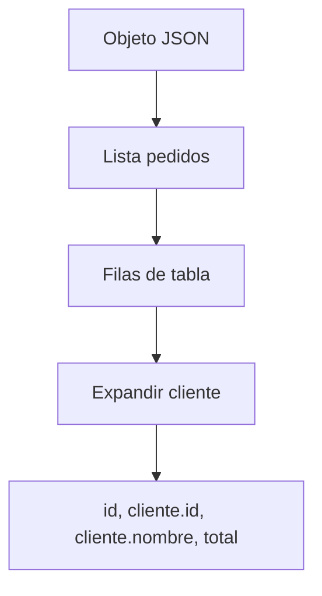
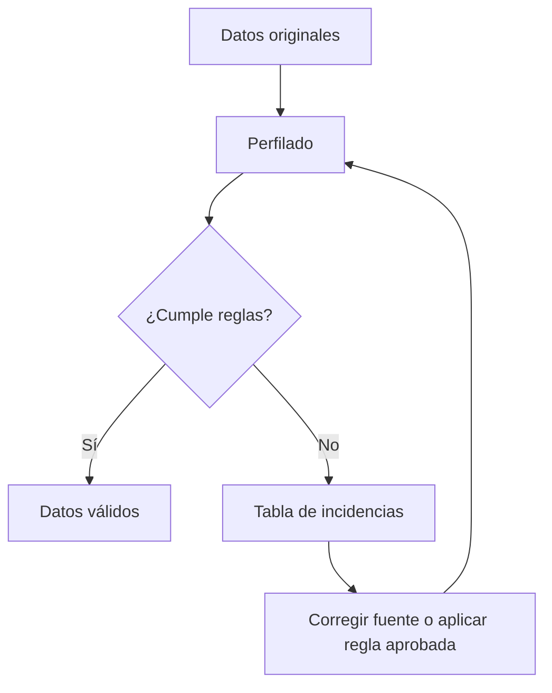
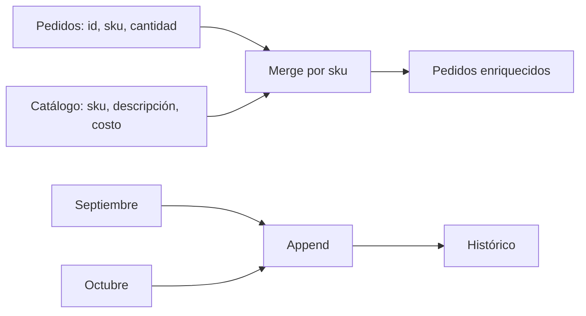
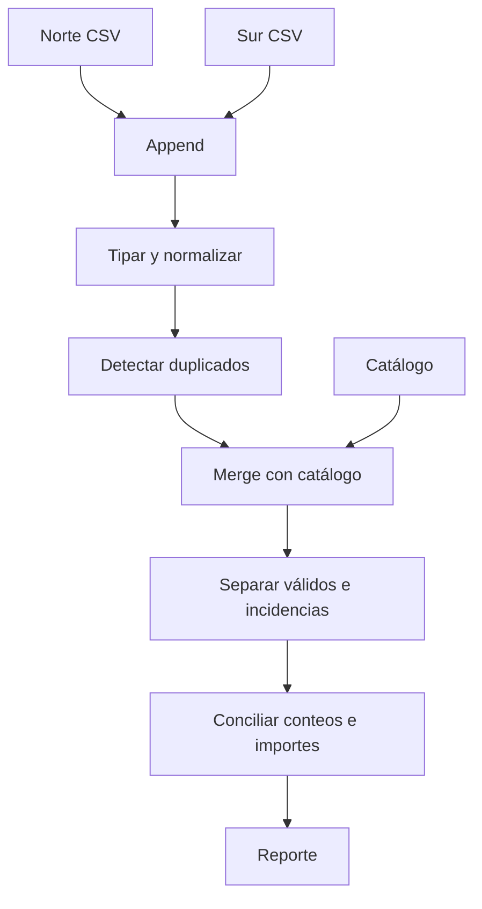

# H17 — Importación, limpieza y transformación de datos

**Roadmap oficial v2.0 · Excel H17/24 · Duración estimada: 20 horas**

**Secciones aprobadas:** H17.01 Adquisición; H17.02 Calidad; H17.03 Integración.  
**Prerrequisitos:** H06, H10 y H11.  
**Entorno principal:** Microsoft Excel con Power Query; comparaciones con Google Sheets.  
**Estado:** manual desarrollado; requiere comprobación práctica de conectores y funciones en la versión instalada.

## Objetivo general

Construir una canalización reproducible que incorpore archivos y fuentes externas, identifique problemas de calidad, aplique transformaciones documentadas, combine fuentes y actualice reportes sin repetir manualmente cada paso.

## Resultados de aprendizaje

1. Distinguir importar, conectar, transformar y cargar.
2. Incorporar CSV/TXT, XML/JSON, carpetas, web y bases de datos según permisos y disponibilidad.
3. Identificar tipos incorrectos, nulos, duplicados, claves inválidas y formatos inconsistentes.
4. Aplicar Power Query, fórmulas y controles de calidad sin destruir datos originales.
5. Integrar tablas mediante anexado y combinación, documentando claves y cardinalidad.
6. Implementar controles de actualización, linaje y conciliación.

## Mapa del módulo


**Principio rector:** conservar la fuente sin modificar, mantener cada transformación como paso verificable y producir una salida reproducible.


# H17.01 — Adquisición de datos

## H17.01.01 Conceptos y arquitectura

**Importación:** copia datos a un libro. **Conexión:** establece cómo obtenerlos de una fuente. **Consulta:** definición de operaciones que se ejecutan para producir un resultado. **ETL:** extracción, transformación y carga; en algunos sistemas se utiliza ELT, donde se carga antes de transformar. **Power Query:** motor de adquisición y transformación de Excel; su lenguaje es **M**, distinto de las fórmulas de celdas y de VBA.

La decisión entre importar una vez o mantener una conexión depende de la frecuencia de actualización, volumen, confidencialidad, credenciales y responsabilidad de mantenimiento.

### Procedimiento general en Excel

1. Abrir **Datos → Obtener datos**.
2. Elegir el conector adecuado.
3. Revisar vista previa, codificación, encabezados y delimitadores.
4. Abrir **Transformar datos** para acceder al Editor de Power Query.
5. Aplicar pasos en orden: origen → estructura → tipos → calidad → integración.
6. Elegir **Cerrar y cargar** o **Cerrar y cargar en...** según la necesidad.
7. Registrar fuente, propietario, periodicidad y fecha de actualización.

> Los menús y conectores varían por versión, sistema operativo, licencia y configuración empresarial.

## H17.01.02 CSV y TXT

Un CSV es texto delimitado; no define por sí solo tipos de datos, codificación ni formato de fechas. `00123` debe permanecer texto si es un identificador. El separador puede ser coma, punto y coma o tabulación; las comillas permiten incluir delimitadores dentro de campos.

**Archivo de práctica `ventas_oct.csv`:**

```csv
id_pedido,fecha,sku,cantidad,precio,region
P001,2026-10-01,00123,2,450.50,Norte
P002,2026-10-02,00124,1,900.00,Sur
P003,2026-10-03,00123,3,450.50,Norte
```

**Problemas a anticipar:** conversión de SKU a número, puntos decimales interpretados como texto, fechas ambiguas, encabezados duplicados, líneas vacías, BOM UTF-8 y columnas desplazadas por delimitadores en campos entrecomillados.

### Ejemplo M: leer CSV con tipos explícitos

```powerquery
let
    Origen = Csv.Document(
        File.Contents("C:\Datos\ventas_oct.csv"),
        [Delimiter=",", Columns=6, Encoding=65001, QuoteStyle=QuoteStyle.Csv]
    ),
    Encabezados = Table.PromoteHeaders(Origen, [PromoteAllScalars=true]),
    Tipos = Table.TransformColumnTypes(
        Encabezados,
        {{"id_pedido", type text}, {"fecha", type date},
         {"sku", type text}, {"cantidad", Int64.Type},
         {"precio", type number}, {"region", type text}},
        "en-US"
    )
in
    Tipos
```

**Explicación:** `File.Contents` lee el archivo local; `Csv.Document` lo interpreta; `Table.PromoteHeaders` convierte la primera fila en nombres; `Table.TransformColumnTypes` aplica tipos con configuración regional. Ajusta la ruta, las columnas y la cultura al origen real. No pegues credenciales en código M.

## H17.01.03 XML y JSON

**JSON:** objetos, listas, cadenas, números, booleanos y nulos; puede requerir expandir registros y listas. **XML:** nodos, atributos y jerarquías; requiere definir qué elementos representan registros.

**JSON de ejemplo:**

```json
{
  "pedidos": [
    {"id": "P001", "cliente": {"id": "C01", "nombre": "Ana"}, "total": 901.0},
    {"id": "P002", "cliente": {"id": "C02", "nombre": "Luis"}, "total": 900.0}
  ]
}
```

**Pasos:** importar → identificar lista `pedidos` → convertir en tabla → expandir registros → expandir `cliente` → asignar tipos → validar unicidad de `id`.



## H17.01.04 Carpetas, web y bases de datos

**Carpetas:** permite combinar múltiples archivos con estructura equivalente; verificar nombres de columnas y esquema antes de anexar. Si cambia el formato de un archivo, el paso de transformación de muestra puede fallar.

**Web:** los conectores dependen de acceso público, autenticación, estructura HTML y políticas del sitio. Priorizar APIs oficiales y permisos; no asumir que una página visual es una tabla estable.

**Bases de datos:** conectarse a una vista o consulta con privilegios mínimos. Evitar descargar tablas completas cuando basta un subconjunto; documentar el servidor, esquema, filtro y periodicidad. La actualización puede requerir autenticación o infraestructura adicional.

**Seguridad:** usar conexiones y mecanismos de credenciales de la plataforma; no escribir contraseñas ni tokens en consultas, celdas o archivos compartidos.

## H17.01.05 Práctica guiada

Importa el CSV anterior, conserva `sku` como texto, convierte fecha y precio con la configuración regional correcta y agrega una columna `importe = cantidad × precio`. Resultados: P001 = 901, P002 = 900, P003 = 1351,50; total = **3152,50**.

**Errores frecuentes:** autodetección de tipos prematura, delimitador incorrecto, fecha convertida al día/mes equivocado y credenciales incrustadas.


# H17.02 — Calidad de datos

## H17.02.01 Dimensiones de calidad

| Dimensión | Pregunta | Prueba típica |
|---|---|---|
| Completitud | ¿Faltan datos obligatorios? | Conteo de nulos en ID |
| Unicidad | ¿Se repiten claves que deberían ser únicas? | Duplicados de ID |
| Validez | ¿Cumplen dominio y tipo? | Cantidad > 0 |
| Consistencia | ¿Coinciden reglas entre tablas? | SKU existe en catálogo |
| Exactitud | ¿Representan la realidad? | Conciliación con fuente autorizada |
| Actualidad | ¿Están vigentes? | Fecha de actualización |
| Integridad referencial | ¿Cada clave externa existe? | Anti-join contra catálogo |

Una celda vacía, un texto vacío `""`, un `null` de Power Query y un error de conversión **no son equivalentes**.

## H17.02.02 Nulos y valores faltantes

**Regla:** decidir por columna y por contexto. Un correo opcional puede ser nulo; un ID de pedido no. Evita reemplazar nulos por cero si cambia el significado del dato.

```powerquery
let
    Origen = Excel.CurrentWorkbook(){[Name="Pedidos"]}[Content],
    SinIdNulo = Table.SelectRows(
        Origen, each [id_pedido] <> null and Text.Trim(Text.From([id_pedido])) <> ""
    )
in
    SinIdNulo
```

**Precaución:** `Text.From` requiere considerar tipos y errores; en datos heterogéneos, primero inspecciona y tipa con manejo explícito de excepciones.

## H17.02.03 Duplicados y claves

Eliminar duplicados exige definir **qué identifica un registro**. `id_pedido` podría ser único por pedido, pero `id_pedido + sku` podría ser la clave de una línea de pedido. Eliminar duplicados por SKU destruiría ventas legítimas.

```powerquery
Table.Distinct(Tabla, {"id_pedido", "sku"})
```

Antes de ejecutar, calcula cuántas filas se eliminarían, conserva una tabla de incidencias y define si debe retenerse la primera, última o una versión priorizada. El orden de supervivencia no debe suponerse estable sin reglas explícitas.

## H17.02.04 Tipos y configuración regional

**Tipos comunes:** texto, entero, decimal, fecha, fecha/hora, lógico. La cultura controla interpretación de `1,234.56` frente a `1.234,56` y de fechas ambiguas. Convierte solo después de identificar la convención de origen.

Ejemplo: `01/02/2026` puede significar 1 de febrero o 2 de enero. Un paso de conversión silencioso puede producir datos válidos sintácticamente pero incorrectos semánticamente.

## H17.02.05 Estandarización

Normaliza espacios, mayúsculas y valores de catálogo, sin borrar datos originales:

```powerquery
Table.TransformColumns(
    Tabla,
    {{"region", each Text.Upper(Text.Trim(_)), type text}}
)
```

En una fuente con posibles nulos, utiliza una condición `if _ = null then null else ...`. Para teléfonos, códigos postales y SKU, conserva texto. Para moneda, mantén columna de divisa y tasa de conversión si hay más de una.

## H17.02.06 Perfilado y reglas

Power Query ofrece herramientas de **calidad, distribución y perfil de columnas**. Según la configuración, el perfilado puede utilizar las primeras 1.000 filas en lugar de todo el conjunto; confirma el alcance antes de sacar conclusiones.



**Indicadores:** tasa de nulos, porcentaje de duplicados, errores de tipo, claves huérfanas y registros rechazados. Siempre informar denominador y fecha de cálculo.

## H17.02.07 Casos de error

- Convertir `0007` a número y perder el identificador.
- Reemplazar `null` por cero sin autorización.
- Quitar duplicados por una columna insuficiente.
- Usar `Text.Proper` en nombres propios sin revisión cultural.
- Reemplazar errores por `null` y ocultar fallos del origen.
- Perfilar una muestra como si fuera el 100 %.


# H17.03 — Integración, trazabilidad y actualización

## H17.03.01 Anexar frente a combinar

**Anexar (Append):** apila filas de tablas de esquema equivalente, por ejemplo ventas de septiembre y octubre.

**Combinar (Merge):** relaciona tablas por una o varias claves, por ejemplo pedidos con catálogo de productos. Debe definirse cardinalidad: uno a uno, muchos a uno o muchos a muchos.



## H17.03.02 Tipos de unión

| Unión | Registros conservados | Uso |
|---|---|---|
| Izquierda | Todos los de la tabla izquierda | Enriquecer pedidos |
| Interna | Solo coincidencias | Registros con correspondencia |
| Derecha | Todos los de la tabla derecha | Revisar catálogo |
| Completa | Todos los de ambas | Conciliación |
| Anti izquierda | Izquierda sin coincidencia | SKU inexistente |
| Anti derecha | Derecha sin coincidencia | Productos sin pedidos |

**Riesgo crítico:** si el catálogo contiene dos filas con el mismo SKU, un `merge` puede multiplicar las filas de pedidos y duplicar importes. Comprueba unicidad antes de expandir.

## H17.03.03 Ejemplo de combinación en M

```powerquery
let
    Pedidos = Excel.CurrentWorkbook(){[Name="Pedidos"]}[Content],
    Catalogo = Excel.CurrentWorkbook(){[Name="Catalogo"]}[Content],
    Union = Table.NestedJoin(
        Pedidos, {"sku"}, Catalogo, {"sku"}, "Detalle",
        JoinKind.LeftOuter
    ),
    Expandido = Table.ExpandTableColumn(
        Union, "Detalle", {"descripcion"}, {"descripcion"}
    )
in
    Expandido
```

**Precondiciones:** tipos de `sku` compatibles y claves únicas en `Catalogo`. Una descripción `null` tras la unión puede indicar un SKU inexistente, pero también diferencias de espacios, mayúsculas o formato.

## H17.03.04 Trazabilidad y linaje

Registrar: nombre de archivo, ruta lógica, fecha de extracción, versión de consulta, transformaciones, cantidad de filas de entrada/salida, rechazos y responsable. En archivos combinados, conservar una columna `archivo_origen`.

**Reconciliación mínima:**

`Filas origen = filas válidas + filas rechazadas`, salvo que el proceso cree o agregue filas deliberadamente.  
`Importe origen = importe válido + importe rechazado`, si las cantidades son comparables y no hay transformaciones de moneda o ajustes.

## H17.03.05 Actualización y operación

1. Confirmar acceso a fuente y credenciales.
2. Ejecutar **Actualizar todo** o actualizar consultas seleccionadas.
3. Revisar errores y número de registros.
4. Comparar totales de control.
5. Registrar fecha/hora y versión.
6. Publicar solo si pasan las pruebas.

La actualización de un libro local no implica programación automática en la nube. Las capacidades de programación, gateway y conectores varían según producto, licencia y entorno.

## H17.03.06 Comparación Excel / Google Sheets

| Necesidad | Excel | Google Sheets |
|---|---|---|
| Importar CSV | Datos → Obtener datos / Power Query | Archivo → Importar |
| Transformación reproducible | Power Query (M) | Fórmulas, Apps Script o herramientas externas |
| Importar web | Conectores web / Power Query | `IMPORTHTML`, `IMPORTXML` cuando proceda |
| Datos entre archivos | Conectores / Power Query | `IMPORTRANGE` |
| Combinación por clave | Merge en Power Query | Fórmulas de búsqueda o Apps Script |
| Actualización | Dependiente de conexión y entorno | Recalculo/automatización con límites propios |

**No existe equivalencia automática** entre una consulta M y una fórmula de Sheets. Las funciones de importación de Sheets pueden estar limitadas por permisos, cuotas, formato del sitio y frecuencia de actualización.


# Proyecto integrador — Canalización de ventas multifuente

## Escenario

Una empresa recibe ventas mensuales de dos sucursales, un catálogo de productos y un archivo de incidencias. Debe producir una tabla limpia, enriquecida y conciliada.

### Archivo A — `norte.csv`

```csv
id_pedido,fecha,sku,cantidad,precio,region
P001,2026-10-01,00123,2,450.50,Norte
P003,2026-10-03,00123,3,450.50,Norte
P005,2026-10-04,00999,1,100.00,Norte
```

### Archivo B — `sur.csv`

```csv
id_pedido,fecha,sku,cantidad,precio,region
P002,2026-10-02,00124,1,900.00,Sur
P004,2026-10-04,00125,2,300.00,Sur
P004,2026-10-04,00125,2,300.00,Sur
```

### Catálogo — `catalogo.csv`

```csv
sku,descripcion,categoria
00123,Teclado,Perifericos
00124,Monitor,Pantallas
00125,Mouse,Perifericos
```

## Reglas del proyecto

- Los identificadores se almacenan como texto.
- La clave de línea de pedido es `(id_pedido, sku)` para este ejercicio.
- Las filas idénticas duplicadas se ponen en cuarentena antes de excluir una copia.
- El SKU `00999` se considera inválido por ausencia en catálogo; conservarlo en incidencias.
- No se imputan precios ni cantidades faltantes sin regla aprobada.
- Los importes se calculan con decimal y se redondean únicamente en la capa de reporte.

## Pipeline



## Resultados esperados

- Filas originales: **6**.
- Duplicado exacto: **1** (segunda aparición de P004).
- SKU sin catálogo: **1** (P005).
- Filas válidas finales: **4** (P001, P002, P003, P004).
- Importe de filas válidas: `901 + 900 + 1351,50 + 600 = 3752,50`.
- Importe de fila inválida por SKU: **100,00**.
- Importe de fila duplicada en origen: **600,00**.
- Importe bruto de seis filas: **4452,50**.
- Conciliación: `3752,50 + 100 + 600 = 4452,50`.

## Entregables

1. Libro con consultas `Origen_Norte`, `Origen_Sur`, `Catalogo`, `Ventas_Limpias`, `Incidencias`, `Reporte`.
2. Diccionario de datos con tipos y reglas.
3. Tabla de conciliación de filas e importes.
4. Capturas de pasos aplicados y consulta final.
5. Procedimiento de actualización.
6. Informe breve de decisiones y límites.

## Rúbrica (100 puntos)

Adquisición 20; calidad y reglas 25; integración 20; conciliación 20; trazabilidad y presentación 15.


# Ejercicios — cinco por sección

**Instrucciones:** resolver antes de consultar el solucionario; registrar explicación, evidencia y criterio de aceptación.


### Ejercicio E01 — H17.01

**Enunciado:** ¿Qué diferencia existe entre importar y mantener una conexión?

**Entregable:** respuesta fundamentada y, cuando aplique, captura o consulta reproducible.


### Ejercicio E02 — H17.01

**Enunciado:** ¿Por qué `00123` debe importarse como texto?

**Entregable:** respuesta fundamentada y, cuando aplique, captura o consulta reproducible.


### Ejercicio E03 — H17.01

**Enunciado:** ¿Qué significa `Encoding=65001` en el ejemplo M?

**Entregable:** respuesta fundamentada y, cuando aplique, captura o consulta reproducible.


### Ejercicio E04 — H17.01

**Enunciado:** ¿Qué paso convierte una lista JSON en registros tabulares?

**Entregable:** respuesta fundamentada y, cuando aplique, captura o consulta reproducible.


### Ejercicio E05 — H17.01

**Enunciado:** Calcula el importe total de los tres registros del CSV inicial.

**Entregable:** respuesta fundamentada y, cuando aplique, captura o consulta reproducible.


### Ejercicio E06 — H17.02

**Enunciado:** ¿En qué se diferencian `null` y cero?

**Entregable:** respuesta fundamentada y, cuando aplique, captura o consulta reproducible.


### Ejercicio E07 — H17.02

**Enunciado:** ¿Por qué no se eliminan duplicados por SKU en ventas?

**Entregable:** respuesta fundamentada y, cuando aplique, captura o consulta reproducible.


### Ejercicio E08 — H17.02

**Enunciado:** ¿Qué riesgo tiene convertir `01/02/2026` sin cultura?

**Entregable:** respuesta fundamentada y, cuando aplique, captura o consulta reproducible.


### Ejercicio E09 — H17.02

**Enunciado:** Propón una regla de validez para cantidad.

**Entregable:** respuesta fundamentada y, cuando aplique, captura o consulta reproducible.


### Ejercicio E10 — H17.02

**Enunciado:** ¿Qué mide la integridad referencial?

**Entregable:** respuesta fundamentada y, cuando aplique, captura o consulta reproducible.


### Ejercicio E11 — H17.03

**Enunciado:** ¿Cuándo usarías Append y cuándo Merge?

**Entregable:** respuesta fundamentada y, cuando aplique, captura o consulta reproducible.


### Ejercicio E12 — H17.03

**Enunciado:** ¿Qué unión identifica SKU de pedidos sin catálogo?

**Entregable:** respuesta fundamentada y, cuando aplique, captura o consulta reproducible.


### Ejercicio E13 — H17.03

**Enunciado:** ¿Qué pasa si el catálogo tiene dos filas por SKU?

**Entregable:** respuesta fundamentada y, cuando aplique, captura o consulta reproducible.


### Ejercicio E14 — H17.03

**Enunciado:** ¿Cuántas filas válidas quedan en el proyecto?

**Entregable:** respuesta fundamentada y, cuando aplique, captura o consulta reproducible.


### Ejercicio E15 — H17.03

**Enunciado:** Comprueba la conciliación monetaria del proyecto.

**Entregable:** respuesta fundamentada y, cuando aplique, captura o consulta reproducible.


# Solucionario separado


### Solución E01

Importar copia datos; una conexión define cómo volver a obtenerlos, sujeta a acceso y actualización.

**Verificación:** contrastar con el dato original, la regla documentada y el resultado esperado.


### Solución E02

Porque es un identificador; convertirlo a número elimina ceros iniciales.

**Verificación:** contrastar con el dato original, la regla documentada y el resultado esperado.


### Solución E03

Codificación UTF-8.

**Verificación:** contrastar con el dato original, la regla documentada y el resultado esperado.


### Solución E04

Convertir lista a tabla y expandir registros, después tipar columnas.

**Verificación:** contrastar con el dato original, la regla documentada y el resultado esperado.


### Solución E05

901 + 900 + 1351,50 = 3152,50.

**Verificación:** contrastar con el dato original, la regla documentada y el resultado esperado.


### Solución E06

Null indica ausencia; cero es un valor numérico válido.

**Verificación:** contrastar con el dato original, la regla documentada y el resultado esperado.


### Solución E07

Porque un SKU puede venderse en múltiples pedidos legítimos.

**Verificación:** contrastar con el dato original, la regla documentada y el resultado esperado.


### Solución E08

Interpretar enero 2 en vez de febrero 1, o viceversa.

**Verificación:** contrastar con el dato original, la regla documentada y el resultado esperado.


### Solución E09

Cantidad numérica entera y mayor que cero, salvo reglas explícitas para devoluciones.

**Verificación:** contrastar con el dato original, la regla documentada y el resultado esperado.


### Solución E10

Que claves como SKU existan en la tabla maestra correspondiente.

**Verificación:** contrastar con el dato original, la regla documentada y el resultado esperado.


### Solución E11

Append apila filas; Merge relaciona columnas por clave.

**Verificación:** contrastar con el dato original, la regla documentada y el resultado esperado.


### Solución E12

Anti izquierda de pedidos respecto al catálogo.

**Verificación:** contrastar con el dato original, la regla documentada y el resultado esperado.


### Solución E13

El merge puede duplicar registros y multiplicar importes.

**Verificación:** contrastar con el dato original, la regla documentada y el resultado esperado.


### Solución E14

4; de 6 originales se separa un duplicado y un SKU inexistente.

**Verificación:** contrastar con el dato original, la regla documentada y el resultado esperado.


### Solución E15

3752,50 + 100 + 600 = 4452,50.

**Verificación:** contrastar con el dato original, la regla documentada y el resultado esperado.


# Laboratorios complementarios

## Laboratorio 1 — CSV y cultura

Importa un CSV con SKU `0001`, precio `1,234.50` y fecha `10/27/2026`. Prueba con cultura incorrecta y correcta. Documenta qué columnas fallan, cuáles cambian silenciosamente y cómo fijar los tipos de manera explícita.

## Laboratorio 2 — Calidad

Crea diez registros con dos IDs nulos, un duplicado exacto, una cantidad negativa y una fecha imposible. Diseña una tabla de incidencias que explique por qué cada fila fue rechazada. No reemplaces silenciosamente valores.

## Laboratorio 3 — Uniones

Construye catálogo con claves `A`, `B`, `C` y pedidos con `A`, `A`, `D`. Compara left, inner y left anti. Resultado esperado para anti izquierda: `D`; para inner: dos pedidos `A`. Comprueba la cardinalidad.

## Laboratorio 4 — Actualización

Agrega una fila válida al archivo de origen, actualiza consultas y comprueba que el total cambia exactamente en el importe añadido. Registra fecha, número de filas y resultado de la prueba de conciliación.

# Evaluación final

1. Explica ETL y ELT.
2. Diferencia consulta, conexión y tabla cargada.
3. ¿Por qué los códigos deben conservarse como texto?
4. ¿Qué riesgo tienen los formatos de fecha ambiguos?
5. ¿Qué hace `Table.PromoteHeaders`?
6. ¿Qué función cumple `Table.TransformColumnTypes`?
7. Diferencia `null`, vacío y error.
8. ¿Cómo definir una clave de deduplicación?
9. ¿Por qué perfilar solo una muestra puede ser insuficiente?
10. Define integridad referencial.
11. Diferencia Append y Merge.
12. Explica una unión anti izquierda.
13. ¿Cómo puede un merge duplicar importes?
14. ¿Qué indicadores incluirías en una conciliación?
15. ¿Qué condiciones verificarías antes de publicar un reporte actualizado?

**Criterio de aprobación:** 12/15 respuestas correctas, 15 ejercicios entregados y proyecto ≥80/100.

# Glosario

**CSV:** valores separados por delimitador. **JSON:** formato estructurado de objetos y listas. **XML:** lenguaje de marcado estructurado. **ETL:** extraer, transformar, cargar. **Power Query:** motor de adquisición y transformación. **M:** lenguaje de consultas de Power Query. **Tipado:** asignación de tipos de datos. **Null:** ausencia de valor. **Clave:** atributo o conjunto de atributos que identifica registros. **Cardinalidad:** relación entre cantidades de coincidencias. **Append:** anexar filas. **Merge:** combinar tablas por claves. **Linaje:** origen y transformaciones de los datos. **Conciliación:** comprobación de conservación y correspondencia de registros y totales.

# Fuentes oficiales para consulta y validación

1. [Microsoft Learn — ¿Qué es Power Query?](https://learn.microsoft.com/es-es/power-query/power-query-what-is-power-query)
2. [Microsoft Learn — Lenguaje M de Power Query](https://learn.microsoft.com/es-es/powerquery-m/)
3. [Microsoft Learn — Csv.Document](https://learn.microsoft.com/en-us/powerquery-m/csv-document)
4. [Microsoft Learn — Table.TransformColumnTypes](https://learn.microsoft.com/en-us/powerquery-m/table-transformcolumntypes)
5. [Microsoft Learn — Table.NestedJoin](https://learn.microsoft.com/en-us/powerquery-m/table-nestedjoin)
6. [Microsoft Learn — Table.Distinct](https://learn.microsoft.com/en-us/powerquery-m/table-distinct)
7. [Microsoft Learn — Perfilado de datos](https://learn.microsoft.com/en-us/power-query/data-profiling-tools)
8. [Google Sheets — Lista de funciones](https://support.google.com/docs/table/25273?hl=es)

**Limitación:** se ofrecen enlaces oficiales como referencias de consulta. Las interfaces y opciones exactas dependen de versión, plataforma, permisos y fuente. Las consultas M y los conectores no se han ejecutado contra sistemas reales en este documento.

# Estado del curso

| Campo | Estado |
|---|---|
| Ruta | H — Excel |
| Módulo | H17 — Importación, limpieza y transformación de datos |
| Secciones | H17.01 Adquisición; H17.02 Calidad; H17.03 Integración |
| Ejercicios | 15 (5 por sección) |
| Solucionario | 15 soluciones separadas |
| Laboratorios | 4 |
| Proyecto | Canalización de ventas multifuente |
| Diagramas | Mermaid |
| Verificación | Resultados esperados y conciliación documentados |
| Pendiente | Pruebas reales en Excel/Power Query y validación de conectores |
| Siguiente módulo | H18 — consultar título oficial del roadmap antes de desarrollarlo |

