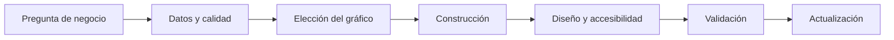
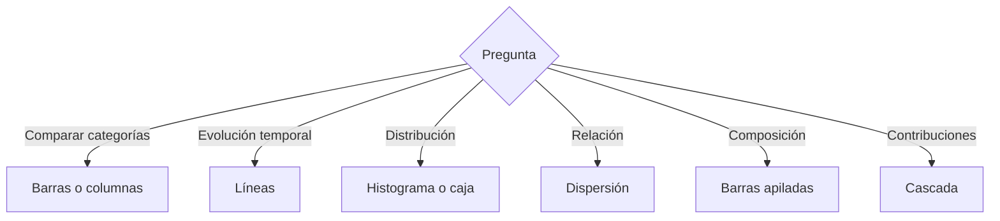
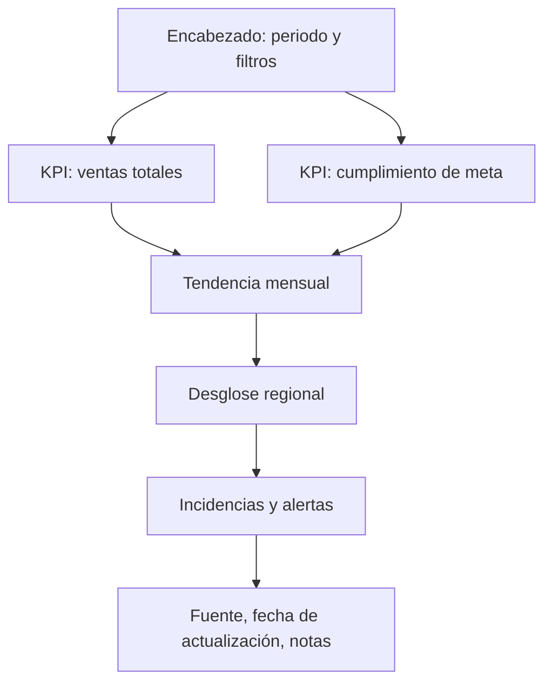

# H18 — Visualización de información y diseño de gráficos

**Roadmap aprobado v2.0 · Excel H18/24 · Curso integral de Excel y Google Sheets**  
**Secciones:** H18.01 Fundamentos · H18.02 Gráficos · H18.03 Diseño  
**Prerrequisitos:** H06 (tablas), H09 (estadística), H17 (preparación de datos).  
**Duración sugerida:** 24–30 horas. **Estado:** contenido académico; pendiente de prueba en las interfaces de Excel y Sheets.

## Competencias

Al terminar podrás elegir gráficos según la pregunta analítica, evitar representaciones engañosas, construir gráficos de Excel y Sheets, personalizar escalas y etiquetas, diseñar paneles accesibles y actualizar visualizaciones a partir de tablas y tablas dinámicas.

## Ruta didáctica



## Datos comunes para las prácticas

**Tabla VentasMensuales** (MXN, sin IVA; valores ficticios):

| Mes | Norte | Centro | Sur | Meta |
|---|---:|---:|---:|---:|
| Ene | 120000 | 100000 | 80000 | 320000 |
| Feb | 135000 | 108000 | 92000 | 330000 |
| Mar | 142000 | 115000 | 98000 | 350000 |
| Abr | 150000 | 122000 | 110000 | 365000 |
| May | 158000 | 130000 | 117000 | 390000 |
| Jun | 165000 | 136000 | 125000 | 410000 |

**Tabla Incidencias**: `tipo`, `cantidad`: Retraso 18, Error de captura 12, Devolución 8, Otro 6.

**Tabla Campañas**: `inversión`, `ventas_atribuidas`: (10000,40000), (15000,51000), (20000,61000), (25000,65000), (30000,82000), (35000,88000). **Advertencia:** correlación observacional no demuestra causalidad.

**Resultados de control:** ventas de enero = 300000; junio = 426000; crecimiento enero–junio = 42%; meta de junio = 410000; cumplimiento de junio = 103,90%; total de incidencias = 44.


# H18.01 — Fundamentos de visualización

## H18.01.01 — Visualizar para responder preguntas

Una visualización no es decoración: es una codificación de datos que debe permitir responder una pregunta verificable. Distingue:
- **Comparación:** ¿qué región vende más?
- **Evolución:** ¿cómo cambian las ventas mes a mes?
- **Composición:** ¿cómo se distribuye un total?
- **Distribución:** ¿cómo se concentran los valores y aparecen extremos?
- **Relación:** ¿se asocian inversión y ventas?
- **Desviación:** ¿cuánto nos separamos de la meta?

### Jerarquía de precisión perceptual

La posición sobre un eje común suele permitir comparaciones más precisas que ángulos, áreas, volúmenes o intensidades de color. Por ello, un gráfico de barras puede ser preferible a uno circular cuando interesa comparar categorías próximas. Evita representar una cantidad mediante áreas de iconos cuyo tamaño no se escala de forma controlada.

## H18.01.02 — Tipo de variable y granularidad

| Tipo | Ejemplo | Gráficos candidatos |
|---|---|---|
| Categórica nominal | Región | Barras/columnas |
| Ordinal | Prioridad baja/media/alta | Barras ordenadas |
| Temporal | Mes | Línea/columnas |
| Cuantitativa continua | Tiempo de entrega | Histograma/caja |
| Dos cuantitativas | Inversión y ventas | Dispersión |
| Parte de un total | Motivo de incidencia | Barras apiladas/100% |

**Granularidad** es el nivel al que se agrupan observaciones. Cambiar de día a mes puede ocultar anomalías. Documenta si cada dato representa un registro, un promedio, una suma o una tasa.

## H18.01.03 — Selección guiada



## H18.01.04 — Escalas y sesgos

- Las barras codifican longitud: normalmente deben empezar en cero.
- Las líneas pueden usar escalas recortadas, pero deben señalizarlo claramente y no exagerar variaciones.
- El eje secundario facilita superponer unidades distintas, pero puede crear correlaciones visuales falsas.
- Los gráficos 3D deforman tamaños y ocultan datos; evitar salvo justificación técnica.
- No mezclar porcentajes, importes y conteos en un mismo eje.
- Un promedio puede ocultar la dispersión; añadir intervalos o distribución cuando corresponda.

## H18.01.05 — Ejemplo analítico

En enero las ventas suman 300000 y en junio 426000. El crecimiento acumulado es `(426000/300000)-1 = 0,42`, es decir **42%**. Esto no significa que cada mes haya crecido 42% ni que la tendencia vaya a mantenerse. Un gráfico de líneas muestra la trayectoria; columnas agrupadas muestran mejor las diferencias entre regiones.

## H18.01.06 — Checklist antes de crear

Pregunta explícita; población y periodo; fuente; unidad; denominador de tasas; tratamiento de nulos; agregación; escala; tipo de gráfico; accesibilidad; prueba de valores.


# H18.02 — Gráficos: construcción y casos de uso

## H18.02.01 — Procedimiento base en Excel

1. Convertir los datos en **Tabla** (`Ctrl+T`) y comprobar encabezados.
2. Seleccionar el rango correcto, incluida la categoría.
3. Ir a **Insertar → Gráficos** y elegir el tipo apropiado.
4. Comprobar si Excel interpretó correctamente filas y columnas.
5. Ajustar título, ejes, unidades, etiquetas y leyenda.
6. Verificar manualmente al menos dos valores y la actualización al agregar registros.

En Sheets, seleccionar datos y utilizar **Insertar → Gráfico**; el editor permite elegir tipo y personalización, aunque las opciones y denominaciones difieren.


### Ficha G01 — Columnas agrupadas

**Qué comunica:** Comparar regiones por mes.

**Datos de ejemplo:** Mes como categoría; series Norte, Centro, Sur.

**Construcción:** preparar una tabla rectangular con categorías, valores y encabezados; seleccionar el rango; insertar el tipo de gráfico; revisar el orden de las series y las unidades; validar contra las celdas.

**Buenas prácticas:** título con conclusión o pregunta, unidad visible, leyenda inequívoca, colores consistentes y texto legible.

**Error a evitar:** Evitar demasiadas categorías y etiquetas inclinadas.

**Comprobación:** comparar al menos un punto de datos y el total de control con la tabla original. Documentar cualquier filtro activo.


### Ficha G02 — Barras horizontales

**Qué comunica:** Comparar categorías con nombres largos.

**Datos de ejemplo:** Tipo de incidencia y cantidad.

**Construcción:** preparar una tabla rectangular con categorías, valores y encabezados; seleccionar el rango; insertar el tipo de gráfico; revisar el orden de las series y las unidades; validar contra las celdas.

**Buenas prácticas:** título con conclusión o pregunta, unidad visible, leyenda inequívoca, colores consistentes y texto legible.

**Error a evitar:** Ordenar según propósito, no necesariamente alfabéticamente.

**Comprobación:** comparar al menos un punto de datos y el total de control con la tabla original. Documentar cualquier filtro activo.


### Ficha G03 — Líneas

**Qué comunica:** Mostrar evolución temporal.

**Datos de ejemplo:** Mes y total mensual.

**Construcción:** preparar una tabla rectangular con categorías, valores y encabezados; seleccionar el rango; insertar el tipo de gráfico; revisar el orden de las series y las unidades; validar contra las celdas.

**Buenas prácticas:** título con conclusión o pregunta, unidad visible, leyenda inequívoca, colores consistentes y texto legible.

**Error a evitar:** No usar eje categórico para fechas con intervalos desiguales sin revisarlo.

**Comprobación:** comparar al menos un punto de datos y el total de control con la tabla original. Documentar cualquier filtro activo.


### Ficha G04 — Áreas

**Qué comunica:** Mostrar evolución de magnitudes acumuladas.

**Datos de ejemplo:** Mes y total por región.

**Construcción:** preparar una tabla rectangular con categorías, valores y encabezados; seleccionar el rango; insertar el tipo de gráfico; revisar el orden de las series y las unidades; validar contra las celdas.

**Buenas prácticas:** título con conclusión o pregunta, unidad visible, leyenda inequívoca, colores consistentes y texto legible.

**Error a evitar:** El apilamiento dificulta comparar series intermedias.

**Comprobación:** comparar al menos un punto de datos y el total de control con la tabla original. Documentar cualquier filtro activo.


### Ficha G05 — Apiladas 100%

**Qué comunica:** Comparar proporciones entre periodos.

**Datos de ejemplo:** Participación regional por mes.

**Construcción:** preparar una tabla rectangular con categorías, valores y encabezados; seleccionar el rango; insertar el tipo de gráfico; revisar el orden de las series y las unidades; validar contra las celdas.

**Buenas prácticas:** título con conclusión o pregunta, unidad visible, leyenda inequívoca, colores consistentes y texto legible.

**Error a evitar:** Oculta los cambios en volumen absoluto.

**Comprobación:** comparar al menos un punto de datos y el total de control con la tabla original. Documentar cualquier filtro activo.


### Ficha G06 — Dispersión XY

**Qué comunica:** Explorar relación entre dos medidas.

**Datos de ejemplo:** Inversión y ventas atribuidas.

**Construcción:** preparar una tabla rectangular con categorías, valores y encabezados; seleccionar el rango; insertar el tipo de gráfico; revisar el orden de las series y las unidades; validar contra las celdas.

**Buenas prácticas:** título con conclusión o pregunta, unidad visible, leyenda inequívoca, colores consistentes y texto legible.

**Error a evitar:** No inferir causalidad.

**Comprobación:** comparar al menos un punto de datos y el total de control con la tabla original. Documentar cualquier filtro activo.


### Ficha G07 — Histograma

**Qué comunica:** Describir distribución de datos continuos.

**Datos de ejemplo:** Tiempos de entrega individuales.

**Construcción:** preparar una tabla rectangular con categorías, valores y encabezados; seleccionar el rango; insertar el tipo de gráfico; revisar el orden de las series y las unidades; validar contra las celdas.

**Buenas prácticas:** título con conclusión o pregunta, unidad visible, leyenda inequívoca, colores consistentes y texto legible.

**Error a evitar:** El número y ancho de intervalos alteran la lectura.

**Comprobación:** comparar al menos un punto de datos y el total de control con la tabla original. Documentar cualquier filtro activo.


### Ficha G08 — Caja y bigotes

**Qué comunica:** Comparar mediana, cuartiles y extremos.

**Datos de ejemplo:** Tiempos de entrega por región.

**Construcción:** preparar una tabla rectangular con categorías, valores y encabezados; seleccionar el rango; insertar el tipo de gráfico; revisar el orden de las series y las unidades; validar contra las celdas.

**Buenas prácticas:** título con conclusión o pregunta, unidad visible, leyenda inequívoca, colores consistentes y texto legible.

**Error a evitar:** La definición de cuartiles y bigotes puede variar.

**Comprobación:** comparar al menos un punto de datos y el total de control con la tabla original. Documentar cualquier filtro activo.


### Ficha G09 — Cascada

**Qué comunica:** Explicar cambios de un valor inicial a uno final.

**Datos de ejemplo:** Saldo inicial, ingresos, costos, saldo final.

**Construcción:** preparar una tabla rectangular con categorías, valores y encabezados; seleccionar el rango; insertar el tipo de gráfico; revisar el orden de las series y las unidades; validar contra las celdas.

**Buenas prácticas:** título con conclusión o pregunta, unidad visible, leyenda inequívoca, colores consistentes y texto legible.

**Error a evitar:** Marcar correctamente los totales.

**Comprobación:** comparar al menos un punto de datos y el total de control con la tabla original. Documentar cualquier filtro activo.


### Ficha G10 — Combinado

**Qué comunica:** Contrastar ventas y meta.

**Datos de ejemplo:** Columnas para ventas; línea para meta.

**Construcción:** preparar una tabla rectangular con categorías, valores y encabezados; seleccionar el rango; insertar el tipo de gráfico; revisar el orden de las series y las unidades; validar contra las celdas.

**Buenas prácticas:** título con conclusión o pregunta, unidad visible, leyenda inequívoca, colores consistentes y texto legible.

**Error a evitar:** No usar ejes secundarios innecesariamente.

**Comprobación:** comparar al menos un punto de datos y el total de control con la tabla original. Documentar cualquier filtro activo.


### Ficha G11 — Circular o anillo

**Qué comunica:** Mostrar composición simple.

**Datos de ejemplo:** Cuatro tipos de incidencia.

**Construcción:** preparar una tabla rectangular con categorías, valores y encabezados; seleccionar el rango; insertar el tipo de gráfico; revisar el orden de las series y las unidades; validar contra las celdas.

**Buenas prácticas:** título con conclusión o pregunta, unidad visible, leyenda inequívoca, colores consistentes y texto legible.

**Error a evitar:** Preferir barras cuando se necesita comparación precisa.

**Comprobación:** comparar al menos un punto de datos y el total de control con la tabla original. Documentar cualquier filtro activo.


### Ficha G12 — Mapa

**Qué comunica:** Representar una variable geográfica.

**Datos de ejemplo:** Región geográfica y ventas.

**Construcción:** preparar una tabla rectangular con categorías, valores y encabezados; seleccionar el rango; insertar el tipo de gráfico; revisar el orden de las series y las unidades; validar contra las celdas.

**Buenas prácticas:** título con conclusión o pregunta, unidad visible, leyenda inequívoca, colores consistentes y texto legible.

**Error a evitar:** No usar mapas para etiquetas sin geometría geográfica válida.

**Comprobación:** comparar al menos un punto de datos y el total de control con la tabla original. Documentar cualquier filtro activo.


### Ficha G13 — Treemap

**Qué comunica:** Explorar jerarquías y composición.

**Datos de ejemplo:** Categoría > producto > ventas.

**Construcción:** preparar una tabla rectangular con categorías, valores y encabezados; seleccionar el rango; insertar el tipo de gráfico; revisar el orden de las series y las unidades; validar contra las celdas.

**Buenas prácticas:** título con conclusión o pregunta, unidad visible, leyenda inequívoca, colores consistentes y texto legible.

**Error a evitar:** Las áreas pequeñas pueden ser difíciles de comparar.

**Comprobación:** comparar al menos un punto de datos y el total de control con la tabla original. Documentar cualquier filtro activo.


### Ficha G14 — Sunburst

**Qué comunica:** Mostrar niveles jerárquicos.

**Datos de ejemplo:** División > región > producto.

**Construcción:** preparar una tabla rectangular con categorías, valores y encabezados; seleccionar el rango; insertar el tipo de gráfico; revisar el orden de las series y las unidades; validar contra las celdas.

**Buenas prácticas:** título con conclusión o pregunta, unidad visible, leyenda inequívoca, colores consistentes y texto legible.

**Error a evitar:** Evitar jerarquías muy profundas.

**Comprobación:** comparar al menos un punto de datos y el total de control con la tabla original. Documentar cualquier filtro activo.


### Ficha G15 — Radar

**Qué comunica:** Comparar perfiles multivariables.

**Datos de ejemplo:** Indicadores estandarizados.

**Construcción:** preparar una tabla rectangular con categorías, valores y encabezados; seleccionar el rango; insertar el tipo de gráfico; revisar el orden de las series y las unidades; validar contra las celdas.

**Buenas prácticas:** título con conclusión o pregunta, unidad visible, leyenda inequívoca, colores consistentes y texto legible.

**Error a evitar:** Áreas y orden de ejes pueden inducir errores.

**Comprobación:** comparar al menos un punto de datos y el total de control con la tabla original. Documentar cualquier filtro activo.


### Ficha G16 — Gráfico dinámico

**Qué comunica:** Explorar agregados mediante filtros.

**Datos de ejemplo:** Tabla dinámica de ventas por región.

**Construcción:** preparar una tabla rectangular con categorías, valores y encabezados; seleccionar el rango; insertar el tipo de gráfico; revisar el orden de las series y las unidades; validar contra las celdas.

**Buenas prácticas:** título con conclusión o pregunta, unidad visible, leyenda inequívoca, colores consistentes y texto legible.

**Error a evitar:** Verificar que el origen y caché estén actualizados.

**Comprobación:** comparar al menos un punto de datos y el total de control con la tabla original. Documentar cualquier filtro activo.


## H18.02.02 — Mini-proyectos por tipo

**Comparación regional:** gráfico de columnas agrupadas con Norte, Centro y Sur para seis meses. Pregunta: ¿qué región lidera cada mes? Respuesta: Norte en todos los meses del conjunto.

**Tendencia y meta:** crear `Total = SUMA(B2:D2)` y un gráfico combinado de columnas para Total y línea para Meta. Junio: 426000 frente a 410000; diferencia positiva de 16000.

**Distribución:** crear 20 tiempos de entrega, agruparlos en intervalos y construir histograma. Comparar con una caja y bigotes si la versión de Excel lo permite. No inferir una distribución a partir de seis totales mensuales.

**Relación:** usar inversión como eje X y ventas atribuidas como eje Y. Agregar línea de tendencia solo como descripción; una pendiente no prueba retorno incremental de publicidad.

**Cascada:** ingresos 426000, costo de ventas −250000, gastos −100000 → margen final 76000. Configurar el valor final como total y verificar la aritmética.

## H18.02.03 — Gráficos vinculados a tablas dinámicas

1. Insertar una tabla dinámica desde la tabla fuente.
2. Colocar Mes en filas, Región en columnas y Ventas en valores.
3. Insertar gráfico dinámico.
4. Añadir segmentación por Región cuando corresponda.
5. Actualizar la tabla dinámica tras cambiar la fuente.
6. Comprobar filtros y totales; no asumir que el gráfico se actualizó por sí solo.

## H18.02.04 — Gráficos de Excel frente a Sheets

| Necesidad | Excel | Google Sheets |
|---|---|---|
| Columnas, barras, líneas, dispersión | Compatible | Compatible |
| Histograma | Compatible | Compatible |
| Cascada | Compatible en versiones modernas | Revisar disponibilidad/tipo |
| Caja y bigotes | Disponible en versiones modernas | Puede requerir alternativa |
| Gráfico dinámico | Vinculado a tabla dinámica | Pivot + gráfico con diferencias |
| Segmentación | Segmentadores y controles | Segmentadores según función |
| Mapa | Dependiente de versión/datos | Tipos geográficos según entorno |

No todas las opciones de formato, cálculo de cuartiles ni mecanismos de actualización son equivalentes.


# H18.03 — Diseño profesional y actualización

## H18.03.01 — Jerarquía visual

Un gráfico profesional responde primero **qué ocurre**, luego **cuánto**, y finalmente **por qué podría ocurrir**. El título debe comunicar la variable y el periodo: «Ventas mensuales por región, enero–junio 2026» es más informativo que «Gráfico 1».

**Jerarquía recomendada:** título → gráfico → anotación principal → fuente y notas metodológicas.

## H18.03.02 — Ejes, etiquetas y formatos

- Mostrar unidades (MXN, %, unidades, días) y periodo.
- Elegir escalas consistentes cuando se comparan gráficos.
- Usar formato de número, no texto manual, para conservar precisión.
- Evitar etiquetas en todos los puntos cuando dificulten la lectura.
- Incluir cero en gráficos de barras y columnas salvo justificación excepcional y claramente visible.
- Mostrar valores faltantes de forma deliberada: no convertirlos silenciosamente a cero.

## H18.03.03 — Color y accesibilidad

No codificar información exclusivamente por color. Usar contraste suficiente, etiquetas, patrones o símbolos cuando ayuden; probar lectura en escala de grises y con daltonismo. Mantener un color estable para cada región en todos los gráficos del tablero.

**Ejemplo de convención:** Norte = serie 1; Centro = serie 2; Sur = serie 3; Meta = línea de referencia. La paleta concreta debe ajustarse a la identidad del proyecto y la accesibilidad.

## H18.03.04 — Anotaciones y narrativa

Una anotación debe aportar contexto comprobable: «Junio supera la meta en 16000 MXN». Evitar frases causales como «la campaña elevó las ventas» si no existe evidencia causal.

## H18.03.05 — Diseño de dashboards



**Disposición recomendada:** una fila de KPI; después tendencia; luego desglose y alertas; al pie fuente y fecha. No incluir más gráficos de los que se puedan interpretar sin desplazamiento excesivo.

## H18.03.06 — Gráficos dinámicos y mantenimiento

Una tabla de Excel permite ampliar datos; las tablas dinámicas y sus gráficos pueden requerir actualización explícita. Una fórmula con rangos fijos puede dejar fuera nuevas filas. Comprueba qué objetos están vinculados a tablas, consultas, tablas dinámicas o rangos.

**Prueba de actualización:** agregar julio, actualizar y verificar que la serie incluya el nuevo mes, que el total cambie y que el periodo del título se actualice.

## H18.03.07 — Checklist de publicación

- Datos reconciliados con origen.
- Unidades y fechas visibles.
- Escalas justificadas.
- Colores y etiquetas accesibles.
- Sin filtros ocultos.
- Notas sobre valores faltantes.
- Fuente y fecha de actualización.
- Exportación revisada en pantalla y PDF.
- Prueba de actualización y revisión de audiencia.


# Laboratorios guiados

## Laboratorio 1 — Comparación de regiones

Construye columnas agrupadas a partir de `VentasMensuales`. Verifica que Norte lidera los seis meses. Prueba el efecto de iniciar el eje vertical en 100000 y explica por qué puede exagerar diferencias.

## Laboratorio 2 — Cumplimiento de metas

Agrega `Total` y `Cumplimiento = Total/Meta`. Crea un gráfico combinado para total y meta, y una tabla con cumplimiento. Junio: **103,90%**. Anota diferencia de **16000 MXN**.

## Laboratorio 3 — Incidencias

Crea barras horizontales con Retraso 18, Error de captura 12, Devolución 8 y Otro 6. Calcula participación: Retraso = 18/44 = **40,91%**. Justifica por qué barras permiten comparar mejor que un circular.

## Laboratorio 4 — Relación entre variables

Representa `Campañas` con gráfico de dispersión XY. Añade una línea de tendencia, interpreta su dirección y explica por qué no basta para demostrar causalidad.

## Laboratorio 5 — Actualización

Agrega julio a `VentasMensuales`: Norte 172000, Centro 141000, Sur 133000, Meta 430000. Total esperado: **446000**; cumplimiento **103,72%**. Comprueba si el gráfico y el título incorporan julio.


# Proyecto integrador — Dashboard comercial ejecutivo

## Brief

Diseñar un panel para dirección que responda: ¿cómo evolucionan las ventas?, ¿qué regiones impulsan los resultados?, ¿se cumplen metas?, ¿qué incidencias merecen atención?

## Estructura del libro

- `Datos`: tabla original `VentasMensuales` y tabla `Incidencias`.
- `Cálculos`: Total mensual, Cumplimiento, Diferencia contra meta, Crecimiento mensual.
- `Dashboard`: KPI, evolución, regiones, incidencias, filtros.
- `Validación`: conciliación, escalas, revisión de actualización y accesibilidad.
- `Diccionario`: origen, unidades, definiciones y periodicidad.

## Cálculos en Excel

Suponiendo Mes en A, Norte B, Centro C, Sur D y Meta E:

```excel
F2: =SUMA(B2:D2)
G2: =F2/E2
H2: =F2-E2
I3: =F3/F2-1
```

Copiar hacia abajo según corresponda; dejar el crecimiento del primer mes sin referencia previa o marcarlo como no aplicable.

## Resultados de control

| Métrica | Resultado |
|---|---:|
| Ventas enero | 300000 |
| Ventas junio | 426000 |
| Crecimiento enero–junio | 42,00% |
| Meta junio | 410000 |
| Excedente junio | 16000 |
| Cumplimiento junio | 103,90% |
| Incidencias totales | 44 |
| Retrasos / incidencias | 40,91% |

## Criterios de aceptación

1. Al menos cuatro gráficos diferentes, cada uno con propósito definido.
2. Ningún gráfico de barras o columnas exagera diferencias mediante ejes truncados sin justificación.
3. KPI y gráficos coinciden con las tablas.
4. Se distinguen ventas absolutas y porcentajes.
5. Filtros y periodo visible.
6. Colores accesibles y consistentes.
7. Fuente y fecha de actualización visibles.
8. La prueba con julio actualiza correctamente el panel.

**Rúbrica:** elección de gráficos 20; precisión 25; diseño/accesibilidad 20; narrativa 15; actualización 10; documentación 10.


# Ejercicios — 15 prácticas (cinco por sección)

Resolver cada ejercicio antes de consultar el solucionario; adjuntar gráfico cuando la pregunta lo requiera.


### E01 — H18.01

**Enunciado:** ¿Qué gráfico elegirías para comparar ventas de tres regiones en junio?

**Entregable:** respuesta razonada, gráfico o cálculo verificable.


### E02 — H18.01

**Enunciado:** ¿Qué gráfico usarías para seis meses de evolución?

**Entregable:** respuesta razonada, gráfico o cálculo verificable.


### E03 — H18.01

**Enunciado:** ¿Por qué una barra suele comenzar en cero?

**Entregable:** respuesta razonada, gráfico o cálculo verificable.


### E04 — H18.01

**Enunciado:** Calcula el crecimiento de enero a junio.

**Entregable:** respuesta razonada, gráfico o cálculo verificable.


### E05 — H18.01

**Enunciado:** ¿Por qué correlación no demuestra causalidad?

**Entregable:** respuesta razonada, gráfico o cálculo verificable.


### E06 — H18.02

**Enunciado:** ¿Qué gráfico usarías para inversión vs ventas atribuidas?

**Entregable:** respuesta razonada, gráfico o cálculo verificable.


### E07 — H18.02

**Enunciado:** ¿Qué gráfico muestra distribución de tiempos individuales?

**Entregable:** respuesta razonada, gráfico o cálculo verificable.


### E08 — H18.02

**Enunciado:** ¿Qué gráfico explica saldo inicial, ingresos y costos hasta saldo final?

**Entregable:** respuesta razonada, gráfico o cálculo verificable.


### E09 — H18.02

**Enunciado:** ¿Qué gráfico conviene para ventas y meta mensual?

**Entregable:** respuesta razonada, gráfico o cálculo verificable.


### E10 — H18.02

**Enunciado:** ¿Qué debes revisar después de actualizar una tabla dinámica?

**Entregable:** respuesta razonada, gráfico o cálculo verificable.


### E11 — H18.03

**Enunciado:** Calcula cumplimiento de junio.

**Entregable:** respuesta razonada, gráfico o cálculo verificable.


### E12 — H18.03

**Enunciado:** ¿Cuál es el excedente de junio?

**Entregable:** respuesta razonada, gráfico o cálculo verificable.


### E13 — H18.03

**Enunciado:** ¿Qué porcentaje de incidencias corresponde a retrasos?

**Entregable:** respuesta razonada, gráfico o cálculo verificable.


### E14 — H18.03

**Enunciado:** Nombra dos medidas de accesibilidad.

**Entregable:** respuesta razonada, gráfico o cálculo verificable.


### E15 — H18.03

**Enunciado:** ¿Qué total debe aparecer al agregar julio?

**Entregable:** respuesta razonada, gráfico o cálculo verificable.


# Solucionario separado


### Solución E01

Columnas o barras agrupadas.

**Verificación:** contrastar con datos originales y revisar si la elección visual responde la pregunta.


### Solución E02

Líneas, con eje temporal ordenado.

**Verificación:** contrastar con datos originales y revisar si la elección visual responde la pregunta.


### Solución E03

Su longitud codifica magnitud; truncar la base distorsiona la comparación.

**Verificación:** contrastar con datos originales y revisar si la elección visual responde la pregunta.


### Solución E04

(426000/300000)-1 = 42%.

**Verificación:** contrastar con datos originales y revisar si la elección visual responde la pregunta.


### Solución E05

Pueden existir confusores, sesgo de selección o causalidad inversa.

**Verificación:** contrastar con datos originales y revisar si la elección visual responde la pregunta.


### Solución E06

Dispersión XY.

**Verificación:** contrastar con datos originales y revisar si la elección visual responde la pregunta.


### Solución E07

Histograma; caja para resumen de cuartiles.

**Verificación:** contrastar con datos originales y revisar si la elección visual responde la pregunta.


### Solución E08

Cascada.

**Verificación:** contrastar con datos originales y revisar si la elección visual responde la pregunta.


### Solución E09

Combinado o líneas/columnas con misma unidad.

**Verificación:** contrastar con datos originales y revisar si la elección visual responde la pregunta.


### Solución E10

Filtros, rango, agregación, valores y gráfico asociado.

**Verificación:** contrastar con datos originales y revisar si la elección visual responde la pregunta.


### Solución E11

426000/410000 = 103,902439%, ≈103,90%.

**Verificación:** contrastar con datos originales y revisar si la elección visual responde la pregunta.


### Solución E12

426000-410000 = 16000 MXN.

**Verificación:** contrastar con datos originales y revisar si la elección visual responde la pregunta.


### Solución E13

18/44 = 40,9091%, ≈40,91%.

**Verificación:** contrastar con datos originales y revisar si la elección visual responde la pregunta.


### Solución E14

No depender solo de color; usar contraste y etiquetas.

**Verificación:** contrastar con datos originales y revisar si la elección visual responde la pregunta.


### Solución E15

172000+141000+133000 = 446000 MXN.

**Verificación:** contrastar con datos originales y revisar si la elección visual responde la pregunta.


# Evaluación final (15 preguntas)

1. ¿Qué se entiende por codificación visual?
2. ¿Cuándo es preferible un gráfico de barras a uno circular?
3. ¿Qué efecto produce truncar el eje de columnas?
4. ¿Por qué una línea temporal requiere orden cronológico?
5. ¿Qué diferencia hay entre composición y distribución?
6. ¿Qué muestra un histograma?
7. ¿Qué muestran una mediana y cuartiles en un diagrama de caja?
8. ¿Qué representa cada punto en dispersión XY?
9. ¿Cuándo usar una cascada?
10. ¿Qué problema puede introducir un eje secundario?
11. ¿Cómo comprobar que un gráfico dinámico está actualizado?
12. ¿Por qué no se debe codificar solo con color?
13. ¿Qué debe incluir un título informativo?
14. ¿Qué fuentes y notas debe presentar un dashboard?
15. ¿Qué prueba ejecutarías al añadir un nuevo mes?

**Criterio de aprobación:** 12/15, entrega de ejercicios y proyecto ≥80/100.

# Glosario

**Variable:** atributo medido. **Codificación visual:** representación mediante posición, longitud, área o color. **Granularidad:** nivel de detalle. **Serie:** conjunto de valores representados. **Eje:** escala de referencia. **Histograma:** frecuencia por intervalos. **Caja y bigotes:** resumen de distribución. **Dispersión:** relación entre pares de valores. **Cascada:** contribuciones sucesivas a un total. **Gráfico dinámico:** gráfico asociado a una tabla dinámica. **Dashboard:** panel de indicadores. **KPI:** indicador clave de desempeño. **Accesibilidad:** facilidad de uso para personas con distintas capacidades perceptivas.

# Fuentes oficiales y bibliografía

1. [Microsoft Support — Crear un gráfico de principio a fin](https://support.microsoft.com/es-es/office/crear-un-gr%C3%A1fico-de-principio-a-fin-e9c1b6f5-3a7a-4b5d-8b4c-7b19caa7d1f3) — buscar el artículo por título si la ruta cambia.
2. [Microsoft Support — Tipos de gráficos disponibles en Office](https://support.microsoft.com/es-es/office/tipos-de-gr%C3%A1ficos-disponibles-en-office-a6187218-807e-4103-9e0a-27cdb19afb90).
3. [Microsoft Support — Crear un gráfico dinámico](https://support.microsoft.com/es-es/search/results?query=gr%C3%A1fico%20din%C3%A1mico%20Excel).
4. [Google Docs Editors Help — Añadir y editar un gráfico](https://support.google.com/docs/answer/63824?hl=es).
5. [Google Docs Editors Help — Tipos de gráficos](https://support.google.com/docs/answer/190718?hl=es).
6. [Data Visualization Catalogue](https://datavizcatalogue.com/) — referencia complementaria para selección de tipos.

**Nota:** algunos enlaces de soporte cambian de ruta; comprobar vigencia. Los datos de este módulo son ficticios y no deben presentarse como resultados de una empresa real.

# Matriz de cobertura y estado del curso

| Elemento | Estado |
|---|---|
| H18.01 Fundamentos | Desarrollado |
| H18.02 Gráficos | 16 fichas de tipos y casos de uso |
| H18.03 Diseño | Desarrollado |
| Diagramas | 3 Mermaid |
| Laboratorios | 5 |
| Ejercicios | 15, cinco por sección |
| Solucionario | 15 respuestas separadas |
| Proyecto | Dashboard comercial ejecutivo |
| Validación de cálculos | Resultados de control documentados |
| Validación de interfaz Excel/Sheets | Pendiente |
| Siguiente módulo | H19 — pendiente de consultar el título exacto del roadmap aprobado |

**Control de calidad:** verificar en la versión instalada las opciones de gráficos, disponibilidad de tipos especializados, actualizaciones y comportamiento de segmentadores antes de utilizar el material en producción.

