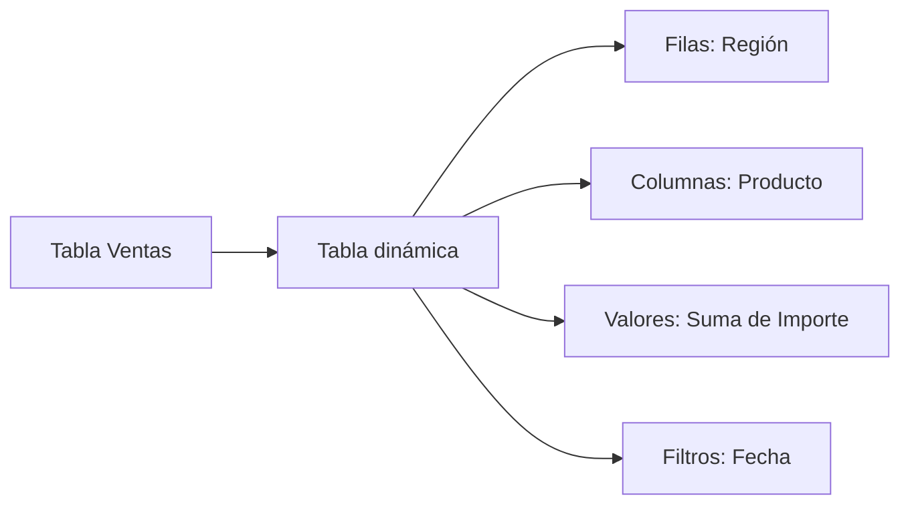
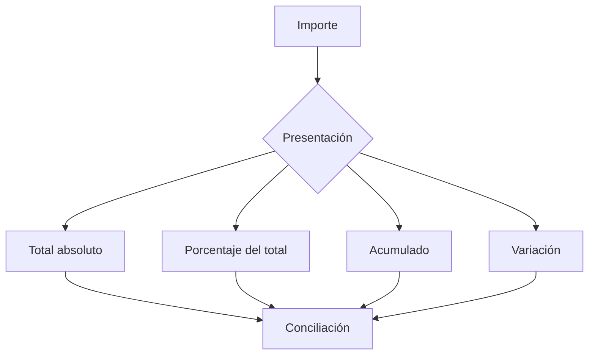
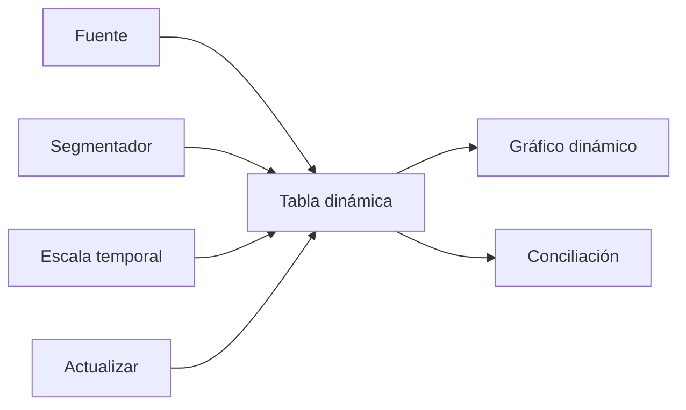

# H19 — Tablas dinámicas y análisis multidimensional

**Curso integral v2.0 · Excel H19/24**  
**Secciones:** H19.01 Fundamentos; H19.02 Análisis; H19.03 Interactividad.  
**Prerrequisitos:** H06, H09, H17 y H18. **Duración:** 24–30 horas.

## Objetivos

Construir tablas dinámicas auditables; seleccionar agregaciones correctas; comparar regiones, productos y periodos; calcular participaciones, acumulados y variaciones; incorporar segmentadores, escalas de tiempo y gráficos dinámicos; gestionar cachés y actualizaciones. Las opciones concretas dependen de la versión de Excel y de Google Sheets.

## Datos para todo el módulo

Crear una tabla de Excel denominada `Ventas`, con las columnas `ID`, `Fecha`, `Región`, `Producto`, `Unidades`, `Precio`, `Importe`. La última se calcula con `=[@Unidades]*[@Precio]`.

| ID | Fecha | Región | Producto | Unidades | Precio | Importe |
|---|---|---|---|---:|---:|---:|
| V001 | 2026-01-05 | Norte | Teclado | 3 | 400 | 1200 |
| V002 | 2026-01-12 | Sur | Mouse | 5 | 200 | 1000 |
| V003 | 2026-01-18 | Norte | Monitor | 2 | 2500 | 5000 |
| V004 | 2026-02-02 | Centro | Teclado | 4 | 400 | 1600 |
| V005 | 2026-02-10 | Sur | Monitor | 1 | 2500 | 2500 |
| V006 | 2026-02-15 | Norte | Mouse | 6 | 200 | 1200 |
| V007 | 2026-03-03 | Centro | Monitor | 1 | 2500 | 2500 |
| V008 | 2026-03-08 | Sur | Teclado | 2 | 400 | 800 |
| V009 | 2026-03-21 | Norte | Mouse | 3 | 200 | 600 |
| V010 | 2026-03-25 | Centro | Mouse | 2 | 200 | 400 |

**Controles:** total de ventas **16800**; unidades **29**; transacciones **10**. Por región: Norte **8000**, Centro **4500**, Sur **4300**. Por producto: Monitor **10000**, Teclado **3600**, Mouse **3200**. Por mes: enero **7200**, febrero **5300**, marzo **4300**.



# H19.01 — Fundamentos

## H19.01.01 — Qué es una tabla dinámica

Una tabla dinámica resume registros mediante **dimensiones** (por ejemplo, Región y Producto) y **medidas** (Importe, Unidades). No cambia los datos originales: genera una vista agregada. Las áreas habituales son **Filas, Columnas, Valores y Filtros**. La **granularidad** es esencial: aquí cada fila representa una transacción, pero en otro conjunto podría representar una línea de pedido; contar filas no siempre equivale a contar pedidos únicos.

## H19.01.02 — Preparación de la fuente

1. Encabezados únicos, sin filas de subtotales ni celdas combinadas.
2. Tipos correctos: fecha real, importe numérico, ID como texto.
3. Gestión explícita de errores y duplicados.
4. Conversión a Tabla (`Ctrl+T`) y nombre `Ventas`.
5. Verificación de total y unidades antes de agregar.

## H19.01.03 — Construcción paso a paso

Seleccionar una celda de `Ventas` → **Insertar → Tabla dinámica** → nueva hoja → arrastrar Región a Filas, Producto a Columnas e Importe a Valores. En Configuración del campo de valor, elegir **Suma**, no Recuento.

| Región | Monitor | Mouse | Teclado | Total |
|---|---:|---:|---:|---:|
| Centro | 2500 | 400 | 1600 | 4500 |
| Norte | 5000 | 1800 | 1200 | 8000 |
| Sur | 2500 | 1000 | 800 | 4300 |
| **Total** | **10000** | **3200** | **3600** | **16800** |

El orden puede variar con las opciones de clasificación. Comprobar que la suma de filas y columnas coincida con el total original.

## H19.01.04 — Agregaciones y estadísticas

- **Suma:** ingresos, costos, unidades.
- **Recuento:** celdas no vacías del campo elegido; no necesariamente recuento distinto.
- **Promedio:** media por registro; puede diferir del promedio ponderado.
- **Mínimo, máximo, desviación:** resumen estadístico según pregunta.
- **Recuento distinto:** puede requerir Modelo de datos; comprobar disponibilidad.

**Caso importante:** ticket medio = `16800/10 = 1680`; precio medio por unidad = `16800/29 ≈ 579,31`. No confundir ambos KPI ni sustituir el segundo por promedio simple de Precio.

## H19.01.05 — Agrupación y disposición

Agrupar Fecha por año y mes; si hay varios años, agrupar solo por mes puede mezclar periodos distintos. Comparar diseño compacto, esquema y tabular. Usar subtotales y totales generales de acuerdo con el análisis. Repetir etiquetas cuando se exporten resultados a otras herramientas.

**Errores comunes:** Importe importado como texto y resumido como recuento; fechas como texto; duplicación de subtotales; origen sin actualizar; contar líneas como clientes; interpretar promedios simples como ponderados.

# H19.02 — Análisis multidimensional

## H19.02.01 — Mostrar valores como porcentajes

Una misma medida admite diferentes denominadores:

- **% del total general:** Norte = `8000/16800 ≈ 47,62%`.
- **% del total de fila:** Norte/Monitor = `5000/8000 = 62,50%`.
- **% del total de columna:** Norte/Monitor = `5000/10000 = 50%`.

Siempre indicar el denominador. El valor 5000 representa proporciones diferentes según la pregunta.

## H19.02.02 — Acumulados y comparaciones

En **Mostrar valores como**, seleccionar *Total acumulado en* con campo base temporal. Enero 7200, febrero 5300, marzo 4300 → acumulados **7200, 12500, 16800**. Ordenar cronológicamente.

**Diferencia respecto a:** actual menos base. Febrero vs enero = `5300−7200 = −1900`. **% de diferencia respecto a:** `−1900/7200 ≈ −26,39%`. Marzo vs febrero = `−1000/5300 ≈ −18,87%`. Si el periodo base es cero, definir tratamiento de división por cero.

## H19.02.03 — Campos y elementos calculados

Un **campo calculado** clásico opera dentro de las reglas de las tablas dinámicas tradicionales y puede producir resultados inesperados en cálculos no aditivos. Para este dataset, calcular `Importe = Unidades*Precio` en la tabla fuente es transparente y verificable.

Un **elemento calculado** combina elementos de un mismo campo; puede interferir con subtotales y agregaciones. Usarlo solo con pruebas explícitas.

En un Modelo de datos, las **medidas DAX** permiten cálculos más expresivos, pero no son fórmulas de celdas ni lenguaje M:

```dax
Ventas Totales := SUM(Ventas[Importe])
Unidades Totales := SUM(Ventas[Unidades])
Precio Medio Ponderado := DIVIDE([Ventas Totales], [Unidades Totales])
```

El soporte de DAX y Power Pivot depende de edición y plataforma.

## H19.02.04 — Top N y validación externa

Ordenar productos por ventas: Monitor 10000, Teclado 3600, Mouse 3200. Top 2 = **13600**, equivalente a **80,95%** de 16800. Verificar si porcentajes de una tabla filtrada utilizan solo elementos visibles o el total original.

Validación independiente mediante fórmula:

```excel
=SUMAR.SI.CONJUNTO(Ventas[Importe];Ventas[Región];"Norte")
```

Resultado **8000**. Contrastar una agregación de tabla dinámica con otra fórmula ayuda a detectar configuraciones incorrectas.



# H19.03 — Interactividad, caché y actualización

## H19.03.01 — Segmentadores

Un **segmentador** es un control de filtro visual. Seleccionar tabla dinámica → insertar segmentación de datos → elegir Región. Al seleccionar Norte, el total esperado es **8000**. Si existen varias tablas dinámicas, revisar conexiones de informe: un segmentador no controla automáticamente todas las visualizaciones.

## H19.03.02 — Escalas de tiempo

Una escala de tiempo filtra fechas por periodos. Requiere campo de fecha real y una versión compatible. No es equivalente a filtrar textos como "Enero" porque conserva estructura temporal.

## H19.03.03 — Gráficos dinámicos

Crear un gráfico dinámico por Producto y agregar segmentador por Región. Comprobar que el gráfico responda al filtro y que los valores coincidan con la tabla. Los filtros visuales no son mecanismos de control de acceso.

## H19.03.04 — Caché y actualización

Una tabla dinámica puede usar una **caché**; los cambios en la fuente no garantizan actualización inmediata. Secuencia operativa: actualizar origen → **Actualizar todo** → revisar filas nuevas → verificar filtros y totales → registrar fecha de actualización.

**Prueba:** agregar V011 (2026-03-29, Sur, Mouse, 2 unidades, precio 200). Importe nuevo **400**. Tras actualizar: ventas **17200**, unidades **31**, transacciones **11**.

## H19.03.05 — Excel y Google Sheets

Google Sheets permite crear tablas dinámicas y aplicar filtros, pero no todas las agregaciones, campos calculados, segmentadores, cachés y capacidades de Modelo de datos son equivalentes a Excel. DAX no se traslada directamente a Sheets. Documentar diferencias de interfaz, disponibilidad y actualización en cada entorno.



# Laboratorios guiados

## Laboratorio 1 — Cruce Región × Producto

Crear la matriz de H19.01.03. Verificar 9 celdas, tres subtotales y total 16800. Entregar captura y explicación de las áreas de la tabla dinámica.

## Laboratorio 2 — Granularidad y promedios

Crear recuento de ID y suma de Unidades por Región. Calcular ticket promedio 1680 y precio medio por unidad ≈579,31. Explicar por qué son métricas diferentes.

## Laboratorio 3 — Participaciones

Mostrar Importe como % del total general, de fila y de columna. Verificar Norte 47,62%, Norte/Monitor por fila 62,50% y por columna 50%.

## Laboratorio 4 — Tendencia

Agrupar Fecha por mes. Crear suma y total acumulado: 7200/12500/16800. Calcular variaciones −26,39% y −18,87%.

## Laboratorio 5 — Interactividad

Insertar segmentador Región y gráfico dinámico. Seleccionar Norte, verificar 8000 y documentar qué visualizaciones responden al filtro.

## Laboratorio 6 — Actualización

Agregar V011, actualizar y verificar 17200 de ventas, 31 unidades y 11 transacciones. Registrar evidencia de la actualización.

# Proyecto integrador — Centro de análisis comercial

**Objetivo:** diseñar un libro de análisis de ventas por región, producto y mes, con indicadores, comparaciones temporales y filtros.

**Hojas:** `Datos` (tabla Ventas), `Analisis` (tablas dinámicas), `Dashboard` (KPI, gráficos, segmentadores), `Pruebas` (conciliación) y `Diccionario` (definiciones y fuentes).

**Indicadores:** ventas 16800; 10 transacciones; 29 unidades; ticket medio 1680; precio por unidad ≈579,31; Norte 47,62% del total; acumulado marzo 16800.

**Criterios de aceptación:** totales por región, producto y mes coinciden; porcentajes indican denominador; top 2 suma 13600; Norte filtrado suma 8000; actualización con V011 lleva total a 17200; la fecha de actualización y la fuente son visibles.

**Rúbrica (100 puntos):** preparación 15; tabla cruzada 20; cálculos 20; interactividad 15; actualización 15; documentación 15.

# Ejercicios (cinco por sección)

| ID | Sección | Enunciado |
|---|---|---|
| E01 | H19.01 | Identifica las cuatro áreas de una tabla dinámica. |
| E02 | H19.01 | Calcula el total de ventas del dataset. |
| E03 | H19.01 | Obtén ventas de Norte. |
| E04 | H19.01 | Explica por qué recuento de filas no siempre equivale a pedidos únicos. |
| E05 | H19.01 | Explica dos ventajas de utilizar una Tabla de Excel como origen. |
| E06 | H19.02 | Calcula porcentaje de Norte sobre total general. |
| E07 | H19.02 | Calcula porcentaje de Monitor dentro de Norte. |
| E08 | H19.02 | Obtén acumulado de ventas a febrero. |
| E09 | H19.02 | Calcula variación febrero vs enero. |
| E10 | H19.02 | Calcula ticket promedio por transacción. |
| E11 | H19.03 | Indica total esperado con segmentador Norte. |
| E12 | H19.03 | Explica por qué se requiere actualizar una tabla dinámica. |
| E13 | H19.03 | Explica por qué un filtro no sustituye permisos de acceso. |
| E14 | H19.03 | Calcula nuevo total al agregar V011 por 400. |
| E15 | H19.03 | Calcula nuevo número de transacciones. |

**Entregable por ejercicio:** cálculo o configuración, interpretación y verificación contra los datos fuente.

# Solucionario separado

| ID | Solución |
|---|---|
| E01 | Filas, Columnas, Valores y Filtros. |
| E02 | 16800. |
| E03 | 8000. |
| E04 | Un pedido puede tener varias líneas y el recuento de filas no es recuento distinto. |
| E05 | Facilita ampliar el rango y mantener encabezados estructurados. |
| E06 | 8000/16800 ≈ 47,62%. |
| E07 | 5000/8000 = 62,50%. |
| E08 | 7200+5300 = 12500. |
| E09 | (5300−7200)/7200 ≈ −26,39%. |
| E10 | 16800/10 = 1680. |
| E11 | 8000. |
| E12 | La caché o agregaciones pueden no reflejar cambios del origen. |
| E13 | Los datos pueden seguir accesibles en el archivo o caché. |
| E14 | 17200. |
| E15 | 11. |

# Evaluación final

1. Define tabla dinámica y granularidad.
2. Explica por qué una columna numérica puede aparecer como Recuento.
3. Diferencia las cuatro áreas de una tabla dinámica.
4. ¿Cuándo se requiere recuento distinto?
5. Diferencia promedio simple y ponderado.
6. Define porcentaje del total de fila.
7. Define porcentaje del total de columna.
8. Diferencia acumulado y suma total.
9. ¿Qué hacer si la base de variación porcentual es cero?
10. Explica limitaciones de campos calculados clásicos.
11. Diferencia campo calculado y medida DAX.
12. ¿Cómo funciona un segmentador?
13. ¿Qué necesita una escala de tiempo?
14. ¿Qué es la caché de una tabla dinámica?
15. ¿Qué pruebas ejecutar después de actualizar?

**Aprobación sugerida:** 12/15 respuestas correctas, ejercicios resueltos y proyecto ≥80/100.

# Glosario

**Dimensión:** atributo de segmentación. **Medida:** valor cuantitativo agregado. **Granularidad:** unidad representada por fila. **Agregación:** suma, promedio, recuento u otra operación. **Caché:** almacenamiento intermedio. **Segmentador:** filtro visual. **Escala de tiempo:** filtro temporal. **DAX:** lenguaje de expresiones del Modelo de datos. **Ticket promedio:** ventas/transacciones. **Precio medio por unidad:** ventas/unidades.

# Referencias oficiales

- [Microsoft — Crear una tabla dinámica](https://support.microsoft.com/es-es/office/crear-una-tabla-din%C3%A1mica-para-analizar-datos-de-una-hoja-de-c%C3%A1lculo-a9a84538-bfe9-40a9-a8e9-f99134456576)
- [Microsoft Learn — DAX overview](https://learn.microsoft.com/en-us/dax/dax-overview)
- [Google — Crear y usar tablas dinámicas](https://support.google.com/docs/answer/1272900?hl=es)

**Nota de validación:** los resultados numéricos son comprobables con el dataset, pero los pasos de interfaz y la disponibilidad de funciones deben probarse en las versiones instaladas de Excel y Sheets.

# Estado

H19.01, H19.02 y H19.03 desarrolladas; 6 laboratorios, 15 ejercicios, solucionario, evaluación y proyecto. Pendiente: pruebas prácticas en Excel y Google Sheets, y revisión de compatibilidad por versión.
