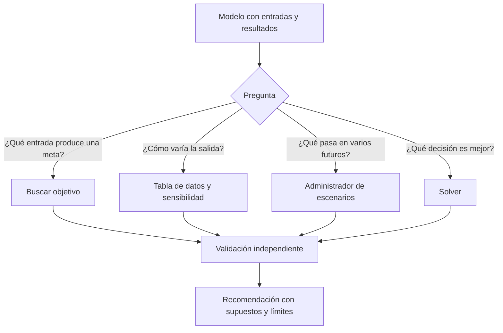
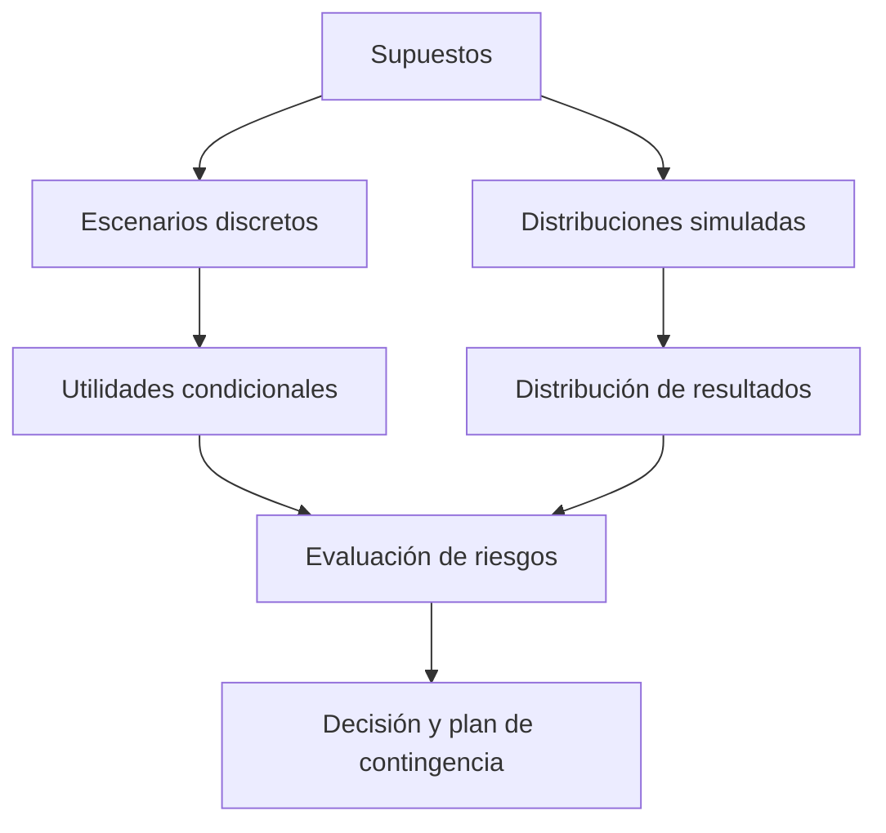
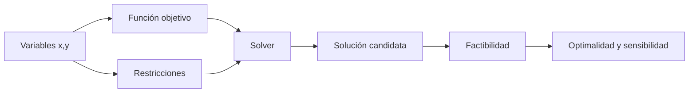

# H20 — Análisis de hipótesis, optimización y escenarios

> **Ruta:** Excel (H01–H24) · **Módulo:** H20/24 · **Roadmap curricular:** v2.0 · **Duración sugerida:** 18 horas · **Nivel:** intermedio–avanzado
>
> **Secciones oficiales:** H20.01 Simulación · H20.02 Escenarios · H20.03 Optimización  
> **Prerrequisitos:** H14 (finanzas) y H19 (análisis multidimensional).  
> **Herramientas:** Excel de escritorio, Análisis de hipótesis, Solver; equivalencias en Google Sheets.

## Propósito

Diseñar, ejecutar y auditar modelos cuantitativos para responder **qué pasa si cambian los supuestos**, **qué valor de entrada produce un resultado deseado** y **qué decisión maximiza o minimiza un objetivo respetando restricciones**. El módulo combina cálculo financiero, análisis de sensibilidad, escenarios de riesgo y optimización matemática.

## Competencias verificables

1. Parametrizar modelos separando **entradas**, **fórmulas**, **restricciones**, **salidas** y **supuestos**.
2. Resolver problemas inversos con **Buscar objetivo**, y contrastar resultados analíticamente.
3. Construir tablas de datos de **una** y **dos** variables, interpretando la orientación de entradas de fila/columna.
4. Comparar escenarios multivariables, ponderar resultados y diferenciar incertidumbre de predicción.
5. Formular modelos de programación lineal, entera y no lineal; seleccionar un método de Solver razonable.
6. Evaluar factibilidad, optimalidad, holguras, sensibilidad y límites de la interpretación.
7. Reproducir modelos simples en Google Sheets sin asumir paridad funcional con Excel.

## Convenciones del manual

- Moneda: **MXN**; datos ficticios de carácter didáctico.
- Excel en español: funciones en español, argumentos separados por `;`, decimal `,`.
- La **tabla de datos** de Análisis de hipótesis **no** es una Tabla estructurada de Excel (`Ctrl+T`).
- Las herramientas de menú pueden cambiar entre versiones, plataformas y licencias.
- Los resultados de control se verificaron mediante cálculo independiente; **no se ejecutaron los procedimientos en la interfaz de Excel**.
- Las probabilidades del módulo son supuestos ilustrativos, **no estimaciones empíricas**.

## Mapa de decisión



## Índice de contenidos

- H20.01.01 — Modelos parametrizados y análisis de sensibilidad
- H20.01.02 — Buscar objetivo: solución inversa
- H20.01.03 — Tabla de datos de una variable
- H20.01.04 — Tabla de datos de dos variables
- H20.01.05 — Depuración, recálculo y límites
- H20.02.01 — Escenarios y decisiones
- H20.02.02 — Administrador de escenarios
- H20.02.03 — Comparación, probabilidades y sensibilidad
- H20.02.04 — Introducción a simulación de incertidumbre
- H20.02.05 — Gestión del riesgo y comunicación
- H20.03.01 — Fundamentos de optimización
- H20.03.02 — Formulación de programación lineal
- H20.03.03 — Configuración de Solver
- H20.03.04 — Restricciones enteras y métodos de solución
- H20.03.05 — Holguras, precios sombra y robustez
- H20.03.06 — Optimización no lineal y diagnóstico
- H20.03.07 — Alternativas en Google Sheets
- Laboratorios, proyecto integrador, ejercicios, solucionario, evaluación y fuentes

# Modelo de referencia A — Rentabilidad de un producto

Este modelo se utiliza en **H20.01 y H20.02**. Créalo en una hoja llamada `Modelo_Rentabilidad`.

| Celda | Variable | Valor inicial | Tipo | Unidad |
|---|---|---:|---|---|
| B3 | Precio de venta (`P`) | 650 | Entrada | MXN/unidad |
| B4 | Costo variable unitario (`CV`) | 390 | Entrada | MXN/unidad |
| B5 | Unidades vendidas (`Q`) | 350 | Entrada | unidades |
| B6 | Costos fijos (`CF`) | 78000 | Entrada | MXN |
| B7 | Margen de contribución unitario | `=B3-B4` | Fórmula | MXN/unidad |
| B8 | Utilidad operativa (`U`) | `=B7*B5-B6` | Fórmula | MXN |
| B9 | Margen de contribución porcentual | `=SI.ERROR(B7/B3;"No aplicable")` | Fórmula | % |
| B10 | Punto de equilibrio entero | `=SI(B7>0;REDONDEAR.MAS(B6/B7;0);"Sin equilibrio finito")` | Fórmula | unidades |
| B11 | Utilidad objetivo | 25000 | Parámetro | MXN |

**Ecuación central:**

\[
U=(P-CV)Q-CF.
\]

**Comprobaciones iniciales:** margen unitario `260`, utilidad `13000`, margen de contribución `40%`, punto de equilibrio `300` unidades. El **punto de equilibrio** se refiere a utilidad cero; no equivale a recuperar una inversión inicial con flujos de caja descontados.

**Hipótesis explícitas:** el precio y el costo variable unitario son constantes dentro de cada corrida; no hay impuestos, devoluciones, descuentos, restricciones de capacidad ni elasticidad precio-demanda. Si cualquiera de estos factores importa para la decisión real, debe ampliarse el modelo.

**Control de integridad:** cambia una sola entrada y comprueba que `B8` responde; después restaura los valores iniciales. Guarda una copia del archivo antes de utilizar herramientas que modifican celdas.

# H20.01 — Simulación y análisis de hipótesis

## H20.01.01 — Modelo parametrizado y sensibilidad

### Concepto

El **análisis de sensibilidad** estudia cómo cambia un resultado ante variaciones controladas de una o varias entradas. En su versión **local** puede emplear derivadas; en Excel suele realizarse mediante cambios discretos, tablas de datos o fórmulas auxiliares.

Para `U=(P-CV)Q-CF`, las sensibilidades locales, manteniendo constantes las otras variables, son:

\[
\frac{\partial U}{\partial P}=Q,\quad
\frac{\partial U}{\partial CV}=-Q,\quad
\frac{\partial U}{\partial Q}=P-CV,\quad
\frac{\partial U}{\partial CF}=-1.
\]

En el punto base (`Q=350`, `P-CV=260`):

| Cambio aislado | Efecto sobre utilidad | Utilidad resultante |
|---|---:|---:|
| Precio +10 MXN | +3500 MXN | 16500 |
| Costo variable +10 MXN | −3500 MXN | 9500 |
| Cantidad +10 unidades | +2600 MXN | 15600 |
| Costo fijo +1000 MXN | −1000 MXN | 12000 |

**Interpretación:** aumentar el precio 10 MXN mejora la utilidad 3500 MXN **solo si la demanda permanece en 350 unidades**. En mercados reales puede existir elasticidad; no conviertas una sensibilidad parcial en predicción causal.

### Práctica guiada

1. Copia el modelo base y crea una tabla de cambios aislados.
2. Modifica cada entrada por separado y registra `B8`.
3. Calcula la diferencia contra 13000.
4. Restaura el caso base y documenta la variable mantenida constante.

**Buenas prácticas:** variar una entrada a la vez para diagnóstico; posteriormente estudiar interacciones. **Error frecuente:** comparar porcentajes de cambio sobre variables con distintas unidades sin normalizar o sin explicar el denominador.

## H20.01.02 — Buscar objetivo (`Goal Seek`)

### Qué resuelve

Busca un valor de **una celda de entrada** que produzca un resultado especificado en una **celda que contiene fórmula**. No optimiza varias variables simultáneamente ni incorpora un conjunto general de restricciones.

### Caso: alcanzar 25000 MXN de utilidad

De la ecuación:

\[
Q=\frac{U_{objetivo}+CF}{P-CV}
=\frac{25000+78000}{650-390}
=396.153846\ldots
\]

**Resultado continuo:** `396,153846...` unidades. Si solo se venden unidades enteras, se necesitan **397 unidades** para alcanzar o superar la meta. Con 397 unidades, la utilidad es **25220 MXN**.

### Pasos en Excel de escritorio

1. Confirma que `B8` contiene `=B7*B5-B6` y que `B5` es un número editable.
2. Abre **Datos → Análisis de hipótesis → Buscar objetivo**.
3. **Definir la celda:** `$B$8`.
4. **Con el valor:** `25000`.
5. **Para cambiar la celda:** `$B$5`.
6. Ejecuta y revisa convergencia y resultado.
7. Comprueba la solución con `=(B11+B6)/B7` y decide cómo manejar integridad.
8. Restaura el valor base `350` antes del siguiente laboratorio.

**Advertencia:** Buscar objetivo puede modificar la celda de entrada. No asumas que el resultado satisface integridad, límites operativos o una tolerancia contractual. En una función con múltiples raíces, la solución puede depender del valor inicial.

### Diagnóstico de errores

- Celda objetivo sin fórmula: configuración inválida.
- Celda de cambio desconectada de la fórmula: el resultado no responde.
- Meta inalcanzable en el dominio real: ausencia de solución útil.
- Margen `P-CV <= 0` con `CF>0`: no existe punto de equilibrio positivo bajo este modelo.
- Resultado decimal para una variable indivisible: redondear con criterio y recalcular, no redondear sin comprobar.

## H20.01.03 — Tabla de datos de una variable

### Propósito

Evalúa una o más fórmulas sobre una secuencia de valores para **una** celda de entrada. Es un mecanismo de sustitución temporal de valores, no una Tabla estructurada de Excel.

### Diseño reproducible

En la misma hoja, coloca:

| Celda | Contenido |
|---|---|
| E3 | `=$B$8` (referencia a la utilidad) |
| D4:D8 | `250`, `300`, `350`, `400`, `450` |
| D3 | Vacía |

Selecciona `D3:E8` → **Datos → Análisis de hipótesis → Tabla de datos** → **Celda de entrada (columna):** `$B$5` → Aceptar. Deja vacía la entrada de fila.

| Unidades | Utilidad esperada (MXN) |
|---:|---:|
| 250 | −13000 |
| 300 | 0 |
| 350 | 13000 |
| 400 | 26000 |
| 450 | 39000 |

### Qué observar

El resultado es lineal porque el margen unitario es constante. Cada incremento de 50 unidades aumenta la utilidad `50 × 260 = 13000` MXN. El umbral de utilidad cero está en 300 unidades.

**Errores frecuentes:** seleccionar un rango que no incluye la fórmula superior; introducir la celda de entrada en la casilla de fila en lugar de columna; utilizar una fórmula que no depende de la entrada; sobrescribir parcialmente las celdas de resultado de la tabla de datos.

## H20.01.04 — Tabla de datos de dos variables

### Propósito

Evalúa una fórmula en combinaciones de **dos** entradas: una en encabezados horizontales y otra en encabezados verticales.

### Diseño reproducible

- `H3`: `=$B$8`.
- `I3:K3`: precios `600`, `650`, `700`.
- `H4:H6`: unidades `300`, `350`, `400`.
- Seleccionar `H3:K6` → **Tabla de datos**.
- **Celda de entrada (fila):** `$B$3` (Precio).
- **Celda de entrada (columna):** `$B$5` (Unidades).

| Unidades \ Precio | 600 | 650 | 700 |
|---:|---:|---:|---:|
| 300 | −15000 | 0 | 15000 |
| 350 | −4500 | 13000 | 30500 |
| 400 | 6000 | 26000 | 46000 |

### Interpretación

El punto `(P=700,Q=400)` ofrece 46000 MXN **dentro de las combinaciones evaluadas**; esto no demuestra que sea una decisión óptima real. El modelo no contempla que el volumen vendido pudiera disminuir al subir el precio ni límites de capacidad.

**Regla esencial:** las entradas de **fila** corresponden a los valores que aparecen en la primera **fila**; las de **columna**, a los valores de la primera **columna**.

## H20.01.05 — Rendimiento, recálculo y límites

- Las tablas de datos pueden elevar el costo de recálculo de libros grandes.
- Excel permite controlar el cálculo automático y, en ciertas versiones, usar la opción **Automático excepto tablas de datos**.
- Las tablas de datos se aplican a una o dos entradas; para más variables, considera escenarios, fórmulas parametrizadas o simulación.
- No confundas la **tabla de datos de Análisis de hipótesis** con una tabla dinámica, una Tabla de Excel o una consulta Power Query.
- Un resultado numérico es válido solo si la fórmula, las unidades, las restricciones y el dominio de las entradas también lo son.

### Resumen H20.01

**Buscar objetivo** resuelve una entrada a partir de una meta. **Tabla de datos** calcula muchas salidas a partir de una o dos entradas. **Sensibilidad** interpreta la relación entre entradas y resultados, sin establecer causalidad.

# H20.02 — Escenarios e incertidumbre

## H20.02.01 — Qué es un escenario

Un **escenario** es un conjunto coherente de supuestos. A diferencia de variar una sola entrada, permite modificar simultáneamente precio, costo, demanda y costos fijos. Los escenarios deben describir historias plausibles y no simples combinaciones extremas sin justificación.

### Tres escenarios de rentabilidad

| Escenario | Precio | Costo variable | Unidades | Costo fijo | Utilidad |
|---|---:|---:|---:|---:|---:|
| Pesimista | 600 | 410 | 280 | 80000 | **−26800** |
| Base | 650 | 390 | 350 | 78000 | **13000** |
| Optimista | 700 | 370 | 420 | 80000 | **58600** |

**Cálculos manuales:**

- Pesimista: `(600−410)×280−80000 = −26800`.
- Base: `(650−390)×350−78000 = 13000`.
- Optimista: `(700−370)×420−80000 = 58600`.

Un escenario es un **resultado condicional** a supuestos; no una previsión probabilística por sí mismo.

## H20.02.02 — Administrador de escenarios

### Procedimiento en Excel de escritorio

1. Crea y verifica `Modelo_Rentabilidad`.
2. Ve a **Datos → Análisis de hipótesis → Administrador de escenarios**.
3. Selecciona **Agregar** y crea `Pesimista`.
4. Define las **celdas cambiantes** `$B$3:$B$6`.
5. Introduce, en el orden correspondiente, `600`, `410`, `280`, `80000`.
6. Repite para `Base` y `Optimista` con la tabla anterior.
7. Usa **Mostrar** para inspeccionar un escenario.
8. Genera un **Resumen** con celda de resultado `$B$8`.
9. Contrasta el resumen con los resultados manuales.
10. Guarda el caso base y registra la versión del modelo.

### Limitaciones importantes

- El Administrador de escenarios admite **hasta 32 celdas cambiantes por escenario**, según la documentación de Microsoft.
- Un resumen de escenarios es un **informe estático**: si modificas valores de los escenarios, regenera el resumen.
- Mostrar un escenario **sustituye valores de entrada** en la hoja; evita perder el caso original.
- Los nombres de escenarios no sustituyen la documentación de sus supuestos.

## H20.02.03 — Sensibilidad de escenarios y probabilidades

Una comparación de tres casos permite explorar dispersión de resultados, pero **no** proporciona una distribución de probabilidades. Si existen probabilidades justificadas, puede calcularse una utilidad esperada.

Supón exclusivamente para practicar:

| Escenario | Probabilidad ilustrativa | Utilidad | Contribución a esperanza |
|---|---:|---:|---:|
| Pesimista | 25% | −26800 | −6700 |
| Base | 50% | 13000 | 6500 |
| Optimista | 25% | 58600 | 14650 |
| **Total** | **100%** | — | **14450** |

\[
E[U]=\sum_i p_i U_i = 14450\;\text{MXN}.
\]

**Probabilidad de pérdida** en este modelo discreto: 25%, porque únicamente el escenario pesimista tiene utilidad negativa. La esperanza de 14450 **no garantiza** que el resultado real sea positivo.

### Fórmulas

Si `A15:A17` contiene nombres, `B15:B17` probabilidades y `C15:C17` utilidades:

```excel
=SUMA(B15:B17)
=SUMAPRODUCTO(B15:B17;C15:C17)
=SUMAR.SI(C15:C17;"<0";B15:B17)
```

**Validaciones:** probabilidades entre 0 y 1, suma 1, escenarios mutuamente excluyentes y exhaustivos **si** se interpretan como una distribución completa.

## H20.02.04 — Introducción a simulación de incertidumbre

### Escenarios discretos frente a Monte Carlo

- **Escenarios discretos:** pocos conjuntos de supuestos seleccionados.
- **Simulación Monte Carlo:** numerosas realizaciones generadas a partir de distribuciones especificadas.
- **Análisis de sensibilidad:** evalúa cambios en entradas sin necesariamente asignar probabilidades.

### Ejemplo didáctico de simulación

Supón **por construcción**, no por evidencia, que `Q` es uniforme discreta entre 300 y 400, que `CV` es uniforme discreta entre 380 y 410, y que son **independientes**. Conserva `P=650` y `CF=78000`.

En una hoja `Simulacion`:

| Columna | Fórmula fila 2 | Significado |
|---|---|---|
| A | `=FILA()-1` | Iteración |
| B | `=ALEATORIO.ENTRE(300;400)` | Unidades simuladas |
| C | `=ALEATORIO.ENTRE(380;410)` | Costo variable simulado |
| D | `=(650-C2)*B2-78000` | Utilidad simulada |

Copia hasta la fila 1001 para obtener 1000 iteraciones. Después calcula:

```excel
=PROMEDIO(D2:D1001)
=MIN(D2:D1001)
=MAX(D2:D1001)
=CONTAR.SI(D2:D1001;"<0")/CONTAR(D2:D1001)
```

**Control teórico de la media:** `E[Q]=350`, `E[CV]=395`. Por independencia, `E[(650−CV)Q] = (650−395)×350`. Entonces `E[U]=11250 MXN`. La media simulada **no tiene por qué ser exactamente** 11250 con 1000 corridas.

### Reproducibilidad y calidad

`ALEATORIO.ENTRE` recalcula resultados; Excel no ofrece aquí una semilla explícita por fórmula. Para conservar una corrida, copia y pega **valores** o utiliza una herramienta externa con semilla controlada. Documenta número de corridas, distribuciones, correlaciones, límites y versión del modelo.

**Riesgo de modelado:** la independencia puede ser falsa. En mercados reales, precio, volumen y costo pueden estar correlacionados. Una simulación sofisticada sobre supuestos incorrectos no produce una decisión confiable.

## H20.02.05 — Riesgo y comunicación ejecutiva

Un informe útil debe separar **resultado esperado**, **rango de escenarios**, **probabilidad de pérdida estimada** y **supuestos no observados**. Cuando no hay datos para probabilidades, comunica solo escenarios condicionales.



### Buenas prácticas

- Definir qué puede controlar la empresa y qué es incierto.
- Separar decisiones de supuestos externos.
- Registrar fuente de probabilidades y distribuciones.
- No utilizar una esperanza matemática positiva como única justificación.
- Presentar acciones concretas ante escenarios desfavorables.

### Resumen H20.02

Los escenarios comparan conjuntos de supuestos; el Administrador los guarda y muestra; la simulación explora variabilidad bajo distribuciones explícitas. Ninguna herramienta convierte automáticamente supuestos en hechos.

# Modelo de referencia B — Optimización de producción

Una empresa fabrica dos productos, **A** y **B**. Cada unidad genera una contribución neta al margen de 80 MXN y 110 MXN, respectivamente. Existen recursos de mano de obra y material limitados.

| Parámetro | Producto A | Producto B | Capacidad |
|---|---:|---:|---:|
| Margen por unidad (MXN) | 80 | 110 | — |
| Horas de trabajo por unidad | 2 | 4 | 240 h |
| Material por unidad | 3 | 2 | 220 kg |
| Demanda máxima | 80 | 60 | unidades |

**Variables de decisión:** `x` = unidades A; `y` = unidades B.

\[
\begin{aligned}
\max \quad & Z=80x+110y \\
\text{sujeto a}\quad &2x+4y\leq240 &&\text{(horas)}\\
&3x+2y\leq220 &&\text{(material)}\\
&0\leq x\leq80 &&\text{(demanda A)}\\
&0\leq y\leq60 &&\text{(demanda B)}\\
&x,y\in\mathbb{Z} &&\text{(unidades enteras)}.
\end{aligned}
\]

**Óptimo esperado:** `x=50`, `y=35`; margen total `7850 MXN`; uso de horas `240/240`; uso de material `220/220`. Se ha contrastado por enumeración exhaustiva de los valores enteros permitidos.

> El margen de este modelo **no** equivale automáticamente a utilidad contable neta: no incluye costos fijos, impuestos ni costos de oportunidad salvo que se incorporen explícitamente.

# H20.03 — Optimización con Solver

## H20.03.01 — Fundamentos de optimización matemática

Una optimización requiere:

1. **Variables de decisión:** valores que el modelo puede cambiar.
2. **Función objetivo:** magnitud a maximizar, minimizar o aproximar a una meta.
3. **Restricciones:** desigualdades, igualdades, límites y requisitos de integridad.
4. **Dominio:** valores permitidos de cada variable.
5. **Supuestos:** relaciones, linealidad, unidades y alcance temporal.

**Factibilidad** significa que una solución satisface todas las restricciones. **Optimalidad** significa que ninguna otra solución factible tiene un objetivo mejor, bajo el modelo y el método de solución. Una solución numérica plausible no es prueba automática de optimalidad global.

## H20.03.02 — Construcción de la hoja `Modelo_Produccion`

Crea las siguientes celdas exactamente para reproducir las instrucciones.

| Celda | Contenido | Explicación |
|---|---|---|
| A15 | Producto A | Etiqueta |
| A16 | Producto B | Etiqueta |
| B15 | 0 | Variable x (unidades) |
| B16 | 0 | Variable y (unidades) |
| C15 | 80 | Margen A |
| C16 | 110 | Margen B |
| D15 | 2 | Horas A |
| D16 | 4 | Horas B |
| E15 | 3 | Material A |
| E16 | 2 | Material B |
| C19 | `=SUMAPRODUCTO(B15:B16;C15:C16)` | Objetivo: margen total |
| D19 | `=SUMAPRODUCTO(B15:B16;D15:D16)` | Horas utilizadas |
| E19 | `=SUMAPRODUCTO(B15:B16;E15:E16)` | Material utilizado |
| D20 | 240 | Horas disponibles |
| E20 | 220 | Material disponible |
| B20 | 80 | Demanda máxima A |
| B21 | 60 | Demanda máxima B |

**Importante:** `SUMAPRODUCTO` multiplica los elementos correspondientes y suma los productos. Las dimensiones de los rangos deben coincidir. No cambies celdas de fórmulas al resolver: Solver debe modificar `B15:B16`.

## H20.03.03 — Habilitar y configurar Solver

### Activación

En Excel de escritorio, el complemento puede requerir activación. En Windows: **Archivo → Opciones → Complementos → Administrar: Complementos de Excel → Ir → Solver**. En macOS: **Herramientas → Complementos de Excel → Solver**. Después suele aparecer en **Datos**. Los menús pueden variar. **Solver no se ejecuta como complemento tradicional en Excel para la Web.**

### Configuración exacta

| Campo de Solver | Valor |
|---|---|
| Establecer objetivo | `$C$19` |
| Optimizar | **Máx** |
| Cambiando celdas variables | `$B$15:$B$16` |
| Restricción 1 | `$D$19 <= $D$20` |
| Restricción 2 | `$E$19 <= $E$20` |
| Restricción 3 | `$B$15 <= $B$20` |
| Restricción 4 | `$B$16 <= $B$21` |
| Restricción 5 | `$B$15:$B$16 >= 0` |
| Restricción 6 | `$B$15:$B$16` **entero** |
| Método | **Simplex LP** para la estructura lineal; integridad gestionada por el solver |

Ejecuta Solver y revisa el mensaje de estado. Si la solución cumple restricciones y mejora el objetivo, guarda los valores y registra método y tolerancias. **No aceptes sin inspección** cualquier mensaje de terminación.

### Solución de control

| Magnitud | Cálculo | Resultado |
|---|---|---:|
| A | x | 50 |
| B | y | 35 |
| Margen | `80×50+110×35` | **7850** |
| Horas | `2×50+4×35` | **240** |
| Material | `3×50+2×35` | **220** |
| Holgura horas | `240−240` | 0 |
| Holgura material | `220−220` | 0 |
| Holgura demanda A | `80−50` | 30 |
| Holgura demanda B | `60−35` | 25 |

## H20.03.04 — Lineal, entero y no lineal

### Programación lineal (LP)

La función objetivo y las restricciones son lineales en las variables. Si las variables pueden tomar valores reales, el conjunto factible forma una región convexa y un óptimo finito puede encontrarse en un vértice. **Simplex LP** es un método habitual.

### Programación lineal entera (MILP/ILP)

Cuando algunas variables deben ser enteras, el problema deja de ser una LP continua. Los algoritmos suelen combinar relajaciones lineales y estrategias de ramificación y acotación. La solución continua puede ser fraccionaria; redondear cada variable sin comprobar puede violar restricciones o perder optimalidad.

### Programación no lineal (NLP)

Si aparecen productos entre variables, potencias, logaritmos o funciones no lineales, el problema requiere métodos apropiados. **GRG Nonlinear** se utiliza para modelos suaves; **Evolutionary** puede ser útil en modelos discontinuos o con funciones lógicas, aunque no garantiza un óptimo global. La elección depende de la estructura matemática, no de la preferencia por un algoritmo.

### Ejemplo no lineal

Supón una demanda `Q(P)=1000−P` y costo variable de 300 MXN por unidad. Para precios en un dominio apropiado:

\[
U(P)=(P-300)(1000-P)-CF.
\]

La función es cuadrática cóncava: `dU/dP=1300−2P`. El óptimo interior está en `P=650`, con `Q=350`. Si existen restricciones de precio, inventario o demanda, deben incorporarse y comprobarse.

## H20.03.05 — Interpretación de resultados y sensibilidad

### Restricciones activas y holgura

Una restricción **activa** o **vinculante** tiene holgura cero. En el óptimo `x=50`, `y=35`, se utilizan todas las horas y todo el material; las demandas máximas no se alcanzan.

### Precios sombra: interpretación correcta

En la **relajación lineal continua**, el precio sombra mide el cambio marginal del valor óptimo ante un aumento pequeño de la capacidad de una restricción, **mientras no cambie la base óptima**.

Para las restricciones de horas y material del ejemplo, los precios sombra locales de la relajación continua son:

- **Horas:** 21,25 MXN por hora adicional.
- **Material:** 12,50 MXN por kilogramo adicional.

Se obtienen resolviendo `2λ_h + 3λ_m = 80` y `4λ_h + 2λ_m = 110`, con `λ_h=21,25`, `λ_m=12,50`.

**Precaución crítica:** el informe de sensibilidad clásico de Solver no está disponible en las mismas condiciones para modelos con restricciones enteras. **No** interpretes los precios sombra continuos como ganancias garantizadas al añadir una sola hora o kilogramo en el problema entero; el efecto puede ser escalonado.

### Validación independiente de la optimalidad entera

Para este problema pequeño es posible enumerar todas las combinaciones enteras y comprobar que ninguna solución factible supera 7850. Código de verificación opcional en Python:

```python
best = None
for x in range(81):
    for y in range(61):
        if 2*x + 4*y <= 240 and 3*x + 2*y <= 220:
            value = 80*x + 110*y
            candidate = (value, x, y)
            if best is None or candidate > best:
                best = candidate
assert best == (7850, 50, 35)
print(best)
```

La enumeración es válida aquí por el pequeño espacio de búsqueda; no escala bien a cientos de variables.

## H20.03.06 — Diagnóstico de Solver

| Síntoma | Posible causa | Acción |
|---|---|---|
| No encuentra solución factible | Restricciones contradictorias | Revisar unidades, signos y límites |
| Objetivo no cambia | Fórmula no depende de variables | Rastrear precedentes y referencias |
| Resultado fraccionario | Faltó integridad | Añadir restricciones enteras |
| Resultado físicamente imposible | Falta una restricción | Revisar capacidades y dominios |
| Solver termina en solución local | Modelo no convexo o método local | Probar inicios, cotas y métodos apropiados |
| Informe de sensibilidad no disponible | Modelo entero u otra condición | Analizar relajación continua por separado |
| Solución cambia al recalcular | Funciones volátiles | Eliminar aleatoriedad de la función objetivo |
| El modelo es demasiado grande | Restricciones de herramienta/edición | Simplificar, descomponer o utilizar un optimizador especializado |

### Lista de comprobación del modelo

- ¿Todas las unidades son compatibles?
- ¿Los coeficientes de objetivo reflejan margen, ingreso o costo de forma correcta?
- ¿Existen límites superiores e inferiores para todas las decisiones?
- ¿Las restricciones representan el proceso físico o contractual?
- ¿La solución es factible al recalcular manualmente?
- ¿Se comparó con alternativas razonables?
- ¿La recomendación explica supuestos y condiciones de vigencia?

## H20.03.07 — Alternativas en Google Sheets

Google Sheets permite construir los modelos con fórmulas (`SUMPRODUCT`, `SUM`, `IF`, tablas auxiliares) y explorar escenarios mediante copias o rangos parametrizados. Para **Goal Seek**, Google documenta un **complemento específico**, disponible en inglés; no es el mismo comando nativo de Excel. Para optimización multivariable pueden emplearse complementos compatibles o un proceso externo (por ejemplo, Python con SciPy), tras revisar permisos, confidencialidad y reproducibilidad.

| Necesidad | Excel de escritorio | Google Sheets |
|---|---|---|
| Buscar valor para una meta | Buscar objetivo | Complemento Goal Seek o solución algebraica |
| Sensibilidad 1 variable | Tabla de datos | Tabla con fórmulas y referencias |
| Sensibilidad 2 variables | Tabla de datos | Cuadrícula de fórmulas parametrizadas |
| Escenarios multivariables | Administrador de escenarios | Tablas de supuestos / hojas duplicadas / automatización |
| Optimización con restricciones | Complemento Solver | Complemento compatible o motor externo |
| Simulación aleatoria | Funciones y recálculo | Funciones y recálculo, con diferencias de comportamiento |

**Portabilidad:** no se debe prometer equivalencia de menús, Solver ni macros. Los resultados matemáticos sí pueden verificarse entre plataformas cuando el modelo y sus supuestos son idénticos.



### Resumen H20.03

Solver responde **qué decisión es mejor** dentro del conjunto factible. La calidad de la solución depende de la formulación, del método, de la tolerancia y de la validez de los datos. La sensibilidad de la relajación continua no debe confundirse con la del modelo entero.

# Laboratorios guiados — práctica progresiva

## Laboratorio L01 — Buscar objetivo y restricciones de integridad (45 min)

**Objetivo:** calcular cuántas unidades permiten alcanzar 25000 MXN de utilidad.

**Pasos:** crear `Modelo_Rentabilidad`; confirmar `B8=13000`; ejecutar Buscar objetivo sobre B8 cambiando B5; anotar 396,153846; imponer la regla empresarial de unidades enteras; probar 396 y 397.

**Controles:** a 396 unidades, utilidad 24960 (insuficiente); a 397, utilidad 25220 (cumple). Entregar captura de configuración y tabla de comprobación.

## Laboratorio L02 — Tabla de datos 1D y 2D (60 min)

**Objetivo:** construir ambas tablas sin confundir entradas de fila/columna.

**Pasos:** reproducir D3:E8 e H3:K6; verificar cinco y nueve resultados respectivamente; aplicar formato condicional para identificar utilidad negativa, cero y positiva; interpretar los resultados.

**Controles:** 1D con Q=300 → 0; 2D con P=700 y Q=350 → 30500; 2D con P=600 y Q=300 → −15000.

## Laboratorio L03 — Escenarios y resumen (45 min)

**Objetivo:** comparar cuatro entradas cambiantes simultáneamente.

**Pasos:** crear Pesimista, Base y Optimista; generar resumen; calcular rango de utilidades y, separadamente, esperanza ponderada con probabilidades ilustrativas.

**Controles:** utilidades −26800, 13000, 58600; esperanza 14450; amplitud 85400. Documentar que la amplitud no es un intervalo de confianza.

## Laboratorio L04 — Simulación y reproducibilidad (45 min)

**Objetivo:** ejecutar 1000 corridas con variables aleatorias y documentar limitaciones.

**Pasos:** crear columnas Q, CV, U; calcular promedio, mínimos, máximos y proporción de pérdidas; copiar/pegar valores para congelar una corrida; repetir y comparar.

**Controles:** esperanza teórica 11250; la media muestral debe aproximarse, pero no igualarse necesariamente. Documentar supuestos de uniformidad e independencia.

## Laboratorio L05 — Optimización lineal entera (75 min)

**Objetivo:** maximizar margen bajo restricciones de horas, material y demanda.

**Pasos:** crear `Modelo_Produccion`; configurar Solver; resolver; comprobar holguras; retirar temporalmente integridad y comparar relajación; restaurar el modelo entero.

**Controles:** A=50, B=35, margen 7850, horas 240, material 220. Entregar restricciones y captura del estado de Solver.

## Laboratorio L06 — Sensibilidad y recomendación (45 min)

**Objetivo:** interpretar cambios marginales sin extrapolar indebidamente.

**Pasos:** analizar la relajación continua; identificar restricciones activas; contrastar los precios sombra con pequeños cambios en capacidades; restaurar restricciones enteras y comparar resultados.

**Control:** precios sombra continuos locales 21,25 MXN/h y 12,50 MXN/kg. Explicar por qué no garantizan el mismo cambio discreto en el problema entero.

# Proyecto integrador — Optimización de producción y presupuesto bajo restricciones

## Caso empresarial

Una pequeña empresa debe decidir **cuánto producir** de A y B durante el próximo periodo, y cómo reaccionar si cambian las capacidades, los márgenes y la demanda. Dirección exige un modelo auditable y una recomendación que no dependa de suposiciones implícitas.

## Preguntas de decisión

1. ¿Cuál es la mezcla de producción que maximiza el margen bajo capacidades actuales?
2. ¿Qué recursos están saturados y cuáles tienen holgura?
3. ¿Cuánto valor tiene aumentar ligeramente cada recurso en la relajación continua?
4. ¿Cómo cambia la solución si varía el margen del producto B?
5. ¿Qué decisiones son robustas ante un escenario adverso de demanda?

## Arquitectura del libro

| Hoja | Contenido | Control |
|---|---|---|
| `Portada` | Objetivo, versión, autor, fecha | Identificación |
| `Supuestos` | Márgenes, capacidades, demandas, escenarios | Fuentes y unidades |
| `Modelo_Produccion` | Variables, objetivo, restricciones | Factibilidad |
| `Sensibilidad` | Cambios de parámetros y resultados | Escenarios comparables |
| `Riesgo` | Escenarios y supuestos de incertidumbre | No confundir probabilidades con hechos |
| `Validacion` | Totales, holguras, alternativas y pruebas | Reproducibilidad |
| `Informe` | Recomendación ejecutiva y limitaciones | Trazabilidad |

## Implementación por fases

**Fase 1 — Datos:** introducir coeficientes, capacidades y demandas; identificar fuentes.  
**Fase 2 — Formulación:** definir variables, objetivo y restricciones; comprobar unidades.  
**Fase 3 — Solver:** resolver el modelo entero; guardar resultado y método.  
**Fase 4 — Auditoría:** recalcular objetivo, recursos, límites y holguras fuera de Solver.  
**Fase 5 — Sensibilidad:** cambiar capacidad de horas y material por separado; distinguir relajación continua del problema entero.  
**Fase 6 — Escenarios:** crear variantes de demanda y margen; resolver cada variante con las mismas reglas.  
**Fase 7 — Comunicación:** preparar recomendación, supuestos, riesgos y criterios para revisar la decisión.

## Resultados mínimos de aceptación

| Prueba | Esperado |
|---|---|
| Producción A | 50 unidades |
| Producción B | 35 unidades |
| Margen máximo | 7850 MXN |
| Horas utilizadas | 240 |
| Material utilizado | 220 |
| Holgura de horas | 0 |
| Holgura de material | 0 |
| Holgura de demanda A | 30 |
| Holgura de demanda B | 25 |
| Solución alternativa (A=40, B=40) | Factible; margen 7600 MXN |
| Diferencia óptimo vs alternativa | 250 MXN |

### Escenarios adicionales del proyecto

1. **Demanda de B limitada a 30 unidades:** resolver nuevamente; no asumir que la solución anterior sigue siendo factible.
2. **Aumento de 10 horas:** recalcular el óptimo entero y comparar con el precio sombra continuo; documentar la diferencia.
3. **Aumento del margen de B a 120 MXN:** actualizar objetivo y resolver de nuevo.
4. **Reducción de material a 200 kg:** resolver y evaluar el costo de oportunidad de la restricción.

Para cada escenario, registrar `x`, `y`, margen, horas, material, holguras, factibilidad y una recomendación. No atribuir probabilidades a estos escenarios sin evidencia.

## Rúbrica (100 puntos)

| Dimensión | Puntos |
|---|---:|
| Formulación matemática y unidades | 20 |
| Construcción y uso correcto de Solver | 20 |
| Factibilidad, integridad y validación | 20 |
| Sensibilidad y escenarios | 20 |
| Comunicación, riesgos y trazabilidad | 15 |
| Presentación y reproducibilidad | 5 |

**Criterio de aprobación:** al menos 80 puntos y ninguna restricción violada en la solución publicada.

## Entregables

Libro Excel con hojas indicadas; evidencia de configuración de Solver; tabla de pruebas; informe ejecutivo de una página con recomendación y limitaciones; bitácora de versiones.

# Ejercicios — 15 actividades, cinco por sección

**Indicaciones:** intenta resolver cada problema antes de leer el solucionario. Entrega ecuación, resultado, interpretación y verificación. En problemas de Excel incluye referencia a las celdas o captura de la configuración.

### Ejercicio E01 · H20.01

**Enunciado:** Calcula el margen unitario y la utilidad del modelo base.

**Entrega:** cálculo, fórmula o configuración de herramienta; resultado y breve interpretación.

### Ejercicio E02 · H20.01

**Enunciado:** Calcula el punto de equilibrio en unidades.

**Entrega:** cálculo, fórmula o configuración de herramienta; resultado y breve interpretación.

### Ejercicio E03 · H20.01

**Enunciado:** Encuentra la cantidad continua necesaria para una utilidad de 25000 y el mínimo entero que cumple.

**Entrega:** cálculo, fórmula o configuración de herramienta; resultado y breve interpretación.

### Ejercicio E04 · H20.01

**Enunciado:** Calcula la utilidad con 250, 300 y 450 unidades.

**Entrega:** cálculo, fórmula o configuración de herramienta; resultado y breve interpretación.

### Ejercicio E05 · H20.01

**Enunciado:** En la tabla de dos variables, calcula utilidad para precio 700 y 350 unidades.

**Entrega:** cálculo, fórmula o configuración de herramienta; resultado y breve interpretación.

### Ejercicio E06 · H20.02

**Enunciado:** Calcula la utilidad del escenario pesimista.

**Entrega:** cálculo, fórmula o configuración de herramienta; resultado y breve interpretación.

### Ejercicio E07 · H20.02

**Enunciado:** Calcula la utilidad del escenario optimista.

**Entrega:** cálculo, fórmula o configuración de herramienta; resultado y breve interpretación.

### Ejercicio E08 · H20.02

**Enunciado:** Calcula la utilidad esperada con probabilidades 25%, 50% y 25%.

**Entrega:** cálculo, fórmula o configuración de herramienta; resultado y breve interpretación.

### Ejercicio E09 · H20.02

**Enunciado:** Calcula la probabilidad ilustrativa de pérdida en los tres escenarios.

**Entrega:** cálculo, fórmula o configuración de herramienta; resultado y breve interpretación.

### Ejercicio E10 · H20.02

**Enunciado:** Explica por qué una simulación de 1000 corridas no reproduce siempre exactamente su esperanza.

**Entrega:** cálculo, fórmula o configuración de herramienta; resultado y breve interpretación.

### Ejercicio E11 · H20.03

**Enunciado:** Escribe la función objetivo y las dos restricciones de recursos del problema de producción.

**Entrega:** cálculo, fórmula o configuración de herramienta; resultado y breve interpretación.

### Ejercicio E12 · H20.03

**Enunciado:** Verifica la solución x=50, y=35.

**Entrega:** cálculo, fórmula o configuración de herramienta; resultado y breve interpretación.

### Ejercicio E13 · H20.03

**Enunciado:** Calcula holguras de horas, material y demandas en el óptimo.

**Entrega:** cálculo, fórmula o configuración de herramienta; resultado y breve interpretación.

### Ejercicio E14 · H20.03

**Enunciado:** Interpreta los precios sombra de la relajación continua.

**Entrega:** cálculo, fórmula o configuración de herramienta; resultado y breve interpretación.

### Ejercicio E15 · H20.03

**Enunciado:** Comprueba si x=40, y=40 es factible y compárala con el óptimo.

**Entrega:** cálculo, fórmula o configuración de herramienta; resultado y breve interpretación.

# Solucionario completo — separado de los enunciados

> Cada solución presenta el resultado y una comprobación independiente. La validación de la interfaz de Excel queda a cargo del laboratorio.

### Solución E01

**Resultado y procedimiento:** Margen `650−390=260` MXN/unidad. Utilidad `260×350−78000=13000` MXN.

**Comprobación:** Sustituye directamente los cuatro parámetros en la ecuación de utilidad.

### Solución E02

**Resultado y procedimiento:** `78000/260=300` unidades.

**Comprobación:** Con 300 unidades: `260×300−78000=0`.

### Solución E03

**Resultado y procedimiento:** `Q=103000/260≈396,153846`; mínimo entero **397**; utilidad **25220**.

**Comprobación:** A 396 unidades la utilidad es `24960`, inferior a la meta.

### Solución E04

**Resultado y procedimiento:** `−13000`, `0` y `39000` MXN, respectivamente.

**Comprobación:** Usa `U=260Q−78000`.

### Solución E05

**Resultado y procedimiento:** `(700−390)×350−78000=30500` MXN.

**Comprobación:** Comprueba que la entrada de fila sea precio y la de columna unidades.

### Solución E06

**Resultado y procedimiento:** `(600−410)×280−80000=−26800` MXN.

**Comprobación:** Margen unitario 190; contribución 53200; menos 80000.

### Solución E07

**Resultado y procedimiento:** `(700−370)×420−80000=58600` MXN.

**Comprobación:** Margen unitario 330; contribución 138600; menos 80000.

### Solución E08

**Resultado y procedimiento:** `0,25(−26800)+0,50(13000)+0,25(58600)=14450` MXN.

**Comprobación:** Verifica que las probabilidades sumen 1.

### Solución E09

**Resultado y procedimiento:** `25%`, porque solo el escenario pesimista tiene utilidad negativa.

**Comprobación:** Este porcentaje solo es válido bajo las probabilidades supuestas.

### Solución E10

**Resultado y procedimiento:** La media muestral varía por aleatoriedad; la convergencia es estadística, no identidad exacta.

**Comprobación:** Bajo independencia y uniformidad del laboratorio, la esperanza teórica es 11250 MXN.

### Solución E11

**Resultado y procedimiento:** `Max Z=80x+110y`, sujeto a `2x+4y≤240` y `3x+2y≤220`, además de límites de demanda e integridad.

**Comprobación:** Comprueba unidades: MXN, horas y kg.

### Solución E12

**Resultado y procedimiento:** Margen `7850`; horas `240`; material `220`; demandas dentro de límites.

**Comprobación:** Sustituye en cada restricción y calcula holguras.

### Solución E13

**Resultado y procedimiento:** Horas `0`; material `0`; demanda A `30`; demanda B `25`.

**Comprobación:** Holgura = límite − uso.

### Solución E14

**Resultado y procedimiento:** Horas `21,25` MXN/h y material `12,50` MXN/kg, válidos localmente mientras no cambie la base óptima.

**Comprobación:** No extrapoles el valor a incrementos grandes ni al modelo entero.

### Solución E15

**Resultado y procedimiento:** Factible: horas `240`, material `200`; margen `7600`; diferencia contra óptimo `250` MXN.

**Comprobación:** La factibilidad no implica optimalidad.

# Evaluación final — 18 preguntas

1. Define análisis de hipótesis y distingue entradas de salidas.
2. ¿Qué condición debe cumplir la celda objetivo de Buscar objetivo?
3. ¿Por qué Buscar objetivo no resuelve por sí solo un problema con dos decisiones y restricciones?
4. ¿Qué diferencia existe entre la entrada de fila y de columna en una tabla de datos de dos variables?
5. ¿Qué problemas puede causar una tabla de datos grande al recalcular?
6. ¿Qué es una sensibilidad local y qué mantiene constante?
7. ¿Qué representa un escenario multivariable?
8. ¿Cuántas celdas cambiantes admite un escenario en Excel según la documentación consultada?
9. ¿Por qué un resumen de escenarios puede quedar desactualizado?
10. ¿Qué información adicional se necesita para calcular una esperanza probabilística?
11. ¿Qué diferencia hay entre un escenario discreto y Monte Carlo?
12. ¿Por qué conviene congelar valores aleatorios al auditar una corrida?
13. Define variable de decisión, función objetivo y restricción.
14. Diferencia factibilidad y optimalidad.
15. ¿Qué añade una restricción de integridad a un modelo lineal?
16. ¿Cuándo conviene Simplex LP frente a GRG Nonlinear?
17. ¿Qué significa una restricción activa y cómo se calcula su holgura?
18. ¿Por qué el precio sombra de la relajación continua no es necesariamente válido para una solución entera?

**Criterio sugerido:** 15/18 respuestas correctas, 15 ejercicios entregados, laboratorios completos y proyecto ≥80/100.

# Buenas prácticas transversales

- Separar supuestos, entradas, fórmulas, restricciones y resultados en zonas distintas.
- Documentar unidades, dominios, fechas, fuente y responsable de cada parámetro.
- Conservar un caso base inalterado para comparar.
- Verificar resultados de Solver y Buscar objetivo mediante cálculo independiente.
- Probar límites, ceros, entradas negativas, restricciones contradictorias y casos extremos.
- No usar un óptimo matemático como recomendación empresarial sin evaluar implementación, riesgo y validez de los datos.
- Controlar versiones, permisos y confidencialidad de archivos y complementos.
- Distinguir el problema **matemático** de las decisiones **organizacionales**.

# Errores frecuentes y diagnóstico

| Error | Consecuencia | Corrección |
|---|---|---|
| Celda objetivo sin fórmula | Buscar objetivo no puede resolver | Vincular salida a entrada |
| Entradas de fila/columna invertidas | Tabla 2D incorrecta | Revisar ubicación de encabezados |
| Mezclar MXN y miles de MXN | Resultado desproporcionado | Documentar unidades |
| Omitir integridad | Producción fraccionaria | Añadir restricción entera |
| Restricciones ausentes | Óptimo irreal | Auditar proceso real |
| Probabilidades arbitrarias presentadas como hechos | Falsa precisión | Identificar supuestos ilustrativos |
| Aleatoriedad sin control | Resultados no reproducibles | Congelar corrida o usar semilla externa |
| Confundir precio sombra LP con modelo entero | Valor marginal engañoso | Resolver y comparar ambos modelos |
| Informes de escenarios sin regenerar | Datos obsoletos | Crear nuevo resumen |
| Suponer que Sheets tiene Solver nativo idéntico | Procedimiento no reproducible | Usar alternativa documentada |

# Glosario

**Análisis de hipótesis (What-If):** estudio de resultados al variar entradas. **Buscar objetivo:** procedimiento inverso para una variable. **Tabla de datos:** evaluación sistemática de una o dos entradas. **Sensibilidad:** cambio de salida ante cambio de entrada. **Escenario:** conjunto de supuestos coherentes. **Simulación:** ejecución repetida de un modelo bajo entradas variables. **Monte Carlo:** simulación con muestras de distribuciones. **Esperanza:** promedio probabilístico ponderado. **Variable de decisión:** cantidad que controla el optimizador. **Función objetivo:** expresión que se maximiza o minimiza. **Restricción:** condición que delimita el conjunto factible. **Factibilidad:** satisfacción de todas las restricciones. **Optimalidad:** mejor valor dentro del conjunto factible. **Programación lineal:** optimización con expresiones lineales. **Programación entera:** optimización con variables discretas. **Holgura:** capacidad disponible menos consumo. **Restricción activa:** condición satisfecha con igualdad en el óptimo. **Precio sombra:** valor marginal de relajar una restricción en un modelo continuo local. **Solver:** complemento de optimización de Excel.

# Bibliografía y documentación oficial

1. Microsoft Support — [Introducción al análisis de hipótesis](https://support.microsoft.com/es-es/excel/introduction-to-what-if-analysis). Diferencias entre Buscar objetivo, tablas de datos, escenarios y Solver.
2. Microsoft Support — [Buscar objetivo](https://support.microsoft.com/es-es/excel/use-goal-seek-to-find-the-result-you-want-by-adjusting-an-input-value). Requisitos de celda objetivo y entrada.
3. Microsoft Support — [Calcular varios resultados con una tabla de datos](https://support.microsoft.com/es-es/excel/calculate-multiple-results-by-using-a-data-table). Entradas de una y dos variables y recálculo.
4. Microsoft Support — [Cambiar entre conjuntos de valores mediante escenarios](https://support.microsoft.com/es-es/excel/switch-between-various-sets-of-values-by-using-scenarios). Administrador, límite de 32 celdas e informes.
5. Microsoft Support — [Definir y resolver un problema con Solver](https://support.microsoft.com/es-es/excel/define-and-solve-a-problem-by-using-solver). Objetivo, variables, restricciones y métodos.
6. Microsoft Support — [Cargar el complemento Solver](https://support.microsoft.com/es-es/excel/load-the-solver-add-in-in-excel). Activación en escritorio.
7. Google Docs Editors Help — [Encontrar un valor desconocido con Goal Seek](https://support.google.com/docs/answer/9506732?hl=es). Complemento de Sheets.
8. Google Docs Editors Help — [Lista de funciones de Google Sheets](https://support.google.com/docs/table/25273?hl=es). Referencia de funciones para alternativas mediante fórmulas.

**Nota de validación:** los vínculos anteriores se consultaron para verificar capacidades y limitaciones de las herramientas. Las cifras de los casos se comprobaron matemáticamente fuera de Excel. No se han ejecutado Solver, Buscar objetivo ni el Administrador de escenarios dentro de una instalación real de Excel; por ello, las capturas, mensajes de convergencia y diferencias por versión siguen pendientes de laboratorio.

# Registro de cobertura académica y control de calidad

| Elemento | Estado |
|---|---|
| H20.01 Simulación | Desarrollado: sensibilidad, Buscar objetivo, tablas 1D y 2D |
| H20.02 Escenarios | Desarrollado: administrador, probabilidades, simulación y riesgos |
| H20.03 Optimización | Desarrollado: LP, entero, no lineal, Solver y sensibilidad |
| Prerrequisitos | H14 y H19 |
| Laboratorios | 6 |
| Ejercicios | 15, cinco por sección |
| Soluciones | 15 separadas |
| Evaluación | 18 preguntas |
| Proyecto integrador | Producción y presupuesto bajo restricciones |
| Verificación aritmética | Independiente, con controles numéricos |
| Verificación en Excel de escritorio | Pendiente |
| Verificación práctica en Google Sheets | Pendiente |
| Siguiente módulo | H21; consultar su título exacto en el roadmap aprobado antes de desarrollarlo |

