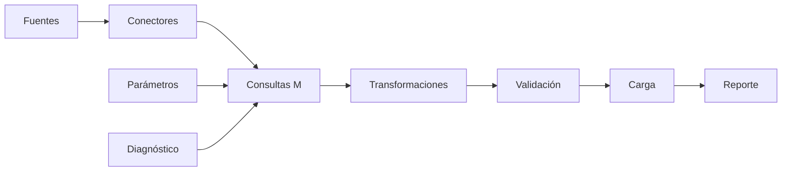
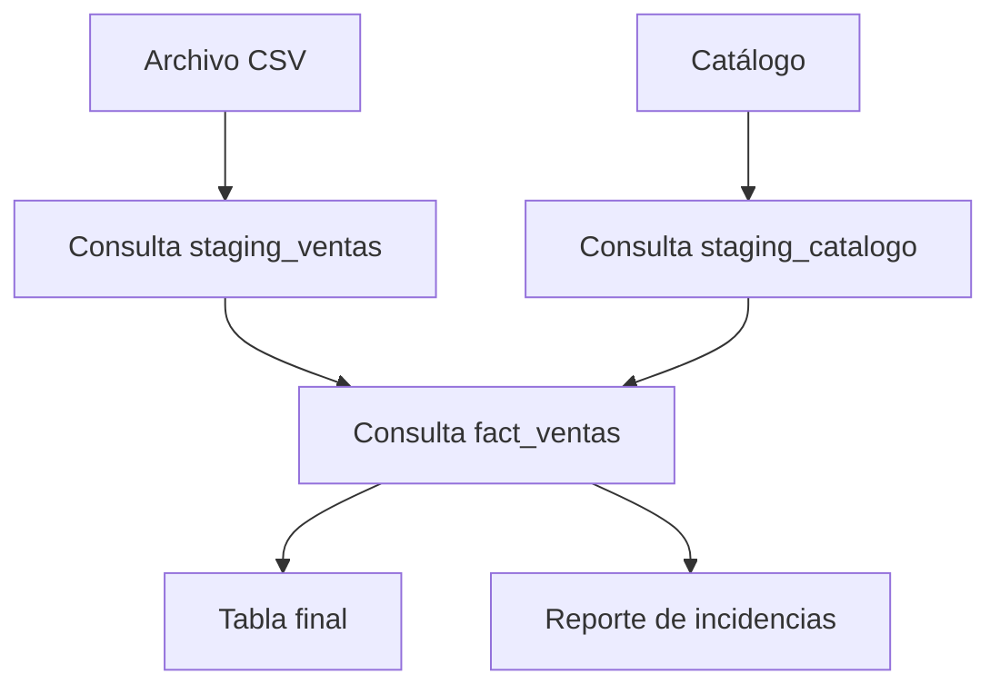
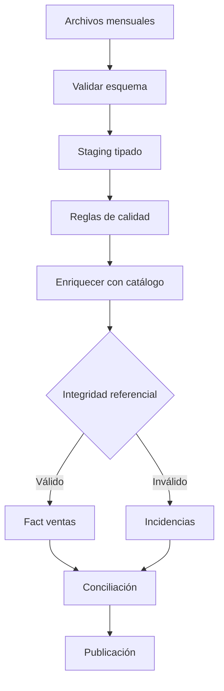

# H21 — Power Query y lenguaje M

**Roadmap v2.0 · Excel H21/24 · 28 horas · Prerrequisito H17**

**Secciones oficiales:** H21.01 Arquitectura; H21.02 Transformaciones; H21.03 Lenguaje M; H21.04 Ingeniería ETL.

**Objetivo:** construir, explicar, depurar, parametrizar y auditar procesos ETL en Excel mediante Power Query y lenguaje M. Este módulo profundiza en los fundamentos de importación y calidad vistos en H17. Las consultas se diseñaron para reproducirse, pero no se han ejecutado en una instalación real de Excel.

## Resultados de aprendizaje

1. Describir el motor Power Query, las consultas y sus dependencias.
2. Preparar fuentes CSV, tablas de Excel, carpetas y bases de datos con tipos explícitos.
3. Aplicar filtros, agrupaciones, pivotes, despivotes, anexado y combinaciones con claves controladas.
4. Escribir expresiones M con `let ... in`, funciones, listas, registros y tablas.
5. Construir funciones personalizadas y parámetros reutilizables.
6. Diseñar validaciones, conciliaciones, tratamiento de errores y actualización.
7. Identificar oportunidades de *query folding* y riesgos de privacidad.
8. Documentar una canalización de datos mantenible.

## Plan de tiempo

| Sección | Teoría | Práctica | Total |
|---|---:|---:|---:|
| H21.01 Arquitectura | 3 h | 3 h | 6 h |
| H21.02 Transformaciones | 3 h | 5 h | 8 h |
| H21.03 Lenguaje M | 3 h | 5 h | 8 h |
| H21.04 Ingeniería ETL | 2 h | 4 h | 6 h |
| **Total** | **11 h** | **17 h** | **28 h** |

## Diagrama general



## Datos del caso transversal

**ventas_2026_01.csv**

```csv
id,fecha,sku,region,cantidad,precio
P001,2026-01-05,0001,Norte,2,100.00
P002,2026-01-06,0002,Sur,1,250.00
P003,2026-01-08,0001,Norte,3,100.00
```

**ventas_2026_02.csv**

```csv
id,fecha,sku,region,cantidad,precio
P004,2026-02-02,0002,Centro,2,250.00
P005,2026-02-05,0003,Sur,4,50.00
P006,2026-02-06,9999,Norte,1,80.00
```

**catalogo.csv**

```csv
sku,descripcion,categoria
0001,Teclado,Perifericos
0002,Monitor,Pantallas
0003,Mouse,Perifericos
```

**Resultados de control:** 6 filas originales; importe bruto 1530; SKU 9999 sin catálogo por 80; 5 filas válidas por 1450. La clave `id` es única en este caso; no se presupone que sea así en cualquier sistema.


# H21.01 — Arquitectura de Power Query

## 21.01.01 — Qué es Power Query

Power Query es una tecnología de conexión y transformación de datos. En Excel, permite construir consultas repetibles mediante una interfaz visual y el lenguaje **M**. Una consulta es una expresión evaluable, no una secuencia de acciones imperativas sobre celdas. Los pasos que aparecen en el editor suelen ser nombres definidos en una expresión `let`.

**Distinciones:** Power Query transforma datos; las fórmulas de Excel calculan sobre celdas; DAX define medidas y columnas en modelos tabulares; VBA automatiza aplicaciones. No son lenguajes intercambiables.

## 21.01.02 — Componentes

- **Origen:** archivo, tabla, carpeta, API o base de datos.
- **Conector:** mecanismo de acceso al origen.
- **Consulta:** expresión que obtiene y transforma datos.
- **Pasos aplicados:** definiciones intermedias de la consulta.
- **Dependencias:** consultas referenciadas por otras consultas.
- **Carga:** destino de resultados, como hoja o modelo de datos.
- **Credenciales y privacidad:** configuración de acceso y combinación de fuentes.



## 21.01.03 — Conexión frente a carga

Una consulta puede configurarse como **solo conexión**, cargarse en una tabla de Excel o incorporarse al modelo de datos, según la plataforma y versión. Para una arquitectura mantenible, conserva consultas de *staging* sin cargar cuando solo sirvan como insumos, y carga únicamente las salidas necesarias. Esto no garantiza por sí mismo mejor rendimiento: mide cada caso.

## 21.01.04 — Interfaz

Ruta habitual: **Datos → Obtener datos → Elegir conector → Transformar datos**. En el Editor de Power Query se distinguen panel de consultas, vista previa, pasos aplicados, barra de fórmulas y Editor avanzado. La disponibilidad varía según sistema operativo, versión y licencia.

## 21.01.05 — Tipos de orígenes

| Fuente | Conector / función M habitual | Riesgo clave |
|---|---|---|
| CSV | `Csv.Document`, `File.Contents` | Delimitador, codificación, cultura |
| Excel | `Excel.Workbook`, `Excel.CurrentWorkbook` | Nombres, tipos y estructura |
| Carpeta | `Folder.Files` | Archivos heterogéneos |
| JSON | `Json.Document` | Listas y registros anidados |
| Web/API | `Web.Contents` | Autenticación, cuotas, esquema |
| SQL | Conector de base de datos | Privilegios, folding, volumen |

**Seguridad:** utiliza los mecanismos de credenciales de la plataforma y permisos mínimos. No incrustes contraseñas ni tokens en M o en un libro compartido.

## 21.01.06 — Referenciar y duplicar

**Referencia:** nueva consulta que depende de otra; útil para reutilizar una base común. **Duplicar:** crea una copia independiente de la expresión inicial, que puede divergir. Las dependencias influyen en el mantenimiento y el diagnóstico; no garantizan ejecución única de una consulta intermedia.

## 21.01.07 — Caso guiado

Crea consultas `stg_enero`, `stg_febrero`, `dim_catalogo`, `fact_ventas` e `incidencias_sku`. Mantén la nomenclatura uniforme y documenta propósito, origen, columnas esperadas y destino de carga.

**Comprobación:** los seis registros aparecen antes de la validación del catálogo; cinco son válidos después de separarlos por integridad referencial.


# H21.02 — Transformaciones

## 21.02.01 — Tipos explícitos y cultura

En M los tipos importan. `type text` conserva ceros a la izquierda de SKU; `Int64.Type` representa enteros; `type number` es un tipo numérico de punto flotante. Para cálculos monetarios que requieran precisión decimal fija, evalúa el tipo **Currency.Type** y la política de redondeo apropiada. Las fechas deben tiparse con una cultura explícita si el texto de origen es ambiguo.

```powerquery
Table.TransformColumnTypes(
    Tabla,
    {{"id", type text}, {"fecha", type date}, {"sku", type text},
     {"region", type text}, {"cantidad", Int64.Type},
     {"precio", type number}},
    "en-US"
)
```

## 21.02.02 — Filtrar, seleccionar, renombrar y ordenar

```powerquery
Table.SelectRows(Tabla, each [cantidad] > 0)
Table.SelectColumns(Tabla, {"id", "sku", "cantidad", "precio"})
Table.RenameColumns(Tabla, {{"precio", "precio_unitario"}})
Table.Sort(Tabla, {{"fecha", Order.Ascending}})
```

**Advertencia:** el orden de filas no es una propiedad de negocio estable salvo que se ordene explícitamente en el punto donde importa. La transformación de una consulta puede cambiar su orden al delegarse a la fuente.

## 21.02.03 — Columnas calculadas

```powerquery
Table.AddColumn(
    Tabla,
    "importe",
    each [cantidad] * [precio],
    type number
)
```

**Control:** cantidad × precio debe producir 200, 250, 300, 500, 200 y 80 en el dataset.

## 21.02.04 — Limpieza textual

```powerquery
Table.TransformColumns(
    Tabla,
    {{"region", each if _ = null then null else Text.Upper(Text.Trim(_)), type text}}
)
```

Normalizar texto no equivale a corregir la semántica: `NORTE` y `N.` solo pueden considerarse equivalentes si existe un catálogo de correspondencias aprobado.

## 21.02.05 — Anexar tablas

```powerquery
Table.Combine({Enero, Febrero})
```

Anexar agrega filas. Si los esquemas difieren, puede introducir columnas nulas. Antes de combinar, valida encabezados y tipos. No confundas anexado con una unión por clave.

## 21.02.06 — Combinar tablas y cardinalidad

```powerquery
let
    Union = Table.NestedJoin(
        Ventas, {"sku"}, Catalogo, {"sku"}, "catalogo", JoinKind.LeftOuter
    ),
    Expandido = Table.ExpandTableColumn(
        Union, "catalogo", {"descripcion", "categoria"},
        {"descripcion", "categoria"}
    )
in
    Expandido
```

**Precondición:** `Catalogo[sku]` es único. Si la tabla de referencia tiene duplicados, expandir puede multiplicar ventas. Las uniones disponibles incluyen interna, izquierda, derecha, completa y anti-uniones.

## 21.02.07 — Anti-unión para incidencias

```powerquery
Table.NestedJoin(
    Ventas, {"sku"}, Catalogo, {"sku"}, "coincidencias", JoinKind.LeftAnti
)
```

Devuelve las ventas cuyo SKU no existe en catálogo. En el dataset, el resultado es P006, por 80.

## 21.02.08 — Agrupar

```powerquery
Table.Group(
    VentasValidas,
    {"region"},
    {{"importe_total", each List.Sum([importe]), type number},
     {"transacciones", each Table.RowCount(_), Int64.Type}}
)
```

**Resultados:** Norte 500, Sur 450, Centro 500. Total 1450. Verifica que la agrupación use únicamente ventas válidas y no la tabla completa.

## 21.02.09 — Pivotar y despivotar

**Pivotar** convierte valores de una columna en nuevas columnas; **despivotar** convierte columnas en filas. Ejemplo de origen ancho: `id, Ene, Feb, Mar`; despivotado: `id, mes, importe`. Es útil para pasar de un reporte de presentación a una tabla analítica.

```powerquery
Table.UnpivotOtherColumns(TablaAncha, {"id"}, "mes", "importe")
```

Para pivotar, debe definirse cómo resolver combinaciones duplicadas de clave y categoría; una función de agregación puede ser necesaria.

## 21.02.10 — Expandir registros y listas

`Table.ExpandRecordColumn` expande campos de un registro; `Table.ExpandListColumn` transforma elementos de listas en filas. Una lista vacía o registros de distinta estructura requieren tratamiento explícito. No supongas que expandir una lista preserva una fila por registro original.

## 21.02.11 — Errores y nulos

`null` representa ausencia de valor. Un error de conversión es distinto de `null` y no debe ocultarse automáticamente. M ofrece `try ... otherwise` y `try ... catch` en entornos compatibles. Un reemplazo de error debe acompañarse de una incidencia y regla documentada.

```powerquery
try Number.FromText("texto", "en-US") otherwise null
```

Este ejemplo demuestra manejo sintáctico; en un proceso real registra el valor rechazado antes de sustituirlo.


# H21.03 — Lenguaje M

## 21.03.01 — Evaluación y `let ... in`

M es un lenguaje funcional de expresiones. Una consulta habitual define nombres con `let` y devuelve la expresión indicada tras `in`.

```powerquery
let
    a = 10,
    b = 20,
    resultado = a + b
in
    resultado
```

Resultado: **30**. Las comas separan definiciones; el identificador que aparece después de `in` determina el resultado final.

## 21.03.02 — Valores y tipos

Entre los valores relevantes están números, texto, lógicos (`true`, `false`), `null`, fechas, listas, registros, tablas y funciones. M distingue mayúsculas y minúsculas en sus identificadores. La conversión de tipos no equivale a cambiar el formato visual de una celda.

## 21.03.03 — Listas

```powerquery
let
    numeros = {2, 4, 6, 8},
    total = List.Sum(numeros),
    media = List.Average(numeros),
    primero = numeros{0}
in
    [Total=total, Media=media, Primero=primero]
```

Resultado: registro con Total 20, Media 5, Primero 2. Los índices de lista empiezan en cero. Una lista se expresa con llaves `{}`.

## 21.03.04 — Registros

```powerquery
let
    producto = [sku="0001", precio=100, activo=true]
in
    producto[precio]
```

Resultado: **100**. Los registros agrupan campos con nombre y se expresan con corchetes `[]`.

## 21.03.05 — Tablas

```powerquery
#table(
    type table [sku = text, cantidad = Int64.Type],
    {{"0001", 2}, {"0002", 3}}
)
```

Esta expresión crea una tabla tipada de dos filas. Las tablas contienen columnas y registros; para acceder a sus filas se utilizan funciones o expresiones de acceso adecuadas.

## 21.03.06 — Funciones y `each`

```powerquery
(x as number, y as number) as number => x * y
```

Una función es un valor que puede recibir argumentos y devolver un resultado. `each` es una forma abreviada de definir una función de un parámetro implícito `_`.

```powerquery
Table.SelectRows(Tabla, each [cantidad] > 1)
```

Equivale conceptualmente a filtrar filas mediante una función que recibe cada registro y devuelve verdadero o falso.

## 21.03.07 — Función personalizada para importes

```powerquery
(cantidad as number, precio as number) as number =>
    cantidad * precio
```

Guardar como consulta-función `fnImporte` e invocar con `fnImporte([cantidad], [precio])` dentro de una columna personalizada. **Pruebas:** (2,100)→200; (0,100)→0; (3,50)→150. Define si las cantidades negativas representan devoluciones o datos inválidos.

## 21.03.08 — Función personalizada con parámetro opcional

```powerquery
(precio as number, optional descuento as nullable number) as number =>
let
    d = if descuento = null then 0 else descuento
in
    precio * (1 - d)
```

Ejemplos: precio 100, descuento omitido →100; descuento 0.10 →90. La función presupone que el descuento está entre 0 y 1; en producción se debe validar ese dominio.

## 21.03.09 — Parámetros y rutas

Evita rutas incrustadas repetidas. Crea un parámetro `pCarpeta` y úsalo en una consulta:

```powerquery
Folder.Files(pCarpeta)
```

**Seguridad:** un parámetro no cifra credenciales ni convierte una ruta local en portable. Documenta las rutas esperadas y los permisos.

## 21.03.10 — Funciones de orden superior

`List.Transform` aplica una función a los elementos de una lista; `List.Select` filtra; `List.Accumulate` acumula estados.

```powerquery
List.Transform({1,2,3}, each _ * 2)
```

Resultado: `{2,4,6}`.

```powerquery
List.Accumulate({1,2,3}, 0, (estado, actual) => estado + actual)
```

Resultado: **6**. Compara con `List.Sum({1,2,3})`, preferible para sumas simples.

## 21.03.11 — Alcance y errores

Los nombres locales son visibles según el ámbito de la expresión. Evita nombres confusos y dependencias circulares. Documenta los tipos esperados y los mensajes de error. No sustituyas indiscriminadamente errores por valores válidos que oculten fallos de calidad.


# H21.04 — Ingeniería ETL y operación

## 21.04.01 — Pipeline reproducible

Un pipeline confiable separa: **extracción → staging → tipado → validación → enriquecimiento → agregación → publicación**. Cada etapa debe tener una entrada y salida definida, criterios de aceptación y una política de fallos.



## 21.04.02 — Consolidación de carpeta

`Folder.Files` devuelve metadatos y contenido binario. Filtra extensiones, nombres temporales y archivos ocultos según reglas. Define una función que transforme cada archivo y valida que todos compartan esquema.

```powerquery
let
    Archivos = Folder.Files(pCarpeta),
    CSV = Table.SelectRows(
        Archivos,
        each Text.Lower([Extension]) = ".csv"
            and not Text.StartsWith([Name], "~$")
    ),
    ConDatos = Table.AddColumn(
        CSV,
        "Datos",
        each fnLeerVentas([Content])
    ),
    Seleccion = Table.SelectColumns(ConDatos, {"Name", "Datos"}),
    Expandido = Table.ExpandTableColumn(
        Seleccion,
        "Datos",
        {"id", "fecha", "sku", "region", "cantidad", "precio"},
        {"id", "fecha", "sku", "region", "cantidad", "precio"}
    )
in
    Expandido
```

La consulta requiere una función `fnLeerVentas` definida por separado y un parámetro `pCarpeta`. `Name` permite conservar linaje. El ejemplo presupone CSV homogéneos y no debe aplicarse sin comprobar el esquema.

### Función `fnLeerVentas`

```powerquery
(contenido as binary) as table =>
let
    CSV = Csv.Document(
        contenido,
        [Delimiter=",", Encoding=65001, QuoteStyle=QuoteStyle.Csv]
    ),
    Encabezados = Table.PromoteHeaders(CSV, [PromoteAllScalars=true]),
    Tipos = Table.TransformColumnTypes(
        Encabezados,
        {{"id", type text}, {"fecha", type date}, {"sku", type text},
         {"region", type text}, {"cantidad", Int64.Type},
         {"precio", type number}},
        "en-US"
    )
in
    Tipos
```

**Precaución:** algunos orígenes con fechas ISO pueden tiparse de forma distinta según cultura; verifica fechas representativas. El código es un ejemplo didáctico, no un importador universal.

## 21.04.03 — Query folding

*Query folding* es la capacidad de delegar transformaciones al sistema de origen, por ejemplo convertir un filtro de Power Query en una operación SQL ejecutada por el servidor. Depende del conector, la operación y el contexto. No significa que toda consulta con SQL siempre pliegue ni que un CSV local ejecute SQL.

**Beneficio potencial:** reducir transferencia de datos y aprovechar índices y recursos del origen. **Comprobación:** inspeccionar indicadores de plegado o consulta nativa cuando estén disponibles y medir duración. **Riesgo:** pasos no plegables pueden obligar a procesar datos localmente.

## 21.04.04 — Rendimiento

- Filtra filas y selecciona columnas temprano cuando sea seguro y favorezca folding.
- Evita expandir listas o uniones muchos-a-muchos sin estimar cardinalidad.
- Revisa tipos antes de combinar claves.
- Evita operaciones repetidas y consultas de staging cargadas innecesariamente.
- `Table.Buffer` no es una optimización universal: puede incrementar memoria e impedir folding; usar solo tras medir.
- Mide tiempos de actualización, filas procesadas y tamaño de salida.

## 21.04.05 — Privacidad y credenciales

Los niveles de privacidad ayudan a controlar la combinación de fuentes. No los desactives indiscriminadamente para acelerar una consulta. Separa secretos de archivos compartidos, usa autenticación administrada y limita el acceso a fuentes y destinos.

## 21.04.06 — Diagnóstico y pruebas

**Pruebas mínimas:** esquema, tipos, nulos en campos obligatorios, duplicados por clave, cantidades válidas, claves foráneas, suma de importes, recuento de filas, archivo de origen y fecha de actualización.

**Conciliación del caso:** 6 filas originales = 5 válidas + 1 incidencia; 1530 = 1450 + 80. Si un archivo se rechaza por esquema incorrecto, registra su nombre y el motivo, sin omitirlo silenciosamente de la conciliación.

## 21.04.07 — Actualización y publicación

La actualización puede depender de credenciales, rutas, permisos, conexiones, versión de Excel y plataforma. Una consulta local no implica programación automática en la nube. Antes de publicar, verifica datos, totales, errores y fecha de ejecución. Mantén documentación de cambios y propietario.

## 21.04.08 — Excel frente a Google Sheets

Power Query y M son tecnologías del ecosistema Microsoft; Sheets no ejecuta directamente consultas M. Para una solución equivalente en Sheets pueden usarse funciones, Apps Script, conectores externos o procesos ETL independientes. Las diferencias incluyen permisos, límites, actualización y semántica de transformación.


# Laboratorios guiados

## Laboratorio 1 — Origen CSV tipado

Importa `ventas_2026_01.csv` y conserva `sku` como texto. Comprueba 3 filas e importe 750. Cambia intencionalmente el tipo de SKU a entero y documenta la pérdida de ceros iniciales.

## Laboratorio 2 — Consolidación

Anexa enero y febrero. Verifica 6 filas e importe bruto 1530. Conserva una columna `archivo_origen` para trazabilidad.

## Laboratorio 3 — Integridad referencial

Combina ventas con catálogo por SKU. Crea una anti-unión para detectar P006. Comprueba que el importe rechazado es 80 y el válido 1450.

## Laboratorio 4 — Transformación a formato largo

Crea una tabla `sku,Ene,Feb` y aplica `Table.UnpivotOtherColumns`. Comprueba que cada producto genera una fila por mes y que los importes totales se conservan.

## Laboratorio 5 — Función personalizada

Define `fnImporte` y úsala en una columna. Prueba valores 0, negativos y nulos; documenta cuáles son válidos según reglas de negocio.

## Laboratorio 6 — Parámetros y actualización

Crea `pCarpeta`, importa dos archivos desde la carpeta, añade un tercer archivo válido y actualiza. Comprueba que la nueva fila aparece y se reconcilia.

## Laboratorio 7 — Rendimiento y folding

En una fuente SQL autorizada, compara una consulta filtrada antes de la carga con otra que traiga más filas; revisa si el conector permite consultar el SQL delegado. Registra duración, filas y condiciones. No extrapoles conclusiones de una única medición.

## Laboratorio 8 — Errores y esquema

Introduce un CSV sin columna `precio`. Comprueba que el pipeline no publica totales parciales sin advertencia. Diseña una tabla de incidencias con archivo, paso, error y fecha.


# Proyecto integrador — Pipeline ETL mensual parametrizado

## Enunciado

Una organización recibe CSV mensuales de ventas y un catálogo de productos. Se requiere consolidación automática al actualizar, separación de registros inválidos, enriquecimiento y un reporte por región. El proceso debe conservar linaje, parámetros y conciliaciones.

## Entregables

1. Carpeta de archivos de ejemplo (`ventas_2026_01.csv`, `ventas_2026_02.csv`, `catalogo.csv`).
2. Parámetro `pCarpeta` y función `fnLeerVentas`.
3. Consultas `stg_archivos`, `stg_ventas`, `dim_catalogo`, `fact_ventas`, `incidencias`, `resumen_region`.
4. Diccionario de datos y reglas de validación.
5. Registro de ejecución y pruebas de actualización.
6. Evidencia de reconciliación y manejo de errores de esquema.

## Reglas

- IDs y SKU siempre como texto.
- Cantidad positiva y precio no negativo para ventas ordinarias.
- `id` único en este dataset; si el negocio permite múltiples líneas, definir clave compuesta.
- SKU debe existir en catálogo; los faltantes se separan, no se eliminan sin registro.
- La columna `archivo_origen` debe conservarse.
- Los importes se calculan antes de agregar.

## Resultados de aceptación

| Control | Resultado |
|---|---:|
| Filas fuente | 6 |
| Filas válidas | 5 |
| Incidencias por SKU | 1 |
| Importe bruto | 1530 |
| Importe válido | 1450 |
| Importe rechazado | 80 |
| Norte válido | 500 |
| Sur válido | 450 |
| Centro válido | 500 |

**Nota:** las regiones se calculan únicamente sobre las cinco filas válidas. La región Norte suma 200 + 300 = 500; Sur 250 + 200 = 450; Centro 500.

## Pruebas de cambio

- Agrega un registro válido P007, SKU 0003, cantidad 2, precio 50. El total bruto pasa a 1630; el válido a 1550; las incidencias permanecen en 80.
- Duplica P002: debe detectarse como posible duplicado y aplicarse una regla explícita, no sumarse silenciosamente.
- Elimina la columna `precio` de un archivo: el proceso debe informar un fallo de esquema y evitar publicar resultados incompletos sin advertencia.

## Rúbrica (100 puntos)

Arquitectura 15; transformaciones 20; M y parametrización 20; calidad y conciliación 20; actualización y diagnóstico 15; documentación y seguridad 10.


# Ejercicios de práctica — 20 ejercicios (cinco por sección)

Resuelve primero los enunciados. Las soluciones están separadas para favorecer la autoevaluación.


### Ejercicio E01 · H21.01

**Enunciado:** Distingue consulta y carga.

**Entregable:** explicación, fórmula M o evidencia de resultado, según corresponda.


### Ejercicio E02 · H21.01

**Enunciado:** ¿Qué diferencia hay entre referenciar y duplicar una consulta?

**Entregable:** explicación, fórmula M o evidencia de resultado, según corresponda.


### Ejercicio E03 · H21.01

**Enunciado:** ¿Por qué mantener staging separado?

**Entregable:** explicación, fórmula M o evidencia de resultado, según corresponda.


### Ejercicio E04 · H21.01

**Enunciado:** ¿Qué función M permite leer archivos de una carpeta?

**Entregable:** explicación, fórmula M o evidencia de resultado, según corresponda.


### Ejercicio E05 · H21.01

**Enunciado:** ¿Qué diferencia existe entre M y DAX?

**Entregable:** explicación, fórmula M o evidencia de resultado, según corresponda.


### Ejercicio E06 · H21.02

**Enunciado:** Calcula el importe bruto de seis filas.

**Entregable:** explicación, fórmula M o evidencia de resultado, según corresponda.


### Ejercicio E07 · H21.02

**Enunciado:** ¿Qué operación anexa enero y febrero?

**Entregable:** explicación, fórmula M o evidencia de resultado, según corresponda.


### Ejercicio E08 · H21.02

**Enunciado:** ¿Qué unión detecta SKU sin catálogo?

**Entregable:** explicación, fórmula M o evidencia de resultado, según corresponda.


### Ejercicio E09 · H21.02

**Enunciado:** ¿Cuántas ventas válidas quedan?

**Entregable:** explicación, fórmula M o evidencia de resultado, según corresponda.


### Ejercicio E10 · H21.02

**Enunciado:** ¿Qué hace `Table.UnpivotOtherColumns`?

**Entregable:** explicación, fórmula M o evidencia de resultado, según corresponda.


### Ejercicio E11 · H21.03

**Enunciado:** ¿Qué devuelve `let a=10,b=20 in a+b`?

**Entregable:** explicación, fórmula M o evidencia de resultado, según corresponda.


### Ejercicio E12 · H21.03

**Enunciado:** ¿Cuál es el primer elemento de `{2,4,6}`?

**Entregable:** explicación, fórmula M o evidencia de resultado, según corresponda.


### Ejercicio E13 · H21.03

**Enunciado:** ¿Qué produce `List.Transform({1,2,3}, each _*2)`?

**Entregable:** explicación, fórmula M o evidencia de resultado, según corresponda.


### Ejercicio E14 · H21.03

**Enunciado:** ¿Qué devuelve una función `(x)=>x*x` para 4?

**Entregable:** explicación, fórmula M o evidencia de resultado, según corresponda.


### Ejercicio E15 · H21.03

**Enunciado:** ¿Qué representa `null`?

**Entregable:** explicación, fórmula M o evidencia de resultado, según corresponda.


### Ejercicio E16 · H21.04

**Enunciado:** Define query folding.

**Entregable:** explicación, fórmula M o evidencia de resultado, según corresponda.


### Ejercicio E17 · H21.04

**Enunciado:** ¿Por qué `Table.Buffer` no debe usarse siempre?

**Entregable:** explicación, fórmula M o evidencia de resultado, según corresponda.


### Ejercicio E18 · H21.04

**Enunciado:** ¿Qué debe pasar si falta una columna obligatoria?

**Entregable:** explicación, fórmula M o evidencia de resultado, según corresponda.


### Ejercicio E19 · H21.04

**Enunciado:** Comprueba la conciliación monetaria inicial.

**Entregable:** explicación, fórmula M o evidencia de resultado, según corresponda.


### Ejercicio E20 · H21.04

**Enunciado:** ¿Qué cambia al agregar P007 por 100?

**Entregable:** explicación, fórmula M o evidencia de resultado, según corresponda.


# Solucionario independiente


### Solución E01

La consulta define obtención y transformación; la carga materializa el resultado en un destino.

**Verificación:** comprobar tipos, dimensiones y reglas del caso antes de aceptar el resultado.


### Solución E02

Referenciar crea dependencia; duplicar copia la expresión inicial.

**Verificación:** comprobar tipos, dimensiones y reglas del caso antes de aceptar el resultado.


### Solución E03

Para aislar extracción y tipado de la lógica de negocio y facilitar reutilización y diagnóstico.

**Verificación:** comprobar tipos, dimensiones y reglas del caso antes de aceptar el resultado.


### Solución E04

`Folder.Files(pCarpeta)`.

**Verificación:** comprobar tipos, dimensiones y reglas del caso antes de aceptar el resultado.


### Solución E05

M transforma datos en consultas; DAX define cálculos en modelos tabulares.

**Verificación:** comprobar tipos, dimensiones y reglas del caso antes de aceptar el resultado.


### Solución E06

200+250+300+500+200+80 = 1530.

**Verificación:** comprobar tipos, dimensiones y reglas del caso antes de aceptar el resultado.


### Solución E07

`Table.Combine({Enero, Febrero})`.

**Verificación:** comprobar tipos, dimensiones y reglas del caso antes de aceptar el resultado.


### Solución E08

`JoinKind.LeftAnti` sobre ventas y catálogo.

**Verificación:** comprobar tipos, dimensiones y reglas del caso antes de aceptar el resultado.


### Solución E09

5, con importe 1450.

**Verificación:** comprobar tipos, dimensiones y reglas del caso antes de aceptar el resultado.


### Solución E10

Convierte columnas no identificadoras en pares atributo-valor.

**Verificación:** comprobar tipos, dimensiones y reglas del caso antes de aceptar el resultado.


### Solución E11

30; en M la sintaxis requiere separar definiciones con comas.

**Verificación:** comprobar tipos, dimensiones y reglas del caso antes de aceptar el resultado.


### Solución E12

`{2,4,6}{0}` devuelve 2.

**Verificación:** comprobar tipos, dimensiones y reglas del caso antes de aceptar el resultado.


### Solución E13

`{2,4,6}`.

**Verificación:** comprobar tipos, dimensiones y reglas del caso antes de aceptar el resultado.


### Solución E14

16.

**Verificación:** comprobar tipos, dimensiones y reglas del caso antes de aceptar el resultado.


### Solución E15

Ausencia de valor; no equivale a cero.

**Verificación:** comprobar tipos, dimensiones y reglas del caso antes de aceptar el resultado.


### Solución E16

Delegación de transformaciones al motor del origen cuando el conector lo permite.

**Verificación:** comprobar tipos, dimensiones y reglas del caso antes de aceptar el resultado.


### Solución E17

Puede consumir memoria adicional e impedir query folding.

**Verificación:** comprobar tipos, dimensiones y reglas del caso antes de aceptar el resultado.


### Solución E18

Registrar fallo de esquema y evitar publicar resultados parciales sin advertencia.

**Verificación:** comprobar tipos, dimensiones y reglas del caso antes de aceptar el resultado.


### Solución E19

1530 = 1450 + 80.

**Verificación:** comprobar tipos, dimensiones y reglas del caso antes de aceptar el resultado.


### Solución E20

Importe bruto 1630, válido 1550 y rechazado 80.

**Verificación:** comprobar tipos, dimensiones y reglas del caso antes de aceptar el resultado.


# Evaluación final

1. Describe el ciclo de vida de una consulta.
2. Explica el propósito de staging.
3. ¿Qué diferencia existe entre una consulta y una tabla cargada?
4. ¿Qué riesgos tiene la detección automática de tipos?
5. ¿Cómo conservas ceros iniciales en SKU?
6. ¿Cuándo usar Append y cuándo Merge?
7. ¿Qué es cardinalidad de una unión?
8. ¿Por qué una unión puede duplicar importes?
9. ¿Cómo construirías una tabla de incidencias?
10. Explica la diferencia entre pivotar y despivotar.
11. ¿Qué devuelve `let ... in`?
12. Diferencia entre lista, registro y tabla.
13. ¿Qué representa `each`?
14. ¿Cómo definirías una función personalizada?
15. ¿Qué riesgos tiene una ruta incrustada?
16. ¿Qué es query folding?
17. ¿Qué efecto puede tener `Table.Buffer`?
18. ¿Por qué no deben desactivarse indiscriminadamente los niveles de privacidad?
19. ¿Qué controles usarías antes de publicar una actualización?
20. ¿Qué diferencias impiden ejecutar M directamente en Sheets?

**Aprobación sugerida:** 16/20 respuestas correctas, 20 ejercicios y proyecto ≥80/100.

# Errores comunes y diagnóstico

| Síntoma | Causa probable | Acción |
|---|---|---|
| SKU `0001` aparece `1` | Tipo numérico | Tipar como texto desde el origen |
| Fechas invertidas | Cultura incorrecta | Definir cultura y probar fechas |
| Se duplican importes tras Merge | Claves duplicadas en catálogo | Validar unicidad y cardinalidad |
| Archivo nuevo no aparece | Filtro de carpeta o falta de actualización | Revisar filtro, ruta y refresh |
| Error de columna inexistente | Cambio de esquema | Registrar incidente y bloquear publicación |
| Consulta lenta | Datos excesivos o pasos no plegables | Revisar diagnóstico y folding |
| Resultado incompleto | Errores ocultos o archivos rechazados | Conciliar filas, importes y archivos |

# Glosario

**Power Query:** tecnología de adquisición y transformación. **M:** lenguaje funcional de consultas. **Staging:** etapa intermedia de preparación. **ETL:** extracción, transformación y carga. **Append:** anexado vertical. **Merge:** combinación por clave. **Anti-join:** filas sin coincidencia. **Cardinalidad:** número de coincidencias entre registros. **Query folding:** delegación de transformaciones al origen. **Parámetro:** valor configurable usado por una consulta. **Linaje:** trazabilidad del origen y de las transformaciones. **Cultura:** convención regional para interpretar fechas y números. **Conciliación:** verificación de conservación y consistencia de totales. **Privacidad de origen:** controles para combinar datos entre fuentes. **Función personalizada:** expresión M reutilizable con parámetros.

# Bibliografía y referencias oficiales

- [Microsoft Learn — Power Query](https://learn.microsoft.com/en-us/power-query/)
- [Microsoft Learn — Referencia del lenguaje M](https://learn.microsoft.com/en-us/powerquery-m/)
- [Microsoft Learn — Csv.Document](https://learn.microsoft.com/en-us/powerquery-m/csv-document)
- [Microsoft Learn — Folder.Files](https://learn.microsoft.com/en-us/powerquery-m/folder-files)
- [Microsoft Learn — Table.Combine](https://learn.microsoft.com/en-us/powerquery-m/table-combine)
- [Microsoft Learn — Table.NestedJoin](https://learn.microsoft.com/en-us/powerquery-m/table-nestedjoin)
- [Microsoft Learn — Table.Group](https://learn.microsoft.com/en-us/powerquery-m/table-group)
- [Microsoft Learn — Table.UnpivotOtherColumns](https://learn.microsoft.com/en-us/powerquery-m/table-unpivotothercolumns)
- [Microsoft Learn — Query folding](https://learn.microsoft.com/en-us/power-query/query-folding-basics)
- [Microsoft Learn — Data profiling tools](https://learn.microsoft.com/en-us/power-query/data-profiling-tools)

**Limitación:** los enlaces sirven para contrastar sintaxis, opciones y disponibilidad. Las fórmulas M de este documento no se han ejecutado en Excel ni en conectores reales; deben verificarse en el entorno de destino.

# Control de cobertura

| Elemento | Resultado |
|---|---|
| H21.01 Arquitectura | Desarrollada |
| H21.02 Transformaciones | Desarrollada |
| H21.03 Lenguaje M | Desarrollada |
| H21.04 Ingeniería ETL | Desarrollada |
| Laboratorios | 8 |
| Ejercicios y soluciones | 20 + 20 |
| Proyecto integrador | 1 |
| Diagramas | 3 |
| Horas | 28 |
| Validación estructural | Realizada |
| Validación en Excel | Pendiente |

