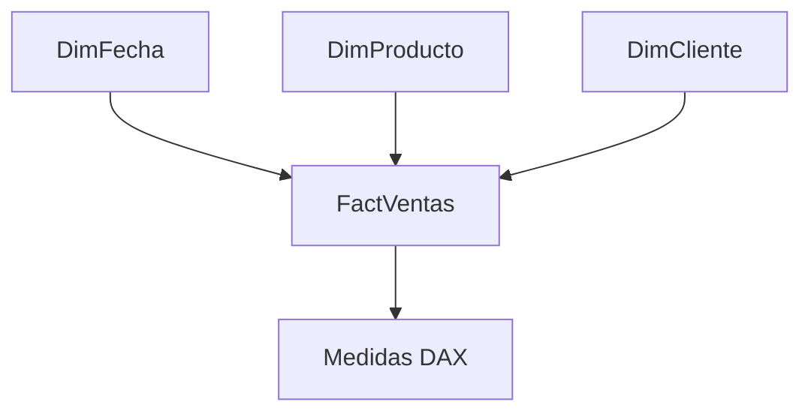
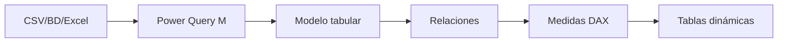
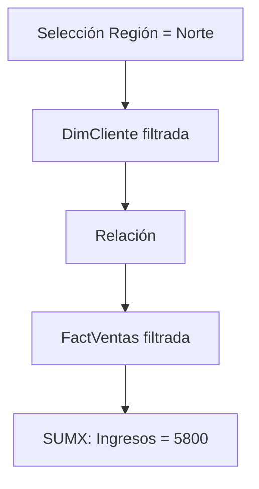
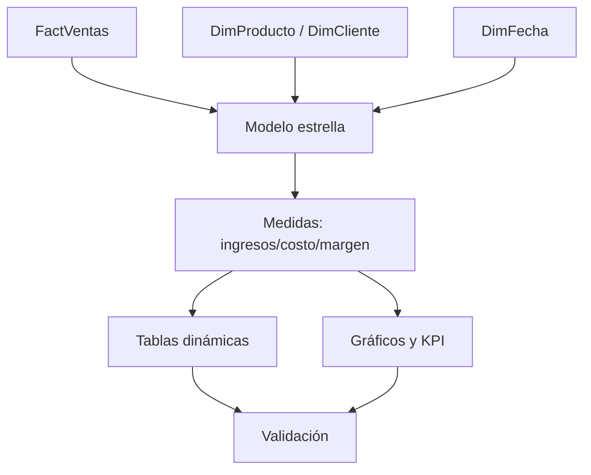

# H22 — Power Pivot, modelo de datos y DAX

**Curso integral Excel / Google Sheets / VBA / Apps Script · Roadmap v2.0 · Excel H22/24**

**Duración sugerida:** 32 horas · **Prerrequisitos:** H19 Tablas dinámicas y H21 Power Query/lenguaje M.

**Secciones oficiales:** H22.01 Modelado · H22.02 Power Pivot · H22.03 Fundamentos DAX · H22.04 DAX avanzado.

> **Alcance de plataforma.** Power Pivot y el Modelo de datos dependen de la edición, plataforma y licencia de Excel. DAX no es el lenguaje de fórmulas de Google Sheets. Los ejemplos están diseñados para un modelo tabular compatible con DAX; se deben ejecutar y verificar en la instalación concreta.

## Competencias

1. Diseñar un esquema estrella con granularidad explícita y relaciones válidas.
2. Importar tablas al Modelo de datos y construir medidas reutilizables.
3. Distinguir columnas calculadas, medidas y tablas calculadas.
4. Explicar contexto de fila, contexto de filtro y transición de contexto.
5. Implementar medidas con `CALCULATE`, iteradores y funciones de relación.
6. Construir inteligencia temporal con una tabla calendario apropiada.
7. Evaluar rendimiento, exactitud y seguridad del modelo.

## Mapa conceptual


## Conjunto de datos común

Se emplearán cuatro tablas: `FactVentas`, `DimProducto`, `DimCliente` y `DimFecha`. Todos los importes son ficticios, expresados en MXN. Los IDs son texto.

**FactVentas**

| VentaID | Fecha | ProductoID | ClienteID | Unidades | PrecioUnitario | CostoUnitario |
|---|---|---|---|---:|---:|---:|
| V001 | 2026-01-05 | P01 | C01 | 2 | 400 | 250 |
| V002 | 2026-01-12 | P02 | C02 | 1 | 2500 | 1800 |
| V003 | 2026-02-03 | P01 | C02 | 3 | 400 | 250 |
| V004 | 2026-02-15 | P03 | C03 | 4 | 200 | 120 |
| V005 | 2026-03-01 | P02 | C01 | 2 | 2500 | 1800 |
| V006 | 2026-03-21 | P03 | C02 | 5 | 200 | 120 |

**DimProducto**

| ProductoID | Producto | Categoría |
|---|---|---|
| P01 | Teclado | Periféricos |
| P02 | Monitor | Pantallas |
| P03 | Mouse | Periféricos |

**DimCliente**

| ClienteID | Cliente | Región |
|---|---|---|
| C01 | Ana | Norte |
| C02 | Luis | Sur |
| C03 | Sofía | Centro |

**DimFecha**: tabla con una fila por día, al menos del 1 de enero al 31 de diciembre de 2026; campos Fecha, Año, MesNúmero, Mes, Trimestre. Debe contener fechas únicas, continuas y sin nulos para inteligencia temporal.

**Totales esperados:** ingresos = **11300**, costo = **7730**, utilidad bruta = **3570**, unidades = **17**, transacciones = **6**, clientes distintos = **3**, margen bruto = **31,59 %**. Por mes: enero 3300; febrero 2000; marzo 6000.


# H22.01 — Modelado dimensional

## H22.01.01 — De tablas operacionales a modelos analíticos

Los sistemas transaccionales optimizan la captura y actualización de operaciones. Un modelo dimensional organiza datos para preguntas analíticas. El esquema estrella coloca una tabla de hechos en el centro y dimensiones alrededor.



**Hecho:** evento cuantificable; aquí, una línea de venta. **Dimensión:** entidad descriptiva para segmentar, como producto, cliente o fecha. **Granularidad:** qué representa exactamente cada fila. La granularidad de `FactVentas` es una línea de venta identificada por `VentaID`; en este ejemplo cada venta tiene una sola línea, pero no debe generalizarse.

## H22.01.02 — Claves, cardinalidad y dirección de filtro

`DimProducto[ProductoID]` y `DimCliente[ClienteID]` deben ser únicos y no nulos. `FactVentas[ProductoID]` y `FactVentas[ClienteID]` pueden repetirse. La relación típica es **uno a muchos** desde dimensión a hechos, con propagación de filtros desde dimensión hacia hechos.

La cardinalidad no es un detalle estético: si una dimensión contiene claves duplicadas, puede fallar la relación o producir resultados incorrectos. Evita activar filtros bidireccionales indiscriminadamente; pueden introducir rutas ambiguas y resultados difíciles de auditar.

## H22.01.03 — Integridad referencial

Un producto de la tabla de hechos que no exista en `DimProducto` es una clave huérfana. Debe detectarse antes de publicar. Según el modelo y el motor, puede aparecer una fila en blanco de dimensión por relaciones inválidas. No la ocultes sin investigar el origen.

**Prueba:** conjunto de `ProductoID` distintos en hechos menos conjunto de `ProductoID` de dimensión debe ser vacío. En Power Query puede hacerse mediante un `Left Anti Join`.

## H22.01.04 — Esquema estrella frente a copo de nieve

**Estrella:** dimensiones relativamente desnormalizadas, fácil navegación y relaciones simples. **Copo de nieve:** dimensiones separadas en varias tablas normalizadas; puede mejorar mantenimiento de jerarquías, pero añade relaciones y complejidad. Para el caso de ventas, el esquema estrella es la elección inicial.

## H22.01.05 — Dimensión de fechas

La tabla calendario permite análisis por mes, trimestre, año y comparaciones interanuales. Debe relacionarse con la columna de fecha de hechos, con tipos compatibles. Para cálculos de inteligencia temporal clásicos, marca una tabla de fechas apropiada si tu entorno lo requiere y verifica los requisitos del motor.

```dax
DimFecha =
ADDCOLUMNS (
    CALENDAR ( DATE ( 2026, 1, 1 ), DATE ( 2026, 12, 31 ) ),
    "Año", YEAR ( [Date] ),
    "MesNúmero", MONTH ( [Date] ),
    "Mes", FORMAT ( [Date], "MMMM" ),
    "Trimestre", "T" & FORMAT ( [Date], "Q" )
)
```

**Nota de implementación:** la columna creada por `CALENDAR` se llama `Date`; renómbrala a `Fecha` o relaciona explícitamente `DimFecha[Date]` con `FactVentas[Fecha]`. La disponibilidad de tablas calculadas depende de la herramienta y versión; alternativa: generar la dimensión en Power Query.

## H22.01.06 — Errores típicos

- Relacionar hechos entre sí sin necesidad.
- Mezclar fechas y horas en claves sin normalización.
- Tratar claves de negocio como valores numéricos agregables.
- Usar una tabla de hechos con granularidad inconsistente.
- Crear relaciones muchos-a-muchos sin analizar sus implicaciones.
- Confundir ausencia de relación con ausencia de datos.


# H22.02 — Power Pivot y el Modelo de datos

## H22.02.01 — Arquitectura de trabajo

**Power Query** obtiene y transforma. **Modelo de datos / Power Pivot** almacena tablas relacionadas y permite medidas. **Tabla dinámica / gráfico dinámico** consume esas medidas. Separar responsabilidades hace más fácil depurar y mantener.



## H22.02.02 — Carga y relaciones

1. Preparar tablas limpias y con tipos explícitos.
2. Cargar al **Modelo de datos**, según las opciones de tu versión.
3. Abrir la vista de diagrama de Power Pivot, si está disponible.
4. Crear relaciones de `DimProducto`, `DimCliente` y `DimFecha` hacia `FactVentas`.
5. Verificar unicidad de claves en el lado uno.
6. Crear medidas y contrastar totales con la fuente.

No todas las ediciones de Excel permiten el mismo flujo de interfaz; si Power Pivot no aparece, comprobar edición y complementos antes de seguir.

## H22.02.03 — Columnas calculadas vs medidas

Una **columna calculada** produce un valor por fila y suele almacenarse en el modelo. Una **medida** se evalúa cuando una visualización solicita un resultado bajo un contexto de filtro. Las medidas son preferibles para agregaciones dinámicas; las columnas se justifican para atributos persistentes o cálculos por fila necesarios en el modelo.

```dax
-- Columna calculada en FactVentas
ImporteLinea = FactVentas[Unidades] * FactVentas[PrecioUnitario]
```

```dax
-- Medida
Ingresos := SUMX ( FactVentas, FactVentas[Unidades] * FactVentas[PrecioUnitario] )
```

El uso de `:=` en algunos ejemplos indica definición de medida; determinados editores utilizan `=`. Ajustar al editor concreto.

## H22.02.04 — Medidas base

```dax
Ingresos := SUMX ( FactVentas, FactVentas[Unidades] * FactVentas[PrecioUnitario] )
Costo := SUMX ( FactVentas, FactVentas[Unidades] * FactVentas[CostoUnitario] )
Utilidad Bruta := [Ingresos] - [Costo]
Unidades := SUM ( FactVentas[Unidades] )
Transacciones := DISTINCTCOUNT ( FactVentas[VentaID] )
Clientes Distintos := DISTINCTCOUNT ( FactVentas[ClienteID] )
Margen Bruto % := DIVIDE ( [Utilidad Bruta], [Ingresos] )
Ticket Medio := DIVIDE ( [Ingresos], [Transacciones] )
```

**Por qué `DIVIDE`:** permite manejar el denominador cero de forma controlada; por defecto devuelve BLANK cuando el divisor es cero o BLANK. No sustituirlo automáticamente por cero si la tasa es indefinida.

## H22.02.05 — Indicadores y KPI

Un KPI requiere una medida, un objetivo y una regla de interpretación. Por ejemplo, margen bruto 31,59 % frente a meta 30 %. La diferencia es −0,62 puntos porcentuales, no −0,62 % relativo. La presentación de KPI integrada puede variar por versión; una medida y un formato condicional ofrecen una alternativa.

## H22.02.06 — Tabla dinámica conectada al modelo

Crear una tabla dinámica desde el Modelo de datos, colocar `DimProducto[Categoría]` en filas y `[Ingresos]` en valores. Resultado esperado: Pantallas 7500; Periféricos 3800; total 11300. Verifica que se utilizan campos de dimensiones y no columnas duplicadas de hechos.


# H22.03 — Fundamentos de DAX

## H22.03.01 — Lenguaje y tipos

DAX (Data Analysis Expressions) es un lenguaje de expresiones para modelos tabulares. Tiene funciones de agregación, filtrado, relaciones, tablas, fecha/hora, texto y lógica. No es SQL, M ni una fórmula de celda de Excel. La sintaxis y los separadores dependen del editor y configuración regional.

## H22.03.02 — Contexto de fila

El **contexto de fila** identifica la fila actual en una columna calculada o iterador. `SUMX(FactVentas, Unidades*PrecioUnitario)` recorre las filas visibles de la tabla y evalúa la expresión por fila antes de sumar.

## H22.03.03 — Contexto de filtro

El **contexto de filtro** determina qué registros participan en una medida. Si una tabla dinámica muestra `DimCliente[Región] = Norte`, `[Ingresos]` se evalúa solo para ventas relacionadas con clientes del Norte: 800 + 5000 = **5800**.



## H22.03.04 — CALCULATE

`CALCULATE` evalúa una expresión bajo un contexto de filtro modificado. Puede añadir, reemplazar o eliminar filtros, según argumentos. No debe interpretarse como una simple función condicional.

```dax
Ingresos Norte :=
CALCULATE ( [Ingresos], DimCliente[Región] = "Norte" )
```

**Precisión:** el filtro booleano anterior puede reemplazar un filtro previo sobre la misma columna. Si se desea intersección con el filtro existente, evaluar `KEEPFILTERS`.

```dax
Ingresos Norte Respetando Selección :=
CALCULATE ( [Ingresos], KEEPFILTERS ( DimCliente[Región] = "Norte" ) )
```

## H22.03.05 — FILTER

`FILTER(tabla, condición)` devuelve una tabla filtrada; es útil cuando la condición no puede expresarse cómodamente como filtro booleano simple. Evita emplearlo sin necesidad sobre una tabla de hechos grande cuando basta un filtro de columna.

```dax
Ventas de 2 o más unidades :=
CALCULATE (
    [Ingresos],
    FILTER ( FactVentas, FactVentas[Unidades] >= 2 )
)
```

En el dataset, todas las ventas excepto V002 cumplen; resultado esperado **8800**. La interacción con otros filtros debe revisarse en la visualización.

## H22.03.06 — Iteradores

`SUMX`, `AVERAGEX`, `MINX`, `MAXX` y `COUNTX` recorren una tabla y evalúan una expresión. `SUMX` es apropiado para `Unidades*PrecioUnitario`; `SUM(FactVentas[Unidades])*SUM(FactVentas[PrecioUnitario])` **no** representa ingresos.

## H22.03.07 — Transición de contexto

Dentro de un contexto de fila, `CALCULATE` puede transformar el contexto de fila en filtros para evaluar una expresión. Este mecanismo explica resultados que parecen sorprendentes al combinar columnas calculadas, iteradores y medidas. No confundas transición de contexto con propagación por relaciones.

## H22.03.08 — BLANK y errores

BLANK no equivale siempre a cero. En ratios, ausencia de ventas puede hacer que el margen sea indefinido. Usa `ISBLANK`, `COALESCE` o el resultado alternativo de `DIVIDE` solo si la semántica del indicador lo permite.


# H22.04 — DAX avanzado

## H22.04.01 — ALL, REMOVEFILTERS y conservación de contexto

Para calcular participación del producto en el total, es necesario decidir qué filtros se mantienen. `REMOVEFILTERS(DimProducto)` elimina filtros de producto pero conserva otros, como región o fecha.

```dax
Participación Producto % :=
DIVIDE (
    [Ingresos],
    CALCULATE ( [Ingresos], REMOVEFILTERS ( DimProducto ) )
)
```

En el total general: Monitor = 7500/11300 ≈ **66,37 %**. En una tabla por región, el denominador sería el total de esa región, no necesariamente 11300.

## H22.04.02 — Relaciones activas e inactivas

Un modelo puede tener FechaPedido y FechaEntrega. Una relación puede ser activa y otra inactiva. `USERELATIONSHIP` puede activar una relación específica dentro de `CALCULATE`, siempre que exista en el modelo.

```dax
-- Ejemplo conceptual: requiere FactVentas[FechaEntrega]
Ingresos por Entrega :=
CALCULATE (
    [Ingresos],
    USERELATIONSHIP ( FactVentas[FechaEntrega], DimFecha[Date] )
)
```

No ejecutar esta medida con el dataset inicial: `FechaEntrega` no existe. Es un ejemplo de extensión del esquema.

## H22.04.03 — Inteligencia temporal

Una tabla de fechas adecuada y la relación correcta son requisitos esenciales para muchas funciones clásicas de inteligencia temporal. Debe evitarse comparar periodos incompletos sin aclararlo.

```dax
Ingresos Año Anterior :=
CALCULATE ( [Ingresos], SAMEPERIODLASTYEAR ( DimFecha[Date] ) )

Variación Interanual % :=
DIVIDE ( [Ingresos] - [Ingresos Año Anterior], [Ingresos Año Anterior] )
```

Con datos solo de 2026, **no existe base 2025** para calcular crecimiento interanual; no se debe presentar como 0 %.

```dax
Ingresos YTD := TOTALYTD ( [Ingresos], DimFecha[Date] )
```

Al cierre de marzo, con el filtro de fechas apropiado, YTD esperado = **11300**. Si se visualiza abril–diciembre sin ventas, el comportamiento depende del contexto y de la medida; documentarlo.

## H22.04.04 — Variables

```dax
Margen Bruto con Variables :=
VAR Venta = [Ingresos]
VAR Beneficio = [Utilidad Bruta]
RETURN DIVIDE ( Beneficio, Venta )
```

`VAR` mejora legibilidad, evita repetir expresiones y puede facilitar optimización; no implica automáticamente que cualquier medida sea más rápida.

## H22.04.05 — Tablas virtuales

Funciones como `SUMMARIZE`, `ADDCOLUMNS`, `VALUES` y `TOPN` permiten construir tablas intermedias en expresiones. Una tabla virtual no equivale a una tabla física persistida.

```dax
Ingresos Top 2 Productos :=
VAR Ranking =
    TOPN (
        2,
        ADDCOLUMNS ( VALUES ( DimProducto[ProductoID] ), "Venta", [Ingresos] ),
        [Venta], DESC,
        DimProducto[ProductoID], ASC
    )
RETURN
    SUMX ( Ranking, [Venta] )
```

En el conjunto de datos, P02 = 7500, P01 = 2000 y P03 = 1800. Top 2 = **9500**. El segundo criterio de orden ayuda a desambiguar empates; `TOPN` puede devolver más de N filas cuando hay empate en el límite según su semántica, por lo que deben verificarse los casos reales.

## H22.04.06 — Rendimiento y mantenimiento

- Diseñar primero un esquema estrella claro.
- Reducir columnas innecesarias y cardinalidad excesiva.
- Preferir medidas base reutilizables.
- Evitar iteraciones costosas y filtros complejos cuando hay alternativas equivalentes.
- No asumir que una medida rápida con seis filas será eficiente con millones.
- Revisar resultados antes y después de optimizar.
- Documentar definiciones, formatos, dependencias y propietarios de medidas.

**Seguridad:** filtrar una tabla dinámica no restringe el acceso al modelo. La protección real exige controles de acceso al archivo y a las fuentes. No presentar un segmentador como seguridad a nivel de fila.


# Laboratorios guiados

## L01 — Esquema estrella

Crea las cuatro tablas, verifica claves únicas de dimensiones y dibuja relaciones uno-a-muchos. **Aceptación:** no hay claves huérfanas y la granularidad está documentada.

## L02 — Medidas base

Implementa Ingresos, Costo, Utilidad Bruta, Unidades y Margen. **Aceptación:** 11300, 7730, 3570, 17 y 31,59 % respectivamente.

## L03 — Comparación por producto

Crea tabla dinámica con Producto en filas y `[Ingresos]` en valores. **Aceptación:** Teclado 2000, Monitor 7500, Mouse 1800.

## L04 — Contexto de filtro

Crea tabla por Región y comprueba Norte 5800, Sur 4700 y Centro 800. Aplica segmentador por Región y explica cómo se propaga el filtro.

## L05 — CALCULATE y FILTER

Implementa `Ingresos Norte` y `Ventas de 2 o más unidades`. **Aceptación:** 5800 y 8800. Contrasta con suma manual de registros.

## L06 — Inteligencia temporal

Construye DimFecha, relaciónala con ventas y calcula ingresos mensuales e YTD. **Aceptación:** enero 3300, febrero 2000, marzo 6000, acumulado marzo 11300. No inventar datos de 2025.

## L07 — Tablas virtuales

Implementa Top 2 Productos. **Aceptación:** 9500; documenta el criterio de desempate.

## L08 — Auditoría de modelo

Introduce temporalmente un ProductoID inexistente en una copia de FactVentas. Detecta el problema, cuantifica el importe afectado y restablece la fuente original. **Aceptación:** tabla de incidencias y conciliación antes/después.


# Proyecto integrador — Modelo analítico de ventas, clientes y productos

## Problema de negocio

Dirección necesita analizar ingresos, costos, rentabilidad, clientes, categorías y evolución temporal sin duplicar cálculos en hojas. Se requiere un modelo auditable que permita responder preguntas por producto, cliente, región y mes.

## Arquitectura



## Entregables

1. Libro con cuatro tablas y relaciones documentadas.
2. Diccionario de datos: tipos, claves, granularidad, reglas de nulos.
3. Medidas base y avanzadas con nombres y formatos consistentes.
4. Panel de ingresos, utilidad, margen, clientes y ventas por categoría.
5. Tabla temporal mensual e indicador YTD.
6. Pruebas de integridad y conciliación.
7. Manual breve de actualización y limitaciones.

## Matriz de resultados esperados

| Indicador | Resultado |
|---|---:|
| Ingresos | 11300 |
| Costo | 7730 |
| Utilidad bruta | 3570 |
| Margen bruto | 31,59 % |
| Unidades | 17 |
| Transacciones | 6 |
| Clientes distintos | 3 |
| Ticket medio | 1883,33 |
| Ventas Norte | 5800 |
| Ventas Sur | 4700 |
| Ventas Centro | 800 |
| Ventas Monitor | 7500 |
| Ventas Teclado | 2000 |
| Ventas Mouse | 1800 |
| Ingresos enero | 3300 |
| Ingresos febrero | 2000 |
| Ingresos marzo | 6000 |
| Ingresos Top 2 Productos | 9500 |

**Conciliación:** sumas por región, producto y mes deben ser iguales a 11300. Costo y utilidad deben satisfacer 7730 + 3570 = 11300.

## Rúbrica (100 puntos)

Modelado y relaciones 25; medidas correctas 25; contexto e inteligencia temporal 20; pruebas y conciliación 15; rendimiento, documentación y presentación 15.


# Ejercicios de práctica — 20 (cinco por sección)

**Instrucciones:** resolver sin consultar el solucionario; entregar fórmula, interpretación y prueba de resultado cuando corresponda.


### Ejercicio E01 — H22.01

**Enunciado:** ¿Qué representa una fila de FactVentas?

**Entregable:** respuesta razonada y evidencia verificable.


### Ejercicio E02 — H22.01

**Enunciado:** ¿Qué tabla debe tener ProductoID único?

**Entregable:** respuesta razonada y evidencia verificable.


### Ejercicio E03 — H22.01

**Enunciado:** ¿Por qué una tabla calendario requiere fechas únicas?

**Entregable:** respuesta razonada y evidencia verificable.


### Ejercicio E04 — H22.01

**Enunciado:** ¿Qué es una clave huérfana?

**Entregable:** respuesta razonada y evidencia verificable.


### Ejercicio E05 — H22.01

**Enunciado:** ¿Por qué preferir esquema estrella inicialmente?

**Entregable:** respuesta razonada y evidencia verificable.


### Ejercicio E06 — H22.02

**Enunciado:** ¿Qué herramienta prepara datos antes de cargarlos?

**Entregable:** respuesta razonada y evidencia verificable.


### Ejercicio E07 — H22.02

**Enunciado:** ¿Cuál es la diferencia entre columna calculada y medida?

**Entregable:** respuesta razonada y evidencia verificable.


### Ejercicio E08 — H22.02

**Enunciado:** Calcula utilidad bruta.

**Entregable:** respuesta razonada y evidencia verificable.


### Ejercicio E09 — H22.02

**Enunciado:** Calcula margen bruto.

**Entregable:** respuesta razonada y evidencia verificable.


### Ejercicio E10 — H22.02

**Enunciado:** ¿Cuál es el ingreso de la categoría Pantallas?

**Entregable:** respuesta razonada y evidencia verificable.


### Ejercicio E11 — H22.03

**Enunciado:** ¿Qué es contexto de fila?

**Entregable:** respuesta razonada y evidencia verificable.


### Ejercicio E12 — H22.03

**Enunciado:** ¿Qué es contexto de filtro?

**Entregable:** respuesta razonada y evidencia verificable.


### Ejercicio E13 — H22.03

**Enunciado:** ¿Qué hace CALCULATE?

**Entregable:** respuesta razonada y evidencia verificable.


### Ejercicio E14 — H22.03

**Enunciado:** ¿Qué resultado produce Ingresos Norte?

**Entregable:** respuesta razonada y evidencia verificable.


### Ejercicio E15 — H22.03

**Enunciado:** ¿Por qué usar SUMX para ingresos?

**Entregable:** respuesta razonada y evidencia verificable.


### Ejercicio E16 — H22.04

**Enunciado:** ¿Qué hace REMOVEFILTERS(DimProducto)?

**Entregable:** respuesta razonada y evidencia verificable.


### Ejercicio E17 — H22.04

**Enunciado:** ¿Cuál es la participación de Monitor en ingresos generales?

**Entregable:** respuesta razonada y evidencia verificable.


### Ejercicio E18 — H22.04

**Enunciado:** ¿Cuál es el YTD a marzo de 2026?

**Entregable:** respuesta razonada y evidencia verificable.


### Ejercicio E19 — H22.04

**Enunciado:** ¿Cuál es el ingreso de los dos productos principales?

**Entregable:** respuesta razonada y evidencia verificable.


### Ejercicio E20 — H22.04

**Enunciado:** ¿Se puede calcular variación interanual sin datos de 2025?

**Entregable:** respuesta razonada y evidencia verificable.


# Solucionario separado


### Solución E01

Una línea de venta; es la granularidad definida del modelo.

**Verificación:** comprobar el modelo, contexto, relaciones y totales de control.


### Solución E02

DimProducto, en el lado uno de la relación.

**Verificación:** comprobar el modelo, contexto, relaciones y totales de control.


### Solución E03

Para ofrecer una dimensión temporal inequívoca y relaciones válidas.

**Verificación:** comprobar el modelo, contexto, relaciones y totales de control.


### Solución E04

Una clave en hechos sin correspondencia en su dimensión.

**Verificación:** comprobar el modelo, contexto, relaciones y totales de control.


### Solución E05

Simplifica relaciones, navegación, filtrado y mantenimiento.

**Verificación:** comprobar el modelo, contexto, relaciones y totales de control.


### Solución E06

Power Query.

**Verificación:** comprobar el modelo, contexto, relaciones y totales de control.


### Solución E07

La columna se evalúa por fila; la medida se evalúa en contexto de filtro.

**Verificación:** comprobar el modelo, contexto, relaciones y totales de control.


### Solución E08

11300 − 7730 = 3570.

**Verificación:** comprobar el modelo, contexto, relaciones y totales de control.


### Solución E09

3570/11300 = 31,59 % aproximadamente.

**Verificación:** comprobar el modelo, contexto, relaciones y totales de control.


### Solución E10

7500.

**Verificación:** comprobar el modelo, contexto, relaciones y totales de control.


### Solución E11

La fila actual al evaluar una expresión, por ejemplo en SUMX.

**Verificación:** comprobar el modelo, contexto, relaciones y totales de control.


### Solución E12

El conjunto de restricciones que determina los registros visibles para una medida.

**Verificación:** comprobar el modelo, contexto, relaciones y totales de control.


### Solución E13

Evalúa una expresión bajo un contexto de filtro modificado.

**Verificación:** comprobar el modelo, contexto, relaciones y totales de control.


### Solución E14

5800.

**Verificación:** comprobar el modelo, contexto, relaciones y totales de control.


### Solución E15

Porque calcula unidades por precio en cada fila y suma los resultados.

**Verificación:** comprobar el modelo, contexto, relaciones y totales de control.


### Solución E16

Elimina filtros de la dimensión Producto, manteniendo otros filtros no afectados.

**Verificación:** comprobar el modelo, contexto, relaciones y totales de control.


### Solución E17

7500/11300 ≈ 66,37 %.

**Verificación:** comprobar el modelo, contexto, relaciones y totales de control.


### Solución E18

11300, con calendario y contexto adecuados.

**Verificación:** comprobar el modelo, contexto, relaciones y totales de control.


### Solución E19

9500.

**Verificación:** comprobar el modelo, contexto, relaciones y totales de control.


### Solución E20

No; debe aparecer como no disponible/BLANK, no como 0 %.

**Verificación:** comprobar el modelo, contexto, relaciones y totales de control.


# Evaluación final

1. Define hecho, dimensión y granularidad.
2. Diferencia estrella y copo de nieve.
3. Explica cardinalidad uno-a-muchos.
4. ¿Qué causa una clave huérfana?
5. ¿Por qué conviene una tabla de fechas?
6. Distingue Power Query y Power Pivot.
7. ¿Cuándo usar columna calculada?
8. ¿Cuándo usar medida?
9. ¿Qué resuelve `DIVIDE`?
10. Define contexto de fila.
11. Define contexto de filtro.
12. Explica `CALCULATE`.
13. Diferencia `FILTER` y filtro booleano directo.
14. ¿Qué hace `SUMX`?
15. Explica transición de contexto.
16. ¿Cuándo usar `REMOVEFILTERS`?
17. ¿Qué requiere `USERELATIONSHIP`?
18. ¿Por qué no se debe inventar crecimiento interanual?
19. ¿Qué es una tabla virtual?
20. ¿Cómo comprobarías el rendimiento y la exactitud tras optimizar?

**Criterio de aprobación:** 16/20, ejercicios entregados y proyecto ≥80/100.

# Glosario

**Modelo tabular:** estructura analítica de tablas relacionadas. **Hecho:** registro de evento medible. **Dimensión:** entidad descriptiva. **Granularidad:** nivel de detalle por fila. **Cardinalidad:** número de correspondencias entre claves. **Esquema estrella:** hechos conectados a dimensiones. **Power Pivot:** capacidad de modelado tabular de Excel. **DAX:** Data Analysis Expressions. **Medida:** expresión evaluada en contexto de filtro. **Columna calculada:** expresión por fila. **Contexto de fila:** fila actual de evaluación. **Contexto de filtro:** restricciones activas sobre datos. **Iterador:** función que evalúa expresión por fila. **Tabla virtual:** tabla intermedia evaluada en una expresión. **YTD:** acumulado del año hasta la fecha.

# Bibliografía y documentación oficial

- [Microsoft Learn — DAX overview](https://learn.microsoft.com/en-us/dax/dax-overview)
- [Microsoft Learn — DAX function reference](https://learn.microsoft.com/en-us/dax/dax-function-reference)
- [Microsoft Learn — CALCULATE](https://learn.microsoft.com/en-us/dax/calculate-function-dax)
- [Microsoft Learn — SUMX](https://learn.microsoft.com/en-us/dax/sumx-function-dax)
- [Microsoft Learn — FILTER](https://learn.microsoft.com/en-us/dax/filter-function-dax)
- [Microsoft Learn — DIVIDE](https://learn.microsoft.com/en-us/dax/divide-function-dax)
- [Microsoft Learn — SAMEPERIODLASTYEAR](https://learn.microsoft.com/en-us/dax/sameperiodlastyear-function-dax)
- [Microsoft Learn — Understand star schema](https://learn.microsoft.com/en-us/power-bi/guidance/star-schema)
- [Microsoft Support — Power Pivot](https://support.microsoft.com/en-us/excel)

**Limitaciones:** las referencias permiten profundizar y comprobar la sintaxis. Las medidas se presentan como ejemplos reproducibles, pero no se han ejecutado dentro de una instancia real de Excel/Power Pivot en esta entrega. Los separadores y la compatibilidad deben verificarse según la configuración regional y versión.

# Estado de cobertura

| Requisito | Entrega |
|---|---|
| H22.01 Modelado | Hechos, dimensiones, relaciones, cardinalidad, estrella |
| H22.02 Power Pivot | Carga, columnas, medidas, KPI |
| H22.03 DAX básico | Contextos, CALCULATE, FILTER, iteradores |
| H22.04 DAX avanzado | Filtros, relaciones, tiempo, tablas virtuales, variables |
| Ejercicios | 20, cinco por sección |
| Soluciones | 20, separadas |
| Laboratorios | 8 |
| Proyecto | Modelo analítico de ventas, clientes y productos |
| Diagramas | 4 Mermaid |
| Pruebas de negocio | Matriz de resultados y conciliaciones |
| Próximo módulo | H23, según roadmap aprobado |

