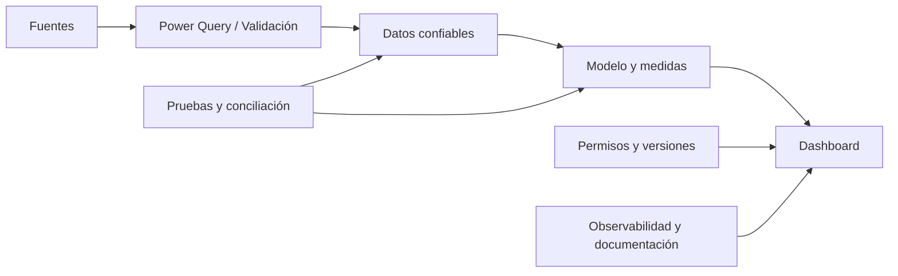
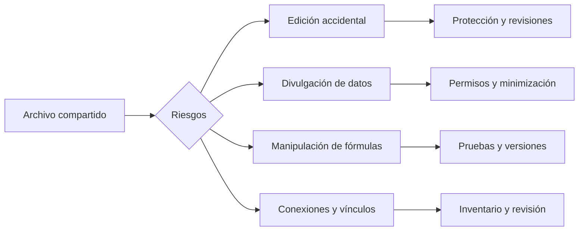

# H23 — Dashboards, auditoría, seguridad y optimización

**Programa Excel/Google Sheets/VBA/Apps Script · Roadmap v2.0 · H23/24**  
**Duración:** 22 horas · **Prerrequisitos:** H18–H22 · **Idioma de fórmulas:** Excel español (`;`).

## Propósito

Auditar, endurecer, acelerar y documentar un libro de análisis empresarial antes de publicarlo. El éxito se mide por **corrección**, **reproducibilidad**, **seguridad**, **rendimiento** y **mantenibilidad**, no solo por su apariencia.

## Resultados de aprendizaje

1. Diseñar un dashboard con KPI trazables y navegación comprensible.
2. Detectar errores de fórmulas, datos, dependencias, referencias y conciliaciones.
3. Aplicar protección y permisos comprendiendo sus límites de seguridad.
4. Identificar cuellos de botella de cálculo y probar mejoras cuantitativamente.
5. Documentar arquitectura, contratos de datos, cambios y compatibilidad.
6. Realizar una revisión técnica con criterios de aceptación reproducibles.

## Arquitectura de referencia



## Dataset del módulo

Tabla `Ventas`:

| Pedido | Fecha | Región | Producto | Unidades | Precio | CostoUnitario |
|---|---|---|---|---:|---:|---:|
| P001 | 2026-10-01 | Norte | A | 2 | 500 | 300 |
| P002 | 2026-10-02 | Sur | B | 3 | 200 | 120 |
| P003 | 2026-10-03 | Norte | B | 4 | 200 | 120 |
| P004 | 2026-10-04 | Centro | A | 1 | 500 | 300 |
| P005 | 2026-10-05 | Sur | A | 2 | 500 | 300 |
| P006 | 2026-10-06 | Centro | B | 5 | 200 | 120 |

Añade columnas `Ingreso = [@Unidades]*[@Precio]`, `Costo = [@Unidades]*[@CostoUnitario]` y `Utilidad = [@Ingreso]-[@Costo]`.

**Resultados de control:** ingresos 4900; costo 2940; utilidad 1960; margen 40%; 17 unidades; 6 pedidos. Por región: Norte 1800, Sur 1600, Centro 1500. Por producto: A 2500, B 2400.

# H23.01 — Dashboards: KPI, composición, navegación e interacción

## 23.01.01 Del requerimiento a la métrica

Un KPI requiere **nombre, fórmula, unidad, granularidad, fuente, responsable, periodicidad y regla de excepción**. «Margen» es ambiguo: ¿bruto, operativo, neto, por producto, ponderado? Para el caso de práctica definimos margen bruto = utilidad bruta / ingresos.

| KPI | Definición | Valor esperado |
|---|---|---:|
| Ingresos | SUMA(Ventas[Ingreso]) | 4900 MXN |
| Costo | SUMA(Ventas[Costo]) | 2940 MXN |
| Utilidad | Ingresos − Costo | 1960 MXN |
| Margen bruto | Utilidad / Ingresos | 40% |
| Ticket promedio | Ingresos / pedidos distintos | 816,67 MXN |
| Unidades | SUMA(Ventas[Unidades]) | 17 |

**Cuidado:** `PROMEDIO(Ventas[Utilidad]/Ventas[Ingreso])` no sustituye al margen ponderado. Un indicador de porcentaje global se calcula como razón de totales.

## 23.01.02 Arquitectura visual

**Encabezado:** título, periodo, filtros activos y actualización. **Primera fila:** cuatro KPI principales. **Zona analítica:** evolución temporal y desglose regional/producto. **Pie:** fuente, advertencias y glosario. El diseño debe soportar lectura rápida y permitir profundizar sin saturar la pantalla.

```mermaid
flowchart TD
 A[Encabezado y filtros] --> B[Ingresos | Utilidad | Margen | Pedidos]
 B --> C[Tendencia]
 C --> D[Región y producto]
 D --> E[Incidencias, fuente y actualización]
```

## 23.01.03 Fórmulas reproducibles

```excel
=SUMA(Ventas[Ingreso])
=SUMA(Ventas[Costo])
=SUMA(Ventas[Utilidad])
=SI.ERROR(SUMA(Ventas[Utilidad])/SUMA(Ventas[Ingreso]);0)
=SUMAR.SI.CONJUNTO(Ventas[Ingreso];Ventas[Región];"Norte")
```

El último cálculo debe devolver **1800**. El uso de `SI.ERROR(...;0)` requiere política explícita: puede ocultar ingresos cero. En reportes auditables, preferir `SI(ingresos=0;NOD();utilidad/ingresos)` si se quiere señalar que no hay razón definida; validar el tratamiento de `#N/A` en los gráficos.

## 23.01.04 Interacción y filtros

Segmentadores y escalas de tiempo deben conectarse a las tablas dinámicas correctas. Prueba cada combinación de filtros: al seleccionar Sur, el KPI de ingresos debe indicar **1600**. Si un KPI proviene de fórmulas independientes que ignoran el filtro, el panel presenta información inconsistente. Documenta qué controles afectan a cada objeto.

## 23.01.05 Accesibilidad y diseño

Usa títulos descriptivos, unidades, etiquetas y contraste suficiente. Evita depender exclusivamente del color, ejes truncados en barras, gráficos 3D y cifras sin contexto. Indica si los importes son brutos/netos y si incluyen impuestos. Mantén consistencia de colores entre vistas.

## 23.01.06 Pruebas de interfaz

- Abrir en pantalla pequeña y comprobar legibilidad.
- Exportar a PDF y verificar que no se corten títulos o gráficos.
- Aplicar filtros individuales y combinados.
- Comprobar que la fecha de actualización es real y no solo `HOY()`.
- Confirmar que los datos del gráfico coinciden con las cifras del modelo.

# H23.02 — Auditoría y seguridad: validación, trazabilidad, protección, permisos, colaboración y versiones

## 23.02.01 Auditoría de fórmulas

En Excel, **Fórmulas → Rastrear precedentes / Rastrear dependientes** permite investigar relaciones entre celdas. **Evaluar fórmula** ayuda a inspeccionar operaciones intermedias. **Mostrar fórmulas** facilita localizar fórmulas copiadas incorrectamente. Ninguna herramienta sustituye pruebas contra resultados independientes.

### Taxonomía de errores

| Error | Causa típica | Investigación |
|---|---|---|
| `#¡DIV/0!` | Denominador cero | Revisar política de datos y regla de división |
| `#N/A` | Clave no encontrada | Revisar catálogo y normalización |
| `#¡REF!` | Referencia eliminada | Rastrear dependencias y cambios |
| `#¡VALOR!` | Tipo incorrecto | Verificar datos y conversiones |
| `#¡DESBORDAMIENTO!` | Rango de matriz bloqueado | Inspeccionar celdas destino |
| Resultado plausible pero falso | Duplicados, filtro o unión errónea | Conciliación externa |

**Principio:** el error más peligroso es un número plausible pero incorrecto.

## 23.02.02 Conciliación e invariantes

Invariantes del caso:

- `Ingresos = Costos + Utilidad` → 4900 = 2940 + 1960.
- `Ingresos por región = Ingresos globales` → 1800 + 1600 + 1500 = 4900.
- `Ingresos por producto = Ingresos globales` → 2500 + 2400 = 4900.
- `Unidades = 17` y `Pedidos = 6`.

Una prueba debe tener **identificador, regla, datos, esperado, observado, estado, fecha y responsable**. No aprobar el libro si falla una conciliación material.

## 23.02.03 Calidad y trazabilidad

Registra fuente, versión, fecha de extracción, transformaciones, reglas de exclusión, totales de entrada/salida y errores. Con Power Query, conservar pasos aplicados y consultas de incidencias. En modelos con relaciones, comprobar cardinalidad y claves únicas para evitar multiplicar importes.

## 23.02.04 Protección no equivale a cifrado

**Protección de hoja** ayuda a evitar cambios accidentales en celdas y objetos; **protección de estructura del libro** restringe ciertas modificaciones. No deben considerarse controles sólidos para mantener secretos frente a quien ya tiene acceso al archivo. Para confidencialidad real, usar permisos de acceso al archivo, clasificación, almacenamiento adecuado y, cuando corresponda, cifrado de archivo. Nunca almacenar contraseñas o tokens de servicios en hojas, consultas o conexiones compartidas.

## 23.02.05 Mínimo privilegio y publicación

- Separar archivo de trabajo y archivo de distribución.
- Conceder acceso de lectura por defecto cuando solo se necesita consulta.
- Limitar edición de datos fuente a responsables autorizados.
- Evitar compartir datos personales innecesarios o cachés con información sensible.
- Revisar consultas, conexiones externas, nombres ocultos, hojas ocultas y vínculos.
- Retirar credenciales incrustadas y metadatos no destinados al receptor.
- Mantener respaldo recuperable y política de retención.

## 23.02.06 Colaboración y versiones

Con almacenamiento compatible (p. ej., OneDrive/SharePoint) pueden existir coautoría e historial de versiones, sujetos a permisos, formato y configuración. Un historial de versiones no sustituye control de cambios: registrar **qué cambió, por qué, quién lo aprobó, qué pruebas pasaron y cómo revertir**. Evitar editar simultáneamente un libro que depende de procesos no compatibles con coautoría.

## 23.02.07 Modelo de amenazas



**Ejercicio de juicio:** si un atacante obtiene copia local de un libro, la protección de hoja no debe ser la única barrera para datos confidenciales. La estrategia correcta comienza antes de distribuir el archivo.

# H23.03 — Rendimiento: volatilidad, cálculo, referencias, modelos, tamaño y estabilidad

## 23.03.01 Cómo calcula Excel

Excel mantiene dependencias entre fórmulas y realiza recálculo inteligente de las celdas afectadas. Un recálculo completo y uno incremental tienen costes diferentes. Las funciones volátiles se recalculan en cada ciclo de cálculo, aun sin cambios aparentes en sus argumentos; el impacto depende de cuántas fórmulas dependan de ellas. Microsoft recomienda medir tiempos por libro, hoja y bloque antes de optimizar.

**Referencia oficial:** https://learn.microsoft.com/es-es/office/vba/excel/concepts/excel-performance/excel-improving-calculation-performance

## 23.03.02 Funciones volátiles

Entre las funciones volátiles se encuentran `AHORA`, `HOY`, `ALEATORIO`, `DESREF` e `INDIRECTO` (según función y versión). `INDICE` no es volátil. Sustituir `DESREF` por referencias estructuradas o `INDICE` puede reducir recálculos, pero **no garantiza** una mejora para todos los libros.

**Ejemplo conceptual de refactor:**

```excel
=SUMA(DESREF(A2;0;0;CONTARA(A:A)-1;1))
```

Esta fórmula tiene volatilidad, dependencia de una columna completa y supuestos sobre encabezados. Si los valores se almacenan en una tabla `Ventas`, la alternativa es:

```excel
=SUMA(Ventas[Ingreso])
```

La equivalencia exige comprobar que ambas expresiones suman exactamente los mismos registros y que la columna `Ingreso` contiene solo importes válidos.

## 23.03.03 Referencias y fórmulas costosas

- Preferir tablas estructuradas a rangos arbitrariamente grandes cuando sea apropiado.
- Evitar repetir cálculos complejos dentro de miles de celdas.
- Evaluar columnas auxiliares y `LET` para reutilizar subexpresiones.
- Usar `SUMAR.SI.CONJUNTO` para agregaciones condicionadas cuando corresponda, en lugar de fórmulas matriciales que examinan rangos excesivos.
- Reducir vínculos entre libros cuando introduzcan fragilidad y latencia.
- Revisar referencias circulares e iteraciones antes de habilitarlas.
- No confundir tamaño del archivo con coste de cálculo: un libro pequeño puede ser lento.

**Referencia oficial:** https://learn.microsoft.com/es-es/office/vba/excel/concepts/excel-performance/excel-tips-for-optimizing-performance-obstructions

## 23.03.04 Metodología de benchmark

1. Guardar copia de seguridad y registrar versión de Excel, hardware, cálculo y número de registros.
2. Cerrar aplicaciones/libros ajenos cuando sea posible.
3. Ejecutar una medición base repetida (p. ej., 5 veces).
4. Cambiar **una variable a la vez**.
5. Verificar equivalencia de resultados antes de comparar tiempos.
6. Repetir mediciones y reportar mediana, mínimo y máximo.
7. Revertir cambios que no aporten mejora o degraden claridad/seguridad.

**Fórmula de mejora relativa:** `(tiempo_base − tiempo_nuevo) / tiempo_base × 100%`. Ejemplo **hipotético**, no medición real: 8,0 s → 5,0 s equivale a 37,5% de reducción de tiempo.

## 23.03.05 Diagnóstico de tamaño y estabilidad

`Ctrl+Fin` puede revelar un rango usado que se extiende mucho más allá de los datos. **Antes de borrar filas/columnas**, realizar copia, revisar fórmulas y conexiones, y volver a validar. Revisar formatos innecesarios, objetos, imágenes, tablas dinámicas, cachés y vínculos. La reducción del tamaño no debe comprometer funcionalidades.

## 23.03.06 Cálculo manual: precaución operativa

El cálculo manual es útil para pruebas de rendimiento, pero puede dejar valores obsoletos. Registrar el modo original, restaurarlo al finalizar y comprobar un recálculo completo antes de publicar. No entregar un libro con cifras desactualizadas.

## 23.03.07 Matriz de hipótesis de rendimiento

| Síntoma | Hipótesis | Prueba | Posible medida |
|---|---|---|---|
| Recálculo lento | Volátiles repetidas | Contar fórmulas y dependientes | Tabla estructurada / INDICE |
| Archivo enorme | Formato en rango no usado | Ctrl+Fin y tamaño | Limpiar con copia previa |
| Abrir lento | Vínculos externos | Inventario de conexiones | Consolidar o desacoplar |
| Consulta lenta | Transformación no plegada | Revisar diagnóstico de Power Query | Filtrar temprano cuando sea válido |
| Dashboard lento | Muchos gráficos o pivotes | Aislar objetos | Simplificar visuales o modelo |

**Nota:** el *query folding* depende del conector y de los pasos; no asumir que toda transformación se ejecuta en origen.

# H23.04 — Mantenimiento: documentación, nombres, portabilidad y compatibilidad

## 23.04.01 Arquitectura por capas

Separar **Entradas → Transformación → Modelo → Métricas → Presentación**. Un usuario no debería tener que editar una fórmula compleja para actualizar un parámetro. Mantener supuestos visibles y reglas centralizadas.

## 23.04.02 Convenciones de nombres

- Tablas: `tbl_Ventas`, `tbl_Catalogo`.
- Consultas: `pq_OrigenVentas`, `pq_VentasLimpias`.
- Medidas: `Ingresos`, `UtilidadBruta`, `MargenBrutoPct`.
- Hojas: `00_Leerme`, `01_Parametros`, `02_Datos`, `03_Modelo`, `04_Dashboard`, `05_Pruebas`.
- Evitar nombres ambiguos como `Tabla1`, `Final2`, `NuevoFinal`.

## 23.04.03 Diccionario de datos

| Campo | Tipo | Regla | Origen |
|---|---|---|---|
| Pedido | Texto | No nulo, único en dataset | CSV ventas |
| Fecha | Fecha | Fecha válida | CSV ventas |
| Región | Texto | Catálogo autorizado | CSV ventas |
| Unidades | Entero | > 0 | CSV ventas |
| Precio | Decimal | ≥ 0 | CSV ventas |
| Ingreso | Decimal | Unidades × Precio | Cálculo |

El diccionario debe indicar si una devolución usa cantidad negativa y cómo afecta a la validación; no imponer reglas universales sin contexto.

## 23.04.04 README del libro

Incluir propósito, dueño, fuentes, credenciales necesarias **sin registrar secretos**, pasos de actualización, dependencias, versión mínima de Excel, definición de KPI, pruebas, limitaciones, historial y procedimiento de recuperación.

## 23.04.05 Control de cambios

Formato sugerido: `versión | fecha | responsable | cambio | motivo | impacto | pruebas | aprobación`. Antes de modificar una medida financiera, establecer un valor de referencia y una prueba de regresión.

## 23.04.06 Portabilidad Excel / Google Sheets

No todas las características se trasladan de forma directa: Power Query, Power Pivot, DAX, segmentadores, nombres de funciones, separadores, tablas estructuradas y macros requieren revisión. Al migrar, definir una **matriz de equivalencias**, reconstruir funciones no soportadas y comprobar cada KPI con valores de control. No confiar en una conversión de formato como garantía de equivalencia.

## 23.04.07 Plan de mantenimiento

- Diario o por actualización: frescura, errores y conciliación.
- Semanal: incidencias, cambios y permisos.
- Mensual: rendimiento, crecimiento de archivo, dependencias y respaldo.
- Trimestral: revisión de arquitectura, documentación y compatibilidad.

La frecuencia debe ajustarse a criticidad y uso real.

# Laboratorios guiados

## L01 — KPI verificables

Construye los seis KPI del dataset y una hoja `05_Pruebas`. **Aceptación:** ingresos 4900, costo 2940, utilidad 1960, margen 40%, 17 unidades y 6 pedidos. Documenta las fórmulas.

## L02 — Filtros y coherencia

Crea un segmentador por región y compara su comportamiento con las tarjetas. **Aceptación:** Sur = 1600. Si una tarjeta no responde al filtro, explica por qué y corrígelo.

## L03 — Inyección de error controlada

En una copia, sustituye `Precio` de P003 por texto `error` y ejecuta validaciones. Identifica qué cálculo falla y cómo separar la fila de incidencias sin ocultar el problema.

## L04 — Conciliación cruzada

Construye resúmenes por región y producto, comprueba 4900 en ambos. Introduce un registro duplicado de P001; comprueba que la suma pasa a 5900 y diseña una alerta por ID duplicado.

## L05 — Revisión de seguridad

Haz un inventario de hojas ocultas, nombres, consultas, vínculos, cachés, permisos y protección. Redacta un informe que diferencie protección accidental de confidencialidad real.

## L06 — Refactor de volatilidad

Compara una suma basada en `DESREF` con `SUMA(Ventas[Ingreso])`. Verifica primero igualdad numérica. Mide al menos cinco veces y reporta mediana; no declares mejora sin datos.

## L07 — Rendimiento de referencias

Construye 5000 filas de prueba; compara fórmulas que recorren rangos sobredimensionados frente a tablas estructuradas. Controla tamaño, versión y modo de cálculo. Describe limitaciones del experimento.

## L08 — Documentación y portabilidad

Crea README, diccionario de datos y matriz de compatibilidad Excel/Sheets. Identifica al menos cinco elementos que requieren validación específica antes de migrar.

# Ejercicios — 20 prácticas, cinco por sección

Resuelve sin consultar las soluciones; anota evidencia y resultado esperado.

### Ejercicio E01 · H23.01

**Enunciado:** ¿Qué diferencia existe entre ingreso y utilidad?

**Entregable:** explicación, cálculo o evidencia de Excel verificable.

### Ejercicio E02 · H23.01

**Enunciado:** ¿Cuál es el margen bruto global?

**Entregable:** explicación, cálculo o evidencia de Excel verificable.

### Ejercicio E03 · H23.01

**Enunciado:** ¿Cuál es el ingreso de Sur?

**Entregable:** explicación, cálculo o evidencia de Excel verificable.

### Ejercicio E04 · H23.01

**Enunciado:** ¿Por qué el margen global no es la media simple de márgenes por fila?

**Entregable:** explicación, cálculo o evidencia de Excel verificable.

### Ejercicio E05 · H23.01

**Enunciado:** ¿Qué metadatos debe tener un KPI?

**Entregable:** explicación, cálculo o evidencia de Excel verificable.

### Ejercicio E06 · H23.02

**Enunciado:** ¿Cuál es la conciliación de ingresos, costos y utilidad?

**Entregable:** explicación, cálculo o evidencia de Excel verificable.

### Ejercicio E07 · H23.02

**Enunciado:** ¿Qué error puede ser más peligroso que #¡REF!?

**Entregable:** explicación, cálculo o evidencia de Excel verificable.

### Ejercicio E08 · H23.02

**Enunciado:** ¿La protección de hoja garantiza confidencialidad?

**Entregable:** explicación, cálculo o evidencia de Excel verificable.

### Ejercicio E09 · H23.02

**Enunciado:** ¿Qué cambia al duplicar P001?

**Entregable:** explicación, cálculo o evidencia de Excel verificable.

### Ejercicio E10 · H23.02

**Enunciado:** ¿Qué debe incluir un registro de pruebas?

**Entregable:** explicación, cálculo o evidencia de Excel verificable.

### Ejercicio E11 · H23.03

**Enunciado:** ¿Qué es una función volátil?

**Entregable:** explicación, cálculo o evidencia de Excel verificable.

### Ejercicio E12 · H23.03

**Enunciado:** ¿Por qué preferir INDICE a DESREF en ciertos casos?

**Entregable:** explicación, cálculo o evidencia de Excel verificable.

### Ejercicio E13 · H23.03

**Enunciado:** ¿Qué porcentaje representa pasar de 8 a 5 segundos?

**Entregable:** explicación, cálculo o evidencia de Excel verificable.

### Ejercicio E14 · H23.03

**Enunciado:** ¿Por qué medir varias veces?

**Entregable:** explicación, cálculo o evidencia de Excel verificable.

### Ejercicio E15 · H23.03

**Enunciado:** ¿Qué riesgo presenta dejar cálculo manual?

**Entregable:** explicación, cálculo o evidencia de Excel verificable.

### Ejercicio E16 · H23.04

**Enunciado:** ¿Por qué separar capas?

**Entregable:** explicación, cálculo o evidencia de Excel verificable.

### Ejercicio E17 · H23.04

**Enunciado:** ¿Qué es un diccionario de datos?

**Entregable:** explicación, cálculo o evidencia de Excel verificable.

### Ejercicio E18 · H23.04

**Enunciado:** ¿Qué requiere una migración a Sheets?

**Entregable:** explicación, cálculo o evidencia de Excel verificable.

### Ejercicio E19 · H23.04

**Enunciado:** ¿Qué contiene un changelog?

**Entregable:** explicación, cálculo o evidencia de Excel verificable.

### Ejercicio E20 · H23.04

**Enunciado:** ¿Por qué conservar pruebas de regresión?

**Entregable:** explicación, cálculo o evidencia de Excel verificable.

# Solucionario independiente

### Solución E01

Ingreso es la venta bruta del caso; utilidad = ingreso menos costo.

**Control:** justificar con la definición, los datos del módulo o una prueba reproducible.

### Solución E02

1960/4900 = 40%.

**Control:** justificar con la definición, los datos del módulo o una prueba reproducible.

### Solución E03

600 + 1000 = 1600 MXN.

**Control:** justificar con la definición, los datos del módulo o una prueba reproducible.

### Solución E04

Porque requiere ponderar por ingreso: suma de utilidad / suma de ingreso.

**Control:** justificar con la definición, los datos del módulo o una prueba reproducible.

### Solución E05

Definición, fórmula, unidad, fuente, periodicidad, responsable y tratamiento de excepciones.

**Control:** justificar con la definición, los datos del módulo o una prueba reproducible.

### Solución E06

4900 = 2940 + 1960.

**Control:** justificar con la definición, los datos del módulo o una prueba reproducible.

### Solución E07

Un valor plausible pero incorrecto por duplicados, filtros o reglas defectuosas.

**Control:** justificar con la definición, los datos del módulo o una prueba reproducible.

### Solución E08

No; ayuda a prevenir modificaciones, no sustituye permisos y cifrado.

**Control:** justificar con la definición, los datos del módulo o una prueba reproducible.

### Solución E09

El ingreso total aumenta 1000: 5900, y se viola unicidad de Pedido.

**Control:** justificar con la definición, los datos del módulo o una prueba reproducible.

### Solución E10

Identificador, regla, esperado, observado, estado, fecha y responsable.

**Control:** justificar con la definición, los datos del módulo o una prueba reproducible.

### Solución E11

Una función que se recalcula en cada ciclo de cálculo, aunque sus argumentos no hayan cambiado.

**Control:** justificar con la definición, los datos del módulo o una prueba reproducible.

### Solución E12

INDICE no es volátil; DESREF sí, lo que puede aumentar recálculos.

**Control:** justificar con la definición, los datos del módulo o una prueba reproducible.

### Solución E13

(8-5)/8 = 37,5% menos tiempo.

**Control:** justificar con la definición, los datos del módulo o una prueba reproducible.

### Solución E14

Para estimar variabilidad y evitar conclusiones por ruido o cachés.

**Control:** justificar con la definición, los datos del módulo o una prueba reproducible.

### Solución E15

Los valores publicados pueden quedar obsoletos.

**Control:** justificar con la definición, los datos del módulo o una prueba reproducible.

### Solución E16

Para aislar cambios, facilitar auditoría, pruebas y mantenimiento.

**Control:** justificar con la definición, los datos del módulo o una prueba reproducible.

### Solución E17

Especificación de campos, tipos, significado, reglas y origen.

**Control:** justificar con la definición, los datos del módulo o una prueba reproducible.

### Solución E18

Matriz de equivalencias y validación de fórmulas, modelos, funciones y resultados.

**Control:** justificar con la definición, los datos del módulo o una prueba reproducible.

### Solución E19

Versión, fecha, responsable, cambio, motivo, pruebas y aprobación.

**Control:** justificar con la definición, los datos del módulo o una prueba reproducible.

### Solución E20

Para detectar cambios no deseados en resultados al modificar el modelo.

**Control:** justificar con la definición, los datos del módulo o una prueba reproducible.

# Proyecto integrador — Auditoría y optimización de un dashboard empresarial

## Encargo

Una organización tiene un libro con seis transacciones, tarjetas de KPI, gráficos y filtros. El libro será compartido con responsables comerciales. Debes convertirlo en un artefacto **confiable, rápido y mantenible**.

## Fase A — Diagnóstico

Inventariar fuentes, hojas, fórmulas, consultas, vínculos, permisos, versiones, riesgos y tiempo de recálculo. Identificar posibles errores por tipos, duplicados y agregaciones.

## Fase B — Corrección

Separar datos y presentación, normalizar nombres, definir medidas, reconciliar resultados y construir tabla de incidencias. Documentar decisiones que alteren registros o KPI.

## Fase C — Seguridad

Definir roles lector/editor, distribución mínima de datos, protección contra edición accidental, historial de versiones y recuperación. No introducir contraseñas ni tokens en el archivo.

## Fase D — Optimización

Medir tiempo base y nuevo en condiciones comparables, al menos cinco iteraciones. Refactorizar una referencia volátil o sobredimensionada; validar igualdad de resultados. Documentar cambios que no produjeron mejoras.

## Fase E — Entrega

Entregar libro, README, diccionario, matriz de pruebas, registro de cambios, informe de rendimiento y checklist de publicación.

### Pruebas obligatorias

| ID | Prueba | Esperado |
|---|---|---|
| T01 | Ingresos | 4900 |
| T02 | Costos | 2940 |
| T03 | Utilidad | 1960 |
| T04 | Margen | 40% |
| T05 | Ingresos Norte | 1800 |
| T06 | Ingresos Sur | 1600 |
| T07 | Ingresos Centro | 1500 |
| T08 | Producto A | 2500 |
| T09 | Producto B | 2400 |
| T10 | Pedidos únicos | 6 |
| T11 | Duplicación controlada P001 | Detectada y bloqueada/cuarentenada |
| T12 | Archivo compartido | Sin secretos incrustados |
| T13 | Benchmark | Mediana base/nueva, sin prometer mejora |
| T14 | Actualización | KPI y filtros consistentes |

### Rúbrica (100 puntos)

Dashboard 20; integridad y conciliación 25; seguridad y permisos 15; benchmark y optimización 20; documentación 15; entrega y presentación 5. **Aprobación sugerida: ≥80/100 sin fallos críticos en T01–T12.**

# Evaluación final

1. Define KPI y sus metadatos mínimos.
2. Diferencia suma de razones y razón de sumas.
3. ¿Por qué deben conciliarse gráficos y medidas?
4. ¿Qué ocurre cuando un segmentador no controla una tarjeta?
5. ¿Cómo validar accesibilidad visual?
6. ¿Qué herramientas permiten auditar precedentes y dependientes?
7. ¿Cómo detectar un valor plausible pero erróneo?
8. ¿Qué protege realmente la protección de hoja?
9. ¿Qué riesgos existen en consultas y vínculos externos?
10. ¿Cómo gestionar versiones y reversión?
11. ¿Qué significa recálculo inteligente?
12. ¿Qué funciones volátiles conoces?
13. ¿Cómo comparar tiempos de cálculo rigurosamente?
14. ¿Qué es el rango usado y por qué importa?
15. ¿Qué peligros tiene el cálculo manual?
16. ¿Cómo separar capas de un modelo?
17. ¿Qué incluye un diccionario de datos?
18. ¿Cómo probar una migración a Google Sheets?
19. ¿Qué es una prueba de regresión?
20. ¿Qué condiciones impiden publicar un libro?

**Aprobación:** 16/20, laboratorios completos y proyecto ≥80/100.

# Fuentes y lecturas recomendadas

1. Microsoft Learn, **Excel performance: Improving calculation performance**: https://learn.microsoft.com/es-es/office/vba/excel/concepts/excel-performance/excel-improving-calculation-performance
2. Microsoft Learn, **Excel performance: Tips for optimizing performance obstructions**: https://learn.microsoft.com/es-es/office/vba/excel/concepts/excel-performance/excel-tips-for-optimizing-performance-obstructions
3. Microsoft Support, **Centro de ayuda de Excel**: https://support.microsoft.com/es-es/excel
4. Microsoft Learn, **Power Query**: https://learn.microsoft.com/es-es/power-query/
5. Google Docs Editors Help, **Hojas de cálculo**: https://support.google.com/docs/?hl=es

**Alcance de validación:** las referencias de rendimiento se han contrastado con documentación de Microsoft; los tiempos de benchmark son ejemplos hipotéticos. Las opciones exactas de protección, coautoría y actualización dependen de versión, licencia y plataforma. Los procedimientos no se han ejecutado en una instalación real de Excel.

# Estado curricular

| Campo | Resultado |
|---|---|
| Módulo | H23 — Dashboards, auditoría, seguridad y optimización |
| Duración | 22 h |
| Secciones | H23.01–H23.04 |
| Ejercicios | 20 con solucionario separado |
| Laboratorios | 8 |
| Proyecto | Auditoría y optimización de dashboard empresarial |
| Diagramas | 3 Mermaid |
| Verificación aritmética | Controles explícitos |
| Pendiente | Pruebas de interfaz y benchmark real |
| Siguiente | H24, último módulo de Excel |

