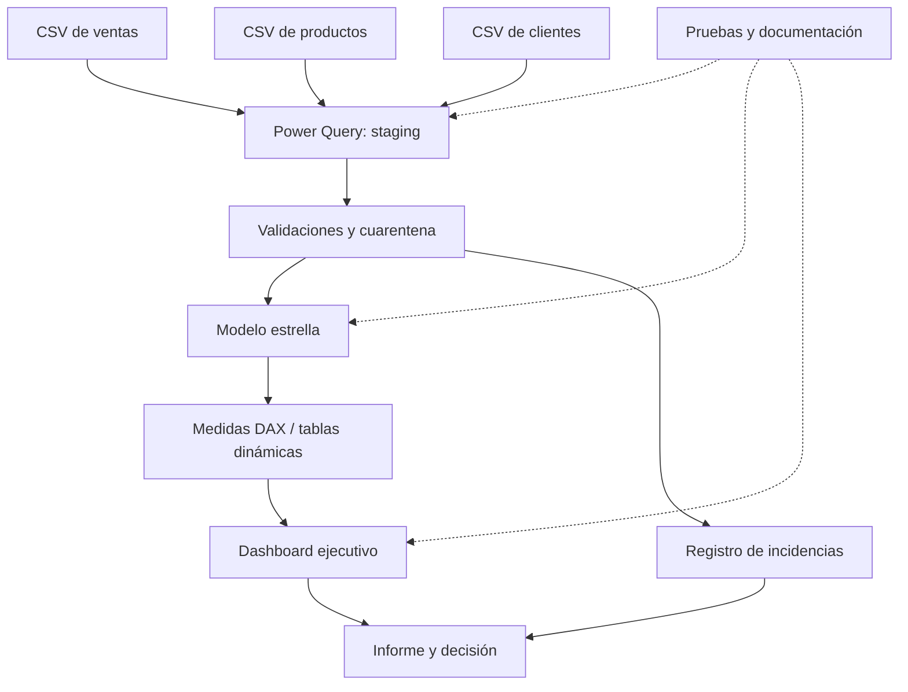
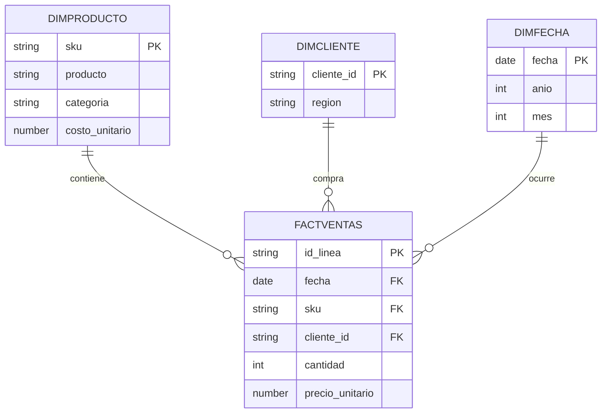
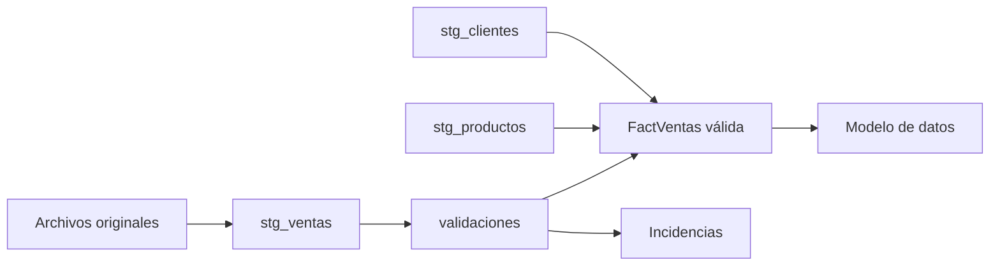
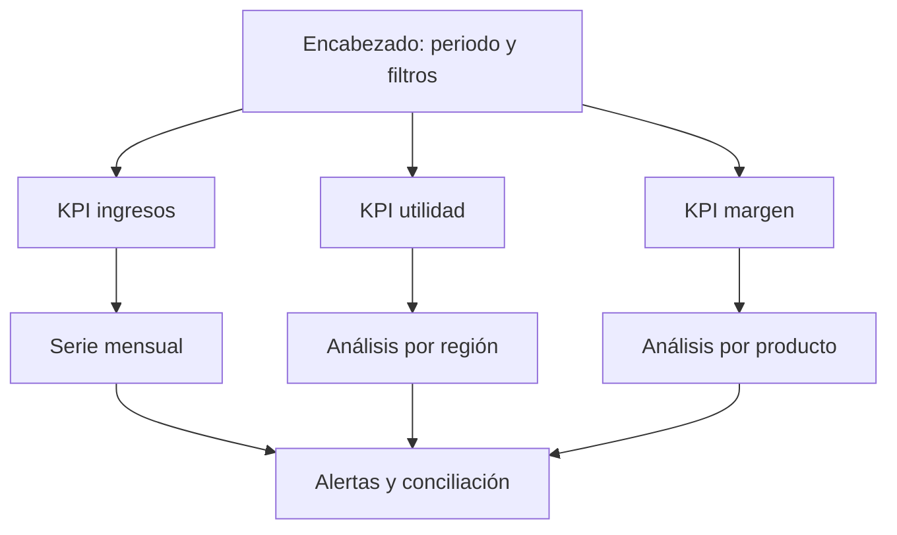

# H24 — Proyecto integrador: Sistema de análisis y gestión empresarial

**Curso integral de Excel — Módulo H24/24 | Roadmap aprobado v2.0**

**Modalidad:** proyecto de cierre profesional, reproducible, con teoría aplicada, prácticas, auditoría y evaluación. **Duración sugerida:** 35–50 horas. **Nivel:** integrador avanzado. **Herramientas:** Excel de escritorio con Power Query, tablas dinámicas y, si está disponible, Power Pivot/Modelo de datos. **Datos:** enteramente ficticios.

> **Propósito:** diseñar, construir, verificar y presentar una solución empresarial que transforme transacciones de ventas y costos en decisiones. El entregable debe ser comprensible para la dirección, verificable por auditoría y mantenible por otro analista.

## Secciones oficiales

- **H24.01 — Definición de requerimientos y métricas**
- **H24.02 — Diseño de tablas y datos de prueba**
- **H24.03 — Importación y limpieza**
- **H24.04 — Fórmulas, consultas y reglas de validación**
- **H24.05 — Modelado de relaciones y análisis**
- **H24.06 — Dashboard y reportes**
- **H24.07 — Protección, colaboración y documentación**
- **H24.08 — Pruebas, auditoría y presentación de resultados**

## Resultados de aprendizaje

1. Traducir necesidades de negocio en indicadores con definiciones matemáticas y criterios de aceptación.
2. Diseñar tablas de hechos, dimensiones y diccionarios de datos con claves y granularidad explícitas.
3. Construir un proceso ETL reproducible, conservando evidencia de registros rechazados.
4. Aplicar fórmulas de Excel, consultas M y medidas DAX según el contexto.
5. Crear reportes interactivos sin confundir filtros de visualización con controles de seguridad.
6. Auditar totales, integridad, calidad, actualización y desempeño.
7. Documentar la operación y comunicar hallazgos con sus límites.

## Arquitectura de referencia



## Alcance, supuestos y límites

El escenario simula una comercializadora pequeña que vende productos a clientes de tres regiones. Cada fila de ventas es una **línea de transacción**, no necesariamente un pedido completo. Se utilizarán importes en MXN y costos unitarios constantes en el conjunto didáctico. No se modelan impuestos, devoluciones, descuentos, fletes, inventario físico ni tipo de cambio: deberán añadirse como requisitos si el negocio real los necesita. Las fechas del dataset corresponden a 2026.

**Principio de calidad:** nunca ocultar registros problemáticos simplemente para que el total del dashboard parezca correcto.


# H24.01 — Definición de requerimientos y métricas

## 24.1.1 — Problema de negocio y partes interesadas

La dirección necesita identificar cuánto vende, qué productos contribuyen al margen, qué regiones concentran los ingresos y si los datos se pueden utilizar para decisiones. Finanzas exige conciliación; operaciones necesita identificar errores; TI requiere que el sistema sea actualizable y seguro.

| Interesado | Pregunta | Entregable | Frecuencia |
|---|---|---|---|
| Dirección | ¿Ingresos, margen y tendencia? | Dashboard | Mensual |
| Comercial | ¿Qué región y producto destacan? | Tabla dinámica y gráfico | Semanal |
| Finanzas | ¿Cuadran los totales? | Hoja de conciliación | Cada actualización |
| Operaciones | ¿Qué registros fallaron? | Bitácora de incidencias | Cada carga |
| TI / analista | ¿Cómo se mantiene? | Manual técnico | Ante cambios |

## 24.1.2 — Requerimientos funcionales y no funcionales

**Funcionales:** cargar ventas y catálogos; detectar errores; enriquecer con dimensiones; calcular ingresos, costo y utilidad; filtrar por mes, región y producto; exportar reporte.

**No funcionales:** resultados deterministas con la misma entrada; trazabilidad de cada fila; actualización documentada; tiempo de respuesta razonable; acceso acorde a clasificación de datos; compatibilidad definida por plataforma; recuperación de versiones.

## 24.1.3 — Definición rigurosa de KPI

| KPI | Fórmula | Unidad | Denominador o alcance |
|---|---|---|---|
| Ingresos | Σ(cantidad × precio unitario) | MXN | Líneas válidas |
| Costo de ventas | Σ(cantidad × costo unitario) | MXN | Líneas válidas |
| Utilidad bruta | Ingresos − costo de ventas | MXN | Antes de gastos operativos |
| Margen bruto | Utilidad bruta / Ingresos | % | Ingresos ≠ 0 |
| Unidades | Σcantidad | unidades | Líneas válidas |
| Líneas válidas | Recuento de IDs de línea | líneas | Sin rechazos |
| Ticket promedio | Ingresos / pedidos distintos | MXN/pedido | Solo si existe ID de pedido |
| Participación regional | Ingresos región / ingresos totales | % | Mismo filtro temporal |

**Advertencia:** en el dataset se incluye `id_linea`, no `id_pedido`; por tanto, **no** calcularemos ticket promedio por pedido. El promedio por línea sí puede calcularse, pero debe etiquetarse correctamente.

## 24.1.4 — Criterios de aceptación

- CA-01: los ingresos del modelo coinciden con el cálculo independiente de control.
- CA-02: ninguna línea con producto o cliente inexistente entra en el reporte validado.
- CA-03: toda exclusión aparece en una tabla de incidencias con motivo.
- CA-04: los filtros cambian gráficos y KPI conectados de forma coherente.
- CA-05: una nueva fila válida aparece después de actualizar, sin editar manualmente fórmulas del reporte.
- CA-06: el manual explica cómo reproducir, actualizar y revertir la solución.

## 24.1.5 — Ejercicio de definición

**Caso:** el gerente solicita «ventas promedio por cliente». Antes de implementar, especifica si es promedio de ingresos por cliente activo, por cliente del catálogo o por pedido. Define periodo, filtros y tratamiento de clientes sin ventas. **Solución:** las tres definiciones son distintas; debe acordarse el denominador y documentarse antes de publicar un KPI.


# H24.02 — Diseño de tablas y datos de prueba

## 24.2.1 — Modelo lógico y granularidad

Diseñaremos `FactVentas` con una fila por línea; `DimProducto` con una fila por SKU; `DimCliente` con una fila por cliente; y `DimFecha` con una fila por fecha. Las dimensiones deben tener claves únicas. En este ejercicio no se necesita una tabla puente.



## 24.2.2 — Archivos de prueba

Guardar cada bloque como archivo `.csv` con codificación UTF-8 y separador coma. Importar SKU e identificadores como **texto**. En Power Query, convertir decimales con cultura que reconozca el punto decimal (`en-US` en estos ejemplos).

**`productos.csv`**

```csv
sku,producto,categoria,costo_unitario
001,Teclado,Perifericos,250
002,Mouse,Perifericos,120
003,Monitor,Pantallas,1800
004,Base,Accesorios,300
```

**`clientes.csv`**

```csv
cliente_id,region
C01,Norte
C02,Sur
C03,Centro
C04,Norte
```

**`ventas_2026_01.csv`**

```csv
id_linea,fecha,sku,cliente_id,cantidad,precio_unitario
L001,2026-01-05,001,C01,3,400
L002,2026-01-08,002,C02,5,200
L003,2026-01-15,003,C03,2,2500
L004,2026-01-22,004,C04,4,500
```

**`ventas_2026_02.csv`**

```csv
id_linea,fecha,sku,cliente_id,cantidad,precio_unitario
L005,2026-02-03,001,C02,2,400
L006,2026-02-10,003,C01,1,2500
L007,2026-02-14,002,C04,6,200
L008,2026-02-23,004,C03,3,500
```

**`ventas_2026_03.csv`**

```csv
id_linea,fecha,sku,cliente_id,cantidad,precio_unitario
L009,2026-03-02,003,C02,1,2500
L010,2026-03-12,001,C03,5,400
L011,2026-03-18,002,C01,4,200
L012,2026-03-26,004,C04,2,500
```

## 24.2.3 — Diccionario de datos

| Campo | Tipo lógico | Regla | Ejemplo |
|---|---|---|---|
| id_linea | texto | único, no vacío | L001 |
| fecha | fecha | válida | 2026-01-05 |
| sku | texto | existe en DimProducto | 001 |
| cliente_id | texto | existe en DimCliente | C01 |
| cantidad | entero | mayor que cero | 3 |
| precio_unitario | decimal | ≥ 0 | 400 |
| costo_unitario | decimal | ≥ 0 | 250 |
| region | texto | dominio controlado | Norte |

## 24.2.4 — Resultados esperados

| Métrica | Enero | Febrero | Marzo | Total |
|---|---:|---:|---:|---:|
| Ingresos | 9200 | 6000 | 6300 | **21500** |
| Costo | 6150 | 3920 | 4130 | **14200** |
| Utilidad bruta | 3050 | 2080 | 2170 | **7300** |
| Unidades | 14 | 12 | 12 | **38** |
| Líneas | 4 | 4 | 4 | **12** |

**Comprobación independiente:** `21500 − 14200 = 7300`; margen bruto = `7300 / 21500 ≈ 33,95%`.

**Por región:** Norte 8700; Sur 4300; Centro 8500. **Por producto:** Teclado 4000; Mouse 3000; Monitor 10000; Base 4500. Estos valores son los oráculos de prueba del modelo.

## 24.2.5 — Casos negativos adicionales

Crea una copia separada `ventas_incidencias.csv` con registros deliberadamente inválidos; **no** los agregues a la base limpia de control.

```csv
id_linea,fecha,sku,cliente_id,cantidad,precio_unitario
L013,2026-03-30,999,C01,2,100
L014,2026-03-30,001,C99,1,400
L015,2026-03-30,002,C02,-2,200
L016,fecha_invalida,003,C03,1,2500
L001,2026-01-05,001,C01,3,400
```

**Resultados:** 5 filas de prueba con incidencias: SKU huérfano, cliente huérfano, cantidad negativa, fecha inválida e ID duplicado respecto al histórico. Las reglas pueden generar múltiples motivos por fila; separar *cantidad de filas rechazadas* de *cantidad de infracciones*.


# H24.03 — Importación y limpieza

## 24.3.1 — Diseño ETL por capas



**Staging:** representa el origen con cambios mínimos y una columna `archivo_origen`. **Validación:** comprueba esquema, tipos, unicidad, dominio e integridad referencial. **Salida:** hechos válidos y rechazos auditables.

## 24.3.2 — Importar desde carpeta

1. Guardar los tres archivos mensuales en una carpeta exclusiva de ventas.
2. Datos → Obtener datos → Desde archivo → Desde carpeta (la ruta exacta de menú puede variar).
3. Filtrar por extensión `.csv` y patrón `ventas_2026_` para no mezclar catálogos o incidencias.
4. Combinar archivos, revisar la función de archivo de muestra y conservar `Name` como `archivo_origen`.
5. Establecer tipos explícitos: `id_linea`, `sku`, `cliente_id` como texto; `fecha` como fecha; cantidad como entero; precio como decimal.
6. Revisar recuentos y errores antes de cargar.

## 24.3.3 — Ejemplo M: transformación de un archivo CSV

```powerquery
let
    Origen = Csv.Document(
        File.Contents("C:\CursoH24\ventas_2026_01.csv"),
        [Delimiter=",", Columns=6, Encoding=65001, QuoteStyle=QuoteStyle.Csv]
    ),
    Encabezados = Table.PromoteHeaders(Origen, [PromoteAllScalars=true]),
    Tipos = Table.TransformColumnTypes(
        Encabezados,
        {{"id_linea", type text}, {"fecha", type date},
         {"sku", type text}, {"cliente_id", type text},
         {"cantidad", Int64.Type}, {"precio_unitario", type number}},
        "en-US"
    )
in
    Tipos
```

**Explicación:** `File.Contents` lee bytes; `Csv.Document` interpreta filas y columnas; `Table.PromoteHeaders` convierte encabezados; `Table.TransformColumnTypes` asigna tipos. La ruta es local y debe parametrizarse para uso real. Este ejemplo sirve para un archivo; la consulta de carpeta requiere además combinar múltiples archivos.

## 24.3.4 — Normalización y control

Para claves, aplicar `Text.Trim` sin eliminar ceros iniciales. Evitar convertir `sku` a número. No corregir IDs desconocidos mediante aproximación automática: primero registrar el problema y confirmar con el propietario del catálogo.

```powerquery
Table.TransformColumns(
    Tabla,
    {{"sku", each if _ = null then null else Text.Trim(_), type text},
     {"cliente_id", each if _ = null then null else Text.Trim(_), type text}}
)
```

**Deduplicación:** `id_linea` es la clave de línea. Antes de quitar duplicados, construir un reporte de IDs repetidos y definir qué fila sobrevive. No usar `Table.Distinct` indiscriminadamente cuando los duplicados contienen importes distintos.

## 24.3.5 — Rendimiento y privacidad

Filtrar pronto, elegir conectores adecuados, fijar tipos y dividir consultas complejas en módulos son prácticas recomendadas por Microsoft. *Query folding* puede delegar operaciones al origen cuando el conector y las transformaciones lo permiten; los archivos CSV no ofrecen un motor de consulta que procese estas operaciones. Configurar niveles de privacidad según la sensibilidad de cada fuente y no desactivarlos para resolver errores sin evaluar el riesgo. [Fuentes oficiales al final del documento].

## 24.3.6 — Laboratorio

Importar las 12 líneas, anexar meses y confirmar `12` registros sin errores. Luego incorporar el archivo de incidencias y separar 5 filas problemáticas. **No** exigir que una única comprobación de tipo detecte todos los problemas: la integridad referencial y la unicidad necesitan reglas adicionales.


# H24.04 — Fórmulas, consultas y reglas de validación

## 24.4.1 — Elegir dónde calcular

| Cálculo | Lugar recomendado | Motivo |
|---|---|---|
| Tipos y limpieza | Power Query | Repetible al actualizar |
| Validación de claves | Power Query / modelo | Detecta filas huérfanas |
| Importe por línea | Power Query o columna de hechos | Cálculo determinista |
| KPI con filtros | Medida DAX | Respeta contexto de filtro |
| Control rápido | Fórmula Excel | Verificación independiente |
| Interfaz de captura | Validación de datos Excel | Previene ciertos errores de entrada |

## 24.4.2 — Fórmulas en tablas de Excel

Si la tabla de hechos incluye `cantidad`, `precio_unitario` y `costo_unitario`:

```excel
=[@cantidad]*[@precio_unitario]
=[@cantidad]*[@costo_unitario]
=[@Ingreso]-[@Costo]
```

Estas fórmulas corresponden respectivamente a las columnas `Ingreso`, `Costo` y `Utilidad` y deben colocarse en ese orden. En una tabla estructurada, Excel puede propagar automáticamente fórmulas calculadas.

**Conciliación con funciones:**

```excel
=SUMA(FactVentas[Ingreso])
=SUMA(FactVentas[Costo])
=SUMA(FactVentas[Utilidad])
=SI(SUMA(FactVentas[Ingreso])=21500;"OK";"REVISAR")
```

## 24.4.3 — Reglas de negocio

- `id_linea` no vacío y único.
- `sku` debe existir exactamente una vez en catálogo.
- `cliente_id` debe existir exactamente una vez en clientes.
- `cantidad` entera y mayor que cero.
- `precio_unitario` y `costo_unitario` no negativos.
- `fecha` debe ser válida y dentro del periodo acordado.
- Los importes se calculan a partir de valores de origen; no se reescriben para cuadrar un total.

## 24.4.4 — Validación de datos y límites

La validación de datos en celdas puede restringir entradas interactivas, pero no sustituye las comprobaciones del pipeline: los datos importados o pegados requieren revisión. La protección de hoja sirve principalmente para prevenir cambios no deseados, no para asegurar información confidencial.

## 24.4.5 — Detección de anomalías

Agregar indicadores de precio cero, cantidades extraordinarias y fechas futuras según reglas explícitas. Un valor extremo no implica necesariamente error; puede ser un pedido legítimo. Evitar borrarlo automáticamente.

## 24.4.6 — Ejercicio

Una línea tiene cantidad 5, precio 400 y costo 250. **Ingreso:** 2000; **costo:** 1250; **utilidad:** 750; **margen bruto:** 37,5%. Comprobar cada paso y distinguir margen (`utilidad/ingreso`) de recargo (`utilidad/costo`).


# H24.05 — Modelado de relaciones y análisis

## 24.5.1 — Esquema estrella

Crear relaciones `DimProducto[sku]` 1→* `FactVentas[sku]`, `DimCliente[cliente_id]` 1→* `FactVentas[cliente_id]`, `DimFecha[fecha]` 1→* `FactVentas[fecha]`. Verificar unicidad y ausencia de claves nulas en el lado «uno».

**No crear relaciones muchos-a-muchos para resolver catálogos duplicados**: primero corregir el modelo o establecer la entidad y cardinalidad correctas.

## 24.5.2 — Dimensión de fechas

Una tabla calendario debe cubrir todas las fechas del periodo analizado y tener una fila por día. Campos recomendados: Fecha, Año, MesNúmero, MesNombre, AñoMes, Trimestre. Ordenar MesNombre por MesNúmero; agrupar por AñoMes para no mezclar años.

## 24.5.3 — Medidas DAX

En Power Pivot / Modelo de datos, con tablas y nombres como los definidos:

```dax
Ingresos := SUMX(FactVentas, FactVentas[cantidad] * FactVentas[precio_unitario])

Costo Ventas := SUMX(
    FactVentas,
    FactVentas[cantidad] * RELATED(DimProducto[costo_unitario])
)

Utilidad Bruta := [Ingresos] - [Costo Ventas]

Margen Bruto := DIVIDE([Utilidad Bruta], [Ingresos])

Unidades := SUM(FactVentas[cantidad])

Lineas := COUNTROWS(FactVentas)
```

**Requisitos:** relaciones activas y válidas; costos unitarios de catálogo con la vigencia correcta. El costo histórico no debe recalcularse con el costo actual cuando el catálogo cambia: en producción, registrar costo transaccional o utilizar una dimensión histórica.

## 24.5.4 — Contexto de evaluación

Una medida DAX responde al contexto de filtro del informe. `SUMX` evalúa una expresión fila a fila y suma resultados; `RELATED` obtiene un valor de una dimensión relacionada desde la fila de hechos. `DIVIDE` gestiona divisiones entre cero de forma más segura que `/` en medidas.

**Error frecuente:** sumar márgenes porcentuales por línea. El margen total correcto es `SUM(Utilidad)/SUM(Ingreso)`, no la suma ni necesariamente el promedio simple de márgenes.

## 24.5.5 — Análisis multidimensional

Crear tabla dinámica con región en filas y mes en columnas; valores Ingresos y Utilidad Bruta. Verificar que la suma por región y mes reconcilia con el total 21500. Añadir categoría de producto como segmentador cuando el entorno lo permita.

## 24.5.6 — Ejercicio

Para la región Norte: L001 1200, L004 2000, L006 2500, L007 1200, L011 800, L012 1000; total **8700**. Comprueba que el cálculo no depende de ordenar físicamente los registros.


# H24.06 — Dashboard y reportes

## 24.6.1 — Diseño de información



## 24.6.2 — Componentes obligatorios

1. Tarjetas: Ingresos, Costo, Utilidad, Margen, Unidades y Líneas.
2. Gráfico de líneas o columnas: Ingresos por mes.
3. Barras horizontales: Ingresos por producto.
4. Columnas agrupadas: Ingresos y utilidad por región.
5. Tabla de incidencias: errores por motivo y archivo.
6. Segmentadores: Región, Categoría y Mes, si están disponibles.
7. Pie: fecha de actualización, moneda, fuente, versión y definiciones.

## 24.6.3 — Principios de visualización

No truncar arbitrariamente ejes de barras; etiquetar MXN y porcentajes; mantener colores consistentes; no depender solo del color; mostrar el denominador de las tasas; no añadir gráficos 3D sin justificación. Un dashboard debe facilitar decisiones, no maximizar la cantidad de elementos.

## 24.6.4 — Resultados que debe comunicar

- **Ingresos:** 21500 MXN.
- **Utilidad bruta:** 7300 MXN.
- **Margen bruto:** aproximadamente 33,95%.
- **Mayor producto por ingresos:** Monitor, 10000 MXN.
- **Mayor región por ingresos:** Norte, 8700 MXN.
- **Mayor mes por ingresos:** Enero, 9200 MXN.

No inferir que el mes con más ingresos es el más rentable sin comparar costos y margen.

## 24.6.5 — Prueba de interacción

Seleccionar Sur en el segmentador: Ingresos esperados **4300**. Seleccionar producto Monitor: Ingresos esperados **10000**. Al limpiar filtros, regresar a 21500. Si una visualización no responde, revisar conexiones y contexto.

## 24.6.6 — Exportación y presentación

Preparar área de impresión, orientación, escalado y notas. Exportar a PDF solo después de comprobar cortes de página y legibilidad. El PDF es un informe estático, no reemplaza el libro interactivo.


# H24.07 — Protección, colaboración y documentación

## 24.7.1 — Modelo de responsabilidades

| Rol | Puede | No debe |
|---|---|---|
| Analista | Mantener consultas y medidas | Alterar datos fuente sin registro |
| Finanzas | Validar conciliaciones | Reescribir controles sin evidencia |
| Dirección | Consultar resultados | Modificar consultas de producción |
| TI | Gestionar permisos y respaldos | Compartir credenciales en el libro |

## 24.7.2 — Seguridad real frente a protección de interfaz

La **protección de hoja** reduce cambios accidentales, pero Microsoft aclara que no está diseñada como una característica de seguridad para proteger datos sensibles. Los permisos de almacenamiento, el control de acceso, el cifrado apropiado y la clasificación de información son controles diferentes. No confiar en hojas ocultas, filtros ni contraseñas de protección de celdas para restringir información confidencial.

## 24.7.3 — Fuentes y credenciales

- Utilizar cuentas y permisos mínimos necesarios.
- No incrustar contraseñas, API keys ni tokens en M, VBA, celdas o documentación compartida.
- Configurar correctamente los niveles de privacidad de Power Query.
- Revisar rutas absolutas, nombres de origen y acceso al migrar de equipo.
- No publicar un libro con datos personales de clientes sin autorización.

## 24.7.4 — Control de versiones y cambios

Registrar versión, fecha, responsable, cambio, motivo, pruebas y resultado. Una copia de seguridad debe poder restaurarse. Mantener datos originales separados de los derivados.

## 24.7.5 — Manual de operación

1. Ubicar carpeta de fuentes y verificar estructura de archivos.
2. Revisar permisos de lectura y conexiones.
3. Importar/actualizar Power Query.
4. Revisar tabla de incidencias.
5. Actualizar modelo de datos y tablas dinámicas.
6. Ejecutar conciliación de ingresos y costos.
7. Comprobar filtros y gráficos.
8. Registrar fecha, versión y responsable.
9. Publicar reporte solo si todas las pruebas críticas pasan.

## 24.7.6 — Manual técnico

Documentar diagrama de datos, claves, cardinalidades, consultas, pasos M, medidas DAX, fuentes, supuestos, límites, parámetros, esquema de carpetas, dependencias y procedimientos de recuperación.

## 24.7.7 — Colaboración y revisión

Establecer revisión por pares antes de modificar KPI o relaciones. Separar entorno de desarrollo y versión publicada. Definir quién aprueba cambios de reglas de negocio.


# H24.08 — Pruebas, auditoría y presentación de resultados

## 24.8.1 — Estrategia de pruebas

**Pruebas unitarias:** fórmulas y reglas individuales. **Pruebas de integración:** uniones y relaciones. **Pruebas de regresión:** comparar contra valores esperados tras cambios. **Pruebas de aceptación:** validar que el dashboard responda preguntas del negocio. **Pruebas de actualización:** verificar la incorporación de nuevos registros.

## 24.8.2 — Matriz de pruebas obligatorias

| ID | Prueba | Esperado |
|---|---|---|
| T01 | Filas originales válidas | 12 |
| T02 | Total ingresos | 21500 |
| T03 | Total costo | 14200 |
| T04 | Total utilidad | 7300 |
| T05 | Margen bruto | ≈33,95% |
| T06 | Unidades | 38 |
| T07 | Enero | 9200 |
| T08 | Febrero | 6000 |
| T09 | Marzo | 6300 |
| T10 | Norte | 8700 |
| T11 | Sur | 4300 |
| T12 | Centro | 8500 |
| T13 | Monitor | 10000 |
| T14 | Incidencias de prueba | 5 filas rechazadas |
| T15 | Total con filtro Sur | 4300 |
| T16 | Total tras limpiar filtros | 21500 |
| T17 | Archivo nuevo válido | aparece tras actualizar |
| T18 | Protección de hoja | no sustituye permisos reales |
| T19 | Cambiar costo de catálogo | activar revisión de costo histórico |
| T20 | Cero ingresos | margen no muestra división inválida |

## 24.8.3 — Conciliación

Comprobar tres identidades:

`Ingresos = Σ por mes = Σ por región = Σ por producto = 21500`.

`Utilidad = Ingresos − Costo = 21500 − 14200 = 7300`.

`Filas procesadas = filas válidas + filas rechazadas` siempre que el flujo no genere o duplique filas y se mida en el mismo punto del pipeline.

## 24.8.4 — Prueba de actualización

Añade una línea nueva `L017,2026-04-02,001,C01,2,400` en un archivo mensual de abril. **Ingreso incremental:** 800; **costo incremental:** 500; **utilidad incremental:** 300. Nuevos totales: ingresos **22300**, costo **14700**, utilidad **7600**, unidades **40**, líneas **13**. Actualizar y comprobar todas las salidas; después restaurar los archivos originales para volver al baseline de 21500.

## 24.8.5 — Auditoría de fórmulas y modelos

Buscar referencias rotas, divisiones por cero, tipos inconsistentes, relaciones ambiguas, filtros activos, duplicados de dimensión, medidas que promedian porcentajes y errores ocultados con `SI.ERROR` sin justificación. Auditar que no existan credenciales en consultas ni datos confidenciales en cachés distribuidas.

## 24.8.6 — Presentación ejecutiva

**Estructura de diez minutos:** problema (1 min), fuentes y calidad (2 min), KPI (2 min), desglose regional y producto (2 min), riesgos y limitaciones (1 min), recomendación y siguientes pasos (2 min). Toda conclusión debe apoyarse en un cálculo o visualización trazable.

## 24.8.7 — Entrega final

- Libro Excel terminado (`.xlsx`, sin macros para este proyecto).
- Carpeta con CSV originales y casos negativos.
- Documento de requerimientos y diccionario de datos.
- Diagrama de modelo, consultas M y medidas DAX.
- Matriz de pruebas ejecutadas con evidencias.
- Manual de actualización y control de versiones.
- Presentación ejecutiva o informe de resultados.

**Nota de plataforma:** Power Pivot y algunas características del Modelo de datos no están disponibles del mismo modo en todas las ediciones o sistemas operativos. Documentar las limitaciones del entorno usado y proponer alternativa con tablas dinámicas y fórmulas si es necesario.


# Ejercicios — 24 actividades (3 por sección)

**Método:** resolver antes de consultar el solucionario. Para cada ejercicio presentar fórmula, consulta, tabla, explicación o captura, según corresponda.


### Ejercicio E01 — H24.01

**Enunciado:** ¿Por qué definir un KPI antes de construir el dashboard?

**Entregable:** respuesta verificable con razonamiento y referencia al dato o regla aplicable.


### Ejercicio E02 — H24.01

**Enunciado:** ¿Qué diferencia existe entre promedio por línea y ticket promedio por pedido?

**Entregable:** respuesta verificable con razonamiento y referencia al dato o regla aplicable.


### Ejercicio E03 — H24.01

**Enunciado:** ¿Cuál es la utilidad bruta si ingresos son 21500 y costos 14200?

**Entregable:** respuesta verificable con razonamiento y referencia al dato o regla aplicable.


### Ejercicio E04 — H24.02

**Enunciado:** ¿Cuál es la granularidad de FactVentas?

**Entregable:** respuesta verificable con razonamiento y referencia al dato o regla aplicable.


### Ejercicio E05 — H24.02

**Enunciado:** ¿Por qué SKU debe conservarse como texto?

**Entregable:** respuesta verificable con razonamiento y referencia al dato o regla aplicable.


### Ejercicio E06 — H24.02

**Enunciado:** ¿Cuántas filas y unidades tiene el conjunto base?

**Entregable:** respuesta verificable con razonamiento y referencia al dato o regla aplicable.


### Ejercicio E07 — H24.03

**Enunciado:** ¿Por qué separar staging y salida validada?

**Entregable:** respuesta verificable con razonamiento y referencia al dato o regla aplicable.


### Ejercicio E08 — H24.03

**Enunciado:** ¿Por qué no usar Table.Distinct sin analizar las claves?

**Entregable:** respuesta verificable con razonamiento y referencia al dato o regla aplicable.


### Ejercicio E09 — H24.03

**Enunciado:** ¿Qué significa query folding?

**Entregable:** respuesta verificable con razonamiento y referencia al dato o regla aplicable.


### Ejercicio E10 — H24.04

**Enunciado:** Calcula ingreso, costo y utilidad de cinco teclados.

**Entregable:** respuesta verificable con razonamiento y referencia al dato o regla aplicable.


### Ejercicio E11 — H24.04

**Enunciado:** ¿Qué hace una validación de datos en una celda?

**Entregable:** respuesta verificable con razonamiento y referencia al dato o regla aplicable.


### Ejercicio E12 — H24.04

**Enunciado:** ¿Por qué no ocultar errores con SI.ERROR indiscriminadamente?

**Entregable:** respuesta verificable con razonamiento y referencia al dato o regla aplicable.


### Ejercicio E13 — H24.05

**Enunciado:** ¿Qué relación debe existir entre DimProducto y FactVentas?

**Entregable:** respuesta verificable con razonamiento y referencia al dato o regla aplicable.


### Ejercicio E14 — H24.05

**Enunciado:** ¿Por qué no promediar márgenes porcentuales sin ponderación?

**Entregable:** respuesta verificable con razonamiento y referencia al dato o regla aplicable.


### Ejercicio E15 — H24.05

**Enunciado:** ¿Cuánto vende la región Norte?

**Entregable:** respuesta verificable con razonamiento y referencia al dato o regla aplicable.


### Ejercicio E16 — H24.06

**Enunciado:** ¿Qué KPI principal debe mostrar el dashboard?

**Entregable:** respuesta verificable con razonamiento y referencia al dato o regla aplicable.


### Ejercicio E17 — H24.06

**Enunciado:** ¿Qué ocurre al filtrar Sur?

**Entregable:** respuesta verificable con razonamiento y referencia al dato o regla aplicable.


### Ejercicio E18 — H24.06

**Enunciado:** ¿Qué producto genera más ingresos?

**Entregable:** respuesta verificable con razonamiento y referencia al dato o regla aplicable.


### Ejercicio E19 — H24.07

**Enunciado:** ¿Proteger una hoja equivale a proteger datos confidenciales?

**Entregable:** respuesta verificable con razonamiento y referencia al dato o regla aplicable.


### Ejercicio E20 — H24.07

**Enunciado:** ¿Qué se debe registrar en un cambio de versión?

**Entregable:** respuesta verificable con razonamiento y referencia al dato o regla aplicable.


### Ejercicio E21 — H24.07

**Enunciado:** ¿Dónde se almacenan las credenciales?

**Entregable:** respuesta verificable con razonamiento y referencia al dato o regla aplicable.


### Ejercicio E22 — H24.08

**Enunciado:** ¿Cuál es la conciliación de ingresos?

**Entregable:** respuesta verificable con razonamiento y referencia al dato o regla aplicable.


### Ejercicio E23 — H24.08

**Enunciado:** ¿Cuáles son los nuevos ingresos tras añadir L017?

**Entregable:** respuesta verificable con razonamiento y referencia al dato o regla aplicable.


### Ejercicio E24 — H24.08

**Enunciado:** ¿Qué evidencia mínima acompaña una prueba?

**Entregable:** respuesta verificable con razonamiento y referencia al dato o regla aplicable.


# Solucionario — 24 respuestas separadas


### Solución E01

Porque unidad, denominador, periodo, filtros y alcance deben estar acordados para evitar métricas ambiguas.

**Control:** comprobar el criterio frente al diccionario de datos, el requisito correspondiente y las pruebas T01–T20.


### Solución E02

El primero divide entre líneas; el segundo entre pedidos distintos. El dataset no incluye ID de pedido.

**Control:** comprobar el criterio frente al diccionario de datos, el requisito correspondiente y las pruebas T01–T20.


### Solución E03

7300 MXN.

**Control:** comprobar el criterio frente al diccionario de datos, el requisito correspondiente y las pruebas T01–T20.


### Solución E04

Una fila por línea de transacción.

**Control:** comprobar el criterio frente al diccionario de datos, el requisito correspondiente y las pruebas T01–T20.


### Solución E05

Porque puede contener ceros iniciales y es un identificador, no una cantidad.

**Control:** comprobar el criterio frente al diccionario de datos, el requisito correspondiente y las pruebas T01–T20.


### Solución E06

12 filas y 38 unidades.

**Control:** comprobar el criterio frente al diccionario de datos, el requisito correspondiente y las pruebas T01–T20.


### Solución E07

Permite preservar evidencia original, repetir transformaciones y auditar exclusiones.

**Control:** comprobar el criterio frente al diccionario de datos, el requisito correspondiente y las pruebas T01–T20.


### Solución E08

Podría eliminar transacciones legítimas o seleccionar arbitrariamente una versión.

**Control:** comprobar el criterio frente al diccionario de datos, el requisito correspondiente y las pruebas T01–T20.


### Solución E09

Delegar al origen transformaciones compatibles; CSV no puede ejecutarlas en el origen.

**Control:** comprobar el criterio frente al diccionario de datos, el requisito correspondiente y las pruebas T01–T20.


### Solución E10

Ingreso 2000; costo 1250; utilidad 750.

**Control:** comprobar el criterio frente al diccionario de datos, el requisito correspondiente y las pruebas T01–T20.


### Solución E11

Restringe ciertas entradas interactivas, pero no sustituye controles de datos importados.

**Control:** comprobar el criterio frente al diccionario de datos, el requisito correspondiente y las pruebas T01–T20.


### Solución E12

Porque puede enmascarar defectos de fuente o de lógica.

**Control:** comprobar el criterio frente al diccionario de datos, el requisito correspondiente y las pruebas T01–T20.


### Solución E13

Uno a muchos por SKU, con SKU único en la dimensión.

**Control:** comprobar el criterio frente al diccionario de datos, el requisito correspondiente y las pruebas T01–T20.


### Solución E14

El margen global es utilidad total dividida entre ingresos totales.

**Control:** comprobar el criterio frente al diccionario de datos, el requisito correspondiente y las pruebas T01–T20.


### Solución E15

8700 MXN.

**Control:** comprobar el criterio frente al diccionario de datos, el requisito correspondiente y las pruebas T01–T20.


### Solución E16

Ingresos 21500, costo 14200, utilidad 7300 y margen ≈33,95%.

**Control:** comprobar el criterio frente al diccionario de datos, el requisito correspondiente y las pruebas T01–T20.


### Solución E17

Ingresos 4300 MXN.

**Control:** comprobar el criterio frente al diccionario de datos, el requisito correspondiente y las pruebas T01–T20.


### Solución E18

Monitor, 10000 MXN.

**Control:** comprobar el criterio frente al diccionario de datos, el requisito correspondiente y las pruebas T01–T20.


### Solución E19

No; la protección de hoja no es una medida de seguridad de datos.

**Control:** comprobar el criterio frente al diccionario de datos, el requisito correspondiente y las pruebas T01–T20.


### Solución E20

Responsable, fecha, cambio, motivo, pruebas y resultado.

**Control:** comprobar el criterio frente al diccionario de datos, el requisito correspondiente y las pruebas T01–T20.


### Solución E21

En mecanismos seguros de autenticación, nunca en celdas ni código compartido.

**Control:** comprobar el criterio frente al diccionario de datos, el requisito correspondiente y las pruebas T01–T20.


### Solución E22

La suma por mes, región y producto debe ser 21500.

**Control:** comprobar el criterio frente al diccionario de datos, el requisito correspondiente y las pruebas T01–T20.


### Solución E23

22300 MXN.

**Control:** comprobar el criterio frente al diccionario de datos, el requisito correspondiente y las pruebas T01–T20.


### Solución E24

Identificador, entrada, resultado esperado, resultado observado, estado, fecha y responsable.

**Control:** comprobar el criterio frente al diccionario de datos, el requisito correspondiente y las pruebas T01–T20.


# Laboratorios secuenciales

## Laboratorio L01 — Requerimientos y métricas (2 h)

Redactar una ficha por KPI: nombre, propósito, fórmula, unidad, periodicidad, fuente, propietario, filtros y comportamiento con denominador cero. **Criterio:** ninguna definición ambigua.

## Laboratorio L02 — Modelo de datos (3 h)

Crear las tres tablas de entrada y una dimensión de fechas. Dibujar relaciones y verificar claves únicas. **Criterio:** sin claves huérfanas en las 12 líneas base.

## Laboratorio L03 — ETL mensual (4 h)

Importar los tres CSV mensuales desde carpeta, tipar campos y consolidar. **Criterio:** 12 filas y 21500 de ingresos.

## Laboratorio L04 — Incidencias y cuarentena (3 h)

Agregar el archivo negativo, crear reglas y registrar cinco filas rechazadas. **Criterio:** 12 válidas y cinco rechazadas, sin perder evidencia.

## Laboratorio L05 — Fórmulas y controles (3 h)

Crear Ingreso, Costo y Utilidad y contrastar con fórmulas independientes. **Criterio:** 21500, 14200 y 7300.

## Laboratorio L06 — Relaciones y DAX (4 h)

Construir esquema estrella, crear medidas y comparar totales por región y producto. **Criterio:** mismos totales en todas las agregaciones.

## Laboratorio L07 — Dashboard (4 h)

Diseñar KPI, tres gráficos, filtros y tabla de incidencias. **Criterio:** Sur = 4300, Monitor = 10000, total sin filtros = 21500.

## Laboratorio L08 — Seguridad y documentación (3 h)

Revisar fuentes, permisos, credenciales, privacidad y versionado. **Criterio:** no exponer datos sensibles ni presentar protección de hoja como control de confidencialidad.

## Laboratorio L09 — Regresión y actualización (4 h)

Ejecutar T01–T20; agregar L017 y comprobar 22300/14700/7600; restaurar baseline. **Criterio:** 20 pruebas documentadas y resultados reconciliados.

## Laboratorio L10 — Defensa ejecutiva (2 h)

Presentar hallazgos y limitaciones en diez minutos. **Criterio:** toda afirmación cuantitativa está respaldada por evidencia reproducible.

# Evaluación final y rúbrica

| Dimensión | Puntos |
|---|---:|
| Requerimientos y definiciones | 10 |
| Diseño y calidad de datos | 15 |
| ETL reproducible | 15 |
| Fórmulas y medidas | 15 |
| Modelo y análisis | 15 |
| Dashboard y comunicación | 10 |
| Seguridad y documentación | 10 |
| Pruebas y auditoría | 10 |
| **Total** | **100** |

**Aprobación sugerida:** ≥80/100, sin fallos críticos de conciliación, sin secretos incrustados y con evidencia de las 20 pruebas. Un error crítico de integridad o exposición de datos requiere corrección aunque la puntuación numérica sea alta.

## Preguntas para defensa oral

1. ¿Qué representa una fila del modelo?
2. ¿Cómo se distingue margen de recargo?
3. ¿Qué ocurre si se duplica un SKU en el catálogo?
4. ¿Cómo se rastrea un importe hasta su archivo de origen?
5. ¿Qué significa que una fila esté en cuarentena?
6. ¿Qué cambia si el costo unitario varía con el tiempo?
7. ¿Qué parte del cálculo pertenece a Power Query y cuál a DAX?
8. ¿Qué sucede cuando se filtra una medida?
9. ¿Por qué el filtro de un dashboard no es un control de seguridad?
10. ¿Cómo se recupera una versión anterior del libro?
11. ¿Qué indicadores se validan después de actualizar?
12. ¿Qué limitaciones del modelo deben comunicarse a dirección?

# Fallos frecuentes y diagnóstico

| Síntoma | Causa posible | Acción |
|---|---|---|
| SKU `001` pasa a `1` | Tipado numérico | Importar como texto desde origen |
| Suma duplicada tras merge | Catálogo con claves duplicadas | Validar cardinalidad y unicidad |
| Costo cambia históricamente | Costo actual aplicado a ventas antiguas | Persistir costo de transacción o versionar dimensión |
| Gráfico no cambia con filtro | Segmentador no conectado | Revisar conexiones de informe |
| Meses desordenados | Mes textual sin clave numérica | Ordenar por AñoMes / MesNúmero |
| Margen incorrecto | Promedio de porcentajes | Dividir utilidad total entre ingresos totales |
| Nuevas filas ausentes | Origen o tabla dinámica sin actualizar | Actualizar consultas, modelo y pivotes |
| Error de privacidad | Fuentes con niveles incompatibles | Revisar clasificación; no desactivar protección por defecto |
| Libro demasiado lento | Consultas costosas y cálculos redundantes | Perfilar, filtrar temprano, medir y modularizar |
| Reporte no auditable | Ausencia de IDs y fuente | Conservar linaje y registro de transformaciones |

# Bibliografía y fuentes verificadas

1. Microsoft Learn — **Best practices when working with Power Query**: https://learn.microsoft.com/en-us/power-query/best-practices — conectores, filtros tempranos, tipos, documentación, parámetros y funciones reutilizables.
2. Microsoft Learn — **Understanding Query Evaluation and Query Folding**: https://learn.microsoft.com/en-us/power-query/power-query-folding — condiciones de delegación al origen y límites para CSV.
3. Microsoft Learn — **Privacy Levels in Power Query**: https://learn.microsoft.com/en-us/power-query/privacy-levels — aislamiento y riesgo de transferencia accidental de datos.
4. Microsoft Support — **Protection and security in Excel**: https://support.microsoft.com/en-us/excel/protection-and-security-in-excel — diferencia entre protección de hojas y seguridad de datos.
5. Microsoft Support — **Protect a worksheet**: https://support.microsoft.com/en-us/excel/protect-a-worksheet — prevención de modificaciones, no confidencialidad.
6. Microsoft Learn — **DAX overview**: https://learn.microsoft.com/en-us/dax/dax-overview — lenguaje DAX y contexto de evaluación.
7. Microsoft Learn — **Power Query M formula language**: https://learn.microsoft.com/en-us/powerquery-m/ — referencia de M.
8. Microsoft Support — **Create a PivotTable to analyze worksheet data**: https://support.microsoft.com/en-us/office/create-a-pivottable-to-analyze-worksheet-data-a9a84538-bfe9-40a9-a8e9-f99134456576.

**Estado de verificación:** las referencias oficiales se consultaron para las recomendaciones de Power Query, query folding, privacidad y protección. Las rutas de menús y la disponibilidad de funciones dependen de versión, licencia y sistema operativo. Los ejemplos de M y DAX se presentan como material didáctico y requieren ejecución en Excel para validar comportamiento exacto en el entorno de destino.

# Cierre de la ruta Excel H01–H24

Con H24 se completa la **secuencia curricular de Excel** del roadmap v2.0. Completar la secuencia no implica acreditar dominio automáticamente: la competencia se demuestra entregando el proyecto, ejecutando las pruebas, defendiendo las decisiones de diseño y documentando limitaciones.

**Próxima ruta curricular:** Google Sheets G01–G12, seguida de VBA V01–V15 y Google Apps Script A01–A15, conforme al roadmap aprobado.

