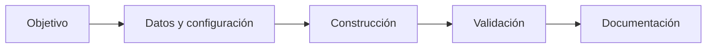
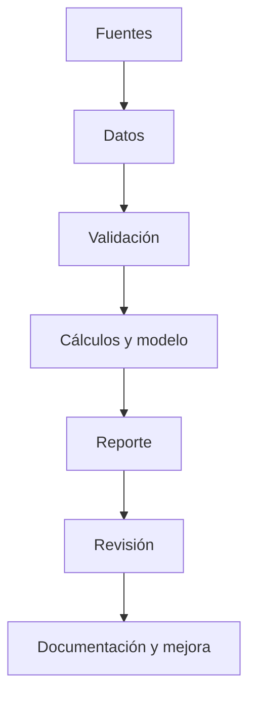

# G04 — Funciones matriciales, QUERY y programación funcional

**Programa aprobado v2.0 · Ruta Google Sheets · G04/G12**

**Nivel:** progresivo (de fundamentos a práctica profesional). **Duración sugerida:** 14–22 horas. **Requisitos:** módulos previos cuando apliquen.

> **Nota de fidelidad curricular:** el título del módulo procede del roadmap aprobado. Los nombres y la distribución interna de las secciones se desarrollan aquí como propuesta didáctica, porque no se recuperó el desglose literal de las subsecciones originales.

## Objetivos de aprendizaje
- Diseñar salidas matriciales sin conflictos de expansión
- Filtrar y agregar con QUERY
- Usar LET y LAMBDA para reducir duplicación

## Dataset común y metodología

Usaremos un conjunto ficticio de ventas con columnas `ID`, `Fecha`, `Región`, `Producto`, `Unidades`, `Precio`, `Importe`. Cada actividad seguirá el ciclo **definir → construir → verificar → documentar**. Las fórmulas de ejemplo usan nombres ingleses y separador `;` cuando la configuración regional lo admite; comprobar el separador y la sintaxis de la hoja real.

| ID | Fecha | Región | Producto | Unidades | Precio | Importe |
|---|---|---|---|---:|---:|---:|
| V01 | 2026-10-01 | Norte | Teclado | 3 | 400 | 1200 |
| V02 | 2026-10-02 | Sur | Mouse | 4 | 200 | 800 |
| V03 | 2026-10-03 | Centro | Monitor | 1 | 2500 | 2500 |

**Controles:** tres registros, ocho unidades, ingresos **4500 MXN**. Estos controles sirven para identificar errores de agregación, formato o filtros.



# G04.01 — ARRAYFORMULA y expansión

## Concepto y fundamentos

**ARRAYFORMULA y expansión** es una competencia del módulo **Funciones matriciales, QUERY y programación funcional**. Su aplicación requiere distinguir el dato original, su representación, el procedimiento de transformación y la evidencia de que el resultado es correcto. Antes de usar una función o interfaz, define la pregunta de negocio y el resultado esperado.

## Procedimiento práctico

1. Crea o abre una hoja de práctica; conserva una copia del origen.
2. Comprueba encabezados, tipos, formato de fecha y permisos.
3. Configura la herramienta relacionada con **arrayformula y expansión**.
4. Documenta cada decisión en una pestaña `Diccionario`.
5. Verifica los tres controles: 3 filas, 8 unidades y 4500 MXN.
6. Prueba un dato inválido y explica cómo se detecta y corrige.

## Ejemplo técnico 1

```excel
=ARRAYFORMULA(IF(A2:A="";"";C2:C*D2:D))
```

**Interpretación:** el ejemplo demuestra una operación elemental; no debe copiarse sin adaptar rangos, permisos y estructura. Para funciones de importación o API, las URLs e IDs son ilustrativos. En análisis financiero, no reemplazar errores por cero sin una política explícita.

## Laboratorio 1: ARRAYFORMULA y expansión

**Preparación:** usa las tres ventas ficticias. **Implementación:** reproduce el procedimiento y registra los pasos. **Prueba positiva:** confirma que los importes individuales son 1200, 800 y 2500. **Prueba negativa:** introduce un precio como texto y comprueba la respuesta. **Entrega:** captura o descripción del resultado, explicación de error y propuesta de corrección.

## Fallos comunes y diagnóstico

| Síntoma | Causa probable | Comprobación y solución |
|---|---|---|
| Fórmula no analiza | Separador o sintaxis | Revisar configuración regional y paréntesis |
| Total incorrecto | Filtro, texto o duplicado | Conciliar contra origen y tipos |
| No hay permiso | Acceso insuficiente | Revisar compartición, roles y autorización |
| Resultado desactualizado | Dependencia o actualización | Revisar origen y mecanismo de refresco |

## Evaluación de la sección

Explica la diferencia entre el origen y la salida; justifica una decisión de **arrayformula y expansión**; muestra un resultado reproducible y registra cómo lo verificarías en otro archivo.

# G04.02 — QUERY y lenguaje de consulta

## Concepto y fundamentos

**QUERY y lenguaje de consulta** es una competencia del módulo **Funciones matriciales, QUERY y programación funcional**. Su aplicación requiere distinguir el dato original, su representación, el procedimiento de transformación y la evidencia de que el resultado es correcto. Antes de usar una función o interfaz, define la pregunta de negocio y el resultado esperado.

## Procedimiento práctico

1. Crea o abre una hoja de práctica; conserva una copia del origen.
2. Comprueba encabezados, tipos, formato de fecha y permisos.
3. Configura la herramienta relacionada con **query y lenguaje de consulta**.
4. Documenta cada decisión en una pestaña `Diccionario`.
5. Verifica los tres controles: 3 filas, 8 unidades y 4500 MXN.
6. Prueba un dato inválido y explica cómo se detecta y corrige.

## Ejemplo técnico 2

```excel
=QUERY(A1:E10;"select B, sum(E) where B is not null group by B label sum(E) 'Total'";1)
```

**Interpretación:** el ejemplo demuestra una operación elemental; no debe copiarse sin adaptar rangos, permisos y estructura. Para funciones de importación o API, las URLs e IDs son ilustrativos. En análisis financiero, no reemplazar errores por cero sin una política explícita.

## Laboratorio 2: QUERY y lenguaje de consulta

**Preparación:** usa las tres ventas ficticias. **Implementación:** reproduce el procedimiento y registra los pasos. **Prueba positiva:** confirma que los importes individuales son 1200, 800 y 2500. **Prueba negativa:** introduce un precio como texto y comprueba la respuesta. **Entrega:** captura o descripción del resultado, explicación de error y propuesta de corrección.

## Fallos comunes y diagnóstico

| Síntoma | Causa probable | Comprobación y solución |
|---|---|---|
| Fórmula no analiza | Separador o sintaxis | Revisar configuración regional y paréntesis |
| Total incorrecto | Filtro, texto o duplicado | Conciliar contra origen y tipos |
| No hay permiso | Acceso insuficiente | Revisar compartición, roles y autorización |
| Resultado desactualizado | Dependencia o actualización | Revisar origen y mecanismo de refresco |

## Evaluación de la sección

Explica la diferencia entre el origen y la salida; justifica una decisión de **query y lenguaje de consulta**; muestra un resultado reproducible y registra cómo lo verificarías en otro archivo.

# G04.03 — FILTER, SORT, UNIQUE

## Concepto y fundamentos

**FILTER, SORT, UNIQUE** es una competencia del módulo **Funciones matriciales, QUERY y programación funcional**. Su aplicación requiere distinguir el dato original, su representación, el procedimiento de transformación y la evidencia de que el resultado es correcto. Antes de usar una función o interfaz, define la pregunta de negocio y el resultado esperado.

## Procedimiento práctico

1. Crea o abre una hoja de práctica; conserva una copia del origen.
2. Comprueba encabezados, tipos, formato de fecha y permisos.
3. Configura la herramienta relacionada con **filter, sort, unique**.
4. Documenta cada decisión en una pestaña `Diccionario`.
5. Verifica los tres controles: 3 filas, 8 unidades y 4500 MXN.
6. Prueba un dato inválido y explica cómo se detecta y corrige.

## Ejemplo técnico 3

```excel
=LET(total;SUM(E2:E10);total/COUNTA(A2:A10))
```

**Interpretación:** el ejemplo demuestra una operación elemental; no debe copiarse sin adaptar rangos, permisos y estructura. Para funciones de importación o API, las URLs e IDs son ilustrativos. En análisis financiero, no reemplazar errores por cero sin una política explícita.

## Laboratorio 3: FILTER, SORT, UNIQUE

**Preparación:** usa las tres ventas ficticias. **Implementación:** reproduce el procedimiento y registra los pasos. **Prueba positiva:** confirma que los importes individuales son 1200, 800 y 2500. **Prueba negativa:** introduce un precio como texto y comprueba la respuesta. **Entrega:** captura o descripción del resultado, explicación de error y propuesta de corrección.

## Fallos comunes y diagnóstico

| Síntoma | Causa probable | Comprobación y solución |
|---|---|---|
| Fórmula no analiza | Separador o sintaxis | Revisar configuración regional y paréntesis |
| Total incorrecto | Filtro, texto o duplicado | Conciliar contra origen y tipos |
| No hay permiso | Acceso insuficiente | Revisar compartición, roles y autorización |
| Resultado desactualizado | Dependencia o actualización | Revisar origen y mecanismo de refresco |

## Evaluación de la sección

Explica la diferencia entre el origen y la salida; justifica una decisión de **filter, sort, unique**; muestra un resultado reproducible y registra cómo lo verificarías en otro archivo.

# G04.04 — LET, LAMBDA y funciones auxiliares

## Concepto y fundamentos

**LET, LAMBDA y funciones auxiliares** es una competencia del módulo **Funciones matriciales, QUERY y programación funcional**. Su aplicación requiere distinguir el dato original, su representación, el procedimiento de transformación y la evidencia de que el resultado es correcto. Antes de usar una función o interfaz, define la pregunta de negocio y el resultado esperado.

## Procedimiento práctico

1. Crea o abre una hoja de práctica; conserva una copia del origen.
2. Comprueba encabezados, tipos, formato de fecha y permisos.
3. Configura la herramienta relacionada con **let, lambda y funciones auxiliares**.
4. Documenta cada decisión en una pestaña `Diccionario`.
5. Verifica los tres controles: 3 filas, 8 unidades y 4500 MXN.
6. Prueba un dato inválido y explica cómo se detecta y corrige.

## Ejemplo técnico 4

```excel
=ARRAYFORMULA(IF(A2:A="";"";C2:C*D2:D))
```

**Interpretación:** el ejemplo demuestra una operación elemental; no debe copiarse sin adaptar rangos, permisos y estructura. Para funciones de importación o API, las URLs e IDs son ilustrativos. En análisis financiero, no reemplazar errores por cero sin una política explícita.

## Laboratorio 4: LET, LAMBDA y funciones auxiliares

**Preparación:** usa las tres ventas ficticias. **Implementación:** reproduce el procedimiento y registra los pasos. **Prueba positiva:** confirma que los importes individuales son 1200, 800 y 2500. **Prueba negativa:** introduce un precio como texto y comprueba la respuesta. **Entrega:** captura o descripción del resultado, explicación de error y propuesta de corrección.

## Fallos comunes y diagnóstico

| Síntoma | Causa probable | Comprobación y solución |
|---|---|---|
| Fórmula no analiza | Separador o sintaxis | Revisar configuración regional y paréntesis |
| Total incorrecto | Filtro, texto o duplicado | Conciliar contra origen y tipos |
| No hay permiso | Acceso insuficiente | Revisar compartición, roles y autorización |
| Resultado desactualizado | Dependencia o actualización | Revisar origen y mecanismo de refresco |

## Evaluación de la sección

Explica la diferencia entre el origen y la salida; justifica una decisión de **let, lambda y funciones auxiliares**; muestra un resultado reproducible y registra cómo lo verificarías en otro archivo.

# Ejercicios de aplicación (3)

**Resolver antes de consultar las soluciones.**

### E01

Usa ARRAYFORMULA para multiplicar dos columnas.

**Entregable:** fórmula, configuración o explicación acompañada de prueba.

### E02

Agrupa ventas por región mediante QUERY.

**Entregable:** fórmula, configuración o explicación acompañada de prueba.

### E03

Filtra registros con importe superior a 1000.

**Entregable:** fórmula, configuración o explicación acompañada de prueba.


# Solucionario separado

### Solución E01

=ARRAYFORMULA(C2:C10*D2:D10) calcula productos por fila.

**Validación:** contrastar con el origen y documentar el resultado esperado.

### Solución E02

=QUERY(A1:E10;"select B, sum(E) where B is not null group by B label sum(E) 'Total'";1) si B es región y E importe.

**Validación:** contrastar con el origen y documentar el resultado esperado.

### Solución E03

=FILTER(A2:E10;E2:E10>1000) devuelve las filas elegibles.

**Validación:** contrastar con el origen y documentar el resultado esperado.


# Proyecto integrador — Motor de reportes dinámicos sin macros

**Contexto:** una pequeña empresa necesita un flujo operativo auditable. **Objetivo:** aplicar las cuatro áreas del módulo para construir una solución reutilizable y revisable por terceros.

## Arquitectura propuesta



## Entregables

1. Libro con pestañas `Datos`, `Parametros`, `Reporte`, `Diccionario` y `Pruebas`.
2. Datos de ejemplo y reglas de validación de cada columna.
3. Procedimiento de uso y actualización con capturas o descripción precisa.
4. Pruebas de aceptación positivas, negativas y de recuperación.
5. Informe de decisiones y limitaciones de la herramienta.

## Criterios de aceptación

- Los tres importes y el total de 4500 MXN coinciden con el origen.
- No se pierden ceros iniciales de IDs ni se interpretan erróneamente fechas.
- Las fórmulas y permisos funcionan en la configuración seleccionada.
- Un cambio controlado en la fuente produce una salida verificable.
- La documentación permite reproducir la solución en otro archivo.

**Rúbrica (100 puntos):** fundamentos 20, implementación 25, validación 25, seguridad/colaboración 15, documentación 15.

# Cuestionario final

1. Define **ARRAYFORMULA y expansión** y describe un uso empresarial.
5. ¿Qué error operativo podría producirse en **arrayformula y expansión** y cómo lo detectarías?
2. Define **QUERY y lenguaje de consulta** y describe un uso empresarial.
6. ¿Qué error operativo podría producirse en **query y lenguaje de consulta** y cómo lo detectarías?
3. Define **FILTER, SORT, UNIQUE** y describe un uso empresarial.
7. ¿Qué error operativo podría producirse en **filter, sort, unique** y cómo lo detectarías?
4. Define **LET, LAMBDA y funciones auxiliares** y describe un uso empresarial.
8. ¿Qué error operativo podría producirse en **let, lambda y funciones auxiliares** y cómo lo detectarías?

**Aprobación:** responder correctamente al menos el 80 % del cuestionario, completar ejercicios y obtener ≥80/100 en el proyecto.

# Referencias oficiales

- [functions: documentación oficial](https://support.google.com/docs/table/25273)
- [collab: documentación oficial](https://support.google.com/docs/answer/9331169)
- [pivot: documentación oficial](https://support.google.com/docs/answer/1272900)
- [chart: documentación oficial](https://support.google.com/docs/answer/63824)
- [script: documentación oficial](https://developers.google.com/apps-script/guides/sheets)
- [api: documentación oficial](https://developers.google.com/workspace/sheets/api/reference/rest)
- [values: documentación oficial](https://developers.google.com/workspace/sheets/api/guides/values)
- [batch: documentación oficial](https://developers.google.com/workspace/sheets/api/guides/batchupdate)

**Alcance y limitaciones:** las funciones, menús y límites pueden cambiar; los ejemplos no se ejecutaron en una cuenta real. Verificar permisos, disponibilidad de funciones y configuración regional. Para APIs, utilizar OAuth y scopes mínimos; nunca incluir tokens reales en el libro.
