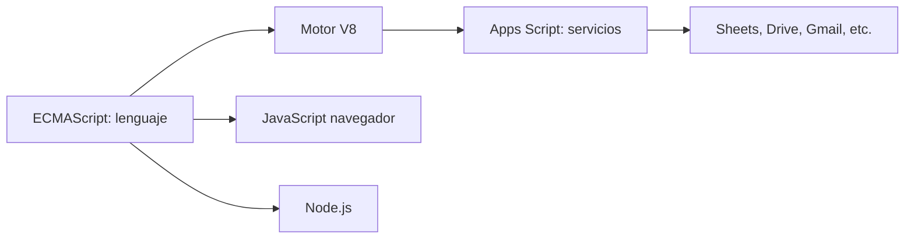
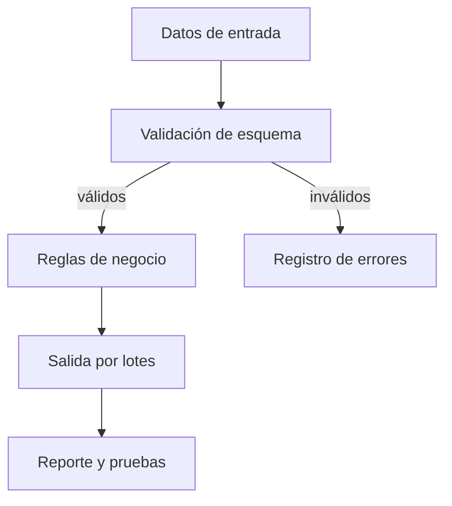

# A10 — Integraciones externas, JSON y APIs HTTP

**Curso de Google Apps Script + JavaScript · Actualización documental noviembre 2026**

**Dedicación sugerida:** 18–30 horas; ajustar a los conocimientos previos. **Objetivo:** comprender los fundamentos, construir soluciones verificables y explicar sus límites.

> Los nombres de los módulos son una propuesta de organización para esta entrega; no se ha podido cotejar el desglose literal completo con el temario histórico aprobado.

## Resultados de aprendizaje

- Explicar los conceptos de integraciones externas, json y apis http con terminología correcta.
- Escribir código reproducible, probar casos límite y documentar fallos.
- Identificar qué APIs son JavaScript estándar y cuáles pertenecen a Apps Script.
- Construir una solución mantenible con permisos mínimos y evidencia de pruebas.

## Conceptos transversales de JavaScript

JavaScript es un lenguaje de programación dinámico, con funciones de primera clase, objetos basados en prototipos y evaluación en un entorno de ejecución. **ECMAScript** especifica el lenguaje; **V8** es un motor; **Apps Script** proporciona servicios y restricciones propias. `const` impide reasignar una variable, no congela el objeto apuntado. `===` evita la conversión implícita típica de `==`; `null`, `undefined` y `NaN` requieren comprobaciones específicas. Las operaciones con números usan habitualmente IEEE-754 y pueden presentar errores de representación decimal.

**Compatibilidad importante:** Apps Script V8 no dispone de las APIs del navegador `window`, `document` o `fetch`, ni de `process` de Node.js; tampoco admite módulos nativos `import/export` ni temporizadores `setTimeout`. `async/await` se puede escribir, pero los servicios Apps Script son síncronos. En interfaces HtmlService sí hay un contexto JavaScript de navegador separado del servidor.



## A10.01 — HTTP: métodos, headers y status

### Modelo mental

La pregunta inicial es **qué información entra, qué transformación ocurre, qué efectos secundarios se producen y qué evidencia permite validar la salida**. Para http: métodos, headers y status, separa lógica pura (transformación determinista) de interacción con servicios (lectura/escritura, permisos, red). Evita asumir que un resultado correcto para un ejemplo pequeño garantiza un proceso correcto con entradas vacías, duplicadas o mal formadas.

### Ejemplo trabajado

```javascript
function leerApi(url) {
  const response = UrlFetchApp.fetch(url, {muteHttpExceptions: true});
  const status = response.getResponseCode();
  if (status < 200 || status >= 300) throw new Error(`HTTP ${status}`);
  return JSON.parse(response.getContentText());
}
```

**Análisis paso a paso:** identifica las declaraciones y su alcance; localiza operaciones sobre valores o referencias; observa qué devuelve cada función y si produce efectos externos. Antes de ejecutar un ejemplo con `SpreadsheetApp`, `DriveApp`, `UrlFetchApp` u otro servicio, configura un proyecto Apps Script y concede solo los permisos necesarios. Las funciones puras pueden probarse en un runtime JavaScript estándar.

### Laboratorio 1

1. Crea un archivo o función aislada para el ejemplo.
2. Predice la salida sin ejecutar y justifica los tipos de datos.
3. Ejecuta y registra la salida real, el entorno y la fecha.
4. Cambia un parámetro para provocar un error controlado.
5. Refactoriza: nombres expresivos, validación de entradas, función pequeña.
6. Escribe una prueba positiva, una prueba negativa y una de caso límite.

**Preguntas de comprobación:** ¿qué hace el runtime?, ¿qué pasa si la entrada es `undefined`?, ¿hay mutación?, ¿qué permisos requiere?, ¿cómo se recupera un fallo?

### Errores comunes

- Confundir `null` con `undefined`, o texto numérico con número.
- Capturar todas las excepciones y ocultarlas sin contexto.
- Ejecutar operaciones costosas dentro de un bucle cuando pueden agruparse.
- Usar un patrón de navegador/Node.js sin verificar compatibilidad V8.
- Conceder scopes más amplios de lo necesario.

## A10.02 — JSON, serialización y validación

### Modelo mental

La pregunta inicial es **qué información entra, qué transformación ocurre, qué efectos secundarios se producen y qué evidencia permite validar la salida**. Para json, serialización y validación, separa lógica pura (transformación determinista) de interacción con servicios (lectura/escritura, permisos, red). Evita asumir que un resultado correcto para un ejemplo pequeño garantiza un proceso correcto con entradas vacías, duplicadas o mal formadas.

### Ejemplo trabajado

```javascript
function parseSeguro(s) {
  try { return {ok:true, valor:JSON.parse(s)}; }
  catch (e) { return {ok:false, error:String(e.message)}; }
}
```

**Análisis paso a paso:** identifica las declaraciones y su alcance; localiza operaciones sobre valores o referencias; observa qué devuelve cada función y si produce efectos externos. Antes de ejecutar un ejemplo con `SpreadsheetApp`, `DriveApp`, `UrlFetchApp` u otro servicio, configura un proyecto Apps Script y concede solo los permisos necesarios. Las funciones puras pueden probarse en un runtime JavaScript estándar.

### Laboratorio 2

1. Crea un archivo o función aislada para el ejemplo.
2. Predice la salida sin ejecutar y justifica los tipos de datos.
3. Ejecuta y registra la salida real, el entorno y la fecha.
4. Cambia un parámetro para provocar un error controlado.
5. Refactoriza: nombres expresivos, validación de entradas, función pequeña.
6. Escribe una prueba positiva, una prueba negativa y una de caso límite.

**Preguntas de comprobación:** ¿qué hace el runtime?, ¿qué pasa si la entrada es `undefined`?, ¿hay mutación?, ¿qué permisos requiere?, ¿cómo se recupera un fallo?

### Errores comunes

- Confundir `null` con `undefined`, o texto numérico con número.
- Capturar todas las excepciones y ocultarlas sin contexto.
- Ejecutar operaciones costosas dentro de un bucle cuando pueden agruparse.
- Usar un patrón de navegador/Node.js sin verificar compatibilidad V8.
- Conceder scopes más amplios de lo necesario.

## A10.03 — Paginación, reintentos y rate limiting

### Modelo mental

La pregunta inicial es **qué información entra, qué transformación ocurre, qué efectos secundarios se producen y qué evidencia permite validar la salida**. Para paginación, reintentos y rate limiting, separa lógica pura (transformación determinista) de interacción con servicios (lectura/escritura, permisos, red). Evita asumir que un resultado correcto para un ejemplo pequeño garantiza un proceso correcto con entradas vacías, duplicadas o mal formadas.

### Ejemplo trabajado

```javascript
function peticionPost(url, payload) {
  return UrlFetchApp.fetch(url, {method:"post",contentType:"application/json",payload:JSON.stringify(payload)});
}
```

**Análisis paso a paso:** identifica las declaraciones y su alcance; localiza operaciones sobre valores o referencias; observa qué devuelve cada función y si produce efectos externos. Antes de ejecutar un ejemplo con `SpreadsheetApp`, `DriveApp`, `UrlFetchApp` u otro servicio, configura un proyecto Apps Script y concede solo los permisos necesarios. Las funciones puras pueden probarse en un runtime JavaScript estándar.

### Laboratorio 3

1. Crea un archivo o función aislada para el ejemplo.
2. Predice la salida sin ejecutar y justifica los tipos de datos.
3. Ejecuta y registra la salida real, el entorno y la fecha.
4. Cambia un parámetro para provocar un error controlado.
5. Refactoriza: nombres expresivos, validación de entradas, función pequeña.
6. Escribe una prueba positiva, una prueba negativa y una de caso límite.

**Preguntas de comprobación:** ¿qué hace el runtime?, ¿qué pasa si la entrada es `undefined`?, ¿hay mutación?, ¿qué permisos requiere?, ¿cómo se recupera un fallo?

### Errores comunes

- Confundir `null` con `undefined`, o texto numérico con número.
- Capturar todas las excepciones y ocultarlas sin contexto.
- Ejecutar operaciones costosas dentro de un bucle cuando pueden agruparse.
- Usar un patrón de navegador/Node.js sin verificar compatibilidad V8.
- Conceder scopes más amplios de lo necesario.

## A10.04 — Webhooks, firmas e idempotencia

### Modelo mental

La pregunta inicial es **qué información entra, qué transformación ocurre, qué efectos secundarios se producen y qué evidencia permite validar la salida**. Para webhooks, firmas e idempotencia, separa lógica pura (transformación determinista) de interacción con servicios (lectura/escritura, permisos, red). Evita asumir que un resultado correcto para un ejemplo pequeño garantiza un proceso correcto con entradas vacías, duplicadas o mal formadas.

### Ejemplo trabajado

```javascript
function leerApi(url) {
  const response = UrlFetchApp.fetch(url, {muteHttpExceptions: true});
  const status = response.getResponseCode();
  if (status < 200 || status >= 300) throw new Error(`HTTP ${status}`);
  return JSON.parse(response.getContentText());
}
```

**Análisis paso a paso:** identifica las declaraciones y su alcance; localiza operaciones sobre valores o referencias; observa qué devuelve cada función y si produce efectos externos. Antes de ejecutar un ejemplo con `SpreadsheetApp`, `DriveApp`, `UrlFetchApp` u otro servicio, configura un proyecto Apps Script y concede solo los permisos necesarios. Las funciones puras pueden probarse en un runtime JavaScript estándar.

### Laboratorio 4

1. Crea un archivo o función aislada para el ejemplo.
2. Predice la salida sin ejecutar y justifica los tipos de datos.
3. Ejecuta y registra la salida real, el entorno y la fecha.
4. Cambia un parámetro para provocar un error controlado.
5. Refactoriza: nombres expresivos, validación de entradas, función pequeña.
6. Escribe una prueba positiva, una prueba negativa y una de caso límite.

**Preguntas de comprobación:** ¿qué hace el runtime?, ¿qué pasa si la entrada es `undefined`?, ¿hay mutación?, ¿qué permisos requiere?, ¿cómo se recupera un fallo?

### Errores comunes

- Confundir `null` con `undefined`, o texto numérico con número.
- Capturar todas las excepciones y ocultarlas sin contexto.
- Ejecutar operaciones costosas dentro de un bucle cuando pueden agruparse.
- Usar un patrón de navegador/Node.js sin verificar compatibilidad V8.
- Conceder scopes más amplios de lo necesario.

## Ejercicios graduados — A10

### E01 — Fundamentos

Explica las entradas, salidas, tipos y efectos secundarios del primer ejemplo.

**Evidencia:** fragmento de código o razonamiento, entrada, salida esperada y comprobación.

### E02 — Predicción

Predice la salida del segundo ejemplo antes de ejecutarlo.

**Evidencia:** fragmento de código o razonamiento, entrada, salida esperada y comprobación.

### E03 — Casos límite

Prueba entradas vacías, `null`, `undefined` y números negativos; documenta resultados.

**Evidencia:** fragmento de código o razonamiento, entrada, salida esperada y comprobación.

### E04 — Refactorización

Separa lógica pura de acceso a servicios en el tercer ejemplo.

**Evidencia:** fragmento de código o razonamiento, entrada, salida esperada y comprobación.

### E05 — Testing

Construye tres pruebas unitarias y una prueba de integración.

**Evidencia:** fragmento de código o razonamiento, entrada, salida esperada y comprobación.

### E06 — Seguridad

Enumera los scopes requeridos y elimina los innecesarios.

**Evidencia:** fragmento de código o razonamiento, entrada, salida esperada y comprobación.

### E07 — Rendimiento

Identifica posibles operaciones repetidas y propón procesamiento en lotes.

**Evidencia:** fragmento de código o razonamiento, entrada, salida esperada y comprobación.

### E08 — Arquitectura

Dibuja el flujo de datos y un punto de recuperación ante fallos.

**Evidencia:** fragmento de código o razonamiento, entrada, salida esperada y comprobación.

### E09 — Depuración

Simula un error y escribe una explicación reproducible.

**Evidencia:** fragmento de código o razonamiento, entrada, salida esperada y comprobación.

### E10 — Extensión

Amplía el ejemplo para validar registros duplicados o inválidos.

**Evidencia:** fragmento de código o razonamiento, entrada, salida esperada y comprobación.

### E11 — Documentación

Redacta un README con requisitos, permisos y ejecución.

**Evidencia:** fragmento de código o razonamiento, entrada, salida esperada y comprobación.

### E12 — Evaluación

Justifica cuándo usar Apps Script y cuándo un servicio externo.

**Evidencia:** fragmento de código o razonamiento, entrada, salida esperada y comprobación.

## Solucionario orientativo (consultar después de resolver)

### Respuesta E01

Identifica argumentos, valores devueltos y llamadas a consola o servicios; estas últimas son efectos secundarios.

### Respuesta E02

Ejecuta mentalmente las expresiones en orden; verifica en V8 o consola y anota discrepancias.

### Respuesta E03

Define explícitamente contratos de entrada; rechaza valores no admitidos con errores descriptivos.

### Respuesta E04

Extrae una función que reciba datos y devuelva datos; deja SpreadsheetApp/UrlFetchApp en un adaptador.

### Respuesta E05

Incluye un caso normal, uno límite y uno inválido; integración requiere cuenta autorizada y recurso de prueba.

### Respuesta E06

Revisa `appsscript.json` y la autorización efectiva; aplica scopes mínimos.

### Respuesta E07

Reduce llamadas a servicios con getValues/setValues y evita lecturas por celda.

### Respuesta E08

Dibuja origen → validación → lógica → persistencia → reporte; incluye registro de errores.

### Respuesta E09

Captura stack y contexto no sensible; reproduce con entradas pequeñas y comprueba la corrección.

### Respuesta E10

Verifica unicidad de IDs, tipos numéricos y valores no negativos antes de guardar.

### Respuesta E11

Incluye propósito, configuración, permisos, riesgos, ejecución, rollback y pruebas.

### Respuesta E12

Apps Script favorece integración ligera Workspace; un backend externo conviene para procesos extensos, escalado y control de runtime.

## Proyecto del módulo — Integraciones externas, JSON y APIs HTTP

**Situación:** un equipo de operaciones necesita automatizar un flujo con datos ficticios de ventas. El sistema recibe registros, valida esquema, calcula agregados, registra errores y produce un resumen verificable.

**Dataset:** `V01,Norte,2,100`; `V02,Sur,1,300`; `V03,Norte,3,50`. El importe por registro es 200, 300 y 150; total esperado **650** y seis unidades.

**Arquitectura:** fuente → validación → transformación pura → adaptador de salida → reporte → auditoría.



**Fases:** 1) definir contrato; 2) programar funciones puras; 3) conectar un servicio; 4) gestionar errores; 5) ejecutar pruebas; 6) documentar despliegue.

**Pruebas de aceptación:** total 650, seis unidades, tres registros, rechazo de ID duplicado, rechazo de importe negativo, manejo de origen vacío, permisos mínimos y trazabilidad de ejecución.

**Rúbrica (100):** corrección 30, fundamentos 20, pruebas 20, seguridad 15, documentación 15.

## Comparación de entornos

| Aspecto | Navegador | Node.js | Apps Script V8 |
|---|---|---|---|
| DOM / `document` | Sí | No por defecto | No en servidor; sí en HTML Service cliente |
| `fetch` | Sí | Sí en versiones modernas | No; usar `UrlFetchApp` |
| `setTimeout` | Sí | Sí | No |
| `import/export` | Sí (módulos) | Sí (ESM) | No de forma nativa; usar bundler |
| Servicios Google Workspace | Mediante APIs | Mediante APIs y SDK | Servicios integrados y avanzados |
| Promises / `async` | Sí | Sí | Sintaxis sí; I/O de servicios bloqueante |

## Evaluación final

1. Explica la diferencia entre motor V8, ECMAScript y servicios de Apps Script.
2. Explica por qué `const objeto = {}` no convierte al objeto en inmutable.
3. ¿Qué permisos requiere el ejemplo y cómo los verificarías?
4. ¿Cómo comprobarías que un proceso puede reintentarse sin duplicar registros?
5. ¿Qué parte del código puede probarse sin una cuenta de Google?

**Criterio de avance:** completar los laboratorios, ≥80/100 en proyecto y explicar las cinco respuestas.

## Referencias oficiales y recursos

- [Apps Script overview](https://developers.google.com/apps-script/overview)
- [V8 runtime](https://developers.google.com/apps-script/guides/v8-runtime)
- [Migración a V8](https://developers.google.com/apps-script/guides/v8-runtime/migration)
- [Cuotas](https://developers.google.com/apps-script/guides/services/quotas)
- [Autorización](https://developers.google.com/apps-script/guides/services/authorization)
- [Triggers](https://developers.google.com/apps-script/guides/triggers)
- [Buenas prácticas](https://developers.google.com/apps-script/guides/support/best-practices)
- [clasp](https://developers.google.com/apps-script/guides/clasp)
- [MDN JavaScript Guide](https://developer.mozilla.org/en-US/docs/Web/JavaScript/Guide)
- [MDN Reference](https://developer.mozilla.org/en-US/docs/Web/JavaScript/Reference)

**Aviso de vigencia:** cuotas, APIs, compatibilidad y condiciones de publicación pueden cambiar. Revisar la documentación oficial antes de desplegar. Los fragmentos que invocan servicios requieren una cuenta/proyecto autorizado; no se han ejecutado en Google Workspace durante la elaboración.
