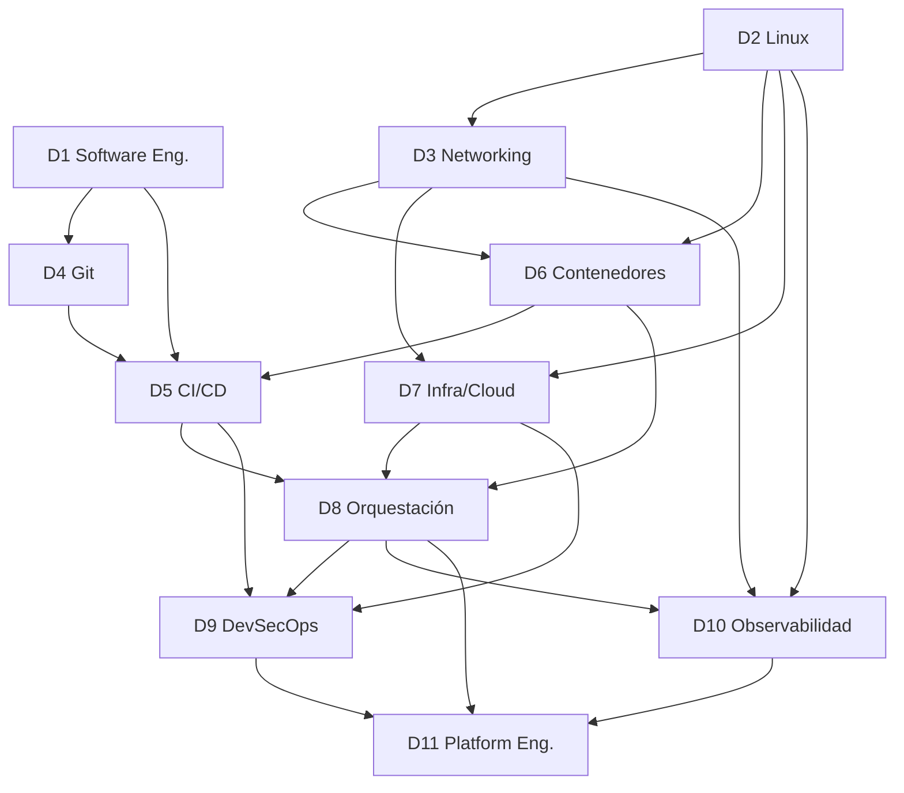

# Roadmap transversal — Fase 1

Este documento define las **once disciplinas troncales** del programa, sus módulos, dependencias y la secuencia pedagógica recomendada.

Identificadores: `T-<D>.<M>` donde `D` es la disciplina (1–11) y `M` el módulo.

## Disciplinas

| ID | Disciplina | Pregunta que responde |
|----|------------|-----------------------|
| D1 | Ingeniería de software y arquitectura | ¿Qué estamos construyendo, versionando y desplegando? |
| D2 | Sistemas operativos (Linux) | ¿Dónde se ejecuta todo esto? |
| D3 | Networking | ¿Cómo se comunican los componentes? |
| D4 | Control de versiones | ¿Cómo colaboramos sin pisarnos? |
| D5 | CI/CD | ¿Cómo integramos, probamos y entregamos de forma continua? |
| D6 | Contenedores y virtualización | ¿Cómo empaquetamos y aislamos cargas? |
| D7 | Infraestructura y Cloud | ¿Dónde provisionamos y bajo qué modelo? |
| D8 | Orquestación y despliegue | ¿Cómo coordinamos muchos servicios? |
| D9 | Seguridad (DevSecOps) | ¿Cómo protegemos toda la cadena? |
| D10 | Observabilidad y SRE | ¿Cómo sabemos que funciona y qué hacer si no? |
| D11 | Arquitectura avanzada y Platform Engineering | ¿Cómo escalamos esto como producto interno? |

## Módulos por disciplina

### D1 — Ingeniería de software
- T-1.1 SDLC y modelos de entrega
- T-1.2 Arquitecturas: monolito, modular, microservicios, serverless
- T-1.3 Dependencias, empaquetado y build systems
- T-1.4 Testing automatizado (unit, integration, e2e, contract)
- T-1.5 Versionamiento, SemVer, releases, changelogs
- T-1.6 Entornos y 12-Factor App

### D2 — Linux
- T-2.1 Kernel, syscalls, espacio usuario
- T-2.2 Procesos, hilos, scheduling, señales
- T-2.3 Memoria y almacenamiento
- T-2.4 Filesystems, permisos, capabilities
- T-2.5 systemd, journald, cron/timers
- T-2.6 Bash scripting y gestión de paquetes
- T-2.7 Logs y troubleshooting (`strace`, `lsof`, …)

### D3 — Networking
- T-3.1 OSI / TCP-IP
- T-3.2 IPv4/IPv6, subnetting, routing, NAT
- T-3.3 TCP / UDP / sockets
- T-3.4 DNS
- T-3.5 HTTP/1.1/2/3, REST
- T-3.6 TLS, PKI, mTLS
- T-3.7 Firewalls, proxies, LB L4/L7
- T-3.8 Diagnóstico de red

### D4 — Control de versiones
- T-4.1 Modelo interno de Git
- T-4.2 Branching, merge, rebase, reflog
- T-4.3 Workflows (trunk-based, GitHub Flow, GitFlow)
- T-4.4 PRs, code review, CODEOWNERS
- T-4.5 Monorepo vs polyrepo

### D5 — CI/CD
- T-5.1 Definiciones precisas (CI, CD-delivery, CD-deployment)
- T-5.2 Pipeline as Code
- T-5.3 Runners y aislamiento
- T-5.4 Build, test, artifact management
- T-5.5 Entornos, approvals, promoción
- T-5.6 Estrategias de release (blue/green, canary, rolling)
- T-5.7 Rollback y gestión de incidentes

### D6 — Contenedores
- T-6.1 Virtualización vs containerización
- T-6.2 Namespaces, cgroups, overlayfs, seccomp
- T-6.3 OCI, runc, containerd
- T-6.4 Docker, BuildKit, multi-stage
- T-6.5 Redes y volúmenes
- T-6.6 Registries, firmas, SBOM
- T-6.7 Docker Compose
- T-6.8 Seguridad de contenedores

### D7 — Infraestructura y Cloud
- T-7.1 IaaS/PaaS/SaaS y responsabilidad compartida
- T-7.2 Redes cloud (VPC, SG, peering)
- T-7.3 IAM
- T-7.4 Compute / Storage / Managed DBs
- T-7.5 LBs y DNS gestionados
- T-7.6 IaC: declarativo, estado, drift
- T-7.7 Configuration Management (Ansible)

### D8 — Orquestación
- T-8.1 Por qué orquestar
- T-8.2 K8s control plane
- T-8.3 Workloads
- T-8.4 Networking K8s + Gateway API
- T-8.5 Storage K8s
- T-8.6 Config y secretos
- T-8.7 Helm y Kustomize
- T-8.8 GitOps (Argo CD / Flux)
- T-8.9 Autoscaling

### D9 — DevSecOps
- T-9.1 Threat modeling
- T-9.2 Gestión de secretos
- T-9.3 SAST, DAST, SCA, IaC scanning
- T-9.4 Supply chain (SBOM, SLSA, Sigstore)
- T-9.5 Policy as Code (OPA/Kyverno)
- T-9.6 Hardening y vulnerability mgmt
- T-9.7 Auditoría y cumplimiento

### D10 — Observabilidad y SRE
- T-10.1 Logs, métricas, trazas
- T-10.2 OpenTelemetry
- T-10.3 Prometheus
- T-10.4 Grafana
- T-10.5 SLI/SLO/error budgets
- T-10.6 Incident response, postmortems
- T-10.7 Capacity planning, chaos, DR

### D11 — Platform Engineering
- T-11.1 Sistemas distribuidos
- T-11.2 Resiliencia
- T-11.3 Multi-ambiente / multi-región / multi-tenant
- T-11.4 IDPs, golden paths, Backstage
- T-11.5 FinOps
- T-11.6 Gobernanza y platform SLOs

## Dependencias

## Secuencia pedagógica

| Fase | Disciplinas | Duración orientativa (10 h/sem) |
|------|-------------|-------------------------------|
| F1 Suelo técnico | D1 + D2 + D3 + D4 | 6–8 sem |
| F2 CI y empaquetado | D5 (base) + D6 | 4–6 sem |
| F3 Cloud e IaC | D7 | 5–7 sem |
| F4 Orquestación | D8 | 6–8 sem |
| F5 CD avanzado + GitOps | D5 (avanz.) + D8 (GitOps) | 3–4 sem |
| F6 DevSecOps | D9 | 3–5 sem |
| F7 Observabilidad y SRE | D10 | 3–5 sem |
| F8 Platform Engineering | D11 + capstone | 4–6 sem |

Total orientativo: **34–49 semanas**. Es un marco de planificación, no una garantía.

## Mapa a roadmaps especializados

| Disciplina | Cursos principales | Alternativas / opcionales |
|------------|--------------------|---------------------------|
| D4 | Git & GitHub | — |
| D5 | GitHub Actions | GitLab CI/CD, Jenkins (contexto) |
| D6 | Docker | Podman (contexto) |
| D7 | Terraform, AWS | OpenTofu, GCP, Azure, Ansible |
| D8 | Kubernetes, Helm, Argo CD | Kustomize, Flux, Crossplane |
| D9 | DevSecOps toolkit (Trivy, cosign/Sigstore, OPA/Kyverno, SOPS/Vault) | — |
| D10 | Prometheus, Grafana, OpenTelemetry | Loki, Tempo, Jaeger |
| D11 | Platform tooling (Backstage) | — |
