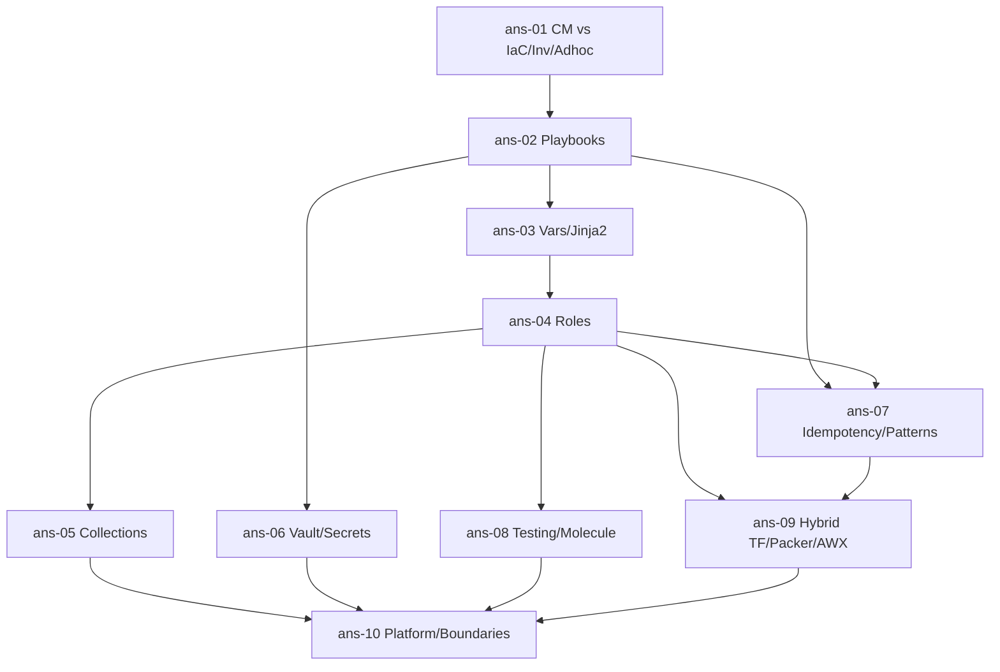

# Ansible — Roadmap detallado

IDs estables: `ans-<NN>-<slug>`.

Duración orientativa total: **25–35 h**. Compacto por diseño.

---

## Nivel 1 — Fundamentos

### ans-01-cm-vs-iac-setup-inventory-and-adhoc

- **Nivel:** fundamentos
- **Objetivo:** entender CM vs IaC, instalar Ansible, modelar inventario, correr comandos ad-hoc.
- **Prerrequisitos:** curso **terraform** ≥ Nivel 1 (para contrastar).
- **Temas:** diferencia CM vs IaC (CM = configurar hosts existentes; IaC = aprovisionar recursos); modelo **push + agentless + SSH**; instalación (`pipx install ansible` recomendado); `ansible --version` muestra `ansible-core` + collections; **inventory** YAML (`hosts.yml`) y INI (`hosts.ini`); grupos, children, variables de grupo/host; **dynamic inventory** (plugins oficiales: `amazon.aws.aws_ec2`, `google.cloud.gcp_compute`); `ansible-inventory --list`; comandos ad-hoc (`ansible all -m ping`, `-m shell -a "uptime"`); SSH keys y `ansible_user`, `ansible_ssh_private_key_file`, `ansible_python_interpreter`.
- **Fundamentos internos:** Ansible serializa un módulo Python, lo copia por SSH al host, lo ejecuta, parsea el JSON de salida; sin Python en el target, no funciona (hay `raw` como escape).
- **Competencias:** inventario simple + ping funcional; correr un comando ad-hoc a un grupo.
- **Ejemplos:** `01-first-ping-with-ssh`, `02-inventory-yaml-vs-ini`, `03-ec2-dynamic-inventory`.
- **Actividades:** `01-connect-to-vms` (guiada), `02-dynamic-inventory-ec2` (independiente).
- **Entregables:** inventory estático + dinámico funcionando contra 2+ hosts.
- **Evaluación:** justificar Ansible vs TF vs Docker para 3 escenarios dados.
- **Duración:** 3 h.

### ans-02-playbooks-plays-tasks-modules-handlers

- **Nivel:** fundamentos
- **Objetivo:** escribir playbooks correctos usando módulos idempotentes y handlers.
- **Prerrequisitos:** `ans-01`.
- **Temas:** estructura: `playbook.yml` → **plays** (bloque con `hosts`, `vars`, `tasks`, `handlers`); **tasks** y **módulos** (`apt`, `yum`, `dnf`, `file`, `copy`, `template`, `service`, `systemd`, `user`, `group`, `cron`, `lineinfile`/`blockinfile`, `uri`, `wait_for`); **handlers** (reactivos a `notify`, se ejecutan al final del play una sola vez); `become: true` + `become_method: sudo`; `when:` condicionales; `loop:` (y `loop_control`); tags para ejecución selectiva (`--tags`, `--skip-tags`); `--check` (dry run) y `--diff`.
- **Fundamentos internos:** los módulos idempotentes consultan el estado antes de actuar y reportan `changed` solo si hubo cambio; los handlers permiten "reiniciar nginx *solo si* algo cambió" sin inflar la lógica.
- **Competencias:** playbook con instalación + config + servicio reiniciado por handler.
- **Ejemplos:** `01-install-nginx-with-handler`, `02-check-and-diff-mode`, `03-tags-selective-run`.
- **Actividades:** `01-nginx-reverse-proxy`, `02-fix-non-idempotent-task` (independiente, debug).
- **Entregables:** playbook idempotente que converge nginx en 1 host.
- **Evaluación:** diagnosticar por qué un task se marca `changed` en cada run.
- **Duración:** 4 h.

### ans-03-variables-facts-templates-jinja2

- **Nivel:** fundamentos
- **Objetivo:** parametrizar y templatizar con disciplina.
- **Prerrequisitos:** `ans-02`.
- **Temas:** fuentes de variables (play vars, inventory vars, group_vars/host_vars, extra vars `-e`, defaults de roles); **precedence** (22 niveles en la doc oficial — moraleja: diseñar para la minoría de niveles usados); **facts** (`ansible_facts.*` recolectados por `setup`); `gather_facts: false` para acelerar; **Jinja2** (`{{ var | default('x') }}`, filtros, loops, `if/else`); **templates** (`template:` module aplica Jinja2 a un archivo); **lookups** (`lookup('file', 'x')`, `lookup('env', 'FOO')`); evitar lógica de negocio en templates.
- **Fundamentos internos:** la precedence es una fuente histórica de bugs — en la práctica basta con usar roles + group_vars + extra vars; `register:` + `set_fact:` permiten capturar resultados y usarlos.
- **Competencias:** template de config real (nginx) con variables por entorno.
- **Ejemplos:** `01-template-nginx-conf`, `02-group-vars-and-overrides`, `03-register-and-set-fact`.
- **Actividades:** `01-nginx-vhost-template`, `02-precedence-exercise` (independiente).
- **Entregables:** template de nginx.conf + vhost completamente parametrizado.
- **Evaluación:** predecir el valor final dado un conjunto de variables en distintos niveles.
- **Duración:** 3 h.

---

## Nivel 2 — Intermedio

### ans-04-roles-structure-and-reuse

- **Nivel:** intermedio
- **Objetivo:** encapsular lógica reutilizable con roles.
- **Prerrequisitos:** `ans-03`.
- **Temas:** `ansible-galaxy role init` → estructura (`defaults/`, `vars/`, `tasks/main.yml`, `handlers/`, `templates/`, `files/`, `meta/`, `README.md`); **defaults vs vars** (defaults son los más bajos en precedence — se sobreescriben fácil); **dependencies** entre roles en `meta/main.yml`; **include_role** vs **import_role** (lazy vs eager); roles por responsabilidad (anti-pattern: role monolítico "setup-everything"); publicación local vs Galaxy privado; versionado SemVer; README como contrato (vars esperadas, OS soportados, ejemplos).
- **Fundamentos internos:** un role bien diseñado se usa en orgs distintas sin modificaciones; `defaults` para "config que un usuario puede sobreescribir", `vars` para "config interna del role".
- **Competencias:** diseñar roles cohesivos; documentar con rigor.
- **Ejemplos:** `01-role-init-skeleton`, `02-role-nginx`, `03-import-vs-include-role`.
- **Actividades:** `01-extract-role-from-playbook`, `02-role-dependency-chain` (independiente).
- **Entregables:** role propio `fastapi-systemd-app` con README + ejemplo.
- **Evaluación:** criticar un role "mega" y proponer descomposición.
- **Duración:** 4 h.

### ans-05-collections-galaxy-and-automation-hub

- **Nivel:** intermedio
- **Objetivo:** consumir y publicar collections.
- **Prerrequisitos:** `ans-04`.
- **Temas:** **collections** como unidad moderna de distribución (desde Ansible 2.10): paquetan roles, modules, plugins, playbooks; namespaces (`ansible.posix`, `community.general`, `community.aws`, `kubernetes.core`); instalación (`ansible-galaxy collection install -r requirements.yml`); versioning con **lockfile** (desde ansible-core 2.17/2.18 con `--requirements-file` y `ansible-galaxy collection list`); **Ansible Galaxy** público vs **Automation Hub** (Red Hat, con collections firmadas y certificadas); creación de collection propia (`ansible-galaxy collection init org.name`); publicar a Galaxy / registry interno.
- **Fundamentos internos:** cuando aparece un bug en un módulo (p. ej. `community.aws.aws_s3`), fijar la version de la collection es la vía de rollback; `ansible-core` evoluciona separado de las collections.
- **Competencias:** gestionar dependencias de collections con lockfile; evaluar collections de terceros.
- **Ejemplos:** `01-requirements-yml-with-collections`, `02-create-and-publish-collection`.
- **Actividades:** `01-adopt-community-aws-collection`, `02-collection-eval-adr` (independiente).
- **Entregables:** repo con `requirements.yml` + lockfile + collection propia instalable.
- **Evaluación:** criterios para aceptar una collection comunitaria.
- **Duración:** 3 h.

### ans-06-vault-and-secrets-management

- **Nivel:** intermedio
- **Objetivo:** manejar secretos sin violar principios básicos.
- **Prerrequisitos:** `ans-02`, curso **devsecops** ≥ `sec-02`.
- **Temas:** `ansible-vault create/edit/encrypt/decrypt/view/rekey`; encriptación de archivos enteros vs campos individuales (`ansible-vault encrypt_string`); **vault password sources**: archivo (`--vault-password-file`), script (`--vault-id key@script.sh`), **múltiples IDs** (dev/prod separados); integración con **secret managers externos** (AWS Secrets Manager, Vault HashiCorp — mejor opción para prod); `no_log: true` para evitar leaks en output; limitaciones del vault (es simetric encryption; la contraseña es un secret más — necesitas rotación).
- **Fundamentos internos:** `ansible-vault` es un bastión mínimo, no sustituye a Vault/Secrets Manager; para prod serio, Ansible debería *consultar* el secret manager al momento de ejecución (vía lookup o módulo), no almacenar secretos en el repo.
- **Competencias:** vault básico; integración con external secret manager.
- **Ejemplos:** `01-vault-encrypt-string`, `02-multi-vault-id`, `03-aws-secrets-manager-lookup`.
- **Actividades:** `01-encrypt-sensitive-vars`, `02-migrate-vault-to-sm` (independiente).
- **Entregables:** playbook con secretos obtenidos desde Secrets Manager en vez de vault file.
- **Evaluación:** justificar por qué `ansible-vault` **no** basta a escala.
- **Duración:** 3 h.

---

## Nivel 3 — Avanzado

### ans-07-idempotency-deep-and-advanced-patterns

- **Nivel:** avanzado
- **Objetivo:** entender idempotencia y usar patrones avanzados cuando se justifican.
- **Prerrequisitos:** `ans-02`, `ans-04`.
- **Temas:** cómo cada módulo determina `changed`; `command`/`shell` **no son idempotentes por default** — usar `creates:`/`removes:` o `changed_when: false`; `register:` + `changed_when:` + `failed_when:` para construir módulos pseudo-idempotentes a partir de `command`; **check mode** (`--check`) y qué módulos no lo soportan; **diff mode** (`--diff`); patrones:
  - `delegate_to:` (ejecutar en un host distinto del loop host);
  - `run_once: true` (una sola vez por play, útil para "crear registro DNS");
  - `serial: N` o `serial: "20%"` (rolling update por lotes);
  - `strategy: free` vs `linear` default;
  - `async:` + `poll:` (jobs largos sin bloquear SSH);
  - `block:` + `rescue:` + `always:` (como try/except);
  - **Mitogen** / `pipelining` para mejorar performance.
- **Fundamentos internos:** sin idempotencia real, Ansible pierde su propiedad clave (poder correrse N veces y converger al mismo estado); check mode es la red de seguridad para operar prod.
- **Competencias:** convertir un playbook "run-once-and-hope" en uno idempotente real.
- **Ejemplos:** `01-shell-with-creates`, `02-delegate-to-dns-server`, `03-serial-rolling-restart`, `04-block-rescue`.
- **Actividades:** `01-make-playbook-idempotent`, `02-rolling-restart-with-serial` (independiente).
- **Entregables:** playbook de rolling restart con `serial` y check mode funcional.
- **Evaluación:** criticar un playbook con 5 `shell:` que fingen idempotencia.
- **Duración:** 4 h.

### ans-08-testing-molecule-lint-and-ci

- **Nivel:** avanzado
- **Objetivo:** probar roles y playbooks como se prueba código.
- **Prerrequisitos:** `ans-04`.
- **Temas:** **ansible-lint** (reglas de estilo y antipatterns; config `.ansible-lint`); **Molecule** (framework de testing para roles): drivers (Docker, Podman, Vagrant, LXC, EC2), *scenarios* (default + extras), `molecule test` ciclo (`destroy → create → prepare → converge → idempotence → verify → destroy`); **idempotence check** nativo (segunda ejecución debe ser 0 changes); **verify** con **Ansible asserts** o **Testinfra** (pytest-style para infra); CI (GHA): matrix de distros (ubuntu-22.04, debian-12, rockylinux-9) y de ansible versions; publicar role a Galaxy desde CI tras tag.
- **Fundamentos internos:** Molecule levanta un contenedor efímero, aplica el role, verifica el estado — ciclo rápido y repetible; sin esto, un role rompe la próxima vez que se usa con otra distro.
- **Competencias:** pipeline de role con Molecule + ansible-lint + matrix CI.
- **Ejemplos:** `01-molecule-scenario-default`, `02-testinfra-verifier`, `03-gha-matrix-role-ci`.
- **Actividades:** `01-add-molecule-to-your-role`, `02-ci-publish-on-tag` (independiente).
- **Entregables:** role del capstone con Molecule + CI matrix + publish on tag.
- **Evaluación:** diseñar la matriz CI para un role que soporta 3 distros.
- **Duración:** 4 h.

---

## Nivel 4 — Producción empresarial

### ans-09-hybrid-with-terraform-packer-and-awx-aap

- **Nivel:** producción
- **Objetivo:** usar Ansible en el stack moderno sin pelearse con Terraform ni Kubernetes.
- **Prerrequisitos:** `ans-04`, `ans-07`, curso **terraform** completo, curso **docker**.
- **Temas:** patrón **TF crea → Ansible configura** (TF aplica outputs → inventory dinámico por tag → Ansible converge); patrón mejor: **Packer + Ansible → AMI inmutable → TF usa AMI** (menos drift, más predecible); cuándo quedarse en pattern 1 (hosts long-lived, legacy); cuándo pasar a pattern 2 (nuevos workloads); **Event-Driven Ansible** (acciones reactivas a eventos: Kafka, webhook, CloudEvents, Alertmanager) para automatizar runbooks; **AWX** (OSS) / **AAP** (Red Hat, comercial): UI, inventarios centralizados, RBAC, scheduling, workflow templates, surveys, notifications; comparación con GitOps "para apps K8s" (donde Ansible pierde relevancia).
- **Fundamentos internos:** mutable configuration + long-lived hosts es viable con disciplina pero drift aparece; immutable images (Packer + rotation) eliminan drift por construcción.
- **Competencias:** combinar TF + Packer + Ansible en un flujo coherente; evaluar cuándo AWX/AAP aporta.
- **Ejemplos:** `01-tf-outputs-to-ansible-inventory`, `02-packer-ansible-ami`, `03-event-driven-ansible-webhook`.
- **Actividades:** `01-build-ami-with-packer-and-ansible`, `02-tf-ansible-or-packer-ansible-adr` (independiente).
- **Entregables:** AMI construida con Packer+Ansible usada por TF + ADR.
- **Evaluación:** elegir mutable vs immutable para 3 workloads.
- **Duración:** 5 h.

### ans-10-platform-patterns-when-ansible-when-not

- **Nivel:** producción
- **Objetivo:** operar Ansible como parte de la plataforma, con criterio y disciplina.
- **Prerrequisitos:** `ans-05`, `ans-06`, `ans-08`, `ans-09`.
- **Temas:** **cuándo Ansible aporta** (Day-2 ops, legacy, network, bare metal, incident response, bootstrap de nodos K8s via kubeadm); **cuándo *no* usar Ansible** (apps en K8s — usar Helm/GitOps; aprovisionamiento cloud — usar TF; configuración de contenedores — hornear en la imagen); **inventory a escala** (plugins dinámicos con filtros por tag/label; cuidado con queries lentas); **immutable-first** como mindset preferido; **ownership** de playbooks y roles como código (CODEOWNERS, revisiones, versionado); seguridad (SSH key management via workload identity ligado a HSM/Yubikey, no claves largas en el runner); **auditoría**: AWX/AAP logs; integración con incident tooling; **deprecation path**: cuándo retirar un playbook y a qué migrar.
- **Fundamentos internos:** Ansible brilla donde la práctica es "mutable con disciplina"; en escenarios cloud-native hay mejores herramientas; el error típico es "si tengo martillo todo es clavo".
- **Competencias:** definir el "contrato Ansible" de la organización.
- **Ejemplos:** `01-ansible-boundaries-matrix`, `02-dynamic-inventory-at-scale`, `03-awx-workflow-template`.
- **Actividades:** `01-platform-contract-adr`, `02-deprecation-plan` (independiente).
- **Entregables:** ADR "contrato Ansible" para el capstone + lista de boundaries explícitas vs TF/K8s/GitOps.
- **Evaluación:** defender el contrato cuando un equipo quiera "usar Ansible para desplegar su app K8s".
- **Duración:** 4 h.

---

## Dependencias entre módulos

## Checklist de verificación requerida en Fase 4

- Versión actual de `ansible-core` y de collections estratégicas (`amazon.aws`, `community.general`, `kubernetes.core`).
- Estado y UX actual del lockfile de collections (es relativamente reciente).
- Molecule drivers vigentes (Docker vs Podman; el soporte Vagrant se ha movido).
- Estado y recomendaciones vigentes de **Mitogen** (si sigue vigente o si `pipelining + fact caching` basta).
- Event-Driven Ansible: estado GA y plugins (Kafka, webhook, CloudEvents).
- Estado y pricing de **Red Hat Ansible Automation Platform 2.x** vs **AWX** OSS (AWX es upstream; AAP añade soporte, Automation Hub, etc.).
- Comparación vigente con alternativas (Chef sigue vivo pero reducido; Puppet; SaltStack).
- Mejores prácticas vigentes para integrar Ansible con secret managers (lookup plugin vigente para AWS/Vault/Azure/GCP).
