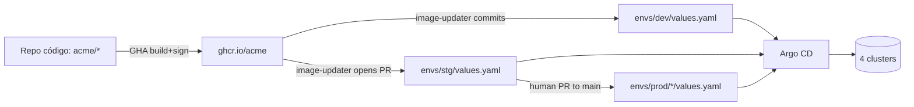
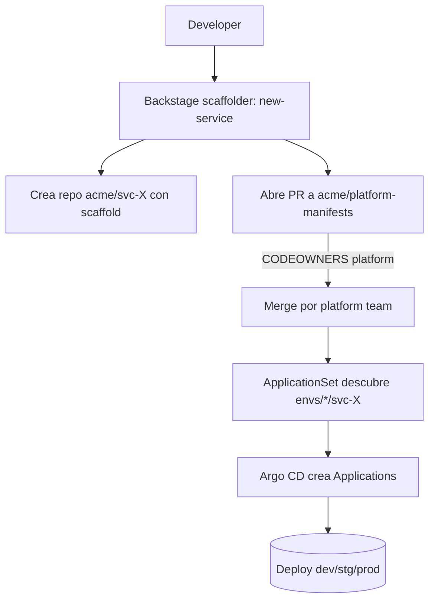

# ADR-001 — Contrato GitOps de plataforma (Acme Foods)

- **Estado**: proposed
- **Fecha**: 2026-01-15
- **Autor(es)**: Equipo Plataforma
- **Contexto**: `scenario.md`. Org con 5 equipos / 22 servicios (50 en 18m) / 4 clusters / PCI-DSS en pricing+checkout.

---

## 1. Estrategia de promoción

| Ambiente | Estrategia | Trigger | Approver | Automatización |
|---|---|---|---|---|
| dev  | folder-overlay + `argocd-image-updater` write-back git | commit a `main` del repo infra o imagen nueva | team-lead o auto | auto-sync + self-heal |
| stg  | folder-overlay, PR del bot image-updater | merge PR del bot al folder `envs/stg/` | 1 team-lead | auto-sync tras merge |
| prod | folder-overlay, PR humano | merge PR a `envs/prod/<region>/` | 2 SRE | auto-sync, `syncWindows` deny viernes-lunes |

**Diagrama de flujo**:



**Alternativas consideradas**:

- Branch-based (dev/stg/main): descartada — los ambientes **divergen** (prod multi-región, replicas distintas) y los merges tendrían conflictos permanentes.
- Image-updater en prod directo: descartada — exige PCI-DSS un humano en el loop para prod.

**Trade-off aceptado**: dos pasos (bot escribe dev → humano hace PR a prod) añaden ~1 día de lead time pero preservan audit trail y 2-approver rule.
**Métrica de éxito**: lead time dev→prod < 48h p95; 0 deploys a prod sin PR aprobado por 2 SRE en 90 días.

---

## 2. PR previews

**Alcance**: `catalog`, `checkout`, `loyalty`. `data-platform` excluido (datos sensibles, footprint grande).

1. Namespace: `pr-{{number}}-{{service}}` (único por servicio+PR).
2. TTL: 7 días desde último push al PR; `CronJob` nocturno elimina stale.
3. `ResourceQuota`: 2 CPU, 4 Gi memoria, 20 pods por namespace.
4. DNS: wildcard `*.preview.acme.example` → ingress-nginx LB; CNAME creado por `external-dns`.
5. Secretos: ESO leyendo `vault://previews/{{service}}/*`; nunca path de prod.
6. Datos: DB-per-PR con `cnpg` operator; seed script `seed-preview.sh`; 500MB max por DB.
7. Limpieza: PR cerrado → `pullRequest` generator deja de emitir → `prune: true` elimina recursos → `CronJob` elimina namespace huérfano.

**Alternativas**: previews compartidos (shared staging por PR) — descartado, no reproduce ambiente aislado.
**Trade-off**: coste de cluster sube ~20% en pico de PRs activos; mitigado con ResourceQuota agresivo.
**Métrica de éxito**: tiempo PR→URL viva < 5 min; 0 previews > 7 días; coste cluster/mes dentro de budget.

---

## 3. Drift reconciliation

| Ambiente | `automated` | `selfHeal` | `prune` | Alerta drift |
|---|---|---|---|---|
| dev  | sí | sí  | sí | no |
| stg  | sí | sí  | sí | warning (Slack) |
| prod | sí | no  | no | critical (PagerDuty) |

Razón: en prod `selfHeal: false` para no revertir parches de emergencia; `prune: false` para forzar que un recurso borrado requiera revisión explícita.

**`ignoreDifferences` común**:

```yaml
ignoreDifferences:
  - group: apps
    kind: Deployment
    jsonPointers: [ /spec/replicas ]          # HPA
  - group: ""
    kind: Secret
    jqPathExpressions: [ '.data["ca.crt"]' ]  # cert-manager rotando CA
```

**`syncWindows` en prod**:

```yaml
syncWindows:
  - kind: deny
    schedule: "0 17 * * 5"
    duration: "63h"
    applications: [ "prod-*" ]
    manualSync: true
```

**Alternativas**: `selfHeal: true` en prod — descartado por el incidente histórico (parche revertido durante outage).
**Trade-off**: drift en prod no se auto-corrige; se requiere runbook claro que diga "parche manual → inmediatamente PR al repo infra".
**Métrica de éxito**: MTTD de drift < 10 min; 0 reversiones de parches de emergencia en incidentes.

---

## 4. Observabilidad

### 4.1 ServiceMonitors

5 componentes expuestos a Prometheus (ver `examples/04`).

### 4.2 Dashboards

- Grafana ID **14584** (ArgoCD) — vista general.
- Grafana ID **19993** (ArgoCD Operational) — SRE / p99.

### 4.3 Alertas

```promql
argocd_app_info{health_status="Degraded"} == 1
```

```promql
increase(argocd_app_sync_total{phase="Failed"}[15m]) > 3
```

```promql
histogram_quantile(0.99, sum(rate(argocd_app_reconcile_bucket[5m])) by (le)) > 60
```

### 4.4 Routing

- Warnings → `#platform-alerts` (Slack).
- Críticos (prod `Degraded` > 5m, sync fallando repetidamente, repo-server down) → `#platform-oncall` + PagerDuty.

**Métrica de éxito**: *reconciliation freshness* ≥ 99% apps < 3 min; *sync success rate* ≥ 99% rolling 24h.

---

## 5. IDP flow (nuevo servicio)



**Decisión Backstage vs script**: Backstage. Razón: 50 servicios en 18 meses justifican la inversión; integra portal + catálogo + plugin de Argo CD.
**Alternativas**: cookiecutter + GHA — descartada por ausencia de portal.
**Trade-off**: 2 FTE-sprint de setup inicial de Backstage; se amortiza con el servicio #10.
**Métrica de éxito**: time-to-first-deploy de un servicio nuevo < 1h desde "create" en Backstage.

---

## 6. Consecuencias

- Lead time dev→prod predecible; audit trail completo en Git.
- Cost cluster sube por previews; se mitiga con quota y TTL.
- Operar `argocd-image-updater` añade un componente más al stack.
- `selfHeal: false` en prod exige disciplina de runbook.

## 7. Revisión

- Revisores: SRE lead, platform lead, security.
- Re-evaluación: 6 meses o cuando se dupliquen los servicios activos.
