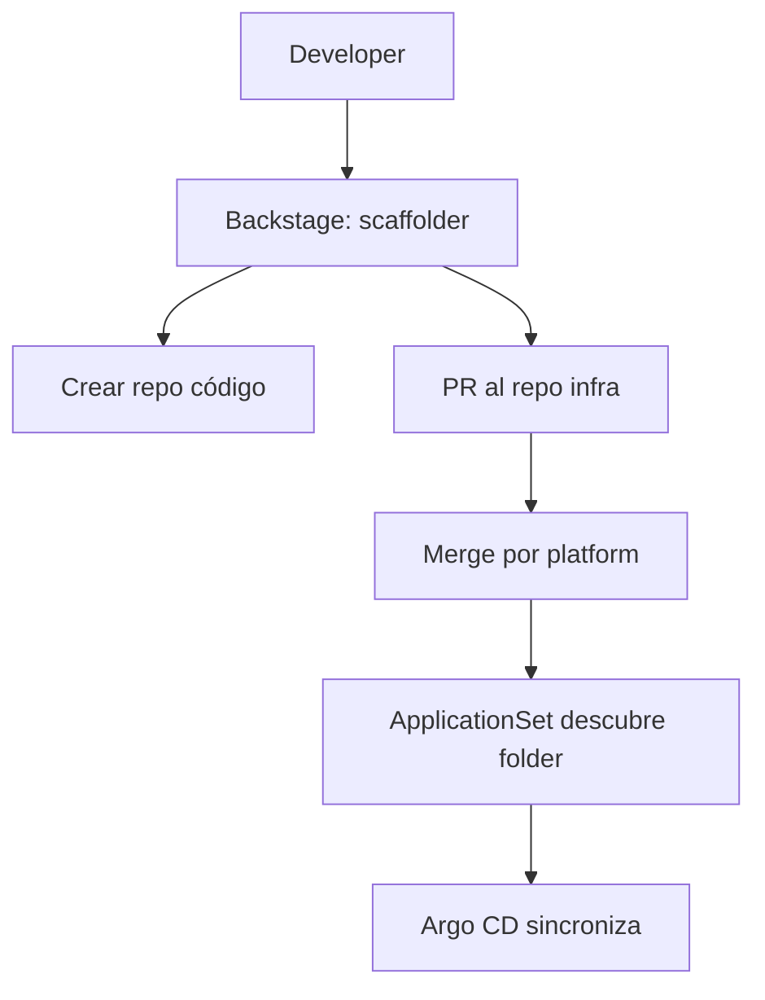

# ADR-001 — Contrato GitOps de plataforma (Acme Foods)

- **Estado**: proposed
- **Fecha**: YYYY-MM-DD
- **Autor(es)**: tu nombre
- **Contexto**: ver `scenario.md`

---

## 1. Estrategia de promoción

> Elige por ambiente. Mezcla permitida. Justifica cada celda.

| Ambiente | Estrategia | Trigger | Approver | Automatización |
|---|---|---|---|---|
| dev | ... | ... | ... | ... |
| stg | ... | ... | ... | ... |
| prod | ... | ... | ... | ... |

**Diagrama de flujo**:


**Alternativas consideradas**:

- Opción A: ... — descartada por ...
- Opción B: ... — descartada por ...

**Trade-off aceptado**: ...
**Métrica de éxito**: ...

---

## 2. PR previews

**Alcance**: qué servicios tienen previews y cuáles no.

Contrato en 7 puntos:

1. Nombrado de namespace: `pr-{number}` o `svc-pr-{number}`.
2. TTL: ... días; job de limpieza en ...
3. `ResourceQuota` default por namespace: CPU ..., memoria ..., pods ...
4. DNS: wildcard `*.preview.acme.example` → ...
5. Secretos: ESO leyendo path `secret/data/previews/*`.
6. Datos: estrategia (DB-per-PR / shared seed / snapshot).
7. Limpieza al cerrar PR: ...

**Alternativas**:
**Trade-off**:
**Métrica de éxito**:

---

## 3. Drift reconciliation

| Ambiente | `automated` | `selfHeal` | `prune` | Alerta drift |
|---|---|---|---|---|
| dev  | ... | ... | ... | ... |
| stg  | ... | ... | ... | ... |
| prod | ... | ... | ... | ... |

**`ignoreDifferences` común** (plantilla aplicada a todas las apps):

```yaml
ignoreDifferences:
  - group: apps
    kind: Deployment
    jsonPointers: [ /spec/replicas ]
```

**`syncWindows` en prod**:

```yaml
syncWindows:
  - kind: deny
    schedule: "0 17 * * 5"      # viernes 17h
    duration: "63h"             # hasta lunes 8h
    applications: [ "prod-*" ]
    manualSync: true
```

**Alternativas**:
**Trade-off**:
**Métrica de éxito**:

---

## 4. Observabilidad

### 4.1 Métricas expuestas (`ServiceMonitor`)

- `argocd-application-controller` :8082
- `argocd-server` :8083
- `argocd-repo-server` :8084
- `argocd-notifications-controller` :9001
- `argocd-applicationset-controller` :8080

### 4.2 Dashboards elegidos

- Grafana ID ... — razón.
- Grafana ID ... — razón.

### 4.3 Alertas (PromQL)

```promql
# Alerta 1 — app Degraded sostenido
argocd_app_info{health_status="Degraded"} == 1
```

```promql
# Alerta 2 — sync fallando repetidamente
increase(argocd_app_sync_total{phase="Failed"}[15m]) > 3
```

```promql
# Alerta 3 — reconciliación lenta
histogram_quantile(0.99, sum(rate(argocd_app_reconcile_bucket[5m])) by (le)) > 60
```

### 4.4 Routing

- `#platform-alerts` warnings; `#platform-oncall` + PagerDuty críticos.
- Reglas: ...

**Métrica de éxito**: ...

---

## 5. IDP flow (nuevo servicio)



**Decisión Backstage vs script**: ...
**Alternativas**:
**Trade-off**:
**Métrica de éxito**:

---

## 6. Consecuencias

- Lo que mejora: ...
- Lo que cuesta: ...
- Deuda operativa aceptada: ...

## 7. Revisión

- Revisores: ...
- Fecha de re-evaluación: ...
