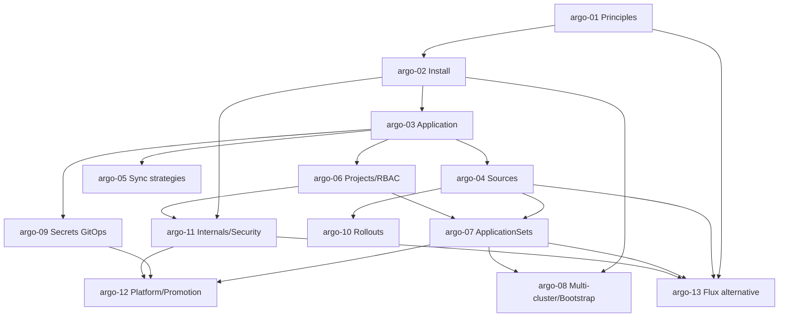

# Argo CD y GitOps — Roadmap detallado

IDs estables: `argo-<NN>-<slug>`.

Duración orientativa total: **35–50 h**.

---

## Nivel 1 — Fundamentos

### argo-01-gitops-principles-and-argocd-vs-flux

- **Nivel:** fundamentos
- **Objetivo:** interiorizar los 4 principios de GitOps y entender el panorama (Argo CD vs Flux) antes de instalar nada.
- **Prerrequisitos:** curso **kubernetes** ≥ Nivel 2.
- **Temas:** **OpenGitOps principles** (declarative, versioned & immutable, pulled automatically, continuously reconciled); push vs pull; "CI builds artifacts, CD reconciles state"; separación clara entre **repo de código** y **repo de infra/manifests**; Argo CD vs Flux (filosofía, UX, modularidad, requisitos); anti-patrones comunes ("GitOps-washing": CI que hace `kubectl apply` no es GitOps).
- **Fundamentos internos:** por qué el modelo pull reduce la superficie de credenciales (el pipeline externo no toca el cluster); por qué la reconciliación continua detecta y revierte drift sin esfuerzo adicional.
- **Competencias:** explicar los 4 principios y justificar GitOps frente a push CI/CD.
- **Ejemplos:** `01-push-vs-pull-diagram`, `02-opengitops-principles-walkthrough`.
- **Actividades:** `01-identify-gitops-washing` (análisis), `02-adr-argocd-vs-flux-first-pass`.
- **Entregables:** ADR corto con la elección y los criterios.
- **Evaluación:** detectar casos donde un pipeline *parece* GitOps pero viola algún principio.
- **Duración:** 2 h.

### argo-02-install-and-first-application

- **Nivel:** fundamentos
- **Objetivo:** instalar Argo CD, acceder por UI/CLI y gestionar la primera Application.
- **Prerrequisitos:** `argo-01`.
- **Temas:** instalación con manifests oficiales o Helm; componentes (`argocd-server`, `application-controller`, `repo-server`, `redis`, `applicationset-controller`, `notifications-controller`, `dex` opcional); acceso: port-forward, `argocd admin initial-password`, luego Ingress + OIDC; `argocd` CLI (`login`, `app create/list/get/sync/diff/history/rollback`); conectar un repo público; primera Application (plain YAML en un repo); conceptos **sync** vs **health**.
- **Fundamentos internos:** el `application-controller` es un sharded controller con reconciliation loop; el `repo-server` renderiza manifests (soporta Helm, Kustomize, Jsonnet, plugins); Argo CD guarda contraseña inicial como secret `argocd-initial-admin-secret`.
- **Competencias:** levantar Argo CD; crear y sincronizar una Application desde CLI y UI.
- **Ejemplos:** `01-install-argocd-in-kind`, `02-first-plain-yaml-app`, `03-cli-essentials`.
- **Actividades:** `01-bootstrap-argocd`, `02-connect-repo-and-sync` (independiente).
- **Entregables:** cluster local con Argo CD operativo + 1 Application sana.
- **Evaluación:** diferenciar "sync status" de "health status".
- **Duración:** 3 h.

### argo-03-application-anatomy-sources-destinations-sync

- **Nivel:** fundamentos
- **Objetivo:** entender el CR Application en profundidad.
- **Prerrequisitos:** `argo-02`.
- **Temas:** `apiVersion: argoproj.io/v1alpha1, kind: Application`; `spec.source` (repoURL, path, targetRevision — branch/tag/commit/`HEAD`); `spec.destination` (server, namespace); `spec.project`; `spec.syncPolicy` (manual vs automated: prune, selfHeal); `spec.ignoreDifferences` (ignorar campos mutados por otros controllers: HPA, VPA); `spec.info`, `annotations`; UI de recursos (tree, diff, logs); `argocd app diff`.
- **Fundamentos internos:** `targetRevision: HEAD` es trampa — significa "lo que esté en el branch default *ahora*" y se mueve; preferir ref inmutable (tag/commit) para artefactos y branch para "ambiente"; `ignoreDifferences` es clave para convivir con HPA/VPA.
- **Competencias:** diseñar Applications bien definidas; usar `diff` para predecir cambios.
- **Ejemplos:** `01-application-spec-walkthrough`, `02-ignore-hpa-replicas`, `03-diff-in-ci`.
- **Actividades:** `01-write-application-manifest`, `02-diagnose-out-of-sync` (independiente).
- **Entregables:** Application manifest documentado para el capstone.
- **Evaluación:** explicar por qué `replicas` suele ir en `ignoreDifferences` cuando hay HPA.
- **Duración:** 3 h.

---

## Nivel 2 — Intermedio

### argo-04-sources-helm-kustomize-jsonnet-multisource

- **Nivel:** intermedio
- **Objetivo:** usar Argo CD con cada tipo de fuente y combinar múltiples sources.
- **Prerrequisitos:** `argo-03`, curso **helm**.
- **Temas:** **plain YAML / directory** (recursive, include/exclude); **Helm**: `source.helm.values`, `valueFiles`, `releaseName`, `parameters`, `fileParameters`, `passCredentials`, **cómo Argo CD renderiza Helm** (no corre `helm install` — hace `helm template` + apply); por eso **hooks de Helm quedan limitados**; **Kustomize**: `source.kustomize.namePrefix`, `images`, `commonLabels`, `patches`; **Jsonnet** (opcional); **Multi-source Applications** (combinar p. ej. un chart base con un values file en otro repo); **Config Management Plugins (CMPs)** para herramientas no soportadas nativamente.
- **Fundamentos internos:** el `repo-server` es quien hace el rendering; para Helm, los hooks `pre-install/pre-upgrade` tradicionales se convierten en **Argo CD hooks** (`argocd.argoproj.io/hook`); se recomienda usar Argo CD sync waves + resource hooks en vez de Helm hooks dentro de charts gestionados por Argo CD.
- **Competencias:** elegir y configurar el source apropiado; combinar chart + values externos.
- **Ejemplos:** `01-helm-source-with-values`, `02-kustomize-with-image-override`, `03-multi-source-chart-plus-values`.
- **Actividades:** `01-deploy-capstone-via-helm-source`, `02-multi-source-pattern` (independiente).
- **Entregables:** capstone desplegado vía Helm source + values externos.
- **Evaluación:** explicar por qué los hooks de Helm no funcionan igual bajo Argo CD y qué alternativa usar.
- **Duración:** 4 h.

### argo-05-sync-strategies-waves-and-hooks

- **Nivel:** intermedio
- **Objetivo:** controlar el *cómo* y el *cuándo* del sync.
- **Prerrequisitos:** `argo-03`.
- **Temas:** **manual sync** vs **automated** (`automated.prune`, `automated.selfHeal`, `automated.allowEmpty`); **sync windows** (ventanas de mantenimiento); **sync options** (`CreateNamespace=true`, `ApplyOutOfSyncOnly=true`, `ServerSideApply=true`, `RespectIgnoreDifferences=true`, `PruneLast=true`); **sync waves** (`argocd.argoproj.io/sync-wave`) para ordenar recursos; **resource hooks** (`PreSync`, `Sync`, `PostSync`, `SyncFail`, `PostDelete`) y delete policies; **retry** y backoff; `argocd app sync --dry-run`.
- **Fundamentos internos:** sync waves ordenan recursos *dentro de una Application*; hooks son recursos (típicamente Jobs) con anotación especial; `selfHeal: true` revierte cambios manuales — poderoso y a veces molesto durante incidentes.
- **Competencias:** diseñar política de sync segura por ambiente (prod: manual approval, dev: auto); orquestar DB migrations con PreSync hook.
- **Ejemplos:** `01-automated-prune-selfheal`, `02-sync-waves-db-then-app`, `03-presync-migration-job`.
- **Actividades:** `01-prod-manual-dev-auto`, `02-add-migration-presync` (independiente).
- **Entregables:** app con sync waves y PreSync migration demostrados.
- **Evaluación:** justificar `selfHeal` on/off por entorno.
- **Duración:** 4 h.

### argo-06-projects-rbac-and-boundaries

- **Nivel:** intermedio
- **Objetivo:** multi-tenancy segura con AppProjects.
- **Prerrequisitos:** `argo-03`, curso **k8s** ≥ `k8s-12` (RBAC).
- **Temas:** **AppProject** CR: `sourceRepos` (repos permitidos), `destinations` (clusters/namespaces permitidos), `clusterResourceWhitelist/Blacklist`, `namespaceResourceWhitelist/Blacklist`, `orphanedResources`, **roles** del project con policies tipo RBAC (CSV), **JWT tokens** por role (útil para integración CI → Argo CD limitado); diferencia entre **Argo CD RBAC** (quién hace qué en Argo CD) y **K8s RBAC** (qué hace Argo CD en el cluster target); SSO/OIDC.
- **Fundamentos internos:** el `application-controller` usa un ServiceAccount con permisos en los clusters target; el *project* es la barrera entre tenants/equipos; sin projects correctos un developer puede desplegar en namespaces que no debería.
- **Competencias:** diseñar projects por equipo/entorno; integrar con SSO.
- **Ejemplos:** `01-project-per-team`, `02-rbac-with-oidc-groups`, `03-jwt-token-for-ci`.
- **Actividades:** `01-multi-team-projects`, `02-least-privilege-rbac-adr` (independiente).
- **Entregables:** projects para 2 equipos distintos con boundaries verificados.
- **Evaluación:** auditar un project `*/*` y proponer restricciones mínimas.
- **Duración:** 3 h.

### argo-07-applicationsets-and-generators

- **Nivel:** intermedio
- **Objetivo:** generar Applications dinámicamente para escalar a muchos entornos/clusters/apps.
- **Prerrequisitos:** `argo-04`, `argo-06`.
- **Temas:** `ApplicationSet` CR; **generators**: **List**, **Cluster** (todos los clusters registrados), **Git** (directories o files), **Matrix** (combinación de generators), **Merge**, **SCM Provider** (GitHub/GitLab, descubrir repos), **Pull Request** (crear preview env por PR); **template** con `metadata` y `spec` parametrizados; `goTemplate: true`; evitar explosión de Applications (`generators + templatePatch` disciplinado); progressive sync.
- **Fundamentos internos:** el `applicationset-controller` genera N Applications desde una definición; eso convierte el "app-of-apps" clásico en algo más maintainable; PR generator + delete-on-close habilita preview environments.
- **Competencias:** reemplazar app-of-apps por ApplicationSet; preview environments por PR.
- **Ejemplos:** `01-git-generator-env-per-folder`, `02-cluster-generator-fleet`, `03-pullrequest-preview-env`.
- **Actividades:** `01-env-per-folder-appset`, `02-pr-preview-environments` (independiente).
- **Entregables:** ApplicationSet que gestiona 3 ambientes del capstone + PR preview.
- **Evaluación:** diferenciar app-of-apps vs ApplicationSet; cuándo cada uno.
- **Duración:** 5 h.

---

## Nivel 3 — Avanzado

### argo-08-multi-cluster-and-bootstrap-patterns

- **Nivel:** avanzado
- **Objetivo:** operar Argo CD contra múltiples clusters y bootstrap de clusters nuevos.
- **Prerrequisitos:** `argo-02`, `argo-07`.
- **Temas:** patrón **control-plane cluster** (Argo CD vive en un cluster y gestiona N clusters target) vs **in-cluster** (uno por cluster, cada uno se auto-gestiona); registrar clusters (`argocd cluster add`, declarative Secret `argocd.argoproj.io/secret-type: cluster`); **bootstrap repo**: un ApplicationSet raíz que define todos los add-ons del cluster (ingress-nginx, cert-manager, external-dns, Prometheus Operator, el propio Argo CD autogestionado); patrón "**app-of-apps**" clásico; cluster add vía **Cluster API** para auto-descubrimiento.
- **Fundamentos internos:** cuando Argo CD "se gestiona a sí mismo" por GitOps, hay que diseñar un bootstrap seguro (chicken-and-egg: cambios al chart de Argo CD deben poder aplicarse); el patrón "self-managing" se logra con una Application que apunta al propio chart de Argo CD con `selfHeal` cuidadoso.
- **Competencias:** diseñar y defender el modelo multi-cluster; bootstrap reproducible.
- **Ejemplos:** `01-register-second-cluster`, `02-bootstrap-repo-skeleton`, `03-argocd-self-managing`.
- **Actividades:** `01-single-vs-control-plane-adr`, `02-bootstrap-everything-from-git` (independiente).
- **Entregables:** cluster "vacío" que, con un solo `kubectl apply`, converge a estado objetivo completo.
- **Evaluación:** riesgos de "Argo CD gestionado por Argo CD" y mitigaciones.
- **Duración:** 5 h.

### argo-09-secrets-with-gitops

- **Nivel:** avanzado
- **Objetivo:** gestionar secretos sin violar GitOps.
- **Prerrequisitos:** `argo-03`, curso **k8s** ≥ `k8s-05`, cursos **aws/gcp** (secret managers).
- **Temas:** por qué secretos en claro en Git **nunca**; opciones:
  - **SOPS + KSOPS** (encriptación con KMS/age/PGP; secret cifrado vive en Git y Argo CD lo descifra via plugin);
  - **Sealed Secrets** (controller con clave pública; genera `SealedSecret` que solo *este* cluster puede descifrar);
  - **External Secrets Operator (ESO)** (CR `ExternalSecret` que sincroniza desde Secret Manager / Vault / etc. — **patrón recomendado hoy**);
  - **Secrets Store CSI Driver** (monta secretos como volúmenes directamente desde el secret manager);
  - **Vault Agent Injector** (sidecar que inyecta secretos).
- Rotación; auditoría; ventajas y trade-offs por opción.
- **Fundamentos internos:** ESO desacopla "qué secreto necesita la app" (en Git) de "dónde vive su valor" (en el secret manager); Sealed Secrets no permite rotar fácilmente la clave maestra sin re-sellar todo; SOPS requiere que Argo CD tenga permiso al KMS (lo que mueve el problema de blast radius).
- **Competencias:** elegir y aplicar la estrategia correcta; migrar entre opciones si cambia la organización.
- **Ejemplos:** `01-eso-aws-secrets-manager`, `02-sealed-secrets-walkthrough`, `03-sops-ksops-argocd-plugin`.
- **Actividades:** `01-capstone-secrets-via-eso`, `02-tradeoffs-adr` (independiente).
- **Entregables:** capstone con secretos vía ESO + ADR comparando opciones.
- **Evaluación:** elegir y defender la estrategia para 3 organizaciones distintas.
- **Duración:** 5 h.

### argo-10-argo-rollouts-progressive-delivery

- **Nivel:** avanzado
- **Objetivo:** implementar blue/green y canary nativos con analysis automático.
- **Prerrequisitos:** `argo-04`, curso **k8s** ≥ `k8s-10` (probes/rollouts).
- **Temas:** instalar **Argo Rollouts** y plugin `kubectl argo rollouts`; CRD **Rollout** (reemplaza a Deployment); estrategias **blue/green** (`activeService`, `previewService`, `autoPromotionEnabled`) y **canary** (`steps`: setWeight/pause/analysis); **AnalysisTemplate** y **AnalysisRun** (métricas de Prometheus, Datadog, CloudWatch, Kayenta); **experiments**; integración con **traffic management** (ingress-nginx, Istio, SMI, Gateway API, Traefik, ALB) para control preciso del peso; relación con Argo CD (Rollout se aplica por GitOps como cualquier otro recurso).
- **Fundamentos internos:** sin traffic management explícito, Argo Rollouts solo puede dividir por *replicas* (aproximación grosera); con integración, divide por *porcentaje de requests*; AnalysisRun gatea la promoción automática.
- **Competencias:** diseñar y correr canary con criterios automáticos de rollback.
- **Ejemplos:** `01-blue-green-with-services`, `02-canary-stepped-with-nginx`, `03-analysis-template-prom`.
- **Actividades:** `01-canary-capstone`, `02-auto-rollback-on-5xx` (independiente).
- **Entregables:** canary del capstone con auto-promotion por métricas Prometheus.
- **Evaluación:** diseñar criterios de analysis realistas (SLI-based) para un servicio dado.
- **Duración:** 5 h.

### argo-11-internals-and-security

- **Nivel:** avanzado
- **Objetivo:** entender y endurecer Argo CD mismo.
- **Prerrequisitos:** `argo-02`, `argo-06`, curso **k8s** ≥ `k8s-16`.
- **Temas:** componentes internos y comunicación (gRPC, Redis como caché); modelo de autenticación (local admin, OIDC/SSO, SAML, JWT); **Argo CD RBAC** (CSV: `p, role:*, applications, *, */*, allow`); **sharding** del application-controller para escala; `argocd-cm` y `argocd-rbac-cm` como fuentes de verdad; secretos (`argocd-secret`), repo credentials (`argocd-cmd-params-cm`, repo creds con SSH/HTTPS/GitHub App); hardening (SSO obligatorio en prod, deshabilitar local admin, `kubectl.kubernetes.io/last-applied-configuration` fuga de datos, HTTPS obligatorio, Pod Security restricted en el namespace de Argo CD); backup del state (CRs son el state — backup del namespace `argocd` basta con Velero); conocidos CVEs (contexto histórico).
- **Fundamentos internos:** Argo CD casi no tiene state propio: todo es CRs → backup fácil, restore reproducible; la contraseña del admin local es una red de seguridad peligrosa en prod.
- **Competencias:** endurecer una instalación default; integrar OIDC; backup/restore.
- **Ejemplos:** `01-oidc-with-github`, `02-rbac-csv-walkthrough`, `03-velero-backup-argocd-ns`.
- **Actividades:** `01-harden-argocd-install`, `02-recover-argocd-from-backup` (independiente).
- **Entregables:** instalación endurecida con SSO + sin admin local + backup verificado.
- **Evaluación:** auditar una instalación default y proponer plan de hardening priorizado.
- **Duración:** 5 h.

---

## Nivel 4 — Producción empresarial

### argo-12-platform-patterns-promotion-previews-observability

- **Nivel:** producción
- **Objetivo:** operar GitOps como plataforma: estrategia de promoción, preview envs, drift, observabilidad.
- **Prerrequisitos:** `argo-07`, `argo-09`, `argo-11`.
- **Temas:** **estrategia de promoción** entre ambientes:
  - **branch-based** (promover = merge dev → stg → prod en el repo de infra),
  - **folder/overlay-based** con ApplicationSet (`envs/dev/`, `envs/stg/`, `envs/prod/`),
  - **image updater** (`argocd-image-updater` escribe commits que bumpan tags cuando aparece imagen nueva);
- separación **repo de código** vs **repo de infra** (uno o varios); ownership (CODEOWNERS en infra repo);
- **PR previews** completas y limpieza automática;
- **drift reconciliation** (cuándo re-sync, cuándo alertar);
- **notifications-controller** (Slack/webhook); **observabilidad de Argo CD mismo** (métricas Prometheus del `application-controller`, dashboards oficiales); **ApplicationSet progressive sync**; relación con **Backstage** / IDPs (plantillas que crean el folder + Application).
- **Fundamentos internos:** la decisión "repo de código vs repo de infra" tiene efectos operativos reales (quién puede mergear a prod); image updater elimina trabajo manual pero introduce commits automáticos (ruido).
- **Competencias:** diseñar el "contrato GitOps" de la plataforma.
- **Ejemplos:** `01-branch-promotion`, `02-folder-promotion-appset`, `03-image-updater`, `04-argocd-metrics-dashboard`.
- **Actividades:** `01-platform-contract-adr`, `02-pr-previews-end-to-end` (independiente).
- **Entregables:** ADR de contrato + capstone con promoción + PR previews + observabilidad.
- **Evaluación:** defender el modelo elegido contra alternativas; evaluar costos operativos.
- **Duración:** 5 h.

### argo-13-flux-as-alternative

- **Nivel:** producción
- **Objetivo:** entender Flux a nivel que permita elegir fundamentadamente y migrar si corresponde.
- **Prerrequisitos:** `argo-01`, `argo-04`, `argo-07`, `argo-11`.
- **Temas:** arquitectura Flux v2: **source-controller** (`GitRepository`, `OCIRepository`, `HelmRepository`, `Bucket`), **kustomize-controller** (`Kustomization` CR), **helm-controller** (`HelmRelease` CR), **notification-controller**, **image-automation-controller** + **image-reflector-controller** (built-in; equivalente a `argocd-image-updater`); multi-tenancy con `kustomization` + impersonation + `ServiceAccount`; `flux` CLI; filosofía "GitOps-only" (sin UI de edición — es una característica, no un defecto); comparación tabular con Argo CD (UX, sharding, SSO, features); criterios de migración (ida y vuelta posibles).
- **Fundamentos internos:** Flux no tiene concepto equivalente de Application monolítica; cada controller lee su CR y actúa; la ausencia de UI con write es intencional (todo cambio pasa por Git); image automation en Flux es nativo, en Argo CD es un addon separado.
- **Competencias:** operar Flux a nivel básico; justificar elección Argo CD vs Flux para una org.
- **Ejemplos:** `01-flux-install-and-first-kustomization`, `02-helmrelease-in-flux`, `03-image-automation-in-flux`.
- **Actividades:** `01-port-capstone-from-argocd-to-flux` (independiente), `02-choice-adr-final`.
- **Entregables:** capstone portado a Flux + ADR final de elección.
- **Evaluación:** comparar operacionalmente ambos sistemas sobre el mismo workload.
- **Duración:** 4 h.

---

## Dependencias entre módulos

## Puente con el capstone

El capstone usa este curso como "último paso" de la cadena DevSecOps:
- Pipeline **GitHub Actions** solo construye, firma y publica la imagen a GHCR, y luego hace un commit al **repo de infra** actualizando el tag.
- **Argo CD** reconcilia desde ese repo con la estrategia de promoción elegida.
- **Admission policy** (Kyverno) exige firma de imagen.
- **Argo Rollouts** gestiona la liberación progresiva con analysis contra Prometheus.
- **ESO** proporciona los secretos sin que vivan en Git.

## Checklist de verificación requerida en Fase 4

- Versión actual estable de Argo CD y Argo Rollouts.
- Versión actual estable de Flux v2.
- Estado y madurez de **multi-source Applications** (GA state y edge cases).
- **ApplicationSets generators** disponibles (lista crece: Plugin, SCM Provider, PR, Matrix, Merge…).
- Mejores prácticas vigentes sobre **secretos en GitOps** (ESO como estado del arte, pero verificar).
- Compatibilidad vigente **Argo Rollouts + Gateway API** (traffic management).
- `argocd-image-updater` madurez y comparativa vigente con Flux image automation.
- CVEs recientes de Argo CD y hardening recommendations actualizadas.
- Pod Security Standards aplicables al namespace `argocd`.
- Estado de **Argo Autopilot** (si se usa como forma de bootstrap).
