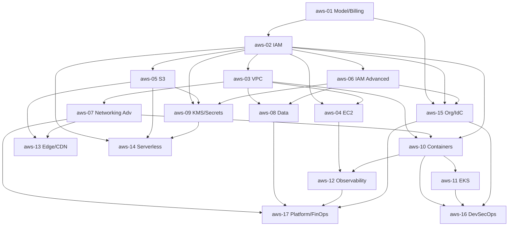

# AWS — Roadmap detallado

IDs estables: `aws-<NN>-<slug>`.

Duración orientativa total: **80–110 h**.

Todas las lecciones se harán idealmente provisionando con **Terraform** (curso prerrequisito). La consola se usa para *entender* y *auditar*, no como mecanismo principal de cambio.

---

## Nivel 1 — Fundamentos

### aws-01-model-regions-billing-and-free-tier

- **Nivel:** fundamentos
- **Objetivo:** entender el modelo global, cómo se cobra y cómo evitar sustos.
- **Prerrequisitos:** nociones básicas de cloud.
- **Temas:** cuenta root (y por qué no se usa a diario), regiones y AZs, selección de región (latencia/compliance/precio), servicios globales vs regionales; APIs REST + SigV4 + endpoints por región; AWS CLI v2 (perfiles, `~/.aws/credentials` y `~/.aws/config`, SSO/Identity Center logon); Free Tier (siempre gratis vs 12-meses vs trial); Billing & Cost Management, AWS Budgets, Cost Explorer, Pricing Calculator; alertas de presupuesto como *primer paso obligatorio*; `aws sts get-caller-identity`.
- **Fundamentos internos:** por qué las llamadas van firmadas (SigV4) y el `sts get-caller-identity` siempre es el chequeo de "quién soy ahora"; qué servicios son globales (IAM, Route 53, CloudFront, Organizations).
- **Competencias:** configurar CLI y perfiles; crear un presupuesto con alertas antes de provisionar nada.
- **Ejemplos:** `01-cli-profiles-and-sts`, `02-budget-with-sns-alert`.
- **Actividades:** `01-safe-account-setup` (guiada), `02-root-mfa-and-admin-user` (independiente, obligatoria antes de cualquier otro módulo).
- **Entregables:** cuenta con MFA en root, usuario administrativo con MFA, presupuesto con alerta a email.
- **Evaluación:** explicar por qué el root no se usa; estimar costo mensual de un workload sencillo.
- **Duración:** 3 h.

### aws-02-iam-fundamentals

- **Nivel:** fundamentos
- **Objetivo:** dominar los primitivos de IAM antes de tocar otros servicios.
- **Prerrequisitos:** `aws-01`.
- **Temas:** principals (user, role, service, federated); políticas identity-based vs resource-based; policy JSON (`Version`, `Statement`, `Effect`, `Action`, `Resource`, `Condition`, `Principal`, `NotAction`/`NotResource`/`NotPrincipal`); groups; **roles y STS** (`sts:AssumeRole`, `sts:AssumeRoleWithWebIdentity` para OIDC); managed vs inline policies; variables de policy (`${aws:username}`); access keys (y por qué evitarlas) vs **IAM Identity Center / SSO** vs OIDC.
- **Fundamentos internos:** la **lógica de evaluación** (default deny → explicit allow → explicit deny gana); por qué un rol es una *identidad asumible* con credenciales temporales; qué es un *trust policy* (quién puede asumir este rol) vs *permission policy* (qué puede hacer una vez asumido).
- **Competencias:** escribir políticas mínimas; crear roles para servicios y para humanos vía SSO.
- **Ejemplos:** `01-least-privilege-s3-readonly`, `02-role-assume-chain`, `03-oidc-trust-policy-for-github`.
- **Actividades:** `01-write-least-privilege-policy`, `02-assume-role-cross-session` (independiente).
- **Entregables:** 3 políticas documentadas con justificación de cada permiso.
- **Evaluación:** auditar una política `"Action": "*"` y proponer la versión mínima equivalente.
- **Duración:** 5 h.

### aws-03-vpc-basics

- **Nivel:** fundamentos
- **Objetivo:** construir y entender una VPC multi-AZ segura.
- **Prerrequisitos:** T-3 networking, `aws-02`.
- **Temas:** VPC CIDR; subnets públicas y privadas (criterio real: pública = *route table tiene IGW*); Internet Gateway, NAT Gateway (y su costo), NAT Instance (opción barata); route tables; **Security Groups** (stateful, allow-only) vs **NACLs** (stateless, allow+deny, ordenadas); DHCP options; DNS en VPC (`enableDnsSupport`, `enableDnsHostnames`); **VPC endpoints** (Gateway: S3/DynamoDB; Interface: casi todo lo demás) y su rol para evitar egress por NAT; peering (introducción).
- **Fundamentos internos:** por qué NAT Gateway cobra por hora + por GB (fuente #1 de facturas sorpresa); por qué los endpoints S3/DynamoDB son gratis (Gateway) y los demás no (Interface); por qué SGs stateful no requieren reglas de retorno.
- **Competencias:** diseñar VPC multi-AZ con separación pública/privada y endpoints.
- **Ejemplos:** `01-vpc-multi-az-with-tf`, `02-sg-vs-nacl-matrix`, `03-s3-gateway-endpoint`.
- **Actividades:** `01-provision-vpc-via-tf-module`, `02-reduce-nat-cost-with-endpoints` (independiente).
- **Entregables:** módulo Terraform propio de VPC con tests smoke.
- **Evaluación:** calcular costo mensual de NAT en 3 AZ y proponer alternativa.
- **Duración:** 5 h.

### aws-04-ec2-fundamentals

- **Nivel:** fundamentos
- **Objetivo:** entender compute básico (aunque luego usemos contenedores): AMIs, instancias, discos, metadata.
- **Prerrequisitos:** `aws-02`, `aws-03`.
- **Temas:** familias y tipos de instancia (general, compute, memory, storage, GPU, Graviton/ARM); AMIs (oficial, propia, AWS Marketplace); keypairs (y preferir **SSM Session Manager** sobre SSH abierto); user-data (cloud-init); EBS (gp3, io2, st1, sc1), snapshots; **instance metadata service** (IMDS) **v2 obligatorio** y riesgos de v1 (SSRF→credential leak); instance profile (role asumido por la EC2); autoscaling groups (introducción) y launch templates.
- **Fundamentos internos:** cómo una EC2 obtiene credenciales temporales vía IMDS→STS mediante el instance profile; por qué IMDSv2 (con sesión token) mitiga el SSRF-to-cred-leak; por qué `user-data` debe ser idempotente.
- **Competencias:** levantar EC2 segura (sin SSH abierto, IMDSv2 enforced) por Terraform.
- **Ejemplos:** `01-ec2-ssm-no-ssh`, `02-imdsv2-enforced`, `03-user-data-bootstrap`.
- **Actividades:** `01-launch-ec2-reach-via-ssm`, `02-attach-instance-profile-and-test-sts` (independiente).
- **Entregables:** EC2 accesible solo por SSM, con rol propio y bootstrap documentado.
- **Evaluación:** explicar por qué IMDSv1 es un riesgo y cómo IMDSv2 lo mitiga.
- **Duración:** 4 h.

### aws-05-s3-fundamentals

- **Nivel:** fundamentos
- **Objetivo:** usar S3 con seguridad razonable desde el día uno.
- **Prerrequisitos:** `aws-02`.
- **Temas:** bucket y objeto; naming global; storage classes (Standard, IA, Glacier, Intelligent-Tiering); versioning; lifecycle rules; **Block Public Access a nivel cuenta y bucket** (default sano); **bucket policies vs ACLs** (ACLs deshabilitadas por default moderno); encryption at-rest (SSE-S3, SSE-KMS, DSSE-KMS); SSE-C (menos común); access logging a bucket aparte; CORS; **presigned URLs**.
- **Fundamentos internos:** por qué S3 es un *object store eventual-consistent → strongly consistent* (desde 2020); por qué la mayoría de "leaks de S3" fueron permisos públicos accidentales → Block Public Access es la red de seguridad.
- **Competencias:** crear buckets seguros por default; usar presigned URLs para subidas controladas.
- **Ejemplos:** `01-safe-bucket-defaults-tf`, `02-presigned-upload`, `03-lifecycle-to-glacier`.
- **Actividades:** `01-provision-and-upload-with-cli-and-boto3`, `02-detect-and-fix-public-bucket` (independiente).
- **Entregables:** bucket con versioning, lifecycle, SSE-KMS y acceso restringido vía bucket policy.
- **Evaluación:** auditar un bucket "público" encontrado en un repo de ejemplo y proponer corrección.
- **Duración:** 4 h.

---

## Nivel 2 — Intermedio

### aws-06-iam-advanced

- **Nivel:** intermedio
- **Objetivo:** aplicar IAM a escala con guardrails y acceso entre cuentas.
- **Prerrequisitos:** `aws-02`.
- **Temas:** **Service Control Policies (SCPs)** (whitelist/blacklist de acciones por OU); **Permission Boundaries** (techo de permisos para principals delegados); **session policies**; cross-account access (role en cuenta B con trust a cuenta A); `aws:PrincipalOrgID` y `aws:SourceAccount`; `aws:ViaAWSService`; condiciones (`StringEquals`, `ArnLike`, `StringLike`, `Bool`, `IpAddress`, `aws:MultiFactorAuthPresent`); **IAM Access Analyzer** (external access y unused access); **least privilege iterativa** (CloudTrail → access analyzer policy generation).
- **Fundamentos internos:** la lógica completa de evaluación cuando intervienen SCPs + resource-based + boundary + identity + session; por qué un `Deny` en SCP no se "compensa" con un `Allow` en identity.
- **Competencias:** diseñar guardrails de org; refinar permisos con Access Analyzer.
- **Ejemplos:** `01-scp-deny-regions`, `02-permission-boundary-for-developers`, `03-cross-account-s3-access`.
- **Actividades:** `01-write-scp-baseline`, `02-generate-least-privilege-from-cloudtrail` (independiente).
- **Entregables:** SCP baseline documentado + boundary de ejemplo + política refinada con Access Analyzer.
- **Evaluación:** resolver un escenario donde SCP y identity policy entran en conflicto.
- **Duración:** 5 h.

### aws-07-networking-advanced

- **Nivel:** intermedio
- **Objetivo:** balancear tráfico, publicar servicios y conectar VPCs/cuentas con criterio de coste y seguridad.
- **Prerrequisitos:** `aws-03`.
- **Temas:** **ALB** (L7, path/host routing, auth con Cognito/OIDC, WAF integration), **NLB** (L4, static IP, PrivateLink), **GWLB** (L3 para appliances); target groups (instance, IP, Lambda, ALB-as-target); health checks; **TLS** terminación con ACM; sticky sessions; **Route 53** (hosted zones públicas y privadas, alias records, routing policies: simple/weighted/latency/geolocation/failover/geoproximity); **VPC peering** vs **Transit Gateway** vs **Cloud WAN**; **PrivateLink** (exponer tu servicio como Interface Endpoint consumible desde otras VPCs/cuentas); **egress controlado** (NAT + endpoints + optional Network Firewall).
- **Fundamentos internos:** cuándo ALB (HTTP) vs NLB (TCP/UDP, mTLS, PrivateLink); por qué TGW escala sobre peering en topologías N:N; cómo PrivateLink evita exponer servicios a internet y evita egress por NAT.
- **Competencias:** elegir y provisionar el LB correcto; diseñar conectividad multi-VPC.
- **Ejemplos:** `01-alb-with-acm-and-route53`, `02-nlb-with-privatelink`, `03-tgw-hub-and-spoke`.
- **Actividades:** `01-publish-app-with-alb-tls-dns`, `02-expose-internal-service-via-privatelink` (independiente).
- **Entregables:** app pública con ALB+ACM+Route53 funcional y documentada.
- **Evaluación:** justificar ALB vs NLB para 3 escenarios.
- **Duración:** 6 h.

### aws-08-managed-data-rds-aurora-dynamodb

- **Nivel:** intermedio
- **Objetivo:** elegir y operar bases de datos administradas sin re-inventar operación.
- **Prerrequisitos:** `aws-03`, `aws-06`.
- **Temas:** **RDS** (Postgres, MySQL, MariaDB, Oracle, SQL Server) — instancia, multi-AZ, read replicas, backups, snapshots, parameter/option groups, **IAM database authentication**; **Aurora** (storage layer compartido, hasta 15 réplicas, Serverless v2, Global Database); **DynamoDB** (key-value + document, partition/sort key, GSI/LSI, on-demand vs provisioned, DAX, Streams, PITR); conexión segura (SG + endpoints + IAM auth cuando aplique); costos de egress y backups.
- **Fundamentos internos:** por qué multi-AZ en RDS implica failover sincrónico ~segundos (no es "HA activa-activa"); por qué DynamoDB es "pague por operación" y cómo diseñar la clave es la decisión de rendimiento.
- **Competencias:** provisionar RDS/Aurora/DynamoDB con backups, SG mínimo y auth segura.
- **Ejemplos:** `01-rds-postgres-multi-az-tf`, `02-aurora-serverless-v2`, `03-dynamodb-single-table`.
- **Actividades:** `01-provision-rds-and-connect`, `02-dynamodb-partition-key-design` (independiente).
- **Entregables:** Postgres administrado y accesible desde VPC privada.
- **Evaluación:** diferenciar RDS vs Aurora vs DynamoDB para 3 workloads dados.
- **Duración:** 5 h.

### aws-09-kms-secrets-manager-parameter-store

- **Nivel:** intermedio
- **Objetivo:** gestionar claves y secretos sin incurrir en malas prácticas.
- **Prerrequisitos:** `aws-02`, `aws-05`, `aws-06`.
- **Temas:** **KMS** CMKs (AWS-managed vs customer-managed vs customer-provided), **envelope encryption**, data keys, key policies (confusión frecuente: "principal del rol" ≠ "principal del servicio"); rotation; multi-Region keys; **Secrets Manager** (secretos con rotación automática integrada con RDS/Redshift/DocumentDB, versionado, replicación); **SSM Parameter Store** (standard gratis, advanced con tamaño/throughput mayor, SecureString con KMS); criterio: Parameter Store para config no sensible/parámetros; Secrets Manager para credenciales rotables.
- **Fundamentos internos:** envelope encryption: KMS cifra la data key, la data key cifra el payload (operación local, no round-trip a KMS por byte); por qué una **key policy** mal escrita rompe uso incluso con la IAM policy correcta.
- **Competencias:** diseñar jerarquía de secretos; rotación RDS vía Secrets Manager.
- **Ejemplos:** `01-cmk-with-key-policy`, `02-secrets-manager-rds-rotation`, `03-ssm-parameter-store-securestring`.
- **Actividades:** `01-store-and-fetch-secret-from-app`, `02-rotate-rds-password-automatically` (independiente).
- **Entregables:** secretos y parámetros del capstone en Secrets Manager / SSM, consumidos vía IAM role.
- **Evaluación:** justificar Secrets Manager vs Parameter Store para 5 ítems dados.
- **Duración:** 4 h.

### aws-10-containers-ecr-ecs-fargate-apprunner

- **Nivel:** intermedio
- **Objetivo:** correr contenedores en AWS sin K8s cuando no se justifica.
- **Prerrequisitos:** curso **docker**, `aws-02`, `aws-03`, `aws-07`.
- **Temas:** **ECR** (private + public, scanning on push básico, lifecycle policies, replication, IAM); **ECS** (cluster, task definition, service, launch types: EC2 vs **Fargate**); task role vs execution role; `awsvpc` network mode; service discovery (Cloud Map), ALB target group por servicio; **App Runner** (más opinionado, menos control, bueno para una API sin devops dedicado).
- **Fundamentos internos:** diferencia entre *execution role* (quién puede pullear la imagen y escribir a CloudWatch Logs) y *task role* (quién asume la aplicación corriendo); por qué Fargate elimina gestión de EC2 pero no elimina IAM/networking.
- **Competencias:** publicar imagen a ECR, correrla en ECS Fargate detrás de ALB.
- **Ejemplos:** `01-ecr-push-from-ci`, `02-ecs-fargate-service`, `03-apprunner-oneclick`.
- **Actividades:** `01-fastapi-on-ecs-fargate`, `02-ecr-lifecycle-policy-cost` (independiente).
- **Entregables:** app del capstone corriendo en ECS Fargate con TLS público.
- **Evaluación:** ECS vs EKS vs Lambda vs App Runner para la app dada.
- **Duración:** 6 h.

---

## Nivel 3 — Avanzado

### aws-11-eks-in-depth

- **Nivel:** avanzado
- **Objetivo:** operar un cluster EKS productivo con identidad por workload.
- **Prerrequisitos:** `aws-10`, curso **kubernetes** Nivel 1–2.
- **Temas:** EKS control plane administrado + node groups (self-managed, managed node groups, **Fargate profiles**); versionado y upgrades; `aws-auth` ConfigMap (legacy) vs **EKS access entries** (moderno); **IRSA** (IAM Roles for Service Accounts) vía OIDC; **EKS Pod Identity** (alternativa más simple y nueva); add-ons (VPC CNI, CoreDNS, kube-proxy, EBS CSI, Load Balancer Controller, External DNS, Cluster Autoscaler/Karpenter); **Karpenter** como scheduler-driven provisioner; integración con ALB/NLB vía Load Balancer Controller.
- **Fundamentos internos:** IRSA vs Pod Identity: ambos otorgan un rol IAM a un ServiceAccount, IRSA via OIDC trust directo con proyección de token, Pod Identity con un agente que atiende requests de IMDS-like; por qué Karpenter outperforma Cluster Autoscaler en flexibilidad de tipos de instancia.
- **Competencias:** levantar EKS por Terraform; dar permisos a workloads sin keys; elegir Karpenter o CAS.
- **Ejemplos:** `01-eks-with-tf-blueprint`, `02-irsa-s3-access-from-pod`, `03-karpenter-provisioner`.
- **Actividades:** `01-provision-eks-and-run-app`, `02-migrate-irsa-to-pod-identity` (independiente).
- **Entregables:** cluster EKS funcional con workload del capstone y acceso IAM por SA.
- **Evaluación:** IRSA vs Pod Identity decisión argumentada.
- **Duración:** 8 h.

### aws-12-observability-cloudwatch-xray-cloudtrail

- **Nivel:** avanzado
- **Objetivo:** instrumentar observabilidad nativa y conectarla al stack OSS del programa (Prometheus/Grafana).
- **Prerrequisitos:** `aws-04`, `aws-10`.
- **Temas:** **CloudWatch Logs** (log groups, retention, subscriptions, metric filters, Logs Insights), **CloudWatch Metrics** (namespaces, dimensions, resolution, custom metrics), **CloudWatch Alarms** (static vs anomaly detection, composite); **CloudWatch Container Insights** para ECS/EKS; **X-Ray** (traces, segments, subsegments) y relación con **OpenTelemetry** (ADOT — AWS Distro for OpenTelemetry); **CloudTrail** (management, data events, Insights) y por qué debe habilitarse en toda cuenta; **CloudWatch Agent** vs **ADOT Collector**; costos de logs (ingestión + storage).
- **Fundamentos internos:** por qué Logs Insights no sustituye a Loki/ELK para volúmenes grandes (costos); por qué CloudTrail "management events" cuesta ~0 y "data events" sí cuesta (S3 object-level, Lambda invoke).
- **Competencias:** instrumentar app con OTel enviando a ADOT → CloudWatch *y* Prometheus/Grafana; crear alarmas útiles (no ruido).
- **Ejemplos:** `01-cloudwatch-logs-insights`, `02-adot-collector-eks`, `03-cloudtrail-org-trail`.
- **Actividades:** `01-instrument-fastapi-with-adot`, `02-cost-trim-cw-logs` (independiente).
- **Entregables:** app con logs/metrics/traces en CloudWatch, alarmas razonables, CloudTrail activo.
- **Evaluación:** diseñar política de retención y filtering que reduzca costos sin perder señal.
- **Duración:** 5 h.

### aws-13-edge-dns-cdn-acm

- **Nivel:** avanzado
- **Objetivo:** publicar workloads al mundo con TLS, CDN y DNS correctos.
- **Prerrequisitos:** `aws-05`, `aws-07`.
- **Temas:** **Route 53** avanzado (hosted zones, delegación entre cuentas, routing policies, resolver endpoints para hybrid DNS); **ACM** (public cert gratis con validación DNS, private CA opcional); **CloudFront** (distribuciones, origins, behaviors, cache policies, origin access control para S3, Lambda@Edge/CloudFront Functions, WAF integration, signed URLs/cookies); invalidation y costos; HTTP/2 y HTTP/3.
- **Fundamentos internos:** por qué ACM cert para CloudFront debe estar en **us-east-1** (y para ALB en la región del ALB); cómo OAC reemplazó al legacy OAI para S3 origins; signed URLs vs signed cookies.
- **Competencias:** entregar app globalmente con TLS, CDN y DNS correcto.
- **Ejemplos:** `01-static-site-s3-cloudfront-oac`, `02-api-on-alb-via-cloudfront`, `03-signed-urls-s3`.
- **Actividades:** `01-publish-site-with-cf-acm-route53`, `02-add-waf-and-geo-restriction` (independiente).
- **Entregables:** sitio del capstone servido por CloudFront + ACM + Route 53.
- **Evaluación:** diseñar caching policy para una API dinámica.
- **Duración:** 4 h.

### aws-14-serverless-integration-essentials

- **Nivel:** avanzado
- **Objetivo:** lo justo de serverless para integraciones y automatizaciones (no un curso de serverless full).
- **Prerrequisitos:** `aws-02`, `aws-05`, `aws-09`.
- **Temas:** **Lambda** (runtimes, memoria=CPU, timeouts, cold starts, provisioned concurrency, SnapStart Java, Lambda layers, container image deployments); **API Gateway** (REST vs HTTP vs WebSocket, auth con JWT/Lambda authorizer, usage plans); **EventBridge** (buses, rules, cross-account, schemas, pipes); **SQS** (standard vs FIFO, visibility timeout, DLQ) y **SNS** (topics, fanout, SMS/email, FIFO); **Step Functions** (introducción); cuándo Lambda vs ECS/EKS; cuidado con costos ocultos (Lambda logs, EventBridge events-per-second, API GW requests).
- **Fundamentos internos:** cómo el modelo de concurrencia de Lambda escala horizontalmente (hasta 1000 simultáneas por default por región, no por función); por qué DLQ y visibility timeout son críticos para no perder/duplicar mensajes.
- **Competencias:** diseñar flujo evento-driven mínimo (p. ej. S3 → Lambda → SNS → Lambda → RDS).
- **Ejemplos:** `01-lambda-s3-trigger`, `02-api-gateway-http-with-cognito`, `03-eventbridge-cross-account`.
- **Actividades:** `01-build-event-driven-mini-pipeline`, `02-cost-of-lambda-at-scale` (análisis).
- **Entregables:** mini-pipeline event-driven funcional.
- **Evaluación:** criterio de elección Lambda vs ECS para 3 workloads.
- **Duración:** 5 h.

---

## Nivel 4 — Producción empresarial

### aws-15-multi-account-org-identity-center

- **Nivel:** producción
- **Objetivo:** operar múltiples cuentas con gobernanza central y acceso humano via SSO.
- **Prerrequisitos:** `aws-01`, `aws-02`, `aws-06`.
- **Temas:** **AWS Organizations** (management account, OUs, member accounts, invitations vs account creation), consolidated billing; **SCPs** como guardrails (ejemplos: deny regiones, deny leave-org, deny disable logging); **AWS Control Tower** (landing zone opinada: management + log archive + audit + guardrails); **IAM Identity Center** (SSO central, permission sets, asignación a cuentas y OUs, integración con Okta/Entra ID/Google Workspace); patrón "una app = una cuenta" vs "una app = múltiples cuentas (dev/stg/prod)"; cross-account roles para pipelines y para humanos.
- **Fundamentos internos:** la cuenta de management no debe hospedar workloads; una SCP "deny" no se puede evadir con un allow en identity policy; Permission Sets de IdC son plantillas que generan roles por cuenta.
- **Competencias:** diseñar y bootstrap una org pequeña (3–5 cuentas) con IdC.
- **Ejemplos:** `01-org-with-tf`, `02-scp-baseline`, `03-identity-center-permission-sets`.
- **Actividades:** `01-create-dev-stg-prod-accounts`, `02-write-scp-baseline-and-test` (independiente).
- **Entregables:** org con 3 cuentas, IdC configurado, SCPs baseline aplicadas.
- **Evaluación:** auditar una SCP y decir qué permite y qué no.
- **Duración:** 6 h.

### aws-16-devsecops-on-aws

- **Nivel:** producción
- **Objetivo:** aplicar los controles DevSecOps del programa específicamente en AWS.
- **Prerrequisitos:** `aws-02`, `aws-10`, `aws-11`, `aws-15`, cursos **github-actions** y **docker** Nivel 4.
- **Temas:** **OIDC GitHub Actions → AWS** (sin keys), trust policies con `sub` claim pinnneado a repo/branch/env; **IRSA / Pod Identity** para workloads EKS; **Secrets Manager rotation** automática; **Inspector** (vuln scanning para EC2/ECR/Lambda); **ECR scanning** (basic vs **enhanced** con Inspector); **GuardDuty** (threat detection); firma de imágenes con **cosign** y verificación en EKS vía policy (sigstore policy-controller/Kyverno); **Config** (configuration recording, conformance packs); recomendaciones del **AWS Security Reference Architecture**; principio: no usar access keys humanas, nunca.
- **Fundamentos internos:** cómo el *claim* `sub` del OIDC token de GHA se mapea al rol IAM, y por qué pinnear a `repo:owner/repo:ref:refs/heads/main` es necesario (vs permitir cualquier branch).
- **Competencias:** aterrizar todos los controles DevSecOps del programa sobre AWS.
- **Ejemplos:** `01-oidc-gha-to-aws-role`, `02-inspector-scan-ecr`, `03-cosign-verify-in-eks`, `04-secrets-manager-rds-rotation`.
- **Actividades:** `01-full-oidc-pipeline-no-keys` (mini-proyecto), `02-ecr-scan-gate-in-pipeline`.
- **Entregables:** pipeline que despliega imagen firmada a EKS, auth por OIDC, scaneada y verificada en admisión.
- **Evaluación:** auditoría escrita de un pipeline existente para brechas y recomendaciones.
- **Duración:** 7 h.

### aws-17-platform-finops-and-well-architected

- **Nivel:** producción
- **Objetivo:** operar AWS como plataforma: landing zone, costos y resiliencia.
- **Prerrequisitos:** `aws-07`, `aws-08`, `aws-12`, `aws-15`.
- **Temas:** **landing zone** (red central, DNS compartido, logging centralizado a cuenta de log-archive, security tooling a cuenta de audit); **Transit Gateway + Route 53 Resolver** hub-and-spoke; **FinOps**: tagging obligatorio (cost allocation tags), Savings Plans, Reserved Instances, Spot/Graviton; Cost Explorer, Cost Anomaly Detection; **AWS Backup** y estrategia DR (RPO/RTO, pilot-light, warm standby, multi-region active-active); **Config conformance packs** y **Security Hub** (findings agregados); **Well-Architected Framework** 6 pilares; **AWS Resilience Hub** (opcional).
- **Fundamentos internos:** por qué los *tags* definen tu capacidad de hacer FinOps (sin tags no hay segmentación de gasto); por qué una landing zone bien diseñada evita costos y riesgos ocultos (p. ej. NAT por cuenta vs centralizado en inspection VPC).
- **Competencias:** diseñar landing zone pequeña; estrategia FinOps aplicable; plan DR consciente de costos.
- **Ejemplos:** `01-tagging-strategy-and-enforcement-scp`, `02-savings-plan-estimation`, `03-dr-pilot-light`.
- **Actividades:** `01-landing-zone-minimal-adr` (independiente), `02-finops-dashboard-and-anomaly`.
- **Entregables:** ADR landing zone + ADR FinOps + plan DR + dashboard de costos.
- **Evaluación:** proponer plan DR razonado para el capstone con trade-offs de costo.
- **Duración:** 7 h.

---

## Dependencias entre módulos

## Checklist de verificación requerida en Fase 4

- Estado actual de **EKS access entries** vs `aws-auth` ConfigMap (recomendación oficial actual).
- Estado y disponibilidad regional de **EKS Pod Identity** (nuevo frente a IRSA, no en todas las versiones de K8s).
- Estado de **S3 Block Public Access** por defecto en cuentas nuevas (cambió hace relativamente poco).
- IMDSv2 por default: estado por tipo de AMI y por región.
- **S3 ACLs disabled by default** (buckets nuevos): confirmar.
- **ECR Enhanced Scanning** con Inspector v2: disponibilidad y costo.
- Estado de **Karpenter** y versión actual (v1 estable).
- Precios actuales de NAT GW (por hora + por GB) para los ejercicios de costo.
- IAM Identity Center: nombre y UI vigentes (sucesor del antiguo "AWS SSO").
- Control Tower: features actuales (Account Factory for Terraform, controles disponibles).
- **AWS Resilience Hub**, **Security Hub**, **Config conformance packs**: estado y actualizaciones recientes.
- OIDC `aud` y `sub` claims actuales emitidos por GitHub Actions y recomendación de pinning.
- **Account root user**: cambios recientes en requisitos de MFA (algunos obligatorios desde 2024–2025).
