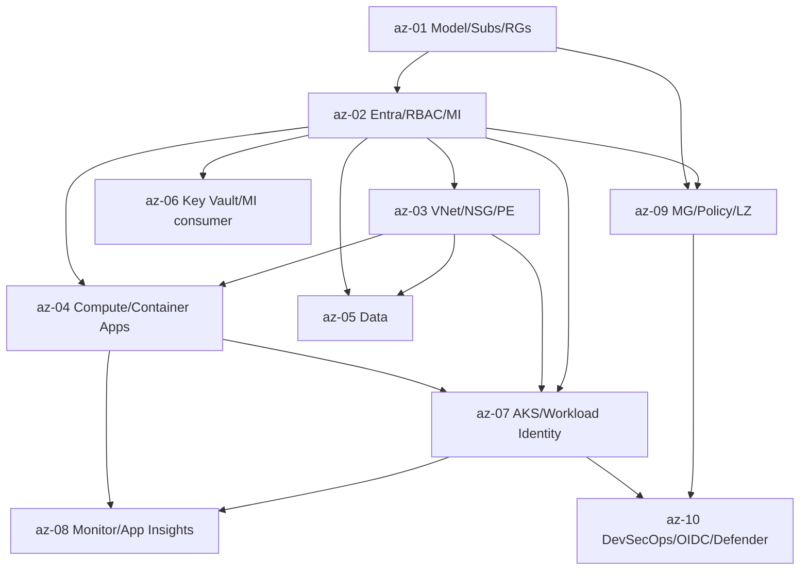

# Azure — Roadmap detallado (diferencial contra AWS)

IDs estables: `az-<NN>-<slug>`.

Duración orientativa total: **25–40 h**. Compacto por diseño.

Todos los módulos asumen conocimiento equivalente del lado AWS y se enfocan en transferencia + divergencias. Se usa **Terraform** (`azurerm` provider) para provisionar; el portal se usa para entender y auditar.

---

## Nivel 1 — Fundamentos diferenciales

### az-01-model-subscriptions-resource-groups-billing-and-cli

- **Nivel:** fundamentos
- **Objetivo:** interiorizar la jerarquía Tenant → MG → Subscription → RG → Resource y manejar `az` CLI.
- **Prerrequisitos:** curso **aws** ≥ `aws-01`, `aws-02`.
- **Temas:** jerarquía completa; **Resource Group** como nivel extra (unidad de deploy y de **eliminación en cascada** — `az group delete` borra todo); **Subscription types** (Pay-as-you-go, Enterprise Agreement, CSP, Dev/Test); **billing** separado de identidad (una Billing Account puede pagar N subscriptions); habilitación de **resource providers** por subscription (`Microsoft.ContainerService`, etc.); `az` CLI (`az login`, `az account set`, `az config set defaults`); `azd` (Azure Developer CLI, templates para quickstart); nombres globales (Storage, Key Vault, FQDNs); **Budgets** con alertas (primer paso); diferencias con AWS: tags por recurso y por RG (ambos útiles).
- **Fundamentos internos:** el RG facilita operar/eliminar grupos funcionales (todo un ambiente dev en un RG → `delete` limpio); habilitar resource providers por subscription es intencional (defensa en profundidad y cuotas).
- **Competencias:** crear subscription playground, RG, budget, CLI operativa.
- **Ejemplos:** `01-az-login-and-defaults`, `02-rg-delete-cascades`, `03-budget-with-notifications`.
- **Actividades:** `01-bootstrap-safe-subscription`, `02-tagging-rg-vs-resource` (independiente).
- **Entregables:** subscription con MFA + RG + budget con alerta.
- **Evaluación:** justificar "un RG = un ambiente de un workload".
- **Duración:** 3 h.

### az-02-entra-id-rbac-managed-identities

- **Nivel:** fundamentos
- **Objetivo:** dominar identidad y autorización: Entra ID + Azure RBAC + Managed Identities.
- **Prerrequisitos:** `az-01`, curso AWS ≥ `aws-02`, `aws-06`.
- **Temas:** **Microsoft Entra ID** (ex Azure AD): usuarios, grupos, **app registrations** (identidad de workloads externos — equivalente a OAuth app), **service principals** (instancia de un app registration en un tenant), **managed identities** (**system-assigned** — vive y muere con el recurso; **user-assigned** — recurso aparte que puede asignarse a varios); **Azure RBAC**: `role assignment` = (role + principal + **scope**); scope jerárquico (MG → Subscription → RG → Resource); roles **built-in** (`Owner`, `Contributor`, `Reader`, roles por servicio p. ej. `Storage Blob Data Reader`), **custom roles** (JSON con `actions`/`notActions`/`dataActions`/`notDataActions`, `assignableScopes`); **Conditional Access** y **MFA**; **Privileged Identity Management (PIM)** para JIT elevation; preferir **groups-based** assignments; **evitar service principal secrets** → OIDC Federation / Managed Identities siempre que se pueda.
- **Fundamentos internos:** la evaluación RBAC Azure es *allow-based* con herencia por scope — no hay "SCP deny" clásico (eso se cubre con **Azure Policy** `deny` effect); una Managed Identity es un service principal gestionado por Azure que se adjunta a un recurso: el recurso obtiene un token sin que haya que guardar secreto.
- **Competencias:** diseñar role assignments mínimos; crear MI y usarla desde una VM/Container App.
- **Ejemplos:** `01-role-assignment-at-rg-scope`, `02-managed-identity-vm-to-keyvault`, `03-custom-role-json`.
- **Actividades:** `01-least-privilege-storage-reader`, `02-mi-vs-sp-with-secret` (análisis).
- **Entregables:** workload con MI leyendo Key Vault sin ningún secreto configurado.
- **Evaluación:** traducir una IAM policy AWS a role assignments Azure equivalentes.
- **Duración:** 4 h.

### az-03-vnet-nsg-asg-private-link-hub-spoke

- **Nivel:** fundamentos
- **Objetivo:** construir red regional segura y aprender el patrón Hub-Spoke.
- **Prerrequisitos:** curso AWS ≥ `aws-03`, `aws-07`.
- **Temas:** **VNet regional** con subnets; **NSG** stateful (allow/deny ingress/egress, prioridad numérica, aplicable a subnet o NIC); **ASG** (Application Security Group) para agrupar NICs por rol lógico y referenciarlos como "sources/destinations" (más mantenible que listas IP); **Service Endpoints** vs **Private Endpoints / Private Link** (Private Endpoints son el camino moderno: dan IP privada al servicio PaaS dentro de tu VNet); **VNet Peering**, **Hub-Spoke** (hub con firewall/vpn, spokes por workload), **Virtual WAN** para topologías grandes; **Azure Firewall** y **Firewall Manager**; **Azure Load Balancer** (L4) vs **Application Gateway** (L7, WAF) vs **Front Door** (global anycast, CDN + WAF); **Azure DNS** y **Private DNS Zones**; **NAT Gateway** regional.
- **Fundamentos internos:** NSGs se componen a nivel subnet y NIC; la "effective rule" se calcula para cada NIC; ASG + NSG es el patrón escalable (menos reglas, por identidad lógica); Private Endpoint elimina egress por internet a servicios PaaS.
- **Competencias:** diseñar VNet con private endpoints a Storage/Key Vault; hub-spoke mínimo.
- **Ejemplos:** `01-vnet-with-nat-and-pe`, `02-nsg-with-asg`, `03-hub-spoke-skeleton`.
- **Actividades:** `01-vnet-plus-private-endpoints`, `02-hub-spoke-tf` (independiente).
- **Entregables:** VNet con subnets public/private, Private Endpoint a Storage/Key Vault.
- **Evaluación:** comparar VPC AWS vs VNet Azure para un workload dado.
- **Duración:** 4 h.

---

## Nivel 2 — Compute, datos, secretos

### az-04-compute-vm-vmss-container-apps-functions-app-service

- **Nivel:** intermedio
- **Objetivo:** elegir compute correcto; en especial, aprovechar **Container Apps**.
- **Prerrequisitos:** curso AWS ≥ `aws-04`, `aws-10`, `aws-14`; curso **docker**.
- **Temas:** **VM** y **VM Scale Sets (VMSS)** con autoscaling; **Spot VMs**; **Shielded VM / Trusted Launch**; **OS Login equivalent**: usar **Azure Bastion** o **Azure AD login for VMs** (sin SSH keys locales); **App Service** (PaaS web/API clásico, planes B/P/I con escaling); **Container Apps** (serverless K8s abstracto, Dapr integrado, scale-to-zero, revisions con traffic split, min/max replicas, ingress HTTP/TCP); **Container Instances (ACI)** (contenedor único, útil para batch); **Azure Functions** (serverless FaaS, triggers HTTP/Queue/Timer/EventGrid, Flex Consumption plan como moderno); mapping (EC2↔VM, ECS/Fargate↔Container Apps, Lambda↔Functions, App Runner↔App Service/Container Apps).
- **Fundamentos internos:** Container Apps corre encima de AKS gestionado por Azure pero oculto — es K8s administrado "sin tener que operar K8s"; Dapr habilita *building blocks* (state, pub/sub, bindings) sin acoplar código a vendor.
- **Competencias:** desplegar capstone en Container Apps con traffic split canary.
- **Ejemplos:** `01-fastapi-on-container-apps`, `02-canary-with-revisions`, `03-vm-with-aad-login`.
- **Actividades:** `01-deploy-same-app-container-apps-and-aks-compare`, `02-canary-5pct-rollout` (independiente).
- **Entregables:** app del capstone en Container Apps con canary y rollback demostrable.
- **Evaluación:** criterio Container Apps vs AKS vs App Service vs Functions para 3 workloads.
- **Duración:** 5 h.

### az-05-data-sql-postgres-cosmos-storage

- **Nivel:** intermedio
- **Objetivo:** mapear el catálogo de datos Azure a casos AWS equivalentes.
- **Prerrequisitos:** curso AWS ≥ `aws-08`.
- **Temas:** **Azure SQL Database** (SQL Server managed; tiers DTU/vCore; serverless; auto-failover groups); **Azure Database for PostgreSQL Flexible Server** (recomendado sobre Single Server, en deprecación); **MySQL Flexible Server**; **Azure Database for Postgres Hyperscale (Citus)**; **Cosmos DB** (multi-model API: SQL, Mongo, Cassandra, Gremlin, Table; globally distributed; **consistency levels** únicos — strong, bounded staleness, session (default), consistent prefix, eventual); **Azure Storage Account**: Blob (equivalente S3, hot/cool/archive, versioning, lifecycle, SAS tokens), Files (SMB/NFS), Queues, Tables; **Private Endpoint** y **customer-managed keys**; mapping (RDS↔Azure SQL/Postgres Flexible, DynamoDB↔Cosmos DB, S3↔Blob, EFS↔Files, SQS↔Service Bus Queue + Storage Queue, SNS↔Event Grid / Service Bus Topics — hay varios equivalentes).
- **Fundamentos internos:** Cosmos DB es materialmente distinto por sus 5 niveles de consistencia (único en el mercado managed); Postgres Flexible Server es el camino actual para Postgres (Single Server se discontinúa); Storage Account agrupa 4 servicios bajo un recurso.
- **Competencias:** provisionar Postgres Flexible + Storage Account + Cosmos DB básico; private endpoints.
- **Ejemplos:** `01-postgres-flexible-tf`, `02-storage-account-blob-sas`, `03-cosmos-sql-api`.
- **Actividades:** `01-connect-fastapi-to-postgres-flexible`, `02-cosmos-consistency-tradeoff` (análisis).
- **Entregables:** Postgres accesible desde app vía Private Endpoint + MI auth.
- **Evaluación:** mapping DynamoDB → Cosmos para un caso dado, con elección de consistency.
- **Duración:** 4 h.

### az-06-key-vault-and-managed-identities-consumer

- **Nivel:** intermedio
- **Objetivo:** gestionar secretos/claves/certificados y consumirlos con Managed Identities.
- **Prerrequisitos:** `az-02`, curso AWS ≥ `aws-09`.
- **Temas:** **Key Vault** unifica **secrets** (strings), **keys** (asimétricas/simétricas, HSM-backed opcional), **certificates** (lifecycle: issuer integration, auto-renewal); **Managed HSM** para FIPS 140-2 L3; access policies (legacy) vs **RBAC data-plane** (moderno, preferir); referenciar secret desde App Service/Function/Container Apps/AKS directamente (`@Microsoft.KeyVault(...)`); **Secrets Store CSI Driver with Azure provider** para AKS; versionado y rotación; **soft delete + purge protection** obligatorios en prod.
- **Fundamentos internos:** Key Vault RBAC es más limpio que access policies legacy; una MI del recurso cliente + `Key Vault Secrets User` role es la receta estándar; soft delete evita pérdida accidental de claves (y requiere plan explícito de purge).
- **Competencias:** publicar secret, consumirlo desde Container Apps / AKS con MI.
- **Ejemplos:** `01-key-vault-rbac-dataplane`, `02-container-app-reads-secret-with-mi`, `03-aks-csi-driver-kv`.
- **Actividades:** `01-capstone-secrets-via-kv`, `02-cert-auto-renewal` (independiente).
- **Entregables:** capstone leyendo secretos y cert TLS desde Key Vault con MI.
- **Evaluación:** justificar `RBAC data-plane` sobre `access policies` legacy.
- **Duración:** 3 h.

---

## Nivel 3 — Avanzado

### az-07-aks-and-workload-identity

- **Nivel:** avanzado
- **Objetivo:** operar AKS con identidad por workload y entender add-ons.
- **Prerrequisitos:** `az-02`, `az-03`, `az-04`, curso **kubernetes** ≥ Nivel 2, curso AWS ≥ `aws-11`.
- **Temas:** AKS control plane managed; node pools (system vs user; Spot; **Virtual Nodes** con ACI para burst); **Azure CNI** (default; da IPs del VNet) vs **Azure CNI Overlay** vs **kubenet** (legacy); **AKS cluster autoscaler** / **Karpenter**-equivalent (Node Autoprovisioning, en preview a verificar); **Workload Identity** (OIDC-based: K8s SA ↔ Entra ID app registration; sucesor de "Pod Identity v1" deprecado); add-ons oficiales (**App Routing** con nginx + managed cert, **CSI Secrets Store** con Key Vault, **Azure Monitor Container Insights**, **Microsoft Defender**, **Dapr**, **GitOps con Flux v2** integrado nativo); **AGIC** (Application Gateway Ingress Controller) para integrar App Gateway; upgrades con **surge** y **max-unavailable**.
- **Fundamentos internos:** Workload Identity es más moderno y seguro que Pod Identity v1; el federation es idéntico conceptualmente a IRSA de EKS; AKS tiene GitOps *nativo* con Flux via `az k8s-extension` (opcional).
- **Competencias:** levantar AKS por Terraform; Workload Identity funcional; GitOps nativo con Flux.
- **Ejemplos:** `01-aks-with-tf`, `02-workload-identity-to-storage`, `03-flux-extension-for-aks`.
- **Actividades:** `01-provision-aks-and-run-app`, `02-wi-vs-pod-identity-v1` (análisis).
- **Entregables:** cluster AKS funcional con workload del capstone usando Workload Identity.
- **Evaluación:** comparar AKS vs EKS vs GKE para una org dada.
- **Duración:** 6 h.

### az-08-observability-azure-monitor-app-insights-activity-log

- **Nivel:** avanzado
- **Objetivo:** instrumentar observabilidad nativa y conectarla al stack OSS.
- **Prerrequisitos:** `az-04`, `az-07`.
- **Temas:** **Azure Monitor** paraguas: **Log Analytics Workspace** (destino de logs y queries con **KQL** — Kusto Query Language), **Metrics** (Platform metrics + custom), **Alerts** (metric alerts, log alerts, activity log alerts), **Workbooks** (dashboards); **Application Insights** (APM: requests, dependencies, exceptions, custom events — basado parcialmente en OTel); **Activity Log** (equivalente a CloudTrail): operaciones de management plane; **Diagnostic Settings** (envío de recursos a Log Analytics / Storage / Event Hub); **Container Insights** para AKS; integración con **OpenTelemetry** (Azure Monitor OTel exporter + Collector); costos (Log Analytics ingestion por GB; retention tiering); comparación con CloudWatch.
- **Fundamentos internos:** KQL es potente pero diferente a PromQL/SQL — curva de aprendizaje real; Application Insights "autocollect" instrumenta frameworks comunes sin código; costo Log Analytics requiere monitoreo explícito.
- **Competencias:** app instrumentada con App Insights; alertas sanas; sink Activity Log.
- **Ejemplos:** `01-app-insights-fastapi`, `02-kql-essentials`, `03-activity-log-to-la-workspace`.
- **Actividades:** `01-instrument-capstone-with-app-insights`, `02-trim-la-cost` (independiente).
- **Entregables:** app con App Insights + alertas + Activity Log centralizado.
- **Evaluación:** convertir una PromQL típica a KQL equivalente.
- **Duración:** 4 h.

---

## Nivel 4 — Producción empresarial

### az-09-multi-subscription-management-groups-azure-policy-landing-zone

- **Nivel:** producción
- **Objetivo:** operar múltiples subscriptions con guardrails y CAF Landing Zone.
- **Prerrequisitos:** `az-01`, `az-02`, `az-03`.
- **Temas:** **Management Groups** (jerarquía, root MG, soft limit de niveles); patrón "Enterprise Scale / CAF Landing Zone" (MG estructura: Platform + Landing Zones + Sandbox + Decommissioned); **Azure Policy**: `policyDefinition` (regla individual con `if/then`, effects: `audit`, `deny`, `append`, `modify`, `deployIfNotExists`, `auditIfNotExists`); **initiatives** (grupos de policies); scope de asignación (MG/Sub/RG); exemptions con TTL; **Policy as Code** (Enterprise Policy as Code / EPAC); **Blueprints** (en deprecación, migración a **Deployment Stacks** + Policy); **PIM** para accesos elevados temporales; **Essential governance** policies de ejemplo (deny locations, deny public IP, require tags, enforce diag settings).
- **Fundamentos internos:** Azure Policy es declarativo y jerárquico; `deny` es el equivalente de SCP; `deployIfNotExists` auto-remediates (poderoso, requiere identity con permisos para operar); CAF Landing Zone es la "receta" oficial pero debe adaptarse a cada org.
- **Competencias:** aplicar baseline de policies; estructurar MGs; CAF Landing Zone mínima.
- **Ejemplos:** `01-mg-hierarchy-tf`, `02-policy-deny-public-ip`, `03-caf-landing-zone-starter`.
- **Actividades:** `01-apply-governance-baseline`, `02-translate-scp-to-azure-policy` (independiente).
- **Entregables:** org con MGs + Azure Policy baseline + CAF LZ mínima.
- **Evaluación:** auditar policies y proponer baseline mínimo para una org pequeña.
- **Duración:** 5 h.

### az-10-devsecops-oidc-defender-acr-supply-chain

- **Nivel:** producción
- **Objetivo:** aterrizar DevSecOps del programa específicamente en Azure.
- **Prerrequisitos:** `az-02`, `az-07`, `az-09`, cursos **github-actions**, **docker** y **devsecops** Nivel 4.
- **Temas:** **OIDC Federation** GitHub Actions → Entra ID app registration (federated-credential con `subject` claim pinneado a `repo:owner/repo:ref:refs/heads/main` o environment); **Workload Identity** para AKS; **ACR (Azure Container Registry)**: SKU Basic/Standard/Premium (Premium: geo-replication, Private Link, Content Trust, Zone Redundant, Tasks); **Microsoft Defender for Cloud** (CSPM + CWPP; Defender for Containers = vuln scanning ACR + runtime), **Defender for Key Vault**, **Defender for Storage**, **Defender for App Service**; **Multi-cloud** Defender (puede escanear AWS/GCP); **Microsoft Sentinel** (SIEM/SOAR); **Azure Policy for AKS** (reemplaza GateKeeper, usa Rego/OPA bajo el capó); **Image signing** con **cosign** (keyless con OIDC Federation de GHA → ACR) y verificación en admisión; **ACR Tasks** para builds en Azure sin runner propio; **Deployment Stacks** como mecanismo IaC gestionado con guardrails de deletion.
- **Fundamentos internos:** OIDC Federation en Azure es más joven que en AWS pero funcional; Defender for Cloud ha evolucionado mucho (unifica lo que antes eran Security Center + Defender for X separado); Azure Policy for AKS reutiliza OPA/Rego — mismas skills del curso devsecops.
- **Competencias:** pipeline sin keys; firma + verificación; Defender configurado.
- **Ejemplos:** `01-oidc-gha-to-azure`, `02-acr-cosign-sign-and-verify`, `03-defender-for-containers-config`.
- **Actividades:** `01-full-oidc-pipeline-no-secrets`, `02-admission-cosign-verify-aks` (independiente).
- **Entregables:** pipeline que despliega imagen firmada a AKS con OIDC + admission verifica firma + Defender activo.
- **Evaluación:** auditoría de un pipeline Azure con service principal secrets existentes y migración a OIDC.
- **Duración:** 6 h.

---

## Dependencias entre módulos

## Checklist de verificación requerida en Fase 4

- Estado y UX actual de **Entra ID** (rebrand desde Azure AD — nomenclatura confusa en docs legacy).
- Estado de **Pod Identity v1** (deprecado) vs **Workload Identity** en AKS; versión de K8s requerida.
- **Container Apps**: versión y features recientes (sessions, dapr, revisions, multi-container).
- Estado de **Blueprints** (deprecación anunciada) y migración a **Deployment Stacks** + Policy.
- Estado de **Node Autoprovisioning / Karpenter en AKS** (preview vs GA).
- Catálogo actual de **built-in roles** y de **built-in policies** (crecen con el tiempo).
- **Postgres Flexible Server** features vs Single Server (confirmar deprecación Single).
- **Front Door** vs **CDN** (CDN clásico tiene componentes en deprecación).
- Comparación vigente **Defender for Cloud** multi-cloud vs equivalentes AWS Security Hub / GCP Security Command Center.
- Formato actual de **federated credential** para GitHub Actions → Entra ID (subject claim patterns).
- `azd` (Azure Developer CLI) madurez y templates disponibles.
