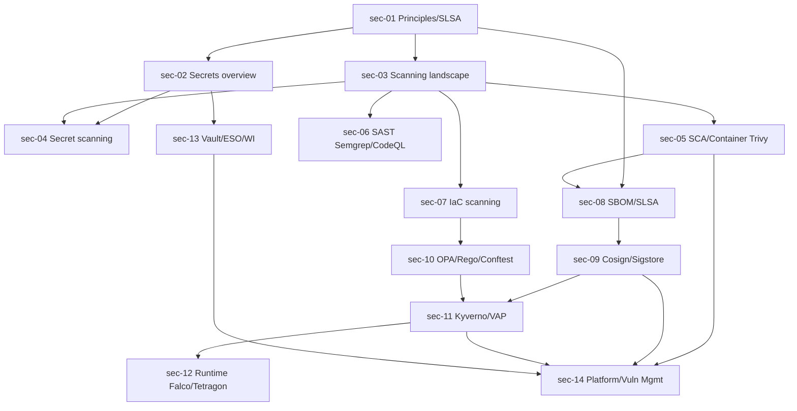

# DevSecOps toolkit — Roadmap detallado

IDs estables: `sec-<NN>-<slug>`.

Duración orientativa total: **45–65 h**.

---

## Nivel 1 — Fundamentos

### sec-01-principles-threat-modeling-and-supply-chain-overview

- **Nivel:** fundamentos
- **Objetivo:** interiorizar los principios (shift-left + defense-in-depth), hacer threat modeling práctico y entender la supply chain.
- **Prerrequisitos:** curso **docker**, curso **github-actions**.
- **Temas:** DevSecOps vs "security team al final"; **shift-left** y **shift-right / defense-in-depth** como complementarios; **threat modeling** práctico: **STRIDE** (Spoofing, Tampering, Repudiation, Information disclosure, Denial of service, Elevation of privilege); **data flow diagrams** mínimos; **trust boundaries**; introducción a **supply chain**: SolarWinds, log4shell, xz-utils, tj-actions como casos reales de aprendizaje; **SLSA** niveles 1–4 (visión); **SBOM** como concepto; **provenance**.
- **Fundamentos internos:** una amenaza existe cuando hay (atacante + motivo + vector); eliminar un vector es más barato que detectar un abuso; SLSA sube el listón: build hermético → provenance → non-forgeable → two-party review.
- **Competencias:** modelar amenazas de un servicio simple en una página; distinguir SLSA niveles.
- **Ejemplos:** `01-stride-of-fastapi-service`, `02-dfd-capstone`, `03-slsa-levels-walkthrough`.
- **Actividades:** `01-threat-model-exercise`, `02-slsa-gap-analysis` (independiente).
- **Entregables:** threat model documentado del capstone + mapa de niveles SLSA actuales vs deseados.
- **Evaluación:** elegir mitigaciones priorizadas por costo/beneficio.
- **Duración:** 4 h.

### sec-02-secrets-overview-and-principles

- **Nivel:** fundamentos
- **Objetivo:** entender dónde pueden vivir los secretos y qué principios aplican antes de elegir una herramienta.
- **Prerrequisitos:** `sec-01`.
- **Temas:** definición operativa: secret = valor cuya exposición compromete confidencialidad o permite acción no autorizada; taxonomía (API keys, DB creds, OAuth tokens, cert priv keys, SSH keys, JWT signing keys, encryption keys); **anti-patrones** (secretos en código, en env vars de larga vida, en ticket systems, en Slack); principios: **rotación**, **mínimo privilegio**, **auditoría**, **detección de uso anómalo**, **short-lived > long-lived** (OIDC, Workload Identity, STS), **separation of duties** entre quien escribe código y quien aprueba acceso a prod; dónde pueden vivir (git, env, config files, secret manager, KMS, HSM, vault); **by design**: cuánto puede filtrarse un secreto antes de rotarlo (ventana de blast radius).
- **Fundamentos internos:** un secreto de larga vida es "una contraseña que se vuelve exponencialmente más valiosa cuanto más tiempo existe"; eliminar long-lived secrets es la ganancia individual más grande en reducir blast radius.
- **Competencias:** auditar dónde viven los secretos de un proyecto.
- **Ejemplos:** `01-where-secrets-live`, `02-long-lived-vs-short-lived`.
- **Actividades:** `01-audit-your-secrets`, `02-rotation-policy-adr` (independiente).
- **Entregables:** inventario de secretos del capstone + ADR de rotación.
- **Evaluación:** proponer migración de un secreto long-lived a short-lived.
- **Duración:** 3 h.

### sec-03-scanning-landscape-sast-dast-sca-iac-container-secret

- **Nivel:** fundamentos
- **Objetivo:** mapear las categorías de scanning y las herramientas por categoría.
- **Prerrequisitos:** `sec-01`.
- **Temas:** categorías:
  - **SAST** (Static Application Security Testing): análisis del código fuente para patrones peligrosos — Semgrep, CodeQL, Bandit (Python);
  - **DAST** (Dynamic): fuzz o probing de un servicio corriendo — OWASP ZAP, Burp;
  - **SCA** (Software Composition Analysis): CVEs en dependencias de 3P — Trivy, Grype, Snyk;
  - **IaC scanning**: misconfig en HCL/YAML/CloudFormation — Checkov, Trivy config, tfsec, Terrascan;
  - **container scanning**: CVEs y misconfig en imágenes — Trivy, Grype, Clair;
  - **secret scanning**: credenciales filtradas en código — gitleaks, trufflehog, GitHub secret scanning;
  - **cloud posture (CSPM)**: estado de la cuenta cloud — Prowler, Steampipe, Config/Security Hub.
- Taxonomía de severidad (CVSS, EPSS, KEV catalog de CISA); señal vs ruido; **suppression** vs **exception** con justificación y expiración.
- **Fundamentos internos:** cada scanner tiene falsos positivos — triage es el trabajo, no la ejecución; CVSS mide *severidad teórica*, EPSS mide *probabilidad de explotación*, KEV lista los *ya explotados en el mundo real*.
- **Competencias:** elegir qué scanner por caso; política de severidad base.
- **Ejemplos:** `01-scanning-matrix`, `02-cvss-vs-epss-vs-kev`, `03-exception-policy-sample`.
- **Actividades:** `01-pick-tooling-for-capstone`, `02-severity-policy-draft` (independiente).
- **Entregables:** matriz "capa × herramienta" + política de severidad y excepciones.
- **Evaluación:** justificar inclusiones/exclusiones de la matriz.
- **Duración:** 3 h.

---

## Nivel 2 — Intermedio

### sec-04-secret-scanning-gitleaks-trufflehog-github

- **Nivel:** intermedio
- **Objetivo:** detectar secretos filtrados en código y prevenir que entren a Git.
- **Prerrequisitos:** `sec-02`, `sec-03`.
- **Temas:** **pre-commit hook** con `gitleaks` o `trufflehog` (ejecución local antes del commit); **CI job** que escanea *toda la historia* (`gitleaks detect`) — porque borrar un archivo con un secreto *no* lo quita de la historia; **GitHub secret scanning** y **push protection** (gratis para repos públicos, con Advanced Security para privados); **BFG Repo-Cleaner** / `git filter-repo` para purgar historia (y por qué rotar sigue siendo obligatorio); patterns y custom rules; falsos positivos típicos (ejemplos en tests, dummy keys); exclusiones con `.gitleaks.toml` justificadas; proceso de respuesta cuando se detecta un secreto real (**rotar primero, limpiar segundo**).
- **Fundamentos internos:** una vez un secreto está en la historia de Git, se asume **leaked**; purgar la historia reduce exposición futura pero no cambia que ese secreto fue público; la rotación es irrevocable.
- **Competencias:** instalar pre-commit, CI scan, responder a un hallazgo real.
- **Ejemplos:** `01-pre-commit-gitleaks`, `02-ci-full-history-scan`, `03-rotate-then-rewrite-history`.
- **Actividades:** `01-full-pipeline-secret-scan`, `02-incident-response-exercise` (independiente).
- **Entregables:** repo con pre-commit + CI scan + runbook de respuesta.
- **Evaluación:** criticar la secuencia "borrar archivo → commit" como respuesta.
- **Duración:** 3 h.

### sec-05-sca-container-scanning-with-trivy

- **Nivel:** intermedio
- **Objetivo:** detectar CVEs y misconfigs en dependencias y en imágenes.
- **Prerrequisitos:** `sec-03`, curso **docker**.
- **Temas:** **Trivy** como scanner multi-propósito (vulns en OS packages y lenguaje packages, misconfig IaC, secretos, licencias, SBOM); escaneo de **filesystem** (`trivy fs`), **image** (`trivy image`), **repository** (`trivy repo`), **k8s cluster** (`trivy k8s`); formatos de salida (table, json, sarif); **SARIF** upload a GitHub Code Scanning; alternativas (**Grype** de Anchore; **Snyk** comercial); política de severidad (`--severity CRITICAL,HIGH`, `--exit-code 1`); ignores con `.trivyignore` + expiry justificada; **cache de DB de vulnerabilidades**; **Trivy Operator** en K8s (CRs VulnerabilityReport, ConfigAuditReport); comparación de **CVE sources** (NVD, GitHub Advisory, GitLab Advisory DB, OSV).
- **Fundamentos internos:** base images "slim" acumulan menos CVEs; actualizar la base image es más barato que parchar; `distroless`/`chainguard` reducen CVEs sin fallback shell.
- **Competencias:** integrar Trivy en CI + K8s; política razonable de severidad.
- **Ejemplos:** `01-trivy-image-ci`, `02-sarif-to-github-code-scanning`, `03-trivy-operator-in-cluster`.
- **Actividades:** `01-scan-and-fail-on-critical`, `02-reduce-cves-by-base-swap` (independiente).
- **Entregables:** CI del capstone falla si hay CVE crítico sin excepción; Trivy Operator corriendo.
- **Evaluación:** criticar política "fallar en Medium" y proponer alternativa SLO-driven.
- **Duración:** 4 h.

### sec-06-sast-with-semgrep-and-codeql

- **Nivel:** intermedio
- **Objetivo:** detectar patrones peligrosos en código fuente.
- **Prerrequisitos:** `sec-03`.
- **Temas:** **Semgrep** (reglas declarativas en YAML-like, multi-lenguaje, OSS + registry público; rules locales en `.semgrep/`); **CodeQL** (query language sobre AST + flujo de datos; muy potente, integración nativa en GitHub como "Code Scanning"); **Bandit** para Python (reglas canónicas de seguridad); diseño de reglas custom (patrón específico de tu organización, p. ej. "no `requests.get` sin timeout"); **false positives y suppressions** (`# nosemgrep`, `// semgrep-disable`); integración con PR comments; **CodeQL Autobuild** y configuración manual cuando falla; relación con Snyk Code (comercial, similar enfoque).
- **Fundamentos internos:** SAST analiza **sin ejecutar**; precisión baja (muchos FP) sin dataflow; CodeQL con dataflow es más preciso pero más lento; Semgrep rápido ideal para reglas simples y custom.
- **Competencias:** integrar Semgrep + CodeQL en pipeline con triage razonable.
- **Ejemplos:** `01-semgrep-ci`, `02-codeql-github-advanced-security`, `03-custom-rule-for-org`.
- **Actividades:** `01-add-sast-to-capstone`, `02-write-custom-rule` (independiente).
- **Entregables:** CI con Semgrep + CodeQL + 1 regla custom del dominio.
- **Evaluación:** triage de 10 findings dados (fix, suprimir con razón, falso positivo).
- **Duración:** 4 h.

### sec-07-iac-scanning-checkov-trivy-config-tfsec

- **Nivel:** intermedio
- **Objetivo:** detectar misconfigs en Terraform/K8s/CloudFormation antes de aplicar.
- **Prerrequisitos:** `sec-03`, curso **terraform**.
- **Temas:** **Checkov** (soporta TF, CloudFormation, K8s, Dockerfile, ARM, Helm, Serverless; policies built-in + custom en Python); **Trivy config** (parcialmente solapado, muy rápido); **tfsec** (fusionado con Trivy, en modo mantenimiento); **Terrascan**; **KICS**; cómo escanear un **plan JSON** (`terraform show -json`) → mucho más preciso que escanear HCL crudo; integración con PR comments; policies custom con **Rego** (OPA) vía Checkov; mapping a benchmarks (CIS, PCI-DSS, HIPAA); **IaC scanning solo en HCL** vs **IaC scanning sobre el plan** (plan es más preciso porque resuelve variables, data sources, locals).
- **Fundamentos internos:** HCL puro tiene incognitas (variables); el plan ya resuelve a valores concretos — IaC scanning sobre plan reduce FP y detecta regresiones por cambios en data sources.
- **Competencias:** pipeline Terraform con IaC scan sobre HCL + sobre plan.
- **Ejemplos:** `01-checkov-tf-folder`, `02-trivy-config-k8s-manifests`, `03-checkov-on-plan-json`.
- **Actividades:** `01-add-iac-scan-to-tf-pipeline`, `02-custom-checkov-policy` (independiente).
- **Entregables:** pipeline Terraform del capstone con IaC scan + 1 policy custom.
- **Evaluación:** diseñar la política mínima de IaC para una org pequeña.
- **Duración:** 4 h.

---

## Nivel 3 — Avanzado

### sec-08-sbom-and-slsa-in-practice

- **Nivel:** avanzado
- **Objetivo:** emitir SBOMs correctos y entender SLSA como marco operativo.
- **Prerrequisitos:** `sec-01`, `sec-05`.
- **Temas:** formatos **CycloneDX** vs **SPDX** (equivalentes funcionales; CycloneDX más común en pipelines CI, SPDX más común en legal/compliance); **Syft** (`syft <image>` o `syft <dir>` genera SBOM); **source SBOM** (desde repo) vs **build SBOM** (de la imagen final) vs **runtime SBOM** (lo que efectivamente está cargado); publicar SBOM como artefacto *y* como **attestation adjunta a la imagen** en OCI; **SLSA v1.0** niveles:
  - L1 build script,
  - L2 provenance generada automáticamente por un hosted builder,
  - L3 provenance non-forgeable + builder isolation,
  - L4 (reservado para el futuro: two-party review etc.);
- **GitHub Actions como builder L3-capable** mediante `actions/attest-build-provenance`; cadena productor-consumidor; cómo verificar atestations.
- **Fundamentos internos:** SBOM es *inventario* (qué hay dentro); provenance es *historia* (cómo se construyó, por quién, desde qué fuente); ambos son necesarios y responden preguntas distintas.
- **Competencias:** emitir y verificar SBOM + provenance.
- **Ejemplos:** `01-syft-cyclonedx-and-spdx`, `02-attest-build-provenance-ghactions`, `03-verify-slsa`.
- **Actividades:** `01-publish-sbom-and-provenance-for-capstone`, `02-slsa-level-roadmap` (independiente).
- **Entregables:** imagen del capstone con SBOM + provenance publicadas y verificables.
- **Evaluación:** diferenciar las garantías de SLSA L1/L2/L3 con ejemplos.
- **Duración:** 4 h.

### sec-09-signing-and-attestations-with-cosign-sigstore

- **Nivel:** avanzado
- **Objetivo:** firmar artefactos y verificar firma end-to-end, con el modelo keyless.
- **Prerrequisitos:** `sec-08`.
- **Temas:** modelo clásico con claves (clave privada custodiada, clave pública distribuida) y sus problemas; **Sigstore** keyless: emisión de certificado efímero por **Fulcio** vinculado al OIDC claim (ej: GitHub Actions `repo:owner/repo:ref:refs/heads/main`), firma, publicación en **Rekor** (transparency log inmutable); `cosign sign` / `cosign verify` con `--certificate-identity` + `--certificate-oidc-issuer`; **cosign attest** (firma de attestations, p. ej. SBOM, SLSA provenance, test results); verificación de attestation con política (`cosign verify-attestation --type=slsaprovenance`); **gitsign** para firmar commits sin GPG; integración con `policy-controller` en K8s para gate en admisión.
- **Fundamentos internos:** keyless elimina gestión de claves (gran reducción de riesgo); auditabilidad vía Rekor (todas las firmas públicas en log distribuido); el certificado efímero vale minutos — no hay "clave privada perdida".
- **Competencias:** firmar y verificar imágenes y attestations; definir política de verificación.
- **Ejemplos:** `01-cosign-sign-keyless`, `02-attest-sbom-and-provenance`, `03-verify-with-identity-pin`.
- **Actividades:** `01-sign-capstone-image`, `02-verify-in-clean-env` (independiente).
- **Entregables:** imagen firmada + attestations publicadas, verificables desde entorno limpio.
- **Evaluación:** detectar una verificación insegura (sin `--certificate-identity`) y corregir.
- **Duración:** 4 h.

### sec-10-policy-as-code-opa-rego-conftest

- **Nivel:** avanzado
- **Objetivo:** expresar políticas como código ejecutable.
- **Prerrequisitos:** `sec-07`.
- **Temas:** **OPA** (Open Policy Agent): engine Rego-based, embebible; **Rego** language (reglas, assertions, iteración, datos externos, built-ins); **Conftest** (CLI que ejecuta Rego sobre YAML/JSON/HCL — típico uso: validar manifests, Terraform plan JSON, Dockerfiles); organización de reglas (packages, imports); testing de policies (`opa test`, `conftest verify`); patrones comunes (deny-list, allow-list, warn/deny severity); OPA en modo server (`opa run`) usado por otros sistemas (p. ej. Styra DAS).
- **Fundamentos internos:** Rego es declarativo y funcional; cada regla define un conjunto de violaciones; la ausencia de violación = ok; Conftest hace Rego accesible sin levantar un servidor OPA.
- **Competencias:** escribir y testear policies Rego para IaC/K8s manifests.
- **Ejemplos:** `01-rego-first-rule`, `02-conftest-on-terraform-plan`, `03-opa-test-suite`.
- **Actividades:** `01-write-no-public-s3-policy`, `02-conftest-in-ci` (independiente).
- **Entregables:** biblioteca Rego inicial + CI Conftest sobre Terraform plan JSON.
- **Evaluación:** convertir una política escrita en prosa a Rego verificable.
- **Duración:** 4 h.

### sec-11-k8s-admission-kyverno-and-policy-controller

- **Nivel:** avanzado
- **Objetivo:** aplicar policies en el momento de admisión del cluster.
- **Prerrequisitos:** `sec-09`, `sec-10`, curso **kubernetes** ≥ `k8s-12`.
- **Temas:** **Kyverno** (CRs `ClusterPolicy`/`Policy`, validate/mutate/generate/verifyImages, muy legible YAML-first); **OPA/Gatekeeper** (ConstraintTemplate + Constraint — Rego-first); **sigstore policy-controller** (específico para firma de imágenes con cosign); **ValidatingAdmissionPolicy** nativo (CEL en API server, sin webhook externo); patrones típicos (require signed images, PSA restricted, require labels/annotations, require resources, forbid `latest` tag, forbid hostPath); exceptions (namespaces excluidos, labels de excepción con TTL); audit mode vs enforce mode; integración con cosign (`verifyImages` en Kyverno pasa la firma + attestation al mismo recurso); testing con `kyverno-cli`; **impacto en performance** del webhook (admission timeouts).
- **Fundamentos internos:** elegir Kyverno vs OPA/Gatekeeper vs policy-controller vs ValidatingAdmissionPolicy depende del use case: Kyverno es el más amigable para equipos K8s nativos, OPA para equipos que ya usan Rego fuera de K8s, policy-controller si el único problema es firmas, VAP si quieres CEL nativo sin webhook.
- **Competencias:** aplicar policies en admisión, elegir herramienta con criterio.
- **Ejemplos:** `01-kyverno-verify-images`, `02-gatekeeper-constraint`, `03-vap-cel-example`.
- **Actividades:** `01-admission-policy-set-for-capstone`, `02-exception-workflow` (independiente).
- **Entregables:** cluster con policies obligatorias en admisión + proceso de excepción.
- **Evaluación:** justificar la elección Kyverno vs OPA vs VAP para un escenario.
- **Duración:** 5 h.

---

## Nivel 4 — Producción empresarial

### sec-12-runtime-security-falco-and-tetragon

- **Nivel:** producción
- **Objetivo:** detectar y responder a comportamiento sospechoso en runtime.
- **Prerrequisitos:** `sec-11`.
- **Temas:** por qué runtime: la admisión no cubre todo (hay zero-days, exploits de dependencias, insider threats); **Falco** (reglas sobre eventos syscalls vía eBPF o módulo kernel; ejemplos: `shell_in_container`, `write_below_etc`, `read_sensitive_file`); **Tetragon** (Cilium, basado en eBPF; detección *y* enforcement, con tracing policies y process-level visibility); respuesta (alert → SIEM; o enforcement activo); cuidado con FP y con alert fatigue; integración con los eventos del cluster y con CloudTrail/Audit Logs para forense; aproximación práctica (empezar con audit mode, luego enforcement selectivo).
- **Fundamentos internos:** eBPF permite observar/trace eventos del kernel con overhead mínimo y sin cargar módulos; Falco construye un lenguaje de reglas sobre esos eventos; Tetragon ofrece además interception (puede bloquear).
- **Competencias:** desplegar Falco + Tetragon; escribir una regla de dominio; definir runbook de respuesta.
- **Ejemplos:** `01-falco-in-cluster`, `02-write-falco-rule`, `03-tetragon-tracingpolicy`.
- **Actividades:** `01-trigger-and-detect-shell-in-pod`, `02-rule-authoring-exercise` (independiente).
- **Entregables:** Falco + Tetragon en kind detectando patrón de prueba + runbook.
- **Evaluación:** criticar un conjunto de reglas por su ruido o sus blind spots.
- **Duración:** 4 h.

### sec-13-secrets-at-scale-vault-eso-and-workload-identity

- **Nivel:** producción
- **Objetivo:** operar secretos a escala con rotación, auditoría y mínimo privilegio.
- **Prerrequisitos:** `sec-02`, curso **argocd-gitops** ≥ `argo-09`, curso **aws** o **gcp** (secret managers y Workload Identity).
- **Temas:** **HashiCorp Vault**: secret engines (kv, database dynamic creds, PKI, transit, aws, azure, gcp), auth methods (K8s, OIDC, approle, cloud IAM), **dynamic secrets** (DB creds generadas on-demand con TTL), **transit** como "encryption as a service"; **External Secrets Operator (ESO)** como puente K8s ↔ Vault / AWS Secrets Manager / GCP Secret Manager / Azure Key Vault; **Secrets Store CSI Driver** como alternativa (mount directo); **Workload Identity** (IRSA en EKS, Pod Identity, Workload Identity en GKE) para que el Pod *sea* un principal cloud sin credenciales estáticas; **short-lived everywhere** (JWTs, OIDC tokens, dynamic DB creds); **rotation policy** y **break-glass** procedures; auditoría (quién accedió a qué secreto, cuándo); migración desde "secrets como ConfigMaps base64".
- **Fundamentos internos:** Vault + dynamic secrets convierte el *concepto* de "contraseña de DB" en un *token efímero*; una rotación es simplemente un TTL vencido; ESO desacopla "qué secreto necesita la app" (en Git) de "dónde vive su valor" (en Vault/cloud).
- **Competencias:** diseñar y operar la arquitectura de secretos de una org.
- **Ejemplos:** `01-vault-dev-mode-and-k8s-auth`, `02-eso-pulling-from-vault`, `03-dynamic-db-creds-with-vault`.
- **Actividades:** `01-capstone-secrets-end-to-end`, `02-rotation-and-break-glass-adr` (independiente).
- **Entregables:** capstone con secretos dinámicos vía Vault + ESO + workload identity, sin ningún secret estático.
- **Evaluación:** diseñar el modelo de rotación para 5 tipos distintos de secretos.
- **Duración:** 6 h.

### sec-14-platform-patterns-gates-dx-inventory-and-vuln-mgmt-lifecycle

- **Nivel:** producción
- **Objetivo:** operar DevSecOps como plataforma sin matar la DX.
- **Prerrequisitos:** `sec-05`, `sec-09`, `sec-11`, `sec-13`.
- **Temas:** **gates como contrato**: qué controles bloquean el merge, cuáles solo warn, cuáles corren en nightly; **política de severidad** basada en EPSS/KEV más que solo CVSS; **exception policy**: formalizada, con approver, con TTL, con revisor; **SBOM como inventario** (publicar SBOMs a un store centralizado; preguntas de inventario: "¿quién corre log4j 2.14?"); **vuln management lifecycle**: detect → triage → prioritize → remediate → verify → report; métricas DevSecOps (**MTTR**, **mean time to patch**, % imágenes firmadas, % tests pasados, % pipelines con todos los gates); **developer experience**: feedback rápido (<10 min), supresión self-service con justificación auditable, docs excelentes, "no sorpresas en prod"; integración con **IDP** (Backstage security tab por servicio); gobernanza (reviews quarterly, drift de policies).
- **Fundamentos internos:** sin inventario SBOM, cada nuevo CVE requiere una investigación ad-hoc; con SBOM centralizado la pregunta es una query SQL/graph; sin exception policy formal, las excepciones se convierten en "regla implícita".
- **Competencias:** diseñar el contrato de seguridad de la plataforma.
- **Ejemplos:** `01-gates-contract`, `02-sbom-inventory-store`, `03-vuln-mgmt-dashboard`.
- **Actividades:** `01-platform-security-contract-adr`, `02-vuln-mgmt-process-exercise` (independiente).
- **Entregables:** ADR + proceso de vuln management + dashboard mínimo.
- **Evaluación:** defender el contrato ante presión de velocidad vs seguridad vs costo.
- **Duración:** 5 h.

---

## Dependencias entre módulos

## Puente con la cadena DevSecOps del capstone

Estas piezas se componen en el capstone en orden:

1. Dev local: pre-commit (gitleaks, lint, fmt).
2. CI (GHA): secret scan historia + SAST (Semgrep + CodeQL) + SCA (Trivy) + IaC scan (Checkov) + build + container scan (Trivy) + **SBOM** (Syft) + **sign + attest** (cosign keyless).
3. Push imagen firmada a GHCR.
4. Argo CD aplica manifests.
5. Admission (Kyverno + policy-controller): verifica firma + attestation + PSA restricted + labels obligatorios.
6. Runtime: Falco/Tetragon detecta anomalías.
7. Secretos: ESO sincroniza desde Vault / cloud secret manager; workload identity sin keys estáticas.
8. Inventory: SBOMs centralizados en un store para preguntas tipo "¿quién usa openssl 3.0.x?".

## Checklist de verificación requerida en Fase 4

- Versión actual de **Sigstore** / cosign / Fulcio / Rekor y UX vigente de `cosign verify --certificate-identity`.
- Estado de **SLSA v1.0** y de la acción `actions/attest-build-provenance`.
- Versión y features actuales de **Trivy**, **Grype**, **Syft**.
- Estado de **Semgrep** OSS vs comercial (Semgrep Pro) y limitaciones por tier.
- **CodeQL** disponibilidad en repos públicos vs privados (Advanced Security).
- Estado de **tfsec** (mantenimiento vs discontinuación tras merge en Trivy).
- Versión y features de **Kyverno** y de **sigstore policy-controller**.
- **ValidatingAdmissionPolicy** GA en qué versión y qué features de CEL.
- Estado de **Tetragon** y comparación vigente con Falco.
- Versión actual de **Vault** y features relevantes (dynamic secrets DB engines soportados).
- Estado de **External Secrets Operator** y de **Secrets Store CSI Driver**.
- Incidentes recientes relevantes para actualizar casos de estudio (xz-utils 2024, tj-actions/changed-files 2025, etc.).
