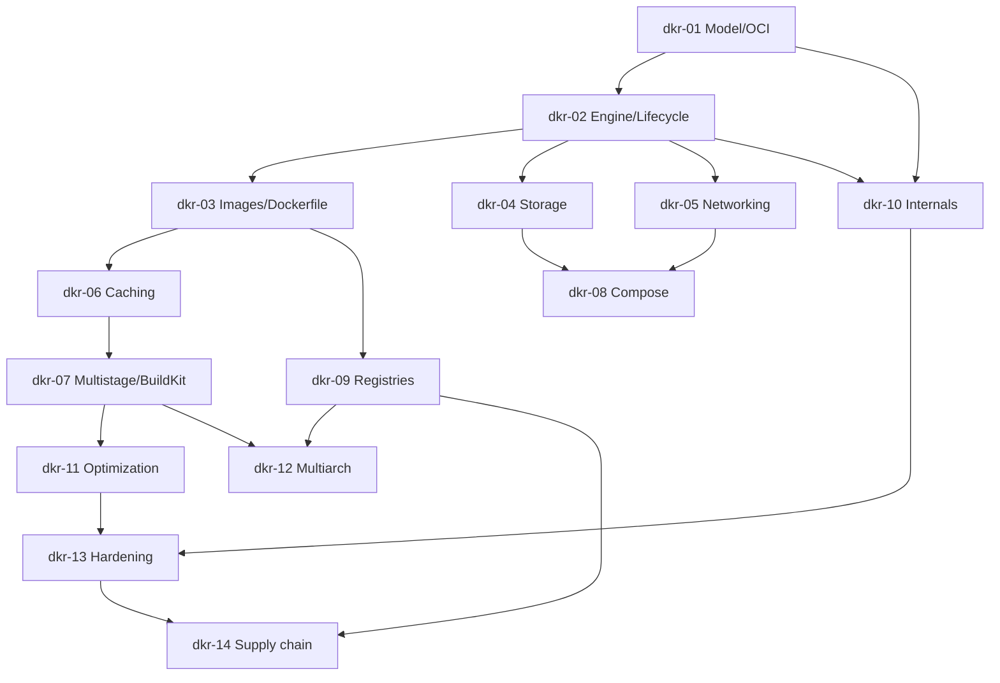

# Docker — Roadmap detallado

IDs estables: `dkr-<NN>-<slug>`.

Duración orientativa total: **50–70 h**.

---

## Nivel 1 — Fundamentos

### dkr-01-mental-model-and-oci

- **Nivel:** fundamentos
- **Objetivo:** construir el modelo mental correcto antes de tocar la CLI: qué es un contenedor, qué no es, y por qué OCI importa.
- **Prerrequisitos:** nociones de procesos y filesystem (T-2.1, T-2.2, T-2.4).
- **Temas:** VMs vs contenedores (hypervisor vs kernel compartido); intuición de **namespaces** (PID, mount, net, user, uts, ipc, cgroup); **cgroups** (límites de CPU, memoria, pids, io); **overlayfs** (filesystem copy-on-write); **OCI image-spec** (manifest, config, layers), **runtime-spec**, **distribution-spec**; relación Docker → containerd → runc.
- **Fundamentos internos:** un contenedor es "un proceso Linux normal con restricciones adicionales"; la imagen es datos; el runtime (runc) es quien hace los `clone`/`unshare`/`setns` con las flags adecuadas.
- **Competencias:** explicar qué pasa cuando se ejecuta un contenedor en términos del kernel.
- **Ejemplos:** `01-processes-vs-containers` (diagrama + explicación), `02-oci-manifest-walkthrough`.
- **Actividades:** `01-draw-namespaces-and-cgroups` (ejercicio conceptual), `02-oci-manifest-reading`.
- **Entregables:** mapa anotado de los componentes OCI y de la pila Docker→runc.
- **Evaluación:** explicar sin consultar docs la diferencia entre VM y contenedor, y entre runtime de alto y bajo nivel.
- **Duración:** 3 h.

### dkr-02-install-engine-and-first-container

- **Nivel:** fundamentos
- **Objetivo:** instalar Docker (o alternativa compatible), entender la arquitectura cliente/daemon y manejar el ciclo de vida de un contenedor.
- **Prerrequisitos:** `dkr-01`.
- **Temas:** instalación en Linux/macOS/Windows (Docker Desktop vs Docker Engine); `dockerd`, socket Unix, permisos (`docker` group = root equivalente); comandos de ciclo de vida (`run`, `ps`, `logs`, `exec`, `stop`, `kill`, `rm`); flags clave de `run` (`-d`, `-it`, `--rm`, `--name`, `--restart`, `-p`, `-v`, `-e`); PID 1 y la trampa del "zombie reaping" (`--init`).
- **Fundamentos internos:** por qué `docker ps` ve lo que ve; por qué `exec` no es `ssh`; por qué `SIGTERM` llega a PID 1 y qué pasa si tu app lo ignora (10s de grace, luego SIGKILL).
- **Competencias:** operar contenedores desde CLI con precisión.
- **Ejemplos:** `01-run-nginx-and-inspect`, `02-pid1-signals`.
- **Actividades:** `01-container-lifecycle`, `02-why-is-my-container-exiting` (debugging guiado).
- **Entregables:** notas con la salida comentada de `docker inspect` sobre un contenedor en vivo.
- **Evaluación:** explicar por qué agregar un usuario al grupo `docker` es equivalente a root.
- **Duración:** 3 h.

### dkr-03-images-dockerfile-basics

- **Nivel:** fundamentos
- **Objetivo:** construir imágenes propias y leer imágenes ajenas.
- **Prerrequisitos:** `dkr-02`.
- **Temas:** `docker pull/push/images/inspect/history`; capas y digests; `Dockerfile` básico: `FROM`, `WORKDIR`, `COPY`, `RUN`, `CMD` vs `ENTRYPOINT` (y la forma shell vs exec), `EXPOSE`, `USER`, `ENV`, `ARG`; `.dockerignore`; `docker build -t`; tags vs digests.
- **Fundamentos internos:** cada instrucción cacheable crea una capa; la caché invalida en orden; `CMD` es argumentos por default de `ENTRYPOINT`; forma shell dispara `/bin/sh -c` (y perdemos señales a PID 1).
- **Competencias:** escribir un Dockerfile correcto para una app Python; interpretar `docker history`.
- **Ejemplos:** `01-dockerfile-python-app`, `02-entrypoint-vs-cmd`, `03-dockerignore-impact`.
- **Actividades:** `01-build-your-first-image`, `02-fix-signal-handling` (independiente).
- **Entregables:** imagen funcional de una app Python/FastAPI mínima.
- **Evaluación:** diferenciar `CMD`, `ENTRYPOINT`, forma shell vs exec; justificar el `USER` no-root.
- **Duración:** 4 h.

### dkr-04-storage-volumes-bind-mounts-tmpfs

- **Nivel:** fundamentos
- **Objetivo:** persistir y compartir estado correctamente.
- **Prerrequisitos:** `dkr-02`.
- **Temas:** volúmenes nombrados vs bind mounts vs tmpfs; drivers de volumen; `docker volume ls/inspect/prune`; permisos (uid/gid dentro del contenedor vs host); `:ro`, `:z`/`:Z` (SELinux); backups (`docker run --rm -v vol:/data busybox tar ...`); por qué nunca persistir datos de aplicación en el filesystem *de la imagen*.
- **Fundamentos internos:** el layer superior del overlay se descarta al eliminar el contenedor; los volúmenes residen fuera (en `/var/lib/docker/volumes/...`); bind mounts exponen directamente el filesystem del host (riesgo y utilidad).
- **Competencias:** diseñar el storage de una app de forma reproducible.
- **Ejemplos:** `01-named-volume-postgres`, `02-bind-mount-dev-code`.
- **Actividades:** `01-persist-postgres-data`, `02-fix-permissions-on-bind-mount` (independiente).
- **Entregables:** Postgres con datos persistidos entre restarts del contenedor.
- **Evaluación:** explicar cuándo usar cada uno y qué pasa si se mezcla incorrectamente.
- **Duración:** 3 h.

### dkr-05-networking-basics

- **Nivel:** fundamentos
- **Objetivo:** entender cómo se comunican contenedores entre sí y con el host.
- **Prerrequisitos:** `dkr-02`, nociones de TCP/IP (T-3.1, T-3.2, T-3.3).
- **Temas:** drivers de red (`bridge`, `host`, `none`, `macvlan`); el bridge `docker0` y las iptables que publica Docker; `-p host:container` vs `--network host`; resolución DNS entre contenedores en una user-defined bridge; puertos ya ocupados.
- **Fundamentos internos:** `docker0` es un bridge Linux; Docker inserta reglas en `iptables` (NAT) para `-p`; la user-defined bridge habilita DNS por nombre entre contenedores (la default no); `--network host` elimina el net namespace.
- **Competencias:** diagnosticar "no puedo conectar a mi contenedor"; diseñar networks por entorno.
- **Ejemplos:** `01-user-defined-bridge`, `02-port-publishing`, `03-why-cant-i-reach-localhost`.
- **Actividades:** `01-two-containers-talking-by-name`, `02-debug-published-port` (independiente).
- **Entregables:** diagrama de red para una app + DB.
- **Evaluación:** explicar por qué `localhost` dentro del contenedor NO es el host.
- **Duración:** 3 h.

---

## Nivel 2 — Intermedio

### dkr-06-dockerfile-idiomatic-and-caching

- **Nivel:** intermedio
- **Objetivo:** escribir Dockerfiles rápidos, pequeños y mantenibles aprovechando la caché.
- **Prerrequisitos:** `dkr-03`.
- **Temas:** orden de instrucciones para maximizar caché (deps lockfiles antes del código); `COPY` vs `ADD` (preferir `COPY`); `RUN` combinados con `&&` para reducir capas (y los límites de esa práctica con BuildKit); `--mount=type=cache`; `ARG` build-time vs `ENV` runtime; healthchecks; metadata `LABEL` (OCI standard labels); dejar la imagen funcional, no interactiva.
- **Fundamentos internos:** la caché compara contexto + instrucción + hash de inputs; cambiar una línea arriba invalida todo lo de abajo; `COPY . .` tempranamente es un anti-patrón para cachear deps.
- **Competencias:** reducir tiempo de build de minutos a segundos con ordenamiento correcto.
- **Ejemplos:** `01-cache-friendly-python`, `02-labels-oci-standard`.
- **Actividades:** `01-measure-and-optimize-cache` (reduce rebuild time X%), `02-add-vs-copy`.
- **Entregables:** Dockerfile con rebuild caliente < 5 s en cambio de código.
- **Evaluación:** diagnosticar un Dockerfile con mala caché y proponer el reorden mínimo.
- **Duración:** 3 h.

### dkr-07-multistage-buildkit-and-secrets

- **Nivel:** intermedio
- **Objetivo:** dominar builds multi-stage con BuildKit, secrets de build y cache mounts.
- **Prerrequisitos:** `dkr-06`.
- **Temas:** `# syntax=docker/dockerfile:1`; stages (`FROM ... AS builder`, `FROM runtime`); `COPY --from=builder`; `--mount=type=cache,target=/root/.cache/pip`; `--mount=type=secret,id=...` + `DOCKER_BUILDKIT=1` o `buildx`; frontend Dockerfile vs otros; `docker buildx` básico; `--progress=plain` para debug.
- **Fundamentos internos:** BuildKit construye un DAG de operaciones, puede paralelizar stages independientes; secrets de build no quedan en capas si se montan como `--mount=type=secret`; `ARG` como secret es un anti-patrón porque *sí* queda en history.
- **Competencias:** separar build-time de runtime; nunca filtrar secretos de build.
- **Ejemplos:** `01-multistage-python-wheels`, `02-buildkit-cache-mount`, `03-secret-mount-git-token`.
- **Actividades:** `01-rewrite-to-multistage`, `02-remove-leaked-secret-from-image` (independiente, forensic).
- **Entregables:** imagen final < 150 MB sin toolchain de build.
- **Evaluación:** demostrar con `docker history` que no hay secretos filtrados.
- **Duración:** 4 h.

### dkr-08-compose-for-development

- **Nivel:** intermedio
- **Objetivo:** modelar entornos locales reproducibles multi-servicio con Compose.
- **Prerrequisitos:** `dkr-04`, `dkr-05`.
- **Temas:** `docker compose` v2 (plugin de la CLI, no `docker-compose` binario); `compose.yaml` (servicios, networks, volumes); `depends_on` con `condition: service_healthy`; healthchecks; `profiles`; override files (`compose.override.yaml`); variables desde `.env`; perfiles de desarrollo vs test; **Compose es para dev** — qué cambia en producción.
- **Fundamentos internos:** Compose crea una network por proyecto; services son resolubles por nombre dentro de esa network; `depends_on` sin healthcheck no espera a que el servicio esté *listo*, solo *arrancado*.
- **Competencias:** levantar un stack local con `compose up` y limpiarlo con `compose down -v`.
- **Ejemplos:** `01-fastapi-postgres-compose`, `02-healthcheck-and-depends-on`, `03-profiles-dev-vs-test`.
- **Actividades:** `01-full-dev-stack`, `02-flaky-startup-fix-with-healthcheck`.
- **Entregables:** stack de dev para el capstone (app + Postgres + reverse proxy).
- **Evaluación:** justificar por qué Compose no es sustituto de orquestador en producción.
- **Duración:** 4 h.

### dkr-09-registries-tags-and-digests

- **Nivel:** intermedio
- **Objetivo:** publicar y consumir imágenes de forma responsable y reproducible.
- **Prerrequisitos:** `dkr-03`.
- **Temas:** `docker login`; registries (Docker Hub, GHCR, ECR, Artifact Registry, Harbor); namespaces y visibilidad; **tags mutables vs digests inmutables** (`image@sha256:...`); estrategia de tagging (`latest`, `v1`, `v1.2`, `v1.2.3`, `sha-<git>`); rate limits de Docker Hub; `docker image prune` y `docker system df`; pull secrets.
- **Fundamentos internos:** un tag es un alias mutable sobre un manifest digest; dos pulls del mismo tag en momentos distintos pueden traer bytes diferentes; en producción referenciar por digest.
- **Competencias:** diseñar política de tagging; publicar a GHCR autenticándose con `GITHUB_TOKEN` desde Actions.
- **Ejemplos:** `01-push-to-ghcr`, `02-pin-by-digest`.
- **Actividades:** `01-publish-and-consume-your-image`, `02-tag-strategy-design` (independiente, ADR).
- **Entregables:** imagen publicada a GHCR con política de tags documentada.
- **Evaluación:** justificar por qué `FROM python:3-slim` en producción es un riesgo.
- **Duración:** 3 h.

---

## Nivel 3 — Avanzado

### dkr-10-internals-namespaces-cgroups-overlayfs

- **Nivel:** avanzado
- **Objetivo:** ver el contenedor desde el kernel, no desde la CLI.
- **Prerrequisitos:** `dkr-01`, `dkr-02`, T-2 Linux.
- **Temas:** `unshare`, `nsenter`, `lsns`; inspección de los namespaces de un contenedor (`/proc/<pid>/ns/*`); `cgroups v2` jerarquía (`/sys/fs/cgroup/`); límites y cómo se traducen a `--cpus`, `--memory`; **overlayfs** (lowerdir, upperdir, merged, workdir); seccomp profiles; capabilities (`CAP_NET_RAW`, etc.); user namespaces y mapeo UID/GID.
- **Fundamentos internos:** replicar manualmente un "mini-contenedor" con `unshare` + `chroot` + `cgcreate` para entender qué hace runc; qué permite y qué no un contenedor "privileged".
- **Competencias:** depurar límites de CPU/memoria aparentes; entender por qué un contenedor rooteado sigue teniendo capacidades reducidas por default.
- **Ejemplos:** `01-manual-mini-container`, `02-inspect-overlay-layers`, `03-capabilities-dropped`.
- **Actividades:** `01-build-container-with-unshare` (demostrativo guiado), `02-why-is-my-app-oomkilled` (independiente).
- **Entregables:** notas con experimentos reproducibles de cada primitiva.
- **Evaluación:** explicar sin docs qué namespaces aisla un contenedor estándar y cuáles no.
- **Duración:** 5 h.

### dkr-11-image-optimization-and-base-image-strategy

- **Nivel:** avanzado
- **Objetivo:** reducir tamaño, superficie de ataque y tiempo de arranque.
- **Prerrequisitos:** `dkr-07`.
- **Temas:** elección de base: `debian:*-slim` vs `alpine` (musl vs glibc, breaking changes), **distroless**, **Chainguard** images, `scratch` para binarios estáticos; medir tamaño real por capa (`dive`); `strip` y pre-compilado; `pip install --no-cache-dir`; `uv` o `poetry --no-interaction` en builder stage; wheels precompiladas; copiar solo lo necesario; separar binarios de deps.
- **Fundamentos internos:** por qué alpine rompe librerías Python con C extensions (musl); por qué distroless no tiene shell (es una decisión de seguridad, no un bug); impacto del tamaño en cold-start y en pull en clusters.
- **Competencias:** elegir y defender base image; ADR escrito.
- **Ejemplos:** `01-slim-vs-alpine-vs-distroless`, `02-dive-walkthrough`, `03-scratch-with-static-binary`.
- **Actividades:** `01-shrink-the-image`, `02-base-image-adr` (independiente).
- **Entregables:** imagen de app Python en < 100 MB sobre distroless o chainguard, funcional.
- **Evaluación:** demostrar los trade-offs con benchmark de tamaño, cold-start y CVEs.
- **Duración:** 4 h.

### dkr-12-multiarch-and-reproducibility

- **Nivel:** avanzado
- **Objetivo:** construir imágenes multi-plataforma y acercarse a builds reproducibles.
- **Prerrequisitos:** `dkr-07`, `dkr-09`.
- **Temas:** `docker buildx` builder, drivers (`docker-container`, `kubernetes`); `--platform linux/amd64,linux/arm64`; emulación con QEMU vs cross-compilation nativa; manifest lists / OCI image index; reproducibilidad: timestamps (`SOURCE_DATE_EPOCH`), lockfiles, pins de base por digest; verificar con `diffoci` (opcional).
- **Fundamentos internos:** una "imagen multi-arch" es realmente un *manifest index* que apunta a varias imágenes mono-arch; QEMU emula instrucciones (lento, útil para builds no cómputo); native runners por arch son la vía rápida.
- **Competencias:** publicar imagen multi-arch; identificar fuentes de no-reproducibilidad.
- **Ejemplos:** `01-buildx-multiarch`, `02-manifest-index-inspection`, `03-lockfile-and-base-digest`.
- **Actividades:** `01-publish-amd64-arm64`, `02-make-build-reproducible` (independiente).
- **Entregables:** imagen `app:v1` en amd64 y arm64 publicada a GHCR.
- **Evaluación:** diagnosticar por qué dos builds consecutivos producen digests distintos.
- **Duración:** 4 h.

---

## Nivel 4 — Producción empresarial

### dkr-13-runtime-security-and-hardening

- **Nivel:** producción
- **Objetivo:** desplegar contenedores siguiendo principio de mínimo privilegio y defensa en profundidad.
- **Prerrequisitos:** `dkr-10`, `dkr-11`.
- **Temas:** `USER` no-root en Dockerfile; `--read-only` filesystem; `--cap-drop=ALL --cap-add=<minimal>`; `--security-opt no-new-privileges`; seccomp profiles (default, custom); AppArmor/SELinux básico; **rootless Docker** (`dockerd-rootless-setuptool.sh`) vs **Podman** rootless; límites (`--memory`, `--cpus`, `--pids-limit`); NO montar `docker.sock` dentro de un contenedor (equivalente a dar root al host); auditoría con `docker scan` deprecado → **Trivy**/`grype`.
- **Fundamentos internos:** por qué `docker.sock` dentro del contenedor = root al host; por qué rootless no cubre todos los casos (bind a puertos < 1024, overlay en algunos kernels); CIS Docker Benchmark como referencia.
- **Competencias:** hardening de una imagen y de su runtime config.
- **Ejemplos:** `01-least-privilege-container`, `02-trivy-scan`, `03-why-not-mount-docker-sock`.
- **Actividades:** `01-harden-fastapi-container`, `02-container-escape-reasoning` (análisis).
- **Entregables:** imagen productiva de la app con todos los controles aplicados y documentados.
- **Evaluación:** auditoría escrita de un `docker run` dado señalando riesgos.
- **Duración:** 5 h.

### dkr-14-supply-chain-sbom-signing-provenance

- **Nivel:** producción
- **Objetivo:** emitir y verificar evidencias de la supply chain de la imagen.
- **Prerrequisitos:** `dkr-09`, `dkr-13`, puente con `gha-14`.
- **Temas:** **SBOM** con `syft` (CycloneDX / SPDX); escaneo con **Trivy** / **grype** (vulns y misconfig); firma con **cosign** (keyless OIDC, útil desde GHA); verificación con `cosign verify` y policies; **attestations** (predicate SLSA Provenance, SBOM) adjuntas a la imagen en el registry; verificación con `cosign verify-attestation`; policy enforcement con **Kyverno** / **OPA/Gatekeeper** / **sigstore policy-controller** (introducción, se profundiza en D8/D9).
- **Fundamentos internos:** cómo cosign empuja la firma al registry como un artefacto OCI relacionado; relación entre image digest, SBOM digest y attestation; qué parte de SLSA es responsabilidad del *builder* (CI) y qué parte del *consumidor*.
- **Competencias:** cadena completa: build → SBOM → scan → sign → attest → verify.
- **Ejemplos:** `01-syft-sbom`, `02-trivy-scan-gate`, `03-cosign-keyless-and-verify`, `04-attest-provenance-and-sbom`.
- **Actividades:** `01-build-sign-and-verify-pipeline` (mini-proyecto, se integra con el curso GHA), `02-fail-build-on-critical-cve`.
- **Entregables:** imagen publicada con SBOM + attestation + firma, verificable desde otra máquina.
- **Evaluación:** demostrar la verificación en un entorno limpio sin acceso al pipeline original.
- **Duración:** 5 h.

---

## Dependencias entre módulos

## Checklist de verificación requerida en Fase 4

- Versión actual de Docker Engine y de la sintaxis `# syntax=docker/dockerfile:1.x` (features de BuildKit cambian).
- Estado actual de `docker compose` v2 vs `docker-compose` v1 (v1 fue descontinuada).
- Default behavior actual de BuildKit (habilitado por default a partir de qué versión).
- Cambios recientes en el modelo de licencias de Docker Desktop (relevante para elección org).
- Estado y madurez de **rootless Docker** y comparación práctica con **Podman** rootless.
- API/comandos actuales de `cosign` (sign, attest, verify-attestation) — Sigstore evoluciona rápido.
- Formato vigente de **SLSA Provenance** v1.0 vs v0.2.
- Versión y comandos de `syft` y `trivy`.
- Estado de la deprecación de Alpine para apps Python con extensiones C.
