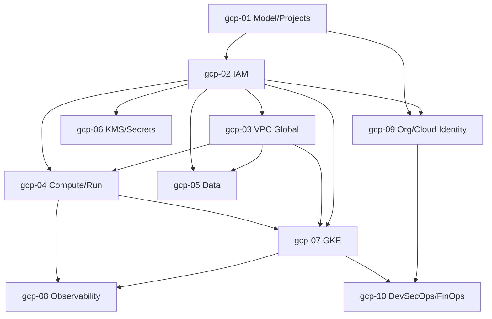

# GCP — Roadmap detallado (diferencial contra AWS)

IDs estables: `gcp-<NN>-<slug>`.

Duración orientativa total: **30–45 h** (deliberadamente menor que AWS: solo cubre lo que es materialmente distinto o estratégicamente relevante). Cada módulo asume conocimiento equivalente del lado AWS y se enfoca en **transferencia + divergencias**.

---

## Nivel 1 — Fundamentos diferenciales

### gcp-01-model-projects-billing-and-cli

- **Nivel:** fundamentos
- **Objetivo:** interiorizar la jerarquía Org → Folders → Projects → Resources, el modelo de billing accounts separadas, y manejarse con `gcloud`.
- **Prerrequisitos:** curso **aws** ≥ `aws-01`, `aws-02`.
- **Temas:** jerarquía Resource Manager; **Project** como unidad de aislamiento barata (cuotas, IAM, APIs habilitadas, billing); **Billing Account** separada que se enlaza a projects (una BA puede pagar por N projects); habilitar APIs explícitamente (`services enable`); `gcloud` CLI (configurations, properties, componentes); `gcloud auth login` vs `gcloud auth application-default login` (ADC); labels como mecanismo de cost allocation; **Budgets + alertas** (primer paso obligatorio); diferencia con AWS: nombres de recursos globales en algunos servicios (buckets), regionales en otros, zonales en otros.
- **Fundamentos internos:** por qué habilitar una API por project es intencional (reduce blast radius, controla cuotas); por qué un project es la unidad correcta de "una app × un entorno" (y no un workspace lógico).
- **Competencias:** crear project, enlazarlo a billing, habilitar APIs mínimas, configurar budget, operar `gcloud`.
- **Ejemplos:** `01-gcloud-configurations`, `02-adc-vs-user-auth`, `03-budget-with-notification`.
- **Actividades:** `01-bootstrap-safe-project`, `02-adc-from-local-dev` (independiente).
- **Entregables:** project con MFA en identidades, APIs mínimas habilitadas, budget con alerta.
- **Evaluación:** justificar "un project ↔ un workload × un ambiente".
- **Duración:** 3 h.

### gcp-02-iam-bindings-deny-policies-and-service-accounts

- **Nivel:** fundamentos
- **Objetivo:** dominar IAM en GCP: bindings role→member, roles predefinidos/custom, deny policies, service accounts e impersonation.
- **Prerrequisitos:** `gcp-01`, curso AWS ≥ `aws-02`, `aws-06`.
- **Temas:** modelo IAM: **allow policy** = conjunto de bindings `(role, members)` adjunto a un *resource*; herencia por la jerarquía (binding en folder aplica a todos sus projects); roles **basic** (deprecados prácticamente), **predefined** (ej. `roles/storage.objectViewer`), **custom** (JSON/YAML); principals: user, group (Google Group, muy usado), service account, serviceAccount.actor; **IAM deny policies** (relativamente nuevo, equivalentes a SCP deny pero por principal); **Org Policies** (constraints, no actions, aplicadas a la jerarquía: p. ej. `compute.vmExternalIpAccess`, `iam.disableServiceAccountKeyCreation`); **Service Accounts** como principals; service account keys (y por qué **evitarlas**); **impersonation** (`roles/iam.serviceAccountTokenCreator`) como forma moderna; condiciones IAM (`request.time`, `resource.name`).
- **Fundamentos internos:** evaluación: *allow* bindings se agregan por jerarquía; una *deny policy* bloquea aunque haya allows; **principio clave**: no se crean keys para service accounts: se impersona o se federa (WIF). AWS: policies "siguen al principal"; GCP: bindings "están en el recurso" y referencian principals.
- **Competencias:** diseñar bindings mínimos; preferir impersonation; aplicar org policies protectoras.
- **Ejemplos:** `01-binding-vs-aws-policy`, `02-group-based-binding`, `03-deny-policy-example`, `04-org-policy-disable-sa-keys`.
- **Actividades:** `01-least-privilege-with-predefined-role`, `02-impersonate-service-account-from-cli` (independiente).
- **Entregables:** project con org policies defensivas aplicadas y SA impersonation funcional.
- **Evaluación:** traducir una política IAM AWS a bindings GCP equivalentes.
- **Duración:** 5 h.

### gcp-03-vpc-global-and-networking

- **Nivel:** fundamentos
- **Objetivo:** entender la VPC global de GCP y sus consecuencias de diseño.
- **Prerrequisitos:** curso AWS ≥ `aws-03`, `aws-07`.
- **Temas:** **VPC global** con subnets regionales (toda subnet de la misma VPC es alcanzable sin peering); modos auto vs custom; firewall rules (globales a la VPC, pueden filtrar por *service accounts* o tags — poderoso); **Cloud NAT** regional; **Private Google Access** (equivalente conceptual de VPC endpoints para APIs de Google); **Shared VPC** (una VPC "host" compartida con projects "service"); **VPC Peering** vs **Network Connectivity Center** vs **Interconnect/VPN**; Cloud **Load Balancing** (global HTTP(S) con anycast, regional, interno); **Cloud Armor** (WAF) y **Google-managed TLS certs**; **Cloud CDN** sobre LB.
- **Fundamentos internos:** por qué LB HTTP(S) global en GCP usa IP anycast única — simplifica DNS y failover; por qué firewall rules basadas en SA son más potentes que SGs AWS (identidad = principal, no "lo que esté en esta subnet").
- **Competencias:** diseñar VPC global multi-región; compartir red vía Shared VPC; publicar servicio con LB global + managed cert.
- **Ejemplos:** `01-vpc-custom-with-cloud-nat`, `02-firewall-by-service-account`, `03-global-https-lb-with-managed-cert`.
- **Actividades:** `01-shared-vpc-host-and-service`, `02-publish-app-global-lb` (independiente).
- **Entregables:** app publicada con LB global, managed cert y Cloud CDN opcional.
- **Evaluación:** comparar VPC AWS vs GCP para un workload multi-región.
- **Duración:** 5 h.

---

## Nivel 2 — Compute, datos, secretos

### gcp-04-compute-engine-cloud-run-cloud-functions

- **Nivel:** intermedio
- **Objetivo:** elegir el compute correcto; en especial, aprovechar Cloud Run.
- **Prerrequisitos:** curso AWS ≥ `aws-04`, `aws-10`, `aws-14`; curso docker.
- **Temas:** **Compute Engine** (instance templates, MIGs, autoscaling, preemptible/Spot, Shielded VM, OS Login en vez de SSH keys); **Cloud Run** (fully managed, scale-to-zero, concurrency per instance, revisiones, traffic splitting canary, min-instances, CPU allocation modes, Cloud Run jobs); **Cloud Functions gen 2** (en realidad son Cloud Run bajo el capó + triggers); comparación: GCE vs GKE vs Cloud Run vs Functions; mapping desde AWS (EC2↔GCE, ECS/Fargate↔Cloud Run, Lambda↔Functions gen 2 o Cloud Run directo).
- **Fundamentos internos:** Cloud Run usa **gVisor** (sandbox userspace de Google) y escala por request con concurrencia configurable (por default 80 req/instance); permite CPU "only during request" o "always allocated" (impacta background work y cold starts).
- **Competencias:** desplegar app containerizada en Cloud Run; elegir compute para 3 workloads.
- **Ejemplos:** `01-fastapi-on-cloud-run`, `02-cloud-run-traffic-splitting-canary`, `03-cloud-run-jobs`.
- **Actividades:** `01-deploy-same-app-run-and-gce-compare`, `02-canary-5pct-rollout` (independiente).
- **Entregables:** app del capstone en Cloud Run con canary y rollback demostrable.
- **Evaluación:** criterio Cloud Run vs GKE vs GCE para 3 workloads concretos.
- **Duración:** 5 h.

### gcp-05-data-cloud-sql-firestore-bigtable-spanner

- **Nivel:** intermedio
- **Objetivo:** mapear el catálogo de datos de GCP a los casos AWS equivalentes.
- **Prerrequisitos:** curso AWS ≥ `aws-08`.
- **Temas:** **Cloud SQL** (Postgres/MySQL/SQL Server, HA regional, read replicas, backups, **Cloud SQL Auth Proxy** para auth con IAM); **AlloyDB** (Postgres-compatible, mejor rendimiento OLTP, costo mayor); **Firestore** (document DB, modos Native vs Datastore); **Bigtable** (wide-column, equivalente conceptual a HBase, para séries y analytics operacionales); **Spanner** (SQL globalmente consistente horizontalmente escalable, único); mapping desde AWS: RDS↔Cloud SQL/AlloyDB, DynamoDB↔Firestore (parcial)+Bigtable (parcial), Aurora Global↔Spanner (sin equivalente real AWS).
- **Fundamentos internos:** por qué Spanner es materialmente distinto (TrueTime, Paxos a escala global); por qué el "Cloud SQL Auth Proxy" habilita conexiones TLS + IAM sin exponer la DB a internet.
- **Competencias:** elegir y provisionar la DB correcta; conectar app desde Cloud Run / GKE vía Auth Proxy o IAM auth.
- **Ejemplos:** `01-cloud-sql-postgres-with-auth-proxy`, `02-firestore-native-crud`, `03-bigtable-timeseries-starter`.
- **Actividades:** `01-connect-fastapi-to-cloud-sql`, `02-dynamodb-to-firestore-translation` (análisis).
- **Entregables:** Postgres administrado accesible desde app con IAM auth.
- **Evaluación:** justificar elección Spanner vs Cloud SQL para 2 casos.
- **Duración:** 4 h.

### gcp-06-kms-and-secret-manager

- **Nivel:** intermedio
- **Objetivo:** gestionar claves y secretos en GCP; mapping con KMS+Secrets Manager AWS.
- **Prerrequisitos:** `gcp-02`, curso AWS ≥ `aws-09`.
- **Temas:** **Cloud KMS** (keyrings regionales/globales, key versions, rotation, HSM vs software, CMEK **customer-managed encryption keys** aplicadas a servicios como GCS, Cloud SQL, GCE disks); **Secret Manager** (versiones, replicación automática o manual multi-región, access via IAM); patrón **mount secrets as env vars o volumes** en Cloud Run / GKE directamente; para config no sensible usar **Runtime Config** o repo (no hay Parameter Store directo — menos distinción conceptual).
- **Fundamentos internos:** encriptación por default *gratuita* en GCS/BigQuery/etc.; CMEK solo necesario si política requiere clave gestionada por cliente; GCP no distingue tanto Secrets vs Parameter Store (anti-ejemplo contra AWS: menos ceremonia).
- **Competencias:** cifrar bucket con CMEK; consumir secret desde Cloud Run.
- **Ejemplos:** `01-gcs-with-cmek`, `02-secret-manager-mount-in-cloud-run`.
- **Actividades:** `01-cmek-rotation-impact`, `02-secret-rotation-pattern` (independiente).
- **Entregables:** secretos del capstone en Secret Manager, consumidos por IAM desde Cloud Run.
- **Evaluación:** mapping cuándo usar Secret Manager vs variables en el servicio.
- **Duración:** 3 h.

---

## Nivel 3 — Avanzado

### gcp-07-gke-and-autopilot

- **Nivel:** avanzado
- **Objetivo:** operar GKE Standard y Autopilot; comparar con EKS.
- **Prerrequisitos:** `gcp-02`, `gcp-03`, `gcp-04`, curso **kubernetes** Nivel 1–2, curso AWS ≥ `aws-11`.
- **Temas:** **GKE Standard** (control plane managed, node pools, release channels: Rapid/Regular/Stable, auto-upgrade, auto-repair); **GKE Autopilot** (sin node management, pricing per pod, limita algunos privilegios — más seguro por default); **Workload Identity** (equivalente a IRSA — ServiceAccount K8s ↔ Service Account GCP); **GKE Ingress** y **Gateway API** con Google LBs; **Cloud Service Mesh** (ex Anthos SM, basado en Istio); **GKE Enterprise/Fleet** (gestión multi-cluster, Config Sync, Policy Controller); diferencia práctica con EKS: menos pegamento (no instalar VPC CNI, ni Load Balancer Controller como add-on separado).
- **Fundamentos internos:** por qué Autopilot restringe hostNetwork, hostPath, etc. (es parte del contrato); por qué Workload Identity es más ergonómico que IRSA (menos piezas); release channels como mecanismo de upgrade continuo.
- **Competencias:** levantar GKE Autopilot y Standard; dar IAM a workloads vía Workload Identity.
- **Ejemplos:** `01-gke-autopilot-tf`, `02-workload-identity-to-gcs`, `03-gke-ingress-with-managed-cert`.
- **Actividades:** `01-deploy-capstone-on-gke-autopilot`, `02-irsa-vs-workload-identity-adr` (independiente).
- **Entregables:** cluster GKE funcional con workload del capstone y acceso IAM por SA.
- **Evaluación:** GKE Autopilot vs Standard vs EKS para una org dada.
- **Duración:** 6 h.

### gcp-08-observability-cloud-ops-audit-logs

- **Nivel:** avanzado
- **Objetivo:** usar Cloud Operations para logs/metrics/traces y Audit Logs para seguridad; integrar con OTel y stack OSS.
- **Prerrequisitos:** curso AWS ≥ `aws-12`.
- **Temas:** **Cloud Logging** (log buckets, sinks a BigQuery/GCS/Pub/Sub, log-based metrics, exclusion filters para control de costo); **Cloud Monitoring** (metrics scopes, dashboards, alerting policies, SLOs nativos); **Cloud Trace** y **Cloud Profiler**; **Audit Logs** (Admin Activity gratis + Data Access opt-in — equivalente a CloudTrail management/data); exportar a BigQuery para análisis a largo plazo; integración con **OpenTelemetry** (OTel Collector exportando a Cloud Ops *y* Prometheus/Grafana en paralelo); comparar costos con CloudWatch.
- **Fundamentos internos:** por qué Admin Activity logs son gratis y siempre activos; por qué Data Access logs se activan a propósito (puede ser caro); SLOs nativos en Cloud Monitoring aterrizan la práctica SRE sin montar Prometheus "para empezar".
- **Competencias:** instrumentar app con OTel → Cloud Ops; crear SLO + alerta.
- **Ejemplos:** `01-otel-to-cloud-ops`, `02-slo-availability-cloud-run`, `03-audit-log-sink-to-bigquery`.
- **Actividades:** `01-dashboard-and-slo-for-capstone`, `02-cost-trim-logging` (independiente).
- **Entregables:** app con OTel enviando a Cloud Ops, SLO y alertas; sink de Audit Logs a BigQuery.
- **Evaluación:** diseñar retención y filtering de logs para una org pequeña.
- **Duración:** 5 h.

---

## Nivel 4 — Producción empresarial

### gcp-09-multi-project-org-cloud-identity

- **Nivel:** producción
- **Objetivo:** operar la jerarquía Organization/Folders/Projects con guardrails y SSO.
- **Prerrequisitos:** `gcp-01`, `gcp-02`, curso AWS ≥ `aws-15`.
- **Temas:** **Cloud Identity** vs Google Workspace (base de usuarios y grupos); **Organization** (una por dominio); **Folders** y patrones típicos (`folders/prod`, `folders/dev`, `folders/shared`, `folders/sandbox`); **Org Policies** importantes para empezar (`iam.disableServiceAccountKeyCreation`, `compute.vmExternalIpAccess=deny`, `storage.publicAccessPrevention`, `compute.restrictVpcPeering`, `iam.allowedPolicyMemberDomains`); **Groups-based access** (ampliamente recomendado: nunca bindings a users individuales); **Project Factory** patterns con Terraform; **Billing Account** separado para gobernar costos; **Essential Contacts** y **Security Command Center** (introducción).
- **Fundamentos internos:** por qué groups-based bindings son la práctica estándar (desacoplar permisos de rotación de personas); por qué org policies son constraints no listas (más declarativo que SCPs).
- **Competencias:** diseñar y aplicar baseline de org con 3 folders y org policies defensivas.
- **Ejemplos:** `01-folders-and-projects-tf`, `02-org-policy-baseline`, `03-groups-based-bindings`.
- **Actividades:** `01-bootstrap-org-baseline`, `02-translate-aws-scp-to-gcp-org-policy` (independiente).
- **Entregables:** org con folders prod/dev/shared, org policies baseline, bindings por grupos.
- **Evaluación:** auditar una jerarquía existente y proponer org policies mínimas.
- **Duración:** 5 h.

### gcp-10-devsecops-platform-wif-binauthz-finops

- **Nivel:** producción
- **Objetivo:** aterrizar los controles DevSecOps y FinOps del programa en GCP.
- **Prerrequisitos:** `gcp-02`, `gcp-07`, `gcp-09`, cursos **github-actions** y **docker** Nivel 4.
- **Temas:** **Workload Identity Federation** (OIDC desde GitHub Actions / GitLab / cualquier IdP OIDC a GCP, con attribute mapping y conditions sobre `sub`/`repository`/`ref`); **Artifact Registry** (sucesor de Container Registry, formatos múltiples: Docker, Maven, npm, Python); **vulnerability scanning** en Artifact Registry; **Binary Authorization** (admisión en GKE: solo imágenes firmadas por un atestador autorizado); integración con **Sigstore cosign**; **Assured Workloads** para compliance (FedRAMP, HIPAA, EU Sovereign Controls); **FinOps**: labels obligatorios, Billing export a BigQuery, **BigQuery billing dashboards**, Committed Use Discounts (CUDs) vs Sustained Use Discounts; **Recommender** (automatic rightsizing suggestions); principio: no service account keys estáticas — nunca.
- **Fundamentos internos:** cómo WIF mapea claims OIDC a un service account via *Workload Identity Pool* + *Provider*; cómo Binary Authorization usa attestations (equivalente conceptual a cosign + policy-controller en EKS, pero nativo); por qué Billing export a BigQuery habilita análisis a nivel label/project/skus.
- **Competencias:** pipeline sin keys; admisión por firma; dashboard de costos.
- **Ejemplos:** `01-wif-github-to-gcp`, `02-cosign-and-binary-authorization`, `03-billing-export-dashboard`.
- **Actividades:** `01-full-wif-pipeline-no-keys`, `02-enforce-binauthz-on-gke-autopilot` (independiente).
- **Entregables:** pipeline GHA→GCP sin keys que publica imagen firmada a Artifact Registry, verificada en admisión por Binary Authorization en GKE.
- **Evaluación:** auditar y endurecer un pipeline GCP con keys estáticas existentes.
- **Duración:** 6 h.

---

## Dependencias entre módulos

## Checklist de verificación requerida en Fase 4

- Estado y UI vigentes de **IAM Deny Policies** y **Org Policy constraints** (lista crece con el tiempo).
- Estado y pricing de **GKE Autopilot** (modelo per-pod y lista de restricciones).
- **Workload Identity Federation** desde GitHub Actions: atributos de mapeo recomendados (`google.subject`, `attribute.repository`, `attribute.ref`) y plantillas vigentes.
- **Cloud Run gen 2** vs **Cloud Functions gen 2** (son el mismo plano, confirmar nombres y endpoints vigentes).
- **AlloyDB** disponibilidad regional y features actuales.
- **Binary Authorization** compatibility con Sigstore cosign (attestors nativos vs integración).
- **Artifact Registry** (sucesor de Container Registry: fechas de deprecación y recomendaciones).
- **Cloud Operations** nombres actuales (Logging/Monitoring/Trace/Profiler) y UX.
- Estado de **Security Command Center** (Standard vs Premium vs Enterprise) y features relevantes.
- Precios de egress y de global LB (relevantes para los ADRs cloud vs cloud).
