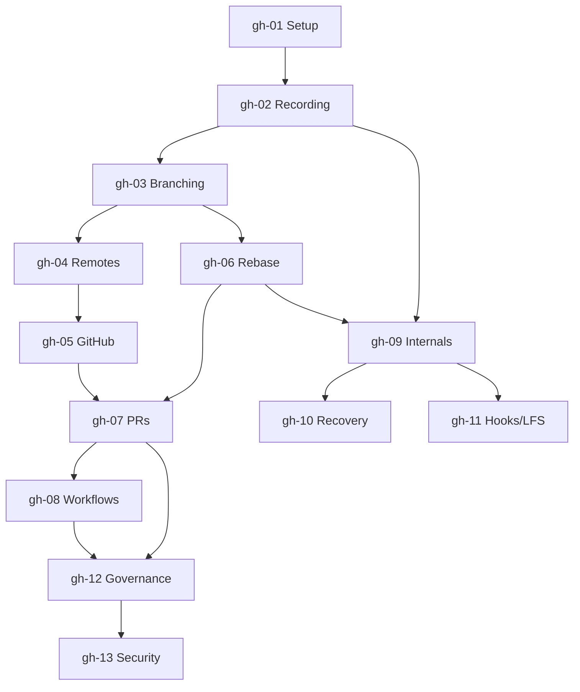

# Git & GitHub — Roadmap detallado

IDs estables: `gh-<NN>-<slug>`. Prerrequisitos entre módulos usan estos IDs.

Duración orientativa total: **40–60 h**.

---

## Nivel 1 — Fundamentos

### gh-01-setup-and-mental-model

- **Nivel:** fundamentos
- **Objetivo:** instalar Git, configurar identidad y editor, y construir el modelo mental correcto (DVCS, snapshots, DAG, tres áreas, objetos).
- **Prerrequisitos:** línea de comandos básica.
- **Temas:** instalación por SO; `git config` (user, editor, pull.rebase, init.defaultBranch, core.autocrlf, credential helper); working tree / index / repository; qué guarda un commit; `git init`, `git status`, `git add`, `git commit`, `git log`.
- **Fundamentos internos:** por qué Git usa hashes de contenido; por qué los snapshots en vez de deltas en el modelo lógico; qué pasa en `.git/` al hacer `init` (HEAD, refs/, objects/, config, hooks/).
- **Competencias:** inicializar un repo, hacer commits significativos, inspeccionar historia, leer `.git/HEAD` y `.git/refs/`.
- **Ejemplos:** `01-first-repo`, `02-what-is-in-dot-git`.
- **Actividades:** `01-config-personal`, `02-first-commits`, `03-explore-dot-git`.
- **Entregables:** repo local inicializado y configurado; mapa anotado de `.git/`.
- **Evaluación:** explicar qué contiene un commit sin consultar docs; identificar los objetos creados al hacer `git add` vs `git commit`.
- **Duración:** 3–4 h.
- **Recursos:** Pro Git cap. 1–2; `man git-config`.

### gh-02-recording-changes

- **Nivel:** fundamentos
- **Objetivo:** dominar el ciclo diario: staging selectivo, commits atómicos, deshacer cambios con precisión.
- **Prerrequisitos:** `gh-01`.
- **Temas:** `git add -p`, `git restore`, `git restore --staged`, `.gitignore` y `.gitattributes` (line endings, LFS filters, binary diff), `git diff` (worktree/staged/HEAD), `git commit --amend`, mensajes de commit (convenciones; *Conventional Commits* como opción).
- **Fundamentos internos:** qué es exactamente el index (es un árbol serializado, no un simple "staging"); por qué `--amend` crea un commit nuevo, no modifica uno existente.
- **Competencias:** hacer commits pequeños y temáticos; recuperar cambios no commiteados; escribir mensajes útiles para `git log --oneline`.
- **Ejemplos:** `01-staging-selectively`, `02-gitignore-patterns`.
- **Actividades:** `01-atomic-commits`, `02-recover-from-mistakes` (independiente).
- **Entregables:** historia pequeña con 10+ commits atómicos y mensajes convencionales.
- **Evaluación:** diferenciar `restore` vs `reset` vs `revert`; explicar por qué `--amend` cambia el hash.
- **Duración:** 3 h.

### gh-03-branching-and-merging-basics

- **Nivel:** fundamentos
- **Objetivo:** usar branches como lo que son (punteros móviles al DAG), fusionar y resolver conflictos.
- **Prerrequisitos:** `gh-02`.
- **Temas:** `git branch`, `git switch`/`checkout`, fast-forward vs 3-way merge, `--no-ff`, resolución de conflictos (editor, `git mergetool`), `git log --graph --oneline --all`.
- **Fundamentos internos:** HEAD como "ref a una ref"; detached HEAD; qué registra Git al mergear (dos padres).
- **Competencias:** modelar trabajo con ramas efímeras; resolver conflictos razonando sobre los tres snapshots involucrados.
- **Ejemplos:** `01-fast-forward-vs-merge`, `02-conflict-walkthrough`.
- **Actividades:** `01-branch-and-merge`, `02-resolve-nontrivial-conflict`.
- **Entregables:** DAG dibujado a mano o con `--graph` de un escenario con 3+ ramas.
- **Evaluación:** predecir qué pasa con HEAD y las refs tras cada operación; explicar un merge commit en términos de árboles.
- **Duración:** 4 h.

### gh-04-remotes-and-collaboration-basics

- **Nivel:** fundamentos
- **Objetivo:** entender el modelo distribuido: `clone`, `fetch`, `pull`, `push`, upstream/tracking branches.
- **Prerrequisitos:** `gh-03`.
- **Temas:** `git remote`, refspecs, `fetch` vs `pull` (y `pull --rebase`), tracking branches (`origin/main`), `git push -u`, protección contra push no-ff, `git ls-remote`.
- **Fundamentos internos:** `refs/remotes/` como caché local del estado remoto en el momento del último `fetch`; qué protocolos usa Git (SSH, HTTPS, Git protocol) y por qué SSH es el estándar práctico.
- **Competencias:** sincronizar correctamente, evitar `git pull` ciego, interpretar "your branch is ahead/behind".
- **Ejemplos:** `01-fetch-vs-pull`, `02-two-clones-same-repo`.
- **Actividades:** `01-local-bare-remote` (crear un remote local con `--bare`), `02-collab-simulation-two-clones` (independiente).
- **Entregables:** repo local + bare remote funcionando sin GitHub.
- **Evaluación:** explicar por qué `fetch` es seguro y `pull` puede sorprender.
- **Duración:** 3 h.

### gh-05-github-first-contact

- **Nivel:** fundamentos
- **Objetivo:** usar GitHub productivamente: cuentas, SSH, HTTPS+PAT, repo creation, README, releases simples.
- **Prerrequisitos:** `gh-04`.
- **Temas:** cuenta y perfil; autenticación (SSH keys, Personal Access Tokens classic vs fine-grained, GitHub CLI `gh` auth); crear repo (público/privado/interno); clonar; `gh repo create`; licencias; README y topics; releases y tags; `.gitattributes` para linguist.
- **Fundamentos internos:** diferencia entre PAT classic y fine-grained; por qué GitHub recomienda SSH o `gh auth`; qué es exactamente un "release" (un tag + metadata + artefactos opcionales).
- **Competencias:** operar repos personales con higiene básica.
- **Ejemplos:** `01-ssh-setup`, `02-first-release`.
- **Actividades:** `01-create-repo-and-push`, `02-publish-first-release`.
- **Entregables:** repo público con README decente, licencia, un release etiquetado.
- **Evaluación:** elegir entre SSH / HTTPS+PAT / `gh` justificando trade-offs.
- **Duración:** 2–3 h.

---

## Nivel 2 — Intermedio

### gh-06-rebase-vs-merge-and-interactive

- **Nivel:** intermedio
- **Objetivo:** dominar `rebase` interactivo y entender cuándo rebasar y cuándo no.
- **Prerrequisitos:** `gh-03`.
- **Temas:** `git rebase <base>`, `git rebase -i` (pick/reword/edit/squash/fixup/drop), `--autosquash`, `--onto`, cherry-pick, `rerere`; regla "no rebases historia pública"; `--update-refs`.
- **Fundamentos internos:** por qué rebase reescribe hashes; qué significa "pierde información" (padres originales); cómo `reflog` sigue siendo tu red de seguridad.
- **Competencias:** limpiar una rama antes de PR; mover commits entre bases; separar un commit grande.
- **Ejemplos:** `01-interactive-cleanup`, `02-rebase-onto`.
- **Actividades:** `01-squash-and-reorder`, `02-rebase-onto-wrong-base` (independiente).
- **Entregables:** PR con historia reescrita vs PR con merge commit; comparación.
- **Evaluación:** justificar la elección merge vs rebase para distintos equipos y políticas.
- **Duración:** 4 h.

### gh-07-collaboration-prs-and-review

- **Nivel:** intermedio
- **Objetivo:** colaborar vía Pull Requests con revisiones efectivas.
- **Prerrequisitos:** `gh-05`, `gh-06`.
- **Temas:** fork vs branch-based workflow; PR drafts; review tools (comments, suggestions, approve/request changes); linked issues y `Fixes #N`; PR templates; `CODEOWNERS`; required reviewers; auto-merge; "squash and merge" vs "rebase and merge" vs "merge commit" (trade-offs sobre historia).
- **Fundamentos internos:** qué es un PR en términos de refs (`refs/pull/<N>/head` y `/merge`); qué commit crea GitHub en cada estrategia de merge.
- **Competencias:** abrir PRs claros; dar reviews útiles; evitar scope creep.
- **Ejemplos:** `01-pr-template`, `02-codeowners`.
- **Actividades:** `01-open-review-merge-pr`, `02-codeowners-and-required-reviews`.
- **Entregables:** repo con PR template, CODEOWNERS y un PR aprobado.
- **Evaluación:** elegir estrategia de merge para la historia que se busca (lineal, con contexto, con contextos cuadriculados).
- **Duración:** 4 h.

### gh-08-workflows-trunk-vs-gitflow

- **Nivel:** intermedio
- **Objetivo:** comparar modelos de ramificación y seleccionar uno fundamentado.
- **Prerrequisitos:** `gh-07`.
- **Temas:** trunk-based development (short-lived branches, feature flags, continuous integration real); GitHub Flow; GitLab Flow; GitFlow (y por qué suele ser demasiado para la mayoría); release branches y hotfix; environment branches (anti-patrón común).
- **Fundamentos internos:** correlación entre modelo de ramas y velocidad de integración; por qué ramas largas → merge hell; relación con feature flags.
- **Competencias:** diseñar y defender un workflow para un equipo específico.
- **Actividades:** `01-simulate-trunk-based` (feature flags simuladas), `02-simulate-gitflow` (y notar la fricción), `03-architecture-decision` (independiente: documentar elección para un escenario dado).
- **Entregables:** ADR con decisión y justificación.
- **Evaluación:** identificar en qué escenario cada modelo falla.
- **Duración:** 3 h.

---

## Nivel 3 — Avanzado

### gh-09-git-internals

- **Nivel:** avanzado
- **Objetivo:** comprender Git desde los objetos hasta los packfiles para poder depurar cualquier estado.
- **Prerrequisitos:** `gh-02`, `gh-06`.
- **Temas:** base de datos de objetos (blob/tree/commit/tag); `git cat-file -p`, `git hash-object`, `git ls-tree`, `git rev-parse`; refs y symbolic refs; packfiles y `git gc`; `git fsck`; alternates; sha1dc; SHA-256 experimental; `git maintenance`.
- **Fundamentos internos:** construir un commit a mano con `hash-object` + `write-tree` + `commit-tree`; cómo se referencian objetos entre sí; qué garantiza la integridad.
- **Competencias:** inspeccionar y reparar repositorios; entender por qué una operación cambia hashes.
- **Ejemplos:** `01-build-commit-by-hand`, `02-inspect-packfile`.
- **Actividades:** `01-commit-from-scratch-plumbing`, `02-fsck-a-broken-repo` (independiente).
- **Entregables:** notas con dibujos del DAG y resultado de `cat-file`.
- **Evaluación:** explicar qué pasa internamente al hacer `commit --amend`, `rebase`, `cherry-pick`.
- **Duración:** 5–6 h.

### gh-10-recovery-and-forensics

- **Nivel:** avanzado
- **Objetivo:** recuperar trabajo "perdido" y depurar regresiones.
- **Prerrequisitos:** `gh-09`.
- **Temas:** `git reflog` (local y por rama), `git bisect` (manual y `--run`), `git blame`, `git log -S/-G` (pickaxe), `git log --follow`, `git worktree`, `git stash` (y por qué no abusarlo), `git reset --soft/--mixed/--hard`.
- **Fundamentos internos:** reflog como diario de HEAD y refs locales; expiración (`gc.reflogExpire`); qué objetos quedan huérfanos tras un reset y cuándo los recoge `gc`.
- **Competencias:** recuperar commits borrados, localizar el commit que introdujo un bug.
- **Ejemplos:** `01-reflog-rescue`, `02-bisect-with-script`.
- **Actividades:** `01-rescue-after-reset-hard` (independiente), `02-bisect-regression`.
- **Entregables:** repo-sandbox con escenarios reproducibles de recuperación.
- **Evaluación:** dado un repo "roto", restaurar historia perdida sin consultar guías.
- **Duración:** 4 h.

### gh-11-hooks-submodules-subtrees-lfs

- **Nivel:** avanzado
- **Objetivo:** extender Git con hooks y manejar casos especiales (binarios, dependencias de código).
- **Prerrequisitos:** `gh-09`.
- **Temas:** hooks locales (`pre-commit`, `commit-msg`, `pre-push`) y framework `pre-commit`; hooks del servidor (`pre-receive`, `update`, `post-receive`); submódulos (vs subtrees vs monorepo); Git LFS (filter smudge/clean); sparse-checkout y partial clone (`--filter=blob:none`); `git bundle`; estrategias para repos grandes (Scalar).
- **Fundamentos internos:** por qué los hooks locales no se versionan por defecto y cómo `pre-commit` lo soluciona; qué guarda un submódulo (gitlink), por qué su UX es dura; cómo LFS reemplaza blobs grandes con punteros.
- **Competencias:** instrumentar un repo con hooks útiles; decidir submódulo vs subtree vs monorepo; configurar LFS correctamente.
- **Actividades:** `01-pre-commit-framework`, `02-submodule-vs-subtree-tradeoffs`, `03-lfs-setup`.
- **Entregables:** repo con `pre-commit` configurado (ruff, black, trufflehog o similar).
- **Evaluación:** elegir entre submodule / subtree / monorepo con justificación.
- **Duración:** 4 h.

---

## Nivel 4 — Producción empresarial

### gh-12-github-governance-and-automation

- **Nivel:** producción
- **Objetivo:** aplicar gobernanza en GitHub a nivel de repo, organización y empresa.
- **Prerrequisitos:** `gh-07`, `gh-08`.
- **Temas:** organizations, teams, roles; permisos a nivel de repo/team; **Rulesets** (sustituto moderno de classic branch protection); required status checks; required deployments; required signatures; merge queues; environments con approvals y wait timers; GitHub Apps vs OAuth Apps vs PATs vs *fine-grained* PATs; webhooks; GitHub API (REST + GraphQL); `gh` CLI avanzada; Projects.
- **Fundamentos internos:** diferencia entre branch protection *classic* y Rulesets (reglas evaluables, superponibles, con bypass controlado); modelo de permisos de GitHub Apps (installation tokens de corta vida); OIDC entre GitHub Actions y clouds (sin secretos de larga vida).
- **Competencias:** diseñar branch protection coherente con el workflow; configurar environments; emitir tokens correctos para cada caso.
- **Ejemplos:** `01-ruleset-main-branch`, `02-environment-with-approval`, `03-oidc-to-aws-cloud`.
- **Actividades:** `01-apply-rulesets`, `02-codeowners-plus-required-reviewers`, `03-github-app-vs-pat` (independiente, de arquitectura).
- **Entregables:** repo con ruleset, CODEOWNERS, environment protegido y PR template, documentado.
- **Evaluación:** justificar cada política en términos de seguridad y velocidad.
- **Duración:** 5 h.

### gh-13-github-security-and-supply-chain

- **Nivel:** producción
- **Objetivo:** aplicar seguridad del repo y de la cadena de suministro desde Git/GitHub.
- **Prerrequisitos:** `gh-12`.
- **Temas:** firma de commits y tags (**SSH keys** o GPG o Sigstore `gitsign`); verified commits; Dependabot (alerts, security updates, version updates); CodeQL / code scanning; secret scanning + push protection; Private vulnerability reporting; **SBOM** nativo de GitHub (dependency graph); attestations / **SLSA provenance** vía GitHub Actions; **OIDC** a cloud providers; secrets de Actions (repo/org/env) y variables; audit log.
- **Fundamentos internos:** cómo verifica GitHub una firma; qué garantiza una attestation SLSA de GitHub Actions; por qué OIDC-to-cloud elimina las credenciales de larga duración (y qué requiere en el trust policy del lado cloud).
- **Competencias:** endurecer un repo productivo; eliminar secretos de larga vida; configurar provenance.
- **Ejemplos:** `01-sign-commits-with-ssh`, `02-dependabot-config`, `03-oidc-to-aws`, `04-attestation-build-provenance`.
- **Actividades:** `01-enable-secret-scanning-and-push-protection`, `02-sign-and-verify-commits`, `03-oidc-federation-to-cloud` (requiere cuenta cloud; marcar costos y alternativa simulada).
- **Entregables:** repo productivo con todos los controles activados y documentados.
- **Evaluación:** auditar un repo ajeno y señalar brechas y recomendaciones; justificar cada control.
- **Duración:** 5–6 h.

---

## Dependencias entre módulos

## Checklist de verificación requerida en Fase 4

Antes de desarrollar los módulos como material ejecutable, verificar contra documentación oficial:

- Versión mínima de Git recomendada y features relevantes (`--update-refs` requiere Git ≥ 2.38; `maintenance` ≥ 2.30; etc.).
- Estado actual de SHA-256 en Git.
- Estado y recomendaciones oficiales entre PAT classic, fine-grained, GitHub Apps y OIDC.
- Diferencias actuales entre **Rulesets** y classic branch protection.
- Formato actual de **attestations** / build provenance de GitHub Actions y su relación con SLSA.
- Comandos y UI vigentes del `gh` CLI.
