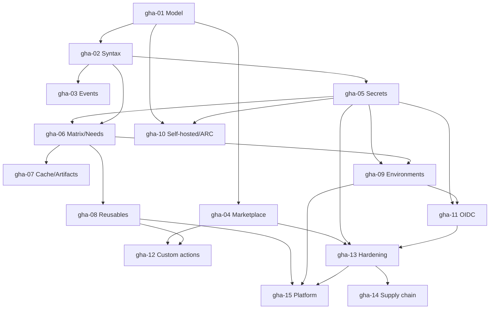

# GitHub Actions — Roadmap detallado

IDs estables: `gha-<NN>-<slug>`.

Duración orientativa total: **55–80 h**.

---

## Nivel 1 — Fundamentos

### gha-01-model-and-first-workflow

- **Nivel:** fundamentos
- **Objetivo:** construir el modelo mental correcto (eventos → workflows → jobs → steps → runners) y ejecutar el primer workflow.
- **Prerrequisitos:** curso Git ≥ `gh-07`.
- **Temas:** anatomía del archivo YAML; ubicación `.github/workflows/`; `on`, `jobs`, `runs-on`, `steps`; `uses` vs `run`; qué hace `actions/checkout`; interfaz UI de Actions (runs, logs, re-run); minutos y billing.
- **Fundamentos internos:** por qué el runner clona el repo (y por qué no por defecto en ciertos triggers); qué información lleva el contexto `github` y de dónde viene; qué es *runner image* y qué trae preinstalado.
- **Competencias:** leer un workflow ajeno y predecir qué va a ocurrir.
- **Ejemplos:** `01-hello-world`, `02-run-vs-uses`.
- **Actividades:** `01-first-workflow` (guiada), `02-read-and-explain` (análisis de un workflow dado).
- **Entregables:** repo con workflow mínimo que corre en push y PR.
- **Evaluación:** explicar la secuencia completa desde el push hasta ver logs verdes.
- **Duración:** 3 h.

### gha-02-syntax-expressions-and-contexts

- **Nivel:** fundamentos
- **Objetivo:** dominar la sintaxis de expresiones, contextos y funciones integradas.
- **Prerrequisitos:** `gha-01`.
- **Temas:** contextos (`github`, `env`, `vars`, `secrets`, `inputs`, `needs`, `job`, `runner`, `steps`, `matrix`, `strategy`); expresiones `${{ ... }}`; operadores; funciones (`contains`, `startsWith`, `format`, `toJSON`, `fromJSON`, `hashFiles`); `if:` condicional en jobs y steps; `env:` a tres niveles; `continue-on-error`, `timeout-minutes`.
- **Fundamentos internos:** cuándo se evalúan las expresiones (preparación del step vs ejecución); por qué no todos los contextos están disponibles en todos los lugares; interpolación insegura y riesgo de inyección de scripts.
- **Competencias:** condicionar ejecución con precisión; evitar interpolar entrada no confiable en comandos de shell.
- **Ejemplos:** `01-conditionals`, `02-contexts-dump`, `03-safe-vs-unsafe-interpolation`.
- **Actividades:** `01-conditional-jobs`, `02-fix-script-injection` (independiente).
- **Entregables:** workflow con lógica condicional y un ejemplo arreglado de inyección.
- **Evaluación:** dado un workflow con `${{ github.event.pull_request.title }}` interpolado en un `run:`, explicar la vulnerabilidad y corregirla.
- **Duración:** 4 h.

### gha-03-events-and-triggers

- **Nivel:** fundamentos
- **Objetivo:** elegir el trigger adecuado y entender el payload que llega.
- **Prerrequisitos:** `gha-02`.
- **Temas:** `push`, `pull_request`, `pull_request_target`, `workflow_dispatch`, `workflow_call`, `workflow_run`, `schedule` (cron), `release`, `issues`, `issue_comment`, `repository_dispatch`; filtros (`branches`, `tags`, `paths`, `types`); payload del evento; `pull_request` desde forks (y por qué los secrets no se exponen por defecto).
- **Fundamentos internos:** diferencia crítica entre `pull_request` (checkout del head del PR, sin secretos) y `pull_request_target` (checkout del base, *con* secretos — superficie de ataque documentada). Comportamiento de `workflow_run` (siempre contra default branch). Expresiones cron en UTC.
- **Competencias:** diseñar triggers precisos; nunca usar `pull_request_target` con `actions/checkout ref: ${{ github.event.pull_request.head.sha }}` sin aislar código no confiable.
- **Ejemplos:** `01-paths-filter`, `02-manual-dispatch-with-inputs`, `03-pull-request-target-safe-pattern`.
- **Actividades:** `01-trigger-matrix` (práctica guiada con varios triggers), `02-safe-fork-pr-workflow` (independiente).
- **Entregables:** mini-catálogo de triggers con ejemplos propios.
- **Evaluación:** justificar la elección de trigger para 5 escenarios dados.
- **Duración:** 4 h.

### gha-04-marketplace-actions-and-basics-of-reuse

- **Nivel:** fundamentos
- **Objetivo:** usar actions del marketplace de forma segura y entender los tipos.
- **Prerrequisitos:** `gha-01`.
- **Temas:** tipos de actions (JavaScript, Docker container, composite); referenciar actions (`owner/repo@ref`); `@v4` vs tag vs **pin a SHA**; actions oficiales (`actions/checkout`, `actions/setup-python`, `actions/setup-node`, `actions/upload-artifact`, `actions/cache`); diferenciar actions mantenidas por GitHub, por vendors de confianza, y por terceros desconocidos.
- **Fundamentos internos:** por qué los tags de Git son mutables y pueden ser reescritos; qué significa pinnear a commit SHA; cómo Dependabot ayuda a mantener los pins actualizados.
- **Competencias:** auditar las dependencias de un workflow; pinnear a SHA cuando corresponde.
- **Ejemplos:** `01-setup-python-matrix`, `02-pin-to-sha`.
- **Actividades:** `01-use-three-marketplace-actions`, `02-audit-a-workflow-for-unpinned-deps` (independiente).
- **Entregables:** workflow con sus actions pinneadas a SHA + comentario con la versión equivalente.
- **Evaluación:** explicar el riesgo del tag mutable con un ejemplo concreto.
- **Duración:** 3 h.

### gha-05-secrets-variables-and-environments-basics

- **Nivel:** fundamentos
- **Objetivo:** gestionar secretos y variables a nivel repo, environment y organización; introducir environments.
- **Prerrequisitos:** `gha-02`.
- **Temas:** diferencia entre `secrets` y `vars`; scopes (repo, environment, org); `GITHUB_TOKEN` (qué es, scope, duración, `permissions:`); redacción automática en logs; environments como namespace de secretos + reglas de deployment; secrets dinámicos (introducción, se profundiza en `gha-11`).
- **Fundamentos internos:** `GITHUB_TOKEN` es un *installation token* de corta vida emitido por GitHub Apps bajo el capó; los environments permiten diferentes valores para la misma clave; `secrets` se pasan explícitamente a reusable workflows (no se heredan).
- **Competencias:** diseñar jerarquía de secretos; aplicar principio de mínimo privilegio al `GITHUB_TOKEN`.
- **Ejemplos:** `01-secret-usage`, `02-permissions-minimal`.
- **Actividades:** `01-env-vs-repo-secret`, `02-restrict-github-token`.
- **Entregables:** workflow con `permissions: contents: read` por default y escalada selectiva.
- **Evaluación:** auditar un repo que concede `permissions: write-all` y proponer un modelo correcto.
- **Duración:** 3 h.

---

## Nivel 2 — Intermedio

### gha-06-matrix-dependencies-outputs

- **Nivel:** intermedio
- **Objetivo:** orquestar jobs dependientes, matrices de ejecución y pasar datos entre jobs.
- **Prerrequisitos:** `gha-02`, `gha-05`.
- **Temas:** `strategy.matrix` (incluye `include`/`exclude`); `fail-fast`; `max-parallel`; `needs:` (grafo de jobs); `outputs` de job (vía `$GITHUB_OUTPUT`); `concurrency` (y `cancel-in-progress`); job summary (`$GITHUB_STEP_SUMMARY`).
- **Fundamentos internos:** cómo expande la matriz la UI; por qué las variables de entorno `GITHUB_OUTPUT` reemplazaron `set-output` (seguridad); cómo `concurrency` crea una cola/lock por nombre.
- **Competencias:** matrices multidimensionales con exclusiones; prevenir deploys concurrentes a prod; propagar un valor computado de un job a otro.
- **Ejemplos:** `01-matrix-python-os`, `02-needs-and-outputs`, `03-concurrency-deploy-lock`.
- **Actividades:** `01-matrix-with-include-exclude`, `02-fan-out-fan-in` (independiente).
- **Entregables:** pipeline con fase `test` matricial → fase `build` única → fase `deploy` con concurrencia controlada.
- **Evaluación:** explicar qué pasa si dos pushes a `main` encolan deploys y la concurrency está activa.
- **Duración:** 4 h.

### gha-07-caching-and-artifacts

- **Nivel:** intermedio
- **Objetivo:** acelerar pipelines con caché y mover archivos entre jobs/runs con artefactos.
- **Prerrequisitos:** `gha-06`.
- **Temas:** `actions/cache` (keys, `restore-keys`, scoping por branch); cachés integradas de `setup-*` (`cache: 'pip'`, etc.); `actions/upload-artifact` y `download-artifact` (v4 cambia la API — verificar); retención de artefactos; límite de tamaño; cross-OS caching trampas.
- **Fundamentos internos:** scope de caché por branch con fallback al default branch; invalidación por hash del lockfile (`hashFiles('**/poetry.lock')`); diferencia entre caché (reutilización oportunista) y artefacto (contrato explícito).
- **Competencias:** diseñar claves de caché efectivas; dividir build/test con artefactos.
- **Ejemplos:** `01-pip-cache`, `02-artifact-between-jobs`.
- **Actividades:** `01-cache-python-deps`, `02-share-build-output-via-artifact`.
- **Entregables:** pipeline donde el job `build` genera un artefacto consumido por `test` y `deploy`.
- **Evaluación:** diagnosticar por qué una caché "no hace hit" (clave, scope o hash).
- **Duración:** 3 h.

### gha-08-reusable-workflows-and-composite-actions

- **Nivel:** intermedio
- **Objetivo:** reutilizar lógica dentro y entre repos.
- **Prerrequisitos:** `gha-06`.
- **Temas:** **composite actions** (`action.yml` con `runs.using: composite`); **reusable workflows** (`workflow_call` con `inputs`, `secrets`, `outputs`); publicación de reusable workflows a nivel org; herencia de secretos (`secrets: inherit`); límites (profundidad de llamada, cantidad de inputs); starter workflows a nivel org.
- **Fundamentos internos:** composite se expande *dentro* del job que la invoca (comparte runner, env); reusable workflow define jobs propios con sus runners; ambos tienen implicaciones distintas de permisos y rendimiento.
- **Competencias:** decidir composite vs reusable workflow; publicar y versionar lógica compartida.
- **Ejemplos:** `01-composite-setup-python-plus-poetry`, `02-reusable-deploy-workflow`.
- **Actividades:** `01-extract-composite-action`, `02-publish-reusable-workflow` (independiente, usa dos repos).
- **Entregables:** una composite action + un reusable workflow, versionados y usados desde un repo cliente.
- **Evaluación:** justificar la elección entre composite y reusable para 3 casos dados.
- **Duración:** 5 h.

### gha-09-environments-approvals-and-deployment-protection

- **Nivel:** intermedio
- **Objetivo:** modelar deployments seguros con environments, approvals y reglas de protección.
- **Prerrequisitos:** `gha-05`, `gha-06`.
- **Temas:** environments (crear, variables, secretos, URL); required reviewers; wait timers; deployment branches (restringir qué refs pueden deployar); custom deployment protection rules (GitHub Apps); recursos `deployments` de la API; UI de deployments.
- **Fundamentos internos:** un environment es un recurso de GitHub, no solo texto en YAML; los gates se evalúan *antes* de ejecutar el job con ese `environment:`; auditoría queda en el deployment record.
- **Competencias:** diseñar la cadena dev → staging → prod con approvals y branch rules.
- **Ejemplos:** `01-environment-with-approval`, `02-branch-restriction`.
- **Actividades:** `01-three-env-pipeline`, `02-add-manual-gate-to-prod`.
- **Entregables:** pipeline con tres environments y approval en producción.
- **Evaluación:** diseñar la política de approvals para un equipo con on-call.
- **Duración:** 4 h.

---

## Nivel 3 — Avanzado

### gha-10-self-hosted-runners-and-arc

- **Nivel:** avanzado
- **Objetivo:** operar runners propios y escalarlos en Kubernetes.
- **Prerrequisitos:** `gha-01`, `gha-05`, nociones básicas de K8s (puede ir después de D8 Nivel 1).
- **Temas:** registrar un runner self-hosted; runner groups; labels; riesgos de ejecutar código no confiable en runners self-hosted (regla: **no self-hosted para repos públicos sin aislamiento**); **ARC** (Actions Runner Controller): CRDs `AutoscalingRunnerSet` y `AutoscalingListener`, escalado por demanda, ephemeral runners; comparación con GitHub-hosted larger runners.
- **Fundamentos internos:** cómo el runner hace long-polling a GitHub para recibir jobs; por qué los runners deben ser efímeros (contaminación entre jobs); modelo de permisos de ARC vía GitHub App.
- **Competencias:** levantar ARC en kind/k3d; configurar runner group por repo; decidir hosted vs self-hosted.
- **Ejemplos:** `01-register-self-hosted-runner`, `02-arc-in-kind`.
- **Actividades:** `01-run-job-on-self-hosted`, `02-arc-minimal-install` (mini-proyecto).
- **Entregables:** cluster local con ARC ejecutando un job; documento de trade-offs.
- **Evaluación:** cuándo es incorrecto usar self-hosted; cómo lo asegurarías.
- **Duración:** 6 h.

### gha-11-oidc-and-cloud-federation

- **Nivel:** avanzado
- **Objetivo:** eliminar credenciales de larga vida usando OIDC.
- **Prerrequisitos:** `gha-05`, `gha-09`.
- **Temas:** OIDC token emitido por GHA; claims (`repository`, `ref`, `environment`, `workflow`, `job_workflow_ref`); configurar el identity provider en AWS (`sts:AssumeRoleWithWebIdentity`), GCP (Workload Identity Federation) y Azure; `permissions: id-token: write`; `aws-actions/configure-aws-credentials`; condiciones del trust policy basadas en claims (bueno: pin a repo+branch/env; malo: pin solo a owner).
- **Fundamentos internos:** flujo OIDC paso a paso; por qué un trust policy mal escrito permite cross-tenant abuse; relación entre `environment` del job y claim OIDC (poderoso para gating por env).
- **Competencias:** federar GHA con AWS/GCP/Azure sin keys; auditar trust policies.
- **Ejemplos:** `01-oidc-aws-assume-role`, `02-trust-policy-with-environment-claim`.
- **Actividades:** `01-federate-with-aws` (requiere cuenta AWS; incluir simulación local alternativa), `02-review-vulnerable-trust-policy` (independiente).
- **Entregables:** repo que despliega a AWS vía OIDC sin ningún secret estático.
- **Evaluación:** detectar y corregir trust policies vulnerables.
- **Duración:** 5 h.

### gha-12-authoring-custom-actions

- **Nivel:** avanzado
- **Objetivo:** escribir, probar y publicar actions propias.
- **Prerrequisitos:** `gha-04`, `gha-08`.
- **Temas:** `action.yml` (metadata, inputs, outputs, runs); tipos: **composite**, **JavaScript** (Node 20), **Docker container**; `@actions/core` y `@actions/github` toolkit; testing (unit + integración en un workflow de prueba); versionado (tags `v1`, release notes); publicación al marketplace; cuando preferir un reusable workflow en vez.
- **Fundamentos internos:** las JS actions corren en el runner directamente (rápido, portable); las Docker actions solo corren en runners Linux; las composite componen steps sin motor propio.
- **Competencias:** empaquetar lógica común como action; versionarla responsablemente.
- **Ejemplos:** `01-composite-action-structure`, `02-js-action-with-core-and-github`, `03-docker-action`.
- **Actividades:** `01-write-composite-action`, `02-write-js-action` (mini-proyecto), `03-publish-and-pin`.
- **Entregables:** una JS action propia publicada en un repo, pinneada a SHA desde otro repo.
- **Evaluación:** justificar elección del tipo de action y la estrategia de versionado.
- **Duración:** 6 h.

---

## Nivel 4 — Producción empresarial

### gha-13-security-hardening

- **Nivel:** producción
- **Objetivo:** endurecer workflows siguiendo la guía oficial y las lecciones de incidentes reales.
- **Prerrequisitos:** `gha-04`, `gha-05`, `gha-11`.
- **Temas:** `permissions:` por defecto a `contents: read`, escalada mínima por job; `pull_request_target` seguro (no checkout de head, o checkout aislado sin ejecutar código del PR); evitar `${{ ... }}` sin sanitizar en `run:`; pinnear todas las actions a SHA; auditar actions de terceros; dependabot para actions; `permissions` del `GITHUB_TOKEN` por workflow y por job; secrets scope; forks y approval de workflows en PRs externos; **StepSecurity Harden-Runner** como defensa en profundidad.
- **Fundamentos internos:** anatomía de incidentes públicos (p. ej. `tj-actions/changed-files`): cadena desde credential leak → action comprometida → tokens exfiltrados en downstream.
- **Competencias:** aplicar y auditar el hardening estándar.
- **Ejemplos:** `01-least-privilege-token`, `02-safe-pull-request-target`, `03-pin-all-actions-with-dependabot`.
- **Actividades:** `01-harden-an-existing-workflow` (independiente), `02-detect-script-injection`.
- **Entregables:** workflow endurecido y ADR con las decisiones tomadas.
- **Evaluación:** auditoría de seguridad escrita de un workflow dado.
- **Duración:** 5 h.

### gha-14-supply-chain-sbom-attestations-signing

- **Nivel:** producción
- **Objetivo:** emitir evidencias verificables de qué se construyó, con qué, y por qué pipeline.
- **Prerrequisitos:** `gha-13`, D6 (Docker) básico.
- **Temas:** SBOM (CycloneDX / SPDX) con `anchore/sbom-action` o `syft`; **attestations** nativas (`actions/attest-build-provenance`, `actions/attest-sbom`) basadas en Sigstore; firma de imágenes con **cosign** (keyless, OIDC); verificación en el consumidor (`cosign verify-attestation`); **SLSA** niveles y lo que GHA puede atestiguar; publicación a **GHCR**.
- **Fundamentos internos:** attestations usan el flujo keyless de Sigstore (ephemeral keys + Fulcio + Rekor); el verifier confirma identidad del issuer (GHA) + repo + workflow; relación entre attestation y SBOM.
- **Competencias:** emitir SBOM + attestation + firma; verificar en el consumidor.
- **Ejemplos:** `01-sbom-with-syft`, `02-attest-build-provenance`, `03-cosign-sign-and-verify`.
- **Actividades:** `01-publish-signed-image-to-ghcr`, `02-verify-in-downstream-workflow`.
- **Entregables:** release reproducible con imagen firmada + attestation + SBOM publicados y verificables.
- **Evaluación:** demostrar la verificación desde un repo distinto.
- **Duración:** 5 h.

### gha-15-platform-patterns-and-cost-governance

- **Nivel:** producción
- **Objetivo:** operar GHA como plataforma a escala de organización.
- **Prerrequisitos:** `gha-08`, `gha-09`, `gha-13`.
- **Temas:** **required workflows** / **repository rules** que exigen checks de org; starter workflows versus reusable workflows "golden path"; convenciones de versionado de reusables (`v1` que apunta a último SHA de la major); políticas de concurrencia a nivel org; billing y presupuesto (minutos por repo, larger runners, GHCR storage, Actions cache storage); métricas de pipeline (duración p50/p95, tasa de éxito); observabilidad (webhooks → sink); costeo de self-hosted vs hosted; disaster-recovery (qué pasa si GitHub está caído).
- **Fundamentos internos:** required workflows se aplican vía rulesets a nivel org/enterprise; billing se reporta por repo pero se consume en runner-minutes con multiplicadores por SO; límite de 10 GB de cache por repo.
- **Competencias:** diseñar el "platform contract" de CI/CD a nivel org.
- **Ejemplos:** `01-required-reusable-workflow-via-ruleset`, `02-cost-dashboard-metrics`.
- **Actividades:** `01-define-org-level-ci-contract` (independiente, documento), `02-cost-exercise`.
- **Entregables:** documento de arquitectura de plataforma CI/CD con decisiones, trade-offs y métricas objetivo.
- **Evaluación:** defender el contrato ante preguntas de developer experience vs seguridad vs costo.
- **Duración:** 5 h.

---

## Dependencias entre módulos

## Checklist de verificación requerida en Fase 4

- Versión actual de `actions/checkout`, `actions/setup-python`, `actions/cache`, `actions/upload-artifact` (v4 cambió significativamente).
- Estado y sintaxis actual de `actions/attest-build-provenance` y `actions/attest-sbom`.
- Documentación vigente de ARC (los nombres de CRDs y el chart cambiaron entre `summerwind/actions-runner-controller` y la versión oficial de GitHub).
- Trust policies actualizadas para OIDC con AWS/GCP/Azure (sintaxis de condiciones).
- Comportamiento actual de `GITHUB_TOKEN` por defecto (cambió entre `permissive` y `restricted` según cuándo se creó la org).
- Guía oficial "Security hardening for GitHub Actions" (fecha de última actualización).
- Estado de **required workflows** / repository rules vs branch protection classic.
