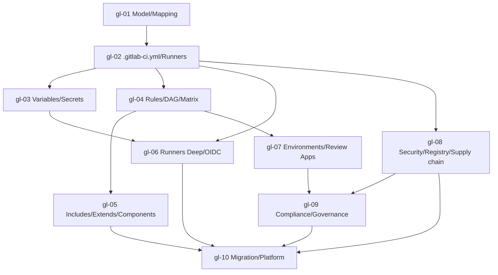

# GitLab CI/CD — Roadmap detallado (diferencial contra GitHub Actions)

IDs estables: `gl-<NN>-<slug>`.

Duración orientativa total: **25–35 h**. Compacto por diseño: cada módulo asume competencias GHA equivalentes y se enfoca en transferencia + divergencias.

---

## Nivel 1 — Fundamentos diferenciales

### gl-01-model-and-mapping-to-gha

- **Nivel:** fundamentos
- **Objetivo:** entender la jerarquía GitLab y hacer el mapping conceptual con GHA.
- **Prerrequisitos:** curso **github-actions** completo.
- **Temas:** jerarquía **Instance → Group → Subgroup → Project** (Group ≈ Org con subgroups anidables, útil para gran escala); SaaS (`gitlab.com`) vs **Self-Managed** (CE/EE) vs **Dedicated**; planes y features gating (Free/Premium/Ultimate; muchas features de seguridad y compliance están gated a Ultimate — comparar con GHAS); UI "pipeline": pipeline → stages → jobs (visualización por stage con DAG opcional); mapping sistemático GHA↔GitLab (ver tabla del README); terminología importante (**Merge Request = Pull Request**; **Group Runners** ≈ org runners de GHA; **Protected Branches/Tags/Environments** ≈ branch protection/environments).
- **Fundamentos internos:** Group es la unidad clave para compartir runners, variables, templates y permisos — equivalente aproximado de "org" de GitHub pero con jerarquía anidable; features gated por plan afectan ADR (hay funcionalidades indispensables en Premium/Ultimate).
- **Competencias:** traducir conceptos GHA↔GitLab sin tabla.
- **Ejemplos:** `01-group-subgroup-structure`, `02-plan-gating-matrix`, `03-translate-gha-concepts`.
- **Actividades:** `01-explore-gitlab-com`, `02-adr-gitlab-vs-github-first-pass` (independiente).
- **Entregables:** cheatsheet personal GHA↔GitLab + ADR inicial.
- **Evaluación:** mapear 10 features GHA a su equivalente GitLab.
- **Duración:** 2 h.

### gl-02-gitlab-ci-yml-pipelines-runners

- **Nivel:** fundamentos
- **Objetivo:** escribir el primer `.gitlab-ci.yml`, entender el modelo de pipeline y los tipos de runner.
- **Prerrequisitos:** `gl-01`.
- **Temas:** anatomía de `.gitlab-ci.yml` (keys top-level: `stages`, `variables`, `default`, `workflow`, `include`, `image`, `services`, `before_script`, `after_script`, un job por key arbitrario); un **job** tiene `stage`, `script`, `image`, `tags`, `rules`/`only`/`except` (`only/except` legacy — preferir `rules`); **ejecutor** (`image:` por default usa docker executor); **tags** para seleccionar runners; `script` es *lista de comandos shell* en el runner; UI de pipelines (status, retry job, downstream, child/parent pipelines); diferencia entre **pipelines** y **jobs** retried; **runners**: **Shared** (gitlab.com SaaS, hosted por GitLab), **Group**, **Project**; **registration** vs **authentication tokens** (los primeros deprecados en favor de `glab runner create` + token nativo); **GitLab-hosted SaaS runners** por tier/sistema; comparación con **GitHub-hosted runners**.
- **Fundamentos internos:** sin `tags:` especificados, el job espera un runner compatible; `tags` + `rules` es el *contrato* para elegir runner y disparar o no.
- **Competencias:** `hello-world` pipeline funcional con 3 stages.
- **Ejemplos:** `01-first-pipeline`, `02-stages-and-jobs`, `03-docker-executor-image`.
- **Actividades:** `01-port-hello-world-from-gha`, `02-shared-vs-group-runner` (análisis).
- **Entregables:** pipeline mínimo con 3 stages (lint/test/build) en SaaS.
- **Evaluación:** diagnosticar un job que queda `pending` sin runner.
- **Duración:** 3 h.

### gl-03-variables-and-secrets-protected-and-masked

- **Nivel:** fundamentos
- **Objetivo:** gestionar variables y secretos con los niveles correctos.
- **Prerrequisitos:** `gl-02`.
- **Temas:** niveles: **Instance → Group → Project → Environment → Pipeline**; **tipos**: `variable` (text) vs `file` (archivo temporal cuyo path se expone en la var); **flags**: `protected` (solo pipelines en refs protegidas pueden leerla), `masked` (filtrada en logs), `expanded`/`raw`; integración con secret managers externos (Vault, AWS Secrets Manager, GCP Secret Manager — nativo: **secrets:** key en el job); **ID Tokens** (JWT emitidos por GitLab, equivalente a OIDC token de GHA — usados para OIDC a cloud y para HashiCorp Vault); evitar `${{ }}` injection (sintaxis `$VAR` en GitLab, igual riesgo).
- **Fundamentos internos:** una variable sin `protected: true` expone el valor a cualquier branch; un **ID Token** es la vía moderna para evitar credenciales de larga vida.
- **Competencias:** jerarquía de variables aplicada; secret bien restringido a prod.
- **Ejemplos:** `01-group-vs-project-var`, `02-protected-and-masked`, `03-secrets-from-vault-with-idtoken`.
- **Actividades:** `01-least-privilege-variables`, `02-oidc-to-vault` (independiente).
- **Entregables:** repo con jerarquía de vars y secreto desde Vault via ID Token.
- **Evaluación:** auditar `variables.yml` con secretos expuestos y proponer refactor.
- **Duración:** 3 h.

---

## Nivel 2 — Intermedio

### gl-04-rules-workflow-needs-dag-parallel-matrix

- **Nivel:** intermedio
- **Objetivo:** controlar cuándo corre un pipeline/job y modelar DAGs.
- **Prerrequisitos:** `gl-02`.
- **Temas:** **`workflow:`** top-level (filtra pipeline completo: `rules:` con `$CI_PIPELINE_SOURCE`, `$CI_COMMIT_BRANCH`, `$CI_MERGE_REQUEST_IID`); **`rules:`** por job (reemplaza `only/except`); **`when:`** (`on_success`, `on_failure`, `always`, `manual`, `delayed:`); **`needs:`** convierte el pipeline en DAG (jobs independientes avanzan sin esperar al stage completo); **`parallel: N`** (correr N copias) + **`parallel: matrix:`** (como `strategy.matrix` en GHA); `CI_NODE_INDEX`/`CI_NODE_TOTAL` dentro del job; **child/parent pipelines** (`trigger:` + `include:`) para dividir pipelines grandes.
- **Fundamentos internos:** sin `needs:`, el modelo de stages es "wall clock = max(duration stage)"; con `needs:` cada job solo espera a sus deps reales (ganancia típica 20–40% en pipelines reales).
- **Competencias:** convertir pipeline linear a DAG; matriz de tests multi-OS/multi-version.
- **Ejemplos:** `01-workflow-rules`, `02-dag-with-needs`, `03-parallel-matrix`.
- **Actividades:** `01-port-matrix-from-gha`, `02-cut-wall-clock-with-needs` (independiente).
- **Entregables:** pipeline DAG con matriz 3x3 y wall-clock mejorado medible.
- **Evaluación:** diseñar DAG para un pipeline con 2 deps independientes antes del deploy.
- **Duración:** 3 h.

### gl-05-reuse-include-extends-and-cicd-components

- **Nivel:** intermedio
- **Objetivo:** reutilizar lógica con los tres mecanismos.
- **Prerrequisitos:** `gl-04`.
- **Temas:** **`include:`** (local, project, remote, template); **`extends:`** (herencia de un job base: hidden jobs con prefijo `.`); diferencia con GHA composite/reusable; **CI/CD Components** (moderno, 2023+): paquetes versionados en un project que exponen un contrato con `spec:inputs:`, consumibles vía `include:component:`; publicación al **CI/CD Catalog** del grupo/instance; comparar con **include:remote** clásico; versionado SemVer de components; sharing patterns (interno vs público); límite de nested includes.
- **Fundamentos internos:** CI/CD Components son el equivalente moderno de "reusable workflows" de GHA — permiten `inputs`, tipado, documentación; replace `include:remote:` que carecía de contrato.
- **Competencias:** publicar y consumir CI/CD Components propios.
- **Ejemplos:** `01-extends-hidden-job`, `02-include-local-vs-project`, `03-cicd-component-publish-and-consume`.
- **Actividades:** `01-extract-component-from-pipeline`, `02-adr-components-vs-includes` (independiente).
- **Entregables:** componente propio en CI/CD Catalog interno + consumidor.
- **Evaluación:** justificar component vs include vs extends para 3 casos.
- **Duración:** 3 h.

### gl-06-runners-deep-executors-fleeting-and-oidc

- **Nivel:** intermedio
- **Objetivo:** operar runners propios con criterio y conectar a cloud sin keys.
- **Prerrequisitos:** `gl-02`, `gl-03`.
- **Temas:** **executors**: `shell`, `docker`, `docker-machine` (deprecated → **Fleeting**), `kubernetes`, `virtualbox`, `ssh`; **Docker-in-Docker (DinD)** (patrón común: `services: docker:dind` + `DOCKER_TLS_CERTDIR`); **Kubernetes executor** (pods efímeros, `kubernetes` config via Group/Project Runner); **Fleeting** autoscaler (sucesor de `docker-machine`, maneja fleet de VMs on-demand en AWS/GCP/Azure); **Runner Operator** / **GitLab Runner on K8s via chart**; registrar runner con `authentication token` moderno (no `registration token`); **ID Token / OIDC → AWS/GCP/Azure/Vault** (sin keys); **custom executor** para casos exóticos.
- **Fundamentos internos:** cada executor tiene trade-offs: `docker` simple pero cada job tira contenedor nuevo; `kubernetes` escala elástico; **DinD seguro** requiere TLS + rootless + no privileged idealmente (hay `kaniko`/`buildkit` como alternativa sin daemon); **ARC-like** patrón en GitLab = chart oficial + autoscaling por métricas.
- **Competencias:** levantar runner K8s; OIDC a AWS sin keys.
- **Ejemplos:** `01-k8s-executor-chart`, `02-fleeting-aws-asg`, `03-oidc-id-token-to-aws`.
- **Actividades:** `01-runner-k8s-and-first-job`, `02-federate-with-aws-oidc` (independiente).
- **Entregables:** runner K8s funcional + pipeline que deploya a AWS vía OIDC sin keys.
- **Evaluación:** elegir executor por workload (3 escenarios).
- **Duración:** 4 h.

---

## Nivel 3 — Avanzado

### gl-07-environments-deployments-and-review-apps

- **Nivel:** avanzado
- **Objetivo:** modelar deployments con approvals y Review Apps nativas.
- **Prerrequisitos:** `gl-04`.
- **Temas:** `environment:` por job (`name`, `url`, `action: start|stop|prepare|verify|access`, `auto_stop_in`); **protected environments** con **approval rules** (requiere aprobación de X usuarios/grupos); deployment history, rollback via UI; **Review Apps**: environment efímero por MR (`$CI_MERGE_REQUEST_IID`), destruido al cerrar MR (`on_stop:` + `action: stop`); patrón blue/green y canary en GitLab (manual con conditional jobs + progressive strategy); **GitLab Agent for Kubernetes** (sucesor del "Kubernetes integration" clásico): instala agente en el cluster, expone CI/CD → cluster sin exponer kube-apiserver; **GitOps mode del Agent** (manifest tracking desde el repo); comparación con Argo CD/Flux (menos features, más integrado con GitLab).
- **Fundamentos internos:** Review Apps materializan el "preview per PR" como primera clase (en GHA es un patrón, aquí es un objeto del dominio); `on_stop:` es el gancho para destruir recursos del environment.
- **Competencias:** Review Apps + protected prod + approval rule.
- **Ejemplos:** `01-environment-with-url`, `02-review-apps-on-mr`, `03-protected-env-approval`.
- **Actividades:** `01-review-apps-end-to-end`, `02-approval-rule-prod` (independiente).
- **Entregables:** pipeline con Review Apps por MR + prod con approval.
- **Evaluación:** diseñar política de environments para dev/stg/prod + hotfix.
- **Duración:** 4 h.

### gl-08-security-scanners-registry-and-supply-chain

- **Nivel:** avanzado
- **Objetivo:** usar los scanners nativos y la cadena de suministro integrada.
- **Prerrequisitos:** `gl-02`, curso **devsecops** ≥ Nivel 2.
- **Temas:** scanners nativos (templates `Jobs/*.gitlab-ci.yml` incluidos vía `include:template:`): **SAST**, **DAST**, **Secret Detection**, **Container Scanning** (Trivy bajo el capó en versiones recientes), **Dependency Scanning (SCA)**, **IaC Scanning**, **Fuzz Testing**, **License Scanning**; **Security Dashboard** (findings agregados), vulnerability triage (dismiss, confirm, resolve); **merge request security widget**; **Container Registry** (OCI, por project; features: cleanup policies, dependency proxy para evitar rate limit de Docker Hub); **Package Registry** (PyPI, npm, Maven, Composer, Conan, Nuget, Go, Helm, …); **supply chain**: SBOM generation nativa; **SLSA provenance** (actualmente parcial; verificar estado); **cosign** sigue aplicando igual (keyless con ID Token de GitLab como issuer OIDC).
- **Fundamentos internos:** los scanners son *jobs* reales que corren en runners (consumen minutos); planes Free tienen una selección más pequeña; Ultimate incluye todos; cosign + ID Token GitLab permite firma keyless análoga a GHA.
- **Competencias:** habilitar scanners + leer Dashboard + firmar imagen con cosign.
- **Ejemplos:** `01-enable-all-security-templates`, `02-container-registry-push-and-cleanup`, `03-cosign-keyless-with-gitlab-oidc`.
- **Actividades:** `01-pipeline-with-scanners`, `02-sign-and-publish` (independiente).
- **Entregables:** pipeline con 5+ scanners activos, imagen firmada en Container Registry.
- **Evaluación:** triage de 10 vulnerabilidades del Dashboard.
- **Duración:** 4 h.

---

## Nivel 4 — Producción empresarial

### gl-09-compliance-approvals-and-governance

- **Nivel:** producción
- **Objetivo:** aplicar gobernanza y compliance a nivel grupo/instance.
- **Prerrequisitos:** `gl-07`, `gl-08`.
- **Temas:** **Compliance Pipelines / Compliance Frameworks**: pipeline obligatorio que se concatena a todos los proyectos de un grupo etiquetados con un framework (equivalente a required workflows en GitHub); **MR approval rules** (número de approvers, Code Owners obligatorios, security approvals por findings); **protected branches/tags**; **push rules** (regex de commit messages, deny de archivos secretos); **audit events** y audit log; **Instance / Group settings** (default branch, CI/CD defaults); **license tier awareness** (features gated); **RBAC** (Guest/Reporter/Developer/Maintainer/Owner); **SAML/SCIM** SSO; **IP allowlist**; integración con **enterprise auditors** y SIEM.
- **Fundamentos internos:** Compliance Pipelines es "pipeline injection" controlada por el equipo de compliance — un project puede extender pero no omitir; approval rules + Code Owners cubren la mayoría de controles ISO/SOC/PCI.
- **Competencias:** aplicar framework de compliance a un grupo; approval rules multi-equipo.
- **Ejemplos:** `01-compliance-pipeline-skeleton`, `02-mr-approval-rules`, `03-audit-events-review`.
- **Actividades:** `01-apply-compliance-framework`, `02-governance-adr` (independiente).
- **Entregables:** grupo con compliance pipeline + approval rules + Code Owners aplicados.
- **Evaluación:** proponer baseline de gobernanza para una org con 50 projects.
- **Duración:** 3 h.

### gl-10-migration-and-platform-patterns

- **Nivel:** producción
- **Objetivo:** migrar entre GHA y GitLab; operar GitLab como plataforma.
- **Prerrequisitos:** `gl-05`, `gl-06`, `gl-08`, `gl-09`.
- **Temas:** **migración GHA → GitLab** (y viceversa): patrones comunes (reusable workflow → CI/CD Component; composite action → extends o component; OIDC trust policy adjustada por `sub` claim distinto); herramientas (`gl-migration`, scripts custom); **inventario** antes de migrar (secrets, variables, tokens, environments, protected branches); periodo de **dual-run** (misma pipeline en ambos); **CI/CD Catalog interno** como "golden path" para toda la org; **inner-source** del catálogo (quién puede proponer componentes); **cost control** (minutos de SaaS runners vs operar runners propios en K8s); **observabilidad del CI/CD** (job duration, success rate, queue time: Prometheus exporter de GitLab); **relación con Argo CD**: GitLab solo construye y publica; Argo CD aplica (misma frontera que recomendamos para GHA, para no acoplar CI con despliegue); ADR final.
- **Fundamentos internos:** una migración exitosa reconoce las *diferencias* (OIDC claims distintas, modelo de permisos distinto) y las *equivalencias* (reusable workflow ≈ CI/CD Component); dual-run reduce riesgo de "big bang".
- **Competencias:** diseñar y ejecutar una migración; operar un catálogo CI/CD como plataforma.
- **Ejemplos:** `01-port-gha-workflow-to-gitlab`, `02-cicd-catalog-governance`, `03-ci-metrics-dashboard`.
- **Actividades:** `01-migrate-capstone-pipeline`, `02-platform-adr-final` (independiente).
- **Entregables:** pipeline del capstone portado + catálogo interno con 3+ componentes + ADR final.
- **Evaluación:** defender la elección GHA vs GitLab para 3 organizaciones distintas.
- **Duración:** 4 h.

---

## Dependencias entre módulos

## Checklist de verificación requerida en Fase 4

- Versión actual de GitLab (releases cada mes 22) y features Premium/Ultimate gated vigentes.
- Estado y madurez de **CI/CD Components** y del **CI/CD Catalog** público.
- Estado de **registration tokens** (deprecados) vs **authentication tokens** nuevos.
- Status de **Fleeting** autoscaler (ex docker-machine) por plugin (AWS/GCP/Azure).
- Status del **GitLab Agent for Kubernetes** (incluyendo GitOps mode) vs Argo CD.
- Lista actual de **scanners nativos** y los que requieren Ultimate.
- Estado de **SLSA provenance / attestations** nativas en GitLab (si GA o parcial).
- Comparativa de pricing GHA vs GitLab vigente (minutos, planes, storage).
- Documentación vigente de **ID Tokens / OIDC** desde GitLab a AWS/GCP/Azure/Vault (atributos del JWT y recomendaciones de pinning por `project_path`, `ref`, `environment`).
