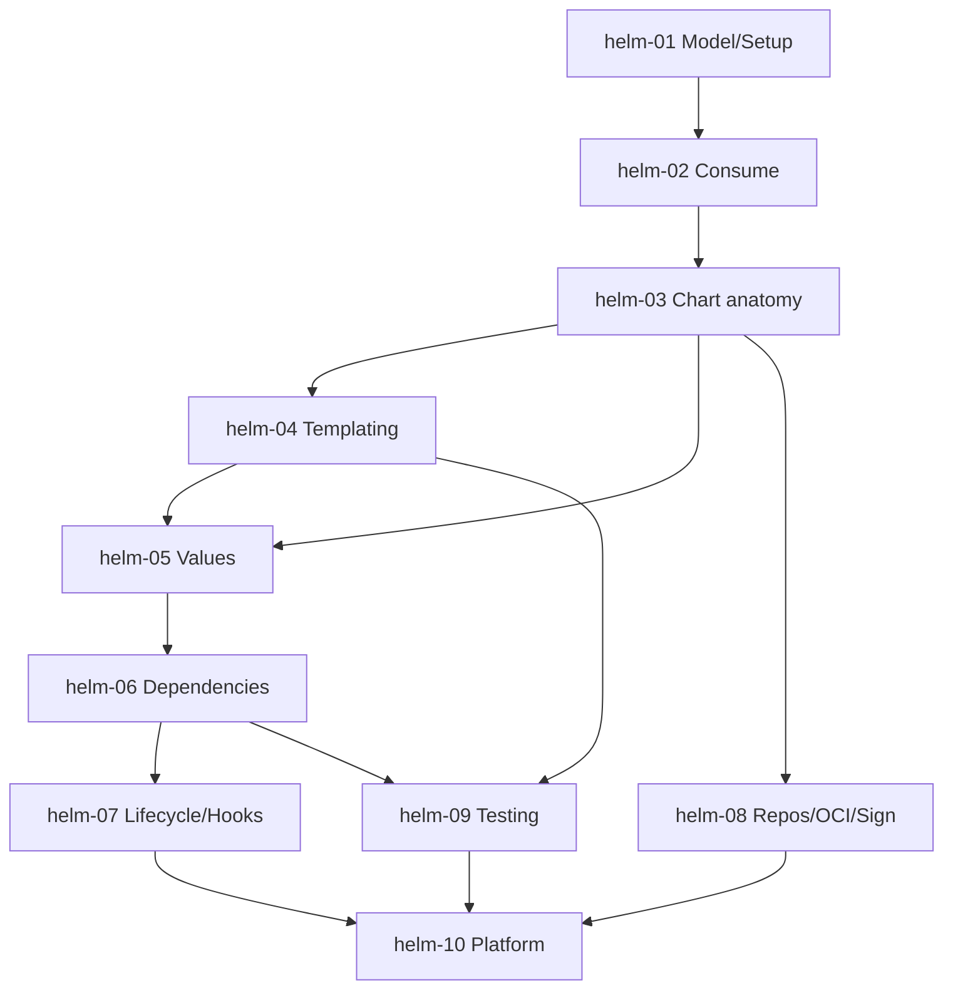

# Helm — Roadmap detallado

IDs estables: `helm-<NN>-<slug>`.

Duración orientativa total: **20–30 h**.

---

## Nivel 1 — Fundamentos

### helm-01-mental-model-and-setup

- **Nivel:** fundamentos
- **Objetivo:** construir el modelo mental (chart, release, repo, values) y poner un entorno funcional.
- **Prerrequisitos:** curso **kubernetes** ≥ Nivel 2.
- **Temas:** por qué un "package manager" tiene sentido en K8s; chart vs release vs revision; **Helm 3 sin Tiller** y qué cambió respecto a Helm 2; instalación (`helm` binario); `helm env`, `helm version`; comandos exploratorios (`helm search hub`, `helm search repo`, `helm show chart/values/readme`); concepto de `values.yaml` como *API pública* del chart.
- **Fundamentos internos:** por qué Tiller fue abandonado (era un singleton server-side con permisos amplios); por qué Helm 3 renderiza en el cliente y aplica contra el API server como cualquier otro usuario.
- **Competencias:** explicar los cuatro conceptos sin consultar docs.
- **Ejemplos:** `01-helm-search-and-show`, `02-tiller-vs-helm3-notes`.
- **Actividades:** `01-install-helm-and-explore`, `02-read-values-of-popular-chart` (independiente).
- **Entregables:** notas con la "API" (`values`) de 3 charts populares.
- **Evaluación:** justificar por qué `values.yaml` *es* la interfaz del chart.
- **Duración:** 2 h.

### helm-02-consume-charts-install-upgrade-rollback

- **Nivel:** fundamentos
- **Objetivo:** operar el lifecycle de releases con charts de terceros.
- **Prerrequisitos:** `helm-01`.
- **Temas:** `helm repo add/update`; `helm install` (`--namespace`, `--create-namespace`, `--version`, `--values`, `--set`); `helm upgrade --install` (patrón idempotente); `helm uninstall`; `helm list` (`--all-namespaces`); `helm status`, `helm get values/manifest/notes/hooks`; `helm history` y **`helm rollback`**; dónde vive el estado del release (**Secret** por default en el namespace del release) y por qué.
- **Fundamentos internos:** cada release tiene revisiones (1, 2, 3…) y cada revisión es un Secret serializado; rollback crea una *nueva* revisión que es copia de una previa; `helm upgrade --install` es el idiom estándar en CI/CD por idempotencia.
- **Competencias:** instalar y actualizar software base del cluster (ingress-nginx, cert-manager) de forma reproducible.
- **Ejemplos:** `01-install-ingress-nginx`, `02-upgrade-with-values-file`, `03-rollback-walkthrough`.
- **Actividades:** `01-install-cert-manager`, `02-rollback-after-bad-upgrade` (independiente).
- **Entregables:** cluster local con 2+ charts instalados; evidencia de upgrade + rollback.
- **Evaluación:** explicar dónde está el estado del release y qué pasa si se borra ese Secret.
- **Duración:** 3 h.

---

## Nivel 2 — Intermedio

### helm-03-chart-anatomy

- **Nivel:** intermedio
- **Objetivo:** crear un chart propio bien estructurado desde cero.
- **Prerrequisitos:** `helm-02`.
- **Temas:** `helm create <name>` (y qué recorta); `Chart.yaml` (campos obligatorios: `apiVersion: v2`, `name`, `version`, `appVersion`, `type: application|library`); `templates/` convenciones (`deployment.yaml`, `service.yaml`, `_helpers.tpl`, `NOTES.txt`, `tests/`); `values.yaml` como contrato; `.helmignore`; **`values.schema.json`** para validar inputs; `files/` para `.Files.Get`; `crds/` (y su política *CRDs no se gestionan por release*).
- **Fundamentos internos:** `helm create` genera un chart "demo" con montones de knobs — borrar el 80% es un paso válido; CRDs en `crds/` se instalan en `install` pero *no* se actualizan en `upgrade` (decisión de seguridad: evitar romper otros usuarios de la CRD).
- **Competencias:** diseñar la estructura de un chart propio.
- **Ejemplos:** `01-helm-create-scaffold`, `02-minimal-chart-from-scratch`, `03-values-schema-json`.
- **Actividades:** `01-chart-for-fastapi`, `02-add-values-schema` (independiente).
- **Entregables:** chart propio funcional para la app del capstone, con `values.schema.json`.
- **Evaluación:** explicar por qué CRDs no se "upgradearon" en Helm y qué estrategia aplicar.
- **Duración:** 4 h.

### helm-04-templating-deep

- **Nivel:** intermedio
- **Objetivo:** dominar Go templates aplicados a YAML con seguridad.
- **Prerrequisitos:** `helm-03`.
- **Temas:** sintaxis Go templates (`{{ }}`, `-` para whitespace, pipelines `|`); funciones built-in y de **Sprig** (`default`, `required`, `quote`, `toYaml`, `nindent`, `tpl`, `include`, `tuple`, `len`, `b64enc`, `sha256sum`); control (`if/else`, `with`, `range`); scoping y `$` para root; **named templates** (`define` / `template` / **`include`** — y por qué `include` suele preferirse); `_helpers.tpl` convenciones; errores comunes (indentación, `null`, listas vs mapas); **`helm template --debug`** para render local; `helm lint`.
- **Fundamentos internos:** la diferencia crítica entre `template` (acción, no se puede pipear) e `include` (función, se puede pipear a `nindent`, `trim`, etc.); `required "msg" .Values.x` falla al render si falta — fundamental para evitar surprises.
- **Competencias:** escribir templates idiomáticos sin "yaml hell".
- **Ejemplos:** `01-sprig-essentials`, `02-include-vs-template-and-nindent`, `03-required-and-default`.
- **Actividades:** `01-refactor-template-with-helpers`, `02-fix-broken-indent` (independiente, debug).
- **Entregables:** `_helpers.tpl` con nombres estándar (`<chart>.fullname`, `<chart>.labels`, `<chart>.selectorLabels`, `<chart>.serviceAccountName`).
- **Evaluación:** diagnosticar un error de render dado solo el output y el template.
- **Duración:** 5 h.

### helm-05-values-precedence-and-child-charts

- **Nivel:** intermedio
- **Objetivo:** manejar valores con precedence predecible, también en charts hijos.
- **Prerrequisitos:** `helm-03`, `helm-04`.
- **Temas:** precedencia (de menor a mayor): defaults del chart → `--values file.yaml` (en orden) → `--set`; multi-document values (`-f` múltiples); overrides por entorno (dev/stg/prod); scoping en subcharts (`subchart.values` no es accesible desde el padre a menos que se pase; **`global:`** para valores compartidos); **`import-values`** para "elevar" valores de un subchart al padre; evitar duplicación entre `values.yaml` y `values.schema.json`.
- **Fundamentos internos:** cada subchart tiene su propio namespace de values; `global` es la única zona compartida (y debe usarse con disciplina); `import-values` + `exports` evita que el padre tenga que replicar la estructura del hijo.
- **Competencias:** diseñar el "contrato de values" de un chart multi-entorno.
- **Ejemplos:** `01-precedence-walkthrough`, `02-global-values-across-subcharts`, `03-import-values`.
- **Actividades:** `01-env-overrides-dev-stg-prod`, `02-share-image-registry-via-global` (independiente).
- **Entregables:** chart con `values.yaml` por default + `values-dev.yaml`, `values-stg.yaml`, `values-prod.yaml` consistentes.
- **Evaluación:** predecir el valor final para un conjunto dado de inputs.
- **Duración:** 3 h.

### helm-06-dependencies-and-umbrella-charts

- **Nivel:** intermedio
- **Objetivo:** componer charts con dependencias correctamente.
- **Prerrequisitos:** `helm-05`.
- **Temas:** `dependencies:` en `Chart.yaml`; `helm dependency update` / `build`; **Chart.lock**; alias; condicionales de dependencias (`condition:` sobre un flag en values); **umbrella charts** vs "chart per app"; cuándo *no* usar umbrella (lifecycle acoplado); gestionar versiones de deps como se gestionan dependencias de código (SemVer, lockfile).
- **Fundamentos internos:** `Chart.lock` fija versiones efectivas; sin él, dos checkouts pueden traer deps distintas; umbrella chart = una sola release gestionando todo (bueno para dev local, peligroso para prod si acopla lifecycles de equipos distintos).
- **Competencias:** elegir composición vs separación; versionar dependencias con disciplina.
- **Ejemplos:** `01-add-postgres-as-dependency`, `02-conditional-dependency`, `03-chart-lock-reproducibility`.
- **Actividades:** `01-umbrella-for-dev-stack`, `02-split-umbrella-decision` (independiente, ADR).
- **Entregables:** umbrella chart para dev local (app + postgres) + ADR que defiende *no* umbrella en prod.
- **Evaluación:** justificar umbrella vs charts separados para 3 escenarios.
- **Duración:** 3 h.

---

## Nivel 3 — Avanzado

### helm-07-lifecycle-hooks-tests-and-atomic

- **Nivel:** avanzado
- **Objetivo:** controlar el ciclo de instalación/upgrade con hooks y rollback automático.
- **Prerrequisitos:** `helm-06`.
- **Temas:** **hooks**: `pre-install`, `post-install`, `pre-upgrade`, `post-upgrade`, `pre-delete`, `post-delete`, `test`; weights y delete-policies (`before-hook-creation`, `hook-succeeded`, `hook-failed`); hooks típicos (DB migrations como Job, backups antes de upgrade); **`helm test`** para verificar un release; `--atomic` (rollback automático si falla), `--wait` (espera a que recursos sean ready), `--timeout`; `--cleanup-on-fail`; evitar hooks para cosas que *no son transversales* al ciclo del release (p. ej. migraciones mejor en `initContainer` o Job gestionado por un operador).
- **Fundamentos internos:** los hooks no son parte del *release* en el sentido tradicional (no quedan en el manifest final tras éxito, dependiendo de delete-policy); `--atomic` combina `--wait` + rollback → ideal para pipelines CD.
- **Competencias:** usar hooks correctamente; configurar `--atomic` como default en CI/CD.
- **Ejemplos:** `01-db-migration-hook`, `02-helm-test-for-smoke`, `03-atomic-upgrade-flow`.
- **Actividades:** `01-add-migration-hook-with-weight`, `02-write-helm-test-connection` (independiente).
- **Entregables:** release con migration hook, `helm test` smoke, upgrade atómico.
- **Evaluación:** criterios para elegir hook vs initContainer vs operator.
- **Duración:** 4 h.

### helm-08-repositories-oci-and-provenance

- **Nivel:** avanzado
- **Objetivo:** publicar y consumir charts con registries modernos y firma.
- **Prerrequisitos:** `helm-03`.
- **Temas:** chart repositories HTTP tradicionales (`index.yaml`, `helm repo index`); **OCI registries** como preferencia moderna (`helm push oci://ghcr.io/<org>/charts <chart>-<ver>.tgz`); autenticación (`helm registry login`); versionado (SemVer); **chart signing** con **`helm package --sign`** + `--key` + `--keyring` → genera `.prov`; verificación con `helm verify` y `helm install --verify`; integración con **cosign** para firmar artefactos OCI (chart y attestations); Artifact Hub como índice público; límites: visibility, pull limits, rate limiting; `helm pull` para operación air-gapped.
- **Fundamentos internos:** OCI unifica distribución (misma infra que imágenes); provenance file (`.prov`) + firma GPG era el camino original; firma con cosign + OCI es el camino moderno (keyless, OIDC).
- **Competencias:** publicar chart firmado a GHCR OCI y verificarlo en el consumidor.
- **Ejemplos:** `01-publish-chart-to-ghcr-oci`, `02-sign-with-cosign-and-verify`, `03-air-gapped-pull`.
- **Actividades:** `01-publish-your-chart-signed`, `02-verify-in-another-env` (independiente).
- **Entregables:** chart propio publicado y firmado en GHCR, verificable desde otro entorno limpio.
- **Evaluación:** explicar la diferencia entre `.prov` + GPG y cosign + OCI; cuándo elegir cada uno.
- **Duración:** 3 h.

### helm-09-testing-lint-unittest-and-chart-testing

- **Nivel:** avanzado
- **Objetivo:** validar charts automáticamente antes de distribuirlos.
- **Prerrequisitos:** `helm-04`, `helm-06`.
- **Temas:** `helm lint` (estilo y errores básicos); `helm template --debug` como "dry render" (útil para diffs en PR); **`helm-unittest`** plugin (asserts sobre manifests renderizados, cubre lógica de templates sin cluster); **`chart-testing` (`ct`)** usado por kubernetes.io (lint + install + test en matriz de K8s versions sobre `kind`); patrón "snapshot testing" para templates estables; integración con GitHub Actions.
- **Fundamentos internos:** la mayoría de bugs de un chart están en edge cases de values (undefined, null, lista vacía) — unittest cubre eso sin cluster; `ct` cubre que *realmente* instala y pasa `helm test` en una matriz de versiones.
- **Competencias:** pipeline de validación por capas (lint → template → unittest → install en kind).
- **Ejemplos:** `01-ct-workflow`, `02-helm-unittest-cases`, `03-snapshot-testing`.
- **Actividades:** `01-add-full-test-pipeline`, `02-cover-edge-cases-with-unittest` (independiente).
- **Entregables:** workflow GHA que ejecuta lint + template + unittest + `ct install` en kind sobre múltiples versiones de K8s.
- **Evaluación:** diseñar matriz de versiones a soportar.
- **Duración:** 4 h.

---

## Nivel 4 — Producción empresarial

### helm-10-platform-patterns-library-charts-argo-flux-and-kustomize-boundary

- **Nivel:** producción
- **Objetivo:** operar Helm como plataforma: library charts, integración con GitOps, y decidir dónde Helm cede ante Kustomize/operadores.
- **Prerrequisitos:** `helm-07`, `helm-08`, `helm-09`, curso **kubernetes** Nivel 4, puente con cursos **argocd** y **docker**.
- **Temas:** **library charts** (`type: library`) para compartir helpers entre charts internos; **app chart genérico de plataforma** (un "golden chart" que todas las apps internas consumen vía values) vs chart por app; **Helm + Argo CD**: `source.helm.values`, `source.helm.valueFiles`, limitaciones (hooks de Argo vs hooks de Helm, nombres de release); **Helm + Flux**: `HelmRelease` CRD; **Helm + Kustomize**: `helm template` como pre-step de Kustomize para post-rendering; **post-renderers** nativos (`--post-renderer`); **cuándo migrar a/desde Kustomize**; **cuándo migrar a un operador**; gobernanza de versiones de charts internos (SemVer, deprecation policy, migration guides).
- **Fundamentos internos:** library charts no se instalan, solo exportan helpers (`define` sin recursos renderizables); Argo CD instala charts "a su manera" (crea manifests y los aplica, sin usar `helm install`), lo cual rompe algunos hooks — hay que diseñar con esto en mente; post-renderers permiten "editar" output de Helm (p. ej. con `kustomize`) sin templatizar más.
- **Competencias:** diseñar la línea entre Helm y las alternativas; versionar charts internos como productos.
- **Ejemplos:** `01-library-chart-shared-helpers`, `02-helm-with-argo-cd-pattern`, `03-post-renderer-with-kustomize`.
- **Actividades:** `01-write-library-chart`, `02-platform-chart-contract-adr` (independiente).
- **Entregables:** library chart interno + ADR del contrato de chart de plataforma.
- **Evaluación:** defender la decisión Helm vs Kustomize vs operador para 3 escenarios reales.
- **Duración:** 4 h.

---

## Dependencias entre módulos

## Chart "canónico" del curso

El chart del capstone (`fastapi-app`) se usará transversalmente a lo largo del curso. Progresión incremental de módulo a módulo:
- `helm-03`: scaffold y Deployment/Service mínimos.
- `helm-04`: `_helpers.tpl`, labels estándar, probes.
- `helm-05`: `values-dev/stg/prod.yaml` + `values.schema.json`.
- `helm-06`: subchart Postgres (dev) con `condition:` para producción.
- `helm-07`: hook de migration, `helm test` de smoke, `--atomic`.
- `helm-08`: publicación a GHCR OCI firmada.
- `helm-09`: pipeline `ct` + unittest.
- `helm-10`: library chart interno + integración Argo CD.

## Checklist de verificación requerida en Fase 4

- Versión actual estable de Helm y features recientes de la CLI.
- Estado del soporte OCI (`helm registry`): defaults y recomendaciones oficiales vs `index.yaml` HTTP.
- Estado y madurez de `helm-unittest` (plugin oficial-ish; API puede moverse).
- Estado de `chart-testing (ct)` usado por kubernetes.io.
- Interacción vigente **Helm + Argo CD**: cambios en el rendering (`argocd-cmp` server, `helm render`, hooks).
- Interacción vigente **Helm + Flux** (`HelmRelease` v2) y breaking changes.
- Mejores prácticas vigentes sobre **CRDs en charts** (`crds/` dir vs chart-of-CRDs separado).
- Verificar que ejemplos usen `apiVersion: v2` y no `v1` (Helm 2 era `v1`).
- Comportamiento vigente de `--atomic` + `--wait` en `install` y `upgrade`.
