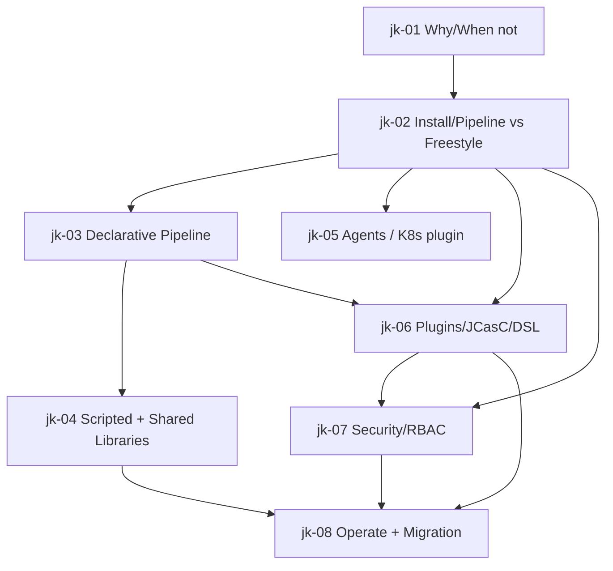

# Jenkins — Roadmap detallado (contexto empresarial)

IDs estables: `jk-<NN>-<slug>`.

Duración orientativa total: **15–25 h**. El curso **más corto** del programa, por diseño: cubre lo necesario para operar entornos reales y planificar migración, no para "aprender Jenkins desde cero como stack moderno".

---

## Nivel 1 — Fundamentos

### jk-01-why-still-jenkins-and-when-not

- **Nivel:** fundamentos
- **Objetivo:** entender por qué Jenkins sigue siendo relevante y cuándo NO elegirlo hoy.
- **Prerrequisitos:** curso **github-actions** (necesario para comparar modelos).
- **Temas:** historia (Hudson → Jenkins fork 2011); modelo mental (controller + agents, pipeline-as-code vs freestyle legacy); por qué muchas enterprises siguen con Jenkins (brownfield, air-gapped, flexibilidad, enterprise support de CloudBees); comparación brutal con GHA/GitLab/Argo Workflows/Tekton (UX, mantenimiento, seguridad, ecosystem); **cuándo *no* elegir Jenkins para un proyecto nuevo** (greenfield cloud-native, SaaS DX esperada, equipo pequeño, workloads K8s-native).
- **Fundamentos internos:** Jenkins "gana por inercia", no por mérito técnico 2026; evaluar cambio de tooling es evaluar costo de migración vs costo de mantenerlo.
- **Competencias:** justificar o rechazar Jenkins con criterio, no por reflejo.
- **Ejemplos:** `01-jenkins-vs-gha-vs-gitlab-vs-argo`, `02-brownfield-vs-greenfield-decision`.
- **Actividades:** `01-when-not-jenkins-adr`, `02-jenkins-cost-estimate` (análisis).
- **Entregables:** ADR "Jenkins sí/no" para un escenario dado + estimación de costo de mantenimiento vs migración.
- **Evaluación:** defender la elección contra ambos extremos ("todo a Jenkins" vs "fuera Jenkins ya").
- **Duración:** 2 h.

### jk-02-install-ui-freestyle-vs-pipeline

- **Nivel:** fundamentos
- **Objetivo:** instalar Jenkins y hacer el primer job de las dos formas (y entender por qué solo una vale hoy).
- **Prerrequisitos:** `jk-01`, curso **docker**.
- **Temas:** instalación con imagen oficial Docker (`jenkins/jenkins:lts`); setup wizard inicial, admin user, plugins recomendados; UI tour (Dashboard, Manage Jenkins, Credentials, People, Build Queue); **Freestyle jobs** (configuración por UI — mala práctica hoy pero *la mayoría de instalaciones legacy están llenas*); **Pipeline jobs** (Jenkinsfile versionado en Git — único enfoque recomendado); **folders** y **views**; conceptos de **build artifact**, **workspace**, **retention**.
- **Fundamentos internos:** las configuraciones de freestyle viven en `config.xml` dentro del `$JENKINS_HOME` del controller — no versionadas por default; esto es la fuente principal de "no sé qué hace ese job"; Pipeline-as-code soluciona esto moviendo la lógica a un `Jenkinsfile` en el repo.
- **Competencias:** levantar Jenkins; hacer un hello-world freestyle y pipeline; identificar freestyle como anti-patrón.
- **Ejemplos:** `01-jenkins-docker-up`, `02-freestyle-hello-world`, `03-pipeline-hello-world`.
- **Actividades:** `01-first-pipeline-job`, `02-explore-jenkins-home` (independiente).
- **Entregables:** Jenkins local + 1 pipeline job funcional.
- **Evaluación:** justificar por qué cada nuevo job en 2026 debe ser pipeline, no freestyle.
- **Duración:** 2 h.

---

## Nivel 2 — Intermedio

### jk-03-declarative-pipeline-jenkinsfile

- **Nivel:** intermedio
- **Objetivo:** escribir pipelines declarative versionados.
- **Prerrequisitos:** `jk-02`.
- **Temas:** sintaxis **Declarative Pipeline**: `pipeline { agent, environment, parameters, options, triggers, stages, post }`; `stages` → `stage { steps }`; **agents** por pipeline o por stage (`agent any`, `agent none`, `agent { docker { image '...' } }`, `agent { kubernetes { ... } }`); **steps**: `sh`, `bat`, `script`, `withCredentials`, `withEnv`, `dir`, `stash/unstash`, `archiveArtifacts`, `junit`, `publishHTML`; **post**: `always`, `success`, `failure`, `unstable`, `changed`, `fixed`; **when** conditionals; **parallel stages**; `input` para gates manuales; credentials binding (`credentials('id')` vs `withCredentials`); linting con `pipeline-model-definition` o `jenkins-cli declarative-linter`.
- **Fundamentos internos:** Declarative es Groovy pero con estructura validada (DSL restringido); permite editar seguro, chequear sintaxis estática, mantenibilidad real; es el "modo recomendado" oficial.
- **Competencias:** replicar un pipeline moderno (lint/test/build/push/deploy) en Jenkinsfile declarative.
- **Ejemplos:** `01-declarative-skeleton`, `02-parallel-stages`, `03-withcredentials-vault`.
- **Actividades:** `01-port-gha-workflow-to-jenkinsfile`, `02-add-manual-gate` (independiente).
- **Entregables:** Jenkinsfile del capstone equivalente al workflow GHA.
- **Evaluación:** diagnosticar un Jenkinsfile mal estructurado y proponer refactor.
- **Duración:** 3 h.

### jk-04-scripted-pipeline-and-shared-libraries

- **Nivel:** intermedio
- **Objetivo:** entender Scripted Pipeline y aprovechar Shared Libraries (donde vive el 80% del poder legacy).
- **Prerrequisitos:** `jk-03`.
- **Temas:** **Scripted Pipeline** (Groovy puro con `node { ... }`): más flexible, menos chequeos, común en legacy; cuándo escapar a `script {}` dentro de declarative (último recurso); **Shared Libraries**: `vars/*.groovy` (steps globales), `src/*.groovy` (clases Groovy), `resources/*` (archivos); configuración global (`Manage Jenkins > System > Global Pipeline Libraries`); carga con `@Library('name@version')`; **versionado por tag/branch** y pinning; testing de libraries (JenkinsPipelineUnit framework); patrones típicos ("`buildAndDeploy()`" como step que encapsula pipeline estándar de la org); gobernanza (CODEOWNERS para la library, PR obligatorio, review).
- **Fundamentos internos:** en instalaciones Jenkins maduras, el "código de pipeline" vive en la library y los Jenkinsfiles son 10 líneas que la invocan; esto es el equivalente conceptual de "reusable workflows / CI/CD Components / composite actions".
- **Competencias:** leer una Shared Library ajena; crear una propia versionada.
- **Ejemplos:** `01-scripted-vs-declarative`, `02-shared-library-skeleton`, `03-pin-library-version`.
- **Actividades:** `01-extract-shared-library`, `02-write-standard-build-step` (independiente).
- **Entregables:** Shared Library propia con step `standardBuild()` versionado + Jenkinsfile que la consume.
- **Evaluación:** criticar una library sin versionado + sin tests y proponer plan de hardening.
- **Duración:** 4 h.

### jk-05-agents-distributed-builds-kubernetes-plugin

- **Nivel:** intermedio
- **Objetivo:** operar builds distribuidos con agents efímeros, especialmente en K8s.
- **Prerrequisitos:** `jk-02`, curso **kubernetes** ≥ Nivel 2.
- **Temas:** tipos de agent: **permanent** (SSH, inbound JNLP), **ephemeral** (Docker por build), **cloud** (EC2/GCE/Azure plugins); **nodes**, **labels**, **executors**; **Kubernetes plugin**: cada build spawnea un Pod con uno o más contenedores (uno `jnlp` que habla con el controller + los que necesite tu build), configurable con `agent { kubernetes { yaml '...' } }`; `podTemplate` global vs inline; isolation y reproducibilidad; **comparación con ARC de GitHub Actions** (modelos equivalentes); **cuándo preferir ephemeral** (siempre que se pueda — evita contamination); problemas comunes (controller sobrecargado, agent timeouts, pod pending por falta de capacity).
- **Fundamentos internos:** cada build en un agent efímero es un entorno limpio — elimina el bug "funcionó ayer, no hoy" por contamination; es el patrón recomendado para prod.
- **Competencias:** levantar Jenkins con Kubernetes plugin en kind; ejecutar un pipeline con agent efímero.
- **Ejemplos:** `01-k8s-plugin-podtemplate`, `02-multi-container-agent`, `03-ephemeral-vs-permanent-tradeoffs`.
- **Actividades:** `01-run-pipeline-on-k8s-agent`, `02-arc-vs-jenkins-k8s-adr` (análisis).
- **Entregables:** Jenkins en kind + pipeline del capstone usando agent K8s.
- **Evaluación:** justificar ephemeral agents en términos de seguridad y reproducibilidad.
- **Duración:** 3 h.

---

## Nivel 3 — Avanzado

### jk-06-plugins-jcasc-job-dsl-blue-ocean

- **Nivel:** avanzado
- **Objetivo:** gestionar config como código y mantener plugins con disciplina.
- **Prerrequisitos:** `jk-02`, `jk-03`.
- **Temas:** **Plugin ecosystem** (~1800 plugins; `plugin-manager` CLI, `install-plugins.sh`); pinning versions y update strategy; **Jenkins Configuration as Code (JCasC)**: `jenkins.yaml` que describe toda la config del controller (security, credentials, nodes, clouds, jobs seeds, tools) — "**config as code** o jamás reproducir Jenkins con precisión"; **Job DSL** plugin (crear jobs desde Groovy — útil con "seed job" que genera N jobs); **Blue Ocean** (UI alternativa más moderna, pero en mantenimiento low-key; perdió momentum); **Jenkins Operator for Kubernetes** (CRD-based deploy; opción avanzada); backup del `JENKINS_HOME` con Velero o similar.
- **Fundamentos internos:** sin JCasC, un Jenkins es "snowflake" imposible de reproducir; con JCasC, el controller se trata como cualquier otra app (Git, PR, CI, deploy); seed jobs + Job DSL permiten mantener jobs legacy mientras se migran.
- **Competencias:** bootstrappear Jenkins reproducible desde cero con JCasC.
- **Ejemplos:** `01-jcasc-minimal-config`, `02-seed-job-with-dsl`, `03-plugin-pinning-strategy`.
- **Actividades:** `01-reproduce-your-jenkins-with-jcasc`, `02-plugin-audit` (independiente).
- **Entregables:** Jenkins reproducible desde `jenkins.yaml` + plugin audit report.
- **Evaluación:** criticar una instalación snowflake y proponer plan JCasC.
- **Duración:** 3 h.

### jk-07-security-rbac-credentials-and-script-approval

- **Nivel:** avanzado
- **Objetivo:** endurecer Jenkins — crítico por su historial de CVEs.
- **Prerrequisitos:** `jk-02`, `jk-06`, curso **devsecops** ≥ Nivel 2.
- **Temas:** **autenticación** (Jenkins DB local, LDAP, SAML, OAuth, OIDC via plugin); **RBAC con Role-based Authorization Strategy plugin** (global + project roles; granularidad por job/folder); **matrix-based security**; **credentials store** (secret text, username/pwd, SSH key, cert, file; scopes global/folder/system); **credentials binding** en pipelines (`withCredentials { ... }` ocultando valores en logs); **Groovy sandbox** y **in-process script approval** (admin aprueba cada API Groovy nueva — fricción real); **CSRF protection** siempre on; **agents to controller access control**; **anonymous read deshabilitado** siempre; integración con **Vault** (plugin oficial) o **AWS Secrets Manager** / **Azure Key Vault**; **secret rotation**; **CVE lifecycle** de Jenkins y de plugins (muy activo — habilitar auto-notificaciones); **security advisories** de la fundación.
- **Fundamentos internos:** la mayoría de CVEs Jenkins son de plugins; la primera medida es *reducir* plugins instalados; la segunda es pinnear y actualizar con disciplina.
- **Competencias:** aplicar hardening baseline; auditar instalación legacy.
- **Ejemplos:** `01-rbac-with-role-strategy`, `02-vault-plugin-integration`, `03-plugin-cve-audit`.
- **Actividades:** `01-harden-fresh-jenkins`, `02-audit-and-remediate-legacy` (independiente).
- **Entregables:** Jenkins endurecido con RBAC + Vault + reporte de auditoría.
- **Evaluación:** priorizar hallazgos de un audit real por severidad y esfuerzo.
- **Duración:** 4 h.

---

## Nivel 4 — Producción empresarial

### jk-08-operate-at-scale-and-migration-to-modern

- **Nivel:** producción
- **Objetivo:** operar Jenkins en prod y planificar/ejecutar migración a herramientas modernas.
- **Prerrequisitos:** `jk-04`, `jk-06`, `jk-07`, curso **github-actions** o **gitlab-cicd**, curso **argocd-gitops**.
- **Temas:** operación: **HA** (controller single-point-of-failure por diseño; CloudBees CI ofrece HA; alternativa: diseño activo-pasivo manual con backup + restore rápido); **backups** del `JENKINS_HOME` (Velero si corre en K8s); **upgrade cadence** (LTS cada ~12 semanas); **capacity planning** (agents = carga real, controller = coordinación); **monitoring** (metrics plugin + Prometheus exporter, alertas en build queue depth, controller CPU/heap).

**Migration path** (foco del módulo):
- Inventario de pipelines (incluyendo freestyle "fantasma"); dependencias de plugins; secrets; artefactos.
- Clasificación: migrar / consolidar / retirar.
- Target: **GHA** (si repos en GitHub), **GitLab CI** (si GitLab), **Argo Workflows / Tekton** (si K8s-native).
- **Dual-run** por N semanas: mismo pipeline en Jenkins + target.
- Reemplazar shared library por reusable workflow / CI/CD Component / Argo Template.
- Reemplazar `withCredentials` por **OIDC federation** al cloud.
- Retirar Jenkins solo cuando todos los pipelines estén migrados + con el equipo cómodo + con backup histórico de ejecuciones archivado.
- ADR final con criterios de éxito, timeline, riesgos, plan de rollback.

- **Fundamentos internos:** una migración exitosa reconoce que Jenkins es inercia operativa, no deuda de código aislada; el riesgo real es parar un pipeline crítico sin saberlo.
- **Competencias:** diseñar y ejecutar migración; operar Jenkins mientras tanto.
- **Ejemplos:** `01-jenkins-ha-pattern`, `02-dual-run-jenkins-and-gha`, `03-migration-plan-template`.
- **Actividades:** `01-migration-adr`, `02-dual-run-one-pipeline` (independiente, mini-proyecto).
- **Entregables:** ADR de migración + 1 pipeline migrado y en dual-run.
- **Evaluación:** defender el plan contra "si funciona no lo toques" y contra "migra todo ya".
- **Duración:** 4 h.

---

## Dependencias entre módulos

## Checklist de verificación requerida en Fase 4

- Versión LTS actual de Jenkins y notas de cambios breaking recientes.
- Estado de **Blue Ocean** (mantenimiento vs desarrollo).
- Compatibilidad JCasC con las versiones recientes (los schemas evolucionan).
- Advisories vigentes de Jenkins y plugins populares (hay feed RSS oficial).
- Comparación vigente **Kubernetes plugin** vs **Argo Workflows** / **Tekton** para workloads K8s-native.
- Estado de **CloudBees CI** y **Jenkins X**.
- Documentación vigente de **shared libraries** y **JenkinsPipelineUnit** para testing.
