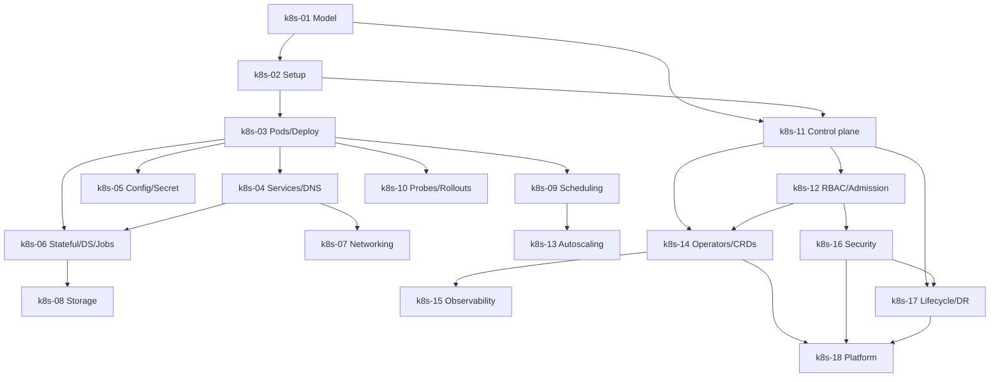

# Kubernetes — Roadmap detallado

IDs estables: `k8s-<NN>-<slug>`.

Duración orientativa total: **80–120 h** (uno de los cursos más extensos del programa).

---

## Nivel 1 — Fundamentos

### k8s-01-mental-model-and-architecture

- **Nivel:** fundamentos
- **Objetivo:** entender el modelo mental declarativo y la arquitectura antes de ejecutar nada.
- **Prerrequisitos:** curso **docker** completo.
- **Temas:** por qué orquestar (vs correr `docker run`); modelo declarativo (`spec` vs `status`); **reconciliation loop**; API server + etcd como fuente de verdad; componentes del control plane y del nodo; qué es un Pod *conceptualmente* (unidad de scheduling, no "un contenedor envuelto"); modos de distribución: self-hosted vs managed (EKS/GKE/AKS); CNCF conformance.
- **Fundamentos internos:** cómo un controller lee `spec` + observa realidad + emite acciones a convergir; por qué el API server es la única puerta a etcd; por qué el "cluster" es un API, no una máquina.
- **Competencias:** explicar la arquitectura sin consultar docs.
- **Ejemplos:** `01-draw-control-plane`, `02-spec-vs-status-walkthrough`.
- **Actividades:** `01-when-is-k8s-overkill` (análisis), `02-architecture-diagram`.
- **Entregables:** diagrama anotado + ADR corto "cuándo K8s no".
- **Evaluación:** explicar la reconciliación con un controller ejemplar (Deployment → ReplicaSet → Pods).
- **Duración:** 3 h.

### k8s-02-setup-local-and-kubectl

- **Nivel:** fundamentos
- **Objetivo:** levantar cluster local y manejar `kubectl` con precisión.
- **Prerrequisitos:** `k8s-01`.
- **Temas:** opciones locales (**kind**, **k3d**, minikube; recomendación: kind o k3d por su rapidez y realismo); instalar `kubectl`, `kind`/`k3d`, `kubectx`/`kubens`; **kubeconfig** (clusters/users/contexts); namespaces; sintaxis de `kubectl` (`get/describe/apply/delete/logs/exec/port-forward/explain`); server-side vs client-side apply; `-o yaml`, `-o json`, `-o jsonpath`, `-o custom-columns`.
- **Fundamentos internos:** cómo `kubectl` autentica (certs/tokens), elige endpoint, serializa objetos; `kubectl explain` como el "man" del API; por qué `apply` es idempotente y preserva campos no gestionados.
- **Competencias:** operar un cluster con disciplina de contextos y namespaces.
- **Ejemplos:** `01-kind-cluster`, `02-kubectl-common-operations`, `03-explain-as-api-docs`.
- **Actividades:** `01-create-local-cluster`, `02-kubeconfig-two-contexts` (independiente).
- **Entregables:** cluster local funcional + kubeconfig con 2+ contextos.
- **Evaluación:** auditar la diferencia entre `apply`, `create`, `replace`.
- **Duración:** 3 h.

### k8s-03-pods-deployments-replicasets

- **Nivel:** fundamentos
- **Objetivo:** modelar workloads sin estado con Deployments y entender qué es realmente un Pod.
- **Prerrequisitos:** `k8s-02`.
- **Temas:** Pod spec (containers, initContainers, **sidecar containers nativos** vía `restartPolicy: Always` en initContainer, volumes, nodeSelector, `restartPolicy`); por qué los Pods no se crean "a mano" en producción; ReplicaSet; **Deployment** (strategy `RollingUpdate` vs `Recreate`, `maxSurge`, `maxUnavailable`, `revisionHistoryLimit`); `kubectl rollout` (status, history, undo, pause/resume); labels y selectors como contrato.
- **Fundamentos internos:** un Deployment gestiona ReplicaSets; una actualización crea un nuevo RS y escala viejo→nuevo; labels son la "pegamento" que une Deployment, ReplicaSet, Pods y Services.
- **Competencias:** desplegar y actualizar un servicio sin downtime; interpretar el estado de un rollout.
- **Ejemplos:** `01-pod-vs-deployment`, `02-rolling-update-walkthrough`, `03-undo-with-rollout`.
- **Actividades:** `01-deploy-fastapi`, `02-rollout-and-rollback` (independiente).
- **Entregables:** Deployment del capstone con rolling update verificado.
- **Evaluación:** explicar por qué modificar un Pod directo no es "la forma K8s".
- **Duración:** 4 h.

### k8s-04-services-and-dns

- **Nivel:** fundamentos
- **Objetivo:** exponer y descubrir workloads dentro del cluster.
- **Prerrequisitos:** `k8s-03`.
- **Temas:** Service tipos **ClusterIP**, **NodePort**, **LoadBalancer**, **ExternalName**, **Headless** (`clusterIP: None`); Endpoints / **EndpointSlices**; **CoreDNS** y nombres (`svc.namespace.svc.cluster.local`); `kube-proxy` modos (iptables, IPVS, eBPF vía Cilium); session affinity; `externalTrafficPolicy` (Cluster vs Local) y por qué importa para preservar IP de cliente.
- **Fundamentos internos:** un Service es un VIP virtual + reglas `kube-proxy` que balancean a los Pods seleccionados por labels; Headless omite el VIP y expone los Pods vía DNS A-records (necesario para StatefulSets); EndpointSlices escalan mejor que Endpoints.
- **Competencias:** elegir el tipo correcto; depurar "mi Service no enruta".
- **Ejemplos:** `01-clusterip-and-nodeport`, `02-headless-stateful`, `03-coredns-resolution`.
- **Actividades:** `01-expose-api-via-clusterip`, `02-debug-no-endpoints` (independiente).
- **Entregables:** app accesible por nombre DNS dentro del cluster.
- **Evaluación:** explicar qué hay detrás de "mi Service no responde" en 3 escenarios dados.
- **Duración:** 4 h.

### k8s-05-config-secrets-env-volumes-basics

- **Nivel:** fundamentos
- **Objetivo:** separar configuración y secretos del código y del container image.
- **Prerrequisitos:** `k8s-03`.
- **Temas:** **ConfigMap** (literales, from-file, from-env-file); **Secret** (opaque, docker-registry, tls, sa-token); **cómo se consumen** (envFrom/env, volumeMounts, projected volumes); **Secrets NO cifrados por default en etcd** (base64 ≠ encrypted) → encryption at rest; integración con secret managers externos (External Secrets Operator, Secrets Store CSI Driver, Vault Agent Injector); volumes básicos (emptyDir, hostPath — y por qué evitar hostPath), downwardAPI.
- **Fundamentos internos:** los Secret-as-env-vars pueden filtrarse por `env` dumps o CrashLoopBackOff logs; preferir volumes montados; projected volume agrupa varias fuentes atómicamente.
- **Competencias:** inyectar config y secretos; auditar que no estén en logs ni en env expuesto.
- **Ejemplos:** `01-configmap-env-and-mount`, `02-secret-as-file-vs-env`, `03-external-secrets-operator-intro`.
- **Actividades:** `01-config-and-secret-for-capstone`, `02-why-base64-is-not-encryption` (análisis).
- **Entregables:** app del capstone leyendo config desde ConfigMap y DB password desde Secret.
- **Evaluación:** explicar los riesgos de Secrets como env vars.
- **Duración:** 3 h.

---

## Nivel 2 — Intermedio

### k8s-06-workloads-deep-statefulset-daemonset-jobs

- **Nivel:** intermedio
- **Objetivo:** elegir el workload controller correcto por tipo de carga.
- **Prerrequisitos:** `k8s-03`, `k8s-04`.
- **Temas:** **StatefulSet** (identidad estable, orden de inicio/parada, PVC templates, headless service obligatorio); **DaemonSet** (uno por nodo, útil para agents: logs, networking, nodo-exporters); **Job** (one-shot con paralelismo), **CronJob** (schedule, `concurrencyPolicy`, `startingDeadlineSeconds`); indexed Jobs; patrones comunes (leader election, worker queue); por qué StatefulSet no es un DBA.
- **Fundamentos internos:** StatefulSets dan `<name>-0`, `<name>-1`, DNS predecible, PVC `data-<name>-0`; se escalan de forma ordenada; eliminarlos no borra PVCs (seguridad); CronJob calcula ventanas en UTC.
- **Competencias:** elegir controller correcto; operar un StatefulSet (recovery, scale) con criterio.
- **Ejemplos:** `01-postgres-via-statefulset`, `02-fluent-bit-daemonset`, `03-cronjob-cleanup`.
- **Actividades:** `01-stateful-postgres-with-pvc`, `02-cronjob-flaky-fix` (independiente).
- **Entregables:** Postgres funcional via StatefulSet con PVCs persistentes.
- **Evaluación:** justificar operar o no operar una DB en K8s para un escenario dado.
- **Duración:** 5 h.

### k8s-07-networking-cni-netpol-ingress-gateway-api

- **Nivel:** intermedio
- **Objetivo:** controlar el tráfico este-oeste y norte-sur con primitivas correctas.
- **Prerrequisitos:** `k8s-04`, T-3 Networking.
- **Temas:** modelo de red K8s (todo Pod puede alcanzar a todo Pod sin NAT dentro del cluster — por default); **CNI plugins** (Calico, **Cilium** con eBPF, Flannel, AWS VPC CNI, GKE Dataplane v2); **NetworkPolicy** (ingress/egress, podSelector/namespaceSelector/ipBlock, patrón **default-deny**); **Ingress** vs **Gateway API** (sucesor, roles separados: GatewayClass/Gateway/HTTPRoute); controllers populares (ingress-nginx, Traefik, Contour, Istio Gateway, Envoy Gateway); mTLS (introducción, mesh en Nivel 4); DNS avanzado y CoreDNS plugins.
- **Fundamentos internos:** NetworkPolicy es *aditiva* (si no hay policy → todo permitido; si hay una → solo lo listado); Gateway API separa roles (platform team = Gateway; app team = HTTPRoute); CNIs eBPF (Cilium) pueden reemplazar `kube-proxy`.
- **Competencias:** aplicar default-deny + reglas explícitas; migrar Ingress → Gateway API.
- **Ejemplos:** `01-default-deny-netpol`, `02-ingress-nginx-tls`, `03-gateway-api-http-route`.
- **Actividades:** `01-isolate-ns-with-netpol`, `02-publish-with-gateway-api` (independiente).
- **Entregables:** cluster con default-deny y app publicada vía Gateway API con TLS.
- **Evaluación:** diseñar política de red para un namespace con app + Postgres + cache.
- **Duración:** 6 h.

### k8s-08-storage-pv-pvc-storageclass-csi

- **Nivel:** intermedio
- **Objetivo:** persistir estado correctamente.
- **Prerrequisitos:** `k8s-06`.
- **Temas:** **PersistentVolume (PV)** y **PersistentVolumeClaim (PVC)**; **StorageClass** y provisioning dinámico; **CSI drivers** (AWS EBS, GCP PD, Azure Disk, longhorn, local-path); access modes (RWO, RWX, ROX, RWOP); `volumeBindingMode: WaitForFirstConsumer` (crítico para evitar PV en AZ equivocada); reclaim policies (Delete, Retain); **VolumeSnapshot** y **VolumeSnapshotClass**; expansión online; RWX con EFS/Filestore y cuándo tiene sentido.
- **Fundamentos internos:** PVC = "pedido" tipado; PV = "oferta" (dinámica o estática); StorageClass intermedia; `WaitForFirstConsumer` deja al scheduler decidir primero el nodo y luego aprovisionar en su AZ.
- **Competencias:** diseñar storage por workload; snapshots y restore.
- **Ejemplos:** `01-pvc-dynamic-ebs`, `02-waitforfirstconsumer-vs-immediate`, `03-volumesnapshot-and-restore`.
- **Actividades:** `01-persist-postgres-with-snapshot`, `02-fix-pv-wrong-az` (independiente).
- **Entregables:** Postgres con PVC + snapshot programado + restore demostrado.
- **Evaluación:** explicar `volumeBindingMode` y por qué `Immediate` genera errores en multi-AZ.
- **Duración:** 4 h.

### k8s-09-scheduling-resources-affinity-taints-pdb

- **Nivel:** intermedio
- **Objetivo:** controlar dónde y bajo qué recursos corren los Pods.
- **Prerrequisitos:** `k8s-03`.
- **Temas:** **requests y limits** (CPU, memoria, ephemeral storage); **QoS classes** (Guaranteed, Burstable, BestEffort); **OOMKills** vs **CPU throttling**; `nodeSelector`; **affinity/anti-affinity** (node, pod, podAnti); **taints/tolerations**; **PriorityClass** y preemption; **PodDisruptionBudget (PDB)**; `topologySpreadConstraints`; nuevos: **ResourceClaims** (DRA) para GPUs.
- **Fundamentos internos:** CPU limit = throttle (no kill); memory limit excedido = OOMKill; requests informan al scheduler; Guaranteed = requests == limits en todos los contenedores; PDBs protegen durante disruption *voluntaria* (drains, upgrades).
- **Competencias:** diseñar requests/limits realistas; anti-afinidad por AZ; PDBs para apps críticas.
- **Ejemplos:** `01-requests-limits-and-qos`, `02-anti-affinity-across-zones`, `03-pdb-minavailable`.
- **Actividades:** `01-tune-resources-and-measure`, `02-protect-rollout-with-pdb` (independiente).
- **Entregables:** app crítica con requests, PDB y anti-afinidad por zona.
- **Evaluación:** diagnosticar OOMKill vs throttling por síntomas.
- **Duración:** 4 h.

### k8s-10-health-probes-lifecycle-and-rollouts

- **Nivel:** intermedio
- **Objetivo:** señalar correctamente el ciclo de vida para rollouts seguros.
- **Prerrequisitos:** `k8s-03`.
- **Temas:** **startupProbe**, **livenessProbe**, **readinessProbe** (HTTP/TCP/exec/gRPC); por qué `liveness` **mal usada** causa restarts en cascada; `readinessGates`; `terminationGracePeriodSeconds`; `preStop` hook y draining; `SIGTERM` → esperar → `SIGKILL`; rolling update seguro (`maxSurge`, `maxUnavailable`); estrategias blue/green y canary (referencia a Argo Rollouts/Flagger, cubiertos en curso Argo); interacción con PDB.
- **Fundamentos internos:** `readiness` quita el Pod del Service (sin matar); `liveness` lo mata; `startup` cubre arranques lentos sin ensuciar `liveness`; sin `preStop`, los LBs externos pueden mandar tráfico mientras el Pod ya murió.
- **Competencias:** instrumentar probes correctas; sin downtime en rollouts.
- **Ejemplos:** `01-three-probes`, `02-prestop-drain`, `03-rolling-update-tuning`.
- **Actividades:** `01-fix-cascading-restarts`, `02-zero-downtime-deploy` (independiente).
- **Entregables:** rollout con probes y preStop demostrados en cluster local.
- **Evaluación:** explicar por qué `liveness` como `GET /` contra una ruta que depende de DB es un anti-patrón.
- **Duración:** 4 h.

---

## Nivel 3 — Avanzado

### k8s-11-control-plane-internals

- **Nivel:** avanzado
- **Objetivo:** mirar el control plane por dentro para depurar y razonar sobre fallos.
- **Prerrequisitos:** `k8s-01`, `k8s-02`.
- **Temas:** **kube-apiserver** (admission → validation → storage); **etcd** (Raft, snapshotting, compactación, performance); **kube-scheduler** (filtros, scoring, extenders, scheduling plugins framework); **kube-controller-manager** (reloj de reconciliación por controller); **cloud-controller-manager**; **kubelet** (pod lifecycle, cadvisor, image GC); **kube-proxy** (iptables/IPVS/eBPF); **CRI/CNI/CSI** interfaces; **leader election**; eventos (`kubectl events`); auditoría (`audit.k8s.io/v1`).
- **Fundamentos internos:** `kubectl get` lee del apiserver que lee de etcd; mutating admission puede modificar objetos; validating admission puede rechazarlos; `audit-log` guarda la secuencia de requests → útil para forense.
- **Competencias:** depurar incidentes buscando señales en los lugares correctos.
- **Ejemplos:** `01-apiserver-request-tracing`, `02-etcdctl-snapshot-restore`, `03-scheduler-plugin-skeleton`.
- **Actividades:** `01-why-is-pod-pending` (debug independiente), `02-etcd-backup-and-restore`.
- **Entregables:** writeup de un fallo diagnosticado + backup/restore de etcd en cluster local.
- **Evaluación:** explicar la cadena de un `kubectl apply` desde el cliente hasta el estado en etcd.
- **Duración:** 6 h.

### k8s-12-rbac-serviceaccounts-admission-policy

- **Nivel:** avanzado
- **Objetivo:** autorizar y validar/mutar objetos con criterio y policy-as-code.
- **Prerrequisitos:** `k8s-11`.
- **Temas:** **ServiceAccount** y token projection; **RBAC** (Role, RoleBinding, ClusterRole, ClusterRoleBinding, aggregation); patrón de **least privilege**; impersonation; **admission controllers** built-in (NamespaceLifecycle, ResourceQuota, PodSecurity, etc.); **MutatingAdmissionWebhook** y **ValidatingAdmissionWebhook**; **ValidatingAdmissionPolicy (CEL en el API server)**; **Pod Security Admission** (reemplazo de PodSecurityPolicy) con labels `enforce/audit/warn=baseline|restricted`; **OPA/Gatekeeper** (ConstraintTemplate + Constraint); **Kyverno** (declarativo, mutate/validate/generate, verifyImages con cosign).
- **Fundamentos internos:** una request pasa por *authn → authz(RBAC) → mutating → validating → persist*; CEL permite políticas sin webhook externo; Kyverno "habla YAML" mientras Gatekeeper "habla Rego".
- **Competencias:** RBAC mínimo por workload; policies obligatorias (no-root, sin privileged, imágenes firmadas, labels requeridos).
- **Ejemplos:** `01-rbac-least-privilege`, `02-psa-restricted-namespace`, `03-kyverno-require-signed-image`, `04-validatingadmissionpolicy-cel`.
- **Actividades:** `01-write-rbac-for-ci-user`, `02-enforce-signed-images-cluster-wide` (independiente).
- **Entregables:** cluster con Pod Security `restricted` + Kyverno rules obligatorias.
- **Evaluación:** auditar RBAC excesivo (`cluster-admin` para apps) y proponer corrección.
- **Duración:** 6 h.

### k8s-13-autoscaling-hpa-vpa-ca-karpenter-keda

- **Nivel:** avanzado
- **Objetivo:** escalar workloads y nodos con criterio.
- **Prerrequisitos:** `k8s-09`.
- **Temas:** **metrics-server** (resource metrics); **HPA** (CPU, memoria, custom/external metrics via Prometheus Adapter/KEDA); **VPA** (recomendación vs actualización, modos Off/Initial/Recreate/Auto); **Cluster Autoscaler**; **Karpenter** (scheduler-driven provisioner, consolidación, varias AMIs, muy eficiente); **KEDA** (event-driven autoscaling: colas, Pub/Sub, Kafka, Prometheus); scaling to zero con KEDA; interacción HPA↔VPA (no coincidir en la misma métrica); predictive scaling.
- **Fundamentos internos:** HPA observa métrica y ajusta `replicas`; VPA ajusta `requests/limits`; CA/Karpenter responden a *Pods Pending* (CA) o a scheduling simulation (Karpenter).
- **Competencias:** definir autoscaling realista; evitar oscilaciones.
- **Ejemplos:** `01-hpa-on-cpu-and-custom-metric`, `02-karpenter-provisioner`, `03-keda-scale-from-queue`.
- **Actividades:** `01-hpa-with-prometheus-adapter`, `02-karpenter-vs-cas-adr` (independiente).
- **Entregables:** HPA + Karpenter activos y verificables en EKS/GKE.
- **Evaluación:** diseñar autoscaling para un workload con tráfico diurno.
- **Duración:** 5 h.

### k8s-14-operators-and-crds

- **Nivel:** avanzado
- **Objetivo:** extender el API con CRDs y escribir un controller mínimo.
- **Prerrequisitos:** `k8s-11`, `k8s-12`.
- **Temas:** **CRD** y versionado (`v1alpha1 → v1beta1 → v1`); conversion webhooks; **operator pattern** (controller + domain knowledge); frameworks: **controller-runtime**, **Operator SDK**, **Kubebuilder**, **Metacontroller**; estado del arte en operadores famosos (Postgres: CloudNativePG/Zalando, Kafka: Strimzi, cert-manager, external-secrets, Argo CD/Workflows); diseño de API (sub-resources `status`, printer columns); testing con `envtest`.
- **Fundamentos internos:** un operador *es* un controller leyendo CRs y produciendo recursos nativos; `status` es sub-resource para evitar conflictos en escritura; versionado y conversion permiten evolucionar APIs sin romper usuarios.
- **Competencias:** diseñar un CRD + controller mínimo; evaluar operadores de terceros.
- **Ejemplos:** `01-crd-echo-controller`, `02-cert-manager-overview`, `03-cnpg-postgres-operator`.
- **Actividades:** `01-write-echo-operator-with-kubebuilder` (mini-proyecto educativo), `02-evaluate-postgres-operators` (independiente).
- **Entregables:** operador "echo" funcional + evaluación comparada de operadores de Postgres.
- **Evaluación:** criterios para adoptar o rechazar un operador de terceros.
- **Duración:** 7 h.

---

## Nivel 4 — Producción empresarial

### k8s-15-observability-in-k8s

- **Nivel:** producción
- **Objetivo:** instrumentar observabilidad nativa K8s con stack OSS.
- **Prerrequisitos:** `k8s-14`.
- **Temas:** **metrics-server** (resource metrics API); **kube-state-metrics**; **Prometheus Operator** (ServiceMonitor, PodMonitor, PrometheusRule, Alertmanager); **node-exporter**; **cAdvisor** integrado en kubelet; dashboards (Grafana + mixins oficiales); **Loki** (logs) y **Promtail/Vector/OTel Collector**; **Tempo**/**Jaeger** (traces); **OpenTelemetry** Operator; eventos como señales (K8s Events, EventExporter); introducción a eBPF-based (Pixie, Hubble) para profiling y network observability.
- **Fundamentos internos:** `ServiceMonitor` es un CR del Operator que configura automáticamente Prometheus para scrapear Services anotados; mixins oficiales (kubernetes-mixin) traen alertas y dashboards probados.
- **Competencias:** desplegar Prometheus Operator; alertas útiles sin ruido; integrar OTel.
- **Ejemplos:** `01-prometheus-operator-stack`, `02-servicemonitor-for-fastapi`, `03-otel-operator-with-tempo`.
- **Actividades:** `01-full-oss-observability`, `02-tune-alerts-signal-vs-noise` (independiente).
- **Entregables:** cluster con Prometheus Operator + Grafana + Loki + Tempo + OTel + alertas sanas.
- **Evaluación:** diseñar runbooks disparables desde las alertas.
- **Duración:** 6 h.

### k8s-16-security-hardening-and-supply-chain

- **Nivel:** producción
- **Objetivo:** cerrar la superficie del cluster y de los workloads.
- **Prerrequisitos:** `k8s-12`.
- **Temas:** **Pod Security Standards** `restricted` por default; `securityContext` por Pod/container (runAsNonRoot, runAsUser, allowPrivilegeEscalation, capabilities drop ALL, readOnlyRootFilesystem); **seccomp** (`RuntimeDefault`); **AppArmor**; **gVisor**/**Kata** como alternativas de runtime; evitar `privileged`, `hostNetwork`, `hostPID`, `hostPath`; **image policy**: firma con cosign + verificación en admission (Kyverno/sigstore policy-controller); escaneo con Trivy en pipeline y en cluster (Trivy Operator); **runtime security** con **Falco** (reglas eBPF); **CIS Kubernetes Benchmark** y herramientas (`kube-bench`, `kube-hunter`); encryption at rest de etcd; audit logging; disable anonymous auth; TLS entre componentes; evitar `cluster-admin` fuera de bootstrap.
- **Fundamentos internos:** Pod Security Admission aplica el label del namespace a cada Pod admitido; Falco detecta eventos sospechosos a nivel syscall vía eBPF; firma de imágenes + verificación cierra la cadena Dockerfile → publish → admit.
- **Competencias:** aplicar PSA restricted + Kyverno + Falco; firmar y verificar imágenes end-to-end.
- **Ejemplos:** `01-securitycontext-strict`, `02-cosign-verify-admission`, `03-falco-rules`.
- **Actividades:** `01-harden-the-capstone`, `02-run-kube-bench-and-fix` (independiente).
- **Entregables:** cluster endurecido con evidencias (reports kube-bench, PSA restricted, firma verificada).
- **Evaluación:** auditoría de un cluster "default" y plan de hardening priorizado.
- **Duración:** 6 h.

### k8s-17-cluster-lifecycle-upgrades-backup-multi-cluster

- **Nivel:** producción
- **Objetivo:** operar el ciclo de vida del cluster y la continuidad del negocio.
- **Prerrequisitos:** `k8s-11`, `k8s-16`.
- **Temas:** versiones K8s (política de soporte, skew policy entre control plane y nodos); **upgrades** (managed: EKS/GKE; self-hosted: kubeadm, strategies: in-place vs blue/green cluster); **node drain** con `kubectl drain` y PDB; **Velero** (backup/restore de recursos + volúmenes); **etcd backup**; **DR**: snapshot regional, recovery sin cluster; **multi-cluster**: fleet management (**Fleet**, **Argo CD app-of-apps**, **Cluster API**); workload portability; service discovery cross-cluster (introducción, mesh en Nivel 4 aparte); **FinOps** cluster-side (OpenCost / Kubecost); mantenimiento sin dolor.
- **Fundamentos internos:** skew: control plane y kubelet pueden diferir ±1 minor; APIs deprecadas (p. ej. `networking.k8s.io/v1beta1`) desaparecen entre versiones → siempre revisar release notes; Velero combina resource backups con volume snapshots vía CSI.
- **Competencias:** upgrade seguro; backup/restore demostrable; plan DR del cluster.
- **Ejemplos:** `01-velero-backup-restore`, `02-eks-upgrade-walkthrough`, `03-opencost-dashboard`.
- **Actividades:** `01-backup-and-restore-cluster`, `02-upgrade-managed-cluster-adr` (independiente).
- **Entregables:** backup/restore demostrados + ADR de estrategia de upgrade.
- **Evaluación:** plan DR para el capstone con RPO/RTO explícitos.
- **Duración:** 6 h.

### k8s-18-platform-patterns-bridges-helm-gitops-mesh

- **Nivel:** producción
- **Objetivo:** operar K8s como plataforma: puentes con Helm, Argo CD, service mesh y OpenCost.
- **Prerrequisitos:** `k8s-14`, `k8s-16`, `k8s-17`.
- **Temas:** **Helm** (visión general, pasa al curso dedicado): charts, values, releases, dependencies, OCI registries para charts; **Kustomize** como alternativa overlay; **GitOps** con **Argo CD** y **Flux** (curso dedicado); **ApplicationSet** para muchos entornos; **service mesh** (Istio, Linkerd, Cilium Service Mesh) — cuándo introducirlo (**pista**: tarde, no temprano); patrones de **IDP** (Backstage + Crossplane + Argo + templates = "golden path"); **cost management** con **OpenCost**/Kubecost; **platform SLOs**; ciclo de **platform engineering** (contratos, versiones, deprecations).
- **Fundamentos internos:** service mesh añade sidecars (overhead CPU/memoria y una capa más de complejidad), vale la pena cuando se necesita mTLS automático, observabilidad L7 uniforme o traffic shaping fino; Helm = templating + release lifecycle; Kustomize = overlays declarativos sin templates.
- **Competencias:** elegir el nivel de "plataforma" adecuado a la organización.
- **Ejemplos:** `01-helm-release-walkthrough`, `02-argo-app-of-apps-overview`, `03-opencost-dashboard`.
- **Actividades:** `01-platform-contract-adr`, `02-when-not-mesh` (análisis).
- **Entregables:** ADR de arquitectura de plataforma + referencias cruzadas a cursos Helm y Argo CD.
- **Evaluación:** diseñar la arquitectura de plataforma mínima viable (y defender *no* introducir mesh).
- **Duración:** 5 h.

---

## Dependencias entre módulos

## Checklist de verificación requerida en Fase 4

- Versión actual estable de Kubernetes y política de soporte (release-cycle y versiones soportadas).
- Estado de **sidecar containers nativos** (`restartPolicy: Always` en initContainers): disponibilidad por versión.
- **Gateway API** GA status y conformance por implementación.
- **ValidatingAdmissionPolicy** (CEL): GA y features vigentes.
- **PodSecurityPolicy** removido (sí/no por versión) y migración a **Pod Security Admission**.
- **EndpointSlices** por default y deprecación de Endpoints.
- Estado de **Karpenter** v1 y compatibilidad con cloud providers.
- `kubernetes-mixin` y versiones de dashboards oficiales.
- **Cosign** y **sigstore policy-controller** release notes.
- **OpenCost** y **Kubecost** estado.
- **Velero** compatibilidad CSI y versiones estables.
- Estado de **Dockershim** removal (ya ocurrió, confirmar wording).
- APIs deprecadas vigentes en upgrades recientes (anotar las que suelen romper).
