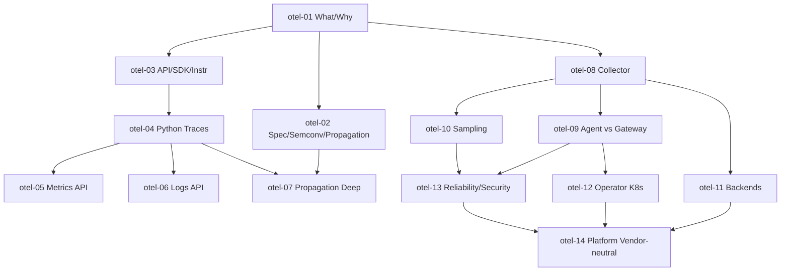

# OpenTelemetry — Roadmap detallado

IDs estables: `otel-<NN>-<slug>`.

Duración orientativa total: **35–50 h**.

---

## Nivel 1 — Fundamentos

### otel-01-what-and-why-signals-and-maturity

- **Nivel:** fundamentos
- **Objetivo:** entender qué es OTel, qué resuelve y qué estado tiene por lenguaje/signal.
- **Prerrequisitos:** curso **prometheus-grafana** ≥ Nivel 2.
- **Temas:** historia (fusión OpenTracing + OpenCensus), proyectos CNCF relacionados; **tres signals** actuales (traces, metrics, logs) + profiling en incubación; qué significa "vendor-neutral" en la práctica; **status page** por lenguaje y signal (traces maduros, metrics maduros, logs recientes); por qué logs son el signal más joven en OTel; relación entre OTel y backends existentes (Prometheus, Jaeger, Zipkin pre-OTel integran como receivers).
- **Fundamentos internos:** OTel no reemplaza al backend — es la capa de **generación + transporte + semántica**; cambiar de backend = cambiar un `exporter` en el Collector.
- **Competencias:** explicar OTel sin confundirla con "un nuevo Prometheus".
- **Ejemplos:** `01-signals-diagram`, `02-status-page-walkthrough`.
- **Actividades:** `01-landscape-mapping` (OTel vs Jaeger/Prometheus/Loki/vendor), `02-when-not-otel` (análisis).
- **Entregables:** notas con el panorama OTel ↔ backends.
- **Evaluación:** justificar OTel para 3 escenarios distintos (greenfield, migración, multi-backend).
- **Duración:** 2 h.

### otel-02-specification-semconv-and-context-propagation

- **Nivel:** fundamentos
- **Objetivo:** entender la especificación, las convenciones semánticas y la propagación de contexto como *las* bases.
- **Prerrequisitos:** `otel-01`.
- **Temas:** estructura de la **spec** (API, SDK, data model, protocol); **Resource** (atributos del productor: `service.name`, `service.version`, `deployment.environment`, `host.*`, `k8s.*`); **Semantic Conventions** vigentes (http, db, messaging, rpc, k8s, faas, cloud…) y versiones (**migración `http.method` → `http.request.method`** como caso real); **W3C Trace Context** (`traceparent` header: `00-<trace-id>-<span-id>-<flags>`) y **Baggage** (`baggage` header para propagar valores de negocio); **context** como objeto portable dentro de un proceso; propagators (`TextMapPropagator`: tracecontext + baggage por default).
- **Fundamentos internos:** el `traceparent` es *la* convención que permite que N servicios en N lenguajes compartan trace sin que ninguno sepa de los demás; Baggage es poderoso pero peligroso (atributos de negocio en cada hop → cardinalidad y costo).
- **Competencias:** leer un `traceparent`; aplicar Resource y semconv correctos; usar baggage con criterio.
- **Ejemplos:** `01-traceparent-walkthrough`, `02-resource-and-semconv`, `03-baggage-example`.
- **Actividades:** `01-identify-breaking-semconv-change`, `02-attribute-review` (independiente).
- **Entregables:** cheatsheet propio de semconv + ejemplo de `traceparent` descompuesto.
- **Evaluación:** diagnosticar un trace "roto" por propagators no habilitados.
- **Duración:** 3 h.

### otel-03-api-sdk-and-instrumentation-strategies

- **Nivel:** fundamentos
- **Objetivo:** distinguir API, SDK, instrumentation (manual, library, auto, zero-code).
- **Prerrequisitos:** `otel-01`.
- **Temas:** **API** (la que importa tu código, p. ej. `opentelemetry.trace.get_tracer()`); **SDK** (configurable, se inicializa en `main()`: providers, processors, exporters); **instrumentation libraries** (community packages que envuelven framework/driver: `opentelemetry-instrumentation-fastapi`, `opentelemetry-instrumentation-requests`, `opentelemetry-instrumentation-psycopg2`); **auto-instrumentation** (`opentelemetry-instrument` CLI wraps the app); **zero-code eBPF** (Pixie, Beyla) — cuándo tiene sentido; cuándo instrumentar manualmente vs confiar en auto.
- **Fundamentos internos:** la separación API/SDK permite que una biblioteca importe la API sin forzar un SDK específico; auto-instrumentation suele dar el 80% de visibilidad gratis, el 20% restante requiere spans manuales para dominio del negocio.
- **Competencias:** elegir la estrategia correcta por servicio.
- **Ejemplos:** `01-manual-vs-auto`, `02-instrumentation-libraries-matrix`.
- **Actividades:** `01-start-with-auto-and-add-manual`, `02-ebpf-vs-sdk-tradeoffs` (análisis).
- **Entregables:** matriz de cobertura "auto / manual / none" para el capstone.
- **Evaluación:** justificar manual vs auto para 3 servicios dados.
- **Duración:** 2 h.

---

## Nivel 2 — Intermedio

### otel-04-instrumenting-python-traces

- **Nivel:** intermedio
- **Objetivo:** instrumentar una app Python/FastAPI con auto + spans manuales útiles.
- **Prerrequisitos:** `otel-03`.
- **Temas:** instalar `opentelemetry-sdk`, `opentelemetry-exporter-otlp` + instrumentation packages (`fastapi`, `httpx`, `psycopg`, `redis`); **tracer provider** setup, **BatchSpanProcessor** + OTLP exporter; `opentelemetry-instrument` wrapper; crear spans manuales (`tracer.start_as_current_span`); atributos (`span.set_attribute`), eventos (`span.add_event`), status (`span.set_status`); exceptions (`span.record_exception`); span kinds (CLIENT/SERVER/PRODUCER/CONSUMER/INTERNAL); nested spans y parent/child automático via context; nombrar spans por operación de negocio no por método HTTP.
- **Fundamentos internos:** cada span abierto se adhiere al Context "current"; sin `start_as_current_span` el span es "huérfano" en la jerarquía; attributes caros (strings largos, N por request) se evitan.
- **Competencias:** instrumentar con auto + añadir spans manuales con criterio.
- **Ejemplos:** `01-fastapi-auto-instrument`, `02-manual-business-spans`, `03-record-exception-and-status`.
- **Actividades:** `01-instrument-capstone-traces`, `02-add-domain-spans` (independiente).
- **Entregables:** capstone emitiendo traces OTLP con RED básico cubierto por auto + 3+ spans manuales de dominio.
- **Evaluación:** criticar un conjunto de spans "ruidosos" y proponer rediseño.
- **Duración:** 4 h.

### otel-05-metrics-api-and-prometheus-interop

- **Nivel:** intermedio
- **Objetivo:** emitir métricas con OTel y entender su interoperabilidad con Prometheus.
- **Prerrequisitos:** `otel-04`, curso **prometheus-grafana** ≥ `obs-07`.
- **Temas:** **Meter**, **Instruments** (Counter, UpDownCounter, Histogram, Observable Counter/Gauge/UpDownCounter via callbacks); **temporality**: `cumulative` (compatible con Prometheus) vs `delta` (compatible con StatsD/Datadog); **aggregation** por default; **views** para redefinir aggregation/buckets; exportar vía OTLP → Collector → Prometheus (vía `prometheusreceiver` o `otlp` ingest nativo); exemplars (vincular métrica con traceId); comparación con `prometheus_client`: cuándo usar uno vs el otro; **evitar emitir desde dos librerías la misma métrica**.
- **Fundamentos internos:** la temporalidad es el "gotcha" que rompe primero: cumulative = valor total desde el inicio; delta = cambio en el intervalo; cumulative-to-delta y viceversa se procesan en el Collector si hace falta.
- **Competencias:** elegir instrument correcto; configurar temporalidad por backend; exemplars funcionando.
- **Ejemplos:** `01-counter-and-histogram-otel`, `02-cumulative-vs-delta`, `03-exemplars-trace-link`.
- **Actividades:** `01-migrate-prometheus-client-to-otel`, `02-add-exemplars` (independiente).
- **Entregables:** capstone emitiendo métricas OTel con exemplars visibles en Grafana.
- **Evaluación:** diagnosticar métricas "flat" tras cambio de temporalidad.
- **Duración:** 4 h.

### otel-06-logs-api-and-bridges

- **Nivel:** intermedio
- **Objetivo:** emitir logs vía OTel sin romper la logging stack existente.
- **Prerrequisitos:** `otel-04`.
- **Temas:** **LogRecord** model (severity, body, attributes, resource, traceId/spanId); **logs API** vs **bridges** con libraries nativas (**patrón recomendado**: seguir usando `logging` de Python y adjuntar el **OTel Logging Handler** que convierte cada record a un LogRecord OTLP); correlación automática traceId/spanId cuando hay span activo; **structured logging** (JSON) como mejor compañero; export a Loki (vía Collector) o a cualquier backend; estado de madurez (logs son el signal más nuevo de OTel).
- **Fundamentos internos:** la mayoría de apps *ya* tienen logging; OTel no quiere reemplazar `logging` sino **recoger** sus records y añadir contexto (traceId); el valor queda en la correlación.
- **Competencias:** adjuntar handler OTel sin refactor masivo; verificar correlación trace↔log en Grafana.
- **Ejemplos:** `01-python-logging-handler-otel`, `02-structured-logs-with-trace-id`, `03-logs-to-loki-via-collector`.
- **Actividades:** `01-add-otel-logging-to-capstone`, `02-click-through-trace-to-logs` (independiente).
- **Entregables:** capstone con logs correlacionados por traceId en Loki, click-through en Grafana.
- **Evaluación:** diagnosticar un log sin traceId cuando debería tenerlo.
- **Duración:** 3 h.

### otel-07-context-propagation-across-services

- **Nivel:** intermedio
- **Objetivo:** mantener el trace vivo across procesos, lenguajes, protocolos y colas.
- **Prerrequisitos:** `otel-02`, `otel-04`.
- **Temas:** HTTP (headers `traceparent`, `tracestate`, `baggage` propagados por client/server instrumentations); gRPC (metadata); mensajería (Kafka headers, SQS message attributes); **manual propagation** cuando el framework no está instrumentado (`inject` / `extract` en el carrier); procesos batch (propagar via DB column, filename, etc.); **async** y **thread-local** context (ContextVars en Python); errores comunes (iniciar un executor que pierde el context — hay helpers).
- **Fundamentos internos:** `inject` serializa el context en un carrier (dict/headers); `extract` reconstruye un context remoto a partir del carrier recibido; sin esto, cada servicio empieza un trace nuevo (traces "cortos" sintomáticos).
- **Competencias:** diagnosticar y arreglar traces rotos cross-service.
- **Ejemplos:** `01-fastapi-client-and-server-trace`, `02-propagate-via-kafka-headers`, `03-executor-context-copy`.
- **Actividades:** `01-two-services-end-to-end-trace`, `02-fix-broken-propagation` (independiente, debug).
- **Entregables:** 2 servicios en Python con trace completo end-to-end visible en Tempo.
- **Evaluación:** dado un trace que se corta en el servicio B, diagnosticar causa.
- **Duración:** 3 h.

### otel-08-collector-architecture-receivers-processors-exporters

- **Nivel:** intermedio
- **Objetivo:** entender el Collector como data plane configurable.
- **Prerrequisitos:** `otel-01`.
- **Temas:** instalar Collector (core vs **contrib** — contrib trae receivers/exporters extra); modelo **pipelines** (`traces`, `metrics`, `logs`), cada una con `receivers → processors → exporters`; **receivers** comunes (OTLP gRPC/HTTP, Prometheus scrape, Jaeger, Zipkin, Kafka, filelog, journald, hostmetrics, k8sobjects); **processors** (batch, memory_limiter, attributes, resource, filter, transform/OTTL, tail_sampling, routing); **exporters** (OTLP, otlphttp, Prometheus/remotewrite, Loki, Tempo, Jaeger, Datadog, Honeycomb, debug, file); configuración YAML (`service.pipelines`, `extensions`, `telemetry`); `otelcol validate`.
- **Fundamentos internos:** una pipeline no mezcla signals — tres pipelines distintas aunque todas vayan al mismo Collector; `memory_limiter` + `batch` son el "cinturón de seguridad" por default; **OTTL** (OpenTelemetry Transformation Language) es un mini-lenguaje para `transform` processor, poderoso para enriquecer/filtrar/renombrar.
- **Competencias:** diseñar y validar una configuración de Collector multi-pipeline.
- **Ejemplos:** `01-collector-yaml-skeleton`, `02-ottl-transform`, `03-multi-exporter`.
- **Actividades:** `01-collector-local-with-three-signals`, `02-add-attribute-processor` (independiente).
- **Entregables:** Collector local recibiendo las 3 señales del capstone y exportando a 3 backends distintos.
- **Evaluación:** diagnosticar un pipeline que descarta datos silenciosamente.
- **Duración:** 5 h.

---

## Nivel 3 — Avanzado

### otel-09-collector-deployment-patterns-agent-vs-gateway

- **Nivel:** avanzado
- **Objetivo:** diseñar la topología del Collector en producción.
- **Prerrequisitos:** `otel-08`.
- **Temas:** patrones:
  - **agent** por nodo/pod (DaemonSet en K8s): recibe local, procesa barato, envía a gateway;
  - **gateway** central (Deployment): batch/compress/retry/sampling pesado, único punto de salida a backend(s);
  - **sidecar** por Pod (menos común, útil para apps que no pueden hablar OTLP al nodo);
  - **sin Collector** (SDK exporta directo al backend): sencillo pero menos robusto;
- escalado (HPA sobre gateway por memoria/queue depth); back-pressure y queue persistence (`sending_queue` disco); health check extension; versión y upgrade del Collector; "distros" (Core vs Contrib vs vendor como ADOT, Grafana Alloy — nota: Alloy es un fork/sucesor relacionado).
- **Fundamentos internos:** agent-only pierde la ventaja de batching cross-pod; gateway-only añade un hop y un riesgo single-point; **agent + gateway** es el patrón de referencia; el disk-backed queue salva ingestion ante caídas de red.
- **Competencias:** elegir y defender la topología.
- **Ejemplos:** `01-daemonset-agent-plus-deployment-gateway`, `02-queue-persistence-disk`, `03-adot-vs-otel-contrib`.
- **Actividades:** `01-deploy-agent-gateway-in-kind`, `02-tradeoffs-adr` (independiente).
- **Entregables:** topología agent+gateway en kind + ADR.
- **Evaluación:** diseñar topología para 3 escalas (10, 1k, 100k RPS).
- **Duración:** 4 h.

### otel-10-sampling-head-tail-probabilistic-parent-based

- **Nivel:** avanzado
- **Objetivo:** diseñar sampling que balancee costo y señal.
- **Prerrequisitos:** `otel-08`.
- **Temas:** **head-based sampling** (decidido en el SDK al iniciar el root span: `ParentBased(TraceIdRatioBased(0.1))`); limitaciones (si se descarta en head no hay trace completo); **tail-based sampling** (en el Collector, decidido con el trace completo): `tail_sampling` processor con policies (`status_code`, `latency`, `string_attribute`, `probabilistic`, `rate_limiting`); interacción con **consistent sampling** (todos los servicios misma decisión gracias a `tracestate`); **error-first** policy (mantener 100% de errores + N% de éxitos); costo de tail-based (buffer en memoria por `decision_wait`).
- **Fundamentos internos:** head simple pero ciego al resultado; tail potente pero stateful; sin consistent sampling, dos servicios pueden decidir distinto → traces incompletos sistemáticos.
- **Competencias:** diseñar y configurar sampling tail-based con policies útiles.
- **Ejemplos:** `01-head-based-parent-ratio`, `02-tail-sampling-errors-plus-latency`, `03-consistent-sampling`.
- **Actividades:** `01-tune-sampling-for-capstone`, `02-cost-estimate-head-vs-tail` (análisis).
- **Entregables:** gateway Collector con sampling tail-based: 100% errores + 10% éxitos + latency > p95.
- **Evaluación:** criticar una policy de sampling dada por sus blind spots.
- **Duración:** 4 h.

### otel-11-backends-tempo-jaeger-loki-prometheus-multi

- **Nivel:** avanzado
- **Objetivo:** elegir backends por signal y operar multi-backend.
- **Prerrequisitos:** `otel-08`.
- **Temas:** **Tempo** (Grafana, trace-only, barato: solo index de trace-id; para búsqueda rica usa `TraceQL` ejecutando sobre el storage); **Jaeger** (clásico, aún vigente, puede ser backend); **Loki** para logs vía Collector; **Prometheus** para métricas (via `remote_write` o `prometheusremotewrite` exporter o OTLP ingest nativo); **multi-exportación** (mismo pipeline → prod backend + dev backend simultáneo, útil para migraciones); **vendor backends** (Datadog, Honeycomb, New Relic — todos aceptan OTLP); **meta-telemetry** del Collector (sus propias métricas Prometheus).
- **Fundamentos internos:** Tempo asume que vas a Grafana para búsqueda avanzada por metadata (via métricas o logs); Jaeger indexa más y por tanto es más caro a escala; multi-export duplica tráfico — útil puntualmente, caro de default.
- **Competencias:** diseñar la matriz "signal × backend"; migrar backend sin tocar código.
- **Ejemplos:** `01-tempo-with-collector`, `02-prom-otlp-ingest`, `03-multi-export-datadog-plus-tempo`.
- **Actividades:** `01-switch-backend-no-code-change`, `02-tempo-vs-jaeger-adr` (independiente).
- **Entregables:** capstone con backend switch demostrado + ADR.
- **Evaluación:** diseñar matriz de 3 signals x 2 backends para una org dada.
- **Duración:** 4 h.

### otel-12-otel-operator-in-k8s

- **Nivel:** avanzado
- **Objetivo:** operar OTel en K8s con el camino declarativo.
- **Prerrequisitos:** `otel-09`, curso **kubernetes** ≥ `k8s-14`.
- **Temas:** **OpenTelemetry Operator**: CRs **`OpenTelemetryCollector`** (modes: deployment, daemonset, sidecar, statefulset) + **`Instrumentation`** (auto-inject SDK en Pods marcados con annotation `instrumentation.opentelemetry.io/inject-python=true`); **Target Allocator** para scrape Prometheus distribuido entre réplicas de Collector; integración con Prometheus Operator; ejemplos reales (receivers k8sobjects, k8sattributes processor para auto-adjuntar labels de pod/namespace); patrones de upgrade del Operator; comparar con instalar Collector vía Helm "manual".
- **Fundamentos internos:** `k8sattributes` processor es casi obligatorio en K8s: enriquece cada span/metric/log con `k8s.pod.name`, `k8s.namespace.name`, `k8s.container.name`, etc.; Instrumentation CR inyecta via mutating webhook las deps y variables de entorno — zero-code para apps compatibles.
- **Competencias:** desplegar Operator + Collector multi-mode + auto-instrumentation Python por annotation.
- **Ejemplos:** `01-operator-install-and-collector-cr`, `02-instrumentation-python-auto-inject`, `03-k8sattributes-enrichment`.
- **Actividades:** `01-full-otel-stack-via-operator`, `02-upgrade-collector-cr` (independiente).
- **Entregables:** stack OTel completo en kind via Operator con capstone auto-instrumentado por annotation.
- **Evaluación:** diagnosticar por qué una Instrumentation no se inyecta.
- **Duración:** 4 h.

---

## Nivel 4 — Producción empresarial

### otel-13-reliability-security-of-the-pipeline

- **Nivel:** producción
- **Objetivo:** operar el pipeline con garantías de confiabilidad y seguridad.
- **Prerrequisitos:** `otel-09`, `otel-10`.
- **Temas:** **TLS** entre SDK/agent/gateway/backend; **auth** (headers Bearer, mTLS, OIDC); **tenancy** (X-Scope-OrgID para Mimir/Loki multi-tenant); **memory_limiter** y **batch** correctamente dimensionados; **sending_queue** persistente en disco; **retry** con backoff; alerts del Collector (queue size, dropped spans/metrics/logs, exporter failures); versioning del Collector y upgrade seguro; **PII scrubbing** con `attributes` processor o OTTL; redactar headers/queries con `redaction` processor; límites a baggage y attributes; chaos testing del pipeline (`toxiproxy`, failure injection); costos del transporte (compression gzip/zstd en OTLP, cardinality en labels).
- **Fundamentos internos:** sin memory_limiter + batch adecuados, el Collector OOMKillea bajo spike; sin retries persistentes, un backend caído = pérdida silenciosa.
- **Competencias:** endurecer el pipeline; definir SLOs del pipeline mismo.
- **Ejemplos:** `01-tls-and-mtls`, `02-persistent-queue-backpressure`, `03-pii-scrubbing-ottl`.
- **Actividades:** `01-harden-collector`, `02-define-pipeline-slo` (independiente).
- **Entregables:** pipeline endurecido con TLS, auth, queue persistente y alertas sobre sí mismo.
- **Evaluación:** auditoría de un pipeline existente con brechas.
- **Duración:** 4 h.

### otel-14-platform-patterns-vendor-neutral-cost-and-semconv-governance

- **Nivel:** producción
- **Objetivo:** gobernar observabilidad vendor-neutral a escala.
- **Prerrequisitos:** `otel-11`, `otel-12`, `otel-13`.
- **Temas:** **vendor-neutral strategy**: contrato "los equipos emiten OTLP, la plataforma decide el backend"; **cost control** (sampling tail por servicio, drop de métricas de alta cardinalidad en el Collector antes del backend, aggregation processors); **cross-signal correlation** garantizada por semconv y propagación (exemplars metric↔trace, traceId en logs); **semconv governance** (seguir upstream + extensión interna documentada; manejo de deprecations con dual-emit transitorio); **IDP integration** (Backstage: cada servicio nuevo trae Instrumentation CR auto-generada); SLOs de la plataforma de observabilidad; ADR vendor neutrality (ejemplo: cómo cambiar de self-hosted a Grafana Cloud con cero cambios de código).
- **Fundamentos internos:** la neutralidad vendor es *diseño*, no accidente: requiere disciplina de atributos (nada propietario), de emisión (OTLP), y del Collector como punto único donde se decide "a qué backend va qué".
- **Competencias:** diseñar y defender el contrato de telemetría de la plataforma.
- **Ejemplos:** `01-vendor-neutral-contract`, `02-cost-control-at-collector`, `03-semconv-deprecation-handling`.
- **Actividades:** `01-platform-telemetry-contract-adr`, `02-switch-vendor-exercise` (independiente).
- **Entregables:** ADR + demo switch de backend sin tocar código del capstone.
- **Evaluación:** defender el contrato ante presión comercial de un vendor propietario.
- **Duración:** 4 h.

---

## Dependencias entre módulos

## Puente con los demás cursos

- **Prometheus + Grafana** (`obs-*`): las métricas OTel aterrizan en Prometheus/Mimir; los logs en Loki; los traces en Tempo. Exemplars conectan métrica ↔ trace en Grafana.
- **Argo Rollouts**: la AnalysisTemplate puede usar métricas OTel-emitidas (vía Prometheus) como criterio de promoción canary.
- **AWS/GCP**: ADOT y Google Managed Service for Prometheus/Trace aceptan OTLP; el curso explicita cómo apuntar el Collector.
- **Capstone**: todas las apps del capstone emiten OTel; el Collector decide qué pipeline por entorno.

## Checklist de verificación requerida en Fase 4

- Status page oficial de OTel por lenguaje y signal (Python específicamente para este curso).
- Versión actual de **Semantic Conventions** y migraciones recientes (p. ej. HTTP semconv v1).
- Estado y recomendación oficial sobre **OTel Logging Handler** en Python.
- OTLP ingest nativo en Prometheus: versión y features.
- **OTel Operator** CRDs y versiones actuales.
- **Grafana Tempo** versión y TraceQL features.
- Comparación vigente **OTel Collector contrib** vs **Grafana Alloy** vs **ADOT** vs **Chainsaw/vendor distros**.
- Estado de **profiling signal** (si aún incubación o GA).
- Compatibilidad vigente de **k8sattributes processor** (muy importante).
- OTTL versión y funciones soportadas en el `transform` processor.
