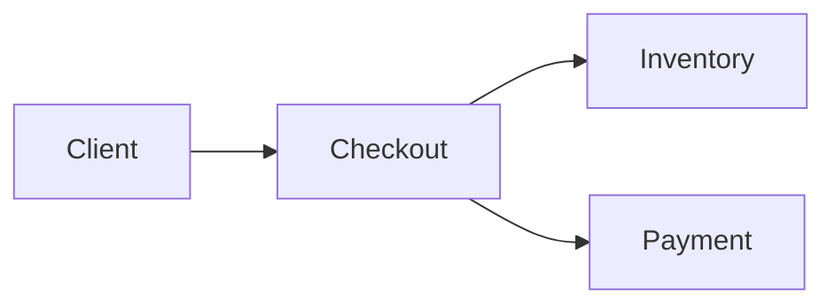

# Checkout Service

Microservicio capstone que procesa checkouts: valida el carro, reserva inventario y cobra.

!!! info "Dueño"
    team-platform · Slack `#checkout` · PagerDuty `checkout-service`.

## Qué leer

- [ADR 0001 — Adopt TechDocs](adr/0001-adopt-techdocs.md)
- [Runbook — Deploy & Rollback](runbook/deploy-and-rollback.md)
- [API reference](api/reference.md)

## Topología

