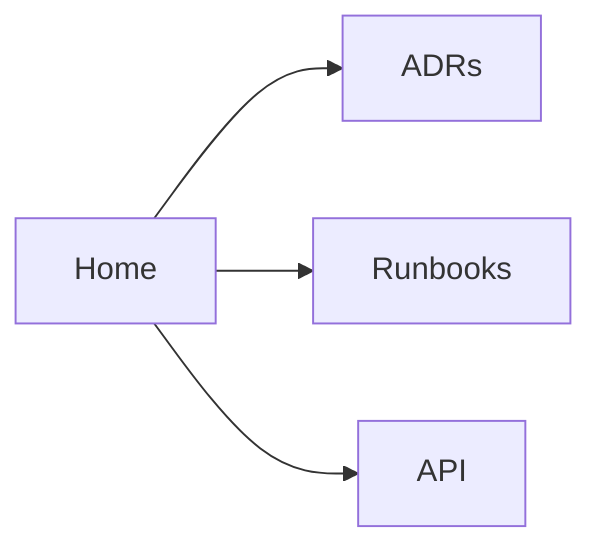

# Example Service

Servicio demo que ejercita el esqueleto mínimo de un sitio TechDocs.

!!! note "Alcance"
    Este sitio existe solo para demostrar la estructura canónica. No hay un servicio real detrás.

## Mapa del sitio



## Qué leer primero

- [ADR 0001 — Use TechDocs](adr/0001-use-techdocs.md)
- [Runbook — Incident 5xx surge](runbook/incident-500s.md)
- [API overview](api/overview.md)

## Snippet

```python
def health():
    return {"status": "ok"}
```
