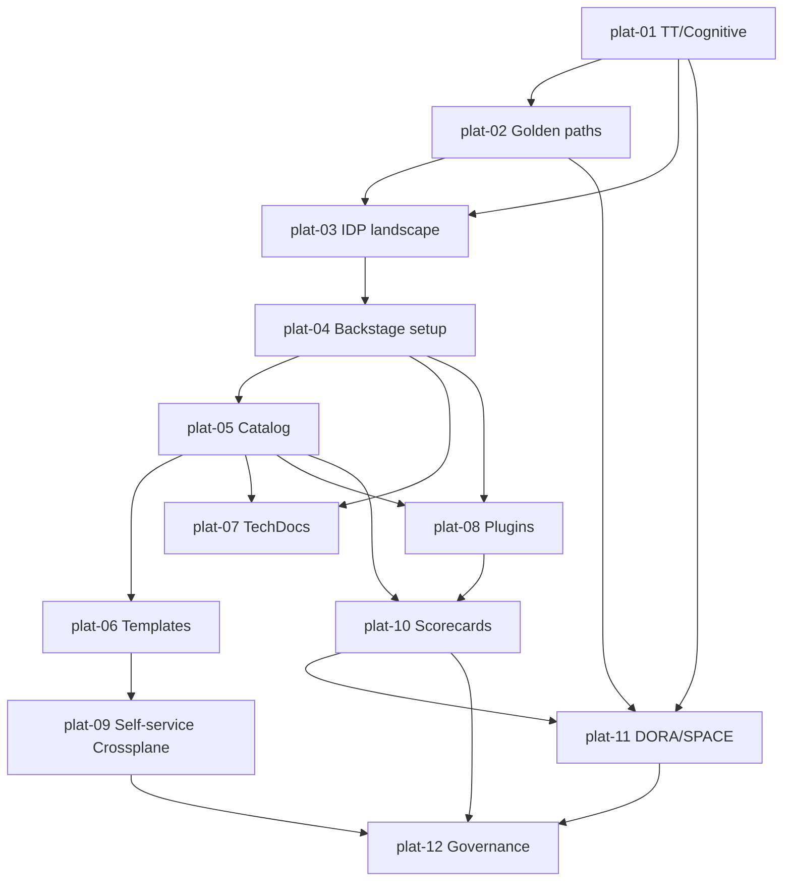

# Platform Engineering — Roadmap detallado

IDs estables: `plat-<NN>-<slug>`.

Duración orientativa total: **40–55 h**. Más corto en horas que otros cursos pero más denso en lecturas y ADRs — gran parte del valor es la práctica reflexiva.

---

## Nivel 1 — Fundamentos

### plat-01-principles-team-topologies-and-cognitive-load

- **Nivel:** fundamentos
- **Objetivo:** entender el modelo organizacional que da sentido a Platform Engineering.
- **Prerrequisitos:** haber operado un sistema real; **todos los cursos previos del programa**.
- **Temas:** **cognitive load** (intrinsic, extraneous, germane) aplicada a equipos; **Team Topologies**: cuatro tipos de equipo (**stream-aligned**, **enabling**, **platform**, **complicated-subsystem**) y tres modos de interacción (**X-as-a-Service**, **collaboration**, **facilitating**); el platform team es *X-as-a-Service* por default; relación con **Conway's Law** y *reverse Conway maneuver*; antipatterns ("ivory tower platform team", "ticketing-driven ops", "platform as a dumping ground"); por qué "DevOps" (como rol) a menudo falla donde Platform Engineering (como disciplina) tiene chance.
- **Fundamentos internos:** si la plataforma impone *collaboration* para cada feature, perdió su propuesta de valor (X-as-a-Service con contratos claros es el objetivo); un platform team mal dimensionado se vuelve un cuello de botella.
- **Competencias:** modelar la organización en Team Topologies y detectar antipatterns.
- **Ejemplos:** `01-team-topologies-case-study`, `02-cognitive-load-exercise`, `03-conways-law-walkthrough`.
- **Actividades:** `01-map-your-org`, `02-antipattern-identification` (independiente).
- **Entregables:** mapa Team Topologies de una organización dada + lista de antipatterns.
- **Evaluación:** justificar por qué un "platform ticket queue" degrada la propuesta de valor.
- **Duración:** 4 h.

### plat-02-golden-paths-paved-roads-and-developer-experience

- **Nivel:** fundamentos
- **Objetivo:** diseñar "caminos felices" opinionados sin anular la innovación.
- **Prerrequisitos:** `plat-01`.
- **Temas:** definición de **golden path** (camino preferido, soportado, con la mejor DX, documentado); **paved road** (Netflix): mismo concepto con fuerte compromiso de ownership; diferencia entre **golden path** (opt-in) y **mandato** (forzado); criterios para definir el primer golden path (volumen, variabilidad baja, dolor compartido, impacto medible); **DX como métrica** (time-to-first-commit, time-to-production, tasa de errores de onboarding, platform NPS); el **"long tail"**: cómo tratar servicios/casos fuera del golden path (opción B soportada vs no soportada); evolución de los paths (deprecations); feedback loops explícitos (interviews, surveys, usage telemetry).
- **Fundamentos internos:** un golden path exitoso elimina decisiones triviales ("qué logging usar") y libera energía para decisiones de dominio; un mal golden path se vuelve un parque jurásico porque nadie puede cambiarlo sin romper mil cosas.
- **Competencias:** diseñar y defender un golden path candidato.
- **Ejemplos:** `01-netflix-paved-road-reading`, `02-first-golden-path-canvas`, `03-dx-metrics-samples`.
- **Actividades:** `01-define-first-golden-path`, `02-dx-interview-template` (independiente).
- **Entregables:** canvas del golden path "nuevo microservicio Python" para el capstone.
- **Evaluación:** criticar un golden path dado por rigidez vs utilidad.
- **Duración:** 4 h.

### plat-03-idp-landscape-backstage-port-cnoe

- **Nivel:** fundamentos
- **Objetivo:** mapear el panorama de herramientas IDP y elegir fundamentadamente.
- **Prerrequisitos:** `plat-01`, `plat-02`.
- **Temas:** **Backstage** (OSS, Spotify → CNCF, framework de Node/TS, catálogo + templates + TechDocs + plugins); **Port** (SaaS, menos ingeniería, onboarding rápido); **OpsLevel**, **Cortex** (scorecards-first); **Humanitec** (platform orchestrator opinionado); **CNOE** (CNCF-blessed reference stack con Backstage + Argo CD + Crossplane + Keycloak + Argo Workflows); criterios de elección (tamaño de equipo plataforma, presupuesto, deseo de ingeniería interna, grado de opinión, extensibilidad); límites: **ninguno "resuelve" platform engineering por sí solo** — son herramientas, no la disciplina.
- **Fundamentos internos:** elegir Backstage implica *construir* un IDP; elegir Port implica *configurar* uno; elegir CNOE implica *desplegar* una reference impl; los trade-offs son costo vs flexibilidad vs expertise interna.
- **Competencias:** evaluar y seleccionar; evitar la trampa "Backstage por default".
- **Ejemplos:** `01-tool-matrix`, `02-cnoe-overview`, `03-port-vs-backstage`.
- **Actividades:** `01-tool-choice-adr`, `02-poc-matrix-for-your-org` (independiente).
- **Entregables:** ADR de elección fundamentado para el capstone.
- **Evaluación:** defender la elección ante presión comercial de un vendor.
- **Duración:** 3 h.

---

## Nivel 2 — Intermedio

### plat-04-backstage-architecture-and-setup

- **Nivel:** intermedio
- **Objetivo:** instalar Backstage y entender su arquitectura.
- **Prerrequisitos:** `plat-03`, nociones básicas Node.js/TypeScript.
- **Temas:** Backstage *es un framework*, no una app descargable: se crea una app propia con `@backstage/create-app`; estructura (`packages/app` frontend React; `packages/backend` Node.js backend; `plugins/*`); configuración (`app-config.yaml`, overrides por entorno); storage (Postgres recomendado para producción); auth (GitHub/Google/Okta/LDAP + guest para dev); permisos (framework de permissions); deploy en K8s via chart oficial; **Backstage mantiene breaking changes frecuentes** (cambios de patron en Backend System 1.0): política de upgrade; **CNOE** como alternativa pre-ensamblada.
- **Fundamentos internos:** Backstage es un *platform of plugins*; el core es relativamente delgado y la mayoría del valor vive en plugins (oficiales o custom); upgradar Backstage es una práctica recurrente, no puntual.
- **Competencias:** levantar Backstage local con Postgres y auth GitHub.
- **Ejemplos:** `01-create-app-and-run`, `02-app-config-structure`, `03-backend-system-1`.
- **Actividades:** `01-local-backstage-with-github-auth`, `02-k8s-deploy-via-helm` (independiente).
- **Entregables:** Backstage local funcional + diagrama de componentes.
- **Evaluación:** justificar Backstage self-hosted vs CNOE preassembled.
- **Duración:** 4 h.

### plat-05-software-catalog-deep

- **Nivel:** intermedio
- **Objetivo:** modelar el software de la organización con el catálogo.
- **Prerrequisitos:** `plat-04`.
- **Temas:** **Entity model** (`apiVersion: backstage.io/v1alpha1`): kinds **Component**, **API**, **Resource**, **System**, **Domain**, **User**, **Group**, **Location**; `catalog-info.yaml` por servicio; **owner** y relaciones (`providesApi`, `consumesApi`, `dependsOn`, `partOf`, `memberOf`); **processors** y **providers** del catalog (ingestión automática desde GitHub orgs, descubrimiento recursivo); **annotations** vinculadas a plugins (`github.com/project-slug`, `backstage.io/kubernetes-id`, `pagerduty.com/integration-key`, …); modelo mental: **el catálogo es la fuente de verdad del inventario**, no un wiki; cómo evitar que se vuelva stale (hooks pre-commit que validan `catalog-info.yaml`); importar sistemas existentes gradualmente.
- **Fundamentos internos:** las relaciones del catálogo habilitan vistas de impacto ("quiénes dependen de este API") y queries ("qué services tienen owner X"); sin disciplina de annotations, los plugins se vuelven inútiles.
- **Competencias:** modelar systems/components/apis/resources del capstone.
- **Ejemplos:** `01-catalog-info-skeleton`, `02-github-provider-ingest`, `03-relations-impact-view`.
- **Actividades:** `01-model-capstone-in-catalog`, `02-pre-commit-validate-catalog-info` (independiente).
- **Entregables:** catalog del capstone poblado con 3+ Components, 2+ APIs, 1 System, 1 Domain, Groups con owners.
- **Evaluación:** diagnosticar un catalog "ruidoso" por relaciones incorrectas.
- **Duración:** 4 h.

### plat-06-templates-and-scaffolder

- **Nivel:** intermedio
- **Objetivo:** crear templates que ejecutan "golden path" en minutos.
- **Prerrequisitos:** `plat-05`.
- **Temas:** anatomía de un **template** (`apiVersion: scaffolder.backstage.io/v1beta3`): `parameters` (JSON Schema para el form UI), `steps` (acciones ejecutadas en orden), `output`; **scaffolder actions** built-in (`fetch:template`, `publish:github`, `catalog:register`, `fs:rename`, `debug:log`); custom actions en TS; templating con **nunjucks** sobre archivos del template skeleton; patterns comunes (crear repo + bootstrap CI + crear Helm chart + crear Argo Application + registrar en catalog + abrir PR a bootstrap repo); **"software templates" como productos** (versionado, testing, docs); evitar templates que "no se mantienen" (deben re-generar el output de referencia en CI y validar).
- **Fundamentos internos:** un template es un *contrato de inicio*; después del scaffolding el repo evoluciona independiente; una buena práctica es que el template produzca referencia a su versión y una herramienta `update-from-template` para re-bajar mejoras.
- **Competencias:** diseñar y mantener templates productivos.
- **Ejemplos:** `01-template-skeleton`, `02-nunjucks-templating`, `03-end-to-end-microservice-template`.
- **Actividades:** `01-build-microservice-template`, `02-test-template-in-ci` (independiente).
- **Entregables:** template "nuevo microservicio Python" funcional, creando repo + CI + chart + Argo Application + TechDocs + catalog entry.
- **Evaluación:** criticar un template "mega" y proponer descomposición.
- **Duración:** 5 h.

---

## Nivel 3 — Avanzado

### plat-07-techdocs-docs-as-code

- **Nivel:** avanzado
- **Objetivo:** integrar documentación de servicio como código versionado.
- **Prerrequisitos:** `plat-04`, `plat-05`.
- **Temas:** **TechDocs** architecture: cada repo con `/docs` + `mkdocs.yml` + `techdocs-ref` en catalog-info; render **in-situ** (dev) vs **centralized** (prod, con S3/GCS/Azure Blob como storage + builder job que convierte MkDocs → HTML y sube); CI job que renderiza y publica; UX dentro de Backstage (navegación, search, versioning); plugins MkDocs útiles (`techdocs-core`, mermaid, pymdownx, admonitions); modelo "**docs owned by services**" (cada servicio dueño de sus docs); checklists de qué documentar (README, ADRs, runbooks, API refs); **autogen** de API docs desde OpenAPI/AsyncAPI; antipatterns (wiki paralelo que se desactualiza).
- **Fundamentos internos:** docs-as-code trata la documentación como código: PR, review, CI, deploy; eliminar wikis paralelos es casi siempre una win neta.
- **Competencias:** publicar y mantener TechDocs; estándar mínimo de docs por servicio.
- **Ejemplos:** `01-mkdocs-site-skeleton`, `02-techdocs-centralized-s3`, `03-openapi-render-plugin`.
- **Actividades:** `01-add-techdocs-to-capstone`, `02-docs-minimum-standard-adr` (independiente).
- **Entregables:** capstone con TechDocs publicadas + estándar mínimo de docs documentado.
- **Evaluación:** auditar un repo "sin docs" y proponer estándar mínimo.
- **Duración:** 3 h.

### plat-08-plugins-ecosystem-and-custom-plugin

- **Nivel:** avanzado
- **Objetivo:** aprovechar y crear plugins para capturar contexto operativo real.
- **Prerrequisitos:** `plat-04`, `plat-05`.
- **Temas:** plugins oficiales útiles: **Kubernetes** (ver Pods/Deployments por Component), **GitHub Actions** (CI badges, workflow runs), **Argo CD** (sync status), **PagerDuty/Opsgenie** (on-call), **Grafana** (dashboards embebidos), **cost insights** (consumption vista), **TechInsights** (base para scorecards), **Catalog Graph**, **API Docs**; plugins comunitarios (Sentry, Datadog, Sonar, Snyk, Vault); **crear un plugin propio** (`npx @backstage/cli new`), estructura (plugin frontend + plugin backend si aplica), consumir APIs externas vía `discoveryApi` + proxy del backend; versionado + distribución de plugins internos (npm private registry); **ciclo de upgrade**: plugins deben seguir el versionado del Backstage core.
- **Fundamentos internos:** los plugins son la "capa de contexto" alrededor del catálogo; sin plugins, el catalog es solo un wiki tipado.
- **Competencias:** instalar y configurar 3+ plugins oficiales; escribir un plugin custom mínimo.
- **Ejemplos:** `01-k8s-plugin-config`, `02-github-actions-plugin`, `03-custom-plugin-boilerplate`.
- **Actividades:** `01-wire-essential-plugins`, `02-write-minimal-custom-plugin` (independiente).
- **Entregables:** Backstage con K8s + GH Actions + Argo CD plugins + 1 custom plugin propio.
- **Evaluación:** criticar un Backstage "catálogo-only" y proponer qué 3 plugins agregan más valor primero.
- **Duración:** 5 h.

### plat-09-self-service-infra-crossplane-and-templates

- **Nivel:** avanzado
- **Objetivo:** habilitar que developers provisionen infra via claims, con guardrails.
- **Prerrequisitos:** `plat-06`, curso **terraform**, curso **kubernetes** ≥ `k8s-14`.
- **Temas:** **Crossplane**: Providers (AWS, GCP, Azure, SQL, …), ManagedResources (CRs 1:1 con recursos cloud); **Composition** y **CompositeResourceDefinitions (XRDs)** para exponer un "producto de plataforma" (p. ej. `XPostgres` → materializa VPC + RDS + Secret + grants); **Claims** namespaced que developers crean (`PostgresClaim`); políticas Kyverno sobre Claims para enforce (región, tier, labels obligatorios); alternativa: **template Backstage que genera PRs a repo Terraform** gestionado por Atlantis o GHA (menos K8s-native, más familiar); criterio de elección (Crossplane para orgs K8s-first con muchas plataformas; TF-via-PR para orgs TF-first); **catálogo de recursos de plataforma** publicados como templates o XRDs; costos (visibilidad por labels, FinOps).
- **Fundamentos internos:** Crossplane convierte "provisionar un recurso cloud" en "crear un CR K8s" → mismo RBAC, mismo GitOps, misma observabilidad que cualquier otro CR; la curva de aprendizaje es real pero amortiza.
- **Competencias:** diseñar un XRD + Composition; exponerlo vía template Backstage.
- **Ejemplos:** `01-crossplane-aws-provider`, `02-xrd-xpostgres`, `03-backstage-template-claims-postgres`.
- **Actividades:** `01-self-service-db`, `02-adr-crossplane-vs-tf-pr` (independiente).
- **Entregables:** developer puede crear una DB Postgres cloud desde Backstage con 3 inputs.
- **Evaluación:** diseñar el conjunto mínimo de recursos de plataforma self-service para el capstone.
- **Duración:** 6 h.

---

## Nivel 4 — Producción empresarial

### plat-10-scorecards-and-service-maturity

- **Nivel:** producción
- **Objetivo:** medir y evolucionar la madurez de los servicios.
- **Prerrequisitos:** `plat-05`, `plat-08`.
- **Temas:** scorecards como **mapa de madurez** por servicio (ejemplos de criterios: tiene owner, tiene SLO, tiene runbook, tiene on-call, imagen firmada, tests > X%, no CVEs críticos, docs actualizadas, deploy frequency > X, deployed en últimos 90 días, PSA restricted); **Backstage TechInsights/Soundcheck** o alternativas (OpsLevel, Cortex); **cómo elegir checks** (empezar con 5–8, no 50); evitar scoring que se gamifica; **adopción como KPI** (% servicios > bronze, > silver, > gold); escalation path (quién ayuda a los equipos a subir de nivel); scorecards como *carrot* no *stick*; integración con el proceso de production readiness review.
- **Fundamentos internos:** sin scorecards no hay forma objetiva de responder "¿estamos mejorando?"; mal diseñados, generan ruido y resistencia; bien diseñados, dan a los equipos un camino claro.
- **Competencias:** diseñar scorecard; medir adopción; comunicar resultados.
- **Ejemplos:** `01-techinsights-fact-and-check`, `02-maturity-levels`, `03-adoption-dashboard`.
- **Actividades:** `01-scorecard-for-capstone`, `02-production-readiness-review-template` (independiente).
- **Entregables:** scorecard aplicado al capstone + plantilla PRR + dashboard adopción.
- **Evaluación:** proponer 3 scorecards nuevos tras feedback simulado.
- **Duración:** 4 h.

### plat-11-metrics-dora-space-and-platform-as-product

- **Nivel:** producción
- **Objetivo:** medir la plataforma como se mide un producto.
- **Prerrequisitos:** `plat-01`, `plat-02`, `plat-10`.
- **Temas:** **DORA metrics**: lead time for changes, deployment frequency, change failure rate, time to restore service; cómo medirlas en CI/CD (eventos de Argo CD, GHA runs, incidents de PagerDuty); **SPACE** framework (Satisfaction, Performance, Activity, Communication, Efficiency) para capturar lo que DORA no (bienestar, flujo); **platform NPS** (survey trimestral a developers); **adoption metrics** (templates usados, servicios registrados, DB provisionadas via self-service, tiempo de onboarding); **leading vs lagging indicators**; **platform-as-a-product**: roadmap, backlog priorizado por valor, releases, release notes, changelog, feedback groups, user interviews; **financiamiento** (showback/chargeback, platform fee); evitar vanity metrics y Goodhart's Law ("cuando una métrica se vuelve objetivo deja de ser buena métrica").
- **Fundamentos internos:** DORA mide el flujo de entrega, no la "calidad de ingeniería"; sin SPACE o equivalente, se cae en gaming (más deploys ≠ mejor producto).
- **Competencias:** diseñar un dashboard de métricas de plataforma defendible.
- **Ejemplos:** `01-dora-from-ci-cd-events`, `02-space-survey-template`, `03-platform-product-roadmap`.
- **Actividades:** `01-build-dora-dashboard`, `02-platform-product-canvas` (independiente).
- **Entregables:** dashboard DORA + canvas platform-as-product + ADR financiamiento.
- **Evaluación:** criticar un dashboard que celebra "número de deploys" sin contexto.
- **Duración:** 4 h.

### plat-12-governance-at-scale-multi-tenant-deprecations-platform-slos

- **Nivel:** producción
- **Objetivo:** operar la plataforma a escala sin volverse jaula ni caos.
- **Prerrequisitos:** `plat-09`, `plat-10`, `plat-11`.
- **Temas:** **multi-tenancy** (namespaces K8s, projects/accounts cloud, Argo CD AppProjects, Backstage permissions por owner); **deprecation policy** (ciclo anuncio → warn → remove, con TTL explícito; soporte vs mantenimiento vs legacy); **platform SLOs** (SLO de uptime del propio Backstage, de latencia del scaffolder, de freshness del catalog, de MTTR en incidentes de plataforma); **release cadence** del platform (continuo con feature flags vs trimestral); **versionado de contratos** (XRDs, templates, APIs internas: SemVer + changelog); **inner-source** patterns (contribuciones de equipos de producto al platform repo con guidelines); comunicación (changelog público interno, Slack channel, office hours, lunch & learn); **cuándo *no* construir plataforma** (equipo < 3, baja variabilidad, bajo volumen); maduración organizacional (del Centro de Excelencia al platform team real).
- **Fundamentos internos:** deprecar bien es tan importante como añadir bien; sin SLO de la plataforma misma, los equipos no pueden razonar sobre su propio riesgo; inner-source permite escalar sin crecer el platform team linealmente.
- **Competencias:** diseñar el modelo de gobernanza y evolución de la plataforma.
- **Ejemplos:** `01-deprecation-policy-sample`, `02-platform-slo-definition`, `03-inner-source-guidelines`.
- **Actividades:** `01-governance-adr`, `02-year-one-plan` (independiente).
- **Entregables:** ADR gobernanza + plan de año uno de plataforma + SLOs definidos.
- **Evaluación:** defender el plan contra tres escenarios (crecimiento rápido, hiring freeze, consolidación tras merger).
- **Duración:** 5 h.

---

## Dependencias entre módulos

## Capstone pedagógico — integración con los demás cursos

Este curso es el **capstone pedagógico** del programa. Al terminar, el capstone técnico (ver `/projects/capstone/`) debe tener:

- **Backstage** con catalog poblado (3+ Components, APIs, 1 System, Users/Groups).
- **Template** "nuevo microservicio Python" que crea repo + GHA + Helm chart + Argo Application + TechDocs + catalog entry + dashboards + alerts + SBOM/firma pipeline.
- **Self-service de DB** via Crossplane (o template TF-PR) desde Backstage.
- **Scorecard** con 8–10 criterios aplicado y dashboard adopción.
- **DORA metrics** medidas desde los events del CI/CD y de Argo CD.
- **Platform SLOs** definidos y medidos.
- **Deprecation policy** documentada.
- **ADR**: contrato de plataforma + roadmap trimestral.

## Checklist de verificación requerida en Fase 4

- Versión actual de Backstage y estado de **Backend System 1.0** (el nuevo backend reemplaza patrón previo — breaking change).
- CNOE reference implementation estado y herramientas incluidas vigentes.
- Estado de Crossplane v1 estable y de **Function-based Compositions** vs Compositions clásicas.
- DORA metrics 2024/2025: nombres y definiciones vigentes del reporte.
- Backstage TechInsights / Soundcheck versión actual.
- Plugins oficiales K8s / Kubernetes v2.
- Estado de **inner-source** del proyecto Backstage: proceso de contribuciones.
- Platform engineering community events / PlatformCon recientes.
- Cambios recientes en pricing / open-source status de **Port**, **OpsLevel**, **Cortex**, **Humanitec**.
- Humanitec *Platform Engineering Report* última edición.
