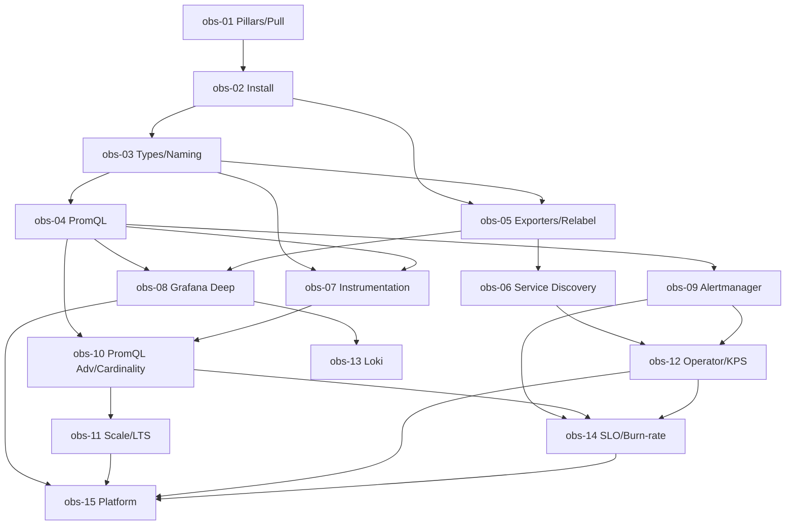

# Prometheus + Grafana — Roadmap detallado

IDs estables: `obs-<NN>-<slug>`.

Duración orientativa total: **45–65 h**.

---

## Nivel 1 — Fundamentos

### obs-01-observability-pillars-and-pull-model

- **Nivel:** fundamentos
- **Objetivo:** interiorizar qué es observabilidad vs monitoring tradicional, y entender el modelo pull.
- **Prerrequisitos:** nociones básicas de sistemas.
- **Temas:** diferencia *monitoring* ("mide lo que ya sabes que importa") vs *observabilidad* ("permite responder preguntas nuevas sobre tu sistema sin desplegar código"); tres pilares (metrics, logs, traces) + eventos y profiles; **pull vs push**: por qué Prometheus elige pull (service discovery → scrape es simétrico y auditable; targets caídos se detectan por *scrape failed*); límites del pull (jobs batch cortos → Pushgateway como excepción, no regla).
- **Fundamentos internos:** por qué los exporters son el "driver" común: traducen cualquier fuente a formato Prometheus text; por qué Prometheus no es base para "a prueba de todo" (no es un sistema de retención larga).
- **Competencias:** justificar la elección de Prometheus y entender cuándo *no* es la respuesta.
- **Ejemplos:** `01-metrics-logs-traces-mental-model`, `02-pull-vs-push-tradeoffs`.
- **Actividades:** `01-when-not-prometheus` (análisis), `02-identify-pillars-in-a-scenario`.
- **Entregables:** mapa anotado de los pilares y notas sobre el modelo pull.
- **Evaluación:** explicar por qué los jobs batch necesitan Pushgateway y por qué el push no debe ser default.
- **Duración:** 2 h.

### obs-02-install-local-stack-and-first-scrape

- **Nivel:** fundamentos
- **Objetivo:** levantar Prometheus + Grafana + un target local con docker-compose y hacer el primer scrape visible.
- **Prerrequisitos:** `obs-01`, docker-compose básico.
- **Temas:** binarios y imágenes oficiales; `prometheus.yml` mínimo (`scrape_configs`, `global`); el endpoint `/metrics` (text format `metric{labels} value` con `# TYPE` y `# HELP`); Prometheus UI (`/graph`, `/targets`, `/alerts`, `/status/config`, `/status/tsdb`); Grafana inicial (admin, data source Prometheus, primer panel); provisioning de Grafana (`provisioning/datasources`, `provisioning/dashboards`); `node_exporter` como primer "target real".
- **Fundamentos internos:** el formato de texto es intencionalmente simple (grep-able, scriptable); la UI de Prometheus es "development only" — Grafana es la UI de usuarios.
- **Competencias:** levantar el stack; verificar scrapes; primera consulta.
- **Ejemplos:** `01-compose-prom-grafana-node`, `02-grafana-provisioning`, `03-first-dashboard-panel`.
- **Actividades:** `01-up-and-running-local-stack`, `02-provision-grafana-declaratively` (independiente).
- **Entregables:** stack local reproducible con `docker compose up`, Grafana con dashboard provisionado.
- **Evaluación:** diagnosticar un target en estado `DOWN`.
- **Duración:** 3 h.

### obs-03-metric-types-and-naming

- **Nivel:** fundamentos
- **Objetivo:** elegir el tipo de métrica correcto y nombrarlo bien.
- **Prerrequisitos:** `obs-02`.
- **Temas:** **counter** (monótono, siempre crece, se usa con `rate()`/`increase()`); **gauge** (sube y baja); **histogram** (buckets acumulativos + `_count` + `_sum`, cálculo de cuantiles con `histogram_quantile()`); **summary** (cuantiles pre-calculados por target, no agregables cross-target — razón para preferir histogram casi siempre); **native histograms** (sparse, nueva alternativa más eficiente); naming (`<namespace>_<subsystem>_<name>_<unit>`, singular, snake_case, sufijos `_total`, `_bytes`, `_seconds`, `_ratio`, `_info`); labels: significado + cardinalidad; **"3 cosas a medir": RED (Rate, Errors, Duration)** para servicios HTTP, **USE (Utilization, Saturation, Errors)** para recursos.
- **Fundamentos internos:** por qué un counter nunca es "el valor absoluto que te interesa" sino la *tasa* vía `rate()`; por qué `histogram_quantile()` sobre un histogram agregado es correcto pero sobre un summary agregado es matemáticamente inválido.
- **Competencias:** nombrar y tipar métricas correctamente; elegir labels con disciplina.
- **Ejemplos:** `01-counter-vs-gauge-vs-histogram`, `02-red-vs-use-method`, `03-naming-review`.
- **Actividades:** `01-rename-and-retype-exercise`, `02-cardinality-smell-test` (independiente).
- **Entregables:** cheat-sheet propio con naming y tipos.
- **Evaluación:** diagnosticar métricas mal tipadas o nombradas en un `/metrics` dado.
- **Duración:** 3 h.

### obs-04-promql-fundamentals

- **Nivel:** fundamentos
- **Objetivo:** leer y escribir PromQL con confianza.
- **Prerrequisitos:** `obs-03`.
- **Temas:** instant vector vs range vector vs scalar vs string; selectors (`{job="x", instance=~".*api.*"}`), range `[5m]`, offset `offset 1h`, `@` modifier; funciones esenciales (`rate`, `irate`, `increase`, `sum/avg/max/min/count by/without`, `topk`, `bottomk`, `histogram_quantile`, `absent`, `clamp_min/max`, `deriv`, `predict_linear`); operadores binarios y matching (`on`, `ignoring`, `group_left`, `group_right`); subqueries (`[5m:1m]`); diferencia **`rate` vs `irate` vs `increase`**; evitar `rate()` sobre un gauge (ni `delta()` sobre un counter).
- **Fundamentos internos:** `rate()` necesita al menos 2 puntos en la ventana — ventana muy corta → `NaN`; subqueries son costosas → preferir recording rules para resultados reutilizables.
- **Competencias:** calcular RED metrics con PromQL; depurar consultas vacías.
- **Ejemplos:** `01-rate-increase-irate`, `02-aggregation-by-without`, `03-histogram-quantile`.
- **Actividades:** `01-build-red-queries`, `02-fix-empty-query` (independiente).
- **Entregables:** cuaderno con las queries RED del capstone.
- **Evaluación:** interpretar y corregir 5 queries dadas.
- **Duración:** 4 h.

---

## Nivel 2 — Intermedio

### obs-05-exporters-and-relabeling

- **Nivel:** intermedio
- **Objetivo:** aprovechar el ecosistema de exporters y transformar labels con relabel.
- **Prerrequisitos:** `obs-02`, `obs-03`.
- **Temas:** exporters comunes: **node_exporter** (hardware/OS), **cAdvisor** (contenedores, integrado en kubelet), **blackbox_exporter** (probes HTTP/HTTPS/TCP/ICMP/DNS), **mysqld_exporter**, **postgres_exporter**, **redis_exporter**, **nginx-prometheus-exporter**, **snmp_exporter**, **cloudwatch_exporter**; **writing a custom exporter** (resumen); **relabel_configs** (`source_labels`, `regex`, `action: replace|keep|drop|labelmap|labeldrop|labelkeep|hashmod`) aplicado *antes* del scrape; **metric_relabel_configs** aplicado *después* (último recurso para drop por cardinalidad); honrar `__address__`, `__name__`, `__meta_*`.
- **Fundamentos internos:** relabel es "programación con regex sobre labels" — es el único momento donde se puede filtrar/renombrar/droppear antes de persistir; `metric_relabel_configs` es la red de seguridad para evitar explosión por una métrica nueva.
- **Competencias:** scrapear 3 exporters distintos; aplicar relabel para normalizar.
- **Ejemplos:** `01-node-exporter-scrape`, `02-blackbox-probe`, `03-relabel-tidy-labels`.
- **Actividades:** `01-add-postgres-exporter`, `02-relabel-dedup-labels` (independiente).
- **Entregables:** stack con 3+ exporters y relabel documentado.
- **Evaluación:** cómo filtrar una métrica ruidosa después del hecho.
- **Duración:** 4 h.

### obs-06-service-discovery

- **Nivel:** intermedio
- **Objetivo:** descubrir dinámicamente qué scrapear.
- **Prerrequisitos:** `obs-05`.
- **Temas:** `static_configs` (ok para 3 targets); `file_sd_configs` (ok para integración con tooling); **Kubernetes SD** (`role: pod|service|endpoints|node|ingress|endpointslice`) con labels `__meta_kubernetes_*`; EC2 SD, GCE SD, Azure SD, Consul SD, Nomad SD, HTTP SD; interacción con **relabel** (filtrar por annotation `prometheus.io/scrape=true`); el patrón **Prometheus Operator** elimina el `prometheus.yml` manual (se cubre en obs-12).
- **Fundamentos internos:** SD genera targets *potenciales*; relabel los filtra; sin filtro, un cluster K8s con 1000 pods genera 1000 scrapes.
- **Competencias:** configurar K8s SD manualmente (antes de usar Operator); diagnosticar "mi pod no es scrapeado".
- **Ejemplos:** `01-static-vs-file-sd`, `02-k8s-sd-pods-with-annotation`, `03-ec2-sd-with-tags`.
- **Actividades:** `01-scrape-pods-by-annotation`, `02-debug-missing-targets` (independiente).
- **Entregables:** Prometheus local scrapeando targets descubiertos por anotación en kind.
- **Evaluación:** por qué un filtro por annotation es más robusto que una lista estática.
- **Duración:** 3 h.

### obs-07-instrumentation-with-python

- **Nivel:** intermedio
- **Objetivo:** instrumentar una app Python con `prometheus_client` siguiendo buenas prácticas.
- **Prerrequisitos:** `obs-03`, `obs-04`.
- **Temas:** `prometheus_client` library (Counter, Gauge, Histogram, Summary); default collectors (`process_*`, `python_gc_*`); exposición vía `start_http_server` o integración WSGI/ASGI (Starlette/FastAPI middleware); buenas prácticas (medir RED en el borde; medir unidades consistentes; no abusar de summaries); labels dinámicos (nunca `user_id` como label); exemplars (vinculan métrica con trace); `multiprocess` mode (gunicorn/uwsgi); testing (`REGISTRY.collect()`).
- **Fundamentos internos:** cada etiqueta nueva incrementa el espacio de series; medir latencia por `path` es casi siempre OK, por `request_id` nunca.
- **Competencias:** instrumentar FastAPI del capstone con RED metrics correctas.
- **Ejemplos:** `01-counter-and-histogram-in-fastapi`, `02-middleware-red-metrics`, `03-multiprocess-mode`.
- **Actividades:** `01-instrument-capstone`, `02-cardinality-safe-labels` (independiente).
- **Entregables:** app del capstone exponiendo `/metrics` con RED correcto.
- **Evaluación:** auditar un `/metrics` dado y señalar métricas con cardinalidad peligrosa.
- **Duración:** 4 h.

### obs-08-grafana-deep

- **Nivel:** intermedio
- **Objetivo:** construir y gobernar dashboards eficaces.
- **Prerrequisitos:** `obs-04`, `obs-05`.
- **Temas:** data sources (añadir Prometheus, Loki, Tempo, Postgres); **dashboards**: paneles (time series, stat, gauge, bar chart, table, heatmap, state timeline, status history), queries por panel, legend formatting, overrides por serie; **variables** (`query`, `custom`, `datasource`, `interval`, chained vars con `__all`); **transformations** (merge, join, reduce, filter); templating y repetición de paneles por variable; alerting UI de Grafana (nuevo motor desde v8; coexiste con Alertmanager); **provisioning** de data sources/dashboards/alerts/notifiers desde YAML; roles y permisos; folders; dashboards *as code* (`grizzly`, `grafonnet`, `dashboards-as-code` con JSON exportado).
- **Fundamentos internos:** Grafana no almacena métricas: todo lo que ves es una query en tiempo real contra el data source; las variables resuelven en el navegador cada carga.
- **Competencias:** dashboards reutilizables con variables; provisioning por YAML.
- **Ejemplos:** `01-dashboard-capstone-red`, `02-variables-and-templating`, `03-provisioning-dashboards`.
- **Actividades:** `01-build-capstone-dashboard`, `02-dashboards-as-code` (independiente).
- **Entregables:** dashboards del capstone exportados a JSON y provisionados.
- **Evaluación:** rediseñar un dashboard "mapa de calor sin eje" en uno útil.
- **Duración:** 5 h.

### obs-09-alertmanager-and-alert-design

- **Nivel:** intermedio
- **Objetivo:** disparar y enrutar alertas útiles, no ruido.
- **Prerrequisitos:** `obs-04`.
- **Temas:** reglas de alerta Prometheus (`groups`, `rules`, `expr`, `for`, `labels`, `annotations`); testing de reglas con `promtool test rules`; Alertmanager: **route tree** (receivers por severidad/equipo), **grouping** (`group_by`, `group_wait`, `group_interval`, `repeat_interval`), **inhibition** (silenciar B si A está activa), **silences** (temporales), **receivers** (email, slack, webhook, pagerduty, msteams, opsgenie); **alert fatigue** y antídotos (menos alertas, bien diseñadas); diseñar alertas sobre **síntomas** (SLO/user-impact), no causas; sin alertas que no requieran acción humana.
- **Fundamentos internos:** `for: 5m` evita flaps; `group_wait` agrega alertas que llegan juntas; inhibition reduce N alertas en cascada a 1; una alerta sin runbook link es un bug.
- **Competencias:** diseñar y testear reglas; configurar routing multi-equipo.
- **Ejemplos:** `01-first-alert-rule`, `02-alertmanager-route-tree`, `03-inhibition-example`.
- **Actividades:** `01-write-alerts-with-promtool-tests`, `02-reduce-alert-fatigue` (independiente).
- **Entregables:** `PrometheusRule` + Alertmanager config con tests pasando.
- **Evaluación:** criticar un conjunto de alertas dado y proponer rediseño.
- **Duración:** 4 h.

---

## Nivel 3 — Avanzado

### obs-10-promql-advanced-recording-rules-cardinality

- **Nivel:** avanzado
- **Objetivo:** optimizar queries, pre-calcular con recording rules y controlar la cardinalidad.
- **Prerrequisitos:** `obs-04`, `obs-07`.
- **Temas:** patrones avanzados PromQL (joins binarios con `group_left`, `on`/`ignoring`, series matching); recording rules (`:` namespace convention: `job:http_requests:rate5m`); por qué pre-calcular (dashboards + alertas sobre la misma expresión costosa); **cardinality troubleshooting**: `tsdb-status` endpoint, `prometheus_tsdb_head_series`, top series por métrica con `topk(10, count by (__name__)({__name__!=""}))`; sources frecuentes de cardinalidad (IDs, timestamps, user agents, paths de alta variabilidad); **native histograms** vs classic.
- **Fundamentos internos:** cada combinación única de labels = 1 serie; una serie "cuesta" RAM proporcionalmente; las recording rules convierten queries O(N) en O(1) a cambio de más storage.
- **Competencias:** detectar y eliminar cardinality explosion; definir recording rules útiles.
- **Ejemplos:** `01-recording-rule-for-slo-ingredient`, `02-cardinality-top-offenders`, `03-native-histogram-compare`.
- **Actividades:** `01-define-recording-rules-for-capstone`, `02-forensic-cardinality-explosion` (independiente).
- **Entregables:** `PrometheusRule` con recording rules + reporte de cardinalidad.
- **Evaluación:** triage cardinalidad: dado un top-10, decidir qué dropear/keep/renombrar.
- **Duración:** 4 h.

### obs-11-scale-and-long-term-storage

- **Nivel:** avanzado
- **Objetivo:** escalar más allá de un Prometheus single-node.
- **Prerrequisitos:** `obs-10`.
- **Temas:** límites prácticos de Prometheus single (RAM = f(series activas); retention default 15 d); **sharding por `__meta_*` o `hashmod` relabel**; **federation** (classic hierarchical, fragil) vs **remote_write** a long-term store; **Thanos** (sidecar + store + querier + compactor + ruler; object store, downsampling, deduplication); **Grafana Mimir** (horizontally-scalable multi-tenant, 1000M+ series/día); **VictoriaMetrics** (cluster o single, muy eficiente en RAM, compatible PromQL con extensiones); **Cortex** (predecesor de Mimir); criterios de elección; costos (storage + egress + compute).
- **Fundamentos internos:** `remote_write` serializa cada muestra a un endpoint HTTP; el long-term store asume la query (via querier compatible PromQL); downsampling (5 min, 1 h) reduce costo de queries de mes/trimestre.
- **Competencias:** elegir y configurar un long-term store para una org dada.
- **Ejemplos:** `01-remote-write-to-victoriametrics`, `02-thanos-sidecar-and-querier`, `03-mimir-helm-overview`.
- **Actividades:** `01-add-vm-as-long-term-store`, `02-adr-thanos-vs-mimir-vs-vm` (independiente).
- **Entregables:** stack con long-term store funcional + ADR.
- **Evaluación:** calcular retención y costos para 10M, 100M, 1B samples/día.
- **Duración:** 5 h.

### obs-12-prometheus-operator-and-kube-prometheus-stack

- **Nivel:** avanzado
- **Objetivo:** operar observabilidad en K8s con el camino "default" moderno.
- **Prerrequisitos:** `obs-06`, `obs-09`, curso **kubernetes** ≥ `k8s-14`, curso **helm**.
- **Temas:** instalar **kube-prometheus-stack** chart (Prometheus Operator + Prometheus + Alertmanager + Grafana + node-exporter + kube-state-metrics + default dashboards y alerts del `kubernetes-mixin`); CRs principales: **ServiceMonitor** / **PodMonitor** / **Probe** / **ScrapeConfig** / **PrometheusRule** / **AlertmanagerConfig**; `releaseName` y labels requeridos para que el Operator "vea" tus ServiceMonitors; integración con GitOps (Argo CD aplica los CRs; dashboards como ConfigMaps con label `grafana_dashboard=1`); patrones multi-tenant (un Prometheus por tenant via `prometheusSelector`); upgrade seguro del stack.
- **Fundamentos internos:** el Operator *genera* el `prometheus.yml` desde los CRs y lo monta como Secret; a partir de ahí es Prometheus "normal"; esta indirección es lo que da declaratividad.
- **Competencias:** desplegar y operar el stack completo en K8s por GitOps.
- **Ejemplos:** `01-kps-via-helm`, `02-servicemonitor-for-fastapi`, `03-dashboard-as-configmap`.
- **Actividades:** `01-full-stack-in-kind`, `02-add-slo-rules-via-crds` (independiente).
- **Entregables:** stack completo en kind + ServiceMonitor + dashboard + rule del capstone.
- **Evaluación:** diagnosticar por qué el Operator "no ve" un ServiceMonitor nuevo.
- **Duración:** 5 h.

### obs-13-loki-and-logs-in-the-stack

- **Nivel:** avanzado
- **Objetivo:** sumar logs al stack sin reinventar.
- **Prerrequisitos:** `obs-08`.
- **Temas:** modelo Loki (index "labels" + chunks de contenido, inspirado en Prometheus pero para logs); **LogQL** (`{app="x"} |= "ERROR" | json | line_format`); **agentes**: Promtail (deprecado en favor de **Grafana Alloy**), **Vector**, **Fluent Bit**, **OpenTelemetry Collector**; parsing (regex, logfmt, json); labels bajos vs campos derivados; **log-based metrics** (counts/rates desde logs cuando no se puede instrumentar); correlación logs ↔ métricas en Grafana (click-through); **retención y storage** (object storage S3/GCS); **anti-patrones**: altas cardinalidades en labels de Loki (igual que en Prometheus); costos.
- **Fundamentos internos:** Loki es barato porque *no indexa el contenido* — por eso solo filtra eficientemente por labels; LogQL hace scanning sobre chunks (lento si el filtro label no es selectivo).
- **Competencias:** desplegar Loki + agente; dashboards correlacionados; log-based metric.
- **Ejemplos:** `01-loki-plus-alloy-local`, `02-logql-for-capstone`, `03-correlate-metrics-and-logs`.
- **Actividades:** `01-add-loki-to-stack`, `02-log-based-metric-for-error-rate` (independiente).
- **Entregables:** Loki en el stack con capstone + correlación en Grafana.
- **Evaluación:** cuándo usar log-based metric vs instrumentar directo.
- **Duración:** 4 h.

---

## Nivel 4 — Producción empresarial

### obs-14-slo-and-burn-rate-alerts

- **Nivel:** producción
- **Objetivo:** definir SLIs/SLOs y alertar sobre quema de error budget con rigor.
- **Prerrequisitos:** `obs-09`, `obs-10`, `obs-12`.
- **Temas:** SLI (métrica de experiencia del usuario: availability, latency, correctness, freshness); SLO (objetivo numérico y ventana, p. ej. 99.9% en 30 d); **error budget** = `1 - SLO`; **burn-rate alerts** (SRE Workbook): single-window es ruidoso; **multi-window multi-burn-rate** (p. ej. 2% budget en 1 h + 2% en 5 min para severidad alta; 5% en 6 h + 5% en 30 min para severidad media); recording rules como "ingredientes SLO"; herramientas **Sloth** y **OpenSLO** para generar reglas desde una especificación; incorporar SLOs al proceso (budget → "cuánto podemos desplegar hoy sin violar"); SLOs del capstone concretos.
- **Fundamentos internos:** burn-rate = `error_rate / (1 - SLO)` — a cuánto consumes el budget relativo; multi-window elimina false positives sin perder sensibilidad.
- **Competencias:** diseñar SLOs y sus alertas; integrar con error budget policy.
- **Ejemplos:** `01-slo-ingredients-recording-rules`, `02-mwmbr-alert`, `03-sloth-generate`.
- **Actividades:** `01-define-capstone-slos`, `02-adopt-sloth` (independiente).
- **Entregables:** SLO formal del capstone con `PrometheusRule` y alertas MWMBR.
- **Evaluación:** criticar un SLO mal definido y proponer corrección.
- **Duración:** 5 h.

### obs-15-platform-dashboards-and-alerts-as-code-governance

- **Nivel:** producción
- **Objetivo:** gobernar observabilidad como plataforma: dashboards/alertas como código, costos, estándares.
- **Prerrequisitos:** `obs-08`, `obs-11`, `obs-12`, `obs-14`.
- **Temas:** **dashboards as code**: `grafonnet` (jsonnet), `grizzly`, exportar JSON y versionar; CI de dashboards (lint, preview en PR); templates/golden path (p. ej. "cada servicio tiene su dashboard RED + USE auto-generado"); **alerts as code** (`PrometheusRule` versionado, tests con `promtool test rules`); **gobernanza**: naming conventions, labels obligatorios, retention policy, SLO contract per service; **costos**: observability bill = active series + logs ingested + egress; Grafana folders por equipo + permisos; integración con **PagerDuty/Opsgenie**; relación con **IDP/Backstage** (plantillas que crean dashboards + alerts por servicio).
- **Fundamentos internos:** sin código y revisión, dashboards se multiplican y envejecen; alertas sin ownership degeneran en ruido; el costo de observabilidad suele crecer sin monitoreo propio ("meta-observability").
- **Competencias:** diseñar el "contrato de observabilidad" de la plataforma.
- **Ejemplos:** `01-grafonnet-baseline`, `02-pr-preview-dashboards`, `03-observability-bill-analysis`.
- **Actividades:** `01-platform-contract-adr`, `02-cost-of-observability-exercise` (independiente).
- **Entregables:** ADR + ejemplo de dashboard/alert generados desde template.
- **Evaluación:** defender el contrato ante DX vs costo vs cobertura.
- **Duración:** 5 h.

---

## Dependencias entre módulos

## Checklist de verificación requerida en Fase 4

- Versión actual de Prometheus (features recientes: native histograms stability, OTLP ingest).
- Grafana versión y cambios UI relevantes (alerting unificado, Scenes, Explore).
- Estado de **Grafana Alloy** vs Promtail/Grafana Agent (Promtail/Agent están en LTS/discontinuación según año).
- Compatibilidad vigente de **ServiceMonitor/PodMonitor/ScrapeConfig** (el último es más reciente).
- Estado de **native histograms** en PromQL y en client libraries.
- Compatibilidad **OTLP → Prometheus** (ingest nativo).
- Documentación vigente de **Mimir**, **VictoriaMetrics**, **Thanos**.
- `kubernetes-mixin` versión y dashboards actuales.
- Promtool features vigentes (`test rules` y `check`).
- Breaking changes recientes de kube-prometheus-stack chart.
