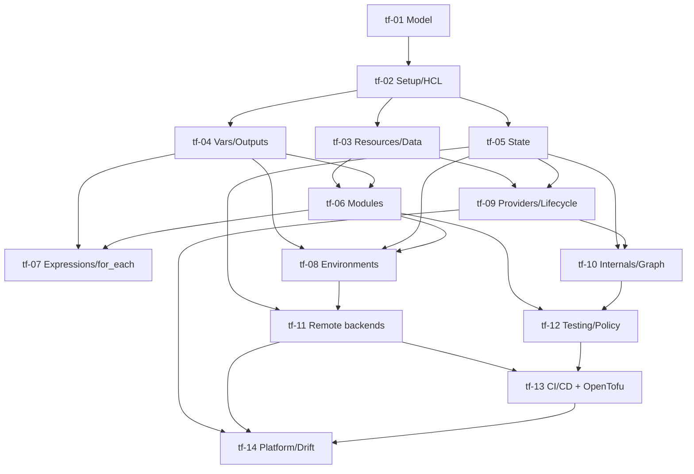

# Terraform — Roadmap detallado

IDs estables: `tf-<NN>-<slug>`.

Duración orientativa total: **55–80 h**.

Nota: todas las decisiones críticas se enseñan de modo que sean portables a **OpenTofu**; divergencias puntuales se tratan en `tf-13` y `tf-14`.

---

## Nivel 1 — Fundamentos

### tf-01-mental-model-and-plan-apply

- **Nivel:** fundamentos
- **Objetivo:** entender el ciclo declarativo (estado deseado + state real → plan → apply), antes de instalar nada.
- **Prerrequisitos:** nociones básicas cloud (T-7.1).
- **Temas:** IaC vs scripts imperativos; declarativo vs imperativo; qué es un "provider" conceptualmente; el ciclo `init → plan → apply → destroy`; qué es el state y por qué es necesario; "cloud desk" (consola) vs IaC; idempotencia; drift (concepto).
- **Fundamentos internos:** por qué una herramienta declarativa necesita state (porque la API no siempre expone de forma barata todo lo que creamos ni cómo lo mapeamos a nuestro código); por qué el plan muestra `+/-/~` y qué significan.
- **Competencias:** explicar el ciclo sin referirse a comandos.
- **Ejemplos:** `01-declarative-vs-imperative-pseudocode`, `02-plan-walkthrough-reading`.
- **Actividades:** `01-draw-the-cycle`, `02-why-do-we-need-state` (ejercicio conceptual).
- **Entregables:** diagrama y notas con el flujo.
- **Evaluación:** explicar qué es drift y por qué `apply` por sí solo no lo detecta todo.
- **Duración:** 2–3 h.

### tf-02-setup-hcl-first-provider

- **Nivel:** fundamentos
- **Objetivo:** instalar Terraform, aprender HCL básico y correr el ciclo contra un provider "seguro" (local/null/random/http).
- **Prerrequisitos:** `tf-01`.
- **Temas:** instalación (binario, `tfenv`/`asdf`); estructura mínima (`main.tf`, `versions.tf`, `providers.tf`); `required_providers` + lockfile `.terraform.lock.hcl`; `terraform init`, `fmt`, `validate`, `plan`, `apply`, `destroy`; sintaxis HCL (bloques, atributos, strings, heredocs, interpolación `${}`); provider `null`, `random`, `local`, `http`; `.gitignore` para `.terraform/`, `*.tfstate*`, `*.tfvars`.
- **Fundamentos internos:** qué hay en `.terraform/` tras `init`; qué fija el lockfile (versiones y hashes de providers); por qué `tfstate` nunca va a Git.
- **Competencias:** correr el ciclo completo en local sin tocar cloud.
- **Ejemplos:** `01-random-pet-and-local-file`, `02-lockfile-anatomy`.
- **Actividades:** `01-first-apply` (guiada), `02-break-and-fix-hcl-syntax`.
- **Entregables:** repo mínimo con `init/plan/apply` funcional sin cloud.
- **Evaluación:** explicar qué fija el lockfile y qué no.
- **Duración:** 3 h.

### tf-03-resources-data-sources-and-references

- **Nivel:** fundamentos
- **Objetivo:** modelar recursos reales con dependencias explícitas e implícitas.
- **Prerrequisitos:** `tf-02`.
- **Temas:** `resource` vs `data`; atributos de salida; referencias (`aws_instance.web.id`); dependencias implícitas (por referencia) vs `depends_on`; providers de ejemplo *didácticos sin coste*: `github`, `tls` (self-signed cert local), `docker` (contra daemon local); `terraform state list/show`.
- **Fundamentos internos:** cómo Terraform construye el grafo a partir de las referencias; por qué `depends_on` suele ser el último recurso, no el primero.
- **Competencias:** declarar recursos con dependencias correctas y leer el state resultante.
- **Ejemplos:** `01-github-repo-with-tls-key`, `02-docker-container-via-tf`.
- **Actividades:** `01-dependency-graph-exercise`, `02-force-depends-on-and-explain` (independiente).
- **Entregables:** stack local sin coste con 3+ recursos interrelacionados.
- **Evaluación:** diferenciar cuándo una dependencia es necesaria vs redundante.
- **Duración:** 4 h.

### tf-04-variables-outputs-locals

- **Nivel:** fundamentos
- **Objetivo:** parametrizar código y exponer resultados.
- **Prerrequisitos:** `tf-02`.
- **Temas:** `variable` con `type` (string, number, bool, list, map, set, object, tuple), `default`, `description`, `sensitive`, `validation`; precedence de valores (`-var`, `-var-file`, `TF_VAR_*`, `terraform.tfvars`, `*.auto.tfvars`); `locals`; `output` con `sensitive` y `description`; `terraform output` y consumo entre módulos/stacks.
- **Fundamentos internos:** `sensitive` oculta en CLI pero *sigue en state en claro*; por qué los secretos de verdad no deben vivir como variables de TF (van a sistemas de secretos y se referencian con `data`).
- **Competencias:** parametrizar correctamente; usar `validation` para fallar temprano.
- **Ejemplos:** `01-typed-variables-with-validation`, `02-outputs-and-sensitive`.
- **Actividades:** `01-parameterize-the-stack`, `02-why-sensitive-is-not-secret-management` (análisis).
- **Entregables:** mismo stack de `tf-03` parametrizado por ambiente.
- **Evaluación:** explicar la jerarquía de precedence y los límites de `sensitive`.
- **Duración:** 3 h.

### tf-05-state-basics

- **Nivel:** fundamentos
- **Objetivo:** entender el state como artefacto operacional de primer orden.
- **Prerrequisitos:** `tf-02`.
- **Temas:** formato del state (JSON versionado); `terraform state list/show/mv/rm`; backend local vs remote (introducción); por qué el state tiene **valores en claro**; locking (concepto, se profundiza en `tf-11`); `terraform refresh` (y por qué es implícito en `plan`); import conceptual.
- **Fundamentos internos:** el state almacena, por recurso, el *resultado real conocido* de la última lectura, incluyendo atributos computados (IDs, ARNs, keypairs, etc.); al editar `tf` tocas el *estado deseado*; al tocar la nube manualmente creas *drift*.
- **Competencias:** moverse por el state con precisión; evitar borrados accidentales.
- **Ejemplos:** `01-state-list-and-show`, `02-sensitive-in-state-demo`.
- **Actividades:** `01-rename-resource-with-state-mv`, `02-inspect-state-of-a-provisioned-stack` (independiente).
- **Entregables:** notas con `state show` de 2–3 recursos y análisis.
- **Evaluación:** por qué el state nunca va a Git y qué controles aplicar al backend remoto.
- **Duración:** 3 h.

---

## Nivel 2 — Intermedio

### tf-06-modules

- **Nivel:** intermedio
- **Objetivo:** encapsular y reutilizar configuración con módulos.
- **Prerrequisitos:** `tf-03`, `tf-04`.
- **Temas:** módulo local (`module "x" { source = "./modules/vpc" }`), módulos del Registry (`source = "terraform-aws-modules/vpc/aws"`), módulos de Git (`source = "git::https://..."`), versiones (`version = "~> 5.0"`); inputs (variables del módulo), outputs; composición de módulos (root module ↔ child modules); límites: nada de "mega-módulos" ni "módulos con un solo recurso".
- **Fundamentos internos:** el módulo es una unidad de encapsulación de HCL + variables + outputs; no es un paquete en sentido fuerte (no versiona su propio state); el root module es el único con backend y providers de verdad.
- **Competencias:** diseñar módulos pequeños, cohesivos y versionados; evaluar módulos de la comunidad antes de adoptarlos.
- **Ejemplos:** `01-local-module-s3-bucket-safe-defaults`, `02-registry-module-vpc`, `03-compose-modules`.
- **Actividades:** `01-write-your-first-module`, `02-adopt-and-evaluate-a-registry-module` (independiente).
- **Entregables:** módulo propio con README, variables documentadas, outputs y ejemplo de uso.
- **Evaluación:** criterios para aceptar o no un módulo de terceros.
- **Duración:** 5 h.

### tf-07-expressions-for_each-count-dynamic

- **Nivel:** intermedio
- **Objetivo:** dominar expresiones, loops y bloques dinámicos sin convertir HCL en código enredado.
- **Prerrequisitos:** `tf-04`, `tf-06`.
- **Temas:** operadores, funciones (`for`, `concat`, `merge`, `lookup`, `try`, `coalesce`, `jsonencode`, `templatefile`); `count` vs `for_each` (y por qué `for_each` casi siempre gana); `dynamic` blocks; splat expressions (`[*]`); conditionals (`condition ? a : b`); `terraform console` para experimentar.
- **Fundamentos internos:** `count` indexa por entero (reorganizaciones causan destroy+create); `for_each` indexa por clave estable (reorganizaciones son no-op); `dynamic` solo cambia la sintaxis — no cambia el grafo.
- **Competencias:** generar N recursos a partir de un mapa; refactorizar un `count` roto a `for_each`.
- **Ejemplos:** `01-for_each-map-of-users`, `02-dynamic-ingress-rules`, `03-count-to-for_each-migration`.
- **Actividades:** `01-iam-users-from-yaml`, `02-fix-count-reindex-drift` (independiente).
- **Entregables:** stack que genera un set de recursos a partir de un YAML/JSON de entrada.
- **Evaluación:** justificar `for_each` sobre `count` con un ejemplo donde `count` falla.
- **Duración:** 4 h.

### tf-08-environments-workspaces-vs-directories

- **Nivel:** intermedio
- **Objetivo:** modelar dev/stg/prod sin acoplar código con datos.
- **Prerrequisitos:** `tf-04`, `tf-05`, `tf-06`.
- **Temas:** workspaces de CLI (`terraform workspace new/select`) y su significado real (solo un prefijo en el state remoto, *no* aislamiento fuerte); patrón "directorios separados por ambiente"; patrón Terragrunt-like con módulos compartidos y HCL fino por ambiente; monorepo vs multi-repo de infra; evitar if-por-entorno dentro de módulos.
- **Fundamentos internos:** por qué los workspaces son útiles para feature environments efímeros pero problemáticos para separar prod del resto (mismo backend, mismas credenciales); por qué la separación física del backend por ambiente es la práctica más defensible.
- **Competencias:** elegir y aplicar el patrón adecuado para la organización; defenderlo.
- **Ejemplos:** `01-env-per-directory`, `02-workspaces-ephemeral-envs`.
- **Actividades:** `01-split-stack-into-three-envs`, `02-adr-env-strategy` (independiente).
- **Entregables:** ADR + stack dev/stg/prod en directorios separados con módulos compartidos.
- **Evaluación:** riesgos de usar un único workspace para "prod" y "stg".
- **Duración:** 4 h.

### tf-09-providers-deep-and-lifecycle

- **Nivel:** intermedio
- **Objetivo:** configurar providers con precisión y controlar el ciclo de vida de los recursos.
- **Prerrequisitos:** `tf-03`, `tf-05`.
- **Temas:** `provider "x" { ... }` con `alias` (ej. varias regiones); meta-arguments de recursos: `lifecycle { create_before_destroy, prevent_destroy, ignore_changes, replace_triggered_by }`; `provisioner` (y por qué son último recurso, no primero); `terraform taint` deprecado → `-replace`; `moved` blocks; introducción a `import` blocks (vs comando `terraform import`); `removed` blocks (nuevo).
- **Fundamentos internos:** `ignore_changes` ignora drift *en atributos específicos* del state (útil para campos modificados por otros sistemas, p. ej. tags inyectados por SCPs); `create_before_destroy` evita downtime pero obliga a que la unicidad del recurso no colisione.
- **Competencias:** evitar destroy+create accidentales; refactorizar nombres sin recrear recursos.
- **Ejemplos:** `01-create-before-destroy-lb`, `02-ignore-tags-managed-elsewhere`, `03-moved-block-refactor`.
- **Actividades:** `01-rename-resource-with-moved`, `02-import-block-vs-cli` (independiente).
- **Entregables:** refactor de un stack real sin recrear recursos.
- **Evaluación:** diagnosticar un plan que destruye un recurso de prod y proponer la corrección.
- **Duración:** 4 h.

---

## Nivel 3 — Avanzado

### tf-10-internals-graph-and-plan-algorithm

- **Nivel:** avanzado
- **Objetivo:** entender qué hace Terraform por dentro para poder razonar sobre plans sorprendentes.
- **Prerrequisitos:** `tf-05`, `tf-09`.
- **Temas:** `terraform graph` y lectura de DAGs; fase de *refresh* (consulta a providers para re-leer atributos); algoritmo del plan (comparación atributo por atributo); `-refresh-only`; `-target` (y por qué es un *escape hatch*, no una práctica); `terraform show -json` y análisis programático; plugin protocol gRPC (visión general).
- **Fundamentos internos:** por qué desactivar `refresh` acelera pero oculta drift; por qué `-target` fragmenta el plan y es peligroso en producción; cómo los providers *saben* si un atributo requiere `ForceNew` (recreación).
- **Competencias:** depurar un plan "raro"; usar `-refresh-only` para reconciliar drift.
- **Ejemplos:** `01-graph-visualization`, `02-plan-json-analysis`, `03-refresh-only-to-reconcile`.
- **Actividades:** `01-why-is-this-being-replaced`, `02-reconcile-drift-safely` (independiente).
- **Entregables:** writeup con interpretación de un plan complejo.
- **Evaluación:** explicar las fases del plan sin consultar docs.
- **Duración:** 4 h.

### tf-11-remote-backends-and-locking

- **Nivel:** avanzado
- **Objetivo:** operar state remoto con locking y colaboración en equipo.
- **Prerrequisitos:** `tf-05`, `tf-08`.
- **Temas:** backends soportados: `s3` (+ DynamoDB para lock, o lock nativo S3 reciente), `gcs`, `azurerm`, `http` (GitLab/GitHub managed state), `remote`/`cloud` (HCP Terraform / Terraform Cloud), `kubernetes` secret; encriptación at-rest; versionado del bucket; policies IAM mínimas para el backend; split de state por bounded context (reducir blast radius); state locking (qué pasa si `apply` muere con lock tomado).
- **Fundamentos internos:** por qué cada ambiente idealmente tiene su propio backend/bucket/key; por qué un state monolítico se vuelve ingobernable; cómo HCP Terraform / OpenTofu Cloud/estado remoto añaden gestión de runs, no solo state.
- **Competencias:** diseñar y bootstrap del backend; recuperar un lock colgado con criterio.
- **Ejemplos:** `01-s3-backend-with-dynamodb-lock`, `02-split-state-by-context`.
- **Actividades:** `01-bootstrap-remote-backend` (puede usar `localstack` o cuenta cloud real con costo marcado), `02-recover-stuck-lock` (independiente).
- **Entregables:** stack migrado de local a remoto con locking funcional y evidencia.
- **Evaluación:** diseñar la estrategia de splitting del state para una org con 50 microservicios.
- **Duración:** 5 h.

### tf-12-testing-and-policy-as-code

- **Nivel:** avanzado
- **Objetivo:** validar código, infraestructura y política antes de aplicar.
- **Prerrequisitos:** `tf-06`, `tf-10`.
- **Temas:** `terraform fmt`, `terraform validate`; **tflint** (reglas de provider y style); **Checkov**, **Trivy config**, **Terrascan** (misconfig scanning); `terraform test` nativo (archivos `*.tftest.hcl` con `run` blocks, assertions); **Terratest** (Go, para pruebas end-to-end reales); **policy-as-code**: **OPA/Rego** + **Conftest** sobre `terraform show -json`, **Sentinel** (comercial de HashiCorp); gates por ambiente.
- **Fundamentos internos:** diferencia entre análisis estático sobre HCL (checkov) y análisis sobre el plan JSON (más potente); `terraform test` es relativamente nuevo — puede evaluar módulos sin desplegar o con `command = apply`.
- **Competencias:** armar un pipeline de validación por capas; escribir policies Rego sobre un plan.
- **Ejemplos:** `01-tflint-and-fmt`, `02-checkov-baseline`, `03-conftest-rego-on-plan`, `04-terraform-test-module`.
- **Actividades:** `01-add-validation-pipeline-locally`, `02-write-rego-policy-no-public-s3` (independiente).
- **Entregables:** módulo con tests nativos + policy OPA aplicada a su plan.
- **Evaluación:** diseñar qué controles exigir en PR vs en merge vs en apply.
- **Duración:** 5 h.

---

## Nivel 4 — Producción empresarial

### tf-13-cicd-and-opentofu

- **Nivel:** producción
- **Objetivo:** operar Terraform desde CI/CD con credenciales efímeras, y evaluar OpenTofu como alternativa.
- **Prerrequisitos:** `tf-11`, `tf-12`, curso GitHub Actions ≥ `gha-11` (OIDC).
- **Temas:** patrón PR → `fmt`/`validate`/`plan` comentado en PR; merge → `apply` con approval (vía environment); OIDC a cloud (sin access keys); artefacto del plan (`terraform plan -out=plan.tfplan`) que se aplica tal cual; preservar coherencia versión-TF vía lockfile y `required_version`; **drift detection scheduled job** (`-refresh-only` + diff); **OpenTofu**: historia, licencia, instalación, compatibilidad del state y providers, divergencias actuales (p. ej. state encryption nativa, `removed` block más agresivo, provider-defined functions), criterio de migración.
- **Fundamentos internos:** por qué el plan guardado se aplica tal cual (evita TOCTOU entre plan y apply); por qué compartir credenciales en runners self-hosted compartidos es peligroso (prefiere OIDC + runners efímeros).
- **Competencias:** armar el pipeline completo; decidir TF vs OpenTofu con criterio.
- **Ejemplos:** `01-ghactions-plan-on-pr`, `02-apply-on-merge-with-environment`, `03-opentofu-migration-smoke-test`.
- **Actividades:** `01-full-cicd-tf`, `02-opentofu-eval` (independiente, ADR).
- **Entregables:** pipeline funcional PR→plan, merge→apply + ADR Terraform vs OpenTofu.
- **Evaluación:** justificar la elección (TF/OpenTofu) a nivel de organización.
- **Duración:** 6 h.

### tf-14-platform-patterns-drift-and-refactoring-at-scale

- **Nivel:** producción
- **Objetivo:** operar Terraform como plataforma: módulos "golden", gestión de drift y refactorings a escala.
- **Prerrequisitos:** `tf-09`, `tf-11`, `tf-12`, `tf-13`.
- **Temas:** **module registry interno** (self-hosted, Git, Artifactory); SemVer de módulos; "golden path" por tipo de workload (p. ej. "microservicio EKS"); templates/scaffolds (p. ej. `cookiecutter`, Backstage templates); **drift detection** continuo y respuesta operativa (reconcile vs adoptar vs revertir); **import blocks** masivos para bootstrap de infra existente; `moved` + `removed` para refactorings sin impacto; estrategia de upgrade entre majors de providers; policy-as-code a escala (biblioteca Rego); gobernanza (quién puede aprobar apply en prod).
- **Fundamentos internos:** por qué un módulo "golden" debe ser *opinionado* pero mínimo (si abstrae todo se vuelve inflexible; si abstrae poco, no agrega valor); por qué el drift sistemático suele indicar un gap organizacional, no una limitación de TF.
- **Competencias:** diseñar el contrato de plataforma IaC de una org.
- **Ejemplos:** `01-internal-module-registry-via-git-tags`, `02-import-blocks-for-legacy-adoption`, `03-moved-and-removed-refactor`.
- **Actividades:** `01-adopt-legacy-infra-via-import`, `02-platform-contract-adr` (independiente).
- **Entregables:** módulo golden versionado + ADR de contrato de plataforma + ejercicio de adopción.
- **Evaluación:** defender el contrato ante trade-offs de autonomía dev vs control de seguridad.
- **Duración:** 6 h.

---

## Dependencias entre módulos

## Checklist de verificación requerida en Fase 4

- Versión estable actual de Terraform y de OpenTofu; features divergentes al momento de desarrollar el módulo (state encryption, `removed`, provider-defined functions).
- Estado y recomendación oficial de **S3 native locking** vs **DynamoDB** para `s3` backend.
- Estado y UX actual de `import` blocks y `moved`/`removed` blocks.
- Estado y UX de `terraform test` nativo (sintaxis puede evolucionar).
- Compatibilidad actual del Registry (TF Registry vs OpenTofu Registry) y comportamiento del lockfile cross-tool.
- Estado del provider AWS (major vigente) y breaking changes recientes relevantes (p. ej. `aws_s3_bucket_*` recursos split).
- Comandos vigentes de `tflint`, `checkov`, `conftest`.
- Estado del soporte oficial de `kubernetes` backend (está marcado como no recomendado en algunas eras).
