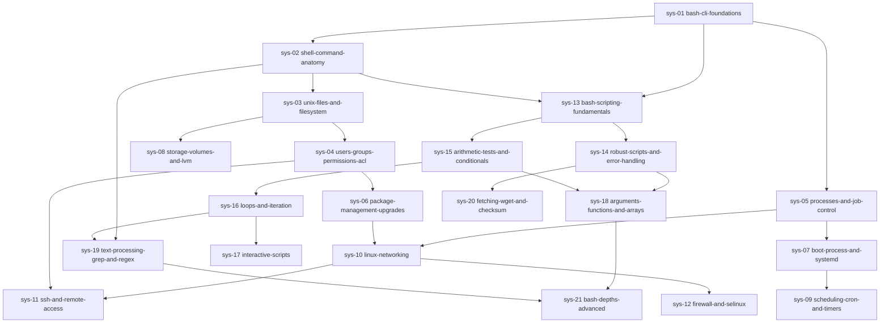

# ROADMAP — 00-Sysadmin

> 21 módulos, 4 niveles, DAG explícito. IDs estables `sys-NN-slug` para citar desde otros cursos.

Cada módulo documenta: **ID · Nivel · Objetivo · Prerrequisitos · Temas · Internals · Competencias (C/O/A) · Ejemplos · Actividades · Entregables · Criterios · Duración**.

---

## Nivel 1 — Fundamentos de línea de comandos

### `sys-01-bash-cli-foundations`
- **Nivel:** fundamentos — **Duración:** 4 h
- **Prerrequisitos:** ninguno
- **Objetivo:** operar la shell interactivamente — moverse por el filesystem, gestionar archivos, redirigir I/O, encadenar comandos con pipes y controlar el entorno mediante variables.
- **Temas:**
  - Qué es una shell, qué es Bash, diferencia con `sh`.
  - Prompt (`PS1`), historial (`history`, `!!`, `!$`, `Ctrl-R`), readline.
  - Navegación: `pwd`, `cd`, `pushd`/`popd`, `~`, `-`.
  - Gestión de archivos: `ls`, `cp`, `mv`, `rm`, `mkdir`, `touch`, `ln`, `stat`.
  - Standard I/O: `stdin` (0), `stdout` (1), `stderr` (2).
  - Redirección: `>`, `>>`, `<`, `2>`, `2>&1`, `&>`, `<<<` (here-string), `<<EOF` (here-doc).
  - Pipes: `|`, `|&`, pipelines y `pipefail`.
  - `tee` para bifurcar flujos.
  - Variables de entorno vs. variables de shell: `export`, `env`, `set`, `unset`, `printenv`.
  - `PATH`, `HOME`, `PWD`, `OLDPWD`, `SHELL`, `LANG`/`LC_*`, `TERM`.
- **Internals:**
  - `fork()` + `execve()` detrás de cada comando externo.
  - Diferencia entre builtin, función, alias y binario externo (`type -a`, `command -V`).
  - File descriptors: tabla por proceso, herencia padre→hijo.
  - Ambiente del proceso: cómo `export` entra en `environ` y los hijos lo heredan.
- **Competencias:**
  - **Conceptual:** describe qué pasa cuando pulsas Enter sobre `ls -l | grep foo > out.txt 2>&1`.
  - **Operativa:** redirige, encadena y persiste salidas correctas incluyendo errores separados.
  - **Arquitectónica:** elige cuándo exportar una variable y cuándo mantenerla local al script.
- **Ejemplos:** `examples/01-prompt-and-readline/`, `examples/02-redirection-matrix/`.
- **Actividades:**
  - `01-cli-tour` (guided-lab, 45 min)
  - `02-io-redirection-dojo` (independent, 60 min)
- **Entregables:** `.bashrc` propio con prompt informativo, aliases útiles e `HISTCONTROL` configurado.
- **Criterios:** uso correcto de `2>&1` vs `&>`; distinción export/local; sin `rm -rf` accidentales en ejemplos.

### `sys-02-shell-command-anatomy`
- **Nivel:** fundamentos — **Duración:** 3 h
- **Prerrequisitos:** `sys-01`
- **Objetivo:** descomponer cualquier línea de comandos en sus partes (comando · opciones cortas/largas · argumentos · separadores · operadores) y leer autónomamente la documentación.
- **Temas:**
  - Anatomía: `cmd [GLOBAL_OPTS] subcmd [OPTS] [ARGS...]`.
  - Opciones cortas (`-l`), largas (`--long`), agrupadas (`-la`), con valor (`-oValue`, `--opt=value`).
  - Argumentos posicionales, `--` separador, flags booleanos.
  - Separadores y operadores: `;`, `&&`, `||`, `&`, `|`, `(…)`, `{…;}`.
  - Fuentes de documentación: `--help`, `man`, `info`, `tldr`, `apropos`, `whatis`.
  - Secciones de manpages (1 user, 2 syscalls, 3 libc, 5 formats, 7 miscellanea, 8 admin).
  - Categorización canónica de comandos:
    - **Navegación/FS** (`cd`, `ls`, `find`, `tree`, `stat`)
    - **Manipulación de archivos** (`cp`, `mv`, `rm`, `install`, `ln`, `rsync`)
    - **Lectura y vista** (`cat`, `less`, `head`, `tail`, `nl`, `od`, `xxd`)
    - **Edición en flujo** (`sed`, `awk`, `tr`, `cut`, `paste`, `sort`, `uniq`, `wc`)
    - **Búsqueda** (`grep`, `find`, `locate`, `which`, `fd`)
    - **Procesos** (`ps`, `top`, `htop`, `kill`, `jobs`, `nice`)
    - **Red** (`ss`, `ip`, `curl`, `wget`, `dig`, `host`)
    - **Usuarios/permisos** (`id`, `whoami`, `chmod`, `chown`, `sudo`)
    - **Paquetes** (`apt`, `dnf`, `pacman`, `apk`)
    - **Servicios** (`systemctl`, `journalctl`)
    - **Disco** (`df`, `du`, `lsblk`, `mount`)
    - **Archivadores/compresión** (`tar`, `gzip`, `xz`, `zstd`, `zip`)
    - **Checksums/firma** (`sha256sum`, `md5sum`, `gpg`)
    - **Shell meta** (`type`, `command`, `builtin`, `alias`, `help`).
- **Internals:** cómo Bash parsea una línea (tokenización → expansión → ejecución); dónde se buscan los comandos (`PATH`, hash table `hash -l`).
- **Competencias:**
  - **Conceptual:** distingue `tar -xzf` de `tar xzf`, de `tar --extract --gzip --file`.
  - **Operativa:** encuentra en < 30 s el flag que necesita en `man` + `/`.
  - **Arquitectónica:** reconoce patrones de CLI consistentes (POSIX `getopt(3)`, GNU `argp`, cobra en Go) y los imita en los propios scripts.
- **Ejemplos:** `examples/01-same-tar-many-ways/`, `examples/02-man-section-tour/`.
- **Actividades:**
  - `01-categorize-the-coreutils` (independent, 45 min) — clasifica 40 comandos.
  - `02-manpage-scavenger-hunt` (challenge, 45 min).
- **Entregables:** tabla personal de 40 comandos categorizados con una línea de uso.
- **Criterios:** categorización coherente, lectura de manpages verificada por preguntas específicas.

### `sys-03-unix-files-and-filesystem`
- **Nivel:** fundamentos — **Duración:** 4 h
- **Prerrequisitos:** `sys-01`, `sys-02`
- **Objetivo:** entender que en Unix *todo es un archivo* — regulares, directorios, enlaces, dispositivos, sockets, pipes — y navegar el layout estándar.
- **Temas:**
  - Tipos de archivos: regular (`-`), directorio (`d`), symlink (`l`), block (`b`), char (`c`), FIFO (`p`), socket (`s`).
  - Inodos, dentries, hardlinks vs. symlinks, `stat`, `ln`, `readlink`.
  - FHS 3.0: `/`, `/etc`, `/var`, `/usr`, `/opt`, `/home`, `/run`, `/tmp`, `/proc`, `/sys`, `/dev`.
  - `/proc` y `/sys`: pseudo-FS, cómo exponen procesos y kernel.
  - `find` con `-type`, `-name`, `-mtime`, `-size`, `-exec`, `-print0`.
  - Nombres de archivo "problemáticos": espacios, newlines, unicode, bytes inválidos; `-print0 | xargs -0`.
  - `locate`/`mlocate` vs. `find`.
- **Internals:** VFS, mount points, superblock, estructura de ext4/xfs/btrfs (visión general).
- **Competencias:**
  - **Conceptual:** explica por qué `rm` en un directorio no borra el inodo si quedan hardlinks.
  - **Operativa:** encuentra, con `find`, los 10 archivos más grandes modificados en los últimos 7 días.
  - **Arquitectónica:** elige dónde colocar un artefacto según FHS (binario propio en `/usr/local/bin`, estado mutable en `/var/lib/<app>`, logs en `/var/log`).
- **Ejemplos:** `examples/01-inodes-and-links/`, `examples/02-proc-tour/`.
- **Actividades:**
  - `01-fhs-treasure-hunt` (guided-lab, 60 min).
  - `02-safe-find-xargs` (independent, 45 min).
- **Entregables:** script `find-biggest.sh` seguro ante nombres raros.
- **Criterios:** usa `-print0 | xargs -0`; respeta FHS en el entregable.

---

## Nivel 2 — Administración de sistemas Linux

### `sys-04-users-groups-permissions-acl`
- **Nivel:** intermedio — **Duración:** 4 h
- **Prerrequisitos:** `sys-03`
- **Objetivo:** modelar quién puede hacer qué sobre qué, combinando DAC clásico + ACL POSIX + sudoers.
- **Temas:** `/etc/passwd`, `/etc/shadow`, `/etc/group`, UID/GID, usuarios de sistema vs. humanos, `useradd`/`usermod`/`userdel`, `groupadd`, `passwd`, `chage`. Permisos `rwx` + ejecución en dirs, bits `setuid`/`setgid`/`sticky`, `chmod` numérico y simbólico, `umask`, `chown`, `chgrp`. ACL POSIX: `getfacl`, `setfacl`, máscara. `sudo`, `/etc/sudoers`, `visudo`, `sudoers.d`, `NOPASSWD`, logging. Capabilities (`setcap`, `getcap`) como alternativa a `setuid`.
- **Internals:** cómo el kernel resuelve una `open()` contra DAC → ACL → MAC (SELinux cae en `sys-12`).
- **Competencias:**
  - **C:** explica por qué `rwxr-s---` en un directorio hace que archivos nuevos hereden el grupo.
  - **O:** crea usuario, lo añade a grupo `developers`, le da sudo sin password para `systemctl restart app.service` únicamente.
  - **A:** decide entre `setuid` binary vs. capability vs. sudoers para una tarea privilegiada.
- **Actividades:**
  - `01-user-model-for-a-team` (architecture, 60 min).
  - `02-sudoers-least-privilege` (debug, 45 min).
- **Entregables:** `users.yaml` declarativo + script idempotente que lo aplica.

### `sys-05-processes-and-job-control`
- **Nivel:** intermedio — **Duración:** 3 h
- **Prerrequisitos:** `sys-01`
- **Objetivo:** orquestar operaciones del sistema entendiendo procesos, señales y control de trabajos.
- **Temas:** proceso vs. programa, PID, PPID, PGID, SID; `ps -ef`, `ps auxf`, `pstree`, `top`/`htop`. Estados (`R`, `S`, `D`, `Z`, `T`). Señales: `SIGTERM`, `SIGKILL`, `SIGHUP`, `SIGINT`, `SIGSTOP`, `SIGCONT`, `SIGPIPE`; `kill`, `pkill`, `killall`. Job control: `&`, `jobs`, `fg`, `bg`, `Ctrl-Z`, `disown`, `nohup`. Prioridad: `nice`, `renice`, `ionice`. Límites: `ulimit`. `nohup` vs `setsid` vs. systemd service.
- **Internals:** `fork`/`exec`/`wait`, zombies y huérfanos, grupos de proceso, sesiones, terminales de control.
- **Competencias:**
  - **C:** explica por qué `Ctrl-C` manda SIGINT solo al foreground group.
  - **O:** mata limpiamente un proceso con graceful shutdown (TERM → esperar → KILL).
  - **A:** elige entre background job, `nohup`, `tmux`/`screen` o systemd unit según durabilidad.
- **Actividades:** `01-signals-dojo` (guided-lab, 45 min), `02-tame-runaway-process` (debug, 45 min).

### `sys-06-package-management-upgrades`
- **Nivel:** intermedio — **Duración:** 3 h
- **Prerrequisitos:** `sys-04`
- **Objetivo:** instalar, actualizar y pinnear software en Debian/Ubuntu, RHEL-family y Alpine con mínima rotura.
- **Temas:** modelo deb (`apt`, `dpkg`, repos, PPAs), modelo rpm (`dnf`, `rpm`, repos, `module`, `dnf history`), Alpine (`apk`, `apk add --no-cache`). Firmas GPG de repositorios. Pinning y hold (`apt-mark hold`, `dnf versionlock`). Upgrades controlados: `apt upgrade` vs `apt full-upgrade`, `dnf upgrade --security`, `unattended-upgrades`, rollback con `dnf history undo`. Supply chain: por qué `curl … | sudo bash` es un anti-patrón.
- **Internals:** cómo se resuelven dependencias (SAT solver en dnf, algoritmo apt), transacciones atómicas.
- **Competencias:**
  - **C:** explica diferencia entre `upgrade` y `dist-upgrade`.
  - **O:** instala paquete fuera-de-distro con repo firmado y lo pinnea.
  - **A:** diseña ventana de upgrade con snapshot/rollback.
- **Actividades:** `01-add-third-party-repo-safely` (guided-lab), `02-rollback-a-bad-upgrade` (debug).

### `sys-07-boot-process-and-systemd`
- **Nivel:** intermedio — **Duración:** 4 h
- **Prerrequisitos:** `sys-05`
- **Objetivo:** entender el camino de arranque Linux moderno y gestionar servicios con systemd.
- **Temas:** BIOS/UEFI → bootloader (GRUB) → kernel → initramfs → `init` (PID 1 = systemd) → targets. Unidades systemd: `.service`, `.socket`, `.timer`, `.mount`, `.target`, `.path`, `.slice`. Dependencias (`Requires`, `Wants`, `After`, `Before`, `Conflicts`). `systemctl`, `journalctl -u`, `systemd-analyze blame`. Unit files en `/etc/systemd/system` vs. `/lib/systemd/system`; drop-ins `foo.service.d/*.conf`. User units (`systemctl --user`). `Restart=`, `RestartSec=`, `WatchdogSec=`.
- **Internals:** PID 1, cgroups v2 bajo systemd, delegation.
- **Competencias:**
  - **C:** lee `systemd-analyze critical-chain` y explica el camino.
  - **O:** convierte un script en una unit robusta con restart y log en journal.
  - **A:** decide socket activation vs. always-on.
- **Actividades:** `01-write-a-service-unit` (guided-lab), `02-debug-boot-regression` (debug).

### `sys-08-storage-volumes-and-lvm`
- **Nivel:** intermedio — **Duración:** 3 h
- **Prerrequisitos:** `sys-03`, `sys-04`
- **Objetivo:** gestionar discos, particiones, filesystems, mounts y LVM para crecer/encoger sin rehacer el sistema.
- **Temas:** discos (`/dev/sdX`, `/dev/nvme0n1`), particiones (`parted`, `fdisk`, GPT vs MBR), filesystems (ext4, xfs, btrfs — pros/contras). `mkfs`, `mount`, `umount`, `/etc/fstab`, `UUID=`, `systemd .mount` units, `findmnt`. LVM: PV → VG → LV; `pvcreate`, `vgcreate`, `lvcreate`, `lvextend`, `resize2fs`/`xfs_growfs`. Snapshots LVM. tmpfs, bind mounts.
- **Internals:** block layer, I/O schedulers (ligero), por qué xfs no se puede encoger.
- **Competencias:**
  - **C:** explica diferencias ext4/xfs/btrfs.
  - **O:** amplía un LV en caliente y crece el filesystem.
  - **A:** diseña layout LVM separando `/`, `/var`, `/home`.
- **Actividades:** `01-grow-a-filesystem-online` (guided-lab), `02-lvm-snapshot-and-rollback` (independent).

### `sys-09-scheduling-cron-and-timers`
- **Nivel:** intermedio — **Duración:** 2 h
- **Prerrequisitos:** `sys-07`
- **Objetivo:** programar trabajos recurrentes de forma reproducible y observable.
- **Temas:** `cron` clásico: `crontab -e`, `/etc/cron.*`, formato de 5 campos, `MAILTO`, `PATH`, timezone. `anacron`. `at` para one-shot. systemd timers: `OnCalendar=`, `OnBootSec=`, `Persistent=`, parejas `.timer` + `.service`. Comparativa cron vs timer: logging unificado en journal, dependencias, randomized delay, ejecución exacta.
- **Internals:** quién corre el job y con qué entorno (es la causa #1 de bugs "funciona en mi shell").
- **Competencias:**
  - **O:** porta un cron a timer con logging centralizado.
  - **A:** decide cron vs timer vs. app con scheduler propio.
- **Actividades:** `01-cron-to-timer-migration` (guided-lab), `02-make-a-scheduled-backup` (mini-project).

---

## Nivel 3 — Red, acceso remoto y seguridad base

### `sys-10-linux-networking`
- **Nivel:** avanzado — **Duración:** 4 h
- **Prerrequisitos:** `sys-05`, `sys-06`
- **Objetivo:** inspeccionar y configurar los canales de comunicación de un host Linux moderno.
- **Temas:** modelo OSI resumido. Interfaces (`ip link`, `ip addr`), rutas (`ip route`), ARP (`ip neigh`). `/etc/hosts`, `/etc/resolv.conf`, `systemd-resolved`, `nsswitch.conf`. Configuración persistente: NetworkManager (`nmcli`), netplan (Ubuntu), `systemd-networkd`. Puertos: `ss -tulpn`. Conectividad: `ping`, `traceroute`, `mtr`, `dig`, `curl -v`, `openssl s_client`. Captura: `tcpdump -i … -nn`.
- **Internals:** netfilter chains (introductorio, se profundiza en `sys-12`), namespaces de red (toque).
- **Competencias:**
  - **O:** configura IP estática + DNS persistente.
  - **A:** diagnostica "no resuelve" vs "resuelve pero no conecta" vs "conecta pero timeout".
- **Actividades:** `01-static-ip-with-nmcli` (guided-lab), `02-network-triage` (debug).

### `sys-11-ssh-and-remote-access`
- **Nivel:** avanzado — **Duración:** 3 h
- **Prerrequisitos:** `sys-04`, `sys-10`
- **Objetivo:** operar máquinas remotas con SSH de forma segura y productiva.
- **Temas:** `ssh`, `sshd_config`, `~/.ssh/config` (Host, User, IdentityFile, ProxyJump). Autenticación por clave (ed25519 recomendado), `ssh-keygen`, `ssh-copy-id`, `authorized_keys` opciones (`from=`, `command=`, `no-pty`). `ssh-agent`, `AddKeysToAgent`, `UseKeychain` (macOS). Port forwarding `-L`, `-R`, `-D` (SOCKS). `scp`, `sftp`, `rsync -e ssh`. Bastion/jump hosts. Hardening sshd: `PermitRootLogin no`, `PasswordAuthentication no`, `AllowUsers`, puertos no estándar (y por qué no es seguridad real), `fail2ban`.
- **Internals:** handshake SSH, known_hosts y TOFU, agent forwarding (y por qué es peligroso).
- **Competencias:**
  - **C:** explica por qué agent forwarding en un bastion compartido es un riesgo.
  - **O:** publica una clave, se conecta via ProxyJump y abre un tunnel.
  - **A:** diseña modelo de acceso con bastion + CA SSH.
- **Actividades:** `01-ssh-config-pyramid` (guided-lab), `02-harden-sshd` (independent).

### `sys-12-firewall-and-selinux`
- **Nivel:** avanzado — **Duración:** 5 h
- **Prerrequisitos:** `sys-10`
- **Objetivo:** controlar el tráfico de red con nftables/firewalld/ufw y confinar procesos con SELinux.
- **Temas:**
  - Firewall: netfilter → iptables (legacy) → **nftables** (actual). Tablas, chains, rules. Frontends: `ufw` (Debian/Ubuntu), `firewalld` (RHEL). Zonas firewalld, servicios, ricos. Reglas INPUT/OUTPUT/FORWARD, estado `conntrack`, NAT básico.
  - SELinux: enforcing / permissive / disabled. Contextos (`ls -Z`, `ps -Z`), tipos, booleans (`getsebool`, `setsebool -P`). `audit2allow`, módulos de política. AppArmor como alternativa (Ubuntu).
- **Internals:** por qué cambiar un puerto de servicio típico (p. ej. nginx) falla con SELinux enforcing hasta que se añade el contexto.
- **Competencias:**
  - **C:** diferencia DAC vs MAC.
  - **O:** abre puerto 8443 en firewalld y permite a nginx bindearlo con SELinux enforcing.
  - **A:** decide SELinux enforcing vs permissive por fase del proyecto.
- **Actividades:** `01-nftables-first-ruleset` (guided-lab), `02-selinux-port-and-fcontext` (debug).

---

## Bash scripting (Nivel 2–3 paralelo)

### `sys-13-bash-scripting-fundamentals`
- **Nivel:** intermedio — **Duración:** 3 h
- **Prerrequisitos:** `sys-01`, `sys-02`
- **Objetivo:** pasar de comandos sueltos a un script reproducible usando variables para hacerlo dinámico.
- **Temas:** shebang, permisos de ejecución, `$0`, `$1..$9`, `${10}`. Variables de shell, comillas simples vs. dobles, expansión de parámetro `${var:-default}`, `${var:=default}`, `${var:?err}`, `${var:+alt}`. Interpolación segura, `printf` vs `echo`. Comentarios, estilo (Google Shell Style Guide).
- **Competencias:**
  - **C:** explica qué pasa sin comillas con `rm $file` cuando `file="a b"`.
  - **O:** convierte un one-liner en script parametrizado.
- **Actividades:** `01-first-parameterized-script` (guided-lab), `02-quoting-dojo` (independent).

### `sys-14-robust-scripts-and-error-handling`
- **Nivel:** intermedio — **Duración:** 3 h
- **Prerrequisitos:** `sys-13`
- **Objetivo:** construir scripts que fallan temprano, claro y limpiamente.
- **Temas:** `set -e`, `set -u`, `set -o pipefail`, `set -x` para debug. Límites de `set -e` (lo que **no** aborta). `trap` para cleanup y señales (`EXIT`, `ERR`, `INT`, `TERM`). Idempotencia. Lock files (`flock`, `mkdir`). Logging a stderr vs stdout, niveles (INFO/WARN/ERROR). Exit codes semánticos. shellcheck como gate de calidad.
- **Actividades:** `01-trap-and-lock` (guided-lab), `02-shellcheck-cleanup` (debug).

### `sys-15-arithmetic-tests-and-conditionals`
- **Nivel:** intermedio — **Duración:** 3 h
- **Prerrequisitos:** `sys-13`
- **Objetivo:** usar variables numéricas, operadores aritméticos y la cláusula `if` con los operadores de test correctos.
- **Temas:** variables numéricas, `declare -i`. Aritmética: `$(( ))`, `(( ))`, `let`, `expr` (legacy), `bc` para floats. Operadores (`+ - * / % ** < > <= >= == != && ||`). Tests: `[` (test), `[[ ]]` (bash), `test`. Operadores de archivo (`-f`, `-d`, `-r`, `-w`, `-x`, `-s`, `-e`, `-h`), de string (`-z`, `-n`, `=`, `!=`, `=~` regex), numéricos (`-eq`, `-ne`, `-lt`, `-le`, `-gt`, `-ge`). `if`/`elif`/`else`/`fi`, `case ... esac` con patterns.
- **Internals:** por qué `[[ ]]` no splittea y `[ ]` sí.
- **Actividades:** `01-choose-the-right-test` (independent), `02-arithmetic-report` (guided-lab).

### `sys-16-loops-and-iteration`
- **Nivel:** intermedio — **Duración:** 3 h
- **Prerrequisitos:** `sys-15`
- **Objetivo:** recorrer secuencias de datos de manera correcta y eficiente.
- **Temas:** `for i in …`, `for ((i=0;i<n;i++))`, `while`, `until`. Iterar sobre archivos (patrón `while IFS= read -r line`), por qué `for f in $(ls)` está mal. `continue`, `break`, bucles anidados. Lectura línea a línea de un archivo o pipe, lectura de null-terminated (`-d ''`). Acceso a datos externos: `curl`/`wget`, parsing con `jq` (toque).
- **Actividades:** `01-safe-file-iteration` (guided-lab), `02-bulk-rename` (independent).

### `sys-17-interactive-scripts-select-dialog-zenity`
- **Nivel:** intermedio — **Duración:** 3 h
- **Prerrequisitos:** `sys-16`
- **Objetivo:** construir scripts que interactúan con un operador humano.
- **Temas:** `read`, `read -p`, `read -s` (passwords), `read -t` (timeout), `read -a`. Builtin `select` para menús TUI puros. `dialog` / `whiptail` (ncurses). `zenity` (GTK, para contextos con DE). Confirmaciones (y/N), menús, inputs, progress bars.
- **Competencias:**
  - **A:** decide cuándo interactivo y cuándo exigir flags (CI vs ops puntual).
- **Actividades:** `01-select-menu-runbook` (guided-lab), `02-dialog-based-installer` (mini-project).

### `sys-18-arguments-functions-and-arrays`
- **Nivel:** intermedio — **Duración:** 4 h
- **Prerrequisitos:** `sys-14`, `sys-15`
- **Objetivo:** estructurar scripts de ≥ 300 líneas con argumentos parseados, funciones reusables y arrays.
- **Temas:** `$@` vs `$*`, `$#`, `shift`, `--` separador. `getopts` (POSIX, cortas) y `getopt` (GNU, largas). Patterns de `--help`/`--version`. Funciones: declaración, scope, `local`, retornos (`return` solo 0-255), captura con `$(func)`. Arrays indexados `arr=(a b c)`, `${arr[@]}`, `${#arr[@]}`, `${arr[*]}`, slicing. Arrays asociativos `declare -A`, iteración por `keys`. Paso de arrays a funciones (nameref `declare -n` o referencia).
- **Actividades:** `01-cli-with-getopts` (guided-lab), `02-refactor-to-functions` (independent).

---

## Nivel 4 — Producción y profundidad

### `sys-19-text-processing-grep-and-regex`
- **Nivel:** avanzado — **Duración:** 4 h
- **Prerrequisitos:** `sys-02`, `sys-16`
- **Objetivo:** filtrar datos de texto a escala con `grep` + expresiones regulares, y complementar con `sed`/`awk`/`cut`.
- **Temas:** familias de regex: BRE, ERE, PCRE. `grep`, `egrep` (`grep -E`), `grep -P`, flags clave (`-i`, `-v`, `-n`, `-r`, `-l`, `-c`, `-o`, `-A`/`-B`/`-C`, `-f file`, `-F` fixed). Anclas, clases, cuantificadores, grupos, backreferences. `sed` para sustituciones (`s/a/b/g`), `-i` in-place y por qué es peligroso. `awk` para columnas (`{print $2, $NF}`) y agregaciones. `cut`, `tr`, `sort`, `uniq -c`, `wc`, `paste`.
- **Competencias:**
  - **C:** diferencia BRE/ERE/PCRE y cuándo pasar `-E` o `-P`.
  - **A:** elige grep vs sed vs awk vs script en Python según complejidad.
- **Actividades:** `01-log-triage-with-grep` (guided-lab), `02-regex-pattern-dojo` (independent).

### `sys-20-fetching-wget-and-checksum-integrity`
- **Nivel:** avanzado — **Duración:** 2 h
- **Prerrequisitos:** `sys-14`
- **Objetivo:** descargar artefactos de internet de forma reproducible, resiliente y verificable.
- **Temas:** `wget` vs `curl` (cuándo cada uno). Flags clave `wget`: `-c` (continue), `-O` (output), `--tries`, `--timeout`, `--retry-connrefused`, `--no-check-certificate` (y por qué casi nunca). Mirrors con `-m`. Verificación: `sha256sum --check`, `sha512sum`, cómo publicar un `SHA256SUMS` propio. Firma: `gpg --verify foo.tar.gz.asc foo.tar.gz`, trust model, por qué firma + checksum. Supply chain: `curl … | bash` revisited.
- **Competencias:**
  - **O:** script que descarga, verifica checksum y firma, aborta si cualquiera falla.
- **Actividades:** `01-wget-with-retries` (guided-lab), `02-verified-download-pipeline` (mini-project).

### `sys-21-bash-depths-advanced`
- **Nivel:** avanzado — **Duración:** 4 h
- **Prerrequisitos:** `sys-18`, `sys-19`
- **Objetivo:** dominar la mecánica interna de Bash para resolver casos avanzados sin reescribir en otro lenguaje.
- **Temas:** orden de expansión (brace → tilde → parameter/arithmetic → command substitution → word splitting → pathname). Globbing: `shopt -s nullglob globstar extglob dotglob failglob`. Parameter expansion avanzada: `${var#pat}`, `${var##pat}`, `${var%pat}`, `${var%%pat}`, `${var/pat/rep}`, `${var//pat/rep}`, `${var^^}`, `${var,,}`. Process substitution `<(cmd)`, `>(cmd)`. Coprocesos (`coproc`). FDs explícitos `exec 3>file`, `{fd}<file`. Named pipes (`mkfifo`). `IFS`. `trap … DEBUG`, `trap … RETURN`. `BASH_SOURCE`, `BASH_LINENO`, `FUNCNAME`. Readonly `declare -r`, `declare -x`, `declare -A`. Portabilidad: cuándo `#!/bin/sh` y cuándo `#!/usr/bin/env bash`; qué pierdes.
- **Competencias:**
  - **C:** predice el resultado de una expansión compleja sin ejecutarla.
  - **O:** usa process substitution para comparar salidas de dos comandos sin archivos temporales.
  - **A:** decide quedarse en Bash vs. reescribir en Python según complejidad y mantenibilidad.
- **Actividades:** `01-expansion-oracle` (independent), `02-replace-tempfiles-with-procsub` (debug).

---

## Diagrama Mermaid de dependencias

---

## Checklist de verificación (Fase 4)

Antes de cada release del curso, verificar contra fuentes autoritativas:

- [ ] Bash 5.2+ sigue siendo el "current stable" en Debian stable, Ubuntu LTS, RHEL supported.
- [ ] `nftables` sigue siendo el backend por defecto; cualquier distro aún en `iptables-legacy` marcada en nota.
- [ ] `systemd` versión en Debian 13 / Ubuntu 26.04 LTS; flags nuevos (`WatchdogSec`, `SystemCallFilter`) sin deprecar.
- [ ] `cgroups v2` universal (ya lo es desde ~2022, confirmar).
- [ ] OpenSSH ≥ 9.x — `ssh-rsa` ya desactivado por defecto; `ed25519` recomendado.
- [ ] `wget` 1.21+ y `curl` 8.x — flags del material siguen válidos.
- [ ] `shellcheck` versión y set de reglas.
- [ ] `GnuPG` modern defaults (ed25519 keys permitidas).
- [ ] FHS 3.0 sigue vigente (no hay 4.0 estable).
- [ ] XDG base dir spec sin cambios.
- [ ] AppArmor vs SELinux: estado actual en Ubuntu 24.04/26.04 (AppArmor por defecto) y en RHEL 10 (SELinux).
- [ ] NetworkManager vs netplan vs systemd-networkd: cuál es default en cada distro validada.
- [ ] `dnf5` como default en Fedora/RHEL recientes — actualizar comandos si procede.
- [ ] Checksums de artefactos descargados en labs (si se congelan versiones concretas).
