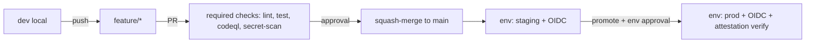

# Ejercicio arquitectónico — Hoja de respuesta del candidato

> Rellena esta plantilla usando el escenario de `scenario.md`.

## D1 — Modelo de ramificación

**Decisión:** `<trunk-based | GitHub Flow | GitLab Flow | GitFlow>`

**Justificación (3–6 líneas, contra cadencia 10–20 deploys/semana y freeze fin de semana):**

```text
<...>
```

## D2 — Estrategia de merge

**Decisión:** `<squash | rebase | merge-commit>`

**Justificación contra bisect, legibilidad y trazabilidad SOC 2:**

```text
<...>
```

## D3 — Gobernanza del repo

### Rulesets

| Regla | Target | Bypass | Riesgo que mitiga |
|-------|--------|--------|-------------------|
| ... | main | ... | ... |

### CODEOWNERS (resumen)

```text
/infra/     @finpay/platform
/security/  @finpay/security
*           @finpay/engineers
```

### Environments

| Env | Required reviewers | Wait timer | Secrets scope |
|-----|--------------------|------------|---------------|
| staging | ... | ... | ... |
| prod | ... | ... | ... |

### Política de bypass

```text
<...>
```

## D4 — OIDC a AWS

**Trust policy (`sub` claim exacto):**

```json
{
  "Condition": {
    "StringEquals": {
      "token.actions.githubusercontent.com:sub": "repo:finpay/api:environment:prod"
    }
  }
}
```

**¿Un role por environment o global? ¿Qué pasa si alguien crea una rama `main-admin`?**

```text
<...>
```

## D5 — Supply chain priorizado

| Prioridad | Control | Amenaza que mitiga (del modelo) | Costo |
|-----------|---------|---------------------------------|-------|
| 1 | ... | ... | ... |
| 2 | ... | ... | ... |
| ... |

**Control descartado explícitamente:**

```text
<cuál y por qué (costo > beneficio)>
```

## Trade-offs transversales

| Decisión | Blast radius credencial | Velocidad integración | Costo auditoría | Blast radius commit malicioso |
|----------|-------------------------|------------------------|-----------------|-------------------------------|
| D1 | ... | ... | ... | ... |
| D2 | ... | ... | ... | ... |
| D3 | ... | ... | ... | ... |
| D4 | ... | ... | ... | ... |
| D5 | ... | ... | ... | ... |

## ADR — [título de la decisión más controvertida]

### Contexto

```text
<...>
```

### Decisión

```text
<...>
```

### Consecuencias

```text
<...>
```

### Alternativas rechazadas

```text
- <alternativa>: por qué no.
- <alternativa>: por qué no.
```

### Cuándo revisar esta decisión

```text
<métrica/evento que dispara revisión>
```

## Diagrama end-to-end



## Modelo de amenaza mínimo

| Amenaza | Probabilidad | Impacto | Control(es) que la mitigan |
|---------|--------------|---------|-----------------------------|
| 1. Commit malicioso de insider | ... | ... | ... |
| 2. Dependencia comprometida (typo-squat/supply chain) | ... | ... | ... |
| 3. Secreto filtrado accidentalmente | ... | ... | ... |
